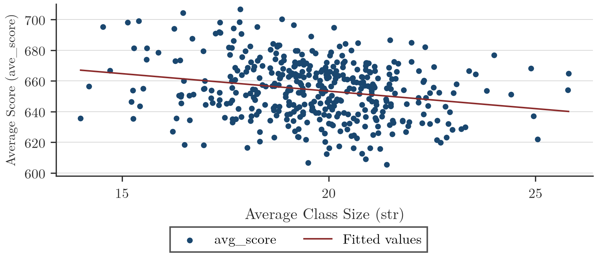
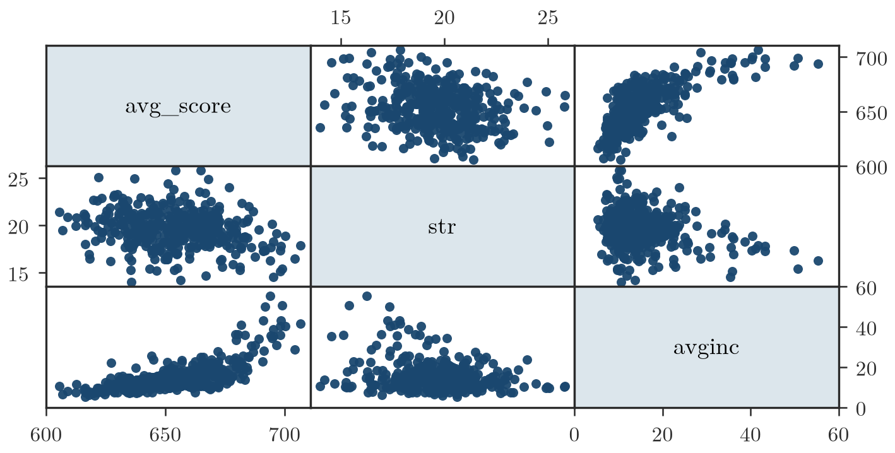
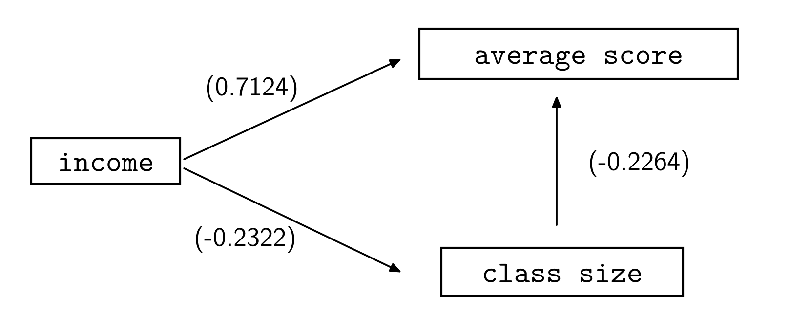
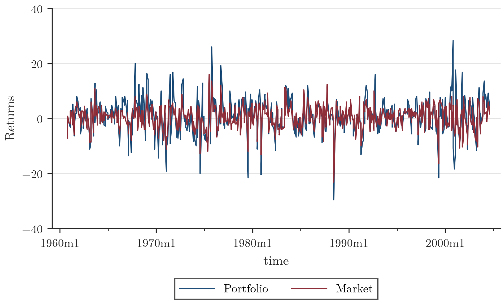
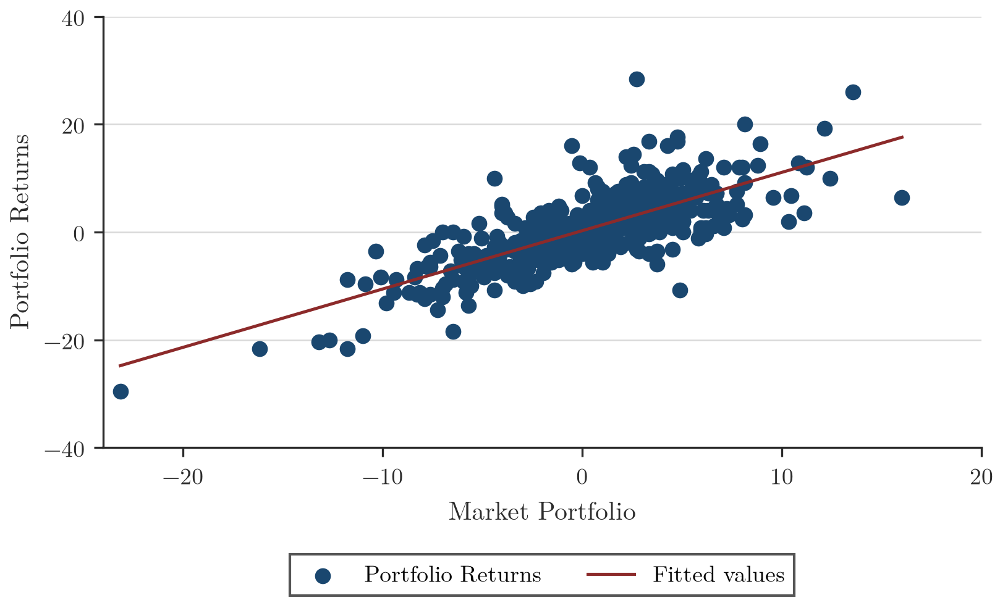

## Informazioni generali sul corso

L'impostazione è più intuitiva che tecnica e si concentra sull'interpretazione economica: interessa soprattutto ciò che non si deve fare, per riconoscere un modello inadeguato, più che l'esecuzione dei calcoli. La scelta del modello e delle variabili conta più della metodologia con cui si eseguono poi i calcoli.

**Programma**
- Elementi fondamentali dell'analisi di regressione con dati cross section:
  - il modello di regressione semplice con un regressore;
  - sistemi d'ipotesi ed intervalli di confidenza;
  - il modello di regressione multipla;
  - omoschedasticità ed eteroschedasticità.
- Regressioni con serie storiche:
  - modelli dinamici;
  - dati stazionari e non stazionari;
  - modelli autoregressivi ed a media mobile;
  - regressioni spurie e test di stazionarietà;
  - cointegrazione (approccio di Engle-Granger).
- Applicazioni con il software Gretl (https://gretl.sourceforge.net/).

La prima parte riguarda ciò che non va considerato nell'output di una regressione e ciò che non va fatto quando i dati sono indipendenti. La seconda mostra che cosa cambia in presenza di dipendenza temporale e quali modelli sfruttano l'inerzia delle serie. I modelli a correzione d'equilibrio sono l'ultimo argomento.

Le applicazioni con Gretl comprendono anche una componente di interpretazione: il riscalamento delle variabili con trasformazioni come il logaritmo, l'interpretazione degli effetti marginali e la diagnosi della quasi collinearità, che si basa sul *variance inflation factor* (VIF). La collinearità esatta blocca il software, mentre quella quasi esatta non è facile da riconoscere: se non ci si accorge del problema, si crede che il modello dia risultati corretti.

Testo di riferimento: C. Hill, W. E. Griffiths e G. C. Lim, *Principi di econometria*, Zanichelli, 2013. I modelli di regressione sono trattati nei capitoli 2-8, le serie storiche nei capitoli 9, 10 e 12. Il testo riporta i dati degli esempi, anche in formato Excel, per replicare i calcoli.

## Cos'è l'econometria?

> [!abstract] Definizione
> Non esiste una definizione unica di **econometria**: una formulazione possibile è quella di un insieme di tecniche statistiche che hanno lo scopo di:
> - definire e misurare relazioni causali tra variabili economiche;
> - validare la credibilità di modelli economici teorici;
> - fare previsioni.

Se lo scopo del modello è la previsione, la relazione logica tra le variabili non è rilevante: la previsione è un esercizio statistico, per cui, se $x$ assume un certo livello, $y$ ne assume un altro. Per rifornire la catena di produzione della Nutella, ad esempio, interessa sapere che in un certo periodo dell'anno occorre acquistare 7 tonnellate di nocciole, non il motivo per cui il prodotto viene consumato. Se invece si vuole capire perché i consumatori comprano la Nutella, per esempio per decidere di cambiare la ricetta o il packaging, bisogna individuare i driver della variabile, e la sola associazione statistica non basta. L'attenzione si concentra su questo secondo scopo, perché il primo si ottiene in modo quasi automatico anche con un modello banale.

L'econometria è una disciplina ibrida: il confine con l'economia non è netto, mentre quello con la statistica lo è. Ciò che la separa dalla statistica è un'ipotesi aggiuntiva con un'importante implicazione economica, l'**ipotesi di esogeneità**, che si formalizza come assenza di correlazione tra una grandezza non osservata (l'errore del modello) e le grandezze osservate (le variabili esplicative). Se il modello è costruito senza rispettare i principi dell'economia, le stime sono sistematicamente distorte: la stima misura l'effetto della politica considerata sommato a un fattore di disturbo non eliminabile, e l'aumento del numero di osservazioni rende solo più precisa la stima sbagliata. Si finisce così per interpretare come effetto della politica la somma di più effetti collaterali, potenzialmente diversi da quello di interesse. Per lo stesso motivo conta la correttezza delle relazioni logiche tra le variabili, più della capacità del modello di approssimare i dati.

## Causalità: definizione e criteri

> [!abstract] Definizione
> Un legame causale tra due variabili $X$ e $Y$, indicato $X \to Y$, specifica che $X$ è una variabile esplicativa che ha impatto su $Y$: questa dipendenza non è simmetrica, cioè $Y$ non causa $X$.
>
> Si può parlare di **causalità** se i seguenti tre criteri valgono **contemporaneamente**:
> 1. **Associazione tra le variabili.**
> 2. **Un ordine logico/temporale**: la causa precede l'effetto (prima si implementa una politica, poi se ne misura l'impatto). Alcune variabili non possono essere conseguenza di una decisione (ad esempio il sesso, la razza, l'età) e per questo possono essere considerate cause. In altri casi non è facile capire quale sia la causa e quale l'effetto: ad esempio, nei periodi di alta disoccupazione i tassi di criminalità sembrano aumentare. La disoccupazione è una causa? Forse, ma potrebbe esserci **causalità inversa**: in aree ad alta criminalità le imprese potrebbero chiudere, aumentando la disoccupazione.
> 3. **L'esclusione di spiegazioni alternative.**

Il primo criterio è statistico: senza una relazione statistica, una variazione di $x$ non avrebbe alcun impatto su $y$ e il problema non si porrebbe. La correlazione, però, è simmetrica: quella tra $x$ e $y$ coincide con quella tra $y$ e $x$, quindi non indica la direzione del legame ma solo l'esistenza di un legame di qualche natura, non necessariamente logico. Per parlare di causalità servono ipotesi aggiuntive: un legame logico, e non solo statistico, in cui una variabile precede l'altra sul piano temporale e su quello logico, e una spiegazione del perché esista quel legame statistico. Una spiegazione plausibile non basta: deve essere unica.

## Esempio: consumo di caffè e probabilità d'infarto

> [!example] Esempio
> Alcuni studi epidemiologici hanno evidenziato un'associazione positiva tra la probabilità di avere un infarto (variabile $Y$) e il consumo di caffè (variabile $X$).
> - Un possibile link causale: bere caffè aumenta la pressione sanguigna, che è un fattore di rischio per questa patologia.
>
> Altri studi hanno mostrato che, una volta controllato per altri fattori (tipo di lavoro, residenza, genere, reddito, livello di stress), l'associazione condizionata si riduce a zero.
> - Questo fornisce una spiegazione alternativa: persone con lavori più stressanti bevono più caffè. È il lavoro stressante il fattore determinante per la probabilità di avere un infarto, e non il caffè.
>
> In pratica, in questo esempio (non supportato da analisi empiriche reali) esiste una variabile $Z$, lo stress, che ha un impatto congiunto su $X$ e $Y$. La relazione tra $X$ e $Y$ viene detta **spuria**, ed è indotta da $Z$: in questo caso la relazione spuria è indotta da una variabile omessa nello studio.

## Esempio: boy scout e criminalità

> [!example] Esempio
> Si vuole investigare la relazione tra l'essere stati boy scout ($S$) e la criminalità giovanile ($D$), nel senso che ci si aspetta che aver frequentato i boy scout riduca la probabilità di commettere crimini.
>
> Alcune evidenze empiriche (dati non reali) sono sintetizzate nella tabella seguente:
>
> **Tabella 1**: essere boy scout e crimine
>
> | Boy scout | Delinquency: Yes | Delinquency: No | Total |
> |---|---|---|---|
> | Yes | 36 (9%) | 364 (91%) | 400 |
> | No | 60 (15%) | 340 (85%) | 400 |
>
> L'evidenza empirica suggerisce una relazione negativa tra $S$ e $D$. Dal punto di vista logico questo legame sembra sensato, per cui $S \to D$: chi è stato boy scout è stato educato al rispetto di regole e principi ed è quindi meno incline a delinquere. Tuttavia non si può escludere che un criminale abbia evitato ambienti "virtuosi", per cui anche la relazione inversa ha senso logico, $D \to S$: chi è avverso alle regole difficilmente si iscrive a un ambiente che ne impone molte. Entrambe le spiegazioni sono ragionevoli e l'ordinamento logico non è chiaro, quindi non si può parlare di causalità.

Poiché la correlazione è simmetrica, i dati non permettono di scegliere tra le due letture. La situazione è un caso di *reverse causality* e rende problematica la stima di una relazione di causa ed effetto: prima ancora di costruire il modello occorre ragionare sui possibili legami logici tra le variabili.

## Causalità: l'impossibilità di dimostrarla e il ruolo della confutazione

In generale **non è possibile dimostrare l'esistenza di una relazione causale**, perché quasi mai si riesce a escludere tutte le altre possibili spiegazioni di un fenomeno: rispetto a un certo livello di associazione misurato, le spiegazioni alternative sono troppe per poterle controllare tutte.

Si possono però **confutare** ipotesi di causalità: se si confutano tutte le ipotesi tranne una, il legame può essere definito come nesso causale con ragionevole certezza.

Nella pratica, la costruzione di un modello richiede di chiarire perché lo si costruisce e perché si scelgono certe variabili, e di verificare poi che descriva le aspettative, per esempio che i coefficienti abbiano il segno atteso: un segno sbagliato può indicare che le correlazioni attese non sono stimate in modo corretto. Il modello proposto non è quello definitivo, perché è praticamente impossibile trovarne uno che risolva tutti i problemi: contribuisce al lavoro di altri che provano modelli alternativi, finché si raggiunge un consenso in cui le spiegazioni concorrenti sono state escluse.

L'ordine è sempre lo stesso: prima si individuano i potenziali driver sulla base della teoria, poi si inseriscono nel modello. Inserire tutte le variabili e selezionarle finché si ottengono segni soddisfacenti è un procedimento insufficiente: la teoria definisce a priori i legami logici, e la storia non può essere ricavata dalla correlazione.

## Esempio: fumo e cancro ai polmoni

> [!example] Esempio
> L'associazione tra fumo e probabilità di tumore è ampiamente documentata. È sintomo di legame causale?
> - Esiste una ricca letteratura epidemiologica che documenta la relazione tra le due variabili.
> - Esiste un legame logico sensato (il cancro si manifesta di solito dopo un consumo intensivo di sigarette).
> - Non sono state trovate, nella letteratura epidemiologica, spiegazioni alternative più convincenti. Esistono inoltre evidenze teoriche che spiegano il legame tra fumo e malattia.
>
> A differenza dei casi precedenti (caffè, boy scout), questo esempio soddisfa tutti e tre i criteri di causalità: associazione, ordine logico/temporale, esclusione di spiegazioni alternative.

Il nesso causale si è consolidato nel corso di decenni, non di settimane: sono state testate varie ipotesi e sono stati individuati meccanismi biologici per cui il consumo di sigarette può aumentare l'incidenza di certe malattie. Poiché potrebbero esistere meccanismi non ancora individuati, il risultato non è definitivo in senso assoluto: oggi si ritiene che la relazione causale esista, ma se la ricerca biologica individuasse un'alternativa più convincente la conclusione andrebbe riconsiderata. La procedura avanza per affinamenti successivi.

## Associazione non implica causalità

L'associazione tra variabili non è un criterio sufficiente per stabilire se un legame sia interpretabile come causale, e non è difficile trovare variabili fortemente associate ma non legate tra loro: come nell'esempio del caffè, l'associazione è in questi casi un legame spurio. Una raccolta (a scopo illustrativo) di associazioni spurie "divertenti" è disponibile su http://www.tylervigen.com/spurious-correlations. Nasce da un database di circa 10.000 variabili in cui un programma ha cercato le coppie più correlate possibili, senza considerare di quali variabili si trattasse. Due esempi:

- il numero di spettatori della serie televisiva *Big Bang Theory* e il numero di ricerche su Google che cominciano con «how to make»: le due serie sono quasi sovrapposte e l'$R^2$ della relazione è 96,5%;
- l'esito delle partite finali di lacrosse e i biglietti venduti al cinema negli Stati Uniti: la correlazione è elevata, dell'ordine del 74%.

Tra le variabili non c'è alcun legame logico. Dal punto di vista puramente previsivo si potrebbe usare una serie per prevedere l'altra, ma la correlazione non spiega perché una delle due si muova e quindi non permette alcuna analisi di scenario: se si trovasse una correlazione simile tra due variabili economiche senza rapporto reciproco, qualsiasi risultato di uno scenario sarebbe casuale e non replicabile. Una volta osservato un legame statistico, è quindi indispensabile spiegarlo dal punto di vista teorico e verificare che sia credibile anche sul piano logico.

L'$R^2$ non è un buon criterio per valutare un modello: indica che i dati sono ben approssimati, cioè che le due variabili si muovono insieme, non che il modello è logicamente corretto, che è ciò che si cerca. Anzi, i modelli buoni non hanno tipicamente un $R^2$ molto grande, e un $R^2$ molto elevato può nascere anche da un legame spurio, come negli esempi precedenti.

Un sistema di intelligenza artificiale interrogato sul perché due variabili abbiano una correlazione del 95% produce sempre una spiegazione, che abbia senso o no. In un caso riportato, un sistema attribuì il picco di una serie storica alla rivoluzione industriale di quegli anni, avvenuta invece circa un secolo prima o dopo. L'intelligenza artificiale può affinare l'intuizione, ma la verifica della coerenza logica resta a chi costruisce il modello.

## Tipi di dato

> [!abstract] Definizione
> - **Cross Section**: tipo di dati che fanno riferimento a osservazioni raccolte in un unico istante temporale su molti soggetti (individui, Paesi, imprese). Esempio: il database STAR, che raccoglie osservazioni su scuole, bambini e alcune loro caratteristiche.
> - **Serie storiche**: sequenze di osservazioni misurate sequenzialmente, spesso a intervalli regolari; il tempo definisce un ordine. Esempi: i prezzi di chiusura di un particolare asset finanziario, o il volume d'acqua orario di un fiume.
> - **Dati Panel** (o longitudinali): fanno riferimento a cross section sui medesimi individui, osservate nel tempo. Ogni osservazione è caratterizzata da una doppia dimensione, tempo e soggetto. Esempio: l'evoluzione dei prezzi di un campione di case in un intervallo temporale limitato.

## Esempio Cross Section: dimensione della classe e punteggio ai test

> [!example] Esempio
> Si pensa spesso che un basso rapporto studenti/insegnanti (*class size*) possa migliorare la performance degli alunni, intesa come risultato ai test di fine anno. L'intuizione è semplice: in classi più piccole l'insegnante dedica più tempo a ogni bambino e il lavoro è più focalizzato, con miglioramenti nelle capacità pratiche e astratte. In California, verso la fine degli anni '90, tutte le classi K-3 furono ridotte per ottenere un rapporto studenti/insegnanti pari a 20 (*Class Size Reduction Act*, CSR). La riduzione è costosa: servono più insegnanti e una riorganizzazione delle classi (con 100 bambini, classi da 10 anziché da 20 richiedono più classi, più computer e più attrezzatura), con un costo iniziale di 1.8 miliardi di dollari annui. Che un programma di questo tipo sia "utile" in senso più ampio è una questione più filosofica che statistica.
>
> La spesa ha senso se la dimensione della classe è in relazione causale con la performance dei bambini: serve un modello causale che stabilisca se sia un driver, non statistico ma logico, di tale performance. Ci si chiede quindi se la dimensione della classe sia l'unico (o il principale) fattore rilevante nello spiegare la variazione della performance attesa degli studenti, oppure se esistano ulteriori informazioni da considerare. Si vuole inoltre quantificare come una riduzione della dimensione della classe impatti sui voti degli alunni.
>
> I dati riguardano circa 420 distretti scolastici della California, ciascuno rappresentato da un punto dello scatterplot. La performance è misurata dal punteggio medio dei bambini del distretto in un test standardizzato, che valuta competenze di matematica, logica e lingua adatte all'età.
>
> 
>
> **Figura 1** — Scatterplot delle variabili rilevanti (Fonte: *California Standardized Testing and Reporting Survey*, year 1999). Lo scatterplot mette in relazione l'*Average Class Size* ($str$, asse orizzontale) con l'*Average Score* ($avg\_score$, asse verticale); la retta interpolante (*fitted values*) ha pendenza negativa: le classi più numerose sono associate a punteggi mediamente più bassi.
>
> Sembrerebbe quindi che ridurre il rapporto studenti/insegnanti sia rilevante. La correlazione tra le due variabili è $-0.2264$ e ha il segno della pendenza della retta di regressione, che vale $-2.28$. Il segno negativo soddisfa il primo criterio di causalità, l'associazione, senza che occorra stabilire se la correlazione sia piccola o grande. Il secondo criterio, un ordine logico e temporale, è soddisfatto in termini generali: prima viene implementata la policy, poi si valutano i benefici, e la maggiore attenzione dedicata a ciascun bambino offre una spiegazione logica del legame. La spiegazione è plausibile, anche se non è detto che sia corretta.
>
> Il terzo criterio richiede di poter escludere spiegazioni alternative più convincenti. Per stabilirlo si fanno altri esperimenti e si provano modelli alternativi. Una spiegazione esaustiva non si può trovare, perché non si possono costruire infiniti modelli che spieghino in modo alternativo la correlazione negativa: si considera una serie di alternative ragionevoli per verificare se la teoria resta la strategia migliore o se esiste un'alternativa superiore. Stimando la pendenza della retta si potrebbe valutare, per esempio, se la riduzione di un'unità della dimensione della classe produca un beneficio di 10 punti al test, che sono molti o pochi a seconda della scala del test. In questa fase il problema non è però quantificare gli effetti, ma capire se esistano modelli migliori, e questi possono passare per l'analisi congiunta di altre variabili.
>
> Un'analisi più dettagliata suggerisce una spiegazione alternativa. Il reddito medio ($avginc$) delle persone che vivono in ogni distretto scolastico è positivamente correlato con il punteggio $avg\_score$: distretti più ricchi tendono a essere associati a voti migliori. Esiste inoltre una dipendenza negativa tra $income$ e $class\ size$ ($str$): i distretti ad alto reddito sono associati a scuole in cui le classi sono mediamente più piccole. La matrice di correlazione si ottiene con il comando `correlate avg_score str avginc`:
>
> |            | avg_score | str     | avginc  |
> |------------|-----------|---------|---------|
> | avg_score  | 1.0000    |         |         |
> | str        | -0.2264   | 1.0000  |         |
> | avginc     | 0.7124    | -0.2322 | 1.0000  |
>
> 
>
> **Figura 2** — Scatterplot delle variabili a coppie. La matrice di scatterplot incrocia $avg\_score$, $str$ e $avginc$ a due a due e conferma visivamente le correlazioni riportate nella matrice di correlazione (in particolare la forte associazione positiva tra $avg\_score$ e $avginc$).
>
> Sulla base di questi risultati ci si chiede se sia il reddito la variabile rilevante per spiegare la performance, e non la dimensione della classe. Il reddito influisce su gran parte delle scelte, e i distretti ad alto reddito potrebbero avere performance migliori per due vie. Le famiglie possono permettersi di comprare più libri ai bambini, e questo può riflettersi in una migliore performance scolastica. Inoltre le scuole dei distretti ad alto reddito potrebbero essere mediamente migliori. Negli Stati Uniti il distretto di appartenenza conta: dove ci sono buone scuole pubbliche, la scuola privata costa decine di migliaia di dollari l'anno già dalle elementari, e chi non può permettersela vorrebbe una scuola pubblica, il cui livello è però abbastanza eterogeneo. Le scuole pubbliche molto buone si trovano in zone dove il prezzo delle case è estremamente più alto, per cui la scuola pubblica buona, che costa relativamente poco, è in un distretto ricco. Il reddito può dunque incidere sulla qualità della scuola, che a sua volta incide sui risultati dei bambini.
>
> Il reddito potrebbe così avere un effetto positivo sulla performance e un effetto negativo sulla dimensione della classe, perché le scuole migliori hanno già classi più piccole, magari perché hanno più insegnanti. Negli Stati Uniti il concetto di dimensione della classe è particolare: non ci sono necessariamente classi fisse, perché le classi si formano di volta in volta, e la dimensione è calcolata come rapporto studenti-insegnanti. Una scuola migliore può avere più insegnanti e altre caratteristiche favorevoli. Se esistono una relazione negativa tra reddito e dimensione della classe e una relazione positiva tra reddito e performance, la relazione negativa osservata tra le due variabili iniziali potrebbe passare per l'effetto del reddito.
>
> 
>
> **Figura 3** — Rappresentazione causale del nuovo modello (in parentesi le correlazioni): $income \to average\ score$ (0.7124), $income \to class\ size$ (-0.2322), $class\ size \to average\ score$ (-0.2264). Il diagramma mostra uno schema in cui il reddito ($income$) influisce sia sul punteggio medio sia sulla dimensione delle classi, e può quindi generare una correlazione osservata (ma potenzialmente spuria) tra $class\ size$ e $average\ score$.
>
> Questa evidenza suggerisce che la dipendenza negativa tra *class size* e *performance* potrebbe essere spuria, perché spiegabile dall'effetto reddito. La relazione causale più complessa offrirebbe una nuova spiegazione del fenomeno.
>
> Per escludere che il reddito sia il vero fattore determinante, si controlla per il reddito: il campione si divide in distretti ad alto reddito e distretti a basso reddito, e in ciascun sottocampione si calcola la correlazione tra *class size* e *test score*. Ogni sottocampione è omogeneo rispetto al reddito (due distretti molto ricchi, per esempio, provengono da un contesto molto simile), per cui la correlazione al suo interno non può dipendere dal reddito. La divisione è grossolana: i distretti con reddito sotto la mediana sono classificati a basso reddito, quelli sopra ad alto reddito. Il confronto con il campione complessivo si fa sulle pendenze della regressione, perché dentro un sottocampione la varianza del punteggio si riduce e la correlazione può cambiare anche quando il reddito non ha alcun ruolo. Se le pendenze nei sottocampioni differiscono da quella complessiva, il reddito ha potere esplicativo: per spiegare la correlazione negativa occorre passare per il reddito, il modello precedente è insoddisfacente e si adotta il modello esteso. Se restano uguali, la relazione è la stessa indipendentemente dal reddito, aggiungerlo non ha utilità pratica e conviene usare il modello senza reddito. Il procedimento si formalizza con il modello di regressione.
>
> Nel dataset *caschool* (420 distretti) le correlazioni complessive sono $-0.2264$ tra dimensione della classe e punteggio e $0.7124$ tra reddito e punteggio. Dividendo alla mediana del reddito (13.73) si ottiene:
> - nei distretti a basso reddito, $-0.130$ ($t=-1.89$), debolmente significativa;
> - nei distretti ad alto reddito, $-0.336$ ($t=-5.14$), significativa.
>
> Dividendo alla media del reddito (15.32) si ottengono $-0.1464$ ($t=-2.41$) per il basso reddito e $-0.385$ ($t=-5.10$) per l'alto reddito. Con entrambe le divisioni la correlazione condizionale nei distretti ad alto reddito è significativa: controllare per il reddito non azzera la correlazione tra *class size* e *test score*, e i dati non confermano che il reddito spieghi da solo la correlazione negativa. L'esempio resta comunque valido come illustrazione del ragionamento sul controllo per una terza variabile.

Per il responsabile della politica scolastica della California (provveditore, ministro o equivalente) la questione è se la spesa di 1.8 miliardi di dollari l'anno serva a migliorare la performance. Se la correlazione negativa fosse un semplice effetto collaterale del reddito, assumere nuovi insegnanti probabilmente non sarebbe utile, perché si interverrebbe su una variabile solo apparentemente legata alla performance dei bambini, da cui questa non dipende direttamente. Sarebbe forse più opportuno dare sussidi alle famiglie meno ricche, perché in quel caso il reddito sarebbe la variabile chiave.

L'analisi non è conclusa, perché potrebbero esserci altri fattori. La scelta del modello procede per passi: si estende il modello, si verifica se migliora il precedente, si fanno valutazioni di natura logica e si traggono le conclusioni. Non ci si fissa sul modello e sull'idea iniziali: li si estende per capire quale sia la spiegazione migliore della correlazione negativa osservata all'inizio, cioè perché esista.

Il modello esteso deve mantenere coerenza logica, con una spiegazione che valga la pena di usare. Non si possono inserire informazioni come il numero di persone che in California vanno a vedere un film di Nicolas Cage: potrebbero risultare correlate, ma la correlazione potrebbe dipendere da qualunque cosa. Ogni variabile inserita richiede una storia che la giustifichi.

## Serie storiche: il modello CAPM

> [!tip] Teorema
> In ambito finanziario si ipotizza spesso che gli investitori abbiano bisogno di incentivi per aumentare il rischio che sono disposti ad assumersi: i rendimenti attesi $R$ di un investimento rischioso dovrebbero essere maggiori di quelli di un investimento non rischioso (*risk-free*, $R_f$). Gli extra rendimenti $R - R_f \geq 0$ dovrebbero quindi essere positivi.
>
> Il rischio viene spesso descritto tramite la varianza; può essere minimizzato costruendo portafogli diversificati, comprando o vendendo asset i cui prezzi sono correlati alle variazioni di mercato. Misurare il rischio richiede quindi, oltre alle varianze, la struttura di covarianza tra l'investimento e il mercato.
>
> Il modello **CAPM** (*Capital Asset Pricing Model*) è stato proposto per descrivere la relazione tra i rendimenti di un portafoglio generico e il *portafoglio di mercato*. Gli investitori decidono come allocare le proprie risorse massimizzando il rendimento atteso di un portafoglio, mantenendo fissato il livello di rischio. Il modello è il risultato di una derivazione algebrica che poggia su molte ipotesi: l'equilibrio del mercato dei capitali e di quello dei tassi di interesse, e la costruzione dei portafogli con l'algoritmo di Markowitz.
>
> In equilibrio si dimostra che deve valere:
> $$\underbrace{E[R_t]}_{\text{Rendimenti attesi}} = \beta \, \underbrace{E[(R_{mt})]}_{\text{Rendimento del mercato}}$$
>
> Il CAPM vale per gli extra rendimenti: $R_t$ e $R_{mt}$ vanno letti al netto di $R_f$, cioè $E[R_t]-R_f=\beta\,(E[R_{mt}]-R_f)$.
>
> Se il modello fosse vero, un investimento non dovrebbe garantire in media alcun premio oltre quello proporzionale al rischio di mercato, e in termini operativi la regressione non può avere intercetta. Ci si chiede se la relazione teorica sia credibile dal punto di vista empirico. La validazione consiste nello stimare una regressione che include l'intercetta e nel verificare se è uguale a zero: si usa una metodologia econometrica per controllare se un modello economico è coerente con i dati, perché un modello incoerente con ciò che si osserva ha poca utilità. Si ipotizzi quindi di descrivere la relazione come segue:
> $$E[R_t] = \alpha + \beta R_{mt}$$
>
> La variabilità di $R_t$ può essere descritta aggiungendo una componente di *noise* $\epsilon_t$, che descrive l'impatto di notizie improvvise, con media $0$ e varianza $\sigma^2$. Quindi:
> $$R_t = \alpha + \beta R_{mt} + \epsilon_t$$
>
> dove:
> - $R_t$ sono i rendimenti di un asset all'istante $t$;
> - $R_{mt}$ sono i rendimenti del mercato a $t$;
> - $\beta = \dfrac{\text{Cov}(R_t, R_{mt})}{\text{Var}(R_{mt})}$;
> - $\epsilon_t$ è una componente non prevedibile, uno shock finanziario;
> - $\alpha$ è un'intercetta (costante).

Se il test non supporta il modello, non si può semplicemente aggiungere un'intercetta: significherebbe cambiare tutte le equazioni e le ipotesi su cui poggia la derivazione. Occorre rispecificare il modello economico in modo che il modello statistico accetti quelle variazioni.

## Serie storiche: verifica empirica del CAPM

> [!example] Esempio
>
> 
>
> **Figura 4** — Serie storiche dei rendimenti del portafoglio (*Portfolio*) e del mercato (*Market*) nel tempo, dal 1960 al 2004 circa. I due andamenti mostrano un forte comovimento: i rendimenti del portafoglio seguono da vicino le oscillazioni dei rendimenti di mercato, con ampiezza leggermente maggiore nei picchi (positivi e negativi).
>
> 
>
> **Figura 5** — Scatterplot di *Portfolio Returns* contro *Market Portfolio*, con retta di regressione interpolante (*fitted values*). La nuvola di punti mostra una chiara relazione lineare positiva, con pendenza superiore a 1, coerente con un $\beta$ maggiore di uno.
>
> Se il modello CAPM è coerente con i dati, ci si aspetta che il parametro $\alpha$ sia $0$: lo si stima con l'analisi di regressione e si testa l'ipotesi che sia nullo.
>
> Una stima credibile per $\beta$ è 1.083759, con errore standard .0404768. L'intervallo di confidenza al 95% è [1.004; 1.163] e suggerisce che questo investimento è più rischioso del mercato. Infatti:
> $$\text{Var}(R_t) = \beta^2 \text{Var}(R_{mt}) + \sigma^2, \qquad \beta > 1$$
>
> La stima di $\alpha$ è .2942161, e l'intervallo di confidenza al 95% è [-.063; .651]: questa evidenza non permette di escludere che $0$ possa essere il vero valore per l'intercetta. Il rischio idiosincratico è $\sigma = 4.157$.

## Panel data: l'impatto di un inceneritore sul prezzo delle case

> [!example] Esempio
> Kiel e McClain (1995) hanno studiato l'effetto che la costruzione di un nuovo inceneritore di rifiuti ha avuto sul valore delle case a North Andover, nel Massachusetts. Gli autori originali eseguirono un'analisi econometrica piuttosto complicata; in questo esempio si considera un modello semplificato, anche se la strategia implementata è simile all'originale.
>
> I rumor secondo cui un nuovo inceneritore sarebbe stato costruito a North Andover iniziarono dopo il 1978, anche se la costruzione iniziò solo nel 1981. L'inceneritore sarebbe entrato in funzione subito dopo l'inizio della costruzione, e ha effettivamente iniziato a funzionare nel 1985. Si utilizzano i dati sui prezzi delle case vendute nel 1978 e un altro campione su quelle vendute nel 1981: sono due campioni indipendenti di case diverse, cioè cross section ripetute e non un panel in senso stretto. L'ipotesi è che il prezzo delle case situate vicino all'inceneritore diminuisca maggiormente rispetto a quello delle case più distanti.
>
> Alcune evidenze empiriche suggeriscono che nel 1981 le case costruite vicino al nuovo stabilimento costavano circa 30mila dollari in meno rispetto alle altre (prezzi reali, in dollari del 1978):
>
> | year | Base price | "Near" effect |
> |---|---|---|
> | 1981 | 101,308.0 | -30,688.3 |
>
> Queste evidenze non bastano per affermare che l'inceneritore abbia causato una perdita sui prezzi delle case: non si sa se ci fossero differenze nei prezzi già prima del 1981, e ci si aspetta che un inceneritore non venga costruito in una zona di pregio. Occorre quindi conoscere i prezzi anche prima che cominciassero le voci:
>
> | year | Base price | "Near" effect |
> |---|---|---|
> | 1978 | 82,517.7 | -18,824.4 |
> | 1981 | 101,308.0 | -30,688.3 |
>
> Una statistica per verificare se il nuovo inceneritore ha ridotto il valore delle abitazioni è lo stimatore **differenza-nelle-differenze**:
> $$\hat{\delta} = \Big(\overline{price}_{81,near} - \overline{price}_{81,far}\Big) - \Big(\overline{price}_{78,near} - \overline{price}_{78,far}\Big)$$
>
> Il primo termine tra parentesi è il coefficiente sull'effetto vicinanza (*near effect*) del 1981, e il secondo è quello del 1978. Per stabilire se la costruzione ha ridotto il valore delle case si osserva come è cambiato questo coefficiente tra il 1978 e il 1981. La differenza nel valore medio delle case era molto maggiore nel 1981 rispetto al 1978 (30.688,27 contro 18.824,37), anche come percentuale del valore medio delle case non vicine al sito dell'inceneritore. La differenza tra i due coefficienti sulla vicinanza è:
> $$\hat{\delta} = -30{,}688.3 - (-18{,}824.4) = -11{,}863.9$$
>
> Resta da stabilire se $\hat{\delta}$ è statisticamente diverso da 0, e per questo occorre calcolare opportuni errori standard. A questo scopo si stima con OLS una regressione sulle due cross section riunite, con una variabile per l'anno 1981, una per la vicinanza all'inceneritore e la loro interazione, il cui coefficiente coincide con $\hat{\delta}$ e ne fornisce l'errore standard.

## Tre cause di problemi nella stima

Un modello può non funzionare per tre cause tipiche, che occorre saper riconoscere: troppo poche informazioni nel modello, causalità non chiara ed errori di misura nei dati.

Il primo problema riguarda le **variabili omesse**. Nel caso più semplice, oltre alla variabile dipendente $y$ e al driver $x$, il modello contiene un termine d'errore $\varepsilon$. Dal punto di vista statistico è una variabile casuale a media zero e varianza qualsiasi; dal punto di vista economico raccoglie tutte le informazioni che non sono nel modello. Se queste informazioni sono rilevanti e hanno un effetto su $x$, una variazione di $x$ si associa sia a una variazione di $y$ sia a una variazione di $\varepsilon$: la variazione osservata di $y$ è una combinazione delle due componenti, di cui si misura solo il totale senza sapere quanto conti ciascuna. Poiché $\varepsilon$ non è osservabile, non si è più in grado di valutare che cosa stia facendo il modello. È il primo caso di **endogeneità**. La soluzione è portare nel modello le variabili omesse, scelte con ragionamenti logici e non con una procedura puramente statistica: il problema è economico e si tratta di capire quali variabili contano davvero.

Il secondo problema è la causalità non chiara. Se non è chiaro se sia $x$ a influenzare $y$ o il contrario, si introduce di fatto un riferimento circolare: non si sa più se, muovendo una variabile, si muova l'altra. Il legame circolare crea una correlazione tra $x$ e l'errore, e la stima dei coefficienti diventa problematica.

Il terzo problema sono gli **errori di misura** nei dati. Anche se il modello è perfetto, dati approssimativi e poveri di informazione inducono, se l'errore riguarda un regressore, una distorsione nella stima dei parametri tanto maggiore quanto più grande è l'errore di misura. Si pensi a un'indagine sulle spese delle famiglie che chiede quanto si è speso al supermercato nell'ultima settimana. Chi ha speso 190 euro tende a ricordare e a riportare 200, e chi ne ha spesi 205 riporta ugualmente 200. L'errore di riporto non è sistematico e la spesa media del campione può risultare corretta, ma introduce rumore nella procedura di stima: se la spesa è un regressore del modello distorce la stima del parametro, se è la variabile dipendente ne riduce soltanto la precisione. Il caso è diverso per l'evasione fiscale, dove tutti tenderebbero a sottostimare o a sovrastimare: lì la distorsione è sistematica e si controlla più facilmente. Qui si tratta invece di persone oneste ma imprecise perché non ricordano, tanto più quanto più lontano è l'evento a cui la domanda si riferisce, e questo può creare grossi problemi. Gli effetti dell'errore di misura si studiano su dati simulati, quindi controllabili.

## Dati dinamici e stabilità

Nell'analisi di regressione con dati cross section si assume di solito che le osservazioni siano pescate in modo indipendente dalla popolazione. Nei sistemi dinamici, tipici della finanza e dell'economia, le variabili hanno invece una loro inerzia e non sono osservate in modo indipendente: se il tasso di interesse oggi è il 5%, domani sarà intorno al 5% e non allo 0% o al 10%. Ne nasce un problema di stabilità dei dati nel tempo, perché la statistica funziona bene se i dati sono stabili.

**Il limite della media.** Si pensi ai prezzi giornalieri di un indice azionario come lo Standard & Poor's, che seguono un andamento con trend. Un software calcola senza difficoltà la media dei prezzi, ma la media è un indicatore di centralità che descrive il fenomeno solo in un intervallo temporale, per puro caso, e non negli intervalli che lo precedono e lo seguono. Una media che mette insieme i prezzi degli ultimi cinque anni e quelli di trent'anni fa non descrive né l'oggi né il passato: i dati provengono da popolazioni statistiche diverse, ciascuna con la propria media. Lo stesso accade in una popolazione in cui metà è alta due metri e metà un metro: le medie rappresentative sono due, quelle delle distribuzioni condizionali, mentre la media aritmetica campionaria, circa un metro e mezzo, non è un indicatore utile né per i bassi né per gli alti. Se i dati non sono sufficientemente regolari, le statistiche descrittive e i parametri stimati non hanno alcun significato logico: numericamente si calcola tutto, ma i numeri non significano nulla. Con le serie storiche bisogna perciò assumere che la serie sia stabile nel tempo, almeno nel senso di avere una media comune.

**Trasformazioni che stabilizzano.** Esistono trasformazioni delle serie originali che, noto il valore iniziale, sono invertibili e quindi non fanno perdere informazione, e che tendono a stabilizzarle. Anziché i prezzi si usano le variazioni di prezzo, cioè i rendimenti, che hanno di solito una media stabile, tipicamente zero. Ciò che cambia nel tempo è la variabilità, che si gestisce in modo più naturale con i modelli ARCH e GARCH, usati in finanza per capire perché la varianza, che è un indicatore di rischio, cambia nel tempo e in che modo. Su questa base si costruiscono le misure di rischio usate nell'analisi del rischio e nel risk management.

**Dipendenza, regressione spuria e cointegrazione.** Quando i dati sono osservati nel tempo non sono indipendenti, e occorre controllare che la dipendenza sia sotto controllo. Se la dipendenza genera una componente di trend, la statistica descrittiva standard non funziona più: si può dimostrare che il teorema del limite centrale e la legge dei grandi numeri non valgono e che le proprietà statistiche degli indicatori vengono meno. Ne deriva la **regressione spuria**: prendendo due serie indipendenti per costruzione, il test di significatività del coefficiente che le lega risulta quasi sempre diverso da zero, con un p-value estremamente piccolo. Il test si basa su una distribuzione normale, mentre la distribuzione degli stimatori con questi dati non lo è; il software non lo sa e restituisce un numero privo di senso. Con dati non stabili non si può dunque usare facilmente la regressione, a meno che i dati non siano stabilizzati prima. Fa eccezione la **cointegrazione**, molto importante soprattutto in finanza: anche se le singole serie non sono stabili, una loro combinazione lineare può esserlo, e in tal caso la relazione tra le variabili è stabile e il parametro che le lega è identificabile.
