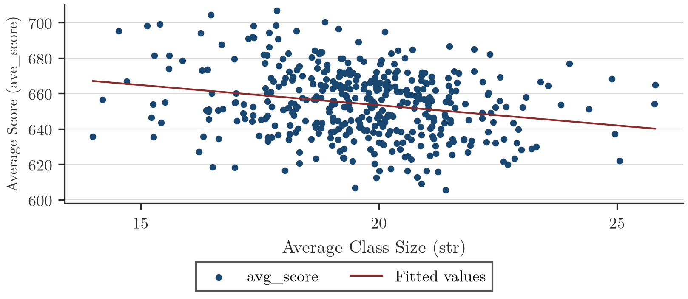
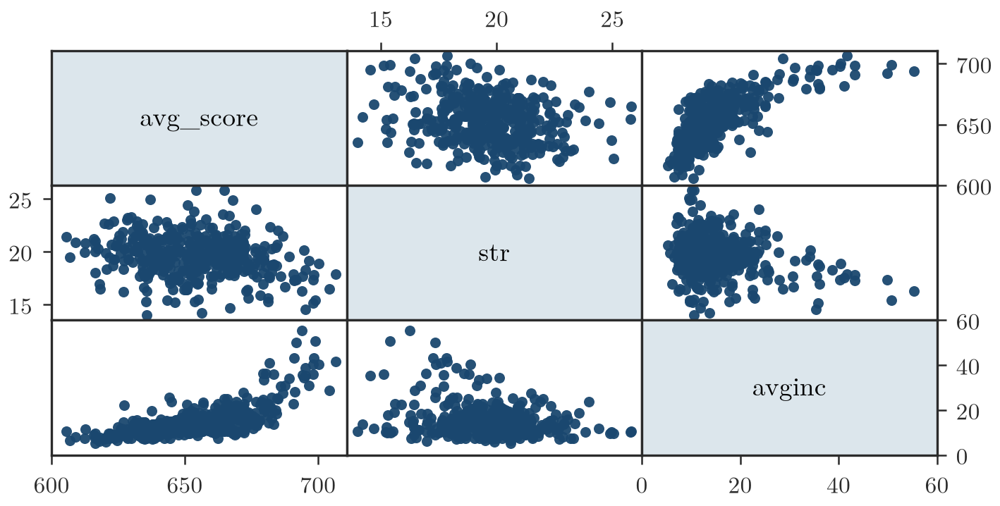
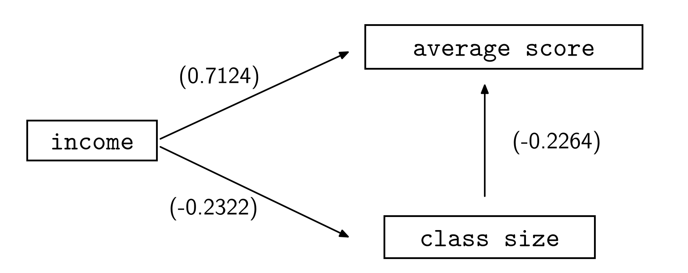
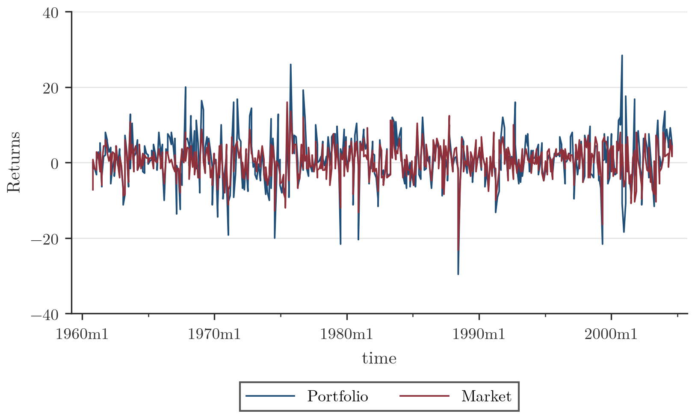
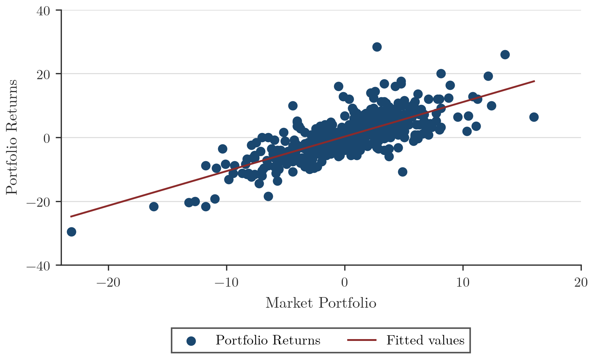

## Informazioni generali sul corso

**Docente:** Davide Raggi. Lezione del 11 novembre 2025.

**Syllabus (sintesi)**
- Elementi fondamentali dell'analisi di regressione con dati cross section:
  - il modello di regressione semplice con un regressore;
  - sistemi d'ipotesi ed intervalli di confidenza;
  - il modello di regressione multipla;
  - omoschedasticità ed eteroschedasticità.
- Regressioni con serie storiche:
  - modelli dinamici;
  - dati stazionari e non stazionari;
  - modelli autoregressivi ed a media mobile;
  - regressioni spurie e test di stazionarietà;
  - cointegrazione (approccio di Engle-Granger).
- Applicazioni con il software GRETL.

**Altre informazioni**
- Esercitazioni: Marco Bidoia.
- Materiale didattico: pagina Moodle del corso "Econometria", anno 2025/2026 (https://moodle.unive.it/course/view.php?id=22785).
- Metodi didattici: lezioni in presenza e materiale supplementare (materiali e ricevimenti aggiuntivi dedicati agli studenti aventi diritto, nella sezione Moodle "Accessibilità e Supporto allo studio").
- Software: Gretl (https://gretl.sourceforge.net/).

**Libro di testo**
- *Principi di econometria*, 2013, C. Hill, W. E. Griffiths e G. C. Lim, Ed. Zanichelli.
  - Modelli di regressione: capitoli 2–8.
  - Serie storiche: capitoli 9, 10 e 12.

*(slide 1–4)*

> [!lezione] Dalla lezione del 10 novembre 2026: impostazione del corso
> L'impostazione è più intuitiva che tecnica. Il corso si concentra sull'interpretazione economica ed è fatto soprattutto di ciò che non si deve fare, più che di come si eseguono i calcoli: lo scopo è dare la consapevolezza di che cosa evitare e di come riconoscere un modello che non va bene. La scelta del modello e delle variabili conta più della metodologia con cui si fanno poi i conti, e a guidarla è la teoria economica, non i dati.
>
> L'econometria è una disciplina ibrida: la distinzione rispetto all'economia non è netta, mentre lo è quella rispetto alla statistica. A separarla dalla statistica è un'ipotesi aggiuntiva con un'importante implicazione economica, l'**ipotesi di esogeneità**, che si formalizza come assenza di correlazione tra qualcosa che non si osserva (l'errore del modello) e qualcosa che si osserva (le variabili esplicative). Se il modello è costruito senza rispettare le regole dell'economia, gli indicatori stimati sono sistematicamente distorti: ciò che si stima non è l'effetto della politica considerata, ma tale effetto sommato a un fattore di disturbo non eliminabile, e l'aumento del numero di osservazioni rende solo più precisa la stima sbagliata. Si finisce per interpretare come effetto di una politica la somma di più effetti collaterali, potenzialmente diversi da quello di interesse. Per lo stesso motivo non interessa che il modello approssimi bene i dati, ma che le relazioni logiche tra le variabili siano corrette.

> [!lezione] Dalla lezione del 10 novembre 2026: esame, esercitazioni e materiali
> **Esame.** La prova è scritta, tipicamente di una decina di domande, ma il numero non è fissato. Si chiede di interpretare risultati, analizzando grafici e tabelle, e di capire se un modello ha un problema oppure no; per la parte di serie storica si chiede inoltre di stabilire se un modello è corretto dal punto di vista metodologico e di interpretare gli effetti dinamici e statici di un modello dinamico. Non si chiede di eseguire le stime. I vecchi esami sono su Moodle e prima della prova si svolgeranno esercitazioni in stile esame (mock exam) con il docente, con il dottor Peruzzi o con il tutor. Conviene sciogliere i dubbi a ricevimento prima dell'esame, perché dopo il compito è ormai fatto; la visione del compito si fa solo di persona.
>
> **Esercitazioni e software.** Per il 2026/27 le esercitazioni sono tenute dal dottor Peruzzi (le slide di questa nota, dell'edizione precedente, indicano il dottor Bidoia). Si usa Gretl, scelto perché è semplice, gratuito, disponibile su ogni piattaforma e lascia concentrare sulla parte econometrica più che sui comandi. Le lezioni empiriche contengono anche una componente di interpretazione. La prima tratta il riscalamento delle variabili con trasformazioni come il logaritmo e l'interpretazione degli effetti marginali, e la diagnosi della quasi collinearità: la collinearità esatta blocca il software, mentre quella quasi esatta non è facile da riconoscere e, se non ci si accorge del problema, si crede che il modello dia risultati corretti. Lo strumento diagnostico citato è, presumibilmente, il *variance inflation factor* (VIF).
>
> **Percorso.** La prima parte riguarda ciò che non va guardato in un output di regressione e ciò che non va fatto quando i dati sono indipendenti. La seconda mostra che cosa cambia in un contesto di dipendenza temporale e quali modelli sfruttano l'inerzia delle serie. I modelli a correzione d'equilibrio sono l'ultimo argomento.
>
> **Materiali.** Tutto il materiale è sulla pagina Moodle del corso (lucidi, dataset, vecchi esami), caricato prima delle lezioni. Conviene iscriversi manualmente alla pagina, così il docente può contattare tutti insieme. Il libro non è obbligatorio ma è discorsivo, ricco di esempi nei capitoli sulle serie storiche e sulla regressione, e mette a disposizione i dati degli esempi (anche in formato Excel) per replicare i calcoli. I lucidi sono una scaletta per il docente, messa a punto in circa trent'anni di insegnamento: il libro spiega il perché delle cose.

## Cos'è l'econometria?

> [!abstract] Definizione
> Non esiste una definizione unica di econometria. Secondo il docente, si può definire come **un insieme di tecniche statistiche che hanno lo scopo di**:
> - definire e misurare relazioni causali tra variabili economiche;
> - validare la credibilità di modelli economici teorici;
> - fare previsioni.

*(slide 5)*

> [!lezione] Dalla lezione del 10 novembre 2026: previsione e spiegazione
> Se lo scopo del modello è fare previsioni, la relazione logica tra le variabili non è rilevante: la previsione è un gioco statistico, per cui se $x$ assume un certo livello $y$ ne assumerà un altro. Per rifornire la catena di produzione della Nutella interessa sapere che in un certo periodo dell'anno bisogna acquistare 7 tonnellate di nocciole, non perché la gente la mangi. Se invece si vuole capire perché la gente compra la Nutella, per esempio per decidere di cambiare la ricetta o il packaging, bisogna individuare i driver della variabile, e la sola associazione statistica non basta. Il corso riguarda soprattutto questo secondo scopo, perché il primo, con un modello banale, si ottiene in modo quasi automatico.

## Causalità: definizione e criteri

> [!abstract] Definizione
> Un legame causale tra due variabili $X$ e $Y$, indicato $X \to Y$, specifica che $X$ è una variabile esplicativa che ha impatto su $Y$: questa dipendenza non è simmetrica, cioè $Y$ non causa $X$.
>
> Si può parlare di **causalità** se i seguenti tre criteri valgono **contemporaneamente**:
> 1. **Associazione tra le variabili.**
> 2. **Un ordine logico/temporale**: la causa precede l'effetto (prima si implementa una politica, poi se ne misura l'impatto). Alcune variabili non possono essere conseguenza di una decisione (ad esempio il sesso, la razza, l'età) e per questo possono essere considerate cause. In altri casi non è facile capire quale sia la causa e quale l'effetto: ad esempio, nei periodi di alta disoccupazione i tassi di criminalità sembrano aumentare. La disoccupazione è una causa? Forse, ma potrebbe esserci **causalità inversa**: in aree ad alta criminalità le imprese potrebbero chiudere, aumentando la disoccupazione.
> 3. **L'esclusione di spiegazioni alternative.**

*(slide 6)*

> [!lezione] Dalla lezione del 10 novembre 2026: associazione e direzione del legame
> Il primo criterio è statistico perché, senza una relazione statistica, una variazione di $x$ non avrebbe alcun impatto su $y$ e il problema non si porrebbe. Ma la correlazione è simmetrica: quella tra $x$ e $y$ e quella tra $y$ e $x$ sono lo stesso numero, quindi non dice nulla sulla direzione e indica solo un legame di qualche natura, non necessariamente logico. Per parlare di causalità servono ipotesi aggiuntive: un legame logico, e non solo statistico, con una variabile che anticipa l'altra non soltanto nel tempo ma nella logica, e una storia che spieghi perché esiste quel legame statistico. Non basta che la storia sia plausibile: deve essere unica.

## Esempio: consumo di caffè e probabilità d'infarto

> [!example] Esempio
> Alcuni studi epidemiologici hanno evidenziato un'associazione positiva tra la probabilità di avere un infarto (variabile $Y$) e il consumo di caffè (variabile $X$).
> - Un possibile link causale: bere caffè aumenta la pressione sanguigna, che rappresenta un fattore di rischio per questa patologia.
>
> Altri studi hanno mostrato che, una volta controllato per altri fattori (tipo di lavoro, residenza, genere, reddito, livello di stress), l'associazione condizionata si riduce a zero.
> - Questo fornisce una spiegazione alternativa: persone con lavori più stressanti bevono più caffè. È il lavoro stressante il fattore determinante per la probabilità di avere un infarto, e non il caffè.
>
> In pratica, in questo esempio (non supportato da analisi empiriche reali) esiste una variabile $Z$, lo stress, che ha un impatto congiunto su $X$ e $Y$. La relazione tra $X$ e $Y$ viene detta **spuria**, ed è indotta da $Z$: in questo caso la relazione spuria è indotta da una variabile omessa nello studio.

*(slide 7–8)*

## Esempio: boy scout e criminalità

> [!example] Esempio
> Si vuole investigare la relazione tra l'essere stati boy scout ($S$) e la criminalità giovanile ($D$), nel senso che ci si aspetta che aver frequentato i boy scout riduca la probabilità di commettere crimini.
>
> Alcune evidenze empiriche (dati non reali) sono sintetizzate nella tabella seguente:
>
> **Tabella 1 — Essere boy scout e crimine**
>
> | Boy scout | Delinquency: Yes | Delinquency: No | Total |
> |---|---|---|---|
> | Yes | 36 (9%) | 364 (91%) | 400 |
> | No | 60 (15%) | 340 (85%) | 400 |
>
> L'evidenza empirica suggerisce una relazione negativa tra $S$ e $D$. Dal punto di vista logico questo legame sembra sensato, per cui $S \to D$. Tuttavia non possiamo escludere che un criminale possa aver evitato ambienti "virtuosi", per cui anche la relazione inversa ha senso logico: $D \to S$.
> - Entrambe le spiegazioni sono ragionevoli.
> - L'ordinamento logico non è chiaro, quindi non possiamo parlare di causalità.

*(slide 9–10)*

> [!lezione] Dalla lezione del 10 novembre 2026: causalità inversa
> Chi sostiene $S \to D$ osserva che chi ha fatto il boy scout è stato educato al rispetto di regole e principi ed è quindi meno incline a delinquere. Chi sostiene $D \to S$ osserva che chi è avverso alle regole difficilmente si iscrive a un ambiente che ne impone molte. Il legame statistico, essendo simmetrico, non permette di scegliere tra le due letture. Questa situazione si chiama *reverse causality* (causalità inversa) e rende problematica la stima di una relazione di causa ed effetto: per questo, prima ancora di costruire il modello, bisogna ragionare sui possibili legami logici tra le variabili. I dati della tabella non sono reali: il docente li ha ricopiati da un libro di statistica.

## Causalità: l'impossibilità di dimostrarla e il ruolo della confutazione

In generale **non è possibile dimostrare l'esistenza di una relazione causale**, perché quasi mai è possibile escludere tutte le altre possibili spiegazioni di un fenomeno. Spesso non si riescono a controllare tutte le spiegazioni alternative (sono troppe) rispetto a un certo livello di associazione misurato.

Possiamo però **confutare** ipotesi di causalità: se riusciamo a confutare tutte le ipotesi tranne una, possiamo essere abbastanza certi nel definire il legame come nesso causale.

*(slide 11)*

> [!lezione] Dalla lezione del 10 novembre 2026: come si lavora senza una risposta definitiva
> Ogni volta che si costruisce un modello bisogna chiarire perché lo si costruisce e perché si scelgono certe variabili, e verificare poi se descrive le aspettative, per esempio se i coefficienti hanno il segno atteso: un segno sbagliato può indicare che le correlazioni attese non sono stimate in modo corretto. Il modello proposto non sarà quello definitivo, ma contribuisce al lavoro di altri che provano modelli alternativi, finché si arriva a un consenso in cui le spiegazioni concorrenti sono state escluse.
>
> Si procede sempre in questo ordine: prima si individuano i potenziali driver sulla base della teoria, poi si inseriscono nel modello. Il contrario, cioè mettere nel modello tutte le variabili e selezionarle finché si trova qualcosa di gradito in termini di segni, non è sufficiente: la teoria deve definire a priori i legami logici e non ci si può far raccontare la storia dalla correlazione. È difficilissimo trovare relazioni causali, ma con un po' di pazienza qualcosa si trova.

## Esempio: fumo e cancro ai polmoni

> [!example] Esempio
> L'associazione tra fumo e probabilità di tumore è ampiamente documentata. È sintomo di legame causale?
> - Esiste una ricca letteratura epidemiologica che documenta la relazione tra le due variabili.
> - Esiste un legame logico sensato (il cancro si manifesta di solito dopo un consumo intensivo di sigarette).
> - Non sono state trovate, nella letteratura epidemiologica, spiegazioni alternative più convincenti. Esistono inoltre evidenze teoriche che spiegano il legame tra fumo e malattia.
>
> A differenza dei casi precedenti (caffè, boy scout), questo esempio soddisfa tutti e tre i criteri di causalità: associazione, ordine logico/temporale, esclusione di spiegazioni alternative.

*(slide 12)*

> [!lezione] Dalla lezione del 10 novembre 2026: il caso del fumo
> L'associazione tra fumo e gravi malattie ai polmoni non basta, da sola, a stabilire il nesso di causa. Nel corso di decenni, e non di settimane, sono state testate varie ipotesi e sono stati individuati meccanismi biologici per cui il consumo di sigarette può aumentare l'incidenza di certe malattie. Poiché potrebbero esistere altri meccanismi non ancora visti, il risultato non è definitivo in senso assoluto: oggi si ritiene che la relazione causale esista, ma se un biologo trovasse un'alternativa più convincente bisognerebbe ripensare tutto. La procedura avanza per affinamenti successivi, ed è praticamente impossibile trovare un modello che risolva tutti i problemi in modo definitivo.

## Associazione non implica causalità

In generale, l'associazione tra variabili **non** è un criterio sufficiente per stabilire se un legame sia interpretabile come causale. Una raccolta (a scopo illustrativo) di associazioni spurie "divertenti" è disponibile su http://www.tylervigen.com/spurious-correlations.

Non è difficile trovare variabili fortemente associate ma non legate tra loro: come visto sopra, l'associazione in questi casi è un **legame spurio**.

Una volta osservato un legame statistico, è indispensabile spiegarlo dal punto di vista teorico e verificare che sia credibile anche dal punto di vista logico.

*(slide 13)*

> [!lezione] Dalla lezione del 10 novembre 2026: correlazioni spurie, $R^2$ e intelligenza artificiale
> Il sito citato nasce da uno statistico che, partendo da un database di circa 10.000 variabili, ha fatto cercare a un programma le coppie più correlate possibili, senza considerare di quali variabili si trattasse. Due esempi:
>
> - il numero di spettatori della serie televisiva *Big Bang Theory* e il numero di ricerche su Google che cominciano con «how to make»: le due serie sono quasi sovrapposte e l'$R^2$ della relazione è 96,5%;
> - l'esito delle partite finali di lacrosse e i biglietti venduti al cinema negli Stati Uniti: la correlazione è elevata, dell'ordine del 74%.
>
> Tra le variabili non c'è alcun legame logico. Dal punto di vista puramente previsivo si potrebbe usare una serie per prevedere l'altra, ma la correlazione non spiega perché una delle due si muova e quindi non permette alcuna analisi di scenario: se si trovasse una correlazione simile tra due variabili economiche senza rapporto reciproco, qualsiasi risultato di uno scenario sarebbe casuale e non replicabile.
>
> L'$R^2$ è la misura peggiore per valutare un modello e nel corso non va usato come indicatore di bontà: dice che i dati sono ben approssimati, cioè che le due variabili si muovono insieme, non che il modello è logicamente corretto, che è ciò che si cerca. Anzi, i modelli buoni non hanno tipicamente un $R^2$ molto grande, e un $R^2$ troppo grande porta con sé problemi statistici non banali, noti come problemi di collinearità.
>
> Lo stesso vale per l'intelligenza artificiale: se le si chiede perché due variabili abbiano una correlazione del 95%, una spiegazione viene sempre prodotta, che abbia senso o no. Il docente riporta il caso di una serie storica con un picco, che un sistema di intelligenza artificiale attribuì alla rivoluzione industriale di quegli anni, avvenuta in realtà circa un secolo prima o dopo. L'intelligenza artificiale può affinare l'intuizione, ma il controllo deve restare allo studente.

## Tipi di dato

> [!abstract] Definizione
> - **Cross Section**: tipo di dati che fanno riferimento a osservazioni raccolte in un unico istante temporale su molti soggetti (individui, Paesi, imprese). Esempio: il database STAR, che raccoglie osservazioni su scuole, bambini e alcune loro caratteristiche.
> - **Serie storiche**: sequenze di osservazioni misurate sequenzialmente, spesso a intervalli regolari; il tempo definisce un ordine. Esempi: i prezzi di chiusura di un particolare asset finanziario, o il volume d'acqua orario di un fiume.
> - **Dati Panel** (o longitudinali): fanno riferimento a cross section sui medesimi individui, osservate nel tempo. Ogni osservazione è caratterizzata da una doppia dimensione, tempo e soggetto. Esempio: l'evoluzione dei prezzi di un campione di case in un intervallo temporale limitato.

*(slide 14)*

## Esempio Cross Section: dimensione della classe e punteggio ai test

> [!example] Esempio
> **Il problema.** Si pensa spesso che un basso rapporto studenti/insegnanti (*class size*) possa migliorare la performance degli alunni. In California, verso la fine degli anni '90, tutte le classi K-3 furono ridotte per ottenere un rapporto studenti/insegnanti pari a 20 (*Class Size Reduction Act* – CSR), con un costo iniziale di $1.8 miliardi annui. Per questo costo, ne vale davvero la pena?
>
> Ci si chiede se la dimensione della classe sia l'unico (o il principale) fattore rilevante nello spiegare la variazione della performance attesa degli studenti, oppure se esistano ulteriori informazioni da considerare. Si vuole inoltre **quantificare** come una riduzione della dimensione della classe impatti sui voti degli alunni.
>
> 
>
> **Figura 1** — Scatterplot delle variabili rilevanti (Fonte: *California Standardized Testing and Reporting Survey*, year 1999). Lo scatterplot mette in relazione l'*Average Class Size* ($str$, asse orizzontale) con l'*Average Score* ($avg\_score$, asse verticale); la retta interpolante (*fitted values*) ha pendenza negativa: le classi più numerose sono associate a punteggi mediamente più bassi.
>
> Sembrerebbe quindi che ridurre il rapporto studenti/insegnanti sia rilevante: a una riduzione della dimensione delle classi corrisponde un aumento medio dei punteggi. La correlazione tra le due variabili è **-0.2264** (ha il segno della pendenza della retta di regressione, che vale invece $-2.28$; le slide le identificano). Esiste inoltre un legame temporale e logico plausibile: prima viene implementata la policy, poi si valutano i benefici.
>
> **Un'altra possibile spiegazione.** Un'analisi più dettagliata suggerisce che anche il reddito medio ($avginc$) delle persone che vivono in ogni distretto scolastico risulta positivamente correlato con il punteggio $avg\_score$: distretti più ricchi tendono ad essere associati a voti migliori. Inoltre esiste una dipendenza negativa tra $income$ e $class\ size$ ($str$), suggerendo che distretti ad alto reddito sono legati a scuole in cui le classi sono mediamente più piccole.
>
> **Matrice di correlazione** (comando `correlate avg_score str avginc`):
>
> |            | avg_score | str     | avginc  |
> |------------|-----------|---------|---------|
> | avg_score  | 1.0000    |         |         |
> | str        | -0.2264   | 1.0000  |         |
> | avginc     | 0.7124    | -0.2322 | 1.0000  |
>
> Sulla base di questi risultati, ci si chiede se sia il **reddito** la variabile rilevante per spiegare la performance, e non la dimensione della classe.
>
> 
>
> **Figura 2** — Scatterplot delle variabili a coppie. La matrice di scatterplot incrocia $avg\_score$, $str$ e $avginc$ a due a due e conferma visivamente le correlazioni riportate nella matrice sopra (in particolare la forte associazione positiva tra $avg\_score$ e $avginc$).
>
> 
>
> **Figura 3** — Rappresentazione causale del nuovo modello (in parentesi le correlazioni): $income \to average\ score$ (0.7124), $income \to class\ size$ (-0.2322), $class\ size \to average\ score$ (-0.2264). Il diagramma mostra uno schema in cui il reddito ($income$) influisce sia sul punteggio medio sia sulla dimensione delle classi, e può quindi generare una correlazione osservata (ma potenzialmente spuria) tra $class\ size$ e $average\ score$.
>
> Questa evidenza empirica suggerisce che la dipendenza negativa tra *class size* e *performance* potrebbe essere **spuria**, poiché può essere spiegata dall'effetto reddito. Questa relazione causale più complessa offrirebbe una nuova spiegazione del fenomeno.
>
> **Verifica: controllo per il reddito.** Cosa si può fare? Si divide il dataset in due parti: da un lato i distretti ad alto reddito, dall'altro quelli a basso reddito. In questi due sottoinsiemi si calcola la correlazione tra *class size* e *test score*. In questo modo è possibile controllare l'effetto reddito, poiché ogni sottoinsieme è omogeneo rispetto a quel fattore: quindi l'effetto reddito dovrebbe non essere più rilevante.
> - Nei distretti a **basso reddito**, la correlazione tra *class size* e *test score* è **-0.1464**, debolmente statisticamente significativa.
> - Nei distretti ad **alto reddito** la correlazione è **-0.1962**, comunque non significativa.
>
> Quindi, una volta controllato l'effetto reddito, la correlazione tra la variabile di policy *class size* e *test score* viene praticamente azzerata. Questo è, con buona probabilità, il sintomo di una relazione **spuria**.

*(slide 15–22)*

> [!lezione] Dalla lezione del 12 novembre 2026: il problema della dimensione della classe e i tre ingredienti della causalità
> Il docente considera l'intuizione la cosa più importante da capire in questa parte: una volta acquisita, formalizzarla con concetti statistico-matematici è abbastanza semplice.
>
> Il docente descrive i bambini come quelli della scuola prescolastica (asilo, scuola dell'infanzia); la nota riferisce la riduzione alle classi K-3. Che cosa significhi "utile" per un programma di questo tipo è una questione più filosofica che statistica e non spetta all'econometrico. Qui "vanno meglio" significa che i bambini ottengono risultati migliori nei test di fine anno. Che sia così è intuitivo: in classi più piccole l'insegnante dedica più tempo a ogni bambino, con miglioramenti nelle capacità pratiche e astratte.
>
> La policy costa molto, perché servono più docenti e una riorganizzazione delle classi: con 100 bambini, classi da 10 anziché da 20 richiedono più classi, più computer e più attrezzatura. Il docente quantifica l'investimento, a memoria, in circa 1,8 miliardi di dollari l'anno, e nel seguito parla di circa due miliardi. La spesa ha senso se la variabile su cui si interviene è in relazione causale con la performance dei bambini: serve un modello causale che dica se la dimensione della classe sia un driver, non statistico ma logico, di tale performance.
>
> I dati sono quelli dei distretti scolastici della California, circa 420, e ogni punto dello scatterplot è un distretto. Sull'asse delle ascisse c'è la dimensione media delle classi della scuola dell'infanzia del distretto, su quello delle ordinate il punteggio medio dei bambini del distretto in un test standardizzato, che valuta competenze di matematica, logica e lingua adatte all'età. La pendenza negativa della retta è il primo ingrediente della relazione causale: la correlazione tra le due variabili è minore di zero. Se la diminuzione sia piccola o grande non spetta a questa analisi. Il secondo ingrediente è una spiegazione logica, che il docente ritiene soddisfatta in termini generali: classi più piccole significano più attenzione a ciascun bambino e un lavoro più focalizzato. Non è detto che la spiegazione sia corretta, ma è plausibile.
>
> Il terzo ingrediente richiede di poter escludere spiegazioni alternative più convincenti. Per stabilirlo si fanno altri esperimenti e si provano modelli alternativi. Una spiegazione esaustiva non si troverà, perché non si possono costruire infiniti modelli che spieghino in modo alternativo la correlazione negativa: si considera una serie di alternative ragionevoli per vedere se la teoria resta la strategia migliore o se c'è qualcosa di meglio. Stimando la pendenza della retta si potrebbe poi valutare, per esempio, se la riduzione di un'unità della dimensione della classe produca un beneficio di 10 punti al test, che sono molti o pochi a seconda della scala del test. Il problema ora non è però quantificare gli effetti, ma capire se esistano modelli migliori, e questi possono passare per l'analisi congiunta di altre variabili.

> [!lezione] Dalla lezione del 12 novembre 2026: perché il reddito può spiegare la relazione negativa
> Il reddito ha impatto su fondamentalmente tutte le scelte, e i distretti ad alto reddito potrebbero avere performance migliori per due vie. In primo luogo le famiglie possono permettersi di comprare più libri ai bambini, e questo può riflettersi in una migliore performance scolastica. In secondo luogo i distretti ad alto reddito potrebbero avere scuole mediamente migliori. Nei dati americani il distretto di appartenenza conta: dove ci sono buone scuole pubbliche, la scuola privata costa moltissimo già dalle elementari, nell'ordine di decine di migliaia di dollari l'anno, e chi non può permettersela vorrebbe una scuola pubblica, ma il livello delle scuole pubbliche è abbastanza eterogeneo. Le scuole pubbliche molto buone si trovano in zone dove il prezzo delle case è estremamente più alto, per cui la scuola pubblica buona, che costa relativamente poco, è in un distretto ricco. Il reddito può dunque incidere sulla qualità della scuola, che a sua volta incide sui risultati dei bambini.
>
> Il reddito potrebbe così avere un effetto positivo sulla performance e un effetto negativo sulla dimensione della classe, perché le scuole migliori hanno già classi più piccole, magari perché hanno più insegnanti. Negli Stati Uniti il concetto di dimensione della classe è particolare: non ci sono necessariamente classi fisse, perché le classi si formano di volta in volta, e la dimensione viene calcolata come rapporto studenti-insegnanti. Una scuola migliore può avere più insegnanti e altre caratteristiche favorevoli. Se esistono una relazione negativa tra reddito e dimensione della classe e una relazione positiva tra reddito e performance, la relazione negativa osservata tra le due variabili iniziali potrebbe passare per l'effetto del reddito.

> [!lezione] Dalla lezione del 12 novembre 2026: come si controlla per il reddito e che cosa si conclude
> Si vuole evitare che il reddito sia il vero driver, e quindi si controlla per il reddito. Prendendo due distretti molto ricchi e calcolando tra loro la dipendenza tra dimensione della classe e performance, la correlazione non può dipendere dal reddito, perché le osservazioni provengono da un contesto molto omogeneo. Per questo il campione si divide in distretti ricchi e poveri e in ciascun sottocampione si calcola la correlazione tra le due variabili. Se le due correlazioni sono diverse, il reddito ha potere esplicativo: per spiegare la correlazione negativa bisogna passare per il reddito, il modello precedente va scartato perché non soddisfacente e si passa al modello esteso. Se restano uguali, la relazione è la stessa indipendentemente dal reddito, aggiungerlo non ha alcuna utilità pratica e tanto vale usare il modello precedente, quello senza reddito.
>
> L'analisi mostrata è molto grossolana: si calcola la mediana del reddito, e i distretti sotto la mediana sono classificati a basso reddito, quelli sopra ad alto reddito. Come funzioni il procedimento si vedrà meglio con il modello di regressione. Per i distretti a basso reddito la correlazione tra dimensione della classe e performance diventa piuttosto piccola e, secondo il docente, in un test di significatività non risulta statisticamente significativa; la nota riporta per questi distretti $-0.1464$, debolmente significativa. Il reddito sembra quindi il driver principale della correlazione negativa: condizionatamente al reddito basso, la correlazione condizionale tra dimensione della classe e performance è sostanzialmente zero. Secondo il docente, anche per i distretti ad alto reddito la correlazione è piuttosto bassa e il test la indica come non significativa, con un p-value leggermente più alto, comunque non sufficiente a giustificare un livello di significatività; la nota riporta per questi distretti $-0.1962$.
>
> Ricalcolando sul dataset del corso (`ECON_Dataset_caschool.csv`, 420 distretti) le correlazioni complessive coincidono con la nota ($-0.2264$ tra dimensione della classe e punteggio, $0.7124$ tra reddito e punteggio), ma quelle nei sottocampioni no. Dividendo alla mediana del reddito (13.73) si ottiene $-0.130$ per il basso reddito ($t=-1.89$, debolmente significativa) e $-0.336$ per l'alto reddito ($t=-5.14$, significativa); dividendo alla media (15.32), $-0.1464$ ($t=-2.41$) e $-0.385$ ($t=-5.10$). Il $-0.1464$ della nota si riproduce quindi con la divisione alla media e non alla mediana, mentre il $-0.1962$ per l'alto reddito non si riproduce con nessuna delle due. Per l'alto reddito la correlazione condizionale risulta significativa in entrambe le divisioni: l'affermazione che sia non significativa, che il docente riprende dalle slide, non trova riscontro in questo dataset. L'esempio resta valido come illustrazione del ragionamento sul controllo per una terza variabile, ma la conclusione numerica che il reddito spieghi da solo la correlazione negativa non è confermata dai dati.
>
> Secondo il docente, controllando per il reddito la correlazione tra la variabile su cui si vorrebbe investire e la performance è dunque non significativa. Il nuovo modello, che passa per il reddito, contiene più informazione, ha senso a parole e supera il precedente: le conclusioni inferenziali escludono il modello precedente, e la correlazione marginale non è così importante perché quella condizionale ai livelli di reddito non è statisticamente significativa.
>
> Per il responsabile politico della California (provveditore, ministro o equivalente) la questione è se i circa due miliardi di dollari l'anno da spendere servano a migliorare la performance. Se la correlazione negativa fosse un semplice effetto collaterale del reddito, assumere nuovi docenti probabilmente non sarebbe utile, perché si interverrebbe su una variabile solo apparentemente legata alla performance dei bambini, da cui questa non dipende direttamente. Sarebbe forse più opportuno dare sussidi alle famiglie meno ricche, se l'obiettivo è migliorare la performance, perché il reddito sembra la variabile chiave.
>
> L'analisi non è conclusa, perché potrebbero esserci altri fattori. Si ha però un meccanismo di scelta: si estende il modello, si verifica se migliora il precedente, si fanno valutazioni di natura logica e si traggono le conclusioni. La strategia è non fissarsi sul modello e sull'idea iniziali, ma estenderli per capire quale sia la spiegazione migliore della correlazione negativa osservata all'inizio, cioè perché esista.

> [!lezione] Dalla lezione del 12 novembre 2026: estendere il modello con coerenza logica
> Per capire se una relazione sia causale, uno dei problemi principali è incrementare il modello in modo logico e verificare se il nuovo modello migliora il precedente. Il modello più esteso deve mantenere sempre coerenza logica, con una spiegazione che valga la pena di usare. Non si possono inserire informazioni come il numero di persone che in California vanno a vedere il film di Nicolas Cage: potrebbero essere correlate, ma la correlazione potrebbe dipendere da qualunque cosa. Quando si inserisce una variabile nel modello serve una storia da raccontare, e non si lascia che siano i dati a dire che cosa si vuole spiegare. Il docente indica questo come il punto più importante.

## Serie storiche: il modello CAPM

> [!tip] Teorema
> In ambito finanziario si ipotizza spesso che gli investitori abbiano bisogno di incentivi per aumentare il rischio che sono disposti ad accollarsi: i rendimenti attesi $R$ di un investimento rischioso dovrebbero essere maggiori di quelli di un investimento non rischioso (*risk-free*, $R_f$). Gli extra rendimenti $R - R_f \geq 0$ dovrebbero quindi essere positivi.
>
> Il rischio viene spesso descritto tramite la varianza; può essere minimizzato costruendo portafogli diversificati, comprando o vendendo asset i cui prezzi sono correlati alle variazioni di mercato. Misurare il rischio richiede quindi, oltre alle varianze, la struttura di covarianza tra l'investimento e il mercato.
>
> Il modello **CAPM** (*Capital Asset Pricing Model*) è stato proposto per descrivere la relazione tra i rendimenti di un portafoglio generico e il *portafoglio di mercato*. Gli investitori decidono come allocare le proprie risorse massimizzando il rendimento atteso di un portafoglio, mantenendo fissato il livello di rischio.
>
> In equilibrio si dimostra che deve valere:
> $$\underbrace{E[R_t]}_{\text{Rendimenti attesi}} = \beta \, \underbrace{E[(R_{mt})]}_{\text{Rendimento del mercato}}$$
>
> Ci si chiede se questa relazione teorica sia credibile dal punto di vista empirico. (Il CAPM vale per gli extra rendimenti: $R_t$ e $R_{mt}$ vanno letti al netto di $R_f$, cioè $E[R_t]-R_f=\beta\,(E[R_{mt}]-R_f)$; le slide omettono $R_f$.)
>
> Si ipotizzi di descrivere la relazione come segue:
> $$E[R_t] = \alpha + \beta R_{mt}$$
>
> La variabilità di $R_t$ può essere descritta aggiungendo una componente di *noise* $\epsilon_t$, che descrive l'impatto di notizie improvvise, con media $0$ e varianza $\sigma^2$. Quindi:
> $$R_t = \alpha + \beta R_{mt} + \epsilon_t$$
>
> dove:
> - $R_t$ sono i rendimenti di un asset all'istante $t$;
> - $R_{mt}$ rappresenta i rendimenti del mercato a $t$;
> - $\beta = \dfrac{\text{Cov}(R_t, R_{mt})}{\text{Var}(R_{mt})}$;
> - $\epsilon_t$ è una componente non prevedibile che rappresenta uno shock finanziario;
> - $\alpha$ è un'intercetta (costante).

*(slide 23–25)*

> [!lezione] Dalla lezione del 10 novembre 2026: perché il CAPM si valida con l'intercetta
> Il CAPM non è un'equazione ma il risultato di due pagine di algebra che poggiano su molte ipotesi: che il mercato dei capitali e quello dei tassi di interesse siano in equilibrio, che gli investitori costruiscano i portafogli con l'algoritmo di Markowitz. Se il modello fosse vero, un investimento non dovrebbe garantire in media alcun premio oltre quello proporzionale al rischio di mercato, e in termini operativi la regressione non può avere intercetta. La validazione consiste allora nello stimare una regressione che include l'intercetta e nel verificare se è uguale a zero: si usa una metodologia econometrica per controllare se un modello economico è coerente con i dati, perché un modello incoerente con ciò che si osserva ha poca utilità.
>
> Se il test non supporta il modello, non si può semplicemente aggiungere un'intercetta: significherebbe cambiare tutte le equazioni e le ipotesi su cui poggia la derivazione. Bisogna rispecificare il modello economico in modo che il modello statistico accetti quelle variazioni. La validazione di una teoria rispetto ai dati è la terza funzione dell'econometria, e quella che al docente interessa di più.

## Serie storiche: verifica empirica del CAPM

> [!example] Esempio
>
> 
>
> **Figura 4** — Serie storiche dei rendimenti del portafoglio (*Portfolio*) e del mercato (*Market*) nel tempo, dal 1960 al 2004 circa. I due andamenti mostrano un forte comovimento: i rendimenti del portafoglio seguono da vicino le oscillazioni dei rendimenti di mercato, con ampiezza leggermente maggiore nei picchi (positivi e negativi).
>
> 
>
> **Figura 5** — Scatterplot di *Portfolio Returns* contro *Market Portfolio*, con retta di regressione interpolante (*fitted values*). La nuvola di punti mostra una chiara relazione lineare positiva, con pendenza superiore a 1, coerente con un $\beta$ maggiore di uno.
>
> Se il modello CAPM fosse coerente con i dati, ci si aspetta che il parametro $\alpha$ sia $0$. Per verificarlo è quindi necessario stimarlo e testare l'ipotesi che sia nullo. L'analisi di regressione può essere utilizzata a questo scopo.
> - Una stima credibile per $\beta$ è **1.083759**, con errore standard **.0404768**. L'intervallo di confidenza al 95% è **[1.004; 1.163]**, che suggerisce che questo investimento è più rischioso del mercato. Infatti:
> $$\text{Var}(R_t) = \beta^2 \text{Var}(R_{mt}) + \sigma^2, \qquad \beta > 1$$
> - La stima di $\alpha$ è **.2942161**, e l'intervallo di confidenza al 95% è **[-.063; .651]**. Questa evidenza non permette di escludere che $0$ possa essere il vero valore per l'intercetta.
> - Il rischio idiosincratico è $\sigma = 4.157$.

*(slide 26–28)*

## Panel data: l'impatto di un inceneritore sul prezzo delle case

> [!example] Esempio
> Kiel e McClain (1995) hanno studiato l'effetto che la costruzione di un nuovo inceneritore di rifiuti ha avuto sul valore delle case a North Andover, nel Massachusetts. Gli autori originali eseguirono un'analisi econometrica piuttosto complicata; in questo esempio si considera un modello semplificato, anche se la strategia implementata è simile all'originale.
>
> I rumor secondo cui un nuovo inceneritore sarebbe stato costruito a North Andover iniziarono dopo il 1978, anche se la costruzione iniziò solo nel 1981. L'inceneritore sarebbe entrato in funzione subito dopo l'inizio della costruzione, e ha effettivamente iniziato a funzionare nel 1985. Si utilizzano i dati sui prezzi delle case vendute nel 1978 e un altro campione su quelle vendute nel 1981 (sono due campioni indipendenti di case diverse, cioè cross section ripetute e non un panel in senso stretto; le slide le trattano come panel). L'ipotesi è che il prezzo delle case situate vicino all'inceneritore diminuisca maggiormente rispetto a quello delle case più distanti.
>
> **Prima evidenza (solo 1981).** Alcune evidenze empiriche suggeriscono che nel 1981 le case costruite vicino al nuovo stabilimento costavano circa 30mila dollari in meno rispetto alle altre (prezzi reali, in dollari del 1978):
>
> | year | Base price | "Near" effect |
> |---|---|---|
> | 1981 | 101,308.0 | -30,688.3 |
>
> Tuttavia, queste evidenze non sono sufficienti per affermare che l'inceneritore abbia causato una perdita sui prezzi delle case: non sappiamo se ci fossero differenze nei prezzi già prima del 1981. Ci si aspetta infatti che un inceneritore non venga costruito in una zona di pregio.
>
> **Confronto 1978 vs 1981.** Per fare chiarezza su questo punto è necessario conoscere quali erano i prezzi anche prima che cominciassero le voci. Queste evidenze congiunte sono riassunte nella tabella seguente:
>
> | year | Base price | "Near" effect |
> |---|---|---|
> | 1978 | 82,517.7 | -18,824.4 |
> | 1981 | 101,308.0 | -30,688.3 |
>
> Una regola per verificare se il nuovo inceneritore ha ridotto il valore delle abitazioni è calcolare la seguente statistica (uno stimatore **differenza-nelle-differenze**):
> $$\hat{\delta} = \Big(\overline{price}_{81,near} - \overline{price}_{81,far}\Big) - \Big(\overline{price}_{78,near} - \overline{price}_{78,far}\Big)$$
> dove il primo termine tra parentesi è il coefficiente sull'effetto vicinanza (*near effect*) del 1981, e il secondo è quello del 1978.
>
> **Calcolo.** Come possiamo sapere se la costruzione di un nuovo inceneritore ha ridotto il valore delle case? Possiamo osservare come è cambiato il coefficiente sull'effetto vicinanza tra il 1978 e il 1981. La differenza nel valore medio delle case era molto maggiore nel 1981 rispetto al 1978 (30.688,27 contro 18.824,37), anche come percentuale del valore medio delle case non vicine al sito dell'inceneritore. La differenza tra i due coefficienti sulla vicinanza è:
> $$\hat{\delta} = -30{,}688.3 - (-18{,}824.4) = -11{,}863.9$$
>
> $\hat{\delta}$ è statisticamente diverso da 0? Occorre calcolare opportuni errori standard. Per questo, risulta opportuno usare modelli di regressione specifici per l'analisi dei **dati panel**.

*(slide 29–32)*

## Tre cause di problemi nella stima

*Integrazione dalla lezione del 10 novembre 2026.*

Per riconoscere quando un modello non va bene bisogna conoscere le potenziali cause di problemi, che sono tipicamente di tre tipi.

**Troppe poche informazioni nel modello (variabili omesse).** Nel caso più semplice, oltre alla variabile dipendente $y$ e al driver $x$, il modello contiene un termine d'errore $\varepsilon$. Dal punto di vista statistico è una variabile casuale a media zero e varianza qualsiasi; dal punto di vista economico raccoglie tutte le informazioni che non sono nel modello. Se queste informazioni sono rilevanti e hanno un effetto su $x$, una variazione di $x$ si associa sia a una variazione di $y$ sia a una variazione di $\varepsilon$: la variazione osservata di $y$ è una combinazione delle due componenti, di cui si misura solo il totale senza sapere quanto conti ciascuna. Poiché $\varepsilon$ non è osservabile, non si è più in grado di valutare che cosa stia facendo il modello. È il primo caso di endogeneità. La soluzione è portare nel modello le variabili omesse, scelte con ragionamenti logici e non con una procedura puramente statistica: il problema è economico e si tratta di capire quali variabili contano davvero.

**Causalità non chiara.** Se non è chiaro se sia $x$ a influenzare $y$ o il contrario, si introduce di fatto un riferimento circolare: non si sa più se, muovendo una variabile, si muova l'altra. Il cortocircuito crea una correlazione tra $x$ e l'errore, e la stima dei coefficienti diventa problematica.

**Errori di misura nei dati.** Anche se il modello è perfetto, dati approssimativi e poveri di informazione inducono una distorsione nella stima dei parametri, tanto maggiore quanto più grande è l'errore di misura. Si pensi a un'indagine sulle spese delle famiglie che chiede quanto si è speso al supermercato nell'ultima settimana. Chi ha speso 190 euro tende a ricordare e a riportare 200, e chi ne ha spesi 205 riporta ugualmente 200. L'errore di riporto non è sistematico e la spesa media del campione può risultare corretta, ma introduce rumore nella procedura di stima e distorce la stima del parametro. Il caso è diverso per l'evasione fiscale, dove tutti tenderebbero a sottostimare o a sovrastimare: lì la distorsione è sistematica e si controlla più facilmente. Qui si tratta invece di persone oneste ma imprecise perché non ricordano, tanto più quanto più lontano è l'evento a cui la domanda si riferisce, e questo può creare grossi problemi. Gli effetti saranno mostrati con dati simulati, quindi controllabili.

## Dati dinamici e stabilità

*Integrazione dalla lezione del 10 novembre 2026.*

Nell'analisi di regressione con dati cross section si assume di solito che le osservazioni siano pescate in modo indipendente dalla popolazione. Nei sistemi dinamici, tipici della finanza e dell'economia, le variabili hanno invece una loro inerzia e non sono osservate in modo indipendente: se il tasso di interesse oggi è il 5%, domani sarà intorno al 5% e non allo 0% o al 10%. Ne nasce un problema di stabilità dei dati nel tempo, perché la statistica funziona bene se i dati sono stabili.

**Il limite della media.** Si pensi ai prezzi giornalieri di un indice azionario come lo Standard & Poor's, che seguono un andamento con trend. Un software calcola senza difficoltà la media dei prezzi, ma la media è un indicatore di centralità che descrive il fenomeno solo in un intervallo temporale, per puro caso, e non negli intervalli che lo precedono e lo seguono. Una media che mette insieme i prezzi degli ultimi cinque anni e quelli di trent'anni fa non descrive né l'oggi né il passato: i dati provengono da popolazioni statistiche diverse, ciascuna con la propria media. Lo stesso accade in una popolazione in cui metà è alta due metri e metà un metro: le medie rappresentative sono due, quelle delle distribuzioni condizionali, mentre la media aritmetica campionaria, circa un metro e mezzo, non è un indicatore utile né per i bassi né per gli alti. Se i dati non sono sufficientemente regolari, le statistiche descrittive e i parametri stimati non hanno alcun significato logico: numericamente si calcola tutto, ma i numeri non significano nulla. Con le serie storiche bisogna perciò assumere che la serie sia stabile nel tempo, almeno nel senso di avere una media comune.

**Trasformazioni che stabilizzano.** Esistono trasformazioni uno a uno delle serie originali, che quindi non fanno perdere informazione, e tendono a stabilizzarle. Tipicamente, anziché i prezzi si usano le variazioni di prezzo, cioè i rendimenti, che hanno di solito una media stabile, tipicamente zero. Ciò che cambia nel tempo è la variabilità, che si gestisce in modo più naturale con i modelli ARCH e GARCH, usati in finanza per capire perché la varianza, che è un indicatore di rischio, cambia nel tempo e in che modo. Su questa base si costruiscono le misure di rischio dei corsi di analisi del rischio e di risk management.

**Dipendenza, regressione spuria e cointegrazione.** Quando i dati sono osservati nel tempo non sono indipendenti, e occorre controllare che la dipendenza sia sotto controllo. Se la dipendenza genera una componente di trend, la statistica descrittiva standard non funziona più: si può dimostrare che il teorema del limite centrale e la legge dei grandi numeri non valgono e che le proprietà statistiche degli indicatori vengono meno. Ne deriva la **regressione spuria**: prendendo due serie indipendenti per costruzione, il test di significatività del coefficiente che le lega risulta quasi sempre diverso da zero, con un p-value estremamente piccolo. Il test si basa su una distribuzione normale, mentre la distribuzione degli stimatori con questi dati non lo è; il software non lo sa e restituisce un numero privo di senso. Con dati non stabili non si può dunque usare facilmente la regressione, a meno che i dati non siano stabilizzati prima. Fa eccezione la **cointegrazione**, molto importante soprattutto in finanza: se le caratteristiche di regolarità sono più o meno stabili, si può sperare che sia stabile anche la relazione tra le variabili e che il parametro che le lega sia identificabile.
