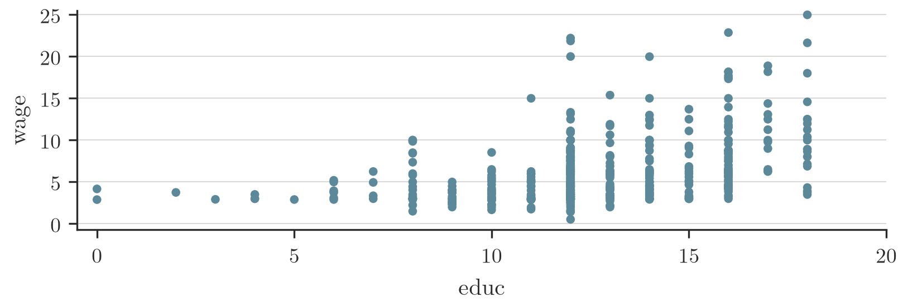
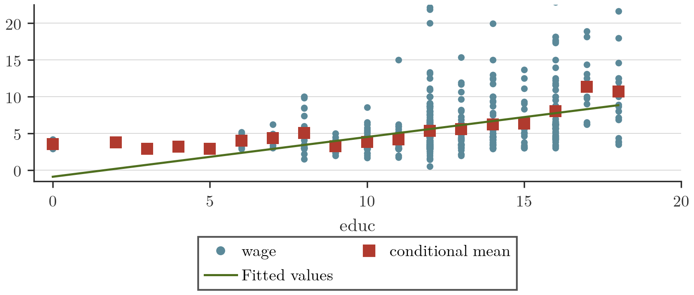
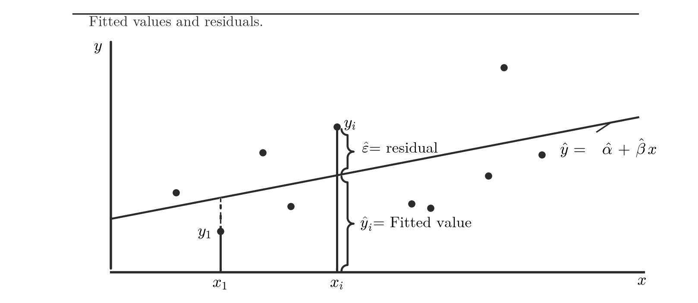
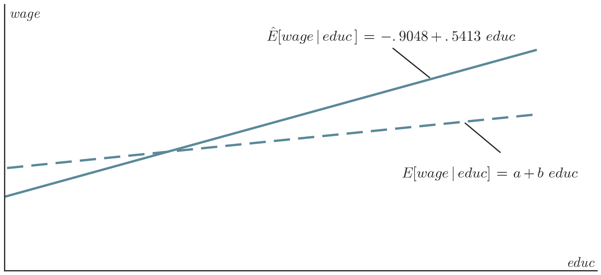
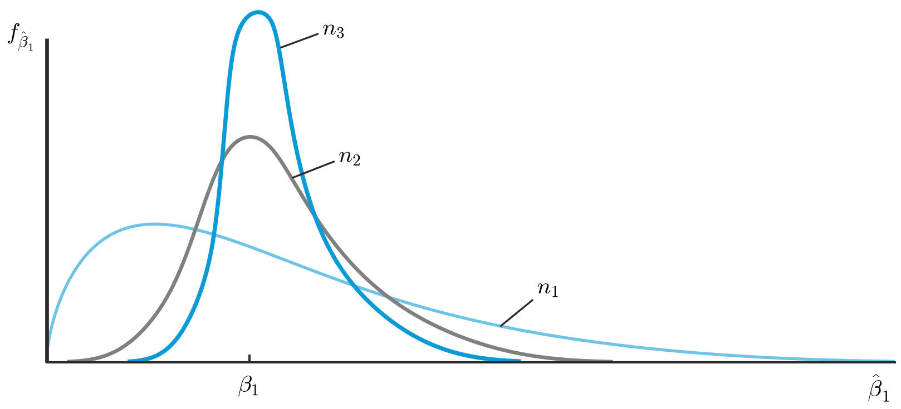

## Introduzione: l'associazione tra variabili quantitative, l'esempio wage vs. education

Si considera come esempio applicato la relazione tra **salari (wage)** e **livello di istruzione (educ)**. Le domande a cui l'analisi vuole rispondere sono:

- Esiste una relazione positiva tra istruzione e salario?
- Per un dato livello di istruzione, qual è il salario medio che un lavoratore può ottenere?
- Qual è il guadagno atteso se si decide di studiare un anno in più?
- Quanto farebbe guadagnare in più conseguire una laurea magistrale (2 anni di studio in più)?

Questo tipo di informazione è utile per prendere decisioni: ad esempio, un individuo potrebbe decidere di iscriversi a una magistrale se il salario atteso aumenta di almeno 1 dollaro l'ora. I dati risalgono al 1976, per cui i salari orari in dollari sono numeri piccoli; l'andamento è simile a quello atteso oggi, a parte la scala.

**Figura 1** — Scatterplot di educ vs. wage (526 individui osservati nel 1976). Relazione grezza tra anni di istruzione e salario orario: i punti seguono una tendenza crescente, con forte dispersione attorno ad essa.

Con l'analisi di regressione si cerca un modello che riassuma, in modo semplice, come variano le distribuzioni condizionali di una variabile $Y$ al variare di una seconda variabile $X$. Nell'esempio, la distribuzione condizionale è la distribuzione di probabilità dei salari ($Y$) per un qualsiasi livello di istruzione ($X$): ogni colonna di punti dello scatterplot raccoglie i salari dei lavoratori che hanno studiato esattamente lo stesso numero di anni, per esempio 10 o 15, e indica in termini probabilistici quanto è probabile trovare, in quel sottogruppo, un lavoratore che guadagna molto o poco. Il modello esprime l'ipotesi (ex-ante) sulla relazione causale: si definisce una variabile obiettivo (variabile dipendente) e una variabile causale (regressore, causa scatenante). Il nesso causale ipotizzato è, per costruzione, unidirezionale ($X \to Y$).

**Figura 2** — Distribuzione condizionale dei salari per ogni livello di istruzione. Boxplot del salario (mediana, quartili, valori estremi) per ciascun valore di anni di istruzione: sia il livello medio sia la dispersione dei salari tendono a crescere con l'istruzione.

Trovare un modello che si adatti con precisione a tutte le distribuzioni condizionali sarebbe troppo complicato. I modelli statistici descrivono quindi la dinamica di alcuni momenti (caratteristiche) delle distribuzioni condizionali; nel modello di regressione queste caratteristiche sono i valori attesi (medie), cioè il momento di ordine uno. Le varianze interessano, ma in generale si vuole capire come, in media, il livello di istruzione incida sul salario. L'obiettivo diventa quindi costruire un modello che descriva le **medie condizionali** di $Y$: ad esempio, qual è il salario atteso per i lavoratori che hanno studiato esattamente 10 anni? Il valore atteso condizionale $E[Y|X=x]$ è la media di $Y$ per un dato livello $x$ di $X$. Nella notazione $E[Y|X]$ la prima variabile è quella su cui si calcola la media, la seconda, dopo la barra verticale, è la variabile di condizionamento: nell'esempio wage è $Y$ ed educ è $X$.

**Figura 3** — Scatterplot di educ vs. wage e $E[wage|educ]$ (quadrati rossi). Le medie condizionate stimate per ciascun livello di istruzione sono sovrapposte ai dati osservati; il loro andamento è crescente ma non perfettamente lineare.

La retribuzione media stimata per un dato numero di anni di istruzione è riportata nella tabella seguente:

**Tabella 1**: valori attesi stimati di wage fissato educ

| years of educ | E[wage\|educ] | years of educ | E[wage\|educ] |
|---|---|---|---|
| educ=0 | 3.53 | educ=10 | 3.83 |
| educ=1 | not available | educ=11 | 4.18 |
| educ=2 | 3.75 | educ=12 | 5.37 |
| educ=3 | 2.92 | educ=13 | 5.59 |
| educ=4 | 3.17 | educ=14 | 6.23 |
| educ=5 | 2.90 | educ=15 | 6.32 |
| educ=6 | 3.98 | educ=16 | 8.04 |
| educ=7 | 4.38 | educ=17 | 11.34 |
| educ=8 | 5.03 | educ=18 | 10.67 |
| educ=9 | 3.27 | educ=19 | not available |

Le medie condizionali tendono a crescere con l'istruzione: per i livelli più bassi, dove la variabilità è scarsa, restano sotto i 5 dollari l'ora, per un livello intermedio sono poco sopra i 5 dollari e per i livelli più alti arrivano a circa 11 dollari. Studiando di più non si guadagna però di più con certezza: in una stessa colonna ci sono persone che guadagnano meno di chi ha studiato zero anni e persone che guadagnano molto di più. Poiché i lavoratori di una colonna hanno lo stesso livello di istruzione, questa non può spiegare l'eterogeneità dei salari, che dipende da altre caratteristiche individuali: il reddito della famiglia (il punto più alto dello scatterplot, a circa 25 dollari l'ora, può appartenere al figlio di un dirigente destinato a diventare dirigente), il tipo di studi (un master in finanza o in storia dell'arte; chi studia archeologia ha esiti molto variabili), le capacità individuali, il genere (nei dati gli uomini tendono a guadagnare più delle donne) e l'università frequentata (a parità di anni di studio, chi si laurea alla Bocconi può avere aspettative diverse da chi si laurea a Cassino, anche solo perché a Milano i salari sono più alti). La parte di eterogeneità non spiegata dall'istruzione, ma da altri fattori, è il termine d'errore, indicato con $\epsilon$.

Per rispondere alle domande iniziali è conveniente un modello che descriva la relazione tra istruzione e salari attesi, e la linea è il modello più semplice che si conosca. I quadrati rossi sono evidenza campionaria, non della popolazione, e spiegare il campione non è l'obiettivo: per conoscere guadagno e anni di studio dell'unità statistica numero 73 basta consultare i dati, senza bisogno di prevederli, e per sapere che cosa succede passando da 12 a 14 anni di istruzione basta la differenza tra le due medie condizionali campionarie. Interessa la popolazione, e in particolare le sue medie condizionali, che si conoscerebbero solo intervistando tutti i lavoratori degli Stati Uniti in un certo periodo e conoscendone con esattezza il reddito, il che è impossibile. Le medie calcolate sui 526 lavoratori del campione ne sono soltanto un'approssimazione.

Per lo stesso motivo non serve una funzione complicata che passi esattamente sui quadrati rossi. Trovarla sarebbe possibile e nemmeno difficile (un comando del computer basta a ottenere funzioni molto regolari che li attraversano), ma le medie campionarie sono già note, calcolate in una tabella a parte. Serve una funzione abbastanza buona da approssimarle e, allo stesso tempo, da approssimare le medie condizionali che si otterrebbero da altri campioni estratti dalla stessa popolazione. Un modello che si adatta perfettamente ai dati posseduti, e non a tutti i dati possibili, che sono i più interessanti perché ignoti, incorre in **overfitting**. Una funzione costruita per passare esattamente per i punti del campione ha un errore praticamente nullo rispetto ai dati usati, ma alcuni punti della popolazione non impiegati nella stima risultano estremamente distanti dalla funzione. Per prevedere $Y$ a un dato valore di $X$ si userebbe il punto sulla funzione stimata, la migliore approssimazione possibile con quella funzione, ma l'errore di previsione sarebbe molto grande per un individuo esterno al campione. È preferibile un modello che non approssimi troppo bene il campione ma non vada troppo male nemmeno fuori da esso, cioè che faccia da media rispetto alle funzioni stimate con campioni diversi: non è perfetto per nessun campione, ma in media non sbaglia in modo sistematico. Il modello serve a capire che cosa succede su ciò che non si osserva; per questo un modello con un $R^2$ del 99% non è necessariamente buono, mentre uno con un $R^2$ del 20% può essere ottimo.

La funzione cercata deve dunque riflettere un andamento di lungo periodo ed essere universale, non specifica del singolo dataset. La retta soddisfa questa esigenza: è un modello molto semplice, facile da identificare e privo di curve o polinomi, e dipende da due soli parametri, l'intercetta e il coefficiente angolare. Stimati questi due numeri, si caratterizza il comportamento dei dati sull'intera popolazione. Il modello non approssima direttamente i dati, per i quali non esiste una funzione che si adatti completamente, ma una loro caratteristica, le medie condizionali, che sono indicatori di centralità sufficientemente stabili.

**Figura 4** — Scatterplot di educ vs. wage con le stime di $E[wage|educ]$ (quadrati rossi) e la linea di regressione. Alla figura precedente si aggiunge la retta di regressione stimata (fitted values), che approssima in modo semplice l'andamento delle medie condizionate.

Esistono modelli che considerano altri indicatori, come quantili e mediane. La regressione quantilica, qui non trattata, permette di studiare come reagiscono le code della distribuzione oltre alla media. In finanza interessano le code, cioè perdere o guadagnare molto: a chi investe interessa coprirsi dagli eventi estremi, per esempio capire come una variazione della situazione geopolitica incida sulle code del rendimento di un portafoglio e non sulla sua media. Qui si considerano le medie condizionali, un indicatore di centralità semplice, ma l'impostazione si può generalizzare.

## Il modello di regressione semplice

> [!abstract] Definizione
> La **funzione di regressione semplice** descrive le medie condizionali $E[Y|X=x]$ attraverso un modello lineare:
>
> $$E[Y|X] = \alpha + \beta X$$
>
> Questa retta è un'approssimazione della vera media condizionale (quella della popolazione, stimata dai quadrati rossi delle figure precedenti), poiché in generale non è possibile trovare un modello semplice che corrisponda esattamente a tutte le medie condizionate.
>
> Data questa ipotesi per la media condizionale, ogni osservazione $(X_i, Y_i)$ nel campione, dove $i$ indica l'unità statistica (un lavoratore nell'esempio), può essere rappresentata come
>
> $$Y_i = E[Y|X=X_i] + \epsilon_i$$
>
> dove $\epsilon_i$ è una quantità stocastica che misura la distanza tra ciascuna osservazione e la retta di regressione. Poiché $E[Y|X=X_i]=\alpha+\beta X_i$, vale
>
> $$Y_i = \alpha + \beta X_i + \epsilon_i$$
>
> La terminologia è la seguente:
> - $Y_i$, $i=1,\dots,n$: variabile dipendente;
> - $X_i$, $i=1,\dots,n$: regressore o predittore (due nomi della stessa variabile: predittore nella letteratura più statistica, regressore in quella più economica);
> - $\epsilon_i$, $i=1,\dots,n$: termine di errore.
>
> Il valore esatto di $Y_i$ per un individuo, che non coincide con la media, dipende da due fattori: una componente media, $\alpha+\beta X_i$, legata all'appartenenza a una categoria (un livello di istruzione), e una componente idiosincratica, individuale, $\epsilon_i$. Intuitivamente $\epsilon_i$ è un fattore di rumore che raccoglie gli effetti di tutte le variabili che potrebbero influenzare $Y$ (escluso $X$) e non sono incluse esplicitamente nel modello: nell'esempio, le caratteristiche individuali elencate sopra. Si assume che l'unico predittore utile per il valore atteso di $Y$ sia il regressore: per questo ci si aspetta che, in media, l'impatto di $\epsilon$ non sia rilevante, ovvero formalmente che $E[\epsilon|X]=0$. Ciò significa che il termine di errore per alcuni soggetti è positivo, per altri negativo, ma in media tutti questi errori si sommano a zero.

Le proprietà di $\epsilon$ determinano se il modello esprima una relazione causale: la relazione tra $\epsilon$ e $X$ permette di dire se il modello è ben specificato. Poiché il termine d'errore non è osservabile, stabilire se il modello sia corretto richiede di determinare le proprietà di una quantità che non si può misurare direttamente, ed è quindi necessario aggirare il problema con un'ipotesi sulla relazione tra $\epsilon$ ed $X$.

Per interpretare l'effetto di una variazione di $X$ si ipotizzi che i parametri $\alpha$ e $\beta$ siano noti. La previsione di $Y$ per un individuo con $X=X_1$ è

$$\hat{Y}(X_1) = \alpha + \beta X_1 + \epsilon(X_1)$$

e per $X=X_2$:

$$\hat{Y}(X_2) = \alpha + \beta X_2 + \epsilon(X_2)$$

dove $\epsilon(X_1)$ ed $\epsilon(X_2)$ rappresentano le caratteristiche non osservate di soggetti con istruzione rispettivamente $X_1$ o $X_2$ anni. L'errore dipende anche da $X$ perché contiene fattori diversi dall'istruzione che in linea di principio possono esserle collegati: più si studia, più si impara, e l'abilità può aumentare. La variazione di $Y$ è quindi

$$\underbrace{\hat{Y}(X_2)-\hat{Y}(X_1)}_{\Delta Y} = \beta\underbrace{(X_2-X_1)}_{\Delta X} + \underbrace{[\epsilon(X_2)-\epsilon(X_1)]}_{\Delta \epsilon}$$

$\Delta Y$ dipende quindi da una scelta economica ($\Delta X$) e da qualcos'altro ($\Delta\epsilon$), quest'ultimo in generale non misurabile anche se teoricamente esiste: la variazione del salario dipende in parte dall'aver studiato più anni e in parte da effetti collaterali della scelta. La variazione complessiva si può invece calcolare: la differenza tra due medie condizionali campionarie dà, per esempio, 3 dollari. Il modello non permette però di stabilire se questi 3 dollari derivino dalla scelta di studiare o da altro, perché se ne conosce soltanto la somma: potrebbero essere 1 più 2, oppure 0 più 3, oppure $-3$ più 6. L'effetto non è identificabile. L'unico modo per identificare l'effetto della scelta, cioè $\beta \Delta X$, è fissare il valore di $\Delta\epsilon$, e il valore più comodo è 0. Se si assume che $\epsilon$ non dipenda da $X$, diversi livelli di $X$ non portano a variazioni di $\epsilon$, cioè $\Delta \epsilon = 0$. Pertanto la variazione di $Y$ è proporzionale alla variazione di $X$, con coefficiente di proporzionalità $\beta$:

$$\Delta Y = \beta \Delta X$$

Nel modello lineare la condizione per cui $\Delta\epsilon=0$ al variare di $X$ è la correlazione nulla tra $X$ ed $\epsilon$. Se $E[\epsilon|X]=0$, allora $\mathrm{Cov}(X,\epsilon)=0$ e $\hat{Y}(X)\approx E[Y|X]$; l'implicazione inversa non vale in generale, perché l'assenza di correlazione è una condizione più debole. Con questa ipotesi l'unica spiegazione delle variazioni di $Y$ è fornita da $X$, pesata dal coefficiente $\beta$, la pendenza della retta di regressione: il risultato di una scelta dipende unicamente dalla scelta stessa ($\Delta X$) e non da altri fattori confondenti ($\Delta \epsilon$). L'ipotesi $E[\epsilon|X]=0$ è nota come **esogeneità** (stretta) ed è alla base dello studio di relazioni causali. Esistono vari concetti di esogeneità: nei modelli di regressione classici si usa quella stretta, mentre in seguito si passa all'esogeneità debole, condizione sufficiente allo scopo. Se l'ipotesi non vale si parla di **endogeneità**, che ha conseguenze pesanti sulla stima: con una correlazione diversa da zero la variazione di $\epsilon$ non potrebbe essere nulla in corrispondenza di una variazione di $X$, e non si saprebbe valutare perché si osservino variazioni di $Y$.
> [!example] Esempio
> Si consideri il modello che lega salario e istruzione con $\alpha=-1$ e $\beta=0.5$:
>
> $$wage_i = \alpha + \beta\, educ_i + \epsilon_i = -1 + 0.5\, educ_i + \epsilon_i$$
>
> Assumendo che altre caratteristiche (genere, esperienza, tenure, ecc.), riassunte in $\epsilon_i$, non siano rilevanti, un anno di scuola in più ($\Delta educ = 1$) induce una variazione della retribuzione oraria prevista di 0.50 dollari; due anni in più inducono una variazione dello stipendio atteso di 1 dollaro.

> [!example] Esempio
> In Italia i consumi sono molto bassi e, per dare loro impulso, si introducono tipicamente dei bonus. La riforma dei mille euro di Matteo Renzi è stata introdotta come sconto fiscale per una certa fascia di lavoratori: la misura è costosa, ma il costo si valuta con precisione, perché è una minore entrata per lo Stato. Lo scopo era stimolare i consumi, e ci si chiede se questi siano effettivamente migliorati in conseguenza della policy.
>
> Per rispondere si può stimare la relazione tra redditi ($X$) e consumi ($Y$), entrambi pro capite: la policy varia $X$ di 1.000 euro, e ci si chiede come siano variati i consumi. L'esempio pone un problema statistico e non valuta se la misura sia stata giusta o sbagliata. Se il parametro che lega consumi e redditi è grande, 1.000 euro in più alle famiglie hanno un impatto sui consumi e la policy ottiene il risultato voluto. Resta da stabilire se il modello sia corretto: la variazione dei consumi osservata può dipendere dai 1.000 euro in più oppure da altro, come le condizioni economiche del periodo; se l'effetto collaterale prevalesse, quei fondi sarebbero stati impiegati più efficacemente altrove.
>
> Un parametro stimato grande implica un impatto della policy solo se $\Delta\epsilon=0$. Altrimenti la variazione dei consumi si può calcolare, ma non si sa da che cosa dipenda, perché occorre considerare una combinazione di eventi e non uno solo. Se $\Delta\epsilon=0$, l'unica spiegazione della variazione di $Y$ è $X$, pesata da $\beta$, che è il moltiplicatore, e il solo problema diventa stimare $\beta$.

Il problema posto da $\Delta\epsilon$ non riguarda il modello di regressione in sé, ma l'interpretabilità dei risultati. In un'impostazione statistica orientata alla previsione l'eterogeneità non viene praticamente considerata, perché lo scopo è trovare un modello da usare per prevedere i dati successivi. In economia interessa invece valutare con precisione il parametro $\beta$, per capire, per esempio, se la spesa per l'istruzione dei bambini sia una scelta corretta: lo scopo è stabilire quanto una policy abbia impatto, cioè stimare correttamente $\beta$, e non disporre di un modello che si adatti ai dati o serva per le previsioni. Per farlo occorre fissare $\Delta\epsilon$ a zero.

Un economista che si chiede se spendere 2 miliardi di dollari l'anno per ridurre la dimensione delle classi sia utile a grande scala affronta un problema politico o economico. Un genitore che deve iscrivere un figlio a scuola ha invece uno scopo di previsione: sceglie la scuola in cui il voto finale del figlio sarà più alto, per entrare l'anno dopo in una buona scuola con una borsa di studio, e cerca la scuola più adatta al proprio figlio, non un miglioramento del sistema. Se la variabile che prevede meglio la performance del figlio risultasse la dimensione del parcheggio della scuola, il genitore misurerebbe il parcheggio di tutte le scuole degli Stati Uniti e sceglierebbe in base a quello: non importa che logicamente non abbia senso, se funziona. È una black box.

Per chi fa previsione non interessa quindi calcolare esattamente il parametro che lega le variabili, perché non è necessariamente legato alla capacità previsiva del modello. Se invece si usa il modello per valutare politiche, o per confermare congetture economiche e finanziarie di qualsiasi tipo, il parametro è ciò che interessa. I due approcci rispondono a criteri diversi perché i problemi sono diversi.

## Stima del modello: il metodo dei minimi quadrati ordinari (OLS)

> [!abstract] Definizione
> Dato un campione, occorre stimare i parametri $\alpha$ e $\beta$ del modello di regressione. L'idea di base è trovare valori per $\alpha$ e $\beta$ che minimizzino la distanza media tra ciascuna osservazione e la retta di regressione: questi due parametri identificano in modo univoco la retta.
>
> Il metodo dei **minimi quadrati ordinari (OLS)** suggerisce di minimizzare la varianza del termine di errore, ovvero calcolare
>
> $$\min_{\alpha,\beta} \mathrm{Var}(\epsilon) = \min_{\alpha,\beta} E[\epsilon^2] \approx \min_{\alpha,\beta} \frac{1}{n}\sum_{i=1}^n (Y_i-\alpha-\beta X_i)^2$$
>
> La distanza è misurata con il quadrato degli scarti, perché scarti positivi e negativi non si compensino. Si derivano le espressioni rispetto ad $\alpha$ e $\beta$, si pongono le derivate uguali a zero e si risolve il sistema di due equazioni in due incognite: la soluzione per $\beta$ è un rapporto tra quantità, quella per $\alpha$ una differenza di medie. Si dimostra che la pendenza della retta di regressione $\beta$ è proporzionale alla covarianza tra $X$ e $Y$:
>
> $$\hat\beta = \frac{\frac{1}{n}\sum_{i=1}^n (Y_i-\bar Y)(X_i-\bar X)}{\frac{1}{n}\sum_{i=1}^n (X_i-\bar X)^2} = \frac{\mathrm{Cov}(X,Y)}{\mathrm{Var}(X)}$$

> [!note] Dimostrazione
> L'espressione di $\beta$ si ricava anche, con un'algebra più breve, a partire dall'esogeneità. Si assume che il modello sia corretto, cioè che la covarianza tra $X$ ed $\epsilon$ sia zero. Nella popolazione $Y$ è data dalla combinazione $\alpha + \beta X + \epsilon$, per cui
>
> $$\mathrm{Cov}(X, Y) = \mathrm{Cov}(X, \alpha + \beta X + \epsilon)$$
>
> La covarianza di una variabile rispetto a una combinazione lineare è la combinazione lineare delle covarianze, perché la covarianza si può pensare come una media, una sommatoria o un integrale, che sono operatori lineari. Si ottiene quindi
>
> $$\mathrm{Cov}(X, Y) = \mathrm{Cov}(X, \alpha) + \mathrm{Cov}(X, \beta X) + \mathrm{Cov}(X, \epsilon)$$
>
> Il primo termine è zero, perché la covarianza tra una costante e una variabile casuale è nulla: al variare di $X$, $\alpha$ resta costante. Il terzo termine è zero per l'ipotesi di esogeneità, che è una scelta di modello e non necessariamente vale. Nel secondo la costante $\beta$ si porta fuori dalla covarianza e resta la covarianza di $X$ con se stessa, cioè la varianza di $X$. Quindi
>
> $$\mathrm{Cov}(X, Y) = \beta \,\mathrm{Var}(X), \qquad \beta = \frac{\mathrm{Cov}(X, Y)}{\mathrm{Var}(X)}$$

Questa relazione vale nella popolazione: il vero $\beta$, quello che si otterrebbe considerando tutti i lavoratori degli Stati Uniti, è la covarianza tra livello di istruzione e salario divisa per la varianza del livello di istruzione. Se la formula vale nella popolazione, si può applicare al campione: numeratore e denominatore si stimano con covarianza e varianza campionarie, che per la legge dei grandi numeri convergono ai momenti di popolazione, per cui lo stimatore converge al vero $\beta$ per $n$ sufficientemente grande. Il procedimento si chiama **metodo dei momenti**.

Il metodo dei momenti impone l'ipotesi economica specifica, l'esogeneità, direttamente tra le condizioni usate per la stima, e la formula funziona solo se la covarianza tra $X$ ed $\epsilon$ è zero. Minimizzando la distanza tra $Y$ e il modello di regressione si ottiene lo stesso stimatore: i due approcci coincidono in questo caso, ma non sempre.

> [!example] Esempio
> Si consideri il modello $wage_i = \alpha + \beta\, educ_i + \epsilon_i$. Le stime OLS basate su un campione di 526 osservazioni sono:
>
> | Variabile | Coef. | Std. Err. | t | P>\|t\| | IC 95% inf. | IC 95% sup. |
> |---|---|---|---|---|---|---|
> | educ | .5413593 | .053248 | 10.17 | 0.000 | .4367534 | .6459651 |
> | _cons | -.9048516 | .6849678 | -1.32 | 0.187 | -2.250472 | .4407687 |
>
> Il modello stimato risulta quindi (coefficienti arrotondati alla quarta cifra)
>
> $$wage = -.9049 + .5414\, educ$$
>
> Studiare un anno in più induce una variazione positiva di circa 54 centesimi nei salari.

> [!abstract] Definizione
> Una volta stimati i parametri, il modello si usa per la previsione. La previsione della media condizionale, o valore predetto, si ottiene sostituendo ai parametri veri le loro stime, per un valore $x_i$ prefissato da chi effettua la previsione:
>
> $$\hat Y_i = \hat E[Y_i|X=x_i] = \hat\alpha + \hat\beta x_i$$
>
> Il termine di errore si stima con il **residuo**, la differenza tra la variabile osservata $Y_i$ (nell'esempio, il salario) e il valore predetto $\hat Y_i$: è il termine d'errore valutato per l'individuo $i$ osservato e misura quanto la previsione si discosta dal valore effettivamente osservato. È definito come
>
> $$\hat\epsilon_i = Y_i - \hat\alpha - \hat\beta X_i = Y_i - \hat Y_i$$
>
> 
>
> **Figura 5** — Rappresentazione grafica di $Y_i$ come somma di residuo ($\hat\epsilon_i$) e valore predetto ($\hat Y_i$). Ogni osservazione $Y_i$ si scompone nella somma del valore previsto dalla retta e del residuo, cioè la distanza verticale tra il punto osservato e la retta.

Il valore predetto è la stima di un valore atteso condizionale ed è una variabile casuale, perché $\alpha$ e $\beta$ sono incerti: del campione si conoscono solo approssimazioni, non i veri parametri della popolazione. L'intercetta non è un parametro di particolare interesse, salvo applicazioni specifiche, e in generale si include nel modello a meno di ragioni molto forti per escluderla.

Il residuo non coincide con il termine d'errore $\epsilon$. Il residuo è un'evidenza campionaria riferita a una persona specifica ed è un numero; il termine d'errore è un concetto più astratto: è la distanza tra ogni individuo della popolazione, e non del campione, e il vero modello nella popolazione, ed è una variabile casuale.

## Il termine d'errore ε: proprietà, omoschedasticità ed eteroschedasticità

> [!abstract] Definizione
> Le proprietà della variabile casuale $\epsilon$ servono a derivare le proprietà degli stimatori OLS: interessano i suoi momenti e la relazione tra $\epsilon$ ed $X$.
>
> Per costruzione, $\epsilon_i$ è la differenza tra $Y_i$ e la media condizionale $E[Y|X_i]$:
>
> $$\epsilon_i = Y_i - E[Y|X_i] = Y_i - \alpha - \beta X_i$$
>
> $\epsilon$ raccoglie tutte le caratteristiche non esplicitamente considerate dal modello e descrive l'eterogeneità presente nei dati: non tutte le persone che hanno studiato 10 anni ricevono la stessa somma di denaro, alcune ricevono uno stipendio superiore alla media condizionata, altre inferiore. Il termine di errore spiega questa variabilità e raccoglie intuitivamente la quantità di informazioni su $Y$ non osservabili che non sono spiegate da $X$.
>
> Ipotizzando che $\alpha+\beta X$ sia un'approssimazione credibile di $E[Y|X]$ (cioè $E[Y|X]\approx \alpha+\beta X$), la media condizionale di $\epsilon$ deve essere
>
> $$E[\epsilon|X] = E[Y|X] - \alpha - \beta X = 0$$
>
> Come conseguenza principale, $\mathrm{Cov}(\epsilon,X)=0$: tutte le variabili che contribuiscono alla costruzione di $\epsilon$ non possono essere correlate con $X$. Questo implica
>
> $$\Delta E[Y|X] = \Delta Y = \beta \Delta X + \Delta \epsilon = \beta \Delta X$$
>
> L'intuizione è che l'unica informazione rilevante per descrivere la media condizionale di $Y$ è fornita da $X$; tutte le altre variabili non possono avere un impatto sistematico su di essa.

L'endogeneità nasce tipicamente perché il modello statistico stimato non corrisponde al modello che descrive i dati nella popolazione. In ogni analisi empirica si distinguono il processo generatore dei dati, un concetto astratto per cui i dati sono legati ad altre variabili in modo predeterminato, e il modello scelto da chi analizza. Il modello teorico, che descrive la realtà, spiega la relazione tra le variabili nella popolazione ed è ignoto; il modello statistico (o empirico) è il modo in cui la si osserva, quello specificato da chi analizza nel software di stima. Se i due modelli coincidono non c'è endogeneità; se il modello stimato è sbagliato rispetto al processo generatore dei dati si ricade nell'endogeneità, con problemi nella stima dei parametri di interesse. Per stabilire se le formule usate per approssimare i parametri siano adeguate occorre conoscere le caratteristiche del termine d'errore, in particolare i suoi momenti condizionali rispetto a $X$.

Il passaggio da $E[\epsilon|X]=0$ a $\mathrm{Cov}(X,\epsilon)=0$ richiede un risultato di statistica di base: la media di una variabile si può scrivere come la media delle medie condizionali.

> [!tip] Teorema
> Per la **legge delle aspettative totali** (o, più brevemente, legge delle aspettative) la media delle medie condizionali è la media marginale, cioè il valore atteso iterato del valore atteso condizionato:
>
> $$E[Y] = E\big[\,E[Y|X]\,\big]$$
>
> Se si calcola la media condizionale rispetto a un insieme informativo molto grande e la si media poi rispetto a un insieme molto piccolo, l'informazione aggiuntiva sparisce.

Il risultato vale nella popolazione oltre che nel campione e in econometria è molto usato, anche in applicazioni più avanzate. Lo si verifica sul diagramma di dispersione dei salari di 526 lavoratori, divisi per livello di istruzione in sottogruppi disgiunti, ciascuno con la media rappresentata da un quadrato rosso. La media marginale dei salari si calcola in due modi: come media aritmetica di tutti i salari, cioè $1/526$ per la somma dei salari, oppure come media dei quadrati rossi pesata per il numero di osservazioni di ciascun gruppo (un quadrato con due persone vale 2, uno con 60 persone vale 60). Si ottiene esattamente lo stesso numero.

> [!note] Dimostrazione
> Si dimostra che la condizione sulla media condizionale, leggermente più forte della covarianza nulla, implica quest'ultima. La covarianza si scrive come $\mathrm{Cov}(X,\epsilon) = E[X\epsilon] - E[X]E[\epsilon]$. Si assume che la media di $\epsilon$ sia zero: se non lo fosse, si può riscrivere il modello in modo che lo sia, sommando la media di $\epsilon$ all'intercetta e sottraendola all'errore, senza cambiare $\beta$ né la covarianza tra $X$ ed $\epsilon$. Il secondo termine sparisce allora per definizione e la covarianza è uguale a $E[X\epsilon]$. Per la legge delle aspettative totali si calcola prima la media rispetto a $\epsilon$ di $X\epsilon$ fissato $X$ (i quadrati rossi) e poi la media rispetto a tutti i valori di $X$:
>
> $$E[X\epsilon] = E\big[\,E[X\epsilon|X]\,\big]$$
>
> Fissato $X$, questo è una costante e si porta fuori dalla media condizionale:
>
> $$E\big[\,E[X\epsilon|X]\,\big] = E\big[\,X \, E[\epsilon|X]\,\big]$$
>
> Se il modello è corretto, $E[\epsilon|X] = 0$ qualunque sia il valore di $X$: l'argomento della media è sempre zero e la media è zero. Quindi $E[\epsilon|X]=0$, che è la definizione corretta di esogeneità, implica $\mathrm{Cov}(X,\epsilon)=0$.

Il viceversa non vale in generale, e per un controesempio basta una dipendenza non lineare: con $X \sim N(0,1)$ ed $\epsilon = X^2 - 1$ si ha $\mathrm{Cov}(X,\epsilon) = E[X^3] - E[X] = 0$, ma $E[\epsilon|X] = X^2 - 1 \neq 0$. I due concetti non sono quindi equivalenti; poiché per la convergenza dello stimatore al vero $\beta$ basta la covarianza nulla, l'esogeneità si può comunque pensare come assenza di correlazione tra $X$ ed $\epsilon$, un concetto più immediato della condizione sul momento condizionale.

> [!abstract] Definizione
> Oltre alla media condizionale si possono fare ipotesi su altri momenti di $\epsilon$. In generale spesso non si sa come descrivere la varianza condizionale di $\epsilon$. Si noti però che la variabilità di $\epsilon$ descrive anche la variabilità della variabile dipendente $Y$:
>
> $$\mathrm{Var}(\epsilon|X) = \mathrm{Var}(Y|X)$$
>
> Si possono formulare due ipotesi alternative sulle varianze condizionali:
>
> - **Omoschedasticità**: $\mathrm{Var}(\epsilon|X)=\sigma^2$, cioè è costante e non dipende da $X$.
> - **Eteroschedasticità**: $\mathrm{Var}(\epsilon|X)=\sigma^2(X)$, quindi è funzione di $X$ e varia in qualsiasi modo al variare di $X$.
>
> Qualunque sia l'ipotesi su $\mathrm{Var}(\epsilon|X)$, i coefficienti stimati restano gli stessi e le stime dei minimi quadrati restano valide. Ipotesi diverse portano però a formule diverse per la varianza, e quindi per gli errori standard, dello stimatore OLS: hanno conseguenze sui test sui parametri, cioè sull'inferenza.
>
> 
>
> **Figura 6** — Retta di regressione $E(Y|X=x)$ ed errori omoschedastici. A diversi valori di $X$ la dispersione di $Y$ attorno alla retta rimane simile (variabilità condizionale simile).
>
> 
>
> **Figura 7** — Retta di regressione $E(Y|X=x)$ ed errori eteroschedastici. A diversi valori di $X$ corrispondono ampiezze diverse della variabilità di $Y$ attorno alla retta, cioè diverse $\mathrm{Var}(Y|X)$.

L'uguaglianza tra le due varianze condizionali segue da $\mathrm{Var}(Y|X) = \mathrm{Var}(\alpha + \beta X + \epsilon|X)$. Fissato $X$, il termine $\alpha + \beta X$ è una costante: se il livello di istruzione è 5, $\alpha$ e $\beta$ sono numeri ignoti ma pur sempre numeri, quindi $\alpha + 5\beta$ è un valore fisso. La varianza di una variabile casuale a cui si somma una costante non dipende dalla costante. Se a ogni faccia di un dado si aggiunge 3, i valori si spostano di 3 unità ma la variabilità tra minimo e massimo non cambia: invece della differenza tra 6 e 1 si ha quella tra 9 e 4, sempre 5. Quindi $\mathrm{Var}(Y|X) = \mathrm{Var}(\epsilon|X)$.

L'eterogeneità dei salari corrisponde così all'eterogeneità della componente individuale del salario che non dipende dal livello di istruzione: la variabilità all'interno di ciascun sottogruppo è la variabilità di tutto ciò che non è nel modello, e la varianza condizionale di $\epsilon$ misura l'eterogeneità dei lavoratori nel sottogruppo.

Nel diagramma di dispersione dei salari si osserva eteroschedasticità: all'aumentare di $X$ la dispersione tende ad aumentare, con un gruppo di lavoratori a varianza piccola e un altro, a livelli di istruzione maggiori, a varianza grande. L'ipotesi di omoschedasticità non appare plausibile, e una qualche forma di eteroschedasticità non si può mai escludere. La varianza non deve necessariamente crescere con $X$: può diminuire o seguire un andamento non monotono (per esempio grande, piccola, piccola, grande). È sufficiente che non sia costante. Per giudicare si osservano le oscillazioni di $Y$ a ogni livello fissato di $X$: nelle code ci sono meno osservazioni e la variabilità può essere qualsiasi, mentre nel corpo della distribuzione la variabilità omoschedastica è circa la stessa.

Delle due ipotesi sul termine d'errore, la media condizionale zero definisce un modello corretto dal punto di vista logico, legato a una relazione causale, a cui non manca nulla; l'ipotesi sulla varianza condizionale, costante o no, è di comodo e si gestisce in modo abbastanza semplice.

## Le ipotesi del modello di regressione OLS

> [!abstract] Definizione
> Ai fini pratici occorre verificare se la strategia OLS fornisce stime affidabili dei parametri di interesse: il coefficiente $\beta$ misura l'impatto di una politica (valutata come $\Delta X$) sulla variabile dipendente. Per valutare queste proprietà occorre definire formalmente le ipotesi sul modello di regressione:
>
> 1. Il vero modello (la retta nella popolazione) è lineare: $E[Y|X]=\alpha+\beta X$;
> 2. Il modello statistico (approssimato) coincide con quello vero, ovvero $Y=\alpha+\beta X+\epsilon$. Come conseguenza principale, $\mathrm{Cov}(X,\epsilon)=0$;
> 3. Le coppie $(X_i,Y_i)$, $i=1,\dots,n$ sono **I.I.D.**;
> 4. I momenti quarti di $X$ e $Y$ esistono e sono finiti;
> 5. Si suppone, ad esempio, che $\mathrm{var}[\epsilon|X]=\sigma^2$ (**Omoschedasticità**).

Le ipotesi si possono formulare in modo diverso ma equivalente. Si è finora supposto che il modello empirico (quello valutato attraverso un dataset) sia $Y=\alpha+\beta X+\epsilon$ e che la media condizionale (il vero modello) sia $E[Y|X]=\alpha+\beta X$. Se il modello empirico coincide con quello vero, $\epsilon \equiv Y-E[Y|X]$, quindi

$$E[\epsilon|X]=0 \;\Rightarrow\; \mathrm{Cov}(X,\epsilon)=0$$

Si può allora partire dal modello empirico lineare $Y=\alpha+\beta X+\epsilon$ e supporre che $E[\epsilon|X]=0$, così che $E[Y|X]=\alpha+\beta X$ corrisponde al vero modello. Le prime due ipotesi sono sostituite da una sola: il regressore $X$ è **esogeno**, ovvero la media condizionale di $\epsilon|X$ è zero ($E[\epsilon|X]=0$), con conseguenza principale $E[Y|X]=\alpha+\beta X$. Le ipotesi di I.I.D., di esistenza e finitezza dei momenti quarti e di omoschedasticità, $\mathrm{var}[\epsilon|X]=\sigma^2$, restano invariate.

Si supponga ora che il regressore non sia esogeno, cioè sia **endogeno**, quindi $\mathrm{Cov}(X,\epsilon)\neq 0$. Si consideri la variazione attesa di $Y$:

$$\underbrace{\hat Y(X_2)-\hat Y(X_1)}_{\Delta Y} = \alpha+\beta X_2+\epsilon(X_2) - [\alpha+\beta X_1+\epsilon(X_1)] = \beta\underbrace{(X_2-X_1)}_{\Delta X} + \underbrace{[\epsilon(X_2)-\epsilon(X_1)]}_{\Delta \epsilon}$$

Poiché $\mathrm{Cov}(X,\epsilon)\neq 0$, ragionevolmente ci si aspetta che $E[\Delta\epsilon|X]$, misurato come $\epsilon(X_2)-\epsilon(X_1)$, sia diverso da zero. In questo caso

$$\Delta Y = \beta \Delta X + \Delta \epsilon$$

Le variazioni attese di $Y$ dipendono da $\beta$ e da $\Delta\epsilon$, in generale non calcolabile: quindi $\beta$ non è più una misura precisa delle implicazioni di $\Delta X$. Il problema centrale è stabilire quando si può assumere $\Delta\epsilon=0$ in corrispondenza di $\Delta X$.

L'effetto sulla stima si vede ripetendo il calcolo della covarianza del metodo dei momenti. Si indichi con $\rho_{X\epsilon}$ la covarianza, diversa da zero, tra $X$ ed $\epsilon$: si ottiene $\mathrm{Cov}(X,Y)=\beta\,\mathrm{Var}(X)+\rho_{X\epsilon}$. Se $\rho_{X\epsilon}$ fosse noto, $\beta$ andrebbe calcolato come

$$\beta = \frac{\mathrm{Cov}(X,Y)-\rho_{X\epsilon}}{\mathrm{Var}(X)}.$$

Per ottenere $\beta$ correttamente occorrerebbe dunque stimare anche $\rho_{X\epsilon}$, cosa che non si sa fare perché quel numero non è noto. Un software, a meno che non gli venga indicato altrimenti, tratta $\rho_{X\epsilon}$ come se fosse zero. Applicando la formula sbagliata quando l'esogeneità non vale, ciò che si stima è $\beta$ più un termine ulteriore, perché il numeratore dovrebbe essere ripulito dall'effetto di $\rho_{X\epsilon}$. Si ha così una distorsione sistematica tra ciò che si vuole stimare e ciò che si stima effettivamente dai dati. Con endogeneità gli stimatori OLS sono distorti e l'implicazione di policy che si vuole valutare con il modello è sistematicamente sbagliata.

> [!example] Esempio
> Si consideri un dataset simulato di dimensione 200 che soddisfa
>
> $$Y_i = 3 + 1.5 X_i + \epsilon_i, \qquad \mathrm{cov}(X,\epsilon)=0.6$$
>
> Con dati simulati si conoscono esattamente le variabili e la relazione tra esse: si fissano $\alpha=3$ e $\beta=1.5$, si costruiscono $X$ e $Y$ al computer e si aggiunge un errore scelto di proposito in modo che sia correlato con $X$. Le varianze sono poste uguali a 1, per cui la covarianza coincide con la correlazione, pari a 0,6, molto alta. Si stima il modello $Y=\alpha+\beta X+\epsilon$ assumendo che la covarianza tra $X$ ed errore sia nulla, cioè calcolando $\beta$ come covarianza tra $X$ e $Y$ divisa per la varianza di $X$: in questo modello la formula standard è sbagliata. L'output di Gretl è il seguente:
>
> | Variabile | Coef. | Std. Err. | t | P>\|t\| | IC 95% inf. | IC 95% sup. |
> |---|---|---|---|---|---|---|
> | X | 2.129496 | .063634 | 33.46 | 0.000 | 2.004008 | 2.254983 |
> | _cons | 2.962697 | .0635759 | 46.60 | 0.000 | 2.837324 | 3.08807 |
>
> La costante è stimata a 2,96, contro il vero valore 3, con intervallo di confidenza da 2,83 a 3,08: il valore 3 vi è contenuto ed è plausibile come vero valore. Il coefficiente $\beta$, che nella realtà vale 1,5, è stimato con 2,129, cioè circa 2,1, e l'intervallo di confidenza indica che il vero valore dovrebbe cadere tra 2 e 2,25. Il valore 1,5 è fuori dall'intervallo: sulla base dei risultati è molto improbabile che sia il vero valore, ma a priori si sa che lo è. Qui $\hat\beta$ non è quindi una stima affidabile del parametro di policy $\beta$: dimenticare l'endogeneità nella procedura di stima produce una stima abbastanza diversa da quella che dovrebbe essere.
>
> Il valore 2,1 è esattamente 1,5 più 0,6: $\hat\beta$ converge infatti a $\beta+\mathrm{Cov}(X,\epsilon)/\mathrm{Var}(X)$, qui circa $1.5+0.6=2.1$ perché $\mathrm{Var}(X)\approx 1$, valore coerente con gli errori standard in tabella. La distorsione non coincide in generale con la correlazione: qui il risultato è proprio quel numero perché la varianza di $X$ è uguale a 1, altrimenti si avrebbe un altro valore, ma sempre una distorsione. Ciò che si stima è $\beta$ più un termine aggiuntivo di cui in generale non si conosce l'entità (per esempio 0,1 oppure 0,99), e non si sa quanto la stima disti da quella desiderata.
>
> La distorsione non sparisce all'aumentare dei dati. Con più dati la stima e l'inferenza sono più precise, ma la parte di distorsione non è comprimibile: si converge sempre più a 2,1 e non a 1,5, perché ciò che si stima è 1,5 più 0,6. La stima è molto precisa, ma sul valore sbagliato, e né la legge dei grandi numeri né il teorema del limite centrale servono a rimediare.

Dal punto di vista statistico la procedura è corretta: lo stimatore dei minimi quadrati, o del metodo dei momenti, è la covarianza tra $X$ e $Y$ divisa per la varianza di $X$. Con esogeneità la formula dà esattamente ciò che serve, cioè un effetto marginale, il parametro $\beta$; con endogeneità la qualità del risultato è molto bassa. Esogeneità ed endogeneità sono quindi un'ipotesi da fare: il modello deve essere corretto dal punto di vista logico, cioè rappresentare una relazione causa-effetto, e occorre convincersi che non sia influenzato dall'endogeneità. Se lo è, le soluzioni sono due: specificare diversamente il modello, oppure usare stimatori non standard, come le variabili strumentali.

L'ipotesi di covarianza nulla non si può dimostrare: occorre ragionare per stabilire se sia ragionevole. Un modo è chiedersi quando l'endogeneità si presenti. Un caso è il modello con troppe poche variabili: la media condizionale dipende da una sola variabile, mentre tutte le altre stanno dentro $\epsilon$ e potrebbero essere legate a $X$. Si può allora togliere informazione a $\epsilon$ e inserirla nel modello, aggiungendo variabili alla media condizionale. Se il parametro associato alla variabile di interesse cambia molto aggiungendo o meno una variabile, nel modello con meno variabili c'è probabilmente un problema di variabile omessa, quindi di endogeneità. In una regressione si possono avere 100 parametri, ma ne interessano solo due o tre, rilevanti per il problema economico: tutti gli altri sono fattori di disturbo.

Conviene individuare le potenziali cause di endogeneità e costruire una serie di modelli che verifichino se quei problemi sono presenti in quello usato. Se, aggiungendo variabili, il parametro di interesse non cambia più, probabilmente le variabili importanti sono state inserite tutte. Sono criteri empirici e non un teorema: il teorema stabilisce che, se il modello ha troppe poche variabili, le stime sono sistematicamente sbagliate, ma empiricamente non è facile validarlo. Si continuano ad aggiungere variabili finché si può; se a un certo punto le stime si stabilizzano, non necessariamente sullo stesso numero ma con gli stessi risultati dal punto di vista qualitativo, probabilmente il problema delle variabili omesse non c'è più e si possono usare le formule standard di stima.

Non si ha mai certezza dell'assenza di endogeneità. Insieme al modello di interesse si stimano numerosi altri modelli e si svolgono altre verifiche che permettano di escludere alcuni tipi di endogeneità: servono, per esempio, altre 50 regressioni per convincersi che non manchino variabili e che quelle usate siano misurate con una certa precisione. L'endogeneità non si può mai escludere, ma si lavora per ridurne la probabilità.

L'endogeneità è quindi un problema economico e non statistico: non pesa su chi vuole soltanto prevedere $Y$, ma su chi usa il parametro per misurare quanto vale una politica, e trascurarla porta a decisioni costose e sbagliate.

## Le proprietà degli stimatori OLS: non distorsione, consistenza e teorema di Gauss-Markov

Ci si chiede se OLS sia una buona strategia per stimare $\beta$ e $\alpha$. Lo scopo del modello di regressione è stimare la retta di regressione della popolazione sulla base di un campione. La funzione di regressione stimata nel campione (**Sample Regression Function - SRF**) va confrontata con la funzione di regressione nella popolazione (**PRF**), il vero modello che descrive i dati. I parametri stimati identificano una retta con una certa pendenza e una certa intercetta, cioè l'intersezione con l'asse delle $Y$. La PRF non si potrà mai conoscere: non si potrà quindi sapere quanto siano vicine SRF e PRF, né trovare il vero valore dei parametri, e un altro campione fornirebbe una SRF diversa, più o meno vicina alla PRF. Occorre capire quando la regressione stimata è una buona proxy per l'intera popolazione: in pratica, la SRF è una buona approssimazione nel campione, ma non è detto lo sia per tutta la popolazione.

**Figura 8** — Modello reale sulla popolazione $E(Y|X=x)$ (linea tratteggiata) rispetto alla regressione stimata (linea retta). Ci si attende che OLS funzioni correttamente se le due rette sono molto vicine tra loro, cioè se $\hat\alpha\approx\alpha$ e $\hat\beta\approx\beta$.

Le stime OLS si basano su un set di dati estratti casualmente dalla popolazione: campioni diversi forniscono stime diverse, quindi $\hat\alpha$ e $\hat\beta$ sono **variabili casuali**. Interessa derivarne media e varianza, e approssimarne le distribuzioni di probabilità per calcolare intervalli di confidenza ed eseguire test statistici. Media e varianza si calcolano condizionatamente ai valori $X_1,\dots,X_n$ del campione, il che equivale a considerare campioni omogenei tra loro: condividono gli stessi $X$ ma non gli stessi individui, perché ciò che cambia sono gli $\epsilon$. Individui con le stesse caratteristiche osservabili possono infatti compiere scelte diverse e avere salari diversi: uguali in $X$, diversi in $\epsilon$.

È sempre possibile scrivere $\hat\beta$ in funzione di $\epsilon$:

$$\hat\beta = \sum_{i=1}^n \underbrace{\left[\frac{(X_i-\bar X)}{\sum_{i=1}^n (X_i-\bar X)^2}\right]}_{\omega_i} (Y_i-\bar Y) = \sum_{i=1}^n \omega_i \underbrace{Y_i}_{\alpha+\beta X_i+\epsilon_i} - \bar Y \underbrace{\sum_{i=1}^n \omega_i}_{=0} = \beta + \sum_{i=1}^n \omega_i \epsilon_i \qquad (1)$$

Il termine in $\bar Y$ si annulla perché $\bar Y$ è una costante che si porta fuori dalla sommatoria e la somma degli scarti di una variabile dalla propria media è zero: è la proprietà fondamentale della media aritmetica. Sostituendo $Y_i=\alpha+\beta X_i+\epsilon_i$, il numeratore di $\hat\beta$ si scompone in tre somme: $\sum_i (X_i-\bar X)\alpha+\sum_i (X_i-\bar X)\beta X_i+\sum_i (X_i-\bar X)\epsilon_i$. La prima è nulla per lo stesso motivo. Nella seconda si porta fuori $\beta$ e si sottrae zero nella forma $\beta\sum_i (X_i-\bar X)\bar X$, ottenendo $\beta\sum_i (X_i-\bar X)^2$, che diviso per il denominatore dà $\beta$. Resta la terza somma, $\sum_i\omega_i\epsilon_i$: lo stimatore è uguale al vero parametro più una componente di rumore, che dipende dall'eterogeneità degli individui.

Dalla eq. (1) si ottiene il valore atteso condizionale di $\hat\beta$:

$$E[\hat\beta|X_1,\dots,X_n] = \beta + \sum \omega_i \underbrace{E[\epsilon_i|X_1,\dots,X_n]}_{\text{per hyp. } =0} = \beta$$

Fissati gli $X$, il denominatore e gli scarti $(X_i-\bar X)$ sono costanti e si portano fuori dal valore atteso, che entra nella sommatoria perché la media di una somma è la somma delle medie. Il momento marginale, cioè la media di $\hat\beta$ rispetto a tutti i possibili $X_1,\dots,X_n$ osservati, è quindi $\beta$: lo stimatore è **non distorto**. Calcolando $\hat\beta$ su moltissimi campioni con caratteristiche simili ($\hat\beta_1$, $\hat\beta_2$ e così via), la media di tutte le stime è esattamente il vero valore: lo stimatore non devia sistematicamente da esso. Se $E[\epsilon|X_1,\dots,X_n]\neq 0$, questo risultato non è più valido e, in media, lo stimatore non fornisce una buona proxy per il vero coefficiente $\beta$.

Finora si è considerata solo la media dello stimatore, non la sua distribuzione, che richiede ipotesi più forti sull'errore. Poiché si dispone di un solo campione, non si sa se la stima ottenuta sia vicina o lontana dalla media. La distanza dal vero valore dipende soltanto da $\epsilon$, cioè dall'eterogeneità delle osservazioni nel dataset, e non da un modello sbagliato o da formule sbagliate. Non si può valutare a monte, perché il vero valore non è noto: serve la distanza media tra lo stimatore, inteso come l'insieme dei valori che può assumere su campioni diversi, e il vero parametro, e la misura di distanza media in statistica è la varianza.

Nella varianza di $\hat\beta$ conta solo il termine in $\epsilon$, perché $\beta$ è una costante e la varianza è insensibile alla traslazione. Fissati gli $X$, il denominatore esce dalla varianza elevato al quadrato; le osservazioni sono indipendenti, quindi la varianza della somma è la somma delle varianze, e anche gli scarti $(X_i-\bar X)$, portati fuori, vanno al quadrato. Con l'ipotesi di omoschedasticità la varianza condizionale di $\epsilon$ è costante, $\sigma^2$, e si porta fuori dalla sommatoria. La varianza condizionale di $\hat\beta$ è quindi

$$\mathrm{Var}[\hat\beta|X_1,\dots,X_n] = \sum \omega_i^2 \underbrace{\mathrm{Var}[\epsilon_i|X_1,\dots,X_n]}_{\times \text{ ip. } =\sigma^2} = \frac{\sigma^2}{\sum_{i=1}^n (X_i-\bar X)^2} = \frac{\sigma^2}{(n-1)}\underbrace{\frac{n-1}{\sum_{i=1}^n (X_i-\bar X)^2}}_{\to 1/\sigma_X^2 \text{ if } n\to+\infty} \quad (\text{consistency})$$

Il fattore $(n-1)/\sum_i (X_i-\bar X)^2$ è l'inverso della varianza campionaria di $X$ e, per $n$ abbastanza grande, converge all'inverso della varianza di $X$ nella popolazione, $\sigma_X^2=\mathrm{Var}(X)$, mentre il fattore $\sigma^2/(n-1)$ tende a zero. All'aumentare delle osservazioni l'incertezza dello stimatore tende quindi a zero e lo stimatore è consistente: con molti dati la stima ottenuta da qualsiasi campione non si discosta dalla media, e il numero nella tabella di output, in un modello corretto e con abbastanza dati, collassa sul vero valore del parametro.

**Figura 9** — Distribuzioni di $\hat\beta$ per campioni di diverse dimensioni ($n_1<n_2<n_3$). La dispersione della distribuzione campionaria di $\hat\beta$ si riduce al crescere della dimensione campionaria e collassa su $\beta$ quando $n\to\infty$.

**Figura 10** — Distribuzioni di $\hat\beta$ per campioni di diverse dimensioni (standardizzate per ottenere una media pari a 0), per $n=2,10,50,100$. Se $n\to\infty$, $\hat\beta\to\beta$ (**Legge dei grandi numeri**).

Simulando campioni dalla stessa popolazione e tracciando l'istogramma delle stime, la distribuzione risulta più concentrata al crescere della numerosità: stime lontane dal vero $\beta$, che con campioni piccoli compaiono, con campioni più grandi non capitano mai, e con 100 osservazioni una stima molto distante dal vero valore non capita praticamente mai. Se $n$ tende all'infinito si osserva l'intera popolazione, tutti i campioni coincidono e lo stimatore dà sempre lo stesso numero: una variabile con media $\beta$ e varianza zero. È un risultato teorico asintotico, ma l'intuizione è che più $n$ è grande, più i valori ottenibili dalla procedura di stima sono concentrati intorno al vero valore.

Se il modello è esatto e il regressore è esogeno, al crescere delle osservazioni gli stimatori di $\alpha$ e di $\beta$ convergono ai veri valori e la retta stimata converge al vero modello, che si spera sia il modello causale. Se invece il regressore è endogeno, la retta stimata non converge mai al vero modello. In questo caso la media dello stimatore è $\beta+\delta$, dove $\delta$ è un numero. Rappresentando su un asse tutte le stime ottenibili con i minimi quadrati o con il metodo dei momenti, il vero valore del parametro e il punto $\beta+\delta$, le stime calcolate su campioni diversi risultano centrate intorno a $\beta+\delta$ e non intorno a $\beta$. Al crescere di $n$ la distribuzione dello stimatore si concentra intorno alla propria media, quindi si schiaccia esattamente su $\beta+\delta$. Si tratta di una distorsione sistematica e si parla di non consistenza.

Sotto l'ipotesi di esogeneità lo stimatore è non distorto e, con l'indipendenza delle osservazioni, consistente; l'omoschedasticità serve per la formula della varianza e per il teorema di Gauss-Markov, non per la consistenza. Nel modello di regressione semplice l'esogeneità è l'ipotesi da cui dipende la validità dei risultati, mentre l'indipendenza e l'omoschedasticità sono ipotesi di comodo e discutibili.

Esistono molti modi per stimare i parametri di un modello. Ci si chiede se i minimi quadrati sfruttino al meglio il contenuto informativo delle osservazioni.

> [!tip] Teorema
> **Teorema di Gauss-Markov.** Se sono soddisfatte le seguenti ipotesi:
>
> - Linearità: il modello nella popolazione è lineare nei parametri, $Y=\alpha+\beta X+\epsilon$; la linearità nelle variabili non è richiesta;
> - I.I.D.: campione casuale di $(X_i,Y_i)$, $i=1,\dots,N$; con il campionamento casuale semplice sono indipendenti tra loro le coppie $(X,Y)$ relative ai singoli individui del campione, non $X$ da $Y$: in tal caso non ci sarebbe nulla da studiare;
> - Esogeneità: $E[\epsilon|X]=0$;
> - Omoschedasticità: $\mathrm{Var}(Y|X=x_i)=\sigma^2$, cioè varianza condizionale dell'errore costante rispetto a $X$;
>
> allora OLS fornisce il **miglior stimatore lineare non distorto (BLUE)**, il più efficiente (con varianza minore) nella classe degli stimatori lineari e non distorti.

Uno stimatore è lineare quando si può scrivere come combinazione lineare delle $Y_i$, $\sum_{i=1}^n c_i Y_i$, con pesi $c_i$ che dipendono soltanto dalle $X$: lo stimatore OLS lo è, perché la rappresentazione (1) dà $\hat\beta = \sum_{i=1}^n \omega_i Y_i$ con pesi $\omega_i$ funzione delle sole $X$. La dimostrazione, piuttosto complicata, è omessa; il meccanismo è lo stesso della media aritmetica in statistica.

Il risultato ha due limiti. Le ipotesi richieste nella realtà non sono quasi mai verificate. Inoltre in statistica gli stimatori non distorti non sono necessariamente i più interessanti: se si sa quanto vale la distorsione, per esempio 0,5, la si può sottrarre allo stimatore distorto e ottenere uno stimatore alternativo del parametro. Se la distorsione si può ritenere abbastanza piccola e il guadagno in precisione molto più grande, si può decidere di usare uno stimatore con caratteristiche diverse. Non è detto che sia la scelta migliore, ma la non distorsione resta comunque un vincolo del teorema.

## La distribuzione di β̂: campioni finiti e normalità asintotica

Oltre alla media e alla varianza, di uno stimatore interessa la distribuzione di probabilità. Lo stimatore è una variabile casuale che raccoglie tutte le stime ottenibili da campioni diversi, ciascuna con una sua probabilità: se si potessero avere tutti i campioni, si calcolerebbe lo stimatore per ciascuno e se ne costruirebbe l'istogramma, cioè la distribuzione di probabilità. Lo studio procede in due modi. Nel primo il numero di osservazioni è fissato (20, 35, 47, 100, 10.000); nel secondo si considera che cosa accade se il numero di osservazioni diverge, cioè se i campioni sono abbastanza grandi da approssimare bene la popolazione. I risultati dimostrabili in campioni finiti richiedono per lo più ipotesi aggiuntive, tra cui la normalità del termine d'errore, oltre all'assenza di correlazione con $X$.

> [!tip] Teorema
> **Distribuzione in campioni finiti.** Si può dimostrare che, sotto opportune ipotesi, la distribuzione di $\hat\beta$ è gaussiana. In particolare, se l'errore nella popolazione $\epsilon$ è indipendente da $X$ ed è normalmente distribuito con media nulla e varianza $\sigma^2$, cioè $\epsilon\sim N(0,\sigma^2)$, allora:
>
> - lo stimatore di $\beta$ ha distribuzione normale: $\hat\beta \sim N\big(\beta,\ \mathrm{Var}(\hat\beta|X)\big)$;
> - lo stimatore standardizzato ha distribuzione t di Student:
>
> $$\frac{\hat\beta-\beta}{\hat\sigma_{\hat\beta}} \sim t_{n-2}$$
>
> Quest'ultimo risultato dipende dal fatto che il denominatore è ignoto e deve essere stimato: $\hat\sigma_{\hat\beta}$ è l'errore standard stimato, definito più sotto. Con la varianza vera, cioè con $\sigma^2$ noto, il denominatore sarebbe $\sqrt{\mathrm{Var}(\hat\beta|X)}$ e il rapporto sarebbe $N(0,1)$.

Il risultato con errore gaussiano e $\sigma^2$ noto poggia su due ipotesi difficili da sostenere. L'errore $\epsilon$ non è osservato, quindi la sua normalità è un'ipotesi di convenienza, che non è detto valga: andrebbe in teoria validata, ma senza osservare $\epsilon$ la validazione è difficile. Anche conoscere $\sigma^2$ è raro. Tipicamente $\sigma^2$ è noto in applicazioni di fisica o chimica, dove rappresenta il livello di precisione dello strumento di misura: se il macchinario è preciso a $10^{-5}$ millimetri (valore a titolo di esempio), questo descrive come i dati si distribuiscono intorno alla media. Nelle scienze sociali l'ipotesi non è proponibile, perché la dispersione delle osservazioni rispetto alla media non è nota quando le osservazioni sono salari, età e simili. Il risultato permette di costruire l'istogramma degli stimatori con la forma a campana, ma nelle applicazioni reali non è sostenibile.

Quando $\sigma^2$ viene stimato, cosa che si fa facilmente, i gradi di libertà $n-2$ della t di Student dipendono dal numero di osservazioni $n$: con 635 osservazioni si ha una t con 633 gradi di libertà. I gradi di libertà controllano la varianza della distribuzione. Al crescere di $n$ la t converge a una gaussiana e oltre circa 30 gradi di libertà le due distribuzioni sono di fatto sovrapponibili. Dal punto di vista operativo, con un campione di più di 30-35 osservazioni si può quindi usare l'approssimazione normale. Con meno di 30 osservazioni la differenza non è trascurabile: se l'errore è gaussiano la t di Student resta esatta, mentre i quantili della normale sottostimano i valori critici e il test rifiuta la nulla più spesso del livello fissato. Nei campioni grandi l'approssimazione normale è inoltre giustificata dalla teoria asintotica, che studia che cosa accade quando il numero di osservazioni cresce anziché essere fissato.

> [!tip] Teorema
> **Normalità asintotica.** In statistica, per stimare il valore atteso di una popolazione si usa la media campionaria, che si distribuisce come una v.c. gaussiana per campioni sufficientemente grandi. Nell'ipotesi che $E[\epsilon|X]=0$, $\hat\beta$ gode della stessa proprietà, perché si può scrivere come un rapporto di medie; lo stesso vale per lo stimatore dell'intercetta. Vale
>
> $$\hat\beta \sim N\big(\beta,\ \hat\sigma_{\hat\beta}^2\big)$$
>
> dove $\hat\sigma_{\hat\beta}^2$ è la varianza stimata di $\hat\beta$, definita più sotto insieme a $\hat\sigma^2$. Questo risultato consente di effettuare test di ipotesi su $\beta$ e di costruire intervalli di confidenza.

Per $n$ che tende all'infinito si dimostra che la deviazione dello stimatore dal vero valore del parametro, moltiplicata per $\sqrt{n}$, converge a una normale con media zero e una varianza detta varianza asintotica, la cui formula si può calcolare ed è funzione di $X$ e di $\sigma^2$. Se $n$ è sufficientemente grande, lo stimatore si distribuisce quindi come una normale con media $\beta$ e con quella varianza. In un campione reale il numero di osservazioni è noto e la teoria asintotica si usa come approssimazione con $n$ finito: con 100 osservazioni, per esempio, si calcola il numeratore della varianza asintotica, lo si divide per 100 e si ottiene una normale con media $\beta$ e una certa varianza. Se il campione è molto grande, questa varianza è molto piccola e lo stimatore converge al vero valore del parametro, risultato già noto perché la varianza dello stimatore collassa a zero.

Il fattore $\sqrt{n}$ serve a ottenere una distribuzione di probabilità non degenere. Senza di esso, poiché la varianza dello stimatore collassa a zero, per $n\to\infty$ $\hat\beta$ è uguale a $\beta$ con probabilità 1 e diverso da $\beta$ con probabilità 0: il risultato è interessante, ma non permette di fare inferenza né di condurre test. Per i test occorre dare più peso al numeratore moltiplicandolo per $\sqrt{n}$, ed è ciò che fa il teorema del limite centrale.

> [!tip] Teorema
> **Perché vale la normalità asintotica: teorema del limite centrale (CLT).** Se una sequenza $Z_i$ è I.I.D. tale che $E[Z_i]=\mu_Z<+\infty$ e $0<\mathrm{Var}[Z_i]=\sigma_Z^2<+\infty$, allora
>
> $$\frac{(\bar Z-\mu_Z)}{\sigma_{\bar Z}} \to N(0,1)$$
>
> Il numeratore di $\hat\beta$ è la media campionaria di variabili $Z=(X-E[X])(Y-E[Y])$, cioè dei prodotti incrociati degli scarti dalla media di $X$ e di $Y$. Le $Z_i$ sono indipendenti per ipotesi, perché $X$ e $Y$ sono estratti in modo indipendente da un individuo all'altro, e il prodotto di quantità indipendenti resta indipendente. Il numeratore è quindi $\frac{1}{n}\sum_{i=1}^n Z_i$, la media delle $Z_i$, a cui si può applicare il CLT. Perché valga, la varianza delle $Z_i$ deve essere finita, quindi i momenti quarti di $X$ e di $Y$ devono esistere: per esempio, $X$ e $Y$ non possono avere distribuzione t di Student con tre gradi di libertà, mentre con cinque va già bene.
>
> Il denominatore converge a una costante, essendo una media di variabili $X^2$ (Legge dei Grandi Numeri). Lo stimatore si comporta dunque come una media aritmetica, con la differenza che le medie sono due, la covarianza al numeratore e la varianza al denominatore, ed entrambe convergono senza particolari problemi, almeno per un campione indipendente e identicamente distribuito. Quindi
>
> $$\frac{\hat\beta - E[\hat\beta]}{\sqrt{\mathrm{Var}(\hat\beta)}} = \frac{\hat\beta-\beta}{\sigma_{\hat\beta}} \to N(0,1) \;\Rightarrow\; \hat\beta \sim N\big(\beta,\sigma_{\hat\beta}^2\big)$$

**Figura 11** — Istogramma rispetto alla densità normale: stime standardizzate di $\beta$ per diversi campioni di dimensione $n$. Pannello di sinistra: campione di piccole dimensioni ($n=2$); pannello di destra: campione di grandi dimensioni ($n=50$, buona approssimazione gaussiana). L'approssimazione normale migliora al crescere della dimensione campionaria.

Di conseguenza, per $n$ sufficientemente grande, l'istogramma ottenuto da, per esempio, 10.000 campioni si approssima bene con una curva a campana con una certa media e una certa varianza. Lo si osserva su dati reali: calcolando lo stimatore su campioni estratti da una popolazione nota, in cui il vero valore del parametro è 3,2, con poche osservazioni la distribuzione è irregolare, con code anche asimmetriche; al crescere delle osservazioni si concentra intorno a 3,2 ed è approssimata sempre meglio da una campana, cioè dalla distribuzione normale. In generale le distribuzioni dello stimatore hanno tutte media $\beta$ ma non sono necessariamente simmetriche, e media e moda possono differire. Con $n$ grande l'approssimazione gaussiana è buona; con $n$ piccolo non è garantita. Questa è l'intuizione alla base della teoria asintotica. Nel modello di regressione la notazione è più complicata, ma il procedimento è identico a quello della media.

## Lo stimatore della varianza σ² e gli errori standard

> [!abstract] Definizione
> In caso di omoschedasticità, il modello di regressione è caratterizzato anche dal parametro $\sigma$, che descrive l'eterogeneità dei soggetti che condividono lo stesso livello di $X$. Uno stimatore non distorto di $\sigma^2$ è
>
> $$\hat\sigma^2 = \frac{1}{n-2}\sum_{i=1}^n \hat\epsilon_i^2$$
>
> Si può dimostrare che $E[\hat\sigma^2]=\sigma^2$.
>
> Gli errori standard per $\hat\alpha$ e $\hat\beta$ si ricavano inserendo $\hat\sigma^2$ nella formula di $\mathrm{Var}(\hat\beta|X_1,\dots,X_n)$. Quindi, $\sigma_{\hat\beta}$ si stima come
>
> $$\hat\sigma_{\hat\beta} = \sqrt{\frac{\hat\sigma^2}{\sum_{i=1}^n (X_i-\bar X)^2}}$$
>
> Gli errori standard per $\hat\alpha$ sono quindi
>
> $$\hat\sigma_{\hat\alpha} = \sqrt{\frac{\hat\sigma^2 \left(\frac{1}{n}\sum_{i=1}^n X_i^2\right)}{\sum_{i=1}^n (X_i-\bar X)^2}}$$

## Intervalli di confidenza per β

Una stima è solo un'approssimazione del valore che si vorrebbe conoscere, perché l'uso di un campione al posto della popolazione introduce incertezza. Il numero ottenuto non sarà mai uguale al vero valore del parametro: si spera che l'errore sia piccolo, ma la stima da sola non basta. Alla stima si affianca quindi un grado di incertezza, che è la varianza dello stimatore. Si costruisce allora un indicatore che tiene insieme la stima, cioè la migliore indicazione sul parametro di interesse, e il grado di incertezza.

> [!abstract] Definizione
> Come per la media campionaria, è utile fornire un intervallo di valori in cui il vero parametro sconosciuto $\beta$ rientra con alta probabilità (di livello $1-\alpha$; in questa formula $\alpha$ è il livello di significatività, non l'intercetta). Poiché $\hat\beta$ è distribuita normalmente, valgono gli stessi risultati della media campionaria: un intervallo di confidenza per $\beta$ può essere calcolato come
>
> $$\text{Confidence interval} = \left[\hat\beta - z_{\frac{\alpha}{2}}\times \hat\sigma_{\hat\beta}\ ;\ \hat\beta + z_{\frac{\alpha}{2}}\times \hat\sigma_{\hat\beta}\right]$$

La stima è il centro dell'intervallo: il limite inferiore è la stima meno il margine d'errore, il limite superiore la stima più il margine d'errore. Il margine d'errore è il prodotto del percentile di livello $\alpha/2$ della distribuzione di interesse, qui la normale, per lo standard error, che misura il livello di imprecisione. Una costruzione di questo tipo garantisce che il vero valore del parametro, che non si conosce, cada nell'intervallo con probabilità $1-\alpha$, tipicamente alta.

L'intervallo di confidenza è a sua volta una specie di stimatore: i suoi due limiti sono variabili casuali, perché lo stimatore, che è una variabile casuale, entra in entrambi. Si supponga di avere 100 campioni diversi, con dati diversi, e di calcolare per ciascuno l'intervallo con la formula. Con un intervallo a livello 95% ci si aspetta che il vero valore del parametro cada nell'intervallo circa 95 volte e non vi cada circa 5 volte. Il 95% riguarda quindi la procedura, non è la probabilità che $\beta$ cada in un intervallo particolare: non significa che il vero valore cada sempre nell'intervallo, ma che cade con probabilità molto alta in un intervallo costruito in questo modo. Quando si calcola l'intervallo sui dati, cioè la sua realizzazione campionaria, ci si aspetta che sia uno dei 95 piuttosto che uno dei 5. Più piccolo è l'intervallo, più informativa è la stima, perché il vero valore cade con alta probabilità in un intervallo ristretto.

L'ampiezza dell'intervallo dipende dal valore di $z$ scelto. Il livello più usato è il 95%, ma si può considerare un intervallo più stretto al 90% o più ampio al 99%. Come per i test di ipotesi, l'intervallo di confidenza serve anche a decidere se un'ipotesi nulla o un'ipotesi alternativa siano credibili.

> [!example] Esempio
> Nel modello di wage su educ, l'intervallo di confidenza al 95% per $\beta$ è calcolato come
>
> $$[0.541 - 1.96\times 0.053\ ;\ 0.541 + 1.96\times 0.053] = [.437;\ .645]$$
>
> Con il quantile $t_{524}\approx 1.9645$ al posto di 1.96, come fa Stata, si ottiene $[.4368;\ .6460]$.
>
> | Variabile | Coef. | Std. Err. | t | P>\|t\| | IC 95% inf. | IC 95% sup. |
> |---|---|---|---|---|---|---|
> | educ | .5413593 | .053248 | 10.17 | 0.000 | .4367534 | .6459651 |
> | _cons | -.9048516 | .6849678 | -1.32 | 0.187 | -2.250472 | .4407687 |
>
> La stima puntuale di $\beta$ è 0.541; tenuto conto del margine d'errore, ci si aspetta che il vero $\beta$ sia compreso tra $[.437;\ .646]$, con livello di confidenza del 95%. L'intervallo suggerisce l'esistenza di un'associazione positiva tra wages e years of education. L'intervallo si calcola allo stesso modo per l'intercetta (riga `_cons` della tabella).

## Verifica d'ipotesi per β

Ci si può chiedere se $X$ sia un predittore utile, cioè se abbia un impatto sulla media condizionale di $Y$. Poiché $\Delta \hat Y = \beta \Delta X$, se $\beta$ fosse $0$ la variazione attesa di $Y$ prevista dal modello sarebbe nulla, qualunque sia la variazione di $X$. È quindi naturale verificare se $\beta$ sia abbastanza vicino a 0 oppure no. In generale si può voler verificare se l'evidenza empirica riassunta in $\hat\beta$ sia coerente con un valore specifico, corrispondente a un'ipotesi di natura economica.

Si consideri la decisione di iscriversi a una magistrale, cioè di studiare due anni in più, che conviene se il guadagno atteso in termini di paga oraria è di almeno un dollaro (valore puramente illustrativo). Nel modello $Y=\alpha+\beta X+\epsilon$ si assume che $X$ ed $\epsilon$ siano incorrelati e che non vi siano effetti collaterali, così che $\beta$, il moltiplicatore della scelta economica, misuri la variazione attesa di $Y$ associata a un anno di studio in più. Con due anni di studio in più la variazione attesa è $2\beta$, e la condizione di convenienza $2\beta>1$ equivale a $\beta>1/2$.

Stimare $\beta$ su un campione e osservare se la stima sia maggiore o minore di un mezzo non basta, perché $\hat\beta$ non è il vero valore della popolazione: è l'evidenza campionaria, cioè la pendenza della retta stimata, mentre la decisione riguarda il $\beta$ della popolazione. La stima è il vero valore più una componente di variabilità che dipende dai dati osservati, e un campione diverso potrebbe dare un risultato diverso. Serve una decisione corretta dal punto di vista probabilistico, che tenga conto dell'incertezza con cui i parametri sono stimati, dovuta al fatto che si misura solo una parte della popolazione. Per questo si ricorre a un test di ipotesi.

Un test decide tra due ipotesi: l'ipotesi nulla $H_0$ e l'ipotesi alternativa $H_a$ (indicata anche con $H_1$), e valuta se i dati siano coerenti con la nulla. La condizione che interessa si pone nell'alternativa: $H_a:\beta>1/2$. Se i dati sono più coerenti con questa ipotesi, la magistrale conviene; se lo sono di più con l'altra, si può scegliere di non farla. L'ipotesi nulla è l'opposto, $H_0:\beta\le 1/2$, e comprende ogni valore da un mezzo in giù.

Il caso più difficile da decidere è $\beta=1/2$ contro $\beta>1/2$, perché un mezzo è il punto della nulla più vicino all'alternativa e la distinzione è minima. Se la nulla è rifiutata in questo caso, i dati sono ancora meno coerenti con un $\beta$ più piccolo: un test di $\beta=1/4$ contro $\beta>1/2$, per esempio, rifiuterebbe la nulla ancora più nettamente. La nulla composta $\beta\le 1/2$ equivale quindi a $\beta=1/2$, la condizione più sfavorevole rispetto all'alternativa: se la nulla è rifiutata per $\beta=1/2$, lo è per qualsiasi $\beta$ minore.

> [!abstract] Definizione
> Il sistema d'ipotesi $H_0:\beta=\kappa$ contro una delle tre possibili alternative ($>$, $<$ o $\neq$) si verifica con la statistica $t$
>
> $$t = \frac{\hat\beta - \kappa}{\hat\sigma_{\hat\beta}}$$
>
> dove $\hat\sigma_{\hat\beta}$ è lo standard error di $\hat\beta$, cioè la radice quadrata della varianza dello stimatore, calcolata con $\sigma^2$ stimato. Misura il livello di precisione della stima. Un'ipotesi tipica è $H_0: \beta=0$ contro $H_a: \beta\neq 0$, per cui
>
> $$t = \frac{\hat\beta - 0}{\hat\sigma_{\hat\beta}}$$

Nella procedura di Neyman e Pearson si assume di credere all'ipotesi nulla, e quindi nell'esempio che il vero valore del parametro sia un mezzo ($\kappa=1/2$). Poiché $\hat\beta$ è distribuito come una variabile casuale gaussiana, la procedura di test si basa sugli stessi risultati validi per la media campionaria. Per la teoria asintotica, sottraendo un mezzo allo stimatore e dividendo per lo standard error si ottiene una normale con media zero e varianza uno (nella teoria asintotica la statistica si indica anche con $z$). Se si calcolassero 100.000 stimatori su 100.000 campioni diversi, l'istogramma della statistica sarebbe ben approssimato dalla normale standard: questa è la distribuzione di $t$ sotto l'ipotesi nulla, centrata in zero. Se fosse vera l'alternativa, $\beta$ sarebbe in media maggiore di un mezzo e la media del numeratore maggiore di zero: con un vero $\beta$ uguale a 5, la media del numeratore sarebbe $5-1/2$. Sotto l'alternativa la distribuzione è quindi ancora normale, ma spostata a destra rispetto a quella sotto $H_0$.

Le due curve rappresentano tutti i campioni ottenibili dalla popolazione, ma si dispone di un solo campione. Si osserva dove cade sull'asse la statistica $t$ osservata: se cade dove una delle due curve è più probabile, i dati sono più coerenti con l'ipotesi corrispondente. Una soglia, cioè una barra verticale, divide l'asse in due parti: da un lato i dati sono coerenti con la nulla, dall'altro lo sono di più con l'alternativa. Se la statistica osservata è molto lontana dalla soglia, la decisione è facile. Se cade dove la curva sotto la nulla assegna probabilità zero, vale l'alternativa; se cade dalla parte opposta, la curva della nulla assegna una probabilità molto più grande di quella dell'alternativa, anche se in assoluto piccola, e vale la nulla. La difficoltà è nella zona intermedia, coerente sia con la nulla sia con l'alternativa, e la soglia deve essere calcolata in modo razionale.

Prendendo una decisione statistica un errore si può sempre fare: l'obiettivo è controllarne la probabilità. La soglia è costruita in modo che la probabilità di uno specifico errore sia fissata a un livello $\alpha$, tipicamente 1%, 5% o 10%, nelle applicazioni macroeconomiche anche più alto perché i dati sono pochi. Il livello $\alpha$ è la probabilità, sotto la curva della nulla, di superare la soglia, cioè l'area sottesa alla curva a destra di essa. Se $t$ cade oltre la soglia, si rifiuta la nulla e si ritiene più probabile l'alternativa, ma la curva della nulla potrebbe comunque essere quella corretta. L'errore di decidere a favore dell'alternativa quando i dati potrebbero essere coerenti con la nulla si chiama **errore del primo tipo**. Con questa costruzione la sua probabilità non può superare $\alpha$.

Fissato $\alpha$, la soglia si legge sulla tavola della normale. Con $\alpha=2{,}5\%$ la soglia è 1,96: se $t$ è inferiore a 1,96 si decide per la nulla, altrimenti per l'alternativa. Con $\alpha=5\%$ la soglia è 1,64: sotto 1,64 si decide per la nulla, altrimenti per l'alternativa. Si tratta di un test unilaterale a destra.

Gli errori possibili sono due. L'errore del primo tipo è scegliere l'alternativa quando è vera la nulla; l'**errore del secondo tipo** è scegliere la nulla quando è vera l'alternativa. Si fissa la probabilità del primo e di solito non si controlla il secondo, sperando che sia piccolo. L'asimmetria si giustifica con le conseguenze diverse dei due errori: il secondo tipo è considerato meno grave, il primo più grave. Alla probabilità del secondo errore è legata la potenza del test.

> [!example] Esempio: il lancio dello space shuttle
> Le condizioni climatiche potevano danneggiare le guarnizioni dei razzi a propellente solido di uno space shuttle: con il freddo le guarnizioni di un giunto cedettero, i gas caldi fuoriusciti dal razzo investirono il serbatoio esterno e il veicolo si disintegrò in volo poco dopo il lancio. La NASA doveva decidere se lanciare sapendo che esisteva un problema, oppure non lanciare e perdere i diritti televisivi. Si può sbagliare lanciando e avendo l'incidente, oppure non lanciando quando l'incidente non ci sarebbe stato e perdendo la diretta televisiva, cioè i ricavi. Quale sia il più grave si può discutere (la vita umana contro il denaro), ma in generale l'errore grave è l'esplosione e quello non grave la perdita dei diritti televisivi. L'errore del primo tipo è quello la cui probabilità si fissa, perché non si vuole sbagliare più di tanto in ciò che si considera più grave; l'errore del secondo tipo si può commettere e si spera che sia il più piccolo possibile.

Un altro modo per stabilire se la statistica si trova a sinistra o a destra della soglia è il **p-value**. Che si sia molto lontani dalla soglia o molto vicini, purché dalla stessa parte, la decisione è la stessa; si vuole però anche una misura di quanto si è vicini alla soglia, cioè di quanto si è lontani dalla coda della distribuzione. Il p-value è la probabilità, sotto l'ipotesi nulla, di osservare una statistica $t$ che vada nella direzione dell'alternativa almeno quanto quella calcolata sul campione: è la probabilità che $t$ sia maggiore o uguale alla statistica osservata $t^{obs}$, e si calcola come nel caso della media campionaria. Corrisponde all'area sotto la curva della nulla a destra di $t^{obs}$. Poiché l'area a destra della soglia è fissata a $\alpha$, se il p-value è maggiore di $\alpha$ la statistica è a sinistra della soglia e non si rifiuta la nulla; se è inferiore la statistica è a destra e la si rifiuta. I due modi sono equivalenti.

Il p-value indica però anche quanto si è vicini alla soglia. Con $\alpha=5\%$ e un p-value del 5,1% si è molto vicini al bordo e la decisione è incerta, perché basta osservare un numero un po' diverso nel calcolare le stime per cambiarla del tutto: in un caso simile occorre più cautela nelle affermazioni. Con un p-value del 75% la decisione di non rifiutare è molto più sicura. Il p-value inoltre si calcola senza fissare $\alpha$, mentre per trovare la soglia occorre definirlo subito; il livello $\alpha$ va però scelto prima di osservare il p-value, perché sceglierlo dopo fa perdere la garanzia che la probabilità dell'errore del primo tipo non superi $\alpha$.

In statistica le ipotesi si rifiutano o non si rifiutano, ma non si accettano mai. Accettare significherebbe dire che l'ipotesi è vera, mentre la decisione è presa sotto incertezza. Se il p-value è maggiore di $\alpha$, i dati sono coerenti con un $\beta$ minore o uguale al valore soglia, ma questo non rende l'ipotesi nulla più probabile né permette di affermare che $\beta$ sia quel valore. Un p-value alto indica che i dati non permettono di rifiutare l'ipotesi nulla; un p-value pari a zero indica che l'evidenza empirica permette di rifiutarla. Nel primo caso non si può però accettare la nulla, cioè dire che il parametro sia esattamente quel valore, perché questo non si sa mai.

Nel test unilaterale a sinistra, per $H_0:\ \beta\ge 1/2$ contro $H_a:\ \beta<1/2$, le distribuzioni si girano e il p-value è la probabilità, sotto la nulla, che $t$ sia minore o uguale alla $t^{obs}$: si guarda la coda sinistra perché la nulla ha media zero e l'alternativa si trova dalla parte sinistra. Il resto non cambia.

Nel caso bilaterale non ci sono alternative unilaterali e si guardano entrambe le code contemporaneamente, per esempio con $H_0:\ \beta=1/2$ contro $H_a:\ \beta\ne 1/2$. La nulla è sempre centrata in zero, mentre l'alternativa non è centrata in zero e può stare a sinistra o a destra: sull'asse della statistica $t$ ci sono quindi una curva per la nulla e due per l'alternativa, una a sinistra e una a destra. Se $t$ cade nelle code è più probabile l'alternativa; se cade al centro è più probabile la nulla.

Si sbaglia da due parti, per cui si definiscono due soglie tali che la probabilità complessiva di sbagliare sia $\alpha$. Poiché la distribuzione è simmetrica e a priori non si sa da quale parte si possa sbagliare, $\alpha$ si divide a metà: la probabilità di sbagliare a sinistra è $\alpha/2$ e quella di sbagliare a destra è $\alpha/2$, con somma $\alpha$. Con $\alpha=5\%$ e la normale le due soglie sono, dalle tavole, circa $-1{,}96$ e $+1{,}96$. Se $t$ cade tra le due soglie, la nulla è più probabile e i dati non sono in grado di rifiutarla; se cade nelle code, i dati non sono coerenti con la nulla e questa si rifiuta.

Il p-value è più complicato da calcolare, perché ora si deve considerare la probabilità di sbagliare da entrambi i lati. Si rifiuta la nulla per valori di $t$ molto piccoli o molto grandi, e il valore assoluto considera le due code con un'unica operazione: se $|t|$ supera una soglia, si è in una delle due code. Il p-value è la probabilità, sotto la nulla, che $|t|$ sia maggiore o uguale a $|t^{obs}|$. La distribuzione di $|t|$ non è nota e non serve, perché l'evento si scompone in due eventi disgiunti, uno per ciascuna coda:

$$P_{H_0}\big(t\le -|t^{obs}|\big)+P_{H_0}\big(t\ge |t^{obs}|\big).$$

La probabilità della loro unione è la somma delle due probabilità. Poiché la normale è simmetrica rispetto a zero, i due addendi sono lo stesso numero e il p-value è

$$2\,P_{H_0}\big(t\ge |t^{obs}|\big).$$

Se la statistica osservata è $-3{,}5$, il valore assoluto è $3{,}5$: il segno meno davanti porta nel lato sinistro della distribuzione, mentre l'altro termine descrive il lato destro. Il p-value si può calcolare in entrambi i modi e i pacchetti statistici lo calcolano in automatico. Questo valore si chiama **p-value a due code**.

> [!example] Esempio: wage vs. educ.
> Ci si può chiedere se un anno in più di scuola abbia un effetto positivo sui salari.
>
> | Variabile | Coef. | Std. Err. | t | P>\|t\| | IC 95% inf. | IC 95% sup. |
> |---|---|---|---|---|---|---|
> | educ | .5413593 | .053248 | 10.17 | 0.000 | .4367534 | .6459651 |
> | _cons | -.9048516 | .6849678 | -1.32 | 0.187 | -2.250472 | .4407687 |
>
> Scritto in linguaggio statistico: $H_0:\beta=0$ vs. $H_a:\beta>0$.
>
> La statistica $t$ osservata è
>
> $$t^{obs} = \frac{.5413593-0}{.053248} = 10.17$$
>
> Il p-value $P_{H_0}(t>t^{obs})\approx 0$, che permette di rifiutare l'ipotesi nulla.
>
> Se si considera invece il sistema d'ipotesi $H_0:\beta=0$ vs. $H_a:\beta\neq 0$, la statistica $t$ osservata rimane $t^{obs}=10.17$ e il p-value viene calcolato come $2\,P_{H_0}(t>|t^{obs}|)\approx 0$.

Nell'output di questo modello compaiono la stima del coefficiente $\beta$, 0,54 (espressa nell'unità del salario, dollari orari), e la costante. Tutti i software eseguono per default un test con nulla "il parametro è uguale a zero" e alternativa "diverso da zero". Il motivo è che $\beta$ è il rapporto tra la covarianza di $X$ e $Y$ e la varianza di $X$, sempre strettamente positiva: se il parametro è zero non c'è correlazione tra $X$ e $Y$, quindi ciò che conta è la covarianza. Un coefficiente nullo significa che $X$ non permette di prevedere $Y$, e anche in un modello causale la prima condizione è che le variabili siano correlate tra loro.

Il software calcola la statistica $t$ per l'ipotesi nulla che il parametro sia zero e, automaticamente, il p-value sulle due code, quindi bilaterale, con il valore assoluto. Nell'esempio il p-value del coefficiente di educ è zero: l'ipotesi nulla è rifiutata, cioè il coefficiente è statisticamente diverso da zero. Per la costante la statistica $t$ è piccola in valore assoluto e lo standard error molto grande. Il p-value è circa il 18,7%, maggiore del 5%: numericamente la stima può essere lontana da zero, ma statisticamente è indistinguibile dallo zero. Non si riesce a rifiutare l'ipotesi che la costante sia uguale a zero, perché i dati non sono abbastanza informativi.

Per verificare $\beta=0{,}5$ si può usare la stessa statistica $t$ con $\kappa=0{,}5$ al posto di zero. In alternativa si guarda l'intervallo di confidenza e ci si chiede se 0,5 cada al suo interno: se cade dentro, non si può escludere che sia il vero valore; se cade fuori, probabilmente 0,5 non è il vero valore del parametro. Con una distribuzione normale l'intervallo di confidenza corrisponde al 95% centrale della distribuzione e il test di ipotesi al 5% sulle code. Chi sta sulle code non sta nella parte centrale e viceversa, quindi se il valore ipotizzato cade dentro l'intervallo la statistica non è nelle code. L'intervallo di confidenza e il test di ipotesi sono problemi duali e la decisione deve essere la stessa, almeno per il test bilaterale: o si sta sulle code o si sta sulla fascia centrale, non su entrambe contemporaneamente. Ci sono quindi tre modi per decidere se un parametro è uguale a una certa costante: il test con le soglie, il p-value e l'intervallo di confidenza.

L'intervallo di confidenza serve anche per le ipotesi con disuguaglianza. Per verificare $H_0:\ \beta\le 0{,}5$, se l'intervallo sta interamente sopra 0,5 tutti i valori plausibili del parametro sono maggiori di 0,5 e il vero valore non può essere minore, quindi l'ipotesi nulla è rifiutata. Se l'intervallo sta interamente sotto 0,5, il vero valore è sempre inferiore a 0,5, quale che sia la sua posizione precisa nell'intervallo. Il caso più scomodo è quello in cui 0,5 cade dentro l'intervallo: allora la nulla non può essere rifiutata, perché non si può escludere che il vero valore sia 0,5. Rispetto al test, l'intervallo dà un'intuizione geometrica di ciò che si sta facendo; le tre procedure portano alla stessa decisione e nessuna è preferibile alle altre.

## Misure di bontà di adattamento: l'R²

> [!abstract] Definizione
> Spesso interessa sapere quanto bene la retta di regressione OLS stimata si adatta ai dati. Un adattamento troppo buono al campione non è necessariamente positivo, perché può essere sintomo di overfitting, ma misurare il grado di adattamento della retta alle osservazioni resta utile. L'indicatore usato di solito nel modello lineare è l'$R^2$. L'idea è calcolare la correlazione tra la variabile dipendente $Y$ e le previsioni del modello $\hat Y$: maggiore è questo numero, migliore è l'adattamento del modello empirico ai dati. L'$R^2$ è definito come
>
> $$R^2 = \mathrm{Corr}^2\big(Y,\hat Y\big)$$
>
> Per costruzione $0 \le R^2 \le 1$. Nella trattazione abituale l'$R^2$ si ottiene scomponendo la variabilità di $Y$ in una parte spiegata dal modello e in una non spiegata: dopo una derivazione algebrica si arriva a un numero compreso tra 0 e 1, che svolgendo i calcoli coincide con il quadrato della correlazione sopra definito. L'$R^2$ è usato anche nella costruzione di test più complessi.
>
> Un $R^2$ vicino a 1 indica che il regressore è un buon predittore del valore atteso condizionale della variabile dipendente; un $R^2$ vicino a 0, che è un predittore mediocre. L'indicatore descrive soltanto come, in uno specifico campione, la retta di regressione approssima le medie dei dati osservati, perché è calcolato sulle previsioni e sulle osservazioni del campione. Non dice come l'output del modello sia correlato con la realtà, di cui il campione è solo una piccola parte, e non dice nulla sulla causalità. Non è quindi un criterio per stabilire se un modello sia corretto o migliore di un altro. Una varianza del termine d'errore molto piccola, con dati molto concentrati, basta a produrre un $R^2$ molto grande: la retta si adatta ai dati, ma nulla di più.

> [!example] Esempio: modello con regressore endogeno
> Si consideri l'esempio di endogeneità in cui $X$ è endogeno ($Y_i=3+1.5X_i+\epsilon_i$, $\mathrm{cov}(X,\epsilon)=0.6$, $n=200$):
>
> | Source | SS | df | MS |
> |---|---|---|---|
> | Model | 903.491169 | 1 | 903.491169 |
> | Residual | 159.74002 | 198 | .806767779 |
> | Total | 1063.23119 | 199 | 5.3428703 |
>
> Number of obs = 200; F(1, 198) = 1119.89; Prob > F = 0.0000; R-squared = 0.8498; Adj R-squared = 0.8490; Root MSE = .8982
>
> | Variabile | Coef. | Std. Err. | t | P>\|t\| | IC 95% inf. | IC 95% sup. |
> |---|---|---|---|---|---|---|
> | x | 2.129496 | .063634 | 33.46 | 0.000 | 2.004008 | 2.254983 |
> | _cons | 2.962697 | .0635759 | 46.60 | 0.000 | 2.837324 | 3.08807 |
>
> L'$R^2$ è elevato ($\approx 85.0\%$), ma il modello non rappresenta una relazione causale. Il modello di base non è sbagliato in sé: è stimato in modo sbagliato, perché la covarianza 0,6 tra $X$ ed $\epsilon$ viene ignorata. Lo stimatore del coefficiente di interesse, il parametro di policy, è così nettamente distorto: ciò che si stima non è il vero valore 1,5 ma 1,5 + 0,6. Il buon adattamento di un modello stimato male mostra che l'$R^2$ non segnala l'endogeneità.

> [!example] Esempio: salari e istruzione
> Si consideri ora la relazione tra salari e istruzione, che potrebbe rappresentare un legame causale:
>
> | Source | SS | df | MS |
> |---|---|---|---|
> | Model | 1179.73204 | 1 | 1179.73204 |
> | Residual | 5980.68225 | 524 | 11.4135158 |
> | Total | 7160.41429 | 525 | 13.6388844 |
>
> Number of obs = 526; F(1, 524) = 103.36; Prob > F = 0.0000; R-squared = 0.1648; Adj R-squared = 0.1632; Root MSE = 3.3784
>
> | Variabile | Coef. | Std. Err. | t | P>\|t\| | IC 95% inf. | IC 95% sup. |
> |---|---|---|---|---|---|---|
> | educ | .5413593 | .053248 | 10.17 | 0.000 | .4367534 | .6459651 |
> | _cons | -.9048516 | .6849678 | -1.32 | 0.187 | -2.250472 | .4407687 |
>
> L'$R^2$ è piuttosto basso ($\approx 16.5\%$), ma il collegamento tra le due variabili ha senso da un punto di vista logico, a differenza del modello precedente, e un $R^2$ basso non esclude una relazione causale plausibile. Non è detto che il modello sia corretto né il migliore possibile, perché si potrebbero aggiungere altre informazioni.
