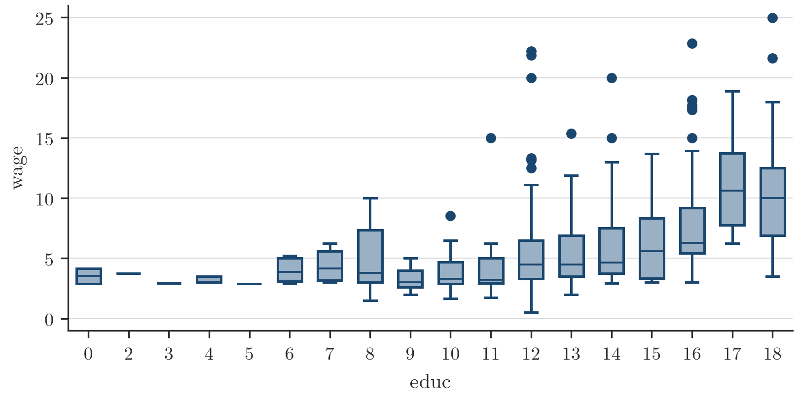
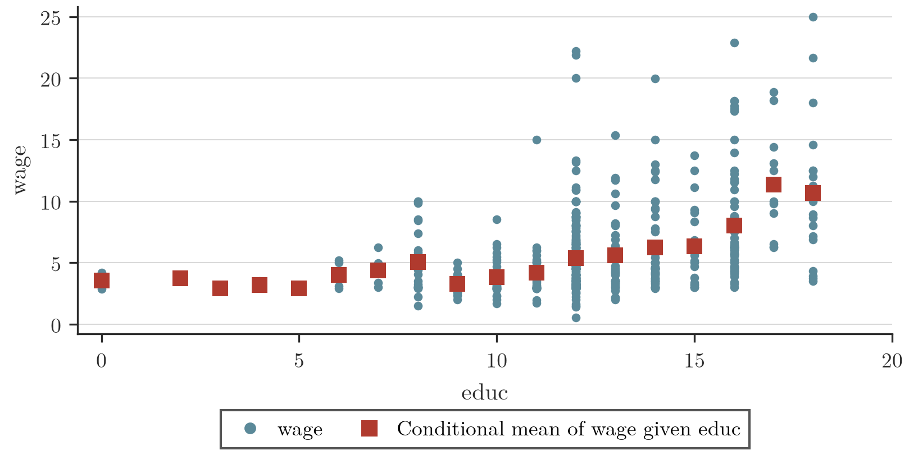
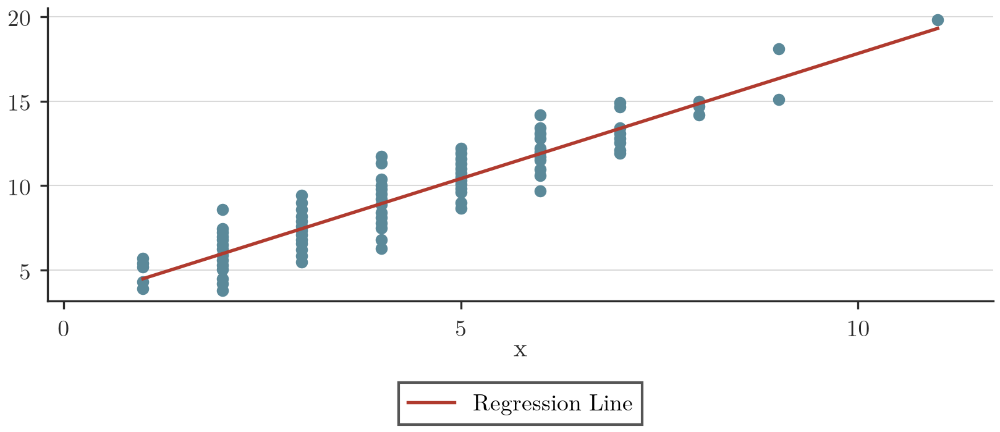
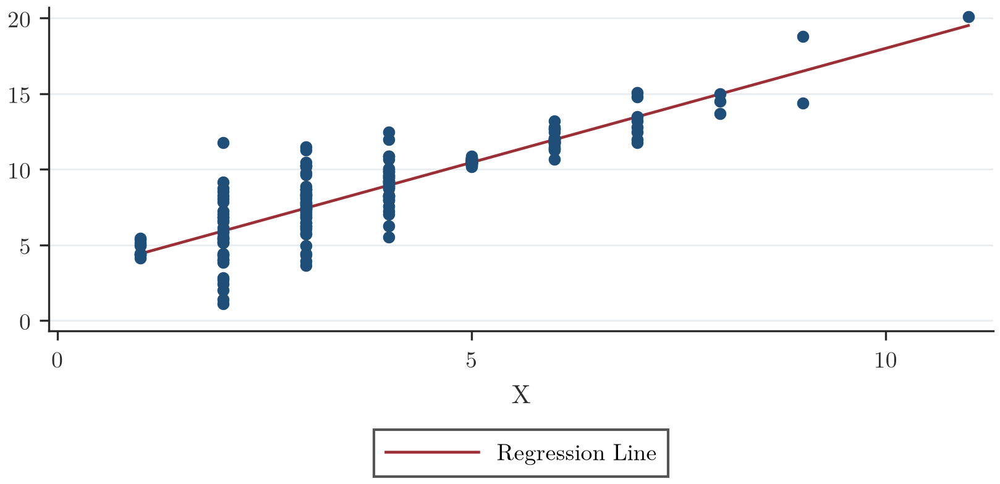
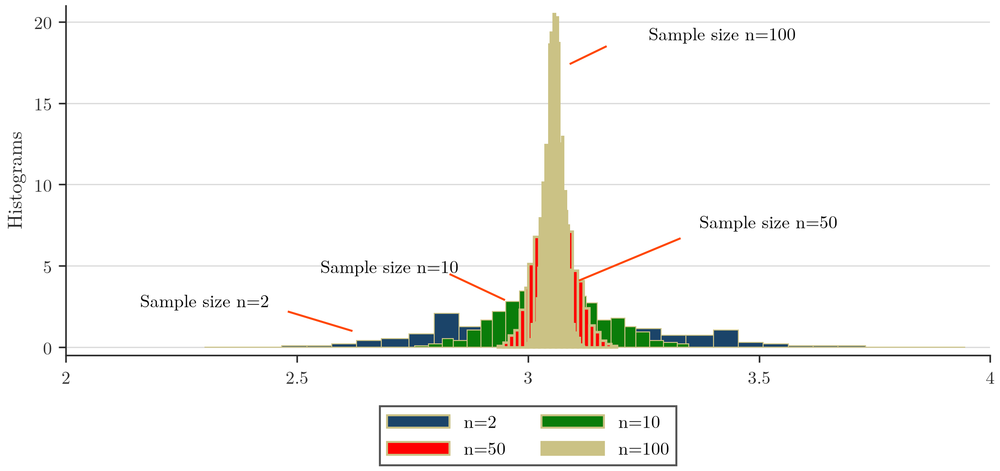
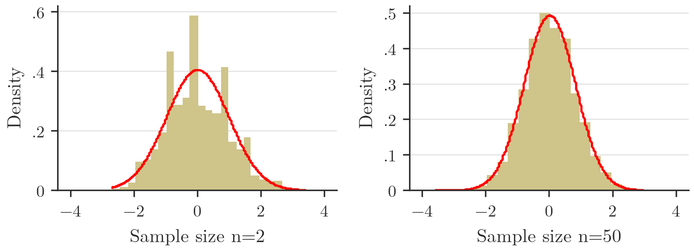

## Introduzione: l'associazione tra variabili quantitative — l'esempio wage vs. education

Il filo conduttore della lezione è un esempio applicato: la relazione tra **salari (wage)** e **livello di istruzione (educ)**. Le domande a cui l'analisi vuole rispondere sono:

- Esiste una relazione positiva tra istruzione e salario?
- Per un dato livello di istruzione, qual è il salario medio che un lavoratore può ottenere?
- Qual è il guadagno atteso se si decide di studiare un anno in più?
- Quanto farebbe guadagnare in più conseguire una laurea magistrale (2 anni di studio in più)?

Questo tipo di informazione è utile per prendere decisioni: ad esempio, un individuo potrebbe decidere di iscriversi a una magistrale se il salario atteso aumenta di almeno 1 euro l'ora.

**Figura 1** — Scatterplot di educ vs. wage (526 individui osservati nel 1976). Relazione grezza tra anni di istruzione e salario orario: i punti seguono una tendenza crescente, con forte dispersione attorno ad essa.

Con l'analisi di regressione si cerca un modello che riassuma, **in modo semplice**, come variano le distribuzioni condizionali di una variabile $Y$ al variare di una seconda variabile $X$. Nell'esempio, la distribuzione condizionale è la distribuzione di probabilità dei salari ($Y$) per un qualsiasi livello di istruzione ($X$). Questo modello rappresenta l'ipotesi (ex-ante) sulla relazione causale: si definisce una variabile obiettivo (variabile dipendente) e una variabile causale (regressore, causa scatenante). Il nesso causale ipotizzato è, per costruzione, **unidirezionale** ($X \to Y$).

**Figura 2** — Distribuzione condizionale dei salari per ogni livello di istruzione. Boxplot del salario (mediana, quartili, valori estremi) per ciascun valore di anni di istruzione: sia il livello medio sia la dispersione dei salari tendono a crescere con l'istruzione.

Trovare un modello che si adatti con precisione a **tutte** le distribuzioni condizionali sarebbe troppo complicato. I modelli statistici descrivono quindi la dinamica di alcuni momenti (caratteristiche) delle distribuzioni condizionali; nel modello di regressione queste caratteristiche sono i valori attesi (medie). L'obiettivo diventa costruire un modello che descriva le **medie condizionali** di $Y$: ad esempio, qual è il salario atteso per i lavoratori che hanno studiato esattamente 10 anni?

**Figura 3** — Scatterplot di educ vs. wage e $E[wage|educ]$ (quadrati rossi). Le medie condizionate stimate per ciascun livello di istruzione sono sovrapposte ai dati osservati; il loro andamento è crescente ma non perfettamente lineare.

Per rispondere a queste domande è conveniente definire un modello che descriva la relazione tra istruzione e salari attesi: **la linea è il modello più semplice che si conosca**.

**Figura 4** — Scatterplot di educ vs. wage con $E[wage|educ]$ (quadrati rossi) e la linea di regressione. Alla figura precedente si aggiunge la retta di regressione stimata (fitted values), che approssima in modo semplice l'andamento delle medie condizionate.

Il valore atteso condizionale $E[Y|X=x]$ è la media di $Y$ per un dato livello $x$ di $X$. La retribuzione media stimata per un dato numero di anni di istruzione è riportata nella tabella seguente:

**Tabella 1** — Valori attesi stimati di wage fissato educ

| years of educ | E[wage\|educ] | years of educ | E[wage\|educ] |
|---|---|---|---|
| educ=0 | 3.53 | educ=10 | 3.83 |
| educ=1 | not available | educ=11 | 4.18 |
| educ=2 | 3.75 | educ=12 | 5.37 |
| educ=3 | 2.92 | educ=13 | 5.59 |
| educ=4 | 3.17 | educ=14 | 6.23 |
| educ=5 | 2.90 | educ=15 | 6.32 |
| educ=6 | 3.98 | educ=16 | 8.04 |
| educ=7 | 4.38 | educ=17 | 11.34 |
| educ=8 | 5.03 | educ=18 | 10.67 |
| educ=9 | 3.27 | educ=19 | not available |

*(slide 3–10)*

> [!lezione] Dalla lezione del 12 novembre 2026: distribuzioni condizionali ed eterogeneità dei salari
> I dati dell'esempio risalgono agli anni Settanta, per cui i salari orari in dollari sono numeri piccoli; l'andamento non è molto diverso da quello atteso oggi, a parte la scala. Ogni colonna di punti dello scatterplot è la distribuzione dei salari dei lavoratori che hanno studiato esattamente un certo numero di anni, per esempio 10 oppure 15. È quindi una distribuzione condizionale, che dice in termini probabilistici quanto è probabile trovare, in quel sottogruppo, un lavoratore che guadagna molto o poco.
>
> I quadrati rossi sono le medie di queste distribuzioni e tendono a crescere con l'istruzione: per i livelli più bassi la variabilità è scarsa e il salario medio è sotto i 5 dollari l'ora, per un livello intermedio è poco sopra i 5 dollari, e per chi ha studiato molto il docente indica un centro della distribuzione intorno ai 15 dollari (la tabella 1 riporta medie condizionali fino a circa 11 dollari). Studiando di più non si guadagna però di più con certezza: in una stessa colonna ci sono persone che guadagnano meno di chi ha studiato zero anni e persone che guadagnano estremamente di più.
>
> Questa eterogeneità dice come varia il salario in funzione di informazioni diverse dall'istruzione, perché i lavoratori di una colonna hanno lo stesso livello di istruzione ma caratteristiche individuali diverse. Il punto in alto, a circa 25 dollari l'ora, può essere il figlio di un dirigente che finirà a fare il dirigente; il punto più in basso può essere qualcuno che ha deciso di studiare archeologia: se gli va bene guadagna molto, se gli va male finisce a fare scavi per i cantieri. Ci sono anche effetti più sottili, come quello di genere: nei dati gli uomini tendono a guadagnare più delle donne. A parità di anni di studio, chi si laurea alla Bocconi può avere aspettative diverse da chi si laurea a Cassino, anche solo perché a Milano i salari sono più alti. All'interno di una colonna l'istruzione è esattamente la stessa e non può spiegare l'eterogeneità, che dipende da altro (il reddito della famiglia, il tipo di studi, l'intelligenza, il genere). La parte di eterogeneità non spiegata dall'istruzione, ma da qualcos'altro, è il termine d'errore, indicato con $\varepsilon$.

> [!lezione] Dalla lezione del 12 novembre 2026: perché una retta che approssima le medie condizionali
> Il modello di regressione lavora sul momento di ordine uno, cioè sulle medie. Le varianze interessano, ma in generale si vuole capire come in media il livello di istruzione impatti sul salario. Serve quindi un modello che approssimi i quadrati rossi, cioè le medie condizionali.
>
> I quadrati rossi sono però evidenza campionaria, non della popolazione. L'obiettivo non è spiegare il campione: per conoscere guadagno e anni di studio dell'unità statistica numero 73 basta guardare il foglio dei dati, senza bisogno di prevederlo, e per sapere che cosa succede passando da 12 a 14 anni di istruzione basta la differenza tra le due medie condizionali campionarie. Interessa la popolazione, e in particolare le medie condizionali di popolazione, che si conoscerebbero solo intervistando tutti i lavoratori degli Stati Uniti in un certo periodo e conoscendone con esattezza il reddito, il che è impossibile. I quadrati rossi, calcolati su uno specifico insieme di poco più di 500 lavoratori, ne sono solo un'approssimazione.
>
> Per questo non serve una funzione complicata che passi esattamente sui quadrati rossi. Sarebbe possibile, e nemmeno difficile (basta un comando del computer per trovare funzioni molto smooth che li attraversano), ma i quadrati rossi sono già noti, calcolati in una tabella a parte. Serve una funzione abbastanza buona da approssimarli e, allo stesso tempo, da approssimare le medie condizionali che si otterrebbero da altri campioni estratti dalla stessa popolazione. Un modello che si adatta perfettamente ai dati posseduti, e non a tutti i dati possibili, che sono i più interessanti perché ignoti, incorre in **overfitting**.
>
> Si consideri una popolazione di cui il campione osservato è soltanto una parte, e una funzione costruita per approssimare esattamente i punti del campione. Rispetto ai dati usati l'errore è praticamente nullo, ma alcuni punti della popolazione non usati nella stima risultano estremamente distanti dalla funzione, cioè da ciò che si potrebbe osservare in un altro campione della stessa popolazione. Per prevedere $y$ a un dato valore di $x$ si userebbe il punto sulla funzione stimata, la migliore approssimazione possibile con quella funzione, ma l'errore di previsione sarebbe gigantesco per una persona esterna al sottoinsieme osservato. È preferibile un modello che non approssimi troppo bene il campione ma non vada troppo male nemmeno fuori da esso, cioè che faccia da media rispetto alle funzioni che si stimerebbero con campioni diversi: non è perfetto per nessun campione, ma in media non sbaglia in modo sistematico. Il modello serve a capire che cosa succede su ciò che non si osserva. Un modello con un $R^2$ del 99% non è necessariamente un buon modello, mentre uno con un $R^2$ del 20% potrebbe essere ottimo.
>
> La funzione cercata deve dunque riflettere un andamento di lungo periodo ed essere universale, non specifica del singolo dataset. Una retta è inoltre un modello molto semplice, facile da identificare e senza curve o polinomi, e dipende da due soli parametri, l'intercetta e il coefficiente angolare: stimati questi due numeri, si caratterizza il comportamento dei dati su tutta la popolazione.
>
> Il modello non approssima direttamente i dati, per i quali non esiste una funzione che si adatti completamente, ma una loro caratteristica, le medie condizionali, che sono indicatori di centralità sufficientemente stabili. Esistono modelli che considerano altri indicatori, come quantili e mediane: è la regressione quantilica, che non fa parte del corso. Il docente la segnala perché permette di capire non solo come reagisce in media un fenomeno a una perturbazione, ma anche come reagiscono le code. In finanza interessano le code delle distribuzioni, cioè perdere o guadagnare molto: i rendimenti medi di un portafoglio sono in media zero, e a chi investe interessa coprirsi dagli eventi estremi, per esempio capire come una variazione della situazione geopolitica impatti le code del portafoglio e non la sua media. Nel corso si considerano le medie condizionali, un indicatore di centralità semplice, sapendo che l'impostazione si può generalizzare.

## Il modello di regressione semplice

> [!abstract] Definizione
> La **funzione di regressione semplice** descrive le medie condizionali $E[Y|X=x]$ attraverso un modello lineare:
>
> $$E[Y|X] = \alpha + \beta X$$
>
> Questa retta è un'**approssimazione** della vera media condizionale (i quadrati rossi delle figure precedenti), poiché in generale non è possibile trovare un modello semplice che corrisponda esattamente a tutte le medie condizionate.
>
> Data questa ipotesi per la media condizionale, ogni osservazione $(X_i, Y_i)$ nel campione può essere rappresentata come
>
> $$Y_i = E[Y|X=X_i] + \epsilon_i$$
>
> dove $\epsilon_i$ è una quantità stocastica che misura la distanza tra ciascuna osservazione e la retta di regressione.
>
> **Terminologia:**
> - $Y_i$, $i=1,\dots,n$: variabile dipendente;
> - $X_i$, $i=1,\dots,n$: regressore o predittore;
> - $\epsilon_i$, $i=1,\dots,n$: termine di errore.
>
> Intuitivamente $\epsilon_i$ è un fattore di rumore che raccoglie gli effetti di tutte le variabili che potrebbero influenzare $Y$ (escluso $X$) e non sono incluse esplicitamente nel modello. Si assume che l'unico predittore utile per il valore atteso di $Y$ sia il regressore: per questo ci si aspetta che, in media, l'impatto di $\epsilon$ non sia rilevante, ovvero formalmente che $E[\epsilon|X]=0$. Ciò significa che il termine di errore per alcuni soggetti è positivo, per altri negativo, ma in media tutti questi errori si sommano a zero.
>
> **Interpretazione causale — effetto di una variazione di $X$.** Ipotizzando che i parametri $\alpha$ e $\beta$ siano noti, la previsione di $Y$ per un individuo con $X=X_1$ è
>
> $$\hat{Y}(X_1) = \alpha + \beta X_1 + \epsilon(X_1)$$
>
> e per $X=X_2$:
>
> $$\hat{Y}(X_2) = \alpha + \beta X_2 + \epsilon(X_2)$$
>
> dove $\epsilon(X_1)$ ed $\epsilon(X_2)$ rappresentano le caratteristiche non osservate di soggetti con istruzione rispettivamente $X_1$ o $X_2$ anni. La variazione di $Y$ è quindi
>
> $$\underbrace{\hat{Y}(X_2)-\hat{Y}(X_1)}_{\Delta Y} = \beta\underbrace{(X_2-X_1)}_{\Delta X} + \underbrace{[\epsilon(X_2)-\epsilon(X_1)]}_{\Delta \epsilon}$$
>
> $\Delta Y$ dipende quindi da una scelta economica ($\Delta X$) e da qualcos'altro ($\Delta\epsilon$), quest'ultimo in generale non misurabile. Se si assume che $\epsilon$ non dipenda da $X$, diversi livelli di $X$ non porteranno a variazioni di $\epsilon$, cioè $\Delta \epsilon = 0$. Pertanto la variazione di $Y$ è proporzionale alla variazione di $X$, con coefficiente di proporzionalità $\beta$:
>
> $$\Delta Y = \beta \Delta X$$
>
> Inoltre, se $E[\epsilon|X]=0$, allora $\mathrm{Cov}(X,\epsilon)=0$ e $\hat{Y}(X)\approx E[Y|X]$ (le slide scrivono l'implicazione in senso inverso, da $\mathrm{Cov}(X,\epsilon)=0$ a $E[\epsilon|X]=0$, che in generale non vale: l'assenza di correlazione è una condizione più debole). Questa ipotesi stabilisce che l'unica spiegazione delle variazioni di $Y$ è fornita da $X$: ipotizzando che $\epsilon$ e $X$ non siano correlati, il risultato di una scelta dipende unicamente dalla scelta stessa ($\Delta X$) e non da altri fattori confondenti ($\Delta \epsilon$). Questa ipotesi è nota come **esogeneità**, ed è alla base dello studio di relazioni causali.
>
> **Esempio numerico.** Si consideri il modello che lega salario e istruzione con $\alpha=-1$ e $\beta=0.5$:
>
> $$wage_i = \alpha + \beta\, educ_i + \epsilon_i = -1 + 0.5\, educ_i + \epsilon_i$$
>
> Assumendo che altre caratteristiche (genere, esperienza, tenure, ecc.), riassunte in $\epsilon_i$, non siano rilevanti, un anno di scuola in più ($\Delta educ = 1$) induce una variazione della retribuzione oraria prevista di 0.50 dollari; due anni in più inducono una variazione dello stipendio atteso di 1 dollaro.

*(slide 11–16)*

> [!lezione] Dalla lezione del 12 novembre 2026: notazione e ruolo del termine d'errore
> Nella notazione $E(y \mid x)$ la prima variabile è quella su cui si calcola la media, mentre la seconda, che segue la barra verticale, è la variabile di condizionamento: i quadrati rossi sono il valore atteso condizionale dei salari rispetto all'istruzione, con wage come variabile $y$ ed education come variabile $x$. Per legare le osservazioni individuali alla media condizionale si considerano le coppie $(y_i, x_i)$, dove $i$ indica l'unità statistica (un lavoratore nell'esempio), $x_i$ è l'istruzione del lavoratore $i$-esimo e $y_i$ il suo salario, e vale $y_i = \alpha + \beta x_i + \varepsilon_i$.
>
> Il salario esatto di un individuo, che non è il salario medio, dipende da due fattori. Il primo è una componente media: per l'appartenenza a una categoria, cioè a un certo livello di istruzione, il salario atteso è $\alpha + \beta x_i$. Il secondo è una componente idiosincratica, individuale, che rappresenta tutte le caratteristiche del lavoratore diverse dall'istruzione: il genere, la famiglia, se è sveglio o no, se ha fatto un master in finanza o in storia dell'arte. Regressore e predittore sono due nomi della stessa variabile $x$: predittore se si segue una letteratura più statistica, regressore se più economica.
>
> Le caratteristiche di $\varepsilon$ determinano se il modello sia una relazione causale oppure no. Nel corso di statistica non sono così importanti, lo sono invece in econometria e in economia, perché la relazione tra $\varepsilon$ e $x$ permette di dire se il modello è ben specificato. Si assume che la correlazione tra $\varepsilon$ e $x$ sia zero: questa condizione si chiama esogeneità, e se non vale si parla di endogeneità, che ha conseguenze pesanti sulla stima. Il termine d'errore non è osservabile, per cui per capire se il modello sia corretto bisogna stabilire le proprietà di qualcosa che non si può misurare direttamente, e occorre aggirare il problema.

> [!lezione] Dalla lezione del 12 novembre 2026: perché senza una condizione sull'errore l'effetto non è identificabile
> Il termine $\varepsilon$ contiene altri fattori, diversi dall'istruzione, che in linea di principio possono essere collegati al livello di istruzione: più si studia, più si impara, e l'abilità conseguita può aumentare. Per questo si scrive $\varepsilon(x_1)$, facendo dipendere l'errore anche da $x_1$, e si lega direttamente l'abilità di una persona al livello di istruzione. Aumentando l'istruzione di $\Delta x$, per esempio due anni, la variazione di $y$ è $\beta \Delta x + \Delta\varepsilon$, dove $\Delta\varepsilon = \varepsilon(x_1 + \Delta x) - \varepsilon(x_1)$ non è calcolabile perché non è noto, ma teoricamente esiste. La variazione di salario dipende quindi in parte dall'aver studiato due anni in più e in parte da effetti collaterali della scelta.
>
> La variazione complessiva si può calcolare: la differenza dei quadrati rossi dà, per esempio, 3 dollari. Sulla base del modello non si sa però se questi 3 dollari dipendano dalla scelta di studiare o da altro, perché si conosce soltanto la somma: potrebbero essere 1 più 2, oppure 0 più 3, oppure $-3$ più 6. L'effetto non è identificabile. L'unico modo per identificare l'effetto della scelta, cioè $\beta \Delta x$, è fissare il valore di $\Delta\varepsilon$, e il valore più comodo è 0: se la variazione di $\varepsilon$ è nulla, tutta la variazione di $y$ dipende da $\beta \Delta x$. Per identificare l'effetto di un fattore su cui si sceglie bisogna quindi essere sicuri che gli effetti collaterali siano nulli.
>
> La condizione statistica per cui la variazione di tutto il resto è nulla quando varia $x$ è una correlazione uguale a zero tra $x$ ed $\varepsilon$ (qui tutto è lineare, quindi basta poco). Concettualmente è difficile verificarla, perché $x$ si può misurare ma $\varepsilon$ no. Con questa ipotesi aggiuntiva, l'unica spiegazione plausibile di una variazione di $y$ è la variazione di $x$ pesata dal coefficiente $\beta$, la pendenza della retta di regressione. L'ipotesi si chiama esogeneità, in questo caso esogeneità stretta: esistono vari concetti di esogeneità e nei modelli di regressione classici si usa quella stretta, mentre nella seconda parte del corso verrà abbandonata a favore dell'esogeneità debole, che è più che sufficiente. Questa nota formula invece l'esogeneità come $E[\varepsilon \mid X]=0$, da cui segue $\operatorname{Cov}(X,\varepsilon)=0$ ma non viceversa, e osserva che le slide enunciano la condizione di correlazione nulla, più debole; il docente usa qui la correlazione nulla e la chiama esogeneità stretta. Se la correlazione fosse diversa da zero, la variazione di $\varepsilon$ non potrebbe essere nulla in corrispondenza di una variazione di $x$, e non si saprebbe valutare perché si osservino variazioni di $y$.

> [!lezione] Dalla lezione del 12 novembre 2026: esempio del bonus fiscale e dei consumi
> Uno dei problemi dell'Italia è che i consumi sono molto bassi, e per dare loro impulso si danno tipicamente dei bonus. Il docente richiama la riforma di Matteo Renzi dei mille euro, introdotta come sconto fiscale per una certa fascia di lavoratori. La misura è costosa, ma il costo si valuta in modo abbastanza preciso, perché è una minore entrata per lo Stato. Lo scopo era stimolare i consumi, e ci si chiede se questi siano effettivamente migliorati in conseguenza della policy.
>
> Per rispondere si può calcolare la relazione tra redditi ($x$) e consumi ($y$), entrambi pro capite: la policy varia $x$ di 1.000 euro, e ci si chiede come siano variati i consumi. Il docente precisa di non aver svolto questa analisi e di non valutare se la scelta sia stata giusta o sbagliata: pone un problema statistico. Se il parametro che lega consumi e redditi è grande, 1.000 euro in più alle famiglie avranno un impatto sui consumi, e la policy avrà ottenuto il risultato voluto. Il problema è se il modello sia corretto: la variazione dei consumi osservata potrebbe dipendere dai 1.000 euro in più, oppure da altro, come le condizioni economiche di quel periodo. Se l'effetto collaterale fosse più importante, probabilmente sarebbe stato più efficiente usare quei soldi per altro.
>
> Si può investire molto denaro in una policy e stimare un parametro grande tra le due variabili, da cui ci si aspetterebbe un impatto devastante. Tale impatto vale solo se si ipotizza che $\Delta\varepsilon$ sia zero. Altrimenti non si può dire che la policy abbia avuto un impatto, perché occorre considerare una combinazione di eventi e non uno solo: la variazione si può calcolare, ma non si sa da che cosa dipenda. L'unico modo per essere sicuri che l'investimento abbia un impatto è fissare ciò che non si conosce, e ciò che non si conosce si fissa tipicamente a zero. Se $\Delta\varepsilon$ è zero, l'unica spiegazione della variazione di $y$ è $x$, pesata da $\beta$, che è il moltiplicatore, e il solo problema diventa stimare $\beta$.

> [!lezione] Dalla lezione del 12 novembre 2026: stimare il parametro o prevedere
> Il problema posto non è del modello di regressione in generale, ma di interpretabilità dei risultati. In un corso di statistica il problema dell'eterogeneità nel modello di regressione non viene praticamente considerato, perché lo scopo è trovare un modello da usare per fare previsioni sui dati successivi. Qui interessa invece valutare con precisione il parametro $\beta$, perché esso dice, per esempio, quanto denaro si sta spendendo per l'istruzione dei bambini e se la scelta fatta è corretta. Lo scopo dell'analisi con i modelli di regressione in economia è capire quanto una policy abbia impatto, cioè stimare correttamente $\beta$, e non avere un modello che si adatti ai dati o che serva per le previsioni; per farlo occorre fissare $\Delta\varepsilon$ a zero. In un corso orientato alle previsioni, invece, che $\beta$ sia calcolato bene o male non importa, purché la previsione sia corretta.
>
> Un economista vuole sapere se spendere 2 miliardi di dollari l'anno per ridurre la dimensione delle classi sia utile a grande scala, il che è un problema politico o economico. Si può assumere invece il punto di vista di un genitore che deve iscrivere un figlio a scuola, e che sceglie la scuola in cui il voto finale del figlio sarà più alto, così da entrare l'anno dopo in una buona scuola con una borsa di studio e poter sopravvivere a un sistema di istruzione estremamente costoso. Per il genitore lo scopo non è migliorare il mondo ma trovare la scuola più adatta al proprio figlio, e il problema diventa di previsione. Se la variabile che prevede meglio la performance del figlio risultasse la dimensione del parcheggio della scuola, il genitore misurerebbe il parcheggio di tutte le scuole degli Stati Uniti e sceglierebbe in base a quello: non importa che logicamente non abbia senso, funziona. È una black box.
>
> Dal punto di vista dello statistico che fa previsione non interessa quindi calcolare esattamente il parametro che lega le variabili, perché non è necessariamente legato alla capacità previsiva del modello. Se invece si usa il modello per valutare politiche, o per confermare congetture economiche e finanziarie di qualsiasi tipo, interessa conoscere il parametro. Il docente precisa che non sta dicendo che un approccio sia migliore dell'altro: lo stesso strumento risponde a criteri diversi perché i problemi sono diversi.

## Stima del modello: il metodo dei minimi quadrati ordinari (OLS)

> [!abstract] Definizione
> Dati i dati campionari, occorre stimare i parametri $\alpha$ e $\beta$ del modello di regressione. L'idea di base è trovare valori per $\alpha$ e $\beta$ che **minimizzino la distanza media** tra ciascuna osservazione e la retta di regressione: questi due parametri identificano in modo univoco la retta.
>
> Il metodo dei **minimi quadrati ordinari (OLS)** suggerisce di minimizzare la varianza del termine di errore, ovvero calcolare
>
> $$\min_{\alpha,\beta} \mathrm{Var}(\epsilon) = \min_{\alpha,\beta} E[\epsilon^2] \approx \min_{\alpha,\beta} \frac{1}{n}\sum_{i=1}^n (Y_i-\alpha-\beta X_i)^2$$
>
> Si dimostra che la pendenza della retta di regressione $\beta$ è proporzionale alla covarianza tra $X$ e $Y$:
>
> $$\hat\beta = \frac{\frac{1}{n}\sum_{i=1}^n (Y_i-\bar Y)(X_i-\bar X)}{\frac{1}{n}\sum_{i=1}^n (X_i-\bar X)^2} = \frac{\mathrm{Cov}(X,Y)}{\mathrm{Var}(X)}$$
>
> **Esempio: wage vs. education.** Si consideri il modello $wage_i = \alpha + \beta\, educ_i + \epsilon_i$. Le stime OLS basate su un campione di 526 osservazioni sono:
>
> | Variabile | Coef. | Std. Err. | t | P>\|t\| | IC 95% inf. | IC 95% sup. |
> |---|---|---|---|---|---|---|
> | educ | .5413593 | .053248 | 10.17 | 0.000 | .4367534 | .6459651 |
> | _cons | -.9048516 | .6849678 | -1.32 | 0.187 | -2.250472 | .4407687 |
>
> Il modello stimato risulta quindi (coefficienti arrotondati alla quarta cifra; le slide troncano a $-.9048$ e $.5413$)
>
> $$wage = -.9049 + .5414\, educ$$
>
> Studiare un anno in più induce una variazione positiva di circa 54 centesimi nei salari.
>
> **Valori predetti e residui.** La previsione della media condizionale, o valore predetto, è
>
> $$\hat Y_i = \hat E[Y_i|X=x_i] = \hat\alpha + \hat\beta x_i$$
>
> Il termine di errore viene stimato come differenza tra la variabile osservata $Y_i$ e il valore atteso $\hat Y_i$; è chiamato **residuo** ed è definito come
>
> $$\hat\epsilon_i = Y_i - \hat\alpha - \hat\beta X_i = Y_i - \hat Y_i$$
>
> 
>
> **Figura 5** — Rappresentazione grafica di $Y_i$ come somma di residuo ($\hat\epsilon_i$) e valore predetto ($\hat Y_i$). Ogni osservazione $Y_i$ si scompone nella somma del valore previsto dalla retta e del residuo, cioè la distanza verticale tra il punto osservato e la retta.

*(slide 17–21)*

> [!lezione] Dalla lezione del 13 novembre 2026: valore predetto, residuo ed errore
> Una volta stimati i parametri, il modello si usa per la previsione. Il valore predetto si ottiene approssimando il valore atteso condizionale con i parametri stimati al posto di quelli veri, $\hat\alpha + \hat\beta x$, dove $x$ è un valore prefissato scelto da chi fa la previsione. Per brevità lo si indica con $\hat y$ ed è la stima di un valore atteso condizionale. È una variabile casuale, perché $\alpha$ e $\beta$ sono incerti: si conoscono solo approssimazioni calcolate sul campione, non i veri parametri della popolazione. Dell'intercetta non ci si occupa in modo particolare: non è un parametro particolarmente interessante, salvo applicazioni specifiche, e in generale si include nel modello a meno di ragioni molto forti per escluderla.
>
> Il residuo misura quanto la previsione si discosta dal valore effettivamente osservato: è il termine d'errore valutato per l'individuo $i$ osservato, cioè la differenza tra il salario osservato e il salario previsto per un dato valore di $x$.
>
> Il residuo è diverso dal termine d'errore $\varepsilon$. Il residuo è la distanza tra un'osservazione e la sua previsione, un'evidenza campionaria riferita a una persona specifica, ed è un numero. Il termine d'errore è un concetto più astratto: è la distanza tra ogni individuo della popolazione, e non del campione, e il vero modello nella popolazione, ed è una variabile casuale. Il residuo non è un'approssimazione di $\varepsilon$; sono due concetti distinti, anche se il residuo ha una sua utilità.

> [!lezione] Dalla lezione del 12 novembre 2026: il parametro $\beta$ ricavato con il metodo dei momenti
> Tutti i libri indicano come modo corretto il metodo dei minimi quadrati: si prendono le osservazioni su $y$ e il modello e si trovano $\alpha$ e $\beta$ tali che la distanza media tra $y$ e la trasformazione lineare di $x$ sia la più piccola possibile. La distanza si calcola con il quadrato, per evitare che gli scarti positivi e negativi si compensino. Si derivano le espressioni rispetto ad $\alpha$ e $\beta$, si pongono le derivate uguali a zero e si risolve il sistema di due equazioni in due incognite: la soluzione per $\beta$ è un rapporto tra quantità, quella per $\alpha$ una differenza di medie. Il docente considera questa la via più noiosa e ne presenta una con un'algebra più breve e a suo parere più intuitiva.
>
> Si assume che il modello sia corretto, cioè che valga l'esogeneità: la covarianza tra $x$ ed $\varepsilon$ è zero. Nella popolazione $y$ è data dalla combinazione $\alpha + \beta x + \varepsilon$, per cui
>
> $$\operatorname{Cov}(x, y) = \operatorname{Cov}(x, \alpha + \beta x + \varepsilon).$$
>
> La covarianza di una variabile rispetto a una combinazione lineare è la combinazione lineare delle covarianze, perché la covarianza si può pensare come una media, una sommatoria o un integrale, che sono operatori lineari. Si ottiene quindi
>
> $$\operatorname{Cov}(x, y) = \operatorname{Cov}(x, \alpha) + \operatorname{Cov}(x, \beta x) + \operatorname{Cov}(x, \varepsilon).$$
>
> Il primo termine è zero, perché la covarianza tra una costante e una variabile casuale è nulla: al variare di $x$, $\alpha$ resta costante. Il terzo termine è zero per ipotesi, che il docente sottolinea essere una scelta e non necessariamente corretta. Nel secondo la costante $\beta$ si porta fuori dalla covarianza e resta la covarianza di $x$ con se stessa, cioè la varianza di $x$. Quindi
>
> $$\operatorname{Cov}(x, y) = \beta \operatorname{Var}(x), \qquad \beta = \frac{\operatorname{Cov}(x, y)}{\operatorname{Var}(x)}.$$
>
> Questa relazione vale nella popolazione: il vero $\beta$, quello che si otterrebbe considerando tutti i lavoratori degli Stati Uniti, è la covarianza tra livello di istruzione e salario divisa per la varianza del livello di istruzione. Se la formula vale nella popolazione, si può applicare al campione: numeratore e denominatore si stimano con covarianza e varianza campionarie, che per la legge dei grandi numeri convergono ai momenti di popolazione, per cui lo stimatore converge al vero $\beta$ per $n$ sufficientemente grande. Il procedimento si chiama **metodo dei momenti**.
>
> Il docente lo preferisce alla costruzione con le derivate perché l'ipotesi viene formulata in modo specifico: la condizione di esogeneità è imposta direttamente, in modo brutale, nelle condizioni usate per la stima, e la formula funziona solo se la covarianza tra $x$ ed $\varepsilon$ è uguale a zero. Minimizzando poi la distanza tra $y$ e il modello di regressione si trova uno stimatore dei minimi quadrati che coincide esattamente con quello appena ricavato. In questo caso i due approcci coincidono, cosa che non sempre accade; ci sono motivi profondi per cui succede. La differenza è che nel metodo dei momenti le ipotesi economiche specifiche, cioè l'esogeneità, sono imposte direttamente.

## Il termine d'errore ε: proprietà, omoschedasticità ed eteroschedasticità

> [!abstract] Definizione
> Le proprietà della variabile casuale $\epsilon$ servono a derivare le proprietà degli stimatori OLS: interessano i suoi momenti e la relazione tra $\epsilon$ ed $X$.
>
> Per costruzione, $\epsilon_i$ è la differenza tra $Y_i$ e la media condizionale $E[Y|X_i]$:
>
> $$\epsilon_i = Y_i - E[Y|X_i] = Y_i - \alpha - \beta X_i$$
>
> $\epsilon$ raccoglie tutte le caratteristiche non esplicitamente considerate dal modello e descrive l'eterogeneità presente nei dati: non tutte le persone che hanno studiato 10 anni ricevono la stessa somma di denaro, alcune ricevono uno stipendio superiore alla media condizionata, altre inferiore. Il termine di errore spiega questa variabilità e raccoglie intuitivamente la quantità di informazioni su $Y$ non osservabili che non sono spiegate da $X$.
>
> **Media condizionale $E[\epsilon|X]$.** Ipotizzando che $\alpha+\beta X$ sia un'approssimazione credibile di $E[Y|X]$ (cioè $E[Y|X]\approx \alpha+\beta X$), la media condizionale di $\epsilon$ deve essere
>
> $$E[\epsilon|X] = E[Y|X] - \alpha - \beta X = 0$$
>
> Come conseguenza principale, $\mathrm{Cov}(\epsilon,X)=0$: tutte le variabili che contribuiscono alla costruzione di $\epsilon$ non possono essere correlate con $X$. Questo implica
>
> $$\Delta E[Y|X] = \Delta Y = \beta \Delta X + \Delta \epsilon = \beta \Delta X$$
>
> L'intuizione è che l'unica informazione rilevante per descrivere la media condizionale di $Y$ è fornita da $X$; tutte le altre variabili non possono avere un impatto sistematico su di essa.
>
> **Varianza condizionale $\mathrm{Var}(\epsilon|X)$.** In generale spesso non si sa come descrivere la varianza condizionale di $\epsilon$. Si noti però che la variabilità di $\epsilon$ descrive anche la variabilità della variabile dipendente $Y$:
>
> $$\mathrm{Var}(\epsilon|X) = \mathrm{Var}(Y|X)$$
>
> Si possono formulare due ipotesi alternative sulle varianze condizionali:
>
> - **Omoschedasticità**: $\mathrm{Var}(\epsilon|X)=\sigma^2$, cioè non dipende da $X$.
> - **Eteroschedasticità**: $\mathrm{Var}(\epsilon|X)=\sigma^2(X)$, quindi è funzione di $X$.
>
> Differenti ipotesi su $\mathrm{Var}(\epsilon|X)$ portano a formule diverse per la varianza, e quindi per gli errori standard, dello stimatore OLS; i coefficienti stimati restano gli stessi (le slide parlano di «diversi stimatori OLS»).
>
> 
>
> **Figura 6** — Retta di regressione $E(Y|X=x)$ ed errori omoschedastici. A diversi valori di $X$ la dispersione di $Y$ attorno alla retta rimane simile (variabilità condizionale simile).
>
> 
>
> **Figura 7** — Retta di regressione $E(Y|X=x)$ ed errori eteroschedastici. A diversi valori di $X$ corrispondono ampiezze diverse della variabilità di $Y$ attorno alla retta, cioè diverse $\mathrm{Var}(Y|X)$.

*(slide 22–27)*

> [!lezione] Dalla lezione del 13 novembre 2026: modello teorico e modello statistico
> L'endogeneità nasce tipicamente perché il modello statistico stimato non corrisponde al modello che descrive i dati nella popolazione. In ogni analisi empirica si hanno in mente due concetti: ciò che si fa, cioè una scelta individuale, e il processo generatore dei dati, un concetto astratto per cui i dati sono legati ad altre variabili in modo predeterminato. C'è quindi un modello teorico che descrive la realtà e un modello empirico che è il modo in cui la si vede. Il modello teorico spiega la relazione tra le variabili nella popolazione e non è noto; il modello statistico è quello scelto da chi analizza, il comando da dare al software. Se i due modelli coincidono non c'è endogeneità; se il modello stimato è sbagliato rispetto al processo generatore dei dati si ricade nell'endogeneità, con problemi nella stima dei parametri di interesse. Il problema chiave dell'econometria è capire se le formule usate per approssimare i parametri vadano bene, e a questo scopo occorre conoscere le caratteristiche del termine d'errore, in particolare i suoi momenti condizionali rispetto a $X$.

> [!lezione] Dalla lezione del 13 novembre 2026: perché $E[\varepsilon \mid X]=0$ implica covarianza nulla
> Si calcola il valore atteso condizionale di $Y$ dato $X$ sulla base del modello statistico $Y = \alpha + \beta X + \varepsilon$: fissato $X$, la media di $\alpha + \beta X + \varepsilon$ è $\alpha + \beta X + E[\varepsilon \mid X]$. Questa coincide con $\alpha + \beta X$ se il modello è correttamente specificato, quindi se il modello teorico coincide con quello statistico deve valere $E[\varepsilon \mid X] = 0$. Questa condizione sul momento condizionale è leggermente più forte della covarianza nulla tra $X$ ed errore.
>
> Si dimostra che implica la covarianza nulla. La covarianza si scrive come $\mathrm{Cov}(X,\varepsilon) = E[X\varepsilon] - E[X]E[\varepsilon]$. Si assume che la media di $\varepsilon$ sia zero: se non lo fosse, si può riscrivere il modello in modo che lo sia, riscalando e modificando l'intercetta, senza cambiare nulla. Il secondo termine sparisce allora per definizione e la covarianza è uguale a $E[X\varepsilon]$. Che questo termine sia nullo si dimostra con una proprietà della statistica di base: la media di una variabile si può scrivere come la media delle medie condizionali.
>
> Il docente lo illustra con il grafico dei salari di 526 lavoratori, divisi in sottogruppi disgiunti, ciascuno con la media rappresentata da un quadratino rosso. La media marginale dei salari si calcola in due modi: facendo la media aritmetica di tutti i salari, cioè $1/526$ per la somma dei salari, oppure facendo la media dei quadratini rossi pesata per il numero di osservazioni di ciascun gruppo (un quadratino con due persone vale due, uno con 60 persone vale 60). Si ottiene esattamente lo stesso numero. È un risultato generale della statistica, valido anche nella popolazione e non solo nel campione: la media marginale è il valore atteso iterato del valore atteso condizionato. Il docente ha detto che avrebbe messo nei lucidi la dimostrazione almeno per il caso discreto, e che il risultato è molto usato in econometria, anche in applicazioni più avanzate.
>
> Applicato al prodotto incrociato, si calcola prima la media rispetto a $\varepsilon$ di $X\varepsilon$ fissato $X$ (i quadratini rossi) e poi la media rispetto a tutti i valori di $X$:
>
> $$E[X\varepsilon] = E\big[\,E[X\varepsilon \mid X]\,\big].$$
>
> Fissato $X$, esso è una costante e si porta fuori dalla media condizionale:
>
> $$E\big[\,E[X\varepsilon \mid X]\,\big] = E\big[\,X \, E[\varepsilon \mid X]\,\big].$$
>
> Se il modello è corretto, $E[\varepsilon \mid X] = 0$ qualunque sia il valore di $X$: l'argomento della media è sempre zero e la media è zero. Quindi $E[\varepsilon \mid X]=0$, che è la definizione corretta di esogeneità, implica $\mathrm{Cov}(X,\varepsilon)=0$. Il viceversa non vale necessariamente, ma l'implicazione è appena stata dimostrata.
>
> Il docente osserva che la condizione sul momento condizionale è un concetto complesso da ricordare, mentre covarianza e correlazione sono più naturali. Nel corso i due concetti si possono considerare sostanzialmente equivalenti: dalla covarianza nulla non segue il viceversa, ma esistono controesempi solo in casi patologici. Chi preferisce può quindi pensare l'esogeneità come assenza di correlazione tra $X$ ed errore.

> [!lezione] Dalla lezione del 17 novembre 2026: la legge delle aspettative totali nei lucidi
> Nei lucidi aggiornati compare, come promesso, un risultato che non occorre sapere ma che in econometria si usa spesso: la legge delle aspettative totali, detta poi più brevemente legge delle aspettative. Afferma che la media delle medie condizionali è la media marginale. Se si calcola la media condizionale rispetto a un insieme informativo molto grande e la si media poi rispetto a un insieme molto piccolo, l'informazione aggiuntiva sparisce.
>
> La dimostrazione è in fondo ai lucidi e non serve guardarla: il risultato è presentato perché il docente lo cita ogni tanto.

> [!lezione] Dalla lezione del 13 novembre 2026: varianza condizionale dell'errore, omoschedasticità ed eteroschedasticità
> Porre la media condizionale a zero dice che il modello va bene, ma si possono fare ipotesi anche su altri momenti. Qualunque sia l'ipotesi sulla varianza di $\varepsilon$ per ogni valore fissato di $X$, le stime dei minimi quadrati restano valide: non è quello il problema. Tuttavia l'ipotesi sulla varianza condizionale ha conseguenze sulla capacità di fare test sui parametri, quindi sull'inferenza. L'omoschedasticità vale quando la varianza di $\varepsilon$ dato $X$ è costante; si parla di eteroschedasticità quando la varianza dell'errore varia in qualsiasi modo al variare di $X$.
>
> Parlare della varianza di $\varepsilon$ dato $X$ e della varianza di $Y$ dato $X$ è la stessa cosa. Si ha $\mathrm{Var}(Y \mid X) = \mathrm{Var}(\alpha + \beta X + \varepsilon \mid X)$, e fissato $X$ il termine $\alpha + \beta X$ è una costante: se il livello di istruzione è 5, $\alpha$ e $\beta$ sono numeri ignoti ma pur sempre numeri, quindi $\alpha + 5\beta$ è un valore esatto. La varianza di una variabile casuale a cui si somma una costante non dipende dalla costante. Per un dado, se a ogni faccia si aggiunge 3, il fenomeno si sposta di 3 unità ma la variabilità tra minimo e massimo non cambia: invece della differenza tra 6 e 1 si ha quella tra 9 e 4, sempre 5. Quindi $\mathrm{Var}(Y \mid X) = \mathrm{Var}(\varepsilon \mid X)$.
>
> L'eterogeneità dei salari corrisponde così all'eterogeneità della componente individuale del salario che non dipende dal livello di istruzione: la variabilità all'interno di ciascun sottogruppo è la variabilità di tutto ciò che non è nel modello, cioè del termine d'errore. La varianza condizionale di $\varepsilon$ è il coefficiente di eterogeneità dei lavoratori in ciascun sottogruppo.
>
> Sul grafico dei salari si è in presenza di eteroschedasticità: al variare di $X$ la dispersione tende ad aumentare, con un gruppo di lavoratori a varianza piccola e un altro, a livelli di istruzione maggiori, a varianza grande. L'ipotesi di omoschedasticità non sembra sensata, e in ogni caso non si può mai escludere una qualche forma di eteroschedasticità. La varianza non deve necessariamente crescere con $X$: può diminuire, o essere grande, piccola, piccola, grande. Basta che non sia costante. Per giudicare bisogna guardare le oscillazioni di $Y$ a ogni livello fissato di $X$. Nelle code ci sono meno osservazioni e la variabilità può essere qualsiasi, ma dove c'è il corpo della distribuzione la variabilità omoschedastica è sempre circa la stessa.
>
> Per il termine d'errore si fanno quindi due ipotesi. La prima, media condizionale zero, serve a definire un modello corretto dal punto di vista logico, legato a una relazione causale, a cui non manca nulla. La seconda riguarda la varianza condizionale, costante o no: è un'ipotesi di comodo, si gestisce in modo abbastanza semplice e non è così importante, anche se richiede qualche attenzione.

## Le ipotesi del modello di regressione OLS

> [!abstract] Definizione
> Ai fini pratici occorre verificare se la strategia OLS fornisce stime affidabili dei parametri di interesse: il coefficiente $\beta$ misura l'impatto di una politica (valutata come $\Delta X$) sulla variabile dipendente. Per valutare queste proprietà occorre definire formalmente le ipotesi sul modello di regressione:
>
> 1. Il vero modello (la retta nella popolazione) è lineare: $E[Y|X]=\alpha+\beta X$;
> 2. Il modello statistico (approssimato) coincide con quello vero, ovvero $Y=\alpha+\beta X+\epsilon$. Come conseguenza principale, $\mathrm{Cov}(X,\epsilon)=0$;
> 3. Le coppie $(X_i,Y_i)$, $i=1,\dots,n$ sono **I.I.D.**;
> 4. I momenti quarti di $X$ e $Y$ esistono e sono finiti;
> 5. Si suppone, ad esempio, che $\mathrm{var}[\epsilon|X]=\sigma^2$ (**Omoschedasticità**).
>
> **Nota: ipotesi OLS equivalenti.** L'ipotesi OLS può essere formulata in modo diverso ma equivalente. Finora si è ipotizzato che il modello empirico (quello valutato attraverso un dataset) sia $Y=\alpha+\beta X+\epsilon$, e che la media condizionale (il vero modello) sia $E[Y|X]=\alpha+\beta X$. Nell'ipotesi che il modello empirico coincida con quello vero, $\epsilon \equiv Y-E[Y|X]$, quindi
>
> $$E[\epsilon|X]=0 \;\Rightarrow\; \mathrm{Cov}(X,\epsilon)=0$$
>
> Un modo alternativo ed equivalente di definire l'ipotesi:
>
> - si considera che il modello empirico sia lineare, $Y=\alpha+\beta X+\epsilon$;
> - si suppone inoltre che $E[\epsilon|X]=0$;
> - quindi $E[Y|X]=\alpha+\beta X$ corrisponde al vero modello.
>
> Le ipotesi alternative ma equivalenti per il metodo OLS si possono quindi riassumere come:
>
> - Il regressore $X$ è **esogeno**, ovvero la media condizionale di $\epsilon|X$ è zero ($E[\epsilon|X]=0$); conseguenza principale: $E[Y|X]=\alpha+\beta X$;
> - Le coppie $(X_i,Y_i)$, $i=1,\dots,n$ sono I.I.D.;
> - I momenti quarti di $X$ e $Y$ esistono e sono finiti;
> - Si suppone che $\mathrm{var}[\epsilon|X]=\sigma^2$ (Omoschedasticità).
>
> **Nota: sull'esogeneità.** Si supponga che il regressore non sia esogeno, cioè sia **endogeno**, quindi $\mathrm{Cov}(X,\epsilon)\neq 0$. Considerando la variazione attesa di $Y$
>
> $$\underbrace{\hat Y(X_2)-\hat Y(X_1)}_{\Delta Y} = \alpha+\beta X_2+\epsilon(X_2) - [\alpha+\beta X_1+\epsilon(X_1)] = \beta\underbrace{(X_2-X_1)}_{\Delta X} + \underbrace{[\epsilon(X_2)-\epsilon(X_1)]}_{\Delta \epsilon}$$
>
> Poiché $\mathrm{Cov}(X,\epsilon)\neq 0$, ragionevolmente ci si aspetta che $E[\Delta\epsilon|X]$, misurato come $\epsilon(X_2)-\epsilon(X_1)$, sia diverso da zero. In questo caso
>
> $$\Delta Y = \beta \Delta X + \Delta \epsilon$$
>
> Le variazioni attese di $Y$ non dipendono solo da $\beta$ ma anche da $\Delta\epsilon$, in generale non calcolabile: quindi $\beta$ non è più una misura precisa delle implicazioni di $\Delta X$.
>
> **Esempio: sull'esogeneità.** Si consideri un dataset simulato di dimensione 200 che soddisfa
>
> $$Y_i = 3 + 1.5 X_i + \epsilon_i, \qquad \mathrm{cov}(X,\epsilon)=0.6$$
>
> Si stima il modello $Y=\alpha+\beta X+\epsilon$:
>
> | Variabile | Coef. | Std. Err. | t | P>\|t\| | IC 95% inf. | IC 95% sup. |
> |---|---|---|---|---|---|---|
> | X | 2.129496 | .063634 | 33.46 | 0.000 | 2.004008 | 2.254983 |
> | _cons | 2.962697 | .0635759 | 46.60 | 0.000 | 2.837324 | 3.08807 |
>
> Si noti che $\hat\beta = 2.129$ è abbastanza diverso da $1.5$. Qui $\hat\beta$ non è una stima affidabile del parametro di policy $\beta$: in questo caso $2.129$ è una stima affidabile di $(\beta+\Delta\epsilon)$, che non è ciò che interessa (più precisamente, $\hat\beta$ converge a $\beta+\mathrm{Cov}(X,\epsilon)/\mathrm{Var}(X)$, qui circa $1.5+0.6=2.1$ se $\mathrm{Var}(X)\approx 1$, valore coerente con gli errori standard in tabella).

*(slide 28–33)*

> [!lezione] Dalla lezione del 13 novembre 2026: l'esempio con dati simulati
> Con dati simulati si conoscono esattamente le variabili e la relazione tra esse. Si fissano $\alpha = 3$ e $\beta = 1{,}5$, si costruiscono $X$ e $Y$ al computer e si aggiunge un errore scelto di proposito in modo che sia correlato con $X$; le varianze sono poste uguali a 1, per cui la covarianza è anche la correlazione, pari a 0,6, molto alta. Il dataset ha 200 osservazioni. Si stima $\beta$ assumendo che la covarianza tra $X$ ed errore sia nulla, cioè come covarianza tra $X$ e $Y$ divisa per la varianza di $X$: in questo modello si sa che la formula standard è sbagliata. La tabella è prodotta con Gretl e ha la stessa struttura di tutte le tabelle di questo tipo.
>
> La costante è stimata a 2,96, contro il vero valore 3, con intervallo di confidenza da 2,83 a 3,08: il valore 3 vi è contenuto ed è plausibile come vero valore. Il coefficiente $\beta$, che nella realtà vale 1,5, è stimato con 2,1, e l'intervallo di confidenza indica che il vero valore dovrebbe cadere tra 2 e 2,25. Il valore 1,5 è fuori dall'intervallo: sulla base dei risultati è molto improbabile che sia il vero valore, ma a priori si sa che lo è. Dimenticare l'endogeneità nella procedura di stima produce quindi una stima abbastanza diversa da quella che dovrebbe essere.
>
> Inoltre 2,1 è esattamente 1,5 più 0,6. La distorsione non coincide in generale con la correlazione: qui il risultato è proprio quel numero perché la varianza di $X$ è uguale a 1, altrimenti si avrebbe un altro valore, ma sempre una distorsione. Ciò che si stima è $\beta$ più un termine aggiuntivo di cui in generale non si conosce l'entità (può essere 0,1 oppure 0,99), e non si sa quanto la stima disti da quella desiderata.
>
> Il secondo problema è che la distorsione non sparisce all'aumentare dei dati. Con più dati la stima è più precisa e l'inferenza più precisa, ma qui la parte di distorsione non è comprimibile: si converge sempre più a 2,1 e non a 1,5, perché ciò che si stima è 1,5 più 0,6. Si è molto precisi nello sbagliare. Né la legge dei grandi numeri né il teorema del limite centrale servono a rimediare.

> [!tip] Esame
> Il docente raccomanda di ricordare questa tabella dell'esempio con dati simulati, perché è più importante della derivazione teorica.

> [!lezione] Dalla lezione del 12 novembre 2026: che cosa succede alla stima se l'esogeneità non vale
> Si supponga che la covarianza tra $x$ ed $\varepsilon$ sia diversa da zero e la si indichi con $\rho_{x\varepsilon}$. Ripetendo il calcolo della covarianza descritto per il metodo dei momenti, si ottiene $\operatorname{Cov}(x, y) = \beta \operatorname{Var}(x) + \rho_{x\varepsilon}$. Se questa condizione valesse e il numero fosse noto, $\beta$ andrebbe calcolato come
>
> $$\beta = \frac{\operatorname{Cov}(x, y) - \rho_{x\varepsilon}}{\operatorname{Var}(x)}.$$
>
> Per ottenere $\beta$ correttamente occorrerebbe dunque stimare anche $\rho_{x\varepsilon}$, cosa che non si sa fare, perché quel numero non è noto. Un software non lo fa: a meno che non gli venga detto, tratta $\rho_{x\varepsilon}$ come se fosse zero. Applicando la formula sbagliata quando l'esogeneità non vale, lo stimatore di $\beta$ non risulta collegato a $\beta$ ma a $\beta$ più un termine ulteriore, perché il numeratore dovrebbe essere ripulito dall'effetto di $\rho_{x\varepsilon}$. Si ha quindi una distorsione sistematica tra ciò che si vuole stimare e ciò che si stima effettivamente dai dati, che non sparisce nemmeno aumentando il numero di osservazioni. Con endogeneità gli stimatori che si vedranno nel corso sono distorti, e l'implicazione di policy che si vuole valutare con il modello sarà sistematicamente sbagliata.
>
> Uno studente chiede se l'endogeneità indichi l'assenza di esogeneità. Il docente conferma: si ha endogeneità quando la correlazione tra $x$ ed $\varepsilon$ è diversa da zero, cioè quando vale il contrario dell'esogeneità.
>
> Il docente chiude il discorso osservando che tutto il gioco dell'econometria, almeno a questo livello, consiste nel capire quando si può dire che la variazione di $\varepsilon$ è uguale a zero in corrispondenza della variazione di $x$. Tutto il resto è algebra banale: la difficoltà è economica più che tecnica. Nelle lezioni successive la parte tecnica viene introdotta gradualmente, per mostrare che quanto detto qualitativamente ha un corrispettivo formale.

> [!lezione] Dalla lezione del 13 novembre 2026: come ragionare sull'endogeneità
> Nessuno dice se l'ipotesi di covarianza nulla sia valida: non si può dimostrare, ma occorre ragionare per capire se è ragionevole. Un modo è chiedersi quando si presenti l'endogeneità. Un caso è il modello con troppe poche variabili: la media condizionale dipende da una sola variabile, mentre tutte le altre stanno dentro $\varepsilon$ e potrebbero essere legate a $X$. Si può allora togliere informazione a $\varepsilon$ e inserirla nel modello, aggiungendo variabili alla media condizionale. Se il parametro associato alla variabile di interesse cambia di molto aggiungendo o no una variabile, nel modello con meno variabili c'è probabilmente un problema di variabile omessa, quindi di endogeneità. In una regressione si possono avere 100 parametri, ma si guardano solo i due o tre rilevanti per il problema economico; tutto il resto sono fattori di disturbo.
>
> Conviene individuare le potenziali cause di endogeneità e costruire una serie di modelli che verifichino se quei problemi sono presenti in quello usato. Se, aggiungendo variabili, il parametro di interesse non cambia più, probabilmente le variabili importanti sono state inserite tutte. Il docente avverte che sono regole del pollice e non un teorema: il teorema dice che, se il modello ha troppe poche variabili, le stime sono sistematicamente sbagliate, ma empiricamente non è facile validarlo. Si continuano ad aggiungere variabili finché si può; se a un certo punto le stime si stabilizzano, non necessariamente allo stesso numero ma con gli stessi risultati dal punto di vista qualitativo, probabilmente il problema delle variabili omesse non c'è più e si possono usare le formule standard di stima. Quando invece si ignora il problema, non si stima $\beta$ ma $\beta$ più un termine legato alla correlazione tra $X$ ed errore; la dimostrazione formale è rimandata.

> [!lezione] Dalla lezione del 13 novembre 2026: endogeneità come problema economico e non statistico
> Dal punto di vista statistico la procedura è corretta: lo stimatore dei minimi quadrati, o del metodo dei momenti, è la covarianza tra $X$ e $Y$ divisa per la varianza di $X$. Con esogeneità la formula dà esattamente ciò che serve, cioè un effetto marginale, il parametro $\beta$; con endogeneità la qualità del risultato è bassissima. Se non ci fosse esogeneità, tutti i modelli stimati sarebbero da buttare. Esogeneità ed endogeneità sono quindi un'ipotesi da fare: il modello deve essere corretto dal punto di vista logico, cioè rappresentare una relazione causa-effetto, e occorre convincersi che non sia influenzato dall'endogeneità. Se lo è, le soluzioni sono due: specificare diversamente il modello, oppure usare stimatori non standard, come le variabili strumentali, che non saranno trattate nel corso per mancanza di tempo.
>
> Non si è mai sicuri della presenza o dell'assenza di endogeneità. Insieme al modello di interesse si stima una batteria di altri modelli e si fanno altri esercizi che permettano di escludere alcuni tipi di endogeneità: servono, per esempio, altre 50 regressioni per convincersi che non manchino variabili e che quelle usate siano misurate con una certa precisione. L'endogeneità non si può mai escludere, ma si lavora per ridurne la probabilità.
>
> Il docente ribadisce che l'endogeneità è un problema economico, non statistico. In un corso di statistica generalmente non interessa molto, perché se l'obiettivo è prevedere $Y$ qualsiasi modello che funzioni va bene. In ambito economico interessa invece la misura del parametro, che dice quanto vale la politica; altrimenti si rischia di prendere decisioni costose e sbagliate.

## Le proprietà degli stimatori OLS: non distorsione, consistenza e teorema di Gauss-Markov

> [!tip] Teorema
> **Domanda guida:** OLS è una buona strategia per stimare $\beta$ e $\alpha$?
>
> La funzione di regressione stimata nel campione (**Sample Regression Function - SRF**) va confrontata con la funzione di regressione nella popolazione (**PRF**), il vero modello che descrive i dati. Poiché non si potrà mai conoscere la PRF, non si potrà mai sapere quanto siano vicine SRF e PRF: un altro campione fornirebbe una SRF diversa, più o meno vicina alla PRF. Occorre quindi capire quando la regressione stimata è una buona proxy per l'intera popolazione: in pratica, la SRF è una buona approssimazione nel campione, ma non è detto lo sia per tutta la popolazione.
>
> 
>
> **Figura 8** — Modello reale sulla popolazione $E(Y|X=x)$ (linea tratteggiata) rispetto alla regressione stimata (linea retta). Ci si attende che OLS funzioni correttamente se le due rette sono molto vicine tra loro, cioè se $\hat\alpha\approx\alpha$ e $\hat\beta\approx\beta$.
>
> Le stime OLS si basano su un set di dati estratti casualmente dalla popolazione: campioni diversi forniscono stime diverse, quindi $\hat\alpha$ e $\hat\beta$ sono **variabili casuali**. Interessa derivarne media e varianza, e approssimarne le distribuzioni di probabilità per calcolare intervalli di confidenza ed eseguire test statistici.
>
> **Rappresentazione di $\hat\beta$ in funzione di $\epsilon$.** È sempre possibile scrivere $\hat\beta$ come
>
> $$\hat\beta = \sum_{i=1}^n \underbrace{\left[\frac{(X_i-\bar X)}{\sum_{i=1}^n (X_i-\bar X)^2}\right]}_{\omega_i} (Y_i-\bar Y) = \sum_{i=1}^n \omega_i \underbrace{Y_i}_{\alpha+\beta X_i+\epsilon_i} - \bar Y \underbrace{\sum_{i=1}^n \omega_i}_{=0} = \beta + \sum_{i=1}^n \omega_i \epsilon_i \qquad (1)$$
>
> **Non distorsione (valore atteso di $\hat\beta$).** Dalla eq. (1):
>
> $$E[\hat\beta|X_1,\dots,X_n] = \beta + \sum \omega_i \underbrace{E[\epsilon_i|X_1,\dots,X_n]}_{\text{per hyp. } =0} = \beta$$
>
> Il momento marginale, cioè la media di $\hat\beta$ rispetto a tutti i possibili $X_1,\dots,X_n$ osservati, è quindi $\beta$: lo stimatore è **non distorto**. Se $E[\epsilon|X_1,\dots,X_n]\neq 0$, questo risultato non è più valido e, in media, lo stimatore non fornisce una buona proxy per il vero coefficiente $\beta$.
>
> **Varianza condizionale (consistenza).** La varianza condizionale di $\hat\beta$ è
>
> $$\mathrm{Var}[\hat\beta|X_1,\dots,X_n] = \sum \omega_i^2 \underbrace{\mathrm{Var}[\epsilon_i|X_1,\dots,X_n]}_{\times \text{ ip. } =\sigma^2} = \frac{\sigma^2}{\sum_{i=1}^n (X_i-\bar X)^2} = \frac{\sigma^2}{(n-1)}\underbrace{\frac{n-1}{\sum_{i=1}^n (X_i-\bar X)^2}}_{\to 1/\sigma_X^2 \text{ if } n\to+\infty} \quad (\text{consistency})$$
>
> Per questo risultato si è utilizzata l'ipotesi di omoschedasticità. Il limite è l'inverso della varianza di $X$, $\sigma_X^2=\mathrm{Var}(X)$ (le slide scrivono $1/\sigma^2$, che si confonderebbe con la varianza dell'errore).
>
> 
>
> **Figura 9** — Distribuzioni di $\hat\beta$ per campioni di diverse dimensioni ($n_1<n_2<n_3$). La dispersione della distribuzione campionaria di $\hat\beta$ si riduce al crescere della dimensione campionaria e collassa su $\beta$ quando $n\to\infty$.
>
> 
>
> **Figura 10** — Distribuzioni di $\hat\beta$ per campioni di diverse dimensioni (standardizzate per ottenere una media pari a 0), per $n=2,10,50,100$. Se $n\to\infty$, $\hat\beta\to\beta$ (**Legge dei grandi numeri**).
>
> **Teorema di Gauss-Markov.** Se sono soddisfatte le seguenti ipotesi:
>
> - **Linearità**: il modello nella popolazione è lineare nei parametri, $Y=\alpha+\beta X+\epsilon$;
> - **I.I.D.**: campione casuale di $(X_i,Y_i)$, $i=1,\dots,N$;
> - **Esogeneità**: $E[\epsilon|X]=0$ (le slide scrivono «il regressore non è correlato al termine di errore», condizione più debole);
> - **Omoschedasticità**: $\mathrm{Var}(Y|X=x_i)=\sigma^2$;
>
> allora OLS fornisce il **miglior stimatore lineare non distorto (BLUE)**, il più efficiente (con varianza minore) nella classe degli stimatori lineari e non distorti.

*(slide 34–42)*

> [!lezione] Dalla lezione del 13 novembre 2026: lo stimatore come $\beta$ più rumore
> Lo stimatore è una strategia statistica che crea un legame tra dati e parametro, e ci si chiede se il rapporto covarianza su varianza sia legato al vero $\beta$ e che cosa succeda quando il campione cresce. Si assume che i dati siano campionati dalla popolazione in modo indipendente, ipotesi importante. Il numeratore di $\hat\beta$ si sviluppa come $\sum_i (x_i - \bar x)\,y_i - \sum_i (x_i - \bar x)\,\bar y$. Il secondo termine è nullo: $\bar y$ è una costante che si porta fuori dalla sommatoria, e la somma degli scarti di una variabile dalla propria media è zero. Uno studente chiede perché; il docente risponde che la proprietà fondamentale della media aritmetica è proprio questa: gli scostamenti delle osservazioni dalla media sommano a zero.
>
> Si sostituisce poi $y_i = \alpha + \beta x_i + \varepsilon_i$ e il numeratore si scompone in tre somme: $\sum_i (x_i - \bar x)\alpha + \sum_i (x_i - \bar x)\beta x_i + \sum_i (x_i - \bar x)\varepsilon_i$. La prima è nulla, per lo stesso motivo. Nella seconda $\beta$ si porta fuori e si sottrae zero nella forma $\beta \sum_i (x_i - \bar x)\bar x$, ottenendo $\beta \sum_i (x_i - \bar x)^2$, che diviso per il denominatore dà $\beta$. Resta il terzo termine:
>
> $$\hat\beta = \beta + \frac{\sum_i (x_i - \bar x)\,\varepsilon_i}{\sum_i (x_i - \bar x)^2}.$$
>
> Lo stimatore è quindi uguale al vero parametro più una componente di rumore che dipende dall'eterogeneità degli individui.

> [!lezione] Dalla lezione del 13 novembre 2026: non distorsione e distanza dal vero valore
> Lo stimatore è una variabile casuale perché dipende dai dati: cambiando il campione cambia la stima. Se ne calcolano valore atteso e varianza condizionatamente ai valori di $x$ del campione, il che equivale a considerare campioni omogenei tra loro, che condividono gli stessi $x$ ma non le stesse persone, perché ciò che cambia sono gli $\varepsilon$. Il docente porta l'esempio dei colleghi che hanno fatto il dottorato con lui: persone con le stesse caratteristiche osservabili, ma che hanno fatto scelte diverse e hanno salari diversi, uguali nelle $x$ e diversi in $\varepsilon$.
>
> Fissati gli $x$, il denominatore e gli scarti $(x_i - \bar x)$ sono costanti e si portano fuori dalla media, che entra nella sommatoria perché la media di una somma è la somma delle medie. Se il modello è corretto $E[\varepsilon_i \mid x]=0$, quindi $E[\hat\beta \mid x] = \beta$. Prendendo campioni con caratteristiche simili e calcolando $\hat\beta$ moltissime volte, con un primo campione $\hat\beta_1$, con un secondo $\hat\beta_2$ e così via, la media di tutte queste stime è esattamente il vero valore, che per fortuna non è noto: se lo fosse, la statistica non servirebbe. Lo stimatore è non distorto: non devia sistematicamente dal vero valore.
>
> Finora si è guardata solo la media, non la distribuzione, che si può calcolare in modo esatto oppure asintotico, ma servono ipotesi più forti sulla distribuzione dell'errore. Il docente non la affronta, perché non serve realmente, e dichiara di essere contrario alla distribuzione per campioni finiti. Il problema è che si ha un solo campione e non si sa se dia una stima vicina o lontana dalla media. La distanza dal vero valore dipende solo da $\varepsilon$, cioè dall'eterogeneità delle osservazioni in quel dataset, e non dal fatto che il modello sia sbagliato o che si usino formule sbagliate. Non si può valutare a monte, perché il vero valore non è noto: serve quindi la distanza media tra lo stimatore, inteso come tutti i valori che può assumere su campioni diversi, e il vero parametro, e la misura di distanza media in statistica è la varianza.

> [!lezione] Dalla lezione del 13 novembre 2026: varianza e consistenza dello stimatore
> Per la varianza di $\hat\beta$ conta solo il termine in $\varepsilon$, perché $\beta$ è una costante e la varianza è insensibile alla traslazione. Per semplificare si assume omoschedasticità, rimandando il caso generale. Fissato $x$, il denominatore esce dalla varianza elevato al quadrato; le osservazioni sono indipendenti, quindi la varianza della somma è la somma delle varianze, e anche gli scarti $(x_i - \bar x)$, portati fuori, vanno al quadrato. Se la varianza condizionale di $\varepsilon$ è costante, $\sigma^2$, si porta fuori dalla sommatoria e si ha
>
> $$\mathrm{Var}(\hat\beta \mid x) = \frac{\sigma^2}{\sum_i (x_i - \bar x)^2}.$$
>
> Dividendo numeratore e denominatore per $n$, il denominatore diventa la varianza campionaria di $X$, che per $n$ abbastanza grande converge alla varianza di $X$ nella popolazione, mentre il numeratore è $\sigma^2/n$ e tende a zero. All'aumentare delle osservazioni l'incertezza dello stimatore tende a zero, quindi lo stimatore è consistente: con molti dati la stima ottenuta da qualsiasi campione non si discosta dalla media, e il numero nella tabella di output, in un modello corretto e con abbastanza dati, collassa sul vero valore del parametro.
>
> Nelle simulazioni, con campioni simulati dalla stessa popolazione e istogramma delle stime, la distribuzione è più concentrata al crescere della numerosità: stime lontane, che con campioni piccoli compaiono, con campioni più grandi non capitano mai, e con 100 osservazioni una stima molto distante dal vero $\beta$ non capita praticamente mai. Se $n$ tende all'infinito si osserva l'intera popolazione, tutti i campioni coincidono e lo stimatore dà sempre lo stesso numero: una variabile con media $\beta$ e varianza zero. È un risultato teorico asintotico, ma l'intuizione è che più $n$ è grande, più i valori ottenibili dalla procedura di stima sono concentrati intorno al vero valore.
>
> Sotto l'ipotesi di esogeneità lo stimatore è non distorto; sotto indipendenza delle osservazioni e omoschedasticità tende a essere consistente.

> [!tip] Esame
> Per il modello di regressione semplice l'esogeneità è l'ipotesi cruciale: senza di essa non funziona niente. Le altre, come l'indipendenza delle osservazioni e l'omoschedasticità, sono tipicamente ipotesi di comodo e discutibili; saranno riprese più avanti.

> [!lezione] Dalla lezione del 17 novembre 2026: dalla retta stimata alla retta di regressione
> Lo scopo finale del modello di regressione è stimare la retta di regressione della popolazione sulla base di un campione. Adattando il modello ai dati si ottiene una retta che non coincide necessariamente con quella vera, il tratteggio verde nel grafico mostrato: la prima è il modello stimato, la seconda il vero modello. Si cerca di stimare il modello valido per la popolazione, che però non è disponibile, e ci si basa sul campione. I parametri stimati identificano una retta con una certa pendenza e una certa intercetta, cioè l'intersezione con l'asse delle $y$; le due rette sono diverse e trovare il vero valore del parametro è impossibile.
>
> Aumentando il numero di osservazioni, i pallini grigi nel grafico, l'evidenza sulla popolazione diventa più chiara. Se il modello è esatto e il regressore è esogeno, gli stimatori di $\alpha$ e di $\beta$ convergono ai veri valori e la retta stimata converge al vero modello, che si spera sia il modello causale. Se invece il regressore è endogeno, la retta stimata non converge mai al vero modello.
>
> Nel caso endogeno la media dello stimatore è $\beta+\delta$, dove $\delta$ è un numero (negativo nel grafico mostrato). Su un asse che rappresenta tutte le stime ottenibili con i minimi quadrati o con il metodo dei momenti si segnano il vero valore del parametro e il punto $\beta+\delta$: le stime, calcolate su campioni diversi, risultano centrate intorno a $\beta+\delta$ e non intorno a $\beta$. Al crescere di $n$ la distribuzione dello stimatore si concentra intorno alla propria media, quindi si schiaccia esattamente su $\beta+\delta$: lo stimatore è molto preciso, ma nello stimare il valore sbagliato. Si tratta di una distorsione sistematica e in questo caso si parla di non consistenza.

> [!lezione] Dalla lezione del 17 novembre 2026: il teorema di Gauss-Markov e i suoi limiti
> Il docente premette che il risultato non è particolarmente importante, ma compare su tutti i libri di testo. La domanda di partenza è se i minimi quadrati siano una buona strategia per sfruttare al meglio il contenuto informativo delle osservazioni. Esistono molti modi per stimare i parametri di un modello; tutti usano i minimi quadrati perché, sotto certe condizioni, sono il modo più preciso di mettere insieme le informazioni, cioè quello con la varianza dello stimatore più piccola.
>
> Sulle condizioni il docente precisa tre punti. Il modello è lineare nei parametri, non nelle variabili. Con il campionamento casuale semplice sono indipendenti tra loro le coppie $(X,Y)$ relative ai singoli individui del campione, non nel senso che $X$ sia indipendente da $Y$: in tal caso non ci sarebbe nulla da studiare. Oltre all'esogeneità è strettamente necessaria l'omoschedasticità, cioè la varianza condizionale dell'errore costante rispetto a $x$.
>
> Uno stimatore è lineare quando la sua formula si può scrivere come una sommatoria, e lo stimatore dei minimi quadrati è un rapporto di sommatorie. Tra gli stimatori lineari e non distorti, cioè quelli che in media colgono il vero valore, lo stimatore OLS è quello con la varianza più piccola, quindi garantisce la maggiore efficienza nell'uso delle informazioni osservate. Il docente enuncia il risultato senza dimostrarlo, perché la dimostrazione è piuttosto complicata; il meccanismo è lo stesso della media aritmetica in statistica.
>
> Il docente dichiara che il risultato non gli piace molto, pur avendo una sua importanza, per due ragioni. Le ipotesi richieste nella realtà non sono quasi mai verificate. Inoltre in statistica gli stimatori non distorti non sono necessariamente i più interessanti: se si sa quanto vale la distorsione, per esempio 0,5, la si può sottrarre allo stimatore distorto e ottenere uno stimatore alternativo del parametro. Se la distorsione si può ritenere abbastanza piccola e il guadagno in precisione molto più grande, si può decidere di usare uno stimatore con caratteristiche diverse. Il docente non sostiene che sia la scelta migliore, ma osserva che la non distorsione è comunque un vincolo.

## La distribuzione di β̂: campioni finiti e normalità asintotica

> [!tip] Teorema
> **Distribuzione in campioni finiti.** Si può dimostrare che, sotto opportune ipotesi, la distribuzione di $\hat\beta$ è gaussiana. In particolare, se l'errore nella popolazione $\epsilon$ è indipendente da $X$ ed è normalmente distribuito con media nulla e varianza $\sigma^2$, cioè $\epsilon\sim N(0,\sigma^2)$, allora:
>
> - lo stimatore di $\beta$ ha distribuzione normale: $\hat\beta \sim N\big(\beta,\ \mathrm{Var}(\hat\beta|X)\big)$;
> - lo stimatore standardizzato ha distribuzione Student $t$:
>
> $$\frac{\hat\beta-\beta}{\hat\sigma_{\hat\beta}} \sim t_{n-2}$$
>
> Quest'ultimo risultato dipende dal fatto che il denominatore è ignoto e deve essere stimato: $\hat\sigma_{\hat\beta}$ è l'errore standard stimato, definito più sotto (le slide scrivono $\sqrt{\mathrm{Var}(\hat\beta|X)}$ al denominatore; con la varianza vera, cioè con $\sigma^2$ noto, il rapporto sarebbe $N(0,1)$). Se $n\to\infty$, la Student $t$ converge a una gaussiana.
>
> **Normalità asintotica.** In statistica, per stimare il valore atteso di una popolazione si usa la media campionaria, che si distribuisce come una v.c. gaussiana per campioni sufficientemente grandi. Nell'ipotesi che $E[\epsilon|X]=0$, $\hat\beta$ gode della stessa proprietà, essendo sostanzialmente costruito come una media:
>
> $$\hat\beta \sim N\big(\beta,\ \hat\sigma_{\hat\beta}^2\big)$$
>
> in cui
>
> $$\hat\sigma_{\hat\beta}^2 = \frac{\hat\sigma^2}{\sum_{i=1}^n (X_i-\bar X)^2}, \qquad \hat\sigma^2 = \frac{1}{n-2}\sum_{i=1}^n \hat\epsilon_i^2$$
>
> Questo risultato consente di effettuare test di ipotesi su $\beta$ e di costruire intervalli di confidenza.
>
> **Perché vale la normalità asintotica — Teorema del limite centrale (CLT).** Se una sequenza $Z_i$ è I.I.D. tale che $E[Z_i]=\mu_Z<+\infty$ e $0<\mathrm{Var}[Z_i]=\sigma_Z^2<+\infty$, allora
>
> $$\frac{(\bar Z-\mu_Z)}{\sigma_{\bar Z}} \to N(0,1)$$
>
> Il numeratore di $\hat\beta$ è la media campionaria di variabili $Z=(X-E[X])(Y-E[Y])$, indipendenti per ipotesi, a cui si può applicare il CLT. Il denominatore converge a una costante, essendo in pratica una media di variabili $X^2$ (Legge dei Grandi Numeri). Quindi
>
> $$\frac{\hat\beta - E[\hat\beta]}{\sqrt{\mathrm{Var}(\hat\beta)}} = \frac{\hat\beta-\beta}{\sigma_{\hat\beta}} \to N(0,1) \;\Rightarrow\; \hat\beta \sim N\big(\beta,\sigma_{\hat\beta}^2\big)$$
>
> 
>
> **Figura 11** — Istogramma rispetto alla densità normale: stime standardizzate di $\beta$ per diversi campioni di dimensione $n$. Pannello di sinistra: campione di piccole dimensioni ($n=2$); pannello di destra: campione di grandi dimensioni ($n=50$, buona approssimazione gaussiana). L'approssimazione normale migliora al crescere della dimensione campionaria.

*(slide 43–46)*

> [!lezione] Dalla lezione del 17 novembre 2026: distribuzione dello stimatore in campioni finiti e asintotica
> Oltre alla media e alla varianza dello stimatore interessa conoscerne la distribuzione di probabilità. Lo stimatore è una variabile casuale che raccoglie tutte le stime ottenibili da campioni diversi, ciascuna con una sua probabilità: se si potessero avere tutti i campioni, si calcolerebbe lo stimatore per ciascuno e se ne costruirebbe l'istogramma, cioè la distribuzione di probabilità.
>
> Si distinguono due approcci. Nel primo si studia la distribuzione con il numero di osservazioni fissato (20, 35, 47, 100, 10.000). Nel secondo si studia che cosa succede se il numero di osservazioni diverge, cioè se i campioni sono abbastanza grandi da approssimare bene la popolazione. Al docente interessa di più il secondo aspetto. Il primo non è particolarmente interessante, anche perché la maggior parte dei risultati dimostrabili in campioni finiti richiede ipotesi aggiuntive, tra cui che il termine d'errore non sia solo incorrelato con $X$, ma anche gaussiano.

> [!lezione] Dalla lezione del 17 novembre 2026: perché l'errore gaussiano con varianza nota non è sostenibile
> Per il risultato in campioni finiti, con errore gaussiano e $\sigma^2$ noto, il docente osserva che le due ipotesi sono difficili da soddisfare. L'errore $\varepsilon$ non è osservato, quindi non si può dire che sia gaussiano: è un'ipotesi di convenienza, che non è detto valga. Ogni ipotesi andrebbe in teoria validata, ma farlo senza avere le osservazioni è difficile, ed è per questo che il docente preferisce in generale non farla. Anche sapere che $\sigma^2$ sia noto è difficile. Tipicamente lo è in applicazioni di fisica o chimica, dove $\sigma^2$ rappresenta il livello di precisione dello strumento di misura: se il macchinario è preciso a $10^{-5}$ millimetri (valore indicato a titolo di esempio), questo descrive come i dati si distribuiscono intorno alla media. Nelle scienze sociali l'ipotesi non è proponibile, perché non si può dire quale sia la dispersione delle osservazioni rispetto alla media quando le osservazioni sono salari, età e simili. Il risultato è quindi gradevole, perché permette di costruire l'istogramma degli stimatori con la forma a campana, ma nella vita reale è insostenibile.

> [!lezione] Dalla lezione del 17 novembre 2026: varianza stimata, t di Student e approssimazione normale
> Se si mantiene $\varepsilon$ gaussiano ma si stima $\sigma^2$, cosa che si fa facilmente, il rapporto si distribuisce come una t di Student con $n-2$ gradi di libertà, dove $n$ è il numero di osservazioni: con 635 osservazioni si ha una t con 633 gradi di libertà. I gradi di libertà controllano la varianza della distribuzione. L'unica differenza rispetto al caso con $\sigma^2$ noto è che il denominatore va stimato: nel caso noto il denominatore usa la varianza campionaria di $x$ e la distribuzione è normale, se $\sigma^2$ va stimato diventa una t di Student.
>
> Il problema non è serio, perché la t di Student è di fatto sovrapponibile alla gaussiana oltre circa 30 gradi di libertà: se $n-2$ è maggiore di 30 le due distribuzioni sono indistinguibili. Dal punto di vista operativo, con un campione di più di 30-35 osservazioni si può usare l'approssimazione normale. Con meno di 30 osservazioni i risultati non sono comunque affidabili, perché tra un campione piccolo e l'altro la variabilità campionaria è troppo alta, e tanto vale far finta che la distribuzione sia normale, scegliendo la strada facile. L'approssimazione normale è inoltre giustificata dalla teoria asintotica, che studia che cosa succede quando il numero di osservazioni cresce anziché essere fissato.

> [!lezione] Dalla lezione del 17 novembre 2026: la distribuzione asintotica e il fattore $\sqrt{n}$
> Se $n$ tende all'infinito si dimostra che la deviazione dello stimatore dal vero valore del parametro, moltiplicata per $\sqrt{n}$, converge a una normale con media zero e una varianza detta varianza asintotica, la cui formula si può calcolare ed è funzione di $x$ e di $\sigma^2$. Se $n$ è sufficientemente grande, quindi, lo stimatore si distribuisce come una normale con media $\beta$ e con quella varianza. In un campione reale il numero di osservazioni è noto e la teoria asintotica si usa come approssimazione con $n$ finito: con 100 osservazioni, per esempio, si calcola il numeratore della varianza asintotica, lo si divide per 100 e si ottiene una normale con media $\beta$ e un certo numero come varianza. Se il campione è molto grande quel numero è molto piccolo e lo stimatore converge al vero valore del parametro, cosa già nota perché la varianza collassa a zero.
>
> Il fattore $\sqrt{n}$ serve a ottenere una distribuzione di probabilità non degenere. Senza di esso, poiché la varianza dello stimatore collassa a zero, per $n$ che tende all'infinito $\hat\beta$ è uguale a $\beta$ con probabilità 1 e diverso da $\beta$ con probabilità 0: il risultato è interessante, ma non permette di fare inferenza né di condurre test. Per i test occorre dare più peso al numeratore moltiplicandolo per $\sqrt{n}$, e questo è il teorema centrale del limite. Lo stimatore di $\beta$, e allo stesso modo quello di $\alpha$, si può scrivere come un rapporto di medie: l'analisi della media aritmetica nel corso di statistica è esattamente la stessa.

> [!lezione] Dalla lezione del 17 novembre 2026: perché la distribuzione asintotica è normale
> Il docente premette che la spiegazione è un po' all'acqua di rose. I prodotti incrociati al numeratore di $\hat\beta$, cioè gli scarti dalla media di $x$ e di $y$, si possono indicare con $z_i$. Sono indipendenti tra loro, perché $x$ e $y$ sono estratti in modo indipendente rispetto all'individuo $i$ e il prodotto di quantità indipendenti resta indipendente. Il numeratore è quindi $1/n$ per la somma dei $z_i$, cioè la loro media, e vale il teorema del limite centrale. Perché valga, la varianza dei $z_i$ deve essere finita, quindi i momenti quarti di $x$ e di $y$ devono esistere: non si può usare una t di Student con tre gradi di libertà, ma una con cinque va già bene.
>
> Lo stimatore di $\beta$ si comporta come una media aritmetica, con la differenza che qui le medie sono due, la covarianza al numeratore e la varianza al denominatore. Per le ragioni dette convergono senza particolari problemi, almeno nel caso di un campione indipendente e identicamente distribuito. Di conseguenza, per $n$ sufficientemente grande, l'istogramma ottenuto da, per esempio, 10.000 campioni si approssima bene con una curva a campana con una certa media e una certa varianza. Il docente non va oltre, perché il risultato dovrebbe essere già noto dal corso di statistica.

> [!lezione] Dalla lezione del 17 novembre 2026: la forma della distribuzione al crescere di $n$
> Nel grafico delle distribuzioni dello stimatore, con poche osservazioni la distribuzione è irregolare, con code anche asimmetriche. Al crescere delle osservazioni si schiaccia intorno al vero valore del parametro, che nel grafico è 3,2, e la forma è approssimata sempre meglio da una campana, cioè dalla distribuzione normale. Questi sono dati reali, frutto di calcoli su un campione estratto da una popolazione a disposizione del docente. Un secondo grafico è invece astratto: se $n$ è grande lo stimatore è ben approssimato da una curva gaussiana, se $n$ è piccolo l'approssimazione gaussiana non è garantita e la distribuzione può essere asimmetrica.
>
> Ognuna delle curve disegnate ha sempre la stessa media $\beta$, ma non è necessariamente simmetrica: media e moda possono essere diverse. Più osservazioni si hanno, migliore è l'approssimazione data da una curva simmetrica a campana, ed è questa l'intuizione alla base della teoria asintotica. Il docente non entra nelle derivazioni analitiche, perché sarebbe noioso e richiederebbe di definire altri concetti: nel modello di regressione la notazione è più complicata, ma il procedimento è identico a quello della media.

## Lo stimatore della varianza σ² e gli errori standard

> [!abstract] Definizione
> In caso di omoschedasticità, il modello di regressione è caratterizzato anche dal parametro $\sigma$, che descrive l'eterogeneità dei soggetti che condividono lo stesso livello di $X$. Uno stimatore non distorto di $\sigma^2$ è
>
> $$\hat\sigma^2 = \frac{1}{n-2}\sum_{i=1}^n \hat\epsilon_i^2$$
>
> Si può dimostrare che $E[\hat\sigma^2]=\sigma^2$.
>
> Gli errori standard per $\hat\alpha$ e $\hat\beta$ si ricavano inserendo $\hat\sigma^2$ nella formula di $\mathrm{Var}(\hat\beta|X_1,\dots,X_n)$. Quindi, $\sigma_{\hat\beta}$ si stima come
>
> $$\hat\sigma_{\hat\beta} = \sqrt{\frac{\hat\sigma^2}{\sum_{i=1}^n (X_i-\bar X)^2}}$$
>
> Gli errori standard per $\hat\alpha$ sono quindi
>
> $$\hat\sigma_{\hat\alpha} = \sqrt{\frac{\hat\sigma^2 \left(\frac{1}{n}\sum_{i=1}^n X_i^2\right)}{\sum_{i=1}^n (X_i-\bar X)^2}}$$

*(slide 47–48)*

## Intervalli di confidenza per β

> [!abstract] Definizione
> Come per la media campionaria, è utile fornire un intervallo di valori in cui il vero parametro sconosciuto $\beta$ rientra con alta probabilità (diciamo $1-\alpha$; in questa formula $\alpha$ è il livello di significatività, non l'intercetta). Poiché $\hat\beta$ è distribuita normalmente, valgono gli stessi risultati della media campionaria: un intervallo di confidenza per $\beta$ può essere calcolato come
>
> $$\text{Confidence interval} = \left[\hat\beta - z_{\frac{\alpha}{2}}\times \hat\sigma_{\hat\beta}\ ;\ \hat\beta + z_{\frac{\alpha}{2}}\times \hat\sigma_{\hat\beta}\right]$$
>
> **Esempio: wage vs. educ.** L'intervallo di confidenza al 95% per $\beta$ è calcolato come
>
> $$[0.541 - 1.96\times 0.053\ ;\ 0.541 + 1.96\times 0.053] = [.437;\ .645]$$
>
> (Le slide riportano $[.436;\ .645]$, cioè l'intervallo in tabella troncato. Stata usa il quantile $t_{524}\approx 1.9645$ al posto di 1.96 e ottiene $[.4368;\ .6460]$.)
>
> | Variabile | Coef. | Std. Err. | t | P>\|t\| | IC 95% inf. | IC 95% sup. |
> |---|---|---|---|---|---|---|
> | educ | .5413593 | .053248 | 10.17 | 0.000 | .4367534 | .6459651 |
> | _cons | -.9048516 | .6849678 | -1.32 | 0.187 | -2.250472 | .4407687 |
>
> Ci si aspetta quindi che il vero $\beta$ sia compreso tra $[.437;\ .646]$, con livello di confidenza del 95%: il 95% riguarda la procedura (in campionamenti ripetuti il 95% degli intervalli così costruiti contiene $\beta$), non è la probabilità che $\beta$ cada in questo intervallo particolare. L'intervallo suggerisce l'esistenza di un'associazione positiva tra wages e years of education.

*(slide 49–50)*

> [!lezione] Dalla lezione del 17 novembre 2026: perché serve un intervallo e non una stima sola
> Lo scopo della statistica è stimare qualcosa. La stima è solo un'approssimazione di ciò che si vorrebbe conoscere, perché c'è incertezza dovuta all'uso di un campione al posto della popolazione. Insieme alla stima c'è quindi un grado di incertezza, che è la varianza dello stimatore. La stima da sola è troppo poco: si spera che l'errore sia piccolo, ma il numero ottenuto non sarà mai uguale al vero valore del parametro. Si costruisce allora un indicatore che tiene insieme la stima, cioè la migliore scommessa sul parametro di interesse, e il grado di incertezza.
>
> La stima è il centro dell'intervallo: il limite inferiore è la stima meno il margine d'errore, il limite superiore la stima più il margine d'errore. Il margine d'errore si ottiene dal percentile di livello $\alpha/2$ della distribuzione di interesse, che in questo corso è la normale, moltiplicato per lo standard error, che misura il livello di imprecisione. Una costruzione di questo tipo garantisce che il vero valore del parametro, che non si conosce, cada nell'intervallo con probabilità $1-\alpha$, tipicamente alta. Se l'intervallo ha copertura del 95% e risulta, per esempio, tra 1 e 3,5, il vero valore cade con alta probabilità tra 1 e 3,5. Più piccolo è l'intervallo, meglio è, perché il vero valore cade con alta probabilità in un intervallo sufficientemente piccolo.

> [!lezione] Dalla lezione del 17 novembre 2026: che cosa significa "con alta probabilità"
> Anche l'intervallo di confidenza è una specie di stimatore: i due limiti sono variabili casuali, perché lo stimatore, che è una variabile casuale, entra in entrambi. Si supponga di avere 100 campioni diversi, con dati diversi, e di calcolare per ciascuno l'intervallo con la formula, che mette insieme la migliore scommessa sulla stima e il margine d'errore. Con un intervallo a livello 95% ci si aspetta che il vero valore del parametro cada nell'intervallo circa 95 volte e non vi cada circa 5 volte. Non significa che il vero valore cada sempre nell'intervallo, ma che cade con probabilità molto alta in un intervallo costruito in questo modo. Su 100 intervalli costruiti, 95 sono soddisfacenti; quando si calcola l'intervallo sui dati, cioè la realizzazione campionaria dell'intervallo, ci si aspetta che sia uno dei 95 piuttosto che uno dei 5.
>
> L'ampiezza dell'intervallo dipende dal valore di $z$ scelto. Un intervallo al 95% è quello che tutti guardano, ma se ne può considerare uno più stretto al 90% o uno più ampio al 99%. Come per i test di ipotesi, l'intervallo di confidenza serve anche a decidere se un'ipotesi nulla o un'ipotesi alternativa siano credibili.

> [!lezione] Dalla lezione del 17 novembre 2026: l'intervallo di confidenza nell'esempio dei salari
> L'intervallo di confidenza si calcola sia per $\beta$ sia per $\alpha$. Per $\beta$ il docente indica un intervallo da 0,43 a 0,64 (la nota riporta $[0{,}437;\ 0{,}646]$): il vero valore del parametro è incluso con alta probabilità tra questi due numeri, e in 95 casi su 100 ci si aspetta che cada in un intervallo costruito così. Quello calcolato è l'unico intervallo disponibile e si spera sia uno dei 95 buoni e non di quelli che sbagliano. La migliore scommessa su $\beta$ è 0,54, ma poiché è fatta con un margine d'errore, il vero valore del parametro può ragionevolmente trovarsi tra 0,43 e 0,64.

## Verifica d'ipotesi per β

> [!abstract] Definizione
> Ci si potrebbe chiedere se $X$ sia un predittore utile, cioè se abbia un impatto sulla media condizionale di $Y$. Si ricordi che $\Delta \hat Y = \beta \Delta X$: se $\beta$ fosse $0$, non importa quale sia la variazione di $X$, la variazione attesa di $Y$ prevista dal modello sarebbe nulla. È quindi naturale verificare se $\beta$ sia abbastanza vicino a 0 oppure no. In generale, si potrebbe voler verificare se l'evidenza empirica riassunta in $\hat\beta$ sia coerente con qualche valore specifico, corrispondente a un'ipotesi di natura economica.
>
> Poiché $\hat\beta$ è distribuito come una variabile casuale gaussiana, la procedura di test si basa sugli stessi risultati validi per la media campionaria. Un'ipotesi tipica da verificare è $H_0: \beta=0$ contro l'alternativa $H_a: \beta\neq 0$. La statistica $t$ è definita come
>
> $$t = \frac{\hat\beta - 0}{\hat\sigma_{\hat\beta}}$$
>
> Il p-value si calcola allo stesso modo del caso della media. In generale, il sistema di ipotesi $H_0:\beta=\kappa$ contro una delle tre possibili alternative ($>$, $<$ o $\neq$) può essere verificato tramite
>
> $$t = \frac{\hat\beta - \kappa}{\hat\sigma_{\hat\beta}}$$
>
> **Esempio: wage vs. educ.** Ci si potrebbe chiedere se un anno in più di scuola abbia un effetto positivo sui salari.
>
> | Variabile | Coef. | Std. Err. | t | P>\|t\| | IC 95% inf. | IC 95% sup. |
> |---|---|---|---|---|---|---|
> | educ | .5413593 | .053248 | 10.17 | 0.000 | .4367534 | .6459651 |
> | _cons | -.9048516 | .6849678 | -1.32 | 0.187 | -2.250472 | .4407687 |
>
> Scritto in linguaggio statistico: $H_0:\beta=0$ vs. $H_a:\beta>0$.
>
> La statistica $t$ osservata è
>
> $$t^{obs} = \frac{.5413593-0}{.053248} = 10.17$$
>
> Il p-value $P_{H_0}(t>t^{obs})\approx 0$, che permette di rifiutare l'ipotesi nulla.
>
> Se si considera invece il sistema d'ipotesi $H_0:\beta=0$ vs. $H_a:\beta\neq 0$, la statistica $t$ osservata rimane $t^{obs}=10.17$ e il p-value viene calcolato come $2\,P_{H_0}(t>|t^{obs}|)\approx 0$.

*(slide 51–53)*

> [!lezione] Dalla lezione del 17 novembre 2026: il problema decisionale e perché serve un test
> Il docente riprende l'esempio della decisione di iscriversi alla magistrale, cioè di studiare due anni in più: una persona potrebbe decidere di farlo se il guadagno atteso in termini di paga oraria è di almeno un euro in più (numeri a caso, precisa il docente, sperando in un po' di più). La decisione è quindi: se si studiano due anni in più ci si aspetta di guadagnare almeno un euro in più, altrimenti non vale la pena. Per validare un'ipotesi di questo tipo si deve fare un test di ipotesi. Si lavora con il modello $y=\alpha+\beta x+\varepsilon$ e si suppone che $x$ ed $\varepsilon$ siano incorrelati, quindi che il modello si comporti bene e non ci siano problemi. La variazione attesa di $y$ in corrispondenza di due anni di studio in più è misurata da $\beta$, il moltiplicatore della scelta economica, e si assume che non ci siano effetti collaterali. Un euro è la soglia minima per fare la magistrale (guadagnare dieci euro in più sarebbe ancora meglio) e la condizione si verifica se $\beta$ è maggiore di un mezzo.
>
> Stimare $\beta$ su un campione e vedere se la stima è maggiore o minore di un mezzo potrebbe sembrare ragionevole, ma funziona poco, perché il $\beta$ stimato non è il vero valore della popolazione: è l'evidenza campionaria, cioè la pendenza della retta stimata, mentre la decisione va presa sul $\beta$ della popolazione. La stima può essere influenzata da un errore campionario che si spera piccolo ma che non si può quantificare: ciò che si stima è il vero valore più una componente di variabilità che dipende dai dati osservati, e un campione diverso potrebbe dare un risultato diverso. Si vuole una decisione corretta dal punto di vista probabilistico, che tenga conto dell'incertezza con cui i parametri sono stimati, dovuta al fatto che si misura solo una parte della popolazione. Serve quindi un test.

> [!lezione] Dalla lezione del 17 novembre 2026: costruzione del sistema di ipotesi
> Su richiesta di uno studente il docente ripassa i test di ipotesi. Un test serve a decidere tra due ipotesi: l'ipotesi nulla, indicata di solito con $H_0$, e l'ipotesi alternativa, indicata con $H_1$ oppure $H_a$ (il docente non ricorda quale notazione abbia usato nelle slide, ma è la stessa cosa). Si vuole capire se i dati sono coerenti con l'ipotesi nulla. Si può porre sotto l'alternativa la condizione che interessa, $\beta>1/2$: se i dati sono più coerenti con questa ipotesi si farà la magistrale, se lo sono di più con l'altra si potrebbe scegliere di non farla. Definita l'alternativa, la nulla è la sua opposta, $\beta\le 1/2$, e comprende qualsiasi numero da un mezzo in giù.
>
> Il caso più difficile da decidere è $\beta$ uguale a un mezzo contro $\beta$ maggiore di un mezzo, perché lì la distinzione è minima: un mezzo è il punto dell'insieme sotto la nulla più vicino all'alternativa. In generale, invece di scrivere la nulla come $\beta\le 1/2$, è equivalente scrivere $\beta=1/2$. Se si rifiutasse la nulla in questo caso, in cui i dati non sono coerenti con il $\beta$ più vicino all'alternativa, lo sarebbero ancora meno con un $\beta$ più piccolo: un test di $\beta=1/4$ contro $\beta>1/2$, per esempio, rifiuterebbe la nulla ancora più nettamente. Si prende dunque il caso più complicato e si fissa $\beta$ a un mezzo: se la nulla è rifiutata in questo caso, lo è per qualsiasi $\beta$ minore di un mezzo. Anziché l'ipotesi composta si usa la condizione più sfavorevole rispetto all'alternativa.

> [!lezione] Dalla lezione del 17 novembre 2026: la procedura di Neyman e Pearson e la regola decisionale
> Nella procedura di Neyman e Pearson si ipotizza di credere ciecamente all'ipotesi nulla, quindi che il vero valore del parametro sia un mezzo. Se allora si sottrae un mezzo allo stimatore e si divide per il livello di precisione della stima, cioè lo standard error di $\hat\beta$ (la radice quadrata della varianza), per la teoria asintotica il risultato deve essere una normale con media zero e varianza uno. Questa quantità si chiama $t$; usando la teoria asintotica si potrebbe chiamare $z$, ma la lettera non è importante. Sull'asse si riportano tutti i valori che la statistica $t$ può assumere se l'ipotesi nulla è corretta: se si calcolassero 100.000 stimatori su 100.000 campioni diversi, togliendo un mezzo e dividendo per lo standard error, l'istogramma sarebbe ben approssimato dalla normale standard. Questa è la distribuzione della statistica $t$ sotto l'ipotesi nulla, centrata in zero. Se fosse vera l'alternativa, $\beta$ sarebbe in media maggiore di un mezzo e la media del numeratore maggiore di zero: con un vero $\beta$ uguale a 5, la media del numeratore sarebbe 5 meno un mezzo. La distribuzione sotto l'alternativa è quindi ancora normale, ma spostata a destra rispetto a quella sotto $H_0$.
>
> Le due curve rappresentano tutti i campioni ottenibili dalla popolazione, ma si dispone di un solo campione. Si guarda dove cade sull'asse la statistica $t$ osservata: se cade nella parte dell'asse dove una delle due curve è più probabile, i dati sono più coerenti con l'ipotesi corrispondente. Si può quindi definire una soglia, una barra verticale che divide l'asse in due parti: da un lato i dati sono coerenti con la nulla, dall'altro lo sono di più con l'alternativa. La soglia va calcolata in modo razionale. Se la statistica osservata è molto lontana da un lato o dall'altro la decisione è facile: se cade in una zona in cui la curva sotto la nulla assegna probabilità zero, vale l'alternativa; se cade dalla parte opposta, la nulla è molto più probabile, perché la probabilità assegnata dalla sua curva è molto più grande di quella dell'alternativa, anche se in assoluto resta piccola. La difficoltà è nella zona intermedia, coerente sia con la nulla sia con l'alternativa, dove la decisione diventa più difficile.

> [!lezione] Dalla lezione del 17 novembre 2026: errore del primo tipo e livello di significatività
> L'idea di Neyman e Pearson parte dal fatto che, prendendo una decisione statistica, un errore si può sempre fare. L'obiettivo è non sbagliare troppo spesso, cioè controllare la probabilità di sbagliare. Si costruisce quindi la soglia in modo che la probabilità di uno specifico errore sia fissata a un livello $\alpha$, tipicamente 1%, 5% o 10%, nelle applicazioni macroeconomiche anche di più, perché i dati sono pochi. Si fissa la soglia in modo che la probabilità di superarla, sotto la curva della nulla, sia uguale ad $\alpha$: è l'area evidenziata in giallo nel grafico. Se la statistica $t$ cade oltre la soglia, si rifiuta la nulla e si dice che è più probabile l'alternativa, ma la curva della nulla potrebbe essere comunque quella corretta. L'errore consiste nel decidere a favore dell'alternativa quando i dati potrebbero essere coerenti con la nulla e si chiama **errore del primo tipo**. Un errore è inevitabile, ma scegliendo la soglia in modo che l'area gialla valga $\alpha$ la probabilità di sbagliare in questo modo non può mai superare $\alpha$; se $\alpha$ è abbastanza piccolo, questo tipo di errore non si commette di fatto.
>
> Fissato $\alpha$, la soglia si legge sulla tavola della normale. Con $\alpha=2{,}5\%$ la soglia è 1,96: se la statistica $t$ è inferiore a 1,96 si decide per la nulla, altrimenti per l'alternativa. Con $\alpha=5\%$ la soglia è 1,64: sotto 1,64 la nulla, altrimenti l'alternativa. Si tratta di un test unilaterale a destra.

> [!lezione] Dalla lezione del 17 novembre 2026: errore del secondo tipo e l'esempio dello space shuttle
> Si possono fare due errori. L'errore del primo tipo è scegliere l'alternativa quando è vera la nulla; l'**errore del secondo tipo** è scegliere la nulla quando è vera l'alternativa. In statistica si fissa la probabilità del primo e di solito non si guarda il secondo, sperando che sia piccolo. La giustificazione "filosofica" di questa asimmetria è che gli errori hanno conseguenze diverse: alcuni sono gravi e altri meno, e il secondo tipo è considerato meno grave, il primo più grave.
>
> Il docente ricorda l'esempio che gli fu fatto nel corso di statistica, l'incidente dello space shuttle esploso in volo subito dopo il lancio. Si sapeva che potevano esserci problemi, perché le condizioni climatiche potevano danneggiare le guarnizioni dei serbatoi: col freddo le guarnizioni si ruppero e non isolarono più il serbatoio dal motore, il carburante finì sul motore, troppo caldo, e tutto esplose. La NASA doveva decidere se lanciare sapendo che c'era un problema o non lanciare e perdere i diritti televisivi. Se lancia e non succede nulla, la decisione è giusta. Gli errori sono due: lanciare e avere l'incidente, oppure non lanciare quando l'incidente non ci sarebbe stato e perdere la diretta televisiva, cioè i soldi. Quale sia l'errore grave si può discutere (il docente osserva di non sapere che cosa sia più importante, la vita umana o i soldi), ma in generale l'errore grave è l'esplosione e quello non grave la perdita dei diritti televisivi. Con questo esempio si interpretano i due errori: quello del primo tipo è quello che si fissa, perché non si vuole sbagliare più di tanto in ciò che si considera più grave, mentre quello del secondo tipo si può commettere e si spera che sia il più piccolo possibile.
>
> Il docente accenna alla potenza del test, che riguarda quanto la procedura sbaglia nell'altra direzione, per chi vuole fare la statistica in modo rigoroso; dichiara di non averla mai capita bene e salta l'argomento.

> [!lezione] Dalla lezione del 17 novembre 2026: il p-value
> Un altro modo per decidere se la statistica si trova a sinistra o a destra della soglia è il **p-value**. Che si sia molto lontani dalla soglia o molto vicini, purché dalla stessa parte, la decisione è sempre la stessa; si vuole però anche un'idea di quanto si è vicini alla soglia, cioè una misura di quanto si è lontani dalla coda della distribuzione. Il p-value è la probabilità, sotto l'ipotesi nulla, di osservare una statistica $t$ che vada nella direzione dell'alternativa, cioè di osservare qualcosa che sia peggio, rispetto all'idea di ipotesi nulla, di quanto osservato: ipotizzando che la nulla sia vera, è la probabilità che la statistica $t$ sia maggiore o uguale alla statistica $t$ osservata, cioè quella calcolata sul campione. Nel grafico è l'area nera, calcolata sotto la curva della nulla. Poiché l'area gialla è fissata al 5%, se l'area nera è maggiore di $\alpha$ la statistica è automaticamente a sinistra della soglia e non si rifiuta la nulla; se è inferiore al 5% è a destra e la si rifiuta. I due modi sono equivalenti.
>
> Il p-value dice però quanto si è vicini alla soglia. Con $\alpha=5\%$ e un p-value del 5,1% si è molto vicini al bordo e la decisione è incerta, perché basta osservare un numero un po' diverso nel calcolare le stime per cambiarla del tutto: in un caso simile occorre più cautela nelle affermazioni. Con un p-value del 75% ci si sente più tranquilli nel prendere la decisione. Permette inoltre di fissare la probabilità a posteriori e non a priori: per trovare la soglia occorre definire subito $\alpha$ (con $\alpha=5\%$ la soglia è 1,64, con $\alpha=2{,}5\%$ è 1,96) e solo dopo si decide, mentre calcolando la probabilità di osservare qualcosa di più grande della statistica $t$ osservata non occorre definire $\alpha$ in anticipo e si può scegliere dopo. Per decidere se è più plausibile la nulla o l'alternativa si può usare la soglia oppure il p-value.

> [!lezione] Dalla lezione del 17 novembre 2026: rifiutare e non rifiutare, mai accettare
> In statistica le ipotesi si rifiutano o non si rifiutano, ma non si accettano mai. Accettare significherebbe dire che l'ipotesi è vera, mentre la decisione è presa sotto incertezza. Se il p-value è maggiore di $\alpha$ non si può essere sicuri che $\beta$ sia effettivamente minore o uguale al valore soglia: è più probabile che lo sia piuttosto che no, ma non si può affermare con certezza che sia quel valore. Una statistica osservata nella zona in cui il p-value è alto indica che i dati non permettono di rifiutare l'ipotesi nulla; una statistica con p-value pari a zero indica che l'evidenza empirica permette di rifiutarla. Ma osservare una statistica nella prima zona non permette di accettare, cioè di dire che il parametro sia esattamente quel valore: questo non si sa mai. Si rifiuta o non si rifiuta.

> [!lezione] Dalla lezione del 17 novembre 2026: il test unilaterale a sinistra
> Nel test unilaterale a sinistra si girano le distribuzioni e il p-value non si calcola più con $t$ maggiore o uguale alla $t$ osservata, ma con $t$ minore o uguale, perché si guarda la coda sinistra. Per un test di $H_0:\ \beta\ge 1/2$ contro $H_1:\ \beta<1/2$, il p-value è la probabilità, sotto la nulla, che la statistica $t$ sia minore o uguale alla $t$ osservata. Si guarda la coda sinistra perché la nulla ha media zero e l'alternativa si trova dalla parte sinistra, non da quella destra: basta girare tutto il resto. Il docente osserva che questo test non è particolarmente interessante e che i richiami di statistica sulla pagina Moodle contengono tutti i casi.

> [!lezione] Dalla lezione del 17 novembre 2026: il test bilaterale e le due soglie
> Il caso più standard in statistica è quello in cui non ci sono alternative unilaterali e si guardano entrambe le code contemporaneamente: per esempio $H_0:\ \beta=1/2$ contro $H_1:\ \beta\ne 1/2$. La nulla è sempre centrata in zero, mentre l'alternativa non si sa dove sia: si sa solo che non è centrata in zero, quindi può stare a sinistra o a destra. Nel grafico ci sono perciò due curve per l'alternativa, una a sinistra e una a destra, e una curva per la nulla, sempre sull'asse della statistica $t$. Se la statistica $t$ cade nelle code è più probabile l'alternativa; se cade al centro è più probabile la nulla.
>
> Si definiscono due soglie, perché si può sbagliare da due parti, in modo che la probabilità complessiva di sbagliare sia $\alpha$. Poiché la distribuzione è simmetrica, si può dividere $\alpha$ a metà: due soglie tali che la probabilità di sbagliare a sinistra sia $\alpha/2$ e quella di sbagliare a destra sia $\alpha/2$, con somma $\alpha$. Si divide così perché a priori non si sa da quale parte si possa sbagliare. Con $\alpha=5\%$ e la normale le due soglie sono, dalle tavole, circa $-1{,}96$ e $+1{,}96$. Se la statistica $t$ cade tra le due soglie, la nulla è più probabile e i dati non sono in grado di rifiutarla; se cade nelle code, i dati non sono coerenti con la nulla e quest'ultima si rifiuta.

> [!lezione] Dalla lezione del 17 novembre 2026: il p-value del test bilaterale
> Calcolare il p-value è più complicato, perché nel caso unilaterale era la probabilità di osservare qualcosa di più grande (o di più piccolo), mentre ora si deve considerare la probabilità di sbagliare da entrambi i lati. Aiuta il valore assoluto: si rifiuta la nulla per valori della statistica $t$ molto piccoli o molto grandi, e guardando $|t|$ si considerano le due code contemporaneamente, con un'unica operazione, perché se $|t|$ supera una soglia si è in una delle due code. Il p-value è la probabilità, sotto la nulla, che $|t|$ sia maggiore o uguale a $|t_{\text{oss}}|$, dove $t_{\text{oss}}$ è la statistica calcolata sul campione. Si conosce la distribuzione gaussiana di $t$ ma non quella di $|t|$; non serve, perché l'evento si scompone in due eventi disgiunti, uno per ciascuna coda:
>
> $$P_{H_0}\big(t\le -|t_{\text{oss}}|\big)+P_{H_0}\big(t\ge |t_{\text{oss}}|\big).$$
>
> Poiché gli eventi sono disgiunti, la probabilità della loro unione è la somma delle due probabilità. Poiché la normale è simmetrica rispetto a zero, i due addendi sono lo stesso numero e il p-value è
>
> $$2\,P_{H_0}\big(t\ge |t_{\text{oss}}|\big).$$
>
> Se la statistica osservata è $-3{,}5$, il valore assoluto è $3{,}5$ e il segno meno davanti porta nel lato sinistro della distribuzione; l'altro termine descrive il lato destro. Il p-value si può calcolare in entrambi i modi e i pacchetti statistici lo calcolano in automatico, quindi non è un problema. Questo valore si chiama tipicamente **p-value a due code**.

> [!lezione] Dalla lezione del 17 novembre 2026: come si legge l'output di una regressione
> Nell'output del modello che mette in relazione i salari con il livello di istruzione compaiono la stima del coefficiente $\beta$, 0,54, e la costante. Il docente indica la stima come espressa in centesimi di euro, perché il salario è misurato in centesimi di euro; la nota presenta i salari in dollari orari. Lo standard error è la stima della varianza dello stimatore sotto radice quadrata: si prende la formula della varianza per un certo $n$ fissato, si stima $\sigma^2$ e si ottengono questi numeri. La stima è quindi accompagnata dal livello di precisione della stima.
>
> Tipicamente tutti i software eseguono un test di ipotesi, con nulla "il parametro è uguale a zero" e alternativa "diverso da zero". Il motivo è che $\beta$ misura la covarianza tra $x$ e $y$ divisa per la varianza di $x$, che è sempre strettamente positiva: se il parametro è zero non c'è correlazione tra $x$ e $y$, quindi ciò che conta è la covarianza. Un coefficiente nullo significa che $x$ non permette di prevedere $y$. Anche in un modello causale la prima condizione è che le variabili siano correlate tra loro.
>
> Viene quindi calcolata la statistica $t$ per verificare l'ipotesi nulla che il parametro sia zero e, automaticamente, il p-value sulle due code, quindi bilaterale, in cui si usa il valore assoluto. Nell'esempio il p-value del coefficiente è zero: l'ipotesi nulla è rifiutata, cioè il coefficiente è statisticamente diverso da zero. Per la costante la statistica è molto piccola e lo standard error molto grande. Il p-value è circa il 18,7%, maggiore del 5%: il numero non è molto distante da zero dal punto di vista probabilistico: numericamente può esserlo, ma statisticamente è indistinguibile dallo zero. Non si riesce a rifiutare l'ipotesi che il parametro $\alpha$ sia uguale a zero, perché i dati non sono abbastanza informativi.

> [!lezione] Dalla lezione del 17 novembre 2026: intervallo di confidenza e test sono equivalenti
> Per verificare se $\beta=0{,}5$ si può fare un test cambiando la statistica: non più $\hat\beta$ meno zero diviso lo standard error, ma $\hat\beta$ meno 0,5 diviso lo standard error. Oppure si guarda l'intervallo di confidenza e ci si chiede se 0,5 cada al suo interno: se cade dentro, non si può escludere che sia il vero valore; se cade fuori, probabilmente 0,5 non è il vero valore del parametro. Il docente salta la dimostrazione dell'equivalenza tra le due strade. L'intervallo dice dove deve stare il vero valore del parametro, il test guarda se la statistica sta fuori dall'intervallo: con una distribuzione normale, l'intervallo di confidenza guarda il 95% centrale (la pancia) della distribuzione e il test di ipotesi il 5% sulle code. Chi è sulle code non è sulla pancia e viceversa, quindi se il vero valore cade dentro l'intervallo non è di certo sulle code. In termini statistici l'intervallo di confidenza e il test di ipotesi sono problemi duali l'uno dell'altro e la decisione deve essere assolutamente la stessa, almeno per il test bilaterale.
>
> Ci sono quindi tre modi per decidere se un parametro è uguale a una certa costante: il test con le soglie, il p-value e l'intervallo di confidenza.

> [!lezione] Dalla lezione del 17 novembre 2026: intervallo di confidenza e ipotesi con disuguaglianza
> L'intervallo di confidenza serve anche per test con disuguaglianza. Per verificare $H_0:\ \beta\le 0{,}5$, se l'intervallo sta interamente sopra 0,5 tutti i valori plausibili del parametro sono maggiori di 0,5 e il vero valore non può essere minore, quindi l'ipotesi nulla è rifiutata. Se l'intervallo sta interamente sotto 0,5, il vero valore sarà sempre inferiore a 0,5, quale che sia la sua posizione precisa nell'intervallo. Il caso più scomodo è quello in cui 0,5 cade dentro l'intervallo: allora la nulla non può essere rifiutata, perché non si può escludere che il vero valore sia 0,5.
>
> Al docente non dispiace usare gli intervalli di confidenza, perché rispetto al test danno un'intuizione geometrica di ciò che si sta facendo. Al computer ognuno può procedere come preferisce: il metodo che fa sbagliare di meno è quello giusto, e non ce n'è uno migliore o peggiore. Le decisioni sono equivalenti perché si basano sullo stesso problema: se si rifiuta la nulla non si rifiuta l'alternativa e viceversa, e o si sta sulle code o si sta sulla fascia centrale della distribuzione, non su entrambe contemporaneamente.
>
> Il docente avverte che un esercizio di questo tipo compare nel compito, quindi conviene prenderci mano. Per dubbi se ne può parlare con più calma in ufficio, durante l'esercitazione.

## Misure di bontà di adattamento: l'R²

> [!abstract] Definizione
> Non è stato ancora considerato il problema di misurare come la variabile $X$ approssimi la variabile dipendente $Y$. Spesso è utile calcolare un indicatore che riassuma quanto bene la linea di regressione OLS si adatti ai dati. L'idea è calcolare la correlazione tra la variabile dipendente $Y$ e le previsioni del modello $\hat Y$: maggiore è questo numero, migliore è l'adattamento del modello empirico ai dati. L'$R^2$ è definito come
>
> $$R^2 = \mathrm{Corr}^2\big(Y,\hat Y\big)$$
>
> Per costruzione $0 \le R^2 \le 1$:
>
> - Un $R^2$ vicino a 1 significa che il regressore è un **buon** predittore per il valore atteso condizionale della variabile dipendente.
> - Un $R^2$ vicino a 0 significa che il regressore è un predittore **mediocre**.
> - **$R^2$ non dice nulla riguardo alla causalità!** Indica solamente come, in uno specifico campione, la retta di regressione approssima le medie dei dati osservati.
>
> **Esempio 1 — caso endogeno.** Si consideri l'esempio precedente in cui $X$ è endogeno ($Y_i=3+1.5X_i+\epsilon_i$, $\mathrm{cov}(X,\epsilon)=0.6$, $n=200$):
>
> | Source | SS | df | MS |
> |---|---|---|---|
> | Model | 903.491169 | 1 | 903.491169 |
> | Residual | 159.74002 | 198 | .806767779 |
> | Total | 1063.23119 | 199 | 5.3428703 |
>
> Number of obs = 200; F(1, 198) = 1119.89; Prob > F = 0.0000; R-squared = 0.8498; Adj R-squared = 0.8490; Root MSE = .8982
>
> | Variabile | Coef. | Std. Err. | t | P>\|t\| | IC 95% inf. | IC 95% sup. |
> |---|---|---|---|---|---|---|
> | x | 2.129496 | .063634 | 33.46 | 0.000 | 2.004008 | 2.254983 |
> | _cons | 2.962697 | .0635759 | 46.60 | 0.000 | 2.837324 | 3.08807 |
>
> Si noti che l'$R^2$ è elevato ($\approx 85.0\%$; le slide scrivono 84,9%, troncando 84,98%). Tuttavia si sa già che il modello **non** rappresenta una relazione causale: un $R^2$ alto non implica causalità.
>
> **Esempio 2 — wage vs. educ.** Si consideri ora la relazione tra salari e istruzione, che potrebbe rappresentare un legame causale:
>
> | Source | SS | df | MS |
> |---|---|---|---|
> | Model | 1179.73204 | 1 | 1179.73204 |
> | Residual | 5980.68225 | 524 | 11.4135158 |
> | Total | 7160.41429 | 525 | 13.6388844 |
>
> Number of obs = 526; F(1, 524) = 103.36; Prob > F = 0.0000; R-squared = 0.1648; Adj R-squared = 0.1632; Root MSE = 3.3784
>
> | Variabile | Coef. | Std. Err. | t | P>\|t\| | IC 95% inf. | IC 95% sup. |
> |---|---|---|---|---|---|---|
> | educ | .5413593 | .053248 | 10.17 | 0.000 | .4367534 | .6459651 |
> | _cons | -.9048516 | .6849678 | -1.32 | 0.187 | -2.250472 | .4407687 |
>
> Si noti che $R^2$ è piuttosto basso ($\approx 16.5\%$; le slide scrivono 16,4%, troncando 16,48%). Nonostante questo risultato, il collegamento tra le due variabili ha comunque senso da un punto di vista logico: un $R^2$ basso non esclude una relazione causale plausibile.

*(slide 54–57)*

> [!lezione] Dalla lezione del 17 novembre 2026: l'$R^2$ come misura di bontà di adattamento
> Il docente introduce un argomento che aveva detto non servire a niente, ma che gli serve per spiegare altri concetti in modo collaterale. Spesso, lavorando con modelli statistici, interessa sapere se il modello si adatta bene ai dati. Come visto la volta precedente, un modello che si adatta troppo bene al campione può essere un sintomo di overfitting e non è necessariamente una cosa positiva. Può tuttavia essere utile capire il grado di bontà di adattamento della retta di regressione stimata alle osservazioni, e l'indicatore usato di solito nel modello lineare è l'$R^2$.
>
> I libri lo spiegano scomponendo la variabilità di $y$ in una parte di varianza spiegata dal modello e in una parte non spiegata: dopo una lunga derivazione algebrica si ottiene un numero compreso tra 0 e 1. Il docente descrive l'$R^2$ come la correlazione tra i valori predetti dal modello e i valori osservati, cioè quanto la previsione del modello è correlata con le osservazioni vere (la nota scrive il quadrato di tale correlazione). Svolgendo i calcoli si ottiene la formula dei libri. L'$R^2$ servirà in seguito per costruire test più complicati.

> [!lezione] Dalla lezione del 17 novembre 2026: perché l'$R^2$ non dice se un modello è corretto
> Il docente non userebbe mai l'$R^2$ per dire se un modello sia corretto. L'indicatore dice soltanto come il modello si adatta ai dati; non dice come l'output del modello sia correlato con la realtà, di cui ciò che si osserva è solo una piccola parte, il campione. Non dice nulla neppure sulla relazione causa-effetto.
>
> Lo mostra l'esempio dell'endogeneità già visto, in cui la nota pone $\mathrm{cov}(X,\epsilon)=0.6$. Il modello di base non è sbagliato in sé, ma viene stimato in modo sbagliato, perché si finge di non vedere quel 0,6. Lo stimatore del coefficiente di interesse, il parametro di policy, è nettamente sbagliato: ciò che si stima non è 1,5, il vero valore, ma 1,5 più 0,6. L'$R^2$ di questo modello è tuttavia l'85%, altissimo: il coefficiente di bontà di adattamento di un modello sbagliato è dunque grande, e l'$R^2$ non dice se c'è endogeneità, che è lo scopo del corso.
>
> Il secondo modello, quello che lega salari e istruzione, non è detto che sia corretto né il migliore possibile, perché si potrebbero aggiungere altre informazioni, ma ha un senso logico, a differenza del precedente. Il suo $R^2$ è il 16%: la correlazione tra modello e dati è relativamente bassa. L'$R^2$ non dice quindi se un modello va bene o male: dice come il modello si adatta ai dati, e un buon adattamento non implica una relazione causale. È soltanto la correlazione tra i valori predetti dal modello nel campione e i valori osservati nel campione. Basta una varianza del termine d'errore molto piccola, con dati molto concentrati, per avere un $R^2$ molto grande, perché la retta si adatta, ma nulla di più.
>
> Il docente avverte che, se nel compito si scrive che un modello è migliore di un altro perché ha un $R^2$ più grande, la risposta non va bene: dichiara che non la prende bene e la prende "proprio sul personale".
