## Introduzione: l'associazione tra variabili quantitative — l'esempio wage vs. education

Il filo conduttore della lezione è un esempio applicato: la relazione tra **salari (wage)** e **livello di istruzione (educ)**. Le domande a cui l'analisi vuole rispondere sono:

- Esiste una relazione positiva tra istruzione e salario?
- Per un dato livello di istruzione, qual è il salario medio che un lavoratore può ottenere?
- Qual è il guadagno atteso se si decide di studiare un anno in più?
- Quanto farebbe guadagnare in più conseguire una laurea magistrale (2 anni di studio in più)?

Questo tipo di informazione è utile per prendere decisioni: ad esempio, un individuo potrebbe decidere di iscriversi a una magistrale se il salario atteso aumenta di almeno 1 euro l'ora.

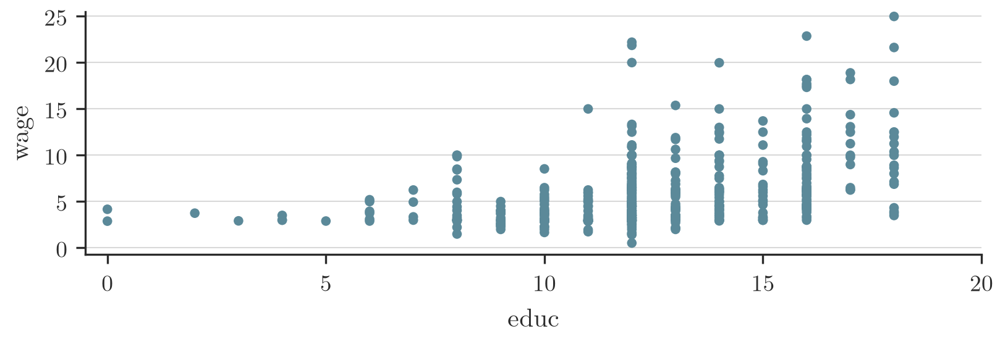

**Figura 1** — Scatterplot di educ vs. wage (526 individui osservati nel 1976). Relazione grezza tra anni di istruzione e salario orario: i punti seguono una tendenza crescente, con forte dispersione attorno ad essa.

Con l'analisi di regressione si cerca un modello che riassuma, **in modo semplice**, come variano le distribuzioni condizionali di una variabile $Y$ al variare di una seconda variabile $X$. Nell'esempio, la distribuzione condizionale è la distribuzione di probabilità dei salari ($Y$) per un qualsiasi livello di istruzione ($X$). Questo modello rappresenta l'ipotesi (ex-ante) sulla relazione causale: si definisce una variabile obiettivo (variabile dipendente) e una variabile causale (regressore, causa scatenante). Il nesso causale ipotizzato è, per costruzione, **unidirezionale** ($X \to Y$).

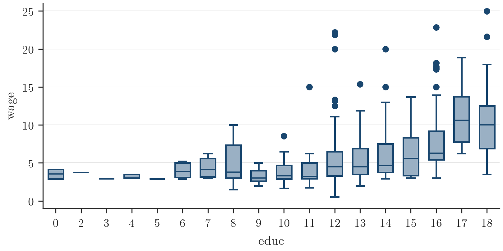

**Figura 2** — Distribuzione condizionale dei salari per ogni livello di istruzione. Boxplot del salario (mediana, quartili, valori estremi) per ciascun valore di anni di istruzione: sia il livello medio sia la dispersione dei salari tendono a crescere con l'istruzione.

Trovare un modello che si adatti con precisione a **tutte** le distribuzioni condizionali sarebbe troppo complicato. I modelli statistici descrivono quindi la dinamica di alcuni momenti (caratteristiche) delle distribuzioni condizionali; nel modello di regressione queste caratteristiche sono i valori attesi (medie). L'obiettivo diventa costruire un modello che descriva le **medie condizionali** di $Y$: ad esempio, qual è il salario atteso per i lavoratori che hanno studiato esattamente 10 anni?

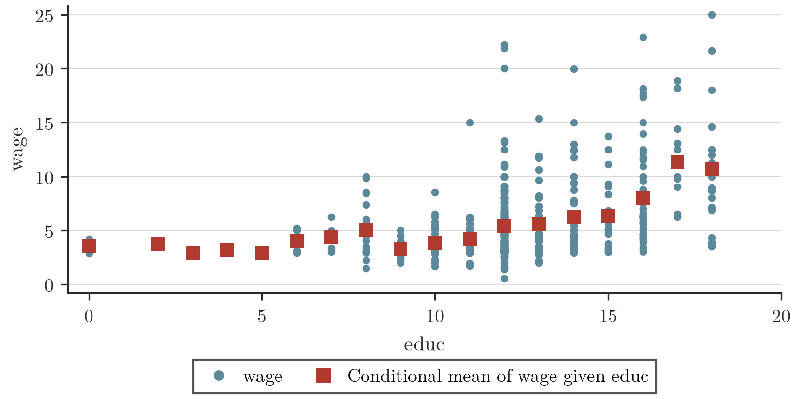

**Figura 3** — Scatterplot di educ vs. wage e $E[wage|educ]$ (quadrati rossi). Le medie condizionate stimate per ciascun livello di istruzione sono sovrapposte ai dati osservati; il loro andamento è crescente ma non perfettamente lineare.

Per rispondere a queste domande è conveniente definire un modello che descriva la relazione tra istruzione e salari attesi: **la linea è il modello più semplice che si conosca**.

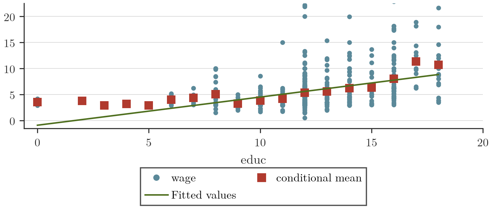

**Figura 4** — Scatterplot di educ vs. wage con $E[wage|educ]$ (quadrati rossi) e la linea di regressione. Alla figura precedente si aggiunge la retta di regressione stimata (fitted values), che approssima in modo semplice l'andamento delle medie condizionate.

Il valore atteso condizionale $E[Y|X=x]$ è la media di $Y$ per un dato livello $x$ di $X$. La retribuzione media stimata per un dato numero di anni di istruzione è riportata nella tabella seguente:

**Tabella 1** — Valori attesi stimati di wage fissato educ

| years of educ | E[wage\|educ] | years of educ | E[wage\|educ] |
|---|---|---|---|
| educ=0 | 3.53 | educ=10 | 3.83 |
| educ=1 | not available | educ=11 | 4.18 |
| educ=2 | 3.75 | educ=12 | 5.37 |
| educ=3 | 2.92 | educ=13 | 5.59 |
| educ=4 | 3.17 | educ=14 | 6.23 |
| educ=5 | 2.90 | educ=15 | 6.32 |
| educ=6 | 3.98 | educ=16 | 8.04 |
| educ=7 | 4.38 | educ=17 | 11.34 |
| educ=8 | 5.03 | educ=18 | 10.67 |
| educ=9 | 3.27 | educ=19 | not available |

*(slide 3–10)*

> [!lezione] Dalla lezione del 12 novembre 2026: distribuzioni condizionali ed eterogeneità dei salari
> I dati dell'esempio risalgono agli anni Settanta, per cui i salari orari in dollari sono numeri piccoli; l'andamento non è molto diverso da quello atteso oggi, a parte la scala. Ogni colonna di punti dello scatterplot è la distribuzione dei salari dei lavoratori che hanno studiato esattamente un certo numero di anni, per esempio 10 oppure 15. È quindi una distribuzione condizionale, che dice in termini probabilistici quanto è probabile trovare, in quel sottogruppo, un lavoratore che guadagna molto o poco.
>
> I quadrati rossi sono le medie di queste distribuzioni e tendono a crescere con l'istruzione: per i livelli più bassi la variabilità è scarsa e il salario medio è sotto i 5 dollari l'ora, per un livello intermedio è poco sopra i 5 dollari, e per chi ha studiato molto il docente indica un centro della distribuzione intorno ai 15 dollari (la tabella 1 riporta medie condizionali fino a circa 11 dollari). Studiando di più non si guadagna però di più con certezza: in una stessa colonna ci sono persone che guadagnano meno di chi ha studiato zero anni e persone che guadagnano estremamente di più.
>
> Questa eterogeneità dice come varia il salario in funzione di informazioni diverse dall'istruzione, perché i lavoratori di una colonna hanno lo stesso livello di istruzione ma caratteristiche individuali diverse. Il punto in alto, a circa 25 dollari l'ora, può essere il figlio di un dirigente che finirà a fare il dirigente; il punto più in basso può essere qualcuno che ha deciso di studiare archeologia: se gli va bene guadagna molto, se gli va male finisce a fare scavi per i cantieri. Ci sono anche effetti più sottili, come quello di genere: nei dati gli uomini tendono a guadagnare più delle donne. A parità di anni di studio, chi si laurea alla Bocconi può avere aspettative diverse da chi si laurea a Cassino, anche solo perché a Milano i salari sono più alti. All'interno di una colonna l'istruzione è esattamente la stessa e non può spiegare l'eterogeneità, che dipende da altro (il reddito della famiglia, il tipo di studi, l'intelligenza, il genere). La parte di eterogeneità non spiegata dall'istruzione, ma da qualcos'altro, è il termine d'errore, indicato con $\varepsilon$.

> [!lezione] Dalla lezione del 12 novembre 2026: perché una retta che approssima le medie condizionali
> Il modello di regressione lavora sul momento di ordine uno, cioè sulle medie. Le varianze interessano, ma in generale si vuole capire come in media il livello di istruzione impatti sul salario. Serve quindi un modello che approssimi i quadrati rossi, cioè le medie condizionali.
>
> I quadrati rossi sono però evidenza campionaria, non della popolazione. L'obiettivo non è spiegare il campione: per conoscere guadagno e anni di studio dell'unità statistica numero 73 basta guardare il foglio dei dati, senza bisogno di prevederlo, e per sapere che cosa succede passando da 12 a 14 anni di istruzione basta la differenza tra le due medie condizionali campionarie. Interessa la popolazione, e in particolare le medie condizionali di popolazione, che si conoscerebbero solo intervistando tutti i lavoratori degli Stati Uniti in un certo periodo e conoscendone con esattezza il reddito, il che è impossibile. I quadrati rossi, calcolati su uno specifico insieme di poco più di 500 lavoratori, ne sono solo un'approssimazione.
>
> Per questo non serve una funzione complicata che passi esattamente sui quadrati rossi. Sarebbe possibile, e nemmeno difficile (basta un comando del computer per trovare funzioni molto smooth che li attraversano), ma i quadrati rossi sono già noti, calcolati in una tabella a parte. Serve una funzione abbastanza buona da approssimarli e, allo stesso tempo, da approssimare le medie condizionali che si otterrebbero da altri campioni estratti dalla stessa popolazione. Un modello che si adatta perfettamente ai dati posseduti, e non a tutti i dati possibili, che sono i più interessanti perché ignoti, incorre in **overfitting**.
>
> Si consideri una popolazione di cui il campione osservato è soltanto una parte, e una funzione costruita per approssimare esattamente i punti del campione. Rispetto ai dati usati l'errore è praticamente nullo, ma alcuni punti della popolazione non usati nella stima risultano estremamente distanti dalla funzione, cioè da ciò che si potrebbe osservare in un altro campione della stessa popolazione. Per prevedere $y$ a un dato valore di $x$ si userebbe il punto sulla funzione stimata, la migliore approssimazione possibile con quella funzione, ma l'errore di previsione sarebbe gigantesco per una persona esterna al sottoinsieme osservato. È preferibile un modello che non approssimi troppo bene il campione ma non vada troppo male nemmeno fuori da esso, cioè che faccia da media rispetto alle funzioni che si stimerebbero con campioni diversi: non è perfetto per nessun campione, ma in media non sbaglia in modo sistematico. Il modello serve a capire che cosa succede su ciò che non si osserva. Un modello con un $R^2$ del 99% non è necessariamente un buon modello, mentre uno con un $R^2$ del 20% potrebbe essere ottimo.
>
> La funzione cercata deve dunque riflettere un andamento di lungo periodo ed essere universale, non specifica del singolo dataset. Una retta è inoltre un modello molto semplice, facile da identificare e senza curve o polinomi, e dipende da due soli parametri, l'intercetta e il coefficiente angolare: stimati questi due numeri, si caratterizza il comportamento dei dati su tutta la popolazione.
>
> Il modello non approssima direttamente i dati, per i quali non esiste una funzione che si adatti completamente, ma una loro caratteristica, le medie condizionali, che sono indicatori di centralità sufficientemente stabili. Esistono modelli che considerano altri indicatori, come quantili e mediane: è la regressione quantilica, che non fa parte del corso. Il docente la segnala perché permette di capire non solo come reagisce in media un fenomeno a una perturbazione, ma anche come reagiscono le code. In finanza interessano le code delle distribuzioni, cioè perdere o guadagnare molto: i rendimenti medi di un portafoglio sono in media zero, e a chi investe interessa coprirsi dagli eventi estremi, per esempio capire come una variazione della situazione geopolitica impatti le code del portafoglio e non la sua media. Nel corso si considerano le medie condizionali, un indicatore di centralità semplice, sapendo che l'impostazione si può generalizzare.

## Il modello di regressione semplice

> [!abstract] Definizione
> La **funzione di regressione semplice** descrive le medie condizionali $E[Y|X=x]$ attraverso un modello lineare:
>
> $$E[Y|X] = \alpha + \beta X$$
>
> Questa retta è un'**approssimazione** della vera media condizionale (i quadrati rossi delle figure precedenti), poiché in generale non è possibile trovare un modello semplice che corrisponda esattamente a tutte le medie condizionate.
>
> Data questa ipotesi per la media condizionale, ogni osservazione $(X_i, Y_i)$ nel campione può essere rappresentata come
>
> $$Y_i = E[Y|X=X_i] + \epsilon_i$$
>
> dove $\epsilon_i$ è una quantità stocastica che misura la distanza tra ciascuna osservazione e la retta di regressione.
>
> **Terminologia:**
> - $Y_i$, $i=1,\dots,n$: variabile dipendente;
> - $X_i$, $i=1,\dots,n$: regressore o predittore;
> - $\epsilon_i$, $i=1,\dots,n$: termine di errore.
>
> Intuitivamente $\epsilon_i$ è un fattore di rumore che raccoglie gli effetti di tutte le variabili che potrebbero influenzare $Y$ (escluso $X$) e non sono incluse esplicitamente nel modello. Si assume che l'unico predittore utile per il valore atteso di $Y$ sia il regressore: per questo ci si aspetta che, in media, l'impatto di $\epsilon$ non sia rilevante, ovvero formalmente che $E[\epsilon|X]=0$. Ciò significa che il termine di errore per alcuni soggetti è positivo, per altri negativo, ma in media tutti questi errori si sommano a zero.
>
> **Interpretazione causale — effetto di una variazione di $X$.** Ipotizzando che i parametri $\alpha$ e $\beta$ siano noti, la previsione di $Y$ per un individuo con $X=X_1$ è
>
> $$\hat{Y}(X_1) = \alpha + \beta X_1 + \epsilon(X_1)$$
>
> e per $X=X_2$:
>
> $$\hat{Y}(X_2) = \alpha + \beta X_2 + \epsilon(X_2)$$
>
> dove $\epsilon(X_1)$ ed $\epsilon(X_2)$ rappresentano le caratteristiche non osservate di soggetti con istruzione rispettivamente $X_1$ o $X_2$ anni. La variazione di $Y$ è quindi
>
> $$\underbrace{\hat{Y}(X_2)-\hat{Y}(X_1)}_{\Delta Y} = \beta\underbrace{(X_2-X_1)}_{\Delta X} + \underbrace{[\epsilon(X_2)-\epsilon(X_1)]}_{\Delta \epsilon}$$
>
> $\Delta Y$ dipende quindi da una scelta economica ($\Delta X$) e da qualcos'altro ($\Delta\epsilon$), quest'ultimo in generale non misurabile. Se si assume che $\epsilon$ non dipenda da $X$, diversi livelli di $X$ non porteranno a variazioni di $\epsilon$, cioè $\Delta \epsilon = 0$. Pertanto la variazione di $Y$ è proporzionale alla variazione di $X$, con coefficiente di proporzionalità $\beta$:
>
> $$\Delta Y = \beta \Delta X$$
>
> Inoltre, se $E[\epsilon|X]=0$, allora $\mathrm{Cov}(X,\epsilon)=0$ e $\hat{Y}(X)\approx E[Y|X]$ (le slide scrivono l'implicazione in senso inverso, da $\mathrm{Cov}(X,\epsilon)=0$ a $E[\epsilon|X]=0$, che in generale non vale: l'assenza di correlazione è una condizione più debole). Questa ipotesi stabilisce che l'unica spiegazione delle variazioni di $Y$ è fornita da $X$: ipotizzando che $\epsilon$ e $X$ non siano correlati, il risultato di una scelta dipende unicamente dalla scelta stessa ($\Delta X$) e non da altri fattori confondenti ($\Delta \epsilon$). Questa ipotesi è nota come **esogeneità**, ed è alla base dello studio di relazioni causali.
>
> **Esempio numerico.** Si consideri il modello che lega salario e istruzione con $\alpha=-1$ e $\beta=0.5$:
>
> $$wage_i = \alpha + \beta\, educ_i + \epsilon_i = -1 + 0.5\, educ_i + \epsilon_i$$
>
> Assumendo che altre caratteristiche (genere, esperienza, tenure, ecc.), riassunte in $\epsilon_i$, non siano rilevanti, un anno di scuola in più ($\Delta educ = 1$) induce una variazione della retribuzione oraria prevista di 0.50 dollari; due anni in più inducono una variazione dello stipendio atteso di 1 dollaro.

*(slide 11–16)*

> [!lezione] Dalla lezione del 12 novembre 2026: notazione e ruolo del termine d'errore
> Nella notazione $E(y \mid x)$ la prima variabile è quella su cui si calcola la media, mentre la seconda, che segue la barra verticale, è la variabile di condizionamento: i quadrati rossi sono il valore atteso condizionale dei salari rispetto all'istruzione, con wage come variabile $y$ ed education come variabile $x$. Per legare le osservazioni individuali alla media condizionale si considerano le coppie $(y_i, x_i)$, dove $i$ indica l'unità statistica (un lavoratore nell'esempio), $x_i$ è l'istruzione del lavoratore $i$-esimo e $y_i$ il suo salario, e vale $y_i = \alpha + \beta x_i + \varepsilon_i$.
>
> Il salario esatto di un individuo, che non è il salario medio, dipende da due fattori. Il primo è una componente media: per l'appartenenza a una categoria, cioè a un certo livello di istruzione, il salario atteso è $\alpha + \beta x_i$. Il secondo è una componente idiosincratica, individuale, che rappresenta tutte le caratteristiche del lavoratore diverse dall'istruzione: il genere, la famiglia, se è sveglio o no, se ha fatto un master in finanza o in storia dell'arte. Regressore e predittore sono due nomi della stessa variabile $x$: predittore se si segue una letteratura più statistica, regressore se più economica.
>
> Le caratteristiche di $\varepsilon$ determinano se il modello sia una relazione causale oppure no. Nel corso di statistica non sono così importanti, lo sono invece in econometria e in economia, perché la relazione tra $\varepsilon$ e $x$ permette di dire se il modello è ben specificato. Si assume che la correlazione tra $\varepsilon$ e $x$ sia zero: questa condizione si chiama esogeneità, e se non vale si parla di endogeneità, che ha conseguenze pesanti sulla stima. Il termine d'errore non è osservabile, per cui per capire se il modello sia corretto bisogna stabilire le proprietà di qualcosa che non si può misurare direttamente, e occorre aggirare il problema.

> [!lezione] Dalla lezione del 12 novembre 2026: perché senza una condizione sull'errore l'effetto non è identificabile
> Il termine $\varepsilon$ contiene altri fattori, diversi dall'istruzione, che in linea di principio possono essere collegati al livello di istruzione: più si studia, più si impara, e l'abilità conseguita può aumentare. Per questo si scrive $\varepsilon(x_1)$, facendo dipendere l'errore anche da $x_1$, e si lega direttamente l'abilità di una persona al livello di istruzione. Aumentando l'istruzione di $\Delta x$, per esempio due anni, la variazione di $y$ è $\beta \Delta x + \Delta\varepsilon$, dove $\Delta\varepsilon = \varepsilon(x_1 + \Delta x) - \varepsilon(x_1)$ non è calcolabile perché non è noto, ma teoricamente esiste. La variazione di salario dipende quindi in parte dall'aver studiato due anni in più e in parte da effetti collaterali della scelta.
>
> La variazione complessiva si può calcolare: la differenza dei quadrati rossi dà, per esempio, 3 dollari. Sulla base del modello non si sa però se questi 3 dollari dipendano dalla scelta di studiare o da altro, perché si conosce soltanto la somma: potrebbero essere 1 più 2, oppure 0 più 3, oppure $-3$ più 6. L'effetto non è identificabile. L'unico modo per identificare l'effetto della scelta, cioè $\beta \Delta x$, è fissare il valore di $\Delta\varepsilon$, e il valore più comodo è 0: se la variazione di $\varepsilon$ è nulla, tutta la variazione di $y$ dipende da $\beta \Delta x$. Per identificare l'effetto di un fattore su cui si sceglie bisogna quindi essere sicuri che gli effetti collaterali siano nulli.
>
> La condizione statistica per cui la variazione di tutto il resto è nulla quando varia $x$ è una correlazione uguale a zero tra $x$ ed $\varepsilon$ (qui tutto è lineare, quindi basta poco). Concettualmente è difficile verificarla, perché $x$ si può misurare ma $\varepsilon$ no. Con questa ipotesi aggiuntiva, l'unica spiegazione plausibile di una variazione di $y$ è la variazione di $x$ pesata dal coefficiente $\beta$, la pendenza della retta di regressione. L'ipotesi si chiama esogeneità, in questo caso esogeneità stretta: esistono vari concetti di esogeneità e nei modelli di regressione classici si usa quella stretta, mentre nella seconda parte del corso verrà abbandonata a favore dell'esogeneità debole, che è più che sufficiente. Questa nota formula invece l'esogeneità come $E[\varepsilon \mid X]=0$, da cui segue $\operatorname{Cov}(X,\varepsilon)=0$ ma non viceversa, e osserva che le slide enunciano la condizione di correlazione nulla, più debole; il docente usa qui la correlazione nulla e la chiama esogeneità stretta. Se la correlazione fosse diversa da zero, la variazione di $\varepsilon$ non potrebbe essere nulla in corrispondenza di una variazione di $x$, e non si saprebbe valutare perché si osservino variazioni di $y$.

> [!lezione] Dalla lezione del 12 novembre 2026: esempio del bonus fiscale e dei consumi
> Uno dei problemi dell'Italia è che i consumi sono molto bassi, e per dare loro impulso si danno tipicamente dei bonus. Il docente richiama la riforma di Matteo Renzi dei mille euro, introdotta come sconto fiscale per una certa fascia di lavoratori. La misura è costosa, ma il costo si valuta in modo abbastanza preciso, perché è una minore entrata per lo Stato. Lo scopo era stimolare i consumi, e ci si chiede se questi siano effettivamente migliorati in conseguenza della policy.
>
> Per rispondere si può calcolare la relazione tra redditi ($x$) e consumi ($y$), entrambi pro capite: la policy varia $x$ di 1.000 euro, e ci si chiede come siano variati i consumi. Il docente precisa di non aver svolto questa analisi e di non valutare se la scelta sia stata giusta o sbagliata: pone un problema statistico. Se il parametro che lega consumi e redditi è grande, 1.000 euro in più alle famiglie avranno un impatto sui consumi, e la policy avrà ottenuto il risultato voluto. Il problema è se il modello sia corretto: la variazione dei consumi osservata potrebbe dipendere dai 1.000 euro in più, oppure da altro, come le condizioni economiche di quel periodo. Se l'effetto collaterale fosse più importante, probabilmente sarebbe stato più efficiente usare quei soldi per altro.
>
> Si può investire molto denaro in una policy e stimare un parametro grande tra le due variabili, da cui ci si aspetterebbe un impatto devastante. Tale impatto vale solo se si ipotizza che $\Delta\varepsilon$ sia zero. Altrimenti non si può dire che la policy abbia avuto un impatto, perché occorre considerare una combinazione di eventi e non uno solo: la variazione si può calcolare, ma non si sa da che cosa dipenda. L'unico modo per essere sicuri che l'investimento abbia un impatto è fissare ciò che non si conosce, e ciò che non si conosce si fissa tipicamente a zero. Se $\Delta\varepsilon$ è zero, l'unica spiegazione della variazione di $y$ è $x$, pesata da $\beta$, che è il moltiplicatore, e il solo problema diventa stimare $\beta$.

> [!lezione] Dalla lezione del 12 novembre 2026: stimare il parametro o prevedere
> Il problema posto non è del modello di regressione in generale, ma di interpretabilità dei risultati. In un corso di statistica il problema dell'eterogeneità nel modello di regressione non viene praticamente considerato, perché lo scopo è trovare un modello da usare per fare previsioni sui dati successivi. Qui interessa invece valutare con precisione il parametro $\beta$, perché esso dice, per esempio, quanto denaro si sta spendendo per l'istruzione dei bambini e se la scelta fatta è corretta. Lo scopo dell'analisi con i modelli di regressione in economia è capire quanto una policy abbia impatto, cioè stimare correttamente $\beta$, e non avere un modello che si adatti ai dati o che serva per le previsioni; per farlo occorre fissare $\Delta\varepsilon$ a zero. In un corso orientato alle previsioni, invece, che $\beta$ sia calcolato bene o male non importa, purché la previsione sia corretta.
>
> Un economista vuole sapere se spendere 2 miliardi di dollari l'anno per ridurre la dimensione delle classi sia utile a grande scala, il che è un problema politico o economico. Si può assumere invece il punto di vista di un genitore che deve iscrivere un figlio a scuola, e che sceglie la scuola in cui il voto finale del figlio sarà più alto, così da entrare l'anno dopo in una buona scuola con una borsa di studio e poter sopravvivere a un sistema di istruzione estremamente costoso. Per il genitore lo scopo non è migliorare il mondo ma trovare la scuola più adatta al proprio figlio, e il problema diventa di previsione. Se la variabile che prevede meglio la performance del figlio risultasse la dimensione del parcheggio della scuola, il genitore misurerebbe il parcheggio di tutte le scuole degli Stati Uniti e sceglierebbe in base a quello: non importa che logicamente non abbia senso, funziona. È una black box.
>
> Dal punto di vista dello statistico che fa previsione non interessa quindi calcolare esattamente il parametro che lega le variabili, perché non è necessariamente legato alla capacità previsiva del modello. Se invece si usa il modello per valutare politiche, o per confermare congetture economiche e finanziarie di qualsiasi tipo, interessa conoscere il parametro. Il docente precisa che non sta dicendo che un approccio sia migliore dell'altro: lo stesso strumento risponde a criteri diversi perché i problemi sono diversi.

## Stima del modello: il metodo dei minimi quadrati ordinari (OLS)

> [!abstract] Definizione
> Dati i dati campionari, occorre stimare i parametri $\alpha$ e $\beta$ del modello di regressione. L'idea di base è trovare valori per $\alpha$ e $\beta$ che **minimizzino la distanza media** tra ciascuna osservazione e la retta di regressione: questi due parametri identificano in modo univoco la retta.
>
> Il metodo dei **minimi quadrati ordinari (OLS)** suggerisce di minimizzare la varianza del termine di errore, ovvero calcolare
>
> $$\min_{\alpha,\beta} \mathrm{Var}(\epsilon) = \min_{\alpha,\beta} E[\epsilon^2] \approx \min_{\alpha,\beta} \frac{1}{n}\sum_{i=1}^n (Y_i-\alpha-\beta X_i)^2$$
>
> Si dimostra che la pendenza della retta di regressione $\beta$ è proporzionale alla covarianza tra $X$ e $Y$:
>
> $$\hat\beta = \frac{\frac{1}{n}\sum_{i=1}^n (Y_i-\bar Y)(X_i-\bar X)}{\frac{1}{n}\sum_{i=1}^n (X_i-\bar X)^2} = \frac{\mathrm{Cov}(X,Y)}{\mathrm{Var}(X)}$$
>
> **Esempio: wage vs. education.** Si consideri il modello $wage_i = \alpha + \beta\, educ_i + \epsilon_i$. Le stime OLS basate su un campione di 526 osservazioni sono:
>
> | Variabile | Coef. | Std. Err. | t | P>\|t\| | IC 95% inf. | IC 95% sup. |
> |---|---|---|---|---|---|---|
> | educ | .5413593 | .053248 | 10.17 | 0.000 | .4367534 | .6459651 |
> | _cons | -.9048516 | .6849678 | -1.32 | 0.187 | -2.250472 | .4407687 |
>
> Il modello stimato risulta quindi (coefficienti arrotondati alla quarta cifra; le slide troncano a $-.9048$ e $.5413$)
>
> $$wage = -.9049 + .5414\, educ$$
>
> Studiare un anno in più induce una variazione positiva di circa 54 centesimi nei salari.
>
> **Valori predetti e residui.** La previsione della media condizionale, o valore predetto, è
>
> $$\hat Y_i = \hat E[Y_i|X=x_i] = \hat\alpha + \hat\beta x_i$$
>
> Il termine di errore viene stimato come differenza tra la variabile osservata $Y_i$ e il valore atteso $\hat Y_i$; è chiamato **residuo** ed è definito come
>
> $$\hat\epsilon_i = Y_i - \hat\alpha - \hat\beta X_i = Y_i - \hat Y_i$$
>
> 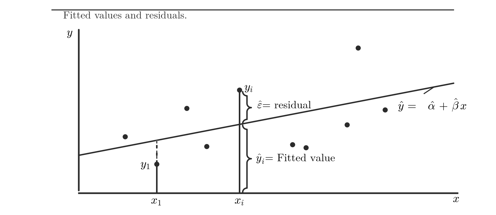
>
> **Figura 5** — Rappresentazione grafica di $Y_i$ come somma di residuo ($\hat\epsilon_i$) e valore predetto ($\hat Y_i$). Ogni osservazione $Y_i$ si scompone nella somma del valore previsto dalla retta e del residuo, cioè la distanza verticale tra il punto osservato e la retta.

*(slide 17–21)*

> [!lezione] Dalla lezione del 12 novembre 2026: il parametro $\beta$ ricavato con il metodo dei momenti
> Tutti i libri indicano come modo corretto il metodo dei minimi quadrati: si prendono le osservazioni su $y$ e il modello e si trovano $\alpha$ e $\beta$ tali che la distanza media tra $y$ e la trasformazione lineare di $x$ sia la più piccola possibile. La distanza si calcola con il quadrato, per evitare che gli scarti positivi e negativi si compensino. Si derivano le espressioni rispetto ad $\alpha$ e $\beta$, si pongono le derivate uguali a zero e si risolve il sistema di due equazioni in due incognite: la soluzione per $\beta$ è un rapporto tra quantità, quella per $\alpha$ una differenza di medie. Il docente considera questa la via più noiosa e ne presenta una con un'algebra più breve e a suo parere più intuitiva.
>
> Si assume che il modello sia corretto, cioè che valga l'esogeneità: la covarianza tra $x$ ed $\varepsilon$ è zero. Nella popolazione $y$ è data dalla combinazione $\alpha + \beta x + \varepsilon$, per cui
>
> $$\operatorname{Cov}(x, y) = \operatorname{Cov}(x, \alpha + \beta x + \varepsilon).$$
>
> La covarianza di una variabile rispetto a una combinazione lineare è la combinazione lineare delle covarianze, perché la covarianza si può pensare come una media, una sommatoria o un integrale, che sono operatori lineari. Si ottiene quindi
>
> $$\operatorname{Cov}(x, y) = \operatorname{Cov}(x, \alpha) + \operatorname{Cov}(x, \beta x) + \operatorname{Cov}(x, \varepsilon).$$
>
> Il primo termine è zero, perché la covarianza tra una costante e una variabile casuale è nulla: al variare di $x$, $\alpha$ resta costante. Il terzo termine è zero per ipotesi, che il docente sottolinea essere una scelta e non necessariamente corretta. Nel secondo la costante $\beta$ si porta fuori dalla covarianza e resta la covarianza di $x$ con se stessa, cioè la varianza di $x$. Quindi
>
> $$\operatorname{Cov}(x, y) = \beta \operatorname{Var}(x), \qquad \beta = \frac{\operatorname{Cov}(x, y)}{\operatorname{Var}(x)}.$$
>
> Questa relazione vale nella popolazione: il vero $\beta$, quello che si otterrebbe considerando tutti i lavoratori degli Stati Uniti, è la covarianza tra livello di istruzione e salario divisa per la varianza del livello di istruzione. Se la formula vale nella popolazione, si può applicare al campione: numeratore e denominatore si stimano con covarianza e varianza campionarie, che per la legge dei grandi numeri convergono ai momenti di popolazione, per cui lo stimatore converge al vero $\beta$ per $n$ sufficientemente grande. Il procedimento si chiama **metodo dei momenti**.
>
> Il docente lo preferisce alla costruzione con le derivate perché l'ipotesi viene formulata in modo specifico: la condizione di esogeneità è imposta direttamente, in modo brutale, nelle condizioni usate per la stima, e la formula funziona solo se la covarianza tra $x$ ed $\varepsilon$ è uguale a zero. Minimizzando poi la distanza tra $y$ e il modello di regressione si trova uno stimatore dei minimi quadrati che coincide esattamente con quello appena ricavato. In questo caso i due approcci coincidono, cosa che non sempre accade; ci sono motivi profondi per cui succede. La differenza è che nel metodo dei momenti le ipotesi economiche specifiche, cioè l'esogeneità, sono imposte direttamente.

## Il termine d'errore ε: proprietà, omoschedasticità ed eteroschedasticità

> [!abstract] Definizione
> Le proprietà della variabile casuale $\epsilon$ servono a derivare le proprietà degli stimatori OLS: interessano i suoi momenti e la relazione tra $\epsilon$ ed $X$.
>
> Per costruzione, $\epsilon_i$ è la differenza tra $Y_i$ e la media condizionale $E[Y|X_i]$:
>
> $$\epsilon_i = Y_i - E[Y|X_i] = Y_i - \alpha - \beta X_i$$
>
> $\epsilon$ raccoglie tutte le caratteristiche non esplicitamente considerate dal modello e descrive l'eterogeneità presente nei dati: non tutte le persone che hanno studiato 10 anni ricevono la stessa somma di denaro, alcune ricevono uno stipendio superiore alla media condizionata, altre inferiore. Il termine di errore spiega questa variabilità e raccoglie intuitivamente la quantità di informazioni su $Y$ non osservabili che non sono spiegate da $X$.
>
> **Media condizionale $E[\epsilon|X]$.** Ipotizzando che $\alpha+\beta X$ sia un'approssimazione credibile di $E[Y|X]$ (cioè $E[Y|X]\approx \alpha+\beta X$), la media condizionale di $\epsilon$ deve essere
>
> $$E[\epsilon|X] = E[Y|X] - \alpha - \beta X = 0$$
>
> Come conseguenza principale, $\mathrm{Cov}(\epsilon,X)=0$: tutte le variabili che contribuiscono alla costruzione di $\epsilon$ non possono essere correlate con $X$. Questo implica
>
> $$\Delta E[Y|X] = \Delta Y = \beta \Delta X + \Delta \epsilon = \beta \Delta X$$
>
> L'intuizione è che l'unica informazione rilevante per descrivere la media condizionale di $Y$ è fornita da $X$; tutte le altre variabili non possono avere un impatto sistematico su di essa.
>
> **Varianza condizionale $\mathrm{Var}(\epsilon|X)$.** In generale spesso non si sa come descrivere la varianza condizionale di $\epsilon$. Si noti però che la variabilità di $\epsilon$ descrive anche la variabilità della variabile dipendente $Y$:
>
> $$\mathrm{Var}(\epsilon|X) = \mathrm{Var}(Y|X)$$
>
> Si possono formulare due ipotesi alternative sulle varianze condizionali:
>
> - **Omoschedasticità**: $\mathrm{Var}(\epsilon|X)=\sigma^2$, cioè non dipende da $X$.
> - **Eteroschedasticità**: $\mathrm{Var}(\epsilon|X)=\sigma^2(X)$, quindi è funzione di $X$.
>
> Differenti ipotesi su $\mathrm{Var}(\epsilon|X)$ portano a formule diverse per la varianza, e quindi per gli errori standard, dello stimatore OLS; i coefficienti stimati restano gli stessi (le slide parlano di «diversi stimatori OLS»).
>
> 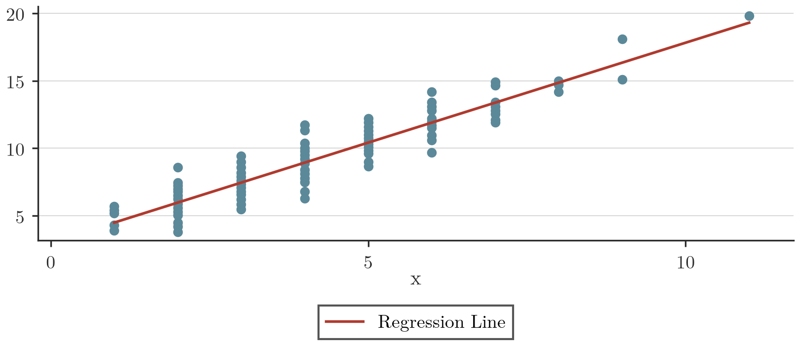
>
> **Figura 6** — Retta di regressione $E(Y|X=x)$ ed errori omoschedastici. A diversi valori di $X$ la dispersione di $Y$ attorno alla retta rimane simile (variabilità condizionale simile).
>
> 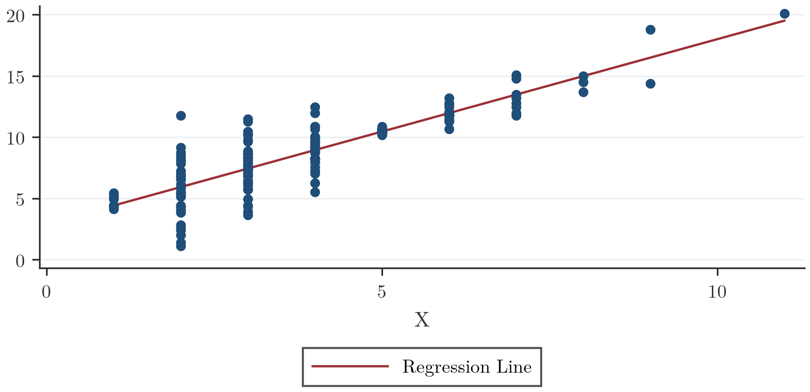
>
> **Figura 7** — Retta di regressione $E(Y|X=x)$ ed errori eteroschedastici. A diversi valori di $X$ corrispondono ampiezze diverse della variabilità di $Y$ attorno alla retta, cioè diverse $\mathrm{Var}(Y|X)$.

*(slide 22–27)*

## Le ipotesi del modello di regressione OLS

> [!abstract] Definizione
> Ai fini pratici occorre verificare se la strategia OLS fornisce stime affidabili dei parametri di interesse: il coefficiente $\beta$ misura l'impatto di una politica (valutata come $\Delta X$) sulla variabile dipendente. Per valutare queste proprietà occorre definire formalmente le ipotesi sul modello di regressione:
>
> 1. Il vero modello (la retta nella popolazione) è lineare: $E[Y|X]=\alpha+\beta X$;
> 2. Il modello statistico (approssimato) coincide con quello vero, ovvero $Y=\alpha+\beta X+\epsilon$. Come conseguenza principale, $\mathrm{Cov}(X,\epsilon)=0$;
> 3. Le coppie $(X_i,Y_i)$, $i=1,\dots,n$ sono **I.I.D.**;
> 4. I momenti quarti di $X$ e $Y$ esistono e sono finiti;
> 5. Si suppone, ad esempio, che $\mathrm{var}[\epsilon|X]=\sigma^2$ (**Omoschedasticità**).
>
> **Nota: ipotesi OLS equivalenti.** L'ipotesi OLS può essere formulata in modo diverso ma equivalente. Finora si è ipotizzato che il modello empirico (quello valutato attraverso un dataset) sia $Y=\alpha+\beta X+\epsilon$, e che la media condizionale (il vero modello) sia $E[Y|X]=\alpha+\beta X$. Nell'ipotesi che il modello empirico coincida con quello vero, $\epsilon \equiv Y-E[Y|X]$, quindi
>
> $$E[\epsilon|X]=0 \;\Rightarrow\; \mathrm{Cov}(X,\epsilon)=0$$
>
> Un modo alternativo ed equivalente di definire l'ipotesi:
>
> - si considera che il modello empirico sia lineare, $Y=\alpha+\beta X+\epsilon$;
> - si suppone inoltre che $E[\epsilon|X]=0$;
> - quindi $E[Y|X]=\alpha+\beta X$ corrisponde al vero modello.
>
> Le ipotesi alternative ma equivalenti per il metodo OLS si possono quindi riassumere come:
>
> - Il regressore $X$ è **esogeno**, ovvero la media condizionale di $\epsilon|X$ è zero ($E[\epsilon|X]=0$); conseguenza principale: $E[Y|X]=\alpha+\beta X$;
> - Le coppie $(X_i,Y_i)$, $i=1,\dots,n$ sono I.I.D.;
> - I momenti quarti di $X$ e $Y$ esistono e sono finiti;
> - Si suppone che $\mathrm{var}[\epsilon|X]=\sigma^2$ (Omoschedasticità).
>
> **Nota: sull'esogeneità.** Si supponga che il regressore non sia esogeno, cioè sia **endogeno**, quindi $\mathrm{Cov}(X,\epsilon)\neq 0$. Considerando la variazione attesa di $Y$
>
> $$\underbrace{\hat Y(X_2)-\hat Y(X_1)}_{\Delta Y} = \alpha+\beta X_2+\epsilon(X_2) - [\alpha+\beta X_1+\epsilon(X_1)] = \beta\underbrace{(X_2-X_1)}_{\Delta X} + \underbrace{[\epsilon(X_2)-\epsilon(X_1)]}_{\Delta \epsilon}$$
>
> Poiché $\mathrm{Cov}(X,\epsilon)\neq 0$, ragionevolmente ci si aspetta che $E[\Delta\epsilon|X]$, misurato come $\epsilon(X_2)-\epsilon(X_1)$, sia diverso da zero. In questo caso
>
> $$\Delta Y = \beta \Delta X + \Delta \epsilon$$
>
> Le variazioni attese di $Y$ non dipendono solo da $\beta$ ma anche da $\Delta\epsilon$, in generale non calcolabile: quindi $\beta$ non è più una misura precisa delle implicazioni di $\Delta X$.
>
> **Esempio: sull'esogeneità.** Si consideri un dataset simulato di dimensione 200 che soddisfa
>
> $$Y_i = 3 + 1.5 X_i + \epsilon_i, \qquad \mathrm{cov}(X,\epsilon)=0.6$$
>
> Si stima il modello $Y=\alpha+\beta X+\epsilon$:
>
> | Variabile | Coef. | Std. Err. | t | P>\|t\| | IC 95% inf. | IC 95% sup. |
> |---|---|---|---|---|---|---|
> | X | 2.129496 | .063634 | 33.46 | 0.000 | 2.004008 | 2.254983 |
> | _cons | 2.962697 | .0635759 | 46.60 | 0.000 | 2.837324 | 3.08807 |
>
> Si noti che $\hat\beta = 2.129$ è abbastanza diverso da $1.5$. Qui $\hat\beta$ non è una stima affidabile del parametro di policy $\beta$: in questo caso $2.129$ è una stima affidabile di $(\beta+\Delta\epsilon)$, che non è ciò che interessa (più precisamente, $\hat\beta$ converge a $\beta+\mathrm{Cov}(X,\epsilon)/\mathrm{Var}(X)$, qui circa $1.5+0.6=2.1$ se $\mathrm{Var}(X)\approx 1$, valore coerente con gli errori standard in tabella).

*(slide 28–33)*

> [!lezione] Dalla lezione del 12 novembre 2026: che cosa succede alla stima se l'esogeneità non vale
> Si supponga che la covarianza tra $x$ ed $\varepsilon$ sia diversa da zero e la si indichi con $\rho_{x\varepsilon}$. Ripetendo il calcolo della covarianza descritto per il metodo dei momenti, si ottiene $\operatorname{Cov}(x, y) = \beta \operatorname{Var}(x) + \rho_{x\varepsilon}$. Se questa condizione valesse e il numero fosse noto, $\beta$ andrebbe calcolato come
>
> $$\beta = \frac{\operatorname{Cov}(x, y) - \rho_{x\varepsilon}}{\operatorname{Var}(x)}.$$
>
> Per ottenere $\beta$ correttamente occorrerebbe dunque stimare anche $\rho_{x\varepsilon}$, cosa che non si sa fare, perché quel numero non è noto. Un software non lo fa: a meno che non gli venga detto, tratta $\rho_{x\varepsilon}$ come se fosse zero. Applicando la formula sbagliata quando l'esogeneità non vale, lo stimatore di $\beta$ non risulta collegato a $\beta$ ma a $\beta$ più un termine ulteriore, perché il numeratore dovrebbe essere ripulito dall'effetto di $\rho_{x\varepsilon}$. Si ha quindi una distorsione sistematica tra ciò che si vuole stimare e ciò che si stima effettivamente dai dati, che non sparisce nemmeno aumentando il numero di osservazioni. Con endogeneità gli stimatori che si vedranno nel corso sono distorti, e l'implicazione di policy che si vuole valutare con il modello sarà sistematicamente sbagliata.
>
> Uno studente chiede se l'endogeneità indichi l'assenza di esogeneità. Il docente conferma: si ha endogeneità quando la correlazione tra $x$ ed $\varepsilon$ è diversa da zero, cioè quando vale il contrario dell'esogeneità.
>
> Il docente chiude il discorso osservando che tutto il gioco dell'econometria, almeno a questo livello, consiste nel capire quando si può dire che la variazione di $\varepsilon$ è uguale a zero in corrispondenza della variazione di $x$. Tutto il resto è algebra banale: la difficoltà è economica più che tecnica. Nelle lezioni successive la parte tecnica viene introdotta gradualmente, per mostrare che quanto detto qualitativamente ha un corrispettivo formale.

## Le proprietà degli stimatori OLS: non distorsione, consistenza e teorema di Gauss-Markov

> [!tip] Teorema
> **Domanda guida:** OLS è una buona strategia per stimare $\beta$ e $\alpha$?
>
> La funzione di regressione stimata nel campione (**Sample Regression Function - SRF**) va confrontata con la funzione di regressione nella popolazione (**PRF**), il vero modello che descrive i dati. Poiché non si potrà mai conoscere la PRF, non si potrà mai sapere quanto siano vicine SRF e PRF: un altro campione fornirebbe una SRF diversa, più o meno vicina alla PRF. Occorre quindi capire quando la regressione stimata è una buona proxy per l'intera popolazione: in pratica, la SRF è una buona approssimazione nel campione, ma non è detto lo sia per tutta la popolazione.
>
> 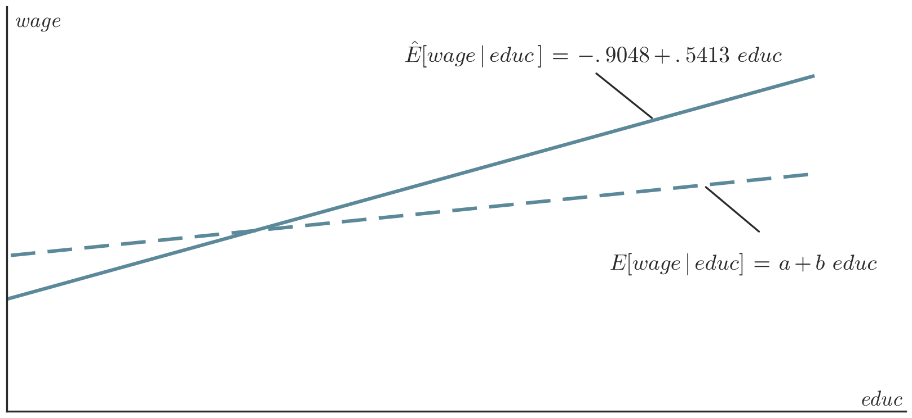
>
> **Figura 8** — Modello reale sulla popolazione $E(Y|X=x)$ (linea tratteggiata) rispetto alla regressione stimata (linea retta). Ci si attende che OLS funzioni correttamente se le due rette sono molto vicine tra loro, cioè se $\hat\alpha\approx\alpha$ e $\hat\beta\approx\beta$.
>
> Le stime OLS si basano su un set di dati estratti casualmente dalla popolazione: campioni diversi forniscono stime diverse, quindi $\hat\alpha$ e $\hat\beta$ sono **variabili casuali**. Interessa derivarne media e varianza, e approssimarne le distribuzioni di probabilità per calcolare intervalli di confidenza ed eseguire test statistici.
>
> **Rappresentazione di $\hat\beta$ in funzione di $\epsilon$.** È sempre possibile scrivere $\hat\beta$ come
>
> $$\hat\beta = \sum_{i=1}^n \underbrace{\left[\frac{(X_i-\bar X)}{\sum_{i=1}^n (X_i-\bar X)^2}\right]}_{\omega_i} (Y_i-\bar Y) = \sum_{i=1}^n \omega_i \underbrace{Y_i}_{\alpha+\beta X_i+\epsilon_i} - \bar Y \underbrace{\sum_{i=1}^n \omega_i}_{=0} = \beta + \sum_{i=1}^n \omega_i \epsilon_i \qquad (1)$$
>
> **Non distorsione (valore atteso di $\hat\beta$).** Dalla eq. (1):
>
> $$E[\hat\beta|X_1,\dots,X_n] = \beta + \sum \omega_i \underbrace{E[\epsilon_i|X_1,\dots,X_n]}_{\text{per hyp. } =0} = \beta$$
>
> Il momento marginale, cioè la media di $\hat\beta$ rispetto a tutti i possibili $X_1,\dots,X_n$ osservati, è quindi $\beta$: lo stimatore è **non distorto**. Se $E[\epsilon|X_1,\dots,X_n]\neq 0$, questo risultato non è più valido e, in media, lo stimatore non fornisce una buona proxy per il vero coefficiente $\beta$.
>
> **Varianza condizionale (consistenza).** La varianza condizionale di $\hat\beta$ è
>
> $$\mathrm{Var}[\hat\beta|X_1,\dots,X_n] = \sum \omega_i^2 \underbrace{\mathrm{Var}[\epsilon_i|X_1,\dots,X_n]}_{\times \text{ ip. } =\sigma^2} = \frac{\sigma^2}{\sum_{i=1}^n (X_i-\bar X)^2} = \frac{\sigma^2}{(n-1)}\underbrace{\frac{n-1}{\sum_{i=1}^n (X_i-\bar X)^2}}_{\to 1/\sigma_X^2 \text{ if } n\to+\infty} \quad (\text{consistency})$$
>
> Per questo risultato si è utilizzata l'ipotesi di omoschedasticità. Il limite è l'inverso della varianza di $X$, $\sigma_X^2=\mathrm{Var}(X)$ (le slide scrivono $1/\sigma^2$, che si confonderebbe con la varianza dell'errore).
>
> 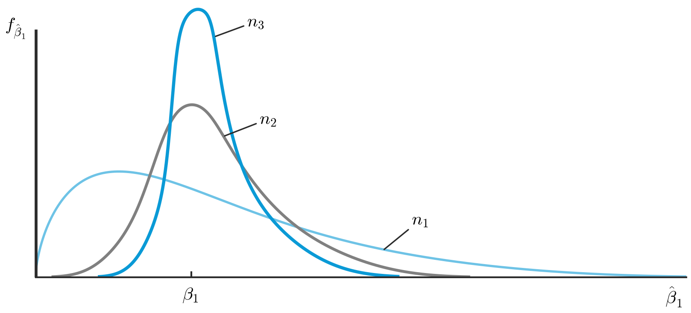
>
> **Figura 9** — Distribuzioni di $\hat\beta$ per campioni di diverse dimensioni ($n_1<n_2<n_3$). La dispersione della distribuzione campionaria di $\hat\beta$ si riduce al crescere della dimensione campionaria e collassa su $\beta$ quando $n\to\infty$.
>
> 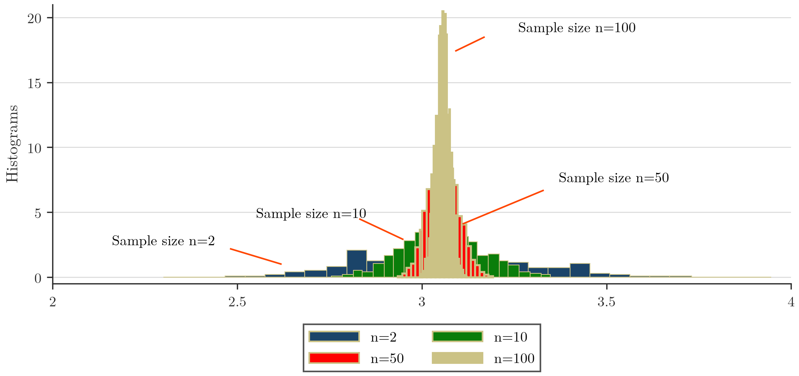
>
> **Figura 10** — Distribuzioni di $\hat\beta$ per campioni di diverse dimensioni (standardizzate per ottenere una media pari a 0), per $n=2,10,50,100$. Se $n\to\infty$, $\hat\beta\to\beta$ (**Legge dei grandi numeri**).
>
> **Teorema di Gauss-Markov.** Se sono soddisfatte le seguenti ipotesi:
>
> - **Linearità**: il modello nella popolazione è lineare nei parametri, $Y=\alpha+\beta X+\epsilon$;
> - **I.I.D.**: campione casuale di $(X_i,Y_i)$, $i=1,\dots,N$;
> - **Esogeneità**: $E[\epsilon|X]=0$ (le slide scrivono «il regressore non è correlato al termine di errore», condizione più debole);
> - **Omoschedasticità**: $\mathrm{Var}(Y|X=x_i)=\sigma^2$;
>
> allora OLS fornisce il **miglior stimatore lineare non distorto (BLUE)**, il più efficiente (con varianza minore) nella classe degli stimatori lineari e non distorti.

*(slide 34–42)*

## La distribuzione di β̂: campioni finiti e normalità asintotica

> [!tip] Teorema
> **Distribuzione in campioni finiti.** Si può dimostrare che, sotto opportune ipotesi, la distribuzione di $\hat\beta$ è gaussiana. In particolare, se l'errore nella popolazione $\epsilon$ è indipendente da $X$ ed è normalmente distribuito con media nulla e varianza $\sigma^2$, cioè $\epsilon\sim N(0,\sigma^2)$, allora:
>
> - lo stimatore di $\beta$ ha distribuzione normale: $\hat\beta \sim N\big(\beta,\ \mathrm{Var}(\hat\beta|X)\big)$;
> - lo stimatore standardizzato ha distribuzione Student $t$:
>
> $$\frac{\hat\beta-\beta}{\hat\sigma_{\hat\beta}} \sim t_{n-2}$$
>
> Quest'ultimo risultato dipende dal fatto che il denominatore è ignoto e deve essere stimato: $\hat\sigma_{\hat\beta}$ è l'errore standard stimato, definito più sotto (le slide scrivono $\sqrt{\mathrm{Var}(\hat\beta|X)}$ al denominatore; con la varianza vera, cioè con $\sigma^2$ noto, il rapporto sarebbe $N(0,1)$). Se $n\to\infty$, la Student $t$ converge a una gaussiana.
>
> **Normalità asintotica.** In statistica, per stimare il valore atteso di una popolazione si usa la media campionaria, che si distribuisce come una v.c. gaussiana per campioni sufficientemente grandi. Nell'ipotesi che $E[\epsilon|X]=0$, $\hat\beta$ gode della stessa proprietà, essendo sostanzialmente costruito come una media:
>
> $$\hat\beta \sim N\big(\beta,\ \hat\sigma_{\hat\beta}^2\big)$$
>
> in cui
>
> $$\hat\sigma_{\hat\beta}^2 = \frac{\hat\sigma^2}{\sum_{i=1}^n (X_i-\bar X)^2}, \qquad \hat\sigma^2 = \frac{1}{n-2}\sum_{i=1}^n \hat\epsilon_i^2$$
>
> Questo risultato consente di effettuare test di ipotesi su $\beta$ e di costruire intervalli di confidenza.
>
> **Perché vale la normalità asintotica — Teorema del limite centrale (CLT).** Se una sequenza $Z_i$ è I.I.D. tale che $E[Z_i]=\mu_Z<+\infty$ e $0<\mathrm{Var}[Z_i]=\sigma_Z^2<+\infty$, allora
>
> $$\frac{(\bar Z-\mu_Z)}{\sigma_{\bar Z}} \to N(0,1)$$
>
> Il numeratore di $\hat\beta$ è la media campionaria di variabili $Z=(X-E[X])(Y-E[Y])$, indipendenti per ipotesi, a cui si può applicare il CLT. Il denominatore converge a una costante, essendo in pratica una media di variabili $X^2$ (Legge dei Grandi Numeri). Quindi
>
> $$\frac{\hat\beta - E[\hat\beta]}{\sqrt{\mathrm{Var}(\hat\beta)}} = \frac{\hat\beta-\beta}{\sigma_{\hat\beta}} \to N(0,1) \;\Rightarrow\; \hat\beta \sim N\big(\beta,\sigma_{\hat\beta}^2\big)$$
>
> 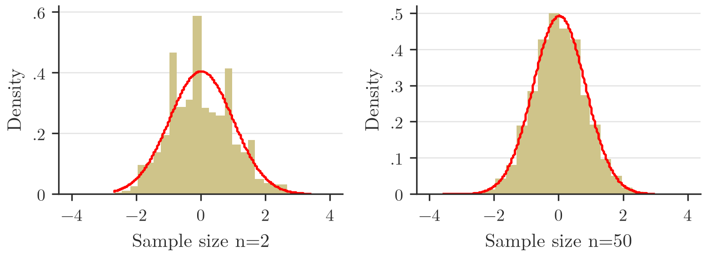
>
> **Figura 11** — Istogramma rispetto alla densità normale: stime standardizzate di $\beta$ per diversi campioni di dimensione $n$. Pannello di sinistra: campione di piccole dimensioni ($n=2$); pannello di destra: campione di grandi dimensioni ($n=50$, buona approssimazione gaussiana). L'approssimazione normale migliora al crescere della dimensione campionaria.

*(slide 43–46)*

## Lo stimatore della varianza σ² e gli errori standard

> [!abstract] Definizione
> In caso di omoschedasticità, il modello di regressione è caratterizzato anche dal parametro $\sigma$, che descrive l'eterogeneità dei soggetti che condividono lo stesso livello di $X$. Uno stimatore non distorto di $\sigma^2$ è
>
> $$\hat\sigma^2 = \frac{1}{n-2}\sum_{i=1}^n \hat\epsilon_i^2$$
>
> Si può dimostrare che $E[\hat\sigma^2]=\sigma^2$.
>
> Gli errori standard per $\hat\alpha$ e $\hat\beta$ si ricavano inserendo $\hat\sigma^2$ nella formula di $\mathrm{Var}(\hat\beta|X_1,\dots,X_n)$. Quindi, $\sigma_{\hat\beta}$ si stima come
>
> $$\hat\sigma_{\hat\beta} = \sqrt{\frac{\hat\sigma^2}{\sum_{i=1}^n (X_i-\bar X)^2}}$$
>
> Gli errori standard per $\hat\alpha$ sono quindi
>
> $$\hat\sigma_{\hat\alpha} = \sqrt{\frac{\hat\sigma^2 \left(\frac{1}{n}\sum_{i=1}^n X_i^2\right)}{\sum_{i=1}^n (X_i-\bar X)^2}}$$

*(slide 47–48)*

## Intervalli di confidenza per β

> [!abstract] Definizione
> Come per la media campionaria, è utile fornire un intervallo di valori in cui il vero parametro sconosciuto $\beta$ rientra con alta probabilità (diciamo $1-\alpha$; in questa formula $\alpha$ è il livello di significatività, non l'intercetta). Poiché $\hat\beta$ è distribuita normalmente, valgono gli stessi risultati della media campionaria: un intervallo di confidenza per $\beta$ può essere calcolato come
>
> $$\text{Confidence interval} = \left[\hat\beta - z_{\frac{\alpha}{2}}\times \hat\sigma_{\hat\beta}\ ;\ \hat\beta + z_{\frac{\alpha}{2}}\times \hat\sigma_{\hat\beta}\right]$$
>
> **Esempio: wage vs. educ.** L'intervallo di confidenza al 95% per $\beta$ è calcolato come
>
> $$[0.541 - 1.96\times 0.053\ ;\ 0.541 + 1.96\times 0.053] = [.437;\ .645]$$
>
> (Le slide riportano $[.436;\ .645]$, cioè l'intervallo in tabella troncato. Stata usa il quantile $t_{524}\approx 1.9645$ al posto di 1.96 e ottiene $[.4368;\ .6460]$.)
>
> | Variabile | Coef. | Std. Err. | t | P>\|t\| | IC 95% inf. | IC 95% sup. |
> |---|---|---|---|---|---|---|
> | educ | .5413593 | .053248 | 10.17 | 0.000 | .4367534 | .6459651 |
> | _cons | -.9048516 | .6849678 | -1.32 | 0.187 | -2.250472 | .4407687 |
>
> Ci si aspetta quindi che il vero $\beta$ sia compreso tra $[.437;\ .646]$, con livello di confidenza del 95%: il 95% riguarda la procedura (in campionamenti ripetuti il 95% degli intervalli così costruiti contiene $\beta$), non è la probabilità che $\beta$ cada in questo intervallo particolare. L'intervallo suggerisce l'esistenza di un'associazione positiva tra wages e years of education.

*(slide 49–50)*

## Verifica d'ipotesi per β

> [!abstract] Definizione
> Ci si potrebbe chiedere se $X$ sia un predittore utile, cioè se abbia un impatto sulla media condizionale di $Y$. Si ricordi che $\Delta \hat Y = \beta \Delta X$: se $\beta$ fosse $0$, non importa quale sia la variazione di $X$, la variazione attesa di $Y$ prevista dal modello sarebbe nulla. È quindi naturale verificare se $\beta$ sia abbastanza vicino a 0 oppure no. In generale, si potrebbe voler verificare se l'evidenza empirica riassunta in $\hat\beta$ sia coerente con qualche valore specifico, corrispondente a un'ipotesi di natura economica.
>
> Poiché $\hat\beta$ è distribuito come una variabile casuale gaussiana, la procedura di test si basa sugli stessi risultati validi per la media campionaria. Un'ipotesi tipica da verificare è $H_0: \beta=0$ contro l'alternativa $H_a: \beta\neq 0$. La statistica $t$ è definita come
>
> $$t = \frac{\hat\beta - 0}{\hat\sigma_{\hat\beta}}$$
>
> Il p-value si calcola allo stesso modo del caso della media. In generale, il sistema di ipotesi $H_0:\beta=\kappa$ contro una delle tre possibili alternative ($>$, $<$ o $\neq$) può essere verificato tramite
>
> $$t = \frac{\hat\beta - \kappa}{\hat\sigma_{\hat\beta}}$$
>
> **Esempio: wage vs. educ.** Ci si potrebbe chiedere se un anno in più di scuola abbia un effetto positivo sui salari.
>
> | Variabile | Coef. | Std. Err. | t | P>\|t\| | IC 95% inf. | IC 95% sup. |
> |---|---|---|---|---|---|---|
> | educ | .5413593 | .053248 | 10.17 | 0.000 | .4367534 | .6459651 |
> | _cons | -.9048516 | .6849678 | -1.32 | 0.187 | -2.250472 | .4407687 |
>
> Scritto in linguaggio statistico: $H_0:\beta=0$ vs. $H_a:\beta>0$.
>
> La statistica $t$ osservata è
>
> $$t^{obs} = \frac{.5413593-0}{.053248} = 10.17$$
>
> Il p-value $P_{H_0}(t>t^{obs})\approx 0$, che permette di rifiutare l'ipotesi nulla.
>
> Se si considera invece il sistema d'ipotesi $H_0:\beta=0$ vs. $H_a:\beta\neq 0$, la statistica $t$ osservata rimane $t^{obs}=10.17$ e il p-value viene calcolato come $2\,P_{H_0}(t>|t^{obs}|)\approx 0$.

*(slide 51–53)*

## Misure di bontà di adattamento: l'R²

> [!abstract] Definizione
> Non è stato ancora considerato il problema di misurare come la variabile $X$ approssimi la variabile dipendente $Y$. Spesso è utile calcolare un indicatore che riassuma quanto bene la linea di regressione OLS si adatti ai dati. L'idea è calcolare la correlazione tra la variabile dipendente $Y$ e le previsioni del modello $\hat Y$: maggiore è questo numero, migliore è l'adattamento del modello empirico ai dati. L'$R^2$ è definito come
>
> $$R^2 = \mathrm{Corr}^2\big(Y,\hat Y\big)$$
>
> Per costruzione $0 \le R^2 \le 1$:
>
> - Un $R^2$ vicino a 1 significa che il regressore è un **buon** predittore per il valore atteso condizionale della variabile dipendente.
> - Un $R^2$ vicino a 0 significa che il regressore è un predittore **mediocre**.
> - **$R^2$ non dice nulla riguardo alla causalità!** Indica solamente come, in uno specifico campione, la retta di regressione approssima le medie dei dati osservati.
>
> **Esempio 1 — caso endogeno.** Si consideri l'esempio precedente in cui $X$ è endogeno ($Y_i=3+1.5X_i+\epsilon_i$, $\mathrm{cov}(X,\epsilon)=0.6$, $n=200$):
>
> | Source | SS | df | MS |
> |---|---|---|---|
> | Model | 903.491169 | 1 | 903.491169 |
> | Residual | 159.74002 | 198 | .806767779 |
> | Total | 1063.23119 | 199 | 5.3428703 |
>
> Number of obs = 200; F(1, 198) = 1119.89; Prob > F = 0.0000; R-squared = 0.8498; Adj R-squared = 0.8490; Root MSE = .8982
>
> | Variabile | Coef. | Std. Err. | t | P>\|t\| | IC 95% inf. | IC 95% sup. |
> |---|---|---|---|---|---|---|
> | x | 2.129496 | .063634 | 33.46 | 0.000 | 2.004008 | 2.254983 |
> | _cons | 2.962697 | .0635759 | 46.60 | 0.000 | 2.837324 | 3.08807 |
>
> Si noti che l'$R^2$ è elevato ($\approx 85.0\%$; le slide scrivono 84,9%, troncando 84,98%). Tuttavia si sa già che il modello **non** rappresenta una relazione causale: un $R^2$ alto non implica causalità.
>
> **Esempio 2 — wage vs. educ.** Si consideri ora la relazione tra salari e istruzione, che potrebbe rappresentare un legame causale:
>
> | Source | SS | df | MS |
> |---|---|---|---|
> | Model | 1179.73204 | 1 | 1179.73204 |
> | Residual | 5980.68225 | 524 | 11.4135158 |
> | Total | 7160.41429 | 525 | 13.6388844 |
>
> Number of obs = 526; F(1, 524) = 103.36; Prob > F = 0.0000; R-squared = 0.1648; Adj R-squared = 0.1632; Root MSE = 3.3784
>
> | Variabile | Coef. | Std. Err. | t | P>\|t\| | IC 95% inf. | IC 95% sup. |
> |---|---|---|---|---|---|---|
> | educ | .5413593 | .053248 | 10.17 | 0.000 | .4367534 | .6459651 |
> | _cons | -.9048516 | .6849678 | -1.32 | 0.187 | -2.250472 | .4407687 |
>
> Si noti che $R^2$ è piuttosto basso ($\approx 16.5\%$; le slide scrivono 16,4%, troncando 16,48%). Nonostante questo risultato, il collegamento tra le due variabili ha comunque senso da un punto di vista logico: un $R^2$ basso non esclude una relazione causale plausibile.

*(slide 54–57)*
