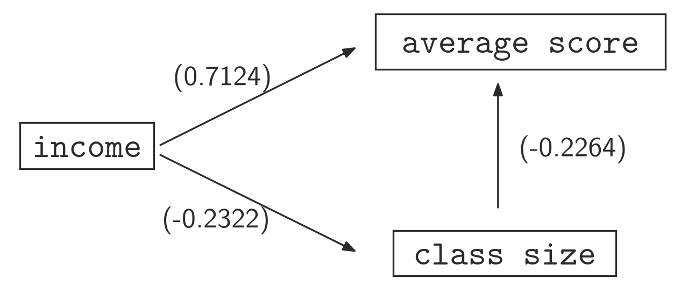

## Esempio motivante: test scores e dimensione della classe

> [!example] Esempio
> Comunemente si pensa che un rapporto studenti-insegnanti più basso induca un rendimento migliore degli studenti. Per questo, ad esempio in California, verso la fine degli anni '90, tutte le classi K-3 sono state ridotte per avere un rapporto massimo studenti-insegnanti di 20 (*Class Size Reduction Act* - CSR). Ciò ha un costo: inizialmente era di 1,8 miliardi di dollari all'anno. Con un costo così alto ci si chiede se ne valga la pena. Il Commissario per l'Istruzione potrebbe essere interessato a sapere se questa spesa extra ha un impatto significativo sul rendimento scolastico atteso.
>
> Resta da stabilire se la dimensione della classe sia l'unica informazione rilevante per spiegare la variazione del punteggio medio atteso di questi studenti, o se vadano considerati altri fattori.
>
> Un modello di regressione naïve, stimato sul dataset `caschool` (420 distretti), evidenzia che esiste una dipendenza negativa significativa tra la dimensione media della classe, `str`, e il punteggio medio atteso, `avg_score`:
>
> | | Coef. | Std. Err. | t | P>\|t\| | [95% Conf. | Interval] |
> |---|---|---|---|---|---|---|
> | str | -2.279808 | .4798256 | -4.75 | 0.000 | -3.22298 | -1.336637 |
> | _cons | 698.933 | 9.467491 | 73.82 | 0.000 | 680.3231 | 717.5428 |
>
> A prima vista ridurre la dimensione delle classi sembra una scelta rilevante, poiché una riduzione della dimensione di una classe induce un aumento del punteggio medio di circa 2.28 punti. L'intervallo di confidenza non include lo zero e assume solo valori negativi: il parametro è statisticamente diverso da zero e sistematicamente negativo. Ma questo modello statistico è una relazione causale? Esistono altre spiegazioni più credibili?
>
> Un esame più attento mostra che il reddito medio (`avginc`) delle persone che vivono in ciascun distretto è correlato positivamente con `avg_score`: i distretti con reddito più alto tendono ad avere studenti con voti più alti. Esiste anche una dipendenza negativa tra reddito e dimensione della classe (`str`): i distretti a reddito più elevato tendono ad avere classi di dimensioni inferiori. Le correlazioni (comando `correlate avg_score str avginc`) sono:
>
> | | avg_score | str | avginc |
> |---|---|---|---|
> | avg_score | 1.0000 | | |
> | str | -0.2264 | 1.0000 | |
> | avginc | 0.7124 | -0.2322 | 1.0000 |
>
> Resta da verificare se includere il reddito nel modello di regressione sia utile per prevedere il punteggio medio e per spiegare la relazione causa-effetto tra performance e riduzione delle classi.
>
> 
>
> **Figura 1** — Scatterplot a coppie delle variabili coinvolte (`avg_score`, `str`, `avginc`). La matrice di scatterplot mostra visivamente le correlazioni della tabella precedente: `avg_score` cresce al crescere di `avginc` e decresce (debolmente) al crescere di `str`; `str` e `avginc` sono debolmente correlate negativamente.
>
> Questa evidenza empirica suggerisce che l'associazione negativa tra dimensione della classe e punteggio del test potrebbe essere **spuria**, poiché può essere spiegata dall'effetto del reddito su ciascuna variabile.
>
> 
>
> **Figura 2** — Rappresentazione causale del modello (diagramma con `income` che punta sia ad `average score` con correlazione 0.7124 sia a `class size` con correlazione -0.2322, e una freccia da `class size` ad `average score` con correlazione -0.2264). Il diagramma illustra come il reddito (`income`) sia una causa comune che influenza sia il punteggio medio sia la dimensione della classe: la correlazione osservata tra `class size` e `average score` non riflette quindi necessariamente un nesso causale diretto.

Il modello di regressione semplice, con un solo regressore, non basta: si costruisce un modello con più variabili esplicative, che incorpori l'effetto del reddito e aiuti anche a specificare meglio un potenziale nesso causale.

## Il modello di regressione multipla e l'interpretazione dei parametri

> [!abstract] Definizione
> Si ipotizzi esistano due o più variabili esplicative, $X_1$ ed $X_2$ ($X_3,\ldots,X_k$) potenzialmente utili per descrivere la media condizionale di $Y$. In questo caso, la funzione di regressione semplice può essere generalizzata da
>
> $$E[Y|X_1,X_2] = \alpha + \beta_1 X_1 + \beta_2 X_2$$
>
> Come per il modello di regressione semplice, ogni osservazione è descritta da
>
> $$Y_i = \alpha + \beta_1 X_{1,i} + \beta_2 X_{2,i} + \epsilon_i$$
>
> $Y$ è la variabile dipendente, $X_1$ e $X_2$ sono i regressori mentre $\epsilon$ è un termine di errore che misura la distanza tra il modello di regressione e l'osservabile $Y$. La media condizionale è il vero modello nella popolazione: $\alpha$ è l'intercetta, mentre $\beta_1$ e $\beta_2$ misurano quanto conta $X_1$ e quanto conta $X_2$. L'errore $\epsilon_i$ lega l'osservazione $i$-esima alla media condizionale e raccoglie tutte le caratteristiche dell'unità statistica (nell'esempio, il distretto) diverse da $X_1$ e $X_2$, come la percentuale di non madrelingua o la qualità delle scuole: descrive come differiscono tra loro unità con gli stessi valori dei regressori. Ciò che non compare nella parte sistematica del modello finisce nell'errore: nel modello semplice, ad esempio, vi rientra il reddito.
>
> Per interpretare i parametri si parta dalla regressione semplice, in cui $\beta_1$ misura la variazione attesa di $Y$ a condizione che $\Delta X = 1$. Infatti $\Delta \hat{Y} = \beta_1 \underbrace{\Delta X}_{=1}$.
>
> Nella regressione multipla, il coefficiente $\beta_1$ è la variazione attesa di $Y$ dovuta a una variazione unitaria di $X_1$ a condizione che $X_2$ sia mantenuto costante. In pratica, se si calcola il valore atteso di $Y$ per un dato livello dei due regressori $X_1=\bar X_1$ e $X_2=\bar X_2$, si ottiene
>
> $$\hat{Y}(\bar X_1, \bar X_2) = \alpha + \beta_1 \bar X_1 + \beta_2 \bar X_2.$$
>
> Si calcoli ora il valore atteso di $Y$ per $X_1 = \bar X_1 + \Delta X_1$ e $X_2 = \bar X_2$:
>
> $$\hat{Y}(\bar X_1 + \Delta X_1, \bar X_2) = \alpha + \beta_1(\bar X_1 + \Delta X_1) + \beta_2 \bar X_2.$$
>
> La variazione prevista di $Y$ è la differenza
>
> $$\Delta \hat{Y} = \hat{Y}(\bar X_1 + \Delta X_1, \bar X_2) - \hat{Y}(\bar X_1, \bar X_2) = \beta_1 \Delta X_1$$
>
> Poiché $\hat Y$ è la media condizionale di $Y$, non contiene l'errore: $\Delta \epsilon = 0$ in media, perché vale $E[\epsilon|X_1,X_2]=0$. Una variazione del valore atteso di $Y$ è quindi proporzionale alla variazione di $X_1$, cioè
>
> $$\Delta Y = \beta_1 \Delta X_1$$
>
> Nella regressione multipla, un parametro descrive l'effetto di una variabile esplicativa una volta controllati gli effetti dell'altra variabile esplicativa nel modello (imponendo $X_2 = \bar X_2$). La regressione semplice ha una sola variabile esplicativa, quindi il parametro descrive l'effetto di una variabile ignorando le altre possibili variabili esplicative, la cui influenza, se correlate con il regressore, confluisce nel coefficiente. I coefficienti $\beta_j$ sono chiamati **effetti marginali**.

Nella regressione semplice $\beta_1$ è una misura di associazione marginale tra $X$ e $Y$, cioè la covarianza tra $X$ e $Y$ divisa per la varianza di $X$, perché nessun'altra variabile è fissata. Nella regressione multipla $\beta_1$ e $\beta_2$ misurano ancora un'associazione, ma condizionale: $\beta_1$ misura l'associazione tra $Y$ e $X_1$ una volta fissato $X_2$, detta anche **correlazione parziale**, benché sia una pendenza e non un coefficiente di correlazione. La formula della variazione attesa è la stessa del modello semplice, ma il concetto cambia: $\beta_1$ non dice quanto conti in generale ridurre di un'unità la dimensione della classe, ma quanto conti farlo tra distretti con lo stesso reddito. Il confronto avviene tra due distretti identici per reddito, in uno soltanto dei quali si stanziano risorse per ridurre la classe. Poiché il reddito è lo stesso, la variazione di $Y$ non può dipendere dall'effetto reddito, e una variazione $\Delta X_1$ della dimensione ha un impatto proporzionale a $\beta_1$. I due distretti possono differire per le altre caratteristiche, ma se $E[\epsilon|X_1,X_2]=0$ queste non hanno un effetto sistematico e si possono trascurare.

Costruire un modello con due variabili esplicative equivale, nell'idea, a dividere il campione in distretti ad alto e a basso reddito (ECON 01, dove il reddito è fissato in modo più grezzo, sopra e sotto la mediana) e a calcolare la dipendenza nei due sottoinsiemi. Il confronto si scrive con due regressioni semplici. Per i distretti ad alto reddito, omogenei tra loro, si stima

$$\text{punteggio}_i = \alpha_A + \beta_A \, \text{size}_i + \varepsilon_i,$$

dove $\beta_A$ è il coefficiente dei distretti ad alto reddito; lo stesso esercizio per i distretti a basso reddito dà

$$\text{punteggio}_i = \alpha_B + \beta_B \, \text{size}_i + \varepsilon_i.$$

I termini d'errore sono diversi perché riguardano sottopopolazioni diverse. All'interno di ciascun sottogruppo il reddito è omogeneo: una variazione del punteggio non può dipenderne e deve dipendere da altro, quindi si elimina l'effetto della variabile confondente. Per semplificare si suppone che in queste regressioni $\varepsilon$ non abbia un effetto sistematico, cioè che non vi siano altre variabili rilevanti. Se le stime di $\beta$ nei due sottocampioni coincidono con quella della regressione sull'intero campione, il reddito non incide sulla relazione tra le variabili; se differiscono da questa, anche quando sono uguali tra loro, il reddito ha importanza. Il modello di regressione multipla formalizza lo stesso schema e calcola la correlazione parziale per qualsiasi livello di $X_2$.

Un fenomeno economico, biologico o di altro genere dipende di norma da più fattori, e considerare le variabili a coppie non basta. Di solito interessa però la relazione tra due variabili specifiche. Le variabili che definiscono la media condizionale si dividono quindi in due sottogruppi: le **variabili di interesse**, o di policy, di cui si vuole l'effetto marginale in modo preciso, e le **variabili di controllo**, che servono a ripulire il termine d'errore dagli effetti collaterali: ciascuna entra nella media condizionale con il proprio termine. Nell'esempio l'interesse riguarda la dimensione della classe e non il reddito: conta solo $\beta_1$, mentre il reddito serve a stimare bene $\beta_1$. L'effetto del reddito sulla performance è un problema distinto. Se però il reddito non è nel modello, la previsione dell'impatto di una riduzione della classe sulla performance può essere sbagliata. Il modello permette di controllare per i fattori confondenti purché siano inclusi esplicitamente: se restano in $\epsilon$, che non è osservabile, non se ne conosce la struttura né come reagiscono.

> [!example] Esempio
> Si consideri il modello di regressione multipla che lega il punteggio medio degli studenti, la dimensione della classe e il reddito delle famiglie:
>
> $$\text{avg\_score}_i = \alpha + \beta_1 \text{str}_i + \beta_2 \text{avginc}_i + \epsilon_i$$
>
> | | Coef. | Std. Err. | t | P>\|t\| | [95% Conf. | Interval] |
> |---|---|---|---|---|---|---|
> | str | -.6487401 | .354405 | -1.83 | 0.068 | -1.345383 | .0479028 |
> | avginc | 1.839112 | .0927868 | 19.82 | 0.000 | 1.656724 | 2.0215 |
> | _cons | 638.7292 | 7.449077 | 85.75 | 0.000 | 624.0867 | 653.3716 |
>
> Questi risultati suggeriscono che, per un dato livello di reddito, se la dimensione della classe si riduce di un'unità, allora il punteggio medio atteso aumenta di circa 0.65 punti. Il p-value del test di significatività è 0.068, cioè 6.8%: al livello del 5% non si rifiuta l'ipotesi nulla e non si può escludere che il parametro sia nullo. L'intervallo di confidenza lo conferma, perché ha il limite inferiore negativo e il superiore positivo, quindi lo zero è un valore possibile. La variazione risulta dunque debolmente significativa (al 10%). L'effetto del reddito è 1.84, statisticamente significativo, con un intervallo di confidenza che assume solo valori positivi, in linea con il segno atteso del coefficiente.

Con il reddito nel modello il coefficiente della dimensione della classe passa da circa -2.28 a -0.65, meno di un terzo. Nel dataset la correlazione tra `str` e `avg_score` nel gruppo ad alto reddito è invece significativa (ECON 01), mentre nel modello con il reddito il coefficiente di `str` non lo è al 5%: la regressione multipla formalizza la logica del confronto per sottocampioni, ma non ne riproduce i p-value.

Il modello di regressione semplice non stima l'effetto della dimensione della classe, ma la combinazione di questo effetto e di quello del reddito, escluso dal modello: leggendo il coefficiente $-2.28$ si attribuisce l'intero effetto alla riduzione di un'unità della dimensione della classe. Aggiungere un regressore permette di scomporre gli effetti in modo esplicito. Il modello a tre variabili è preferibile al precedente per tre ragioni: ha senso dal punto di vista logico, si può scrivere come modello di regressione e la regressione permette di valutarlo empiricamente sui dati. Se il coefficiente del reddito fosse risultato non significativo, l'effetto del reddito sarebbe irrilevante e si sarebbe potuti restare nel modello più semplice, secondo il rasoio di Occam: tra due spiegazioni valide e senza controindicazioni interne si preferisce la più semplice. Qui però il modello più complicato cambia completamente le conclusioni: i due modelli non sono equivalenti e il più complicato si impone, perché porta a rifiutare il precedente.

Il modello a tre variabili non basta a stabilire un nesso causale. Per arrivarci occorre proseguire l'analisi, togliendo altri fattori dal termine d'errore e inserendoli nella media condizionale. Si aggiungono informazioni sensate dal punto di vista logico, e il modello deve restare coerente con un'idea teorica, economica, sociologica o pedagogica, a seconda dell'oggetto di studio. Poiché interessa il parametro della dimensione della classe, su cui si investe, si può continuare a inserire variabili finché $\beta_1$ si stabilizza: quando diventa insensibile all'aggiunta di nuove variabili, ciò che resta fuori ha poca importanza per spiegarlo. Ai fini della decisione conta soltanto se valga la pena sostenere il costo dell'intervento.

## Cause di endogeneità: distorsione da variabile omessa

> [!tip] Teorema
> Nel modello di regressione semplice si ipotizza che $E[\epsilon|X] = 0$ ($\Rightarrow \text{Cov}(\epsilon, X) = 0$).
>
> Si supponga che la vera media condizionale (relazione causale), eventualmente con altre variabili, sia ben approssimata dal modello
>
> $$\text{Modello 1:} \quad Y = \alpha + \beta_1 X_1 + \beta_2 X_2 + \tilde\epsilon$$
>
> Poiché il vero modello non è noto a priori, si stima un modello statistico più semplice, cioè la regressione sbagliata, non correttamente specificata:
>
> $$\text{Modello 2:} \quad Y = \alpha + \beta_1 X_1 + \epsilon$$
>
> Le conseguenze di questo errore si valutano sotto le ipotesi seguenti:
> - $\text{Cov}(\tilde\epsilon, X_j) = 0$, $j=1,2$ (**esogeneità** rispetto al vero modello);
> - $\text{Cov}(X_1, X_2) \neq 0$.
>
> Nel Modello 2 la variabile $X_2$ è omessa: il suo impatto atteso su $Y$ è inglobato nel termine di errore, $\epsilon = \beta_2 X_2 + \tilde\epsilon$, quindi
>
> $$\text{Cov}(X_1, \epsilon) = \beta_2 \text{Cov}(X_1, X_2) \neq 0 \quad \text{se } \beta_2 \neq 0$$
>
> Per il modello di regressione semplice la condizione di esogeneità è violata. Lo stimatore OLS di $\beta_1$ è **distorto** ($E[\hat\beta_1] \neq \beta_1$) sia in campioni piccoli sia in campioni grandi, e per $n \to \infty$
>
> $$\hat\beta_1 \xrightarrow{p} \beta_1 + \frac{\rho_{X_1\epsilon}}{\sigma_X^2}$$
>
> dove $\rho_{X_1\epsilon} = \text{Cov}(X_1, \epsilon)$ e $\sigma_X^2 = \text{Var}(X_1)$. Il limite differisce da $\beta_1$: la distorsione persiste anche se $n$ è grande (**non consistenza**).

Per mettere il limite in relazione con il vero $\beta_1$ si osserva che il coefficiente di $X_1$ nel Modello 2 converge al rapporto tra $\text{Cov}(Y, X_1)$ e $\text{Var}(X_1)$, e si sostituisce a $Y$ il processo generatore del Modello 1:

$$\hat\beta_1 \xrightarrow{p} \frac{\text{Cov}(Y, X_1)}{\text{Var}(X_1)} = \frac{\text{Cov}(\alpha + \beta_1 X_1 + \beta_2 X_2 + \tilde\epsilon,\; X_1)}{\text{Var}(X_1)}.$$

Il numeratore si scompone in una somma di covarianze con $X_1$. Quella di $\alpha$ è nulla, perché $\alpha$ è una costante; quella di $\beta_1 X_1$ è $\beta_1 \text{Var}(X_1)$, perché la covarianza di una variabile con se stessa è la sua varianza; quella di $\beta_2 X_2$ è $\beta_2 \text{Cov}(X_1, X_2)$; resta quella di $\tilde\epsilon$ con $X_1$. Si ottiene

$$\hat\beta_1 \xrightarrow{p} \beta_1 + \beta_2 \frac{\text{Cov}(X_1, X_2)}{\text{Var}(X_1)} + \frac{\text{Cov}(\tilde\epsilon, X_1)}{\text{Var}(X_1)}.$$

Per l'esogeneità rispetto al vero modello l'ultimo termine è nullo, e il termine distorsivo $\beta_2 \text{Cov}(X_1, X_2)/\text{Var}(X_1)$ coincide con $\rho_{X_1\epsilon}/\sigma_X^2$. Il limite dello stimatore dipende quindi dalla struttura di correlazione tra $X_1$ e $X_2$ oltre che da $\beta_1$: è la combinazione del vero segnale $\beta_1$ e di un effetto dovuto alla correlazione tra le variabili, che il modello statistico omette e il modello vero contiene. Con troppo poche variabili si stima dunque una combinazione di effetti.

L'effetto distorsivo si annulla se $\text{Cov}(X_1, X_2) = 0$ e anche se $\beta_2 = 0$, perché in entrambi i casi il termine distorsivo è nullo. Omettere una variabile irrilevante, o incorrelata con la variabile di interesse, non produce quindi alcuna distorsione. Le due condizioni non devono valere esattamente: se la covarianza o $\beta_2$ sono molto piccoli, l'eventuale problema è trascurabile.

In termini di effetti, una variazione unitaria di $X$, cioè $\Delta X = 1$, produce

$$\Delta Y = \beta_1 + \underbrace{\Delta \epsilon}_{\approx \rho_{X_1\epsilon}/\sigma_X^2}$$

In questa situazione gli effetti dovuti ai regressori inclusi e a quelli omessi non sono distinguibili, e assumere come riferimento una regressione sbagliata porta probabilmente a decisioni sbagliate.

Nell'esempio della CAL school non è possibile stabilire se la stima $\hat\beta = -2.280$ derivi dall'effettiva variazione della dimensione della classe o da altri fattori, come il reddito. Il reddito non è nel modello, quindi finisce nel termine d'errore, che raccoglie tutto ciò che non è la dimensione della classe. Poiché la correlazione tra reddito e dimensione della classe è significativamente diversa da zero, stimare il modello semplice equivale a ipotizzare che sia nulla. Inserendo il reddito nel modello, il suo effetto passa dall'errore alla media condizionale, e si elimina una delle possibili cause di endogeneità, cioè una delle cause che legano $\epsilon$ alla dimensione della classe. Il parametro passa da $-2.280$ a circa $-0.65$: la distorsione non era piccola ed è la conseguenza di aver stimato il modello come se $\Delta\epsilon$ fosse nullo, mentre non lo è.

L'endogeneità da variabile omessa è concettualmente il caso più semplice: si accerta aggiungendo al modello altre variabili in modo sensato, cioè preservandone la logica e senza inserire variabili a caso, e osservando se l'effetto distorsivo sul parametro persiste o sparisce.

Il caso opposto, con più regressori del necessario, non pone problemi di distorsione. Se il vero modello ha due regressori e se ne stimano tre, il terzo ha impatto atteso nullo e la sua stima è circa zero, mentre le stime di $\beta_1$ e $\beta_2$ restano non distorte. Gli errori standard invece crescono, di poco se il regressore superfluo è poco correlato con quelli inclusi e anche di molto se è fortemente correlato con essi, perché la procedura di stima aggiunge un termine inutile: invece di porre il coefficiente a zero, come dovrebbe essere, lo pone uguale a una covarianza campionaria, che numericamente non è zero. Un modello sovraparametrizzato non produce dunque distorsione, ma se il regressore superfluo è molto correlato con quelli inclusi la precisione delle stime cala molto; un modello con troppo pochi regressori ha invece un problema di distorsione.

## Cause di endogeneità: errori di misura

L'errore di misura è una causa di endogeneità più sottile della precedente, che riguardava un modello statistico con informazione insufficiente. Il modello può essere corretto, con tutte le variabili necessarie, ma una variabile di interesse, il regressore, non è osservabile con precisione e al suo posto si dispone di un'approssimazione. Il problema non dipende da chi stima: anche con il modello migliore, se i dati sono imprecisi, per esempio perché ottenuti con un campionamento mal condotto, le stime sono inadeguate.

Un esempio tipico è il consumo delle famiglie italiane, rilevato con sondaggi ben condotti, come quelli dell'Istat. Chi la settimana precedente ha speso 160 euro al supermercato non ricorda l'importo esatto senza lo scontrino: riporta circa 150 euro, e se la volta dopo ne spende 140 riporta comunque 150. L'approssimazione non è sistematicamente distorta, perché a volte sovrastima e a volte sottostima: è un'imprecisione casuale.

> [!tip] Teorema
> Si ha endogeneità anche quando il regressore non è osservato esattamente e se ne conosce solo un'approssimazione. Si consideri il caso in cui non si osserva $X_i$ ma solo un proxy $X_i^*$:
>
> $$Y_i = \gamma X_i + \epsilon_i$$
>
> $$X_i^* = X_i + u_i \qquad \text{Cov}(X_i, u_i) = 0$$
>
> - $X_i$ è il vero regressore, non osservabile;
> - $X_i^*$ è il regressore osservabile, ma impreciso;
> - $u_i$ è l'errore di misura, una variabile casuale a media zero e varianza $\text{Var}(u_i)$.
>
> L'errore di misura non dipende da fattori estranei, in particolare da $\epsilon_i$, né dal livello di $X_i$: oltre a $\text{Cov}(X_i, u_i) = 0$ si ipotizza $\text{Cov}(u_i, \epsilon_i) = 0$. La regressione calcolabile è
>
> $$Y_i = \beta X_i^* + \epsilon_i^*$$
>
> Per verificare se soddisfa l'ipotesi OLS, la regressione originale si scrive in funzione del regressore osservabile $X^*$:
>
> $$Y_i = \gamma X_i + \epsilon_i = \gamma(X_i^* - u_i) + \epsilon_i = \gamma X_i^* + \underbrace{\epsilon_i - \gamma u_i}_{\epsilon_i^*}$$
>
> La regressione calcolabile diventa
>
> $$Y_i = \gamma X_i^* + \epsilon_i^* \;\Rightarrow\; \text{Cov}(X_i^*, \epsilon_i^*) = -\gamma \text{Var}(u_i) \neq 0 \;\Rightarrow\; \text{Endogeneity}$$
>
> Il segno si verifica con $\text{Cov}(X+u,\,\epsilon-\gamma u) = -\gamma\,\text{Var}(u)$, poiché $u$ è incorrelato con $X$ e con $\epsilon$. L'uso di regressori osservati con imprecisione porta quindi a stimatori distorti e non consistenti.

Il limite dello stimatore OLS di $\beta$ nella regressione calcolabile è la covarianza tra $Y$ e $X^*$ divisa per la varianza di $X^*$. Poiché $X^* = X + u$, per metterlo in relazione con il vero parametro $\gamma$ si riscrive $Y$ in funzione del vero $X$ e di $\gamma$, cioè rispetto al processo che genera i dati:

$$\hat\beta \xrightarrow{p} \frac{\text{Cov}(Y, X + u)}{\text{Var}(X + u)} = \frac{\text{Cov}(Y, X) + \text{Cov}(Y, u)}{\text{Var}(X + u)} = \frac{\gamma \,\text{Var}(X)}{\text{Var}(X + u)} + \frac{\text{Cov}(X, \epsilon)}{\text{Var}(X + u)} + \frac{\text{Cov}(Y, u)}{\text{Var}(X + u)}.$$

Il modello con il vero $X$ è corretto, quindi $\text{Cov}(X, \epsilon) = 0$. Inoltre $\text{Cov}(Y, u) = 0$, perché $\text{Cov}(Y, u) = \gamma\,\text{Cov}(X, u) + \text{Cov}(\epsilon, u)$ e l'errore di misura è incorrelato sia con $X$ sia con $\epsilon$: il livello di imprecisione non dipende da $Y$. Al denominatore, poiché $X$ e $u$ sono incorrelati, la varianza della somma è la somma delle varianze: il doppio prodotto $2\,\text{Cov}(X, u)$ si annulla. Resta

$$\hat\beta \xrightarrow{p} \gamma \, \frac{\text{Var}(X)}{\text{Var}(X) + \text{Var}(u)}.$$

Con l'errore di misura non si stima quindi $\gamma$, ma $\gamma$ moltiplicato per un rapporto minore di uno, perché il denominatore è maggiore del numeratore. Se $\text{Var}(u)$ è piccola, cioè i dati sono riportati con alta precisione, il rapporto tende a uno e $\beta$ coincide di fatto con $\gamma$; se la variabilità di $u$ è grande si ha un problema serio. Se $\text{Var}(u) = \text{Var}(X)$ il rapporto vale $1/2$ e si stima la metà di $\gamma$. Questa formulazione è equivalente alla precedente: il limite descrive l'effetto sulla stima, mentre la covarianza $\text{Cov}(X^*, \epsilon^*)$, proporzionale a $\text{Var}(u)$, descrive la correlazione tra il regressore e il termine d'errore implicito nella regressione stimata.

> [!example] Esempio
> Si consideri un dataset simulato di dimensione 200 che soddisfa
>
> $$Y = 3 + 1.5X + \epsilon$$
>
> La variabile $X$ è il vero regressore, misurato senza errore. Come benchmark si stima il modello $Y = \alpha + \beta X + \epsilon$, con $X$ come regressore:
>
> | | Coef. | Std. Err. | t | P>\|t\| | [95% Conf. | Interval] |
> |---|---|---|---|---|---|---|
> | X | 1.427984 | .0654388 | 21.82 | 0.000 | 1.298938 | 1.557031 |
> | _cons | 3.072873 | .06727 | 45.68 | 0.000 | 2.940215 | 3.205531 |
>
> Le stime sono molto precise: $\hat\beta$ e $\hat\alpha$ sono vicini ai valori veri, rispettivamente 1.5 e 3.
>
> Si ipotizzi ora che $X$ non sia osservabile e sia disponibile solo $X^* = X + u$, con $u \sim N(0,1)$. Si stima la regressione
>
> $$Y = \alpha + \beta X^* + \epsilon$$
>
> in cui anche $\epsilon \sim N(0,1)$ ed è indipendente da $u$:
>
> | | Coef. | Std. Err. | t | P>\|t\| | [95% Conf. | Interval] |
> |---|---|---|---|---|---|---|
> | Xs | .70249 | .0742756 | 9.46 | 0.000 | .5560173 | .8489628 |
> | _cons | 3.135813 | .1029848 | 30.45 | 0.000 | 2.932726 | 3.338901 |
>
> In questo caso $\hat\beta$ non è neanche vicino a 1.5, il valore vero del coefficiente: l'intervallo di confidenza al 95%, da circa 0.556 a 0.849, non lo include. Un test sulla coerenza di 0.7 con 1.5 potrebbe non rifiutare se la stima fosse molto imprecisa, cioè con dati molto dispersi e un intervallo tanto ampio da contenere 1.5. Poiché però con il vero regressore le stime erano precise, il campione non è troppo piccolo, e si ottiene sistematicamente un risultato diverso dalla verità.
>
> La distorsione si quantifica con il limite in probabilità ricavato sopra. Nella simulazione $\text{Var}(X) = \text{Var}(u) = 1$ e $\text{Cov}(X, u) = 0$, quindi il fattore di riduzione vale $1/2$ e il coefficiente stimato converge alla metà del vero valore. La distorsione, differenza tra il valore vero e la sua metà, è pari alla metà del vero valore, circa 0.75, e il valore stimato (.70249) è prossimo al vero 1.5 meno la distorsione (.75).

Con un coefficiente positivo, un modello di questo tipo dà stime sistematicamente più basse di quelle desiderate: il fenomeno si chiama **attenuation bias**, perché il parametro di interesse è sottostimato in modo regolare.

Il problema si può ridurre osservando più volte la stessa unità. Gli istituti che producono professionalmente questi dati, come l'Istat o la Banca d'Italia, cercano di correggerlo. Uno schema possibile è osservare ogni famiglia per un periodo abbastanza lungo, per esempio dieci settimane. Per la famiglia $i$-esima si hanno allora dieci osservazioni, $X_{i1}, X_{i2}, \dots, X_{i,10}$, cioè la spesa delle settimane da uno a dieci, e la varianza di ciascuna è $\text{Var}(u)$, l'imprecisione fisiologica. In generale, con $n$ osservazioni per la famiglia $i$ si calcola la media aritmetica

$$\bar{X}_i = \frac{1}{n} \sum_{j=1}^{n} X_{ij}$$

e la si usa come regressore per quella famiglia. La media è uno stimatore della media della popolazione e, se le osservazioni sono indipendenti, la sua varianza è $\text{Var}(u)/n$. Con dieci osservazioni la varianza della media è un decimo di quella di ogni singola osservazione, e nel rapporto $\text{Var}(X) / (\text{Var}(X) + \text{Var}(u))$ al posto di $\text{Var}(u)$ compare la varianza della media, $\text{Var}(u)/10$: il rapporto si avvicina a uno, e se $\text{Var}(u) = \text{Var}(X)$ passa da $1/2$ a $10/11 \approx 0.91$. Più grande è $n$, cioè il numero di osservazioni per la stessa unità statistica, più piccolo è l'effetto dell'imprecisione: già quattro o cinque rilevazioni per famiglia danno una media molto più precisa di ogni singola osservazione.

Il metodo è costoso, perché richiede di chiedere la stessa informazione per molte settimane, e ne esistono di più sofisticati. In ogni caso il problema va risolto a monte: con dati raccolti in modo rapido, per esempio con un'indagine su internet, gli errori di misura rischiano di non essere considerati con serietà e le stime possono risultare fortemente distorte anche se il modello è corretto.

In finanza il problema è frequente, perché molte procedure di stima si basano su stime ripetute. Da una prima regressione si stimano dei coefficienti, poi si esegue una regressione in cui i coefficienti stimati sono usati come regressori; si procede così, tipicamente, per validare dal punto di vista statistico modelli come il CAPM, cioè per verificare se sono credibili sui dati. I coefficienti stimati sono variabili approssimate: non sono il vero valore del parametro, ma il vero valore alterato da un errore di stima, un errore campionario. Ciò può creare endogeneità e problemi collegati.

Un altro esempio è l'inserimento della volatilità di un investimento in un modello di regressione che spieghi la performance. La volatilità non è osservabile direttamente e può solo essere stimata: nel modello entra la volatilità stimata, che non è un indicatore esatto della volatilità oggettiva ma la migliore approssimazione disponibile. Usarla come regressore crea endogeneità, e le stime tendono a essere attenuate verso zero: sottostimano il parametro se è positivo e lo sovrastimano se è negativo. Poiché la volatilità stimata contiene un errore di misura, cioè l'errore di stima, la cui dispersione è misurata dall'errore standard, i risultati vanno interpretati con attenzione: le stime del modello possono essere distorte.

Nelle applicazioni finanziarie più recenti il problema della volatilità si risolve tipicamente con dati ad alta frequenza per calcolare la volatilità di un giorno. I dati ad alta frequenza sono osservati a intervalli di pochi secondi: le microvariazioni del prezzo, per esempio dello Standard & Poor's, servono a stimare la volatilità dell'intera giornata, e l'indicatore è molto preciso perché si mediano molte osservazioni nel corso della giornata. L'idea è la stessa delle osservazioni ripetute: usare più dati per stimare un parametro. I dati intragiornalieri richiedono però alcuni accorgimenti, perché in quel contesto un eccesso di dati può comunque essere problematico.

L'errore di misura sulla variabile dipendente ha conseguenze diverse. Se l'errore riguardasse $Y$ anziché $X$, gli errori standard di tutti i coefficienti diventerebbero più grandi, perché l'errore di misura entra nel termine d'errore; poiché però è incorrelato con $X$ e con qualsiasi altra variabile, non crea alcuna distorsione. Lo si verifica ripetendo il calcolo del limite in probabilità dello stimatore con $Y + u$ al posto di $Y$: $X$ non ha problemi e il coefficiente stimato risulta uguale al vero. Cambia la varianza del termine d'errore, ma non c'è distorsione.

L'endogeneità consiste in una covarianza non nulla tra regressore ed errore, e il problema pratico è stabilire quando la covarianza è diversa da zero. Per l'errore di misura si può fare poco una volta raccolti i dati: chi sa a monte che i dati potrebbero contenere un errore di misura deve considerare automaticamente il rischio di endogeneità, affidandosi a dataset sufficientemente affidabili e standardizzati. Le cause di endogeneità non si esauriscono nei due casi esaminati. Un altro caso si presenta nell'ambito delle serie storiche; altri casi, non trattabili con questi modelli, sorgono quando non si può stabilire se sia $X$ a causare $Y$ o viceversa, e compaiono specificamente nei modelli macroeconomici.

## L'errore ε: momenti condizionali

> [!abstract] Definizione
> Le proprietà della variabile casuale $\epsilon$ servono a derivare le proprietà degli stimatori OLS. In particolare interessano i suoi momenti e le relazioni tra $\epsilon$ e $X_1,\ldots,X_k$.
>
> Per costruzione, $\epsilon_i$ può essere visto come la differenza tra $Y_i$ e la media condizionale $E[Y|X_1,\ldots,X_k]$, cioè
>
> $$\epsilon_i = Y_i - E[Y|X_{1i},\ldots,X_{ki}] = Y_i - \alpha - \sum_{j=1}^{k} \beta_j X_{ji}$$
>
> $\epsilon$ raccoglie tutte le caratteristiche dei soggetti non esplicitamente prese in considerazione dal modello e descrive una certa eterogeneità del campione.
>
> **Media condizionale**, $E[\epsilon|X_1,\ldots,X_k]$. Si supponga, ad esempio, che $E[Y|X] = \alpha + \sum_{j=1}^{k} \beta_j X_j$ sia un'approssimazione credibile della media condizionale. Con questa ipotesi, la media condizionale di $\epsilon$ è
>
> $$E[\epsilon|X] = E[Y|X] - \alpha - \sum_{j=1}^{k} \beta_j X_j = 0$$
>
> Come conseguenza principale, $\text{Cov}(\epsilon, X) = 0$ e quindi tutte le variabili che concorrono a costruire $\epsilon$ devono essere incorrelate con $X_j$, $\forall j$. Le uniche informazioni rilevanti per descrivere la media condizionale di $Y$ sono infatti $X_1,\ldots,X_k$, e tutte le altre variabili non possono avere un impatto sistematico su di essa.
>
> **Varianza condizionale**, $\text{Var}(\epsilon|X_1,\ldots,X_k)$. In generale, la forma funzionale della varianza condizionale di $\epsilon$ non è nota. In ogni caso, la variabilità di $\epsilon$ descrive anche la variabilità della variabile dipendente $Y$, ovvero
>
> $$\text{Var}(Y|X) = \text{Var}(\epsilon|X)$$
>
> Riguardo alle varianze condizionali si formulano due ipotesi:
> - **Omoschedasticità**: si assume che $\text{Var}(\epsilon|X_1,\ldots,X_k) = \sigma^2$ non dipenda da $X$.
> - **Eteroschedasticità**: si assume che $\text{Var}(\epsilon|X_1,\ldots,X_k) = \sigma^2(X_1,\ldots,X_k)$ dipenda dai regressori (da almeno uno degli $X_j$).

## Le ipotesi OLS

> [!abstract] Definizione
> Le ipotesi OLS sono le condizioni necessarie per valutare correttamente i coefficienti tramite OLS:
>
> - Il modello vero (nella popolazione) è lineare, ovvero $E[Y|X] = \alpha + \beta_1 X_1 + \cdots + \beta_k X_k$;
> - Il modello statistico corrisponde a quello vero, ovvero $Y = \alpha + \beta_1 X_1 + \cdots + \beta_k X_k + \epsilon$;
>   - Come conseguenza principale, $\text{Cov}(X_j, \epsilon) = 0$, e quindi $X_j$ si dice **esogeno** (per ogni $j$);
> - Le $(k+1)$-uple $(X_{1,i},\ldots,X_{k,i}, Y_i)$, $i=1,\ldots,n$ sono **I.I.D.**;
> - I momenti quarti di $X_j$ e $Y$ esistono e sono finiti (per tutti i $j$);
> - Si suppone, ad esempio, che $\text{var}[\epsilon|X] = \sigma^2$ (**omoschedasticità**);
> - **Assenza di perfetta collinearità**: non esistono relazioni lineari esatte tra le variabili indipendenti.

Il modello deve essere lineare nei parametri, cioè combinazione lineare dei parametri per le variabili, ma può essere non lineare nelle variabili. L'ipotesi richiede soltanto che ogni $\beta$ moltiplichi la variabile $X$, qualunque essa sia: un logaritmo, un polinomio o altro. Con variabili in scala logaritmica, per esempio, la relazione tra $X$ e $Y$ è non lineare. Per l'indipendenza, ogni unità statistica è campionata indipendentemente, quindi le sue caratteristiche sono indipendenti dalle realizzazioni delle altre unità. L'omoschedasticità è assunta per semplicità; il caso dell'eteroschedasticità è trattato in seguito.

L'esistenza dei momenti fino al quarto ordine è un'ipotesi tecnica, necessaria per applicare il teorema del limite centrale e la legge dei grandi numeri e fare inferenza asintotica. Momenti finiti significano che la dispersione della distribuzione non può essere troppo grande: le code della distribuzione di probabilità di $X$ e $Y$, di cui non si ipotizza la forma, non possono essere troppo pesanti, e deve essere possibile calcolare la media teorica nella popolazione di queste variabili casuali. L'ipotesi non è soddisfatta dalla variabile di Cauchy, che non ha momenti, né dalla t di Student con tre gradi di libertà, che ha media e varianza finite ma non i momenti dal terzo ordine in poi, quindi nemmeno il quarto.

Un esempio intuitivo è il calcolo del reddito medio delle persone che vivono in Texas. Se nella popolazione ci sono troppe persone con redditi molto bassi o molto alti, la probabilità di estrarre nel campione una persona con un reddito annuo o un patrimonio di miliardi di dollari diventa alta, e la media campionaria, che resta non distorta, varia moltissimo da un campione all'altro: un campione che contiene una di queste persone darebbe un reddito medio del Texas di 60 milioni di dollari, che non è un indicatore sensato. Gli outlier sbilanciano i calcoli e rendono instabili tutte le stime. In termini tecnici, richiedere momenti finiti fino al quarto ordine significa escludere varianze troppo grandi o esplosive.

## Perfetta collinearità

> [!example] Esempio
> Intuitivamente, la perfetta collinearità è un problema perché contraddice la logica del modello di regressione. In generale, un parametro misura come varia $Y$ in corrispondenza di una variazione unitaria del regressore, ad esempio $X_1$, una volta che tutte le altre variabili sono fissate. Se $X_1$ e $X_2$ sono perfettamente correlati, non è possibile variare $X_1$ mantenendo fisso $X_2$, perché le due variabili si muovono assieme.
>
> La **perfetta collinearità** si osserva quando almeno uno dei regressori è funzione lineare esatta di alcuni altri regressori. Un esempio di relazione lineare esatta tra $X_1, X_2, X_3$ e $X_5$ è $X_2 = a_1 X_1 + a_3 X_3 + a_5 X_5$ per alcune costanti note $a_1, a_3, a_5$.
>
> Si consideri la regressione multipla
>
> $$Y = \beta_0 + \beta_1 X_1 + \beta_2 X_2 + \beta_3 X_3 + \epsilon$$
>
> in cui l'impatto atteso di $X_2$ o $X_3$ su $Y$ è misurato rispettivamente da $\beta_2$ e $\beta_3$. Si supponga che $X_2 = \phi X_3$, con $\phi$ costante nota. La previsione $\hat Y$ può essere calcolata come
>
> $$E[Y|X_1,X_2,X_3] = \beta_0 + \beta_1 X_1 + \beta_2 X_2 + \beta_3 X_3 = \beta_0 + \beta_1 X_1 + (\beta_2\phi + \beta_3) X_3 = \beta_0 + \beta_1 X_1 + \tilde\beta_3 X_3$$
>
> In questo caso non è possibile distinguere gli effetti di $X_2$ e $X_3$. La combinazione di $\beta_2$ e $\beta_3$, ovvero $(\beta_2\phi+\beta_3)$, misura l'impatto congiunto di $X_2$ e $X_3$ sulla $Y$ attesa. Di conseguenza, quando si stimano i parametri tramite OLS, il sistema di equazioni non ha un'unica soluzione e i parametri non possono essere stimati.
>
> La soluzione alla collinearità perfetta è eliminare uno qualsiasi dei regressori che causano collinearità dal modello.

Un caso di perfetta collinearità si presenta con due variabili etichetta. Per capire se esistano distorsioni salariali, ad esempio tra uomini e donne, a parità di istruzione, si consideri il salario in funzione del livello di istruzione, a cui si aggiunge il genere. Si suppone che i generi siano soltanto due, maschio e femmina, e si costruisce il modello

$$\text{salario}_i = \alpha + \beta_1 \,\text{istruzione}_i + \beta_2 M_i + \beta_3 F_i + \varepsilon_i,$$

dove $M$ ed $F$ sono due **variabili etichetta** (dummy): $M$ vale uno se il lavoratore è maschio e zero se è femmina, $F$ vale uno per una lavoratrice e zero per un lavoratore maschio. Dato $M$ si prevede esattamente $F$, perché $M = 1 - F$: le due variabili sono perfettamente correlate, con correlazione $-1$, cioè uno in valore assoluto.

Il parametro $\beta_2$ rappresenta l'effetto di essere maschio sul salario al netto delle altre variabili. Nel modello dei punteggi scolastici, in cui il reddito è correlato con la dimensione della classe, l'effetto marginale si calcolava fissando il reddito e modificando la dimensione della classe. Qui ciò non è possibile: se di due lavoratori del tutto equivalenti si modifica la caratteristica $M$, si modifica automaticamente anche $F$, e a una variazione di una variabile corrisponde sempre una variazione dell'altra. Il problema è sistematico e deterministico, indipendente dal campione. I regressori $M$ ed $F$ sono perfettamente collineari e il modello statistico non è correttamente specificato: richiederebbe quattro parametri, $\alpha$, $\beta_1$, $\beta_2$ e $\beta_3$, ma non permette di identificare gli effetti marginali.

Imponendo l'identità $M = 1 - F$, che ricostruisce semplicemente la natura dei dati, il modello si riscrive

$$\text{salario}_i = \alpha + \beta_1 \,\text{istruzione}_i + \beta_2 (1 - F_i) + \beta_3 F_i + \varepsilon_i.$$

I due modelli sono equivalenti, perché si è soltanto imposta un'identità. Ordinando i termini, l'intercetta è $\alpha + \beta_2$, il coefficiente di istruzione è $\beta_1$ e il coefficiente di $F$ raccoglie $\beta_3$ e $-\beta_2$, perché da $\beta_2 (1 - F)$ resta $-\beta_2 F$:

$$\text{salario}_i = (\alpha + \beta_2) + \beta_1 \,\text{istruzione}_i + (\beta_3 - \beta_2) F_i + \varepsilon_i.$$

Il primo modello ha quattro parametri, il secondo tre: il numero di parametri stimati è uguale al numero di regressori inseriti nel modello, cioè la costante, istruzione e $F$. Stimando il secondo modello si ottengono tre stime: quella dell'intercetta ($\alpha + \beta_2$), quella del coefficiente di istruzione ($\beta_1$) e quella del coefficiente di $F$ ($\beta_3 - \beta_2$). Da queste si dovrebbero ricavare $\alpha$, $\beta_1$, $\beta_2$ e $\beta_3$ del modello originale, ma si ha un sistema di tre equazioni in quattro incognite, che ha infinite soluzioni: i parametri del modello originale non si possono ricostruire, cioè identificare. Si ha un **problema di identificazione**. Aggiungere $F$ o $M$ ha aggiunto un parametro al modello senza aggiungere informazione per la stima: il modello è più complicato, ma i dati non permettono di ottenere informazioni su tutti i parametri.

Poiché le soluzioni sono infinite, ci si riconduce a un caso stimabile scegliendo la soluzione più semplice: se si fissa uno dei quattro parametri, gli altri si ottengono di conseguenza e la soluzione è unica. Non si può fissare $\beta_1$, il coefficiente dell'istruzione, perché serve e non è coinvolto nella relazione esatta; si fissa $\beta_2$ o $\beta_3$, e il valore più semplice è zero. Porre $\beta_3 = 0$ o $\beta_2 = 0$ equivale a togliere il regressore corrispondente. Eliminare un regressore non significa togliere dal database quella categoria di persone, né le donne dal campione: si elimina soltanto il parametro del regressore ridondante, e il gruppo resta rappresentato in modo diverso. L'operazione non crea problemi di interpretabilità del modello, e i software eliminano in automatico una delle due variabili.

Si ponga $\beta_2 = 0$, cioè si tolga $M$. Il modello diventa

$$\text{salario}_i = \alpha + \beta_1 \,\text{istruzione}_i + \beta_3 F_i + \varepsilon_i.$$

Il modello descrive il salario atteso per persone con certe caratteristiche. Per le lavoratrici ($F = 1$), con un livello di istruzione fissato e media dell'errore condizionata ai regressori nulla, la regressione è $\alpha + \beta_1 \,\text{istruzione} + \beta_3$: l'intercetta è $\alpha + \beta_3$, cioè la combinazione dei parametri che non moltiplicano alcun regressore, e il coefficiente angolare è $\beta_1$. Per i lavoratori ($F = 0$) il termine in $\beta_3$ sparisce e resta $\alpha + \beta_1 \,\text{istruzione}$. Si hanno così due valori attesi condizionali, uno per ciascun genere, anche se $M$ non compare nel modello.

Nel grafico con l'istruzione in ascissa e il salario in ordinata, la retta degli uomini ha pendenza $\beta_1$, attesa positiva, e intercetta $\alpha$: il sistema ha ora tre equazioni e tre incognite e i parametri sono stimabili. La retta delle donne ha la stessa pendenza e intercetta $\alpha + \beta_3$. Il parametro $\beta_3$ può essere positivo o negativo; nelle analisi empiriche sul salario risulta tipicamente negativo e piuttosto grande in valore assoluto, quindi la retta delle donne sta sotto quella degli uomini. Le due rette sono parallele: il differenziale tra i gruppi è la distanza tra le intercette e non dipende dal livello di istruzione, quindi il gap tra genere maschile e femminile è $\beta_3$. Se il gap fosse di 5 dollari all'ora, a qualsiasi livello di istruzione le donne guadagnerebbero 5 dollari in meno degli uomini; se fosse di 0,5, la differenza sarebbe di 50 centesimi.

Il problema della collinearità perfetta si risolve quindi eliminando il regressore ridondante, a monte o lasciando che lo faccia il software, ma il modello va poi interpretato di conseguenza: la variabile omessa individua il **gruppo di riferimento**, e il coefficiente dell'altra variabile di genere misura la deviazione dell'altro gruppo rispetto a quello di riferimento. La scelta del gruppo di riferimento è arbitraria: si sarebbe potuta togliere $F$ anziché $M$. In quel caso l'intercetta del modello stimato identifica il punto del genere femminile, mentre il punto del genere maschile è dato da $\alpha$ più il coefficiente di $M$. I dati identificano comunque le stesse due intercette, una per genere, e cambia soltanto il modo di esprimerle in funzione dei parametri. Nell'output cambiano soltanto l'intercetta, con il suo errore standard, e il segno del coefficiente di genere: se nel primo modello è $-0{,}3$, nel secondo è $+0{,}3$. Il coefficiente dell'istruzione resta uguale, così come l'$R^2$ e gli errori standard dei coefficienti di istruzione e di genere.

Per stabilire se esista una differenza di salario tra i generi si verifica, in un modello di questo tipo, con un test di significatività se $\beta_3$ è uguale a zero o diverso da zero. Se la domanda fosse se la differenza di genere implica una variazione di salario del 30%, si verificherebbe se il coefficiente corrisponde al 30% o è diverso. Ogni altra ipotesi sui parametri si verifica con test standard.

Un altro modo di risolvere la collinearità è mantenere $M$ e $F$ e togliere la costante. La relazione lineare esatta tra le due variabili è $M + F = 1$, equivalente a $M = 1 - F$ e a $F = 1 - M$, e in essa interviene un terzo regressore, la costante. Anche la costante è un regressore: per stimare $\alpha$ serve un regressore associato e, poiché $\alpha \cdot x = \alpha$, questo regressore è $x = 1$. La relazione di collinearità coinvolge perciò $M$, $F$ e il regressore associato ad $\alpha$, e togliere $\alpha$ risolve il problema. Mentre nei casi precedenti si era tolta $M$ o $F$, ora si mantengono entrambe e il modello diventa

$$\text{salario}_i = \beta_1 \,\text{istruzione}_i + \beta_2 M_i + \beta_3 F_i + \varepsilon_i.$$

Per un lavoratore ($M = 1$, quindi $F = 0$) il salario atteso è $\beta_2 + \beta_1 \,\text{istruzione}$, perché il termine in $F$ sparisce; per una lavoratrice, calcolando il valore atteso dato $F = 1$, è $\beta_3 + \beta_1 \,\text{istruzione}$. Si hanno così due rette di regressione. La stima di $\beta_2$ coincide con l'intercetta del gruppo maschile ottenuta nel modello senza $M$, cioè con $\alpha$ di quel modello, e la stima di $\beta_3$ con l'intercetta del genere femminile. I due punti identificati dai dati sono $\alpha$ e $\alpha + \beta_3$ nel modello senza $M$, $\beta_2$ e $\beta_3$ nell'ultimo. Il differenziale è sempre lo stesso numero: le parametrizzazioni sono equivalenti e cambia soltanto l'interpretazione dei differenziali.

Nell'ultima parametrizzazione, però, il test sulla differenza tra i generi non si riduce a un test su un solo parametro: per verificare se i due gruppi hanno lo stesso livello di salario occorre testare l'uguaglianza $\beta_2 - \beta_3 = 0$, cioè una combinazione lineare di parametri. Il test non è del tutto banale, ma si può calcolare una statistica $t$ su questa combinazione. Per campioni grandi lo stimatore di ciascun parametro è ben approssimato da una normale, quindi lo è anche la differenza $\hat\beta_2 - \hat\beta_3$, con media zero sotto l'ipotesi nulla. La varianza della differenza è

$$\operatorname{Var}(\hat\beta_2) + \operatorname{Var}(\hat\beta_3) - 2\operatorname{Cov}(\hat\beta_2, \hat\beta_3).$$

La covarianza non compare nella tabella di output della regressione: il software, per esempio Gretl, la calcola, ma va recuperata da un'altra parte dell'output. Il test è quindi più laborioso del test sull'uguaglianza a zero di $\beta_2$ o di $\beta_3$, che è standard e non richiede alcun ragionamento. Questa parametrizzazione ha però un vantaggio intuitivo: i due parametri sono già le intercette dei due gruppi, quindi numericamente non servono trasformazioni. Se la combinazione lineare coinvolgesse cinque parametri servirebbero tutte le covarianze possibili tra gli stimatori e i calcoli diventerebbero complicati, e in quel caso la parametrizzazione è sconsigliabile.

Per costruire i test sul confronto tra gruppi, in generale, si calcola il valore atteso condizionato con la variabile etichetta uguale a 1 e con la variabile uguale a 0, e se ne fa la differenza. L'espressione ottenuta dipende dalla parametrizzazione usata, e il test va impostato in funzione di quella adottata.

## Stima OLS della regressione multipla

> [!note] Dimostrazione
> Una volta osservati i dati, i parametri $\alpha$ e $\beta_j$ che definiscono il modello di regressione si stimano scegliendo i valori che minimizzano la distanza tra ciascuna osservazione e la retta di regressione. Come nel caso della regressione semplice, OLS minimizza la varianza del termine di errore:
>
> $$\min_{\alpha,\beta_1,\beta_2} \text{Var}(\epsilon) = \min_{\alpha,\beta_1,\beta_2} E[\epsilon^2] \approx \min_{\alpha,\beta_1,\beta_2} \frac{1}{n}\sum_{i=1}^{n} (Y_i - \alpha - \beta_1 X_{1,i} - \beta_2 X_{2,i})^2$$
>
> La soluzione OLS per $\hat\beta_j$ è una funzione poco intuitiva di $X_1, X_2$ ed $Y$. Tuttavia, lo stimatore può essere ricavato come risultato di una regressione semplice del tipo
>
> $$Y = \alpha + \beta_j \hat u_j + \eta,$$
>
> dove il regressore ausiliario $\hat u_j$ è definito come segue:
>
> $$\hat u_j = X_j - \hat a - \hat b X_h, \qquad h \neq j$$
>
> Si noti che $\hat u_j$ sono i residui della regressione $X_j = a + bX_h + u_j$ (l'indice $h$ denota l'altro regressore; $i$ resta l'indice dell'osservazione), per cui lo stimatore OLS risulta
>
> $$\hat\beta_j = \frac{\sum_{i=1}^n \hat u_{j,i} Y_i}{\sum_{i=1}^n \hat u_{j,i}^2}, \qquad j=1,2$$
>
> Risultati equivalenti possono essere ottenuti per regressioni con un numero generico $k$ di regressori.
>
> Questa formula mostra che $\hat\beta_j$ si ottiene da una semplice regressione di $Y$ su $\hat u_j$. L'informazione fornita dal regressore $X_j$ può essere suddivisa in due segnali: la parte che può essere spiegata da altri fattori ($X_h, h \neq j$) e la parte che non dipende da $X_h$, che è $\hat u_j$. Per $\hat\beta_1$, i residui $\hat u_{1,i}$ sono la parte di $X_1$ non correlata con $X_2$, cioè $X_{1,i}$ dopo che gli effetti di $X_{2,i}$ sono stati controllati. Quindi $\hat\beta_1$ misura la **relazione campionaria tra $Y$ e $X_1$ dopo che l'effetto di $X_2$ è stato controllato/eliminato**.
>
> La previsione del valore atteso di $Y$, o **valore predetto**, è
>
> $$\hat Y_i = \hat E[Y_i|X_1=x_{1,i}, X_2=x_{2,i}] = \hat\alpha + \hat\beta_1 x_{1,i} + \hat\beta_2 x_{2,i}$$
>
> Il termine di errore viene stimato come la differenza tra la variabile osservata $Y_i$ e il valore atteso stimato $\hat Y_i$. Questa differenza è il **residuo**, definito come
>
> $$\hat\epsilon_i = Y_i - \hat\alpha - \hat\beta_1 X_{1,i} - \hat\beta_2 X_{2,i} = Y_i - \hat Y_i$$
>
> Come per la regressione semplice, ogni osservazione $Y_i$ può essere scritta come la somma tra la previsione della media condizionale e della componente residuale:
>
> $$Y_i = \hat Y_i + \hat\epsilon_i = \underbrace{\hat\alpha + \hat\beta_1 X_{1,i} + \hat\beta_2 X_{2,i}}_{\text{previsione}} + \underbrace{\hat\epsilon_i}_{\text{Residuo}}$$

Per la stima e per lo stimatore si usa lo stesso simbolo, cioè il nome del parametro, e il contesto chiarisce il significato. La stima è il numero che compare nella tabella di output, lo stimatore è la formula che permette di ottenere quel numero. Nella formula della previsione i simboli indicano le stime, cioè numeri; in una relazione che coinvolge variabili indicano lo stimatore, che è una variabile casuale.

## Il teorema di Frisch-Waugh-Lovell (caso a due regressori) e verifica numerica

> [!tip] Teorema
> Invece di calcolare $\hat\beta_1$ tramite la consueta procedura OLS, lo si può ottenere come segue:
>
> (a) Si regredisce $Y$ su $X_2$ e si ottiene il residuo $\hat\epsilon_y$.
> (b) Si regredisce $X_1$ su $X_2$ e si calcolano i residui $\hat u$.
> (c) Infine, si regredisce $\hat\epsilon_y$ su $\hat u$ per ottenere $\hat\beta_1$.
>
> Questo risultato, noto come **Teorema di Frisch-Waugh-Lovell**, permette di interpretare ciascun coefficiente OLS $\beta_1$ come l'associazione lineare (pendenza della regressione parziale, non una correlazione) tra la variabile dipendente $Y$ e il regressore $X_1$, una volta eliminati gli effetti di $X_2$ (lo stesso vale per $\beta_2$).
>
> Esempio. Si consideri il modello di regressione che lega la performance alla dimensione della classe e al reddito:
>
> $$\text{avg\_score}_i = \alpha + \beta_1 \text{str}_i + \beta_2 \text{avginc}_i + \epsilon_i$$
>
> Le stime OLS basate su un campione di 420 osservazioni sono:
>
> | | Coef. | Std. Err. | t | P>\|t\| | [95% Conf. | Interval] |
> |---|---|---|---|---|---|---|
> | str | -.6487401 | .354405 | -1.83 | 0.068 | -1.345383 | .0479028 |
> | avginc | 1.839112 | .0927868 | 19.82 | 0.000 | 1.656724 | 2.0215 |
> | _cons | 638.7292 | 7.449077 | 85.75 | 0.000 | 624.0867 | 653.3716 |
>
> Il modello stimato diventa quindi
>
> $$E[\text{avg\_score}] = 638.73 - 0.649\,\text{str} + 1.839\,\text{avginc}$$
>
> Usando il teorema di Frisch-Waugh-Lovell:
>
> (1) Si stimi $\text{str} = a + b\,\text{avginc} + u_{str}$ e si calcoli $\hat u_{str}$:
>
> | | Coef. | Std. Err. | t | P>\|t\| | [95% Conf. | Interval] |
> |---|---|---|---|---|---|---|
> | avginc | -.0607907 | .0124556 | -4.88 | 0.000 | -.0852741 | -.0363073 |
> | _cons | 20.57153 | .2108957 | 97.54 | 0.000 | 20.15698 | 20.98608 |
>
> (2) Si stimi $\text{avg\_score} = a + b\,\text{avginc} + u_{score}$ e si calcoli $\hat u_{score}$:
>
> | | Coef. | Std. Err. | t | P>\|t\| | [95% Conf. | Interval] |
> |---|---|---|---|---|---|---|
> | avginc | 1.87855 | .0905044 | 20.76 | 0.000 | 1.700649 | 2.05645 |
> | _cons | 625.3836 | 1.532405 | 408.11 | 0.000 | 622.3714 | 628.3958 |
>
> (3) Si stimi $\hat u_{score} = a + b\,\hat u_{str} + u$ per ottenere $\hat\beta_1$:
>
> | | Coef. | Std. Err. | t | P>\|t\| | [95% Conf. | Interval] |
> |---|---|---|---|---|---|---|
> | resid_str | -.6487401 | .3539808 | -1.83 | 0.068 | -1.344544 | .0470642 |
> | _cons | 1.35e-08 | .6505869 | 0.00 | 1.000 | -1.27883 | 1.27883 |
>
> Il coefficiente ottenuto nel passo (3), -.6487401, coincide con il coefficiente di `str` stimato nella regressione multipla completa a qualsiasi decimale: l'uguaglianza è esatta, non approssimata, ed è la verifica numerica del teorema.

La formula dello stimatore richiede già nel modello semplice un passaggio algebrico non breve, che si allunga a ogni regressore aggiunto: per legare il parametro ai dati in forma generale occorrono l'algebra lineare e le matrici. Il teorema di Frisch-Waugh-Lovell offre una via diversa: la regressione di $y$ su $\hat u_j$ dà lo stesso valore della minimizzazione standard, che è ciò che calcola il software. La dimostrazione richiede la notazione dell'algebra lineare.

La quantità $\hat u_j$ è il residuo della regressione del regressore associato a $\beta_j$ su tutti gli altri regressori del modello, cioè la differenza tra il valore del regressore e la previsione che se ne ottiene con gli altri. Con due regressori, $\hat u_2$ è il residuo della regressione di $x_2$ su $x_1$ e $\hat u_1$ è il residuo della regressione di $x_1$ su $x_2$. Con dieci regressori, per $x_5$ si regredisce il quinto regressore sugli altri nove, dal primo al decimo escluso il quinto, e lo stesso si fa per ciascuno. Nel modello $y = \alpha + \beta x + \varepsilon$ il residuo è l'informazione contenuta in $y$ che $x$ non permette di prevedere; allo stesso modo $\hat u_j$ è la parte di $x_j$ non prevedibile con gli altri regressori.

Nella regressione di $y$ su $\hat u_j$ il rapporto tra covarianza e varianza, che nel modello semplice misura l'associazione marginale tra $x$ e $y$, è calcolato tra $y$ e la parte di $x_j$ non spiegabile con $x_h$, cioè tra $y$ e $x_j$ una volta tolto l'effetto di $x_h$, con $h \neq j$: è la correlazione parziale, coerente con la nozione di effetto marginale: fissare il reddito e osservare che cosa accade alla performance quando cambia la dimensione della classe significa misurare l'associazione tra due variabili tenendo fissa la terza. Ogni coefficiente della regressione multipla si interpreta quindi come un'associazione, ma non come un'associazione marginale che prescinde dalle altre variabili. Il teorema collega così un concetto economico, l'effetto marginale, a un concetto statistico, la correlazione parziale.

Il risultato non cambia se, al posto dei residui della regressione di $y$ sugli altri regressori, si usa direttamente $y$: possono cambiare gli errori standard, ma la stima del parametro resta la stessa. I software non applicano questa procedura, perché richiede più tempo di una stima simultanea di tutti i parametri. L'utilità è teorica: in una regressione semplice il coefficiente misura l'associazione tra due variabili, e qui le variabili sono già ripulite dall'effetto di tutti gli altri regressori, quindi l'associazione è calcolata al netto di tutti gli altri regressori del modello.

## Bontà di adattamento (R²)

> [!abstract] Definizione
> La misura della bontà di adattamento $R^2$ può essere calcolata anche per un modello di regressione multipla. Come per la regressione semplice, è la correlazione al quadrato tra la variabile dipendente e la previsione, ovvero
>
> $$R^2 = \text{Corr}^2(Y, \hat Y)$$
>
> Questo indicatore è appropriato per verificare se il modello prevede correttamente la variabile dipendente, ma non indica presenza di relazioni causali.
>
> Output completo (esempio avg_score su str e avginc, n = 420):
>
> | Source | SS | df | MS | |
> |---|---|---|---|---|
> | (ESS) Model | 77801.487 | 2 | 38900.7435 | Number of obs = 420 |
> | (RSS) Residual | 74308.1067 | 417 | 178.196898 | F( 2, 417) = 218.30 |
> | (TSS) Total | 152109.594 | 419 | 363.030056 | Prob > F = 0.0000 |
> | | | | | R-squared = 0.5115 |
> | | | | | Adj R-squared = 0.5091 |
> | | | | | Root MSE = 13.349 |
>
> | | Coef. | Std. Err. | t | P>\|t\| | [95% Conf. | Interval] |
> |---|---|---|---|---|---|---|
> | str | -.6487401 | .354405 | -1.83 | 0.068 | -1.345383 | .0479028 |
> | avginc | 1.839112 | .0927868 | 19.82 | 0.000 | 1.656724 | 2.0215 |
> | _cons | 638.7292 | 7.449077 | 85.75 | 0.000 | 624.0867 | 653.3716 |

L'output riporta due indici: l'$R^2$ appena definito, cioè la correlazione al quadrato, e l'**$R^2$ aggiustato**. L'$R^2$ serve poco a stabilire se un modello è buono, perché non diminuisce mai quando si aggiungono variabili, e resta invariato solo se la variabile aggiunta ha coefficiente stimato nullo: è un fatto matematico. Per confrontare modelli che differiscono per uno o più regressori servirebbe un indicatore che dica, per esempio, se un aumento del 5% della bontà di adattamento è molto o poco; ma poiché l'$R^2$ non può diminuire all'aumentare del numero di variabili, il suo aumento non consente questa valutazione.

L'$R^2$ aggiustato sottrae all'$R^2$ una penalità positiva, $(1-R^2)\,k/(n-k-1)$ con $k$ regressori oltre all'intercetta, che cresce con il numero di parametri e dipende anche da $R^2$ e da $n$. Aggiungere variabili migliora l'adattamento ma peggiora la penalità, perciò l'$R^2$ aggiustato non è sempre crescente e con troppi parametri può diminuire: il beneficio dell'aggiunta di una variabile è compensato, o più che compensato, dall'aumento di complessità del modello.

In generale si accetta di aggiungere una variabile al modello se l'$R^2$ aggiustato aumenta, perché al netto della penalità l'adattamento migliora. Non si può però dire che il miglioramento sia significativo: l'indicatore non è un test e non è una procedura inferenziale, pur muovendosi in quella direzione.

## Proprietà degli stimatori OLS: distribuzione e varianza

> [!tip] Teorema
> Come per la media campionaria, le stime OLS si basano su un dataset ottenuto da campionamento casuale. Per questo motivo campioni diversi forniscono stime diverse: le stime OLS sono quindi variabili casuali.
>
> Si può dimostrare che $\hat\beta_j$, $\forall j$, è ben approssimato da una variabile casuale Normale. In particolare, se $E[\epsilon|X_1,X_2,\ldots,X_k]=0$, e $\hat\beta_j$ è uno stimatore OLS di $\beta_j$, allora
>
> $$\hat\beta_j \sim N\left(\beta_j, \hat\sigma_{\hat\beta_j}^2\right)$$
>
> in cui
>
> $$\hat\sigma_{\hat\beta_j}^2 = \frac{\hat\sigma^2}{\sum_{i=1}^n (X_{i,j} - \bar X_j)^2 (1-R_j^2)}, \qquad \hat\sigma^2 = \frac{1}{n-k-1}\sum_{i=1}^n \hat\epsilon_i^2$$
>
> e $R_j^2$ è il coefficiente di bontà di adattamento calcolato dalla regressione di $X_j$ su tutte le altre variabili indipendenti. Con $k$ regressori più l'intercetta i gradi di libertà sono $n-k-1$, come nell'output Stata: 420 − 2 − 1 = 417. La formula della varianza vale sotto omoschedasticità. Questo risultato consente di effettuare test di ipotesi su $\beta_j$ e di costruire intervalli di confidenza.
>
> L'errore standard di $\hat\beta_j$ è
>
> $$\hat\sigma_{\hat\beta_j} = \sqrt{\frac{\hat\sigma^2}{\sum_{i=1}^n (X_{i,j}-\bar X_j)^2 (1-R_j^2)}}$$
>
> - Valori grandi di $\sigma^2$ rendono grande l'errore standard (questa grandezza non dipende dalla dimensione del campione $n$);
> - Valori grandi di $\sum_{i=1}^n (X_{ji}-\bar X_j)^2$ rendono piccolo l'errore standard: maggiore è la variabilità di $X_j$, minore è l'errore standard;
> - Maggiore è la dimensione del campione $n$, minore è l'errore standard;
> - Alta correlazione tra regressori (quasi collinearità) implica un errore standard grande. Nel caso di perfetta collinearità, $R_j^2 = 1 \Rightarrow \hat\sigma_{\hat\beta} \to +\infty$.

Il risultato vale sotto le ipotesi usuali del modello di regressione: assenza di collinearità perfetta, dati osservati in modo indipendente dalla popolazione, esogeneità e condizioni sui momenti delle variabili, cioè code non troppo pesanti, che altrimenti potrebbero distorcere le stime e la precisione dell'OLS. Se $n$ è sufficientemente grande e vale l'esogeneità, lo stimatore di qualsiasi $\beta_j$ si distribuisce come una normale centrata sul vero valore del parametro, con un errore standard calcolabile: sono gli stessi risultati del modello semplice, con formule più complesse. La dimostrazione richiede l'algebra lineare; l'intuizione è quella del modello semplice. L'indipendenza dei dati e le condizioni sui momenti permettono di applicare la legge dei grandi numeri e il teorema del limite centrale, e l'esogeneità implica che la media dello stimatore coincida con il vero valore del parametro. L'omoschedasticità è soltanto un'ipotesi di comodo.

Per un test d'ipotesi su un parametro si può usare la distribuzione per campioni finiti, cioè la $t$ di Student, oppure quella asintotica, cioè la normale. Oltre 30 gradi di libertà le due sono sovrapponibili, mentre con meno di 30 osservazioni in un modello di regressione multipla l'interpretazione dei risultati è poco affidabile, per l'eccessiva incertezza dovuta al campione piccolo. Le ipotesi necessarie per la distribuzione asintotica si possono inoltre indebolire. Con dati in serie storica, che sono dipendenti tra loro, la distribuzione per campioni finiti non si può calcolare, mentre quella asintotica sì. Il ricorso alla distribuzione asintotica è quindi giustificato in molti casi: non occorre l'ipotesi di indipendenza, spesso basta una forma di esogeneità più debole di quella stretta e non occorre che il termine d'errore sia gaussiano.

Nel modello semplice l'errore standard dipende da due ingredienti, la varianza dell'errore e la varianza di $x$. Nella regressione multipla intervengono anche gli effetti degli altri regressori e, poiché $\sum_{i=1}^n (X_{i,j}-\bar X_j)^2 = n\,\widehat{\operatorname{Var}}(x_j)$, l'errore standard del teorema si scrive

$$\hat\sigma_{\hat\beta_j} = \sqrt{\frac{\hat\sigma^2}{n\,\widehat{\operatorname{Var}}(x_j)\,(1 - R_j^2)}},$$

dove $\widehat{\operatorname{Var}}(x_j)$ è la varianza di $x_j$ calcolata sul dataset. Il numeratore è la stima della varianza dell'errore; il denominatore contiene $n$ volte la varianza della variabile associata al coefficiente $j$-esimo, come nel modello semplice, e in più il fattore $1 - R_j^2$.

L'$R_j^2$, con il pedice $j$, misura il grado di associazione tra la variabile $j$ e tutte le altre, qualunque ne sia il numero: è l'$R^2$ che si otterrebbe stimando $x_j$ su tutti gli altri regressori, escluso $y$. Nell'esempio con la dimensione della classe come variabile 1, $R_j^2$ è l'$R^2$ della regressione in cui la dimensione della classe è la variabile dipendente e il reddito è il regressore. Con dieci variabili, tra cui la percentuale di madrelingua nel distretto e altre informazioni, sarebbe l'$R^2$ della regressione della dimensione della classe su tutti gli altri regressori. Un $R_j^2$ alto significa che le altre variabili spiegano il regressore, cioè che si stanno aggiungendo al modello variabili ridondanti, o quasi.

Con collinearità perfetta la regressione di $x_j$ sugli altri regressori ha componente d'errore nulla, quindi $R_j^2 = 1$: il denominatore dell'errore standard diventa zero e la varianza è infinita. Il software segnala un problema matematico con infinite soluzioni, perché un'equazione delle condizioni del primo ordine dei minimi quadrati duplica un'altra. Lo stimatore è infinitamente impreciso e qualsiasi valore del parametro è compatibile con i dati: in un test d'ipotesi non si potrebbe mai rifiutare alcuna ipotesi nulla e un intervallo di confidenza andrebbe da meno infinito a più infinito.

La quasi collinearità è il caso in cui i regressori hanno una correlazione alta ma non tanto da diventare patologica, per esempio del 99%. Allora $R_j^2$ è molto vicino a 1 ma non uguale, il fattore $1 - R_j^2$ è molto piccolo ma non nullo, il software calcola tutto senza segnalare il problema e la varianza risulta artificialmente aumentata. Gli errori standard tendono a esplodere e gli intervalli di confidenza diventano molto ampi: non da meno infinito a più infinito, ma per esempio da $-100$ a $+100$ quando la scala del parametro è 10, con grande incertezza nell'inferenza e scarsa capacità di usare il modello. Anche con un campione molto grande lo zero può cadere nell'intervallo, e si può concludere che un parametro non è statisticamente significativo soltanto perché sono stati inseriti regressori quasi collineari, cioè informazioni quasi inutili. Il problema si riconosce solo indirettamente: aggiungendo una variabile gli errori standard aumentano di tre, quattro, cinque o sei volte e ciò che prima era significativo non lo è più.

Per individuare il problema i software calcolano il rapporto $1/(1 - R_j^2)$, detto **variance inflation factor**, che misura l'aumento della varianza dello stimatore, e quindi dell'errore standard, rispetto al caso ideale, ma poco interessante, di regressori $x_1, x_2, x_3$ indipendenti tra loro. Se il valore supera 10 o 12 si ritiene che ci sia un problema di quasi collinearità e che l'aumento artificiale degli errori standard cominci a essere problematico: è una regola empirica, non un teorema. Questi indicatori si ottengono dal software senza stimare le regressioni a mano: compare una tabella con un valore per ogni regressore del modello. Il problema è sottile e di non facile soluzione.

Un esempio di quasi collinearità riguarda il differenziale salariale tra uomini e donne. Una serie di modelli standard mostra che, a meno di qualche variabilità, la differenza è di circa il 30% in termini di salari ed è statisticamente significativa. Si aggiunge poi un regressore di interesse pratico, una dummy che interagisce con una variabile continua. Il coefficiente della variabile $female$ risulta allora non significativo: la stima è più o meno la stessa, 27% anziché 30%, qualitativamente sempre una differenza molto grande, ma non è significativa, e non lo è nemmeno la variabile aggiunta. Il regressore aggiunto non porta informazione utile e un parametro la cui significatività appariva quasi certa non risulta più significativo. Passando dal modello senza problemi a quello con problemi gli errori standard aumentano di cinque o sei volte, e nel test $t$ il denominatore molto grande comprime la statistica, quindi non si rifiuta l'ipotesi nulla. La causa è il terzo ingrediente dell'errore standard, la correlazione del regressore con tutti gli altri, che si aggiunge alla varianza della variabile e a quella dell'errore.

## Intervalli di confidenza per βj

> [!abstract] Definizione
> Come per la media campionaria, è utile fornire un intervallo di valori plausibili in cui il vero parametro $\beta$ cade con alta probabilità (nel senso dei campioni ripetuti: una quota $1-\alpha$ degli intervalli così costruiti contiene il vero valore). Poiché anche $\hat\beta_j$ è normalmente distribuita, valgono ancora tutti i risultati validi per la media campionaria. Un intervallo di confidenza per $\beta_j$ può quindi essere calcolato come
>
> $$\text{Intervallo di confidenza} = \left[\hat\beta_j - z_{\alpha/2} \times \hat\sigma_{\hat\beta_j} \;;\; \hat\beta_j + z_{\alpha/2} \times \hat\sigma_{\hat\beta_j}\right]$$
>
> Esempio: intervalli di confidenza per scores vs. income and class size. Nell'esempio del performance vs. class size e reddito, l'intervallo di confidenza al 95% per $\beta_1$ e $\beta_2$ è calcolato come
>
> $$C.I.(\beta_1) \equiv [-0.6487 - 1.96\times 0.3544 \;;\; -0.6487 + 1.96\times 0.3544] = [-1.343;\, 0.046]$$
>
> $$C.I.(\beta_2) \equiv [1.8391 - 1.96\times 0.0928 \;;\; 1.8391 + 1.96\times 0.0928] = [1.657;\, 2.021]$$
>
> Gli intervalli riportati nell'output di Stata differiscono leggermente perché usano il quantile $t_{417;\,0.975}\approx 1.966$ al posto di 1.96.
>
> | | Coef. | Std. Err. | t | P>\|t\| | [95% Conf. | Interval] |
> |---|---|---|---|---|---|---|
> | str | -.6487401 | .354405 | -1.83 | 0.068 | -1.345383 | .0479028 |
> | avginc | 1.839112 | .0927868 | 19.82 | 0.000 | 1.656724 | 2.0215 |
> | _cons | 638.7292 | 7.449077 | 85.75 | 0.000 | 624.0867 | 653.3716 |

## Verifica d'ipotesi per βj

> [!tip] Teorema
> Per stabilire se $X_1$ o $X_2$ siano predittori utili, cioè abbiano un impatto sul valore atteso di $Y$, si ricordi che
>
> $$\Delta \hat Y = \beta_j \Delta X_j.$$
>
> Se $\beta_j$ fosse 0, qualunque sia la variazione di $X_j$ la variazione attesa di $Y$ prevista dal modello sarebbe nulla. Diventa quindi naturale verificare se $\beta_j$ è sufficientemente vicino a 0.
>
> In generale si può verificare se l'evidenza empirica è coerente con un valore specifico del parametro. Poiché $\hat\beta_j$ è distribuito secondo una variabile casuale gaussiana, la procedura di test si basa esattamente sugli stessi risultati della regressione semplice.
>
> Per verificare $H_0: \beta_j = 0$ rispetto all'alternativa $H_a: \beta_j \neq 0$, la statistica $t$ è
>
> $$t = \frac{\hat\beta_j - 0}{\hat\sigma_{\hat\beta_j}}$$
>
> Il p-value si calcola come al solito.
>
> Esempio. Nel punteggio medio vs. dimensione della classe e reddito, per il sistema di ipotesi $H_0: \beta_1 = 0$ vs. $H_a: \beta_1 \neq 0$, la statistica t osservata è
>
> $$t^{obs} = \frac{-.6487401 - 0}{.354405} = -1.83$$
>
> e il p-value è calcolato come $2P_{H_0}(t > |t^{obs}|) = P_{H_0}(|t| > |t^{obs}|) = 0.068$. A un livello del 5% non si rifiuta quindi l'ipotesi nulla e il parametro non è considerato statisticamente diverso da 0: secondo questo modello la dimensione della classe non risulta statisticamente significativa al 5% (lo sarebbe al 10%; il mancato rifiuto di $H_0$ non prova che l'effetto sia nullo).
>
> Per il sistema di ipotesi $H_0: \beta_2 = 0$ vs. $H_a: \beta_2 \neq 0$ la statistica t osservata è
>
> $$t^{obs} = \frac{1.839112 - 0}{.0927868} = 19.82$$
>
> e il p-value calcolato è $2P_{H_0}(t > |t^{obs}|) \approx 0$. Al livello dell'1% (e anche al 5%) si rifiuta quindi l'ipotesi nulla: il reddito è un predittore statisticamente significativo.

## Il teorema di Gauss-Markov

> [!tip] Teorema
> Vale il seguente risultato. Se sono soddisfatte le seguenti ipotesi (a cui si aggiunge l'assenza di perfetta collinearità, senza la quale OLS non è definito):
>
> - **Linearità**: nel modello sulla popolazione, la variabile dipendente $Y$ è correlata alle variabili indipendenti $X_1,\ldots,X_k$ e all'errore $\epsilon$, come
>
> $$Y = \alpha + \beta_1 X_1 + \ldots + \beta_k X_k + \epsilon$$
>
> - **Esogeneità**: l'errore $\epsilon$ ha un valore atteso condizionato pari a zero per qualsiasi valore delle variabili esplicative. In altre parole, $E(\epsilon|X) = 0$.
> - **Omoschedasticità**: $\text{Var}(Y|X_1,\ldots,X_k) = \sigma^2$;
> - **Campionamento casuale**: i dati sono ottenuti da un campione casuale di dimensione $n$, $(X_{1,i},\ldots,X_{k,i}, Y_i)$, $i=1,\ldots,n$.
>
> Allora, OLS fornisce il **miglior stimatore lineare non distorto (BLUE)**, che è il più efficiente (con varianza minore) nella classe degli stimatori lineari e non distorti.

## Rappresentazione matriciale del modello

> [!abstract] Definizione
> La rappresentazione matriciale descrive un modello di regressione in modo compatto.
>
> La matrice dei regressori è
>
> $$\mathbf{X}_{n\times(k+1)} = \begin{pmatrix} 1 & X_{11} & X_{12} & \ldots & X_{1k} \\ 1 & X_{21} & X_{22} & \ldots & X_{2k} \\ \vdots & \vdots & \vdots & \vdots & \vdots \\ 1 & X_{n1} & \ldots & \ldots & X_{nk} \end{pmatrix}$$
>
> $X_{ij}$ è l'osservazione corrispondente al $j$-esimo regressore relativo all'$i$-esimo soggetto. La prima colonna rappresenta un regressore associato all'intercetta $\alpha$.
>
> Il vettore $\mathbf{Y}$ di dimensione $n\times 1$ ($n$ righe e 1 colonna) raccoglie tutte le osservazioni relative alla variabile dipendente
>
> $$\mathbf{Y}_{n\times 1} = \begin{pmatrix} Y_1 \\ Y_2 \\ \vdots \\ Y_n \end{pmatrix}$$
>
> Il vettore $\beta$ di dimensione $k+1$ raccoglie tutti i parametri associati ai $k$ regressori $\beta_1,\ldots,\beta_k$ e l'intercetta $\alpha$.
>
> $$\beta_{(k+1)\times 1} = \begin{pmatrix} \alpha \\ \beta_1 \\ \vdots \\ \beta_k \end{pmatrix}$$
>
> Il vettore $\epsilon$ di dimensione $n\times 1$ include gli errori per ciascun soggetto
>
> $$\epsilon_{n\times 1} = \begin{pmatrix} \epsilon_1 \\ \epsilon_2 \\ \vdots \\ \epsilon_n \end{pmatrix}$$
>
> Il modello di regressione si scrive quindi come:
>
> $$\begin{pmatrix} Y_1 \\ Y_2 \\ \vdots \\ Y_n \end{pmatrix} = \begin{pmatrix} 1 & X_{11} & X_{12} & \ldots & X_{1k} \\ 1 & X_{21} & X_{22} & \ldots & X_{2k} \\ \vdots & \vdots & \vdots & \vdots & \vdots \\ 1 & X_{n1} & \ldots & \ldots & X_{nk} \end{pmatrix} \begin{pmatrix} \alpha \\ \beta_1 \\ \vdots \\ \beta_k \end{pmatrix} + \begin{pmatrix} \epsilon_1 \\ \epsilon_2 \\ \vdots \\ \epsilon_n \end{pmatrix}$$
>
> e in forma compatta con
>
> $$\mathbf{Y} = \mathbf{X}\beta + \epsilon$$

## OLS in notazione matriciale

Nei manuali di econometria la regressione è presentata quasi sempre in termini di algebra lineare. Nella forma compatta $\mathbf{Y} = \mathbf{X}\beta + \epsilon$ lo stimatore dei minimi quadrati si ricava derivando rispetto all'intero vettore dei parametri.

> [!note] Dimostrazione
> OLS può essere scritto tramite la funzione quadratica
>
> $$S(\alpha,\beta_1,\ldots,\beta_k) = (\mathbf{Y}-\mathbf{X}\beta)'(\mathbf{Y}-\mathbf{X}\beta) = \epsilon'\epsilon = \sum_{i=1}^n \epsilon_i^2$$
>
> I coefficienti $\beta$ si stimano, come al solito, minimizzando $\epsilon'\epsilon \approx n\text{Var}(\epsilon)$, cioè
>
> $$\min_{\alpha,\beta_1,\ldots,\beta_k} S(\alpha,\beta_1,\ldots,\beta_k) = \min_\beta S(\beta)$$
>
> Uguagliando a 0 le derivate prime rispetto a $\beta$ si ottiene
>
> $$\frac{\partial S}{\partial \beta} = -2\mathbf{X}'\mathbf{Y} + 2\mathbf{X}'\mathbf{X}\beta = 0$$
>
> Gli stimatori OLS si ottengono come
>
> $$\hat\beta = (\mathbf{X}'\mathbf{X})^{-1}\mathbf{X}'\mathbf{Y}$$

La formula vale qualunque sia il numero dei regressori: con uno o con duemila lo stimatore si scrive allo stesso modo, e il calcolo richiede soltanto le regole di derivata rispetto a un vettore.

Il prodotto $\mathbf{X}'\mathbf{X}$ è di fatto il quadrato di $\mathbf{X}$, e $(\mathbf{X}'\mathbf{X})^{-1}$ è il denominatore. Nel modello semplice il denominatore è la somma dei quadrati degli scarti di $x$ dalla media, cioè $n$ volte la varianza di $x$, e il numeratore è la somma dei prodotti incrociati degli scarti di $x$ e di $y$, cioè $n$ volte la covarianza tra $x$ e $y$. In generale, come intuizione più che come formalismo, al denominatore compaiono i momenti secondi empirici dei regressori e al numeratore il prodotto incrociato tra $x$ e $y$.

L'algebra lineare è un modo compatto di scrivere tutto ciò che precede, senza aggiungere né togliere nulla, ed è comoda negli sviluppi teorici. Dimostrare il teorema di Frisch-Waugh-Lovell con le sommatorie è complicato, mentre con l'algebra matriciale il problema si risolve in tre righe. La differenza è solo di notazione.

## Il teorema di Frisch-Waugh-Lovell (versione generale, matriciale)

> [!tip] Teorema
> Si consideri il modello di regressione
>
> $$\mathbf{Y} = \beta_1 \mathbf{X}^1 + \beta_2 \mathbf{X}^2 + \epsilon$$
>
> in cui $\mathbf{X}^1$ e $\mathbf{X}^2$ sono sottoinsiemi dei regressori tali che $\mathbf{X} = [\mathbf{X}^1, \mathbf{X}^2]$ e il vettore dei parametri $\beta$ è diviso di conseguenza in due parti, ovvero $\beta = (\beta_1, \beta_2)$.
>
> Il modello di regressione può quindi essere scritto come
>
> $$\mathbf{Y} = [\mathbf{X}^1, \mathbf{X}^2] \begin{pmatrix} \beta_1 \\ \beta_2 \end{pmatrix} + \epsilon$$
>
> Il **teorema di Frisch-Waugh-Lovell** afferma che gli stimatori OLS per il vettore dei parametri $\beta_1$ possono essere calcolati come:
>
> (a) Si regredisce $\mathbf{Y}$ su $\mathbf{X}^2$ e si ottiene il residuo $\hat\epsilon_y$.
> (b) Quindi si regredisce ogni regressore in $\mathbf{X}^1$ su tutti i regressori in $\mathbf{X}^2$ per ottenere i residui $\hat u$.
> (c) Infine, regredendo $\hat\epsilon_y$ su $\hat u$ si ottiene $\hat\beta_1$.
>
> Lo stesso procedimento vale per $\hat\beta_2$.
