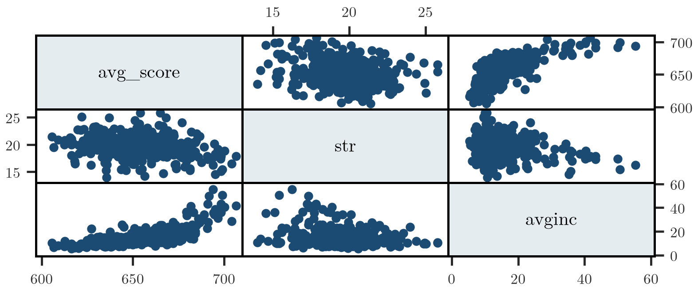

## Esempio motivante: test scores e dimensione della classe

> [!example] Esempio
> Comunemente si pensa che un rapporto studenti-insegnanti più basso induca un rendimento migliore degli studenti. Per questo, ad esempio in California, verso la fine degli anni '90, tutte le classi K-3 sono state ridotte per avere un rapporto massimo studenti-insegnanti di 20 (*Class Size Reduction Act* - CSR). Ciò ha un costo: inizialmente era di 1,8 miliardi di dollari all'anno. Con un costo così alto ci si chiede se ne valga la pena. Il Commissario per l'Istruzione potrebbe essere interessato a sapere se questa spesa extra ha un impatto significativo sul rendimento scolastico atteso.
>
> Ci chiediamo se la dimensione della classe sia l'unica informazione rilevante che ha un impatto nello spiegare la variazione del punteggio medio atteso di questi studenti, o se vadano considerati altri fattori.
>
> Un modello di regressione naïve evidenzia che esiste una dipendenza negativa significativa tra la dimensione media della classe, `str`, e il punteggio medio atteso, `avg_score`:
>
> | | Coef. | Std. Err. | t | P>\|t\| | [95% Conf. | Interval] |
> |---|---|---|---|---|---|---|
> | str | -2.279808 | .4798256 | -4.75 | 0.000 | -3.22298 | -1.336637 |
> | _cons | 698.933 | 9.467491 | 73.82 | 0.000 | 680.3231 | 717.5428 |
>
> A prima vista ridurre la dimensione delle classi sembra una scelta rilevante, poiché una riduzione della dimensione di una classe induce un aumento del punteggio medio di circa 2,28 punti. Ma questo modello statistico è una relazione causale? Esistono altre spiegazioni più credibili?
>
> Ad un esame più attento, osserviamo che il reddito medio (`avginc`) per le persone che vivono in ciascun distretto è correlato positivamente con `avg_score`: i distretti con reddito più alto tendono ad avere studenti con voti più alti. Esiste anche una dipendenza negativa tra reddito e dimensione della classe (`str`): i distretti a reddito più elevato tendono ad avere classi di dimensioni inferiori. Le correlazioni (comando `correlate avg_score str avginc`) sono:
>
> | | avg_score | str | avginc |
> |---|---|---|---|
> | avg_score | 1.0000 | | |
> | str | -0.2264 | 1.0000 | |
> | avginc | 0.7124 | -0.2322 | 1.0000 |
>
> Ci chiediamo se includere il reddito nel modello di regressione possa essere utile per prevedere il punteggio medio e spiegare la relazione causa-effetto performance vs. riduzione delle classi.
>
> 
>
> **Figura 1** — Scatterplot a coppie delle variabili coinvolte (`avg_score`, `str`, `avginc`). La matrice di scatterplot mostra visivamente le correlazioni della tabella precedente: `avg_score` cresce al crescere di `avginc` e decresce (debolmente) al crescere di `str`; `str` e `avginc` sono debolmente correlate negativamente.
>
> Questa evidenza empirica suggerisce che l'associazione negativa tra dimensione della classe e punteggio del test potrebbe essere **spuria**, poiché può essere spiegata dall'effetto del reddito su ciascuna variabile.
>
> 
>
> **Figura 2** — Rappresentazione causale del modello (diagramma con `income` che punta sia ad `average score` con correlazione 0.7124 sia a `class size` con correlazione -0.2322, e una freccia da `class size` ad `average score` con correlazione -0.2264). Il diagramma illustra come il reddito (`income`) sia una causa comune che influenza sia il punteggio medio sia la dimensione della classe: la correlazione osservata tra `class size` e `average score` non riflette quindi necessariamente un nesso causale diretto.

*(slide 3–7)*

## Il modello di regressione multipla e l'interpretazione dei parametri

> [!abstract] Definizione
> Si ipotizzi esistano due o più variabili esplicative, $X_1$ ed $X_2$ ($X_3,\ldots,X_k$) potenzialmente utili per descrivere la media condizionale di $Y$. In questo caso, la funzione di regressione semplice può essere generalizzata da
>
> $$E[Y|X_1,X_2] = \alpha + \beta_1 X_1 + \beta_2 X_2$$
>
> Come per il modello di regressione semplice, ogni osservazione è descritta da
>
> $$Y_i = \alpha + \beta_1 X_{1,i} + \beta_2 X_{2,i} + \epsilon_i$$
>
> $Y$ è la variabile dipendente, $X_1$ e $X_2$ sono i regressori mentre $\epsilon$ è un termine di errore che misura la distanza tra il modello di regressione e l'osservabile $Y$.
>
> **Interpretazione dei parametri.** Nella regressione semplice, $\beta_1$ misura la variazione attesa di $Y$ a condizione che $\Delta X = 1$. Infatti $\Delta \hat{Y} = \beta_1 \underbrace{\Delta X}_{=1}$.
>
> Nella regressione multipla, il coefficiente $\beta_1$ è la variazione attesa di $Y$ dovuta a una variazione unitaria di $X_1$ a condizione che $X_2$ sia mantenuto costante. In pratica, se calcoliamo la variazione attesa di $Y$ per un dato livello dei due regressori $X_1=\bar X_1$ e $X_2=\bar X_2$, otteniamo
>
> $$\hat{Y}(\bar X_1, \bar X_2) = \alpha + \beta_1 \bar X_1 + \beta_2 \bar X_2 + \epsilon(\bar X_1, \bar X_2).$$
>
> Supponiamo ora di voler calcolare $Y$ atteso per $X_1 = \bar X_1 + \Delta X_1$ e $X_2 = \bar X_2$:
>
> $$\hat{Y}(\bar X_1 + \Delta X_1, \bar X_2) = \alpha + \beta_1(\bar X_1 + \Delta X_1) + \beta_2 \bar X_2 + \epsilon(\bar X_1 + \Delta X_1, \bar X_2).$$
>
> La variazione prevista di $Y$ è la differenza
>
> $$\Delta \hat{Y} = \hat{Y}(\bar X_1 + \Delta X_1, \bar X_2) - \hat{Y}(\bar X_1, \bar X_2) = \beta_1 \Delta X_1 + \Delta \epsilon$$
>
> Nell'ipotesi che $\epsilon$ non sia rilevante per descrivere il valore atteso di $Y$, cioè $\Delta \epsilon = 0$ (in media vale per $E[\epsilon|X_1,X_2]=0$; la presenza di $\epsilon$ nelle espressioni di $\hat Y$ qui sopra è impropria, perché $\hat Y$ è la media condizionale e non contiene l'errore), allora una variazione del valore atteso di $Y$ è proporzionale alla variazione di $X_1$, cioè
>
> $$\Delta Y = \beta_1 \Delta X_1$$
>
> Nella regressione multipla, un parametro descrive l'effetto di una variabile esplicativa una volta controllati gli effetti dell'altra variabile esplicativa nel modello (imponendo $X_2 = \bar X_2$). La regressione semplice ha una sola variabile esplicativa, quindi il parametro descrive l'effetto di una variabile senza controllare per le altre possibili variabili esplicative, la cui influenza, se correlate con il regressore, confluisce nel coefficiente (le slide scrivono «al netto di tutte le altre», da intendere come «ignorando le altre»). I coefficienti $\beta_j$ sono chiamati **effetti marginali**.
>
> **Esempio: class scores vs. reddito e class size.** Consideriamo il modello di regressione multipla che lega il punteggio medio degli studenti, la dimensione della classe e il reddito delle famiglie:
>
> $$\text{avg\_score}_i = \alpha + \beta_1 \text{str}_i + \beta_2 \text{avginc}_i + \epsilon_i$$
>
> | | Coef. | Std. Err. | t | P>\|t\| | [95% Conf. | Interval] |
> |---|---|---|---|---|---|---|
> | str | -.6487401 | .354405 | -1.83 | 0.068 | -1.345383 | .0479028 |
> | avginc | 1.839112 | .0927868 | 19.82 | 0.000 | 1.656724 | 2.0215 |
> | _cons | 638.7292 | 7.449077 | 85.75 | 0.000 | 624.0867 | 653.3716 |
>
> Questi risultati suggeriscono che, per un dato livello di reddito, se la dimensione della classe si riduce di un'unità, allora il punteggio medio atteso aumenta di circa 0.65 punti. Questa variazione però risulta debolmente significativa.

*(slide 8–11)*

> [!lezione] Dalla lezione del 12 novembre 2026: la dimensione della classe con e senza il reddito
> Nella regressione semplice del punteggio dei bambini sulla dimensione della classe, la pendenza stimata è indicata dal docente in $-2{,}27$ (la nota riporta $-2{,}28$). Il test di significatività sul coefficiente, per verificare se il parametro sia diverso da zero, dà un p-value pari a zero: esiste una pendenza negativa, quella della retta dello scatter plot che descrive i dati.
>
> Nel modello esteso l'aspettativa del punteggio dipende dalla dimensione della classe, $X_1$, e dal reddito, $X_2$. Stimandolo, il coefficiente che lega la performance alla dimensione della classe si più che dimezza, passando da circa $-2{,}2$ a $-0{,}64$, e il test di significatività dà un p-value maggiore del 5%, non esageratamente grande. Aggiungendo il reddito, l'impatto della dimensione della classe sulla performance si riduce di molto: in un'analisi stretta, condizionatamente al livello di reddito la dipendenza lineare tra performance e dimensione della classe è nulla. Il docente collega questo risultato al p-value dell'analisi per sottocampioni di ECON 01.
>
> Ricalcolando sul dataset del corso (`ECON_Dataset_caschool.csv`, 420 distretti): nella regressione semplice la pendenza è $-2.2798$ (errore standard $0.4798$, $t=-4.75$); aggiungendo il reddito il coefficiente della dimensione della classe diventa $-0.6487$ (errore standard $0.3544$, $t=-1.83$, p-value di circa $0.07$), quindi non significativo al 5% e debolmente significativo al 10%. Quanto detto dal docente sul modello esteso è confermato; il collegamento con l'analisi per sottocampioni no, perché sul dataset la correlazione nel gruppo ad alto reddito è significativa (vedi ECON 01).
>
> Il docente presenta la costruzione di un modello con due variabili come equivalente a dividere il campione in due pezzi, alto e basso reddito, e a calcolare il livello di dipendenza nei due sottoinsiemi. Il punto viene ripreso più avanti.

> [!lezione] Dalla lezione del 17 novembre 2026: dal modello semplice alla regressione multipla
> Poiché il modello di regressione semplice è stato sviluppato in modo abbastanza dettagliato, la regressione multipla si affronta più velocemente, per differenze. Un modello con due variabili è troppo piccolo per ricavarne molto: lo ha mostrato l'esempio della prima lezione, i bambini che vanno a scuola, con la performance in funzione della dimensione della classe. Aggiungendo il reddito, le conclusioni, ragionando logicamente, risultavano completamente diverse. Si vuole quindi costruire un modello con più informazioni disponibili, cioè più variabili, il che aiuta anche a specificare meglio un potenziale nesso causale tra le variabili.
>
> Nell'esempio le variabili in gioco sono tre: il reddito, la dimensione della classe e la performance. Il modello di regressione semplice dà la stima per una variazione unitaria della dimensione della classe: se la classe diminuisce di un'unità, il punteggio al test attitudinale aumenta in media di circa due punti (la stima della nota è $-2{,}28$). Il numero è statisticamente significativo, perché il p-value del test di significatività è diverso da zero, quindi c'è un miglioramento sistematico. L'intervallo di confidenza non include lo zero, perciò il parametro è statisticamente diverso da zero, ed è sistematicamente negativo, perché l'intervallo assume solo valori negativi.
>
> Il problema è che non si è sicuri che la relazione sia causale. La storia raccontata può avere senso, ma si vorrebbe includere nel modello l'effetto del reddito che, per quanto detto nelle lezioni precedenti, è legato sia alla dimensione della classe sia alla performance, in senso diverso. Occorre quindi un modello di regressione che incorpori questa informazione.

> [!lezione] Dalla lezione del 17 novembre 2026: il modello con due regressori e il termine d'errore
> Nel caso con due regressori $Y$ è la performance, $X_1$ la dimensione della classe e $X_2$ il secondo regressore. Il valore atteso condizionale, cioè il vero modello nella popolazione, dipende da $\alpha$, $\beta_1$, $\beta_2$, $X_1$ e $X_2$: $\alpha$ è l'intercetta, mentre $\beta_1$ e $\beta_2$ misurano quanto conta $X_1$ e quanto conta $X_2$. Come nel modello semplice, per collegare l'osservazione del singolo distretto alla media condizionale si aggiunge un termine d'errore, che descrive come differiscono tra loro distretti con le stesse caratteristiche, cioè con caratteristiche diverse dalla dimensione della classe e dal livello di reddito.

> [!lezione] Dalla lezione del 17 novembre 2026: $\beta_1$ e $\beta_2$ come correlazioni condizionali
> Nel modello di regressione semplice $\beta_1$ è una correlazione marginale tra $x$ e $y$, cioè la covarianza tra $x$ e $y$ divisa per la varianza di $x$. Nel modello con più variabili $\beta_1$ e $\beta_2$ sono ancora correlazioni, ma non marginali: sono correlazioni condizionali (la nota chiama i $\beta_j$ effetti marginali).
>
> Il docente ripete l'esercizio già fatto: stabilire la performance attesa per due livelli della dimensione della classe, con il reddito fissato. Si prendono distretti con lo stesso reddito e si vede che cosa succede alla performance modificando una sola delle due variabili. Sostituendo nel modello i due valori e facendo la differenza, e ipotizzando che la componente residuale sia nulla, la variazione di performance è uguale a $\beta_1$ per la variazione della policy, cioè per la riduzione di un'unità della dimensione della classe.
>
> $\beta_1$ non dice quanto conti in generale ridurre di un'unità la dimensione della classe, ma quanto conti farlo in contesti in cui i distretti hanno lo stesso reddito. Non è più una correlazione tra $X$ e $Y$, ma una correlazione tra $X_1$ e $Y$ con $X_2$ fissato. Si confrontano distretti uguali, quindi la variazione di $Y$ non può dipendere dall'effetto reddito, perché quella quantità è fissa: l'esperimento consiste nel modificare la dimensione della classe solo tra distretti uguali. A parità di reddito, una variazione $dx$ della dimensione ha un impatto proporzionale a $\beta_1$.
>
> La formula è la stessa del modello semplice, ma il concetto è diverso. Nel modello semplice $X_2$ non compare e quindi non è fissato, e la correlazione è marginale; qui è condizionale, tra $Y$ e $X_1$ con $X_2$ fissato. È esattamente ciò che si faceva nelle lezioni precedenti dividendo un campione grande in due parti, distretti ricchi e distretti poveri, e calcolando la correlazione nelle due parti: è questo che si fa nel modello di regressione.

> [!lezione] Dalla lezione del 19 novembre 2026: il confronto tra distretti ricchi e poveri scritto come due regressioni
> Il confronto tra distretti ricchi e poveri si formalizza con due regressioni semplici. Per i distretti ad alto reddito, omogenei tra loro, si stima
>
> $$\text{punteggio}_i = \alpha_A + \beta_A \, \text{size}_i + \varepsilon_i,$$
>
> dove $\beta_A$ è il coefficiente dei distretti ad alto reddito; lo stesso esercizio per i distretti a basso reddito dà
>
> $$\text{punteggio}_i = \alpha_B + \beta_B \, \text{size}_i + \varepsilon_i.$$
>
> I termini d'errore sono diversi perché riguardano sottopopolazioni diverse. All'interno di ciascun sottogruppo le stime non dipendono dal reddito, perché il reddito è omogeneo. Per analogia: se tutti fossero alti due metri, la probabilità di schiacciare a basket non dipenderebbe dall'altezza, ma da altre caratteristiche, per esempio l'elasticità muscolare. Si elimina così l'effetto della variabile confondente, il reddito: essendo uguale per tutti, una variazione del punteggio non può dipenderne e deve dipendere da altro. Per semplificare si suppone inoltre che in queste regressioni $\varepsilon$ non abbia un effetto sistematico, cioè che non vi siano altre variabili rilevanti.
>
> Se la stima di $\beta$ nei due sottocampioni non è influenzata dal reddito, il reddito non ha impatto sulla stima della correlazione tra le variabili chiave; se la stima cambia, il reddito ha importanza. Interessa stimare $\beta$ perché è una misura di correlazione, data dalla covarianza divisa per la varianza, quindi esprime la relazione tra $X$ e $Y$. L'idea è quella mostrata nella prima lezione, scritta ora nella forma di un modello di regressione.

> [!lezione] Dalla lezione del 19 novembre 2026: variabili di interesse e variabili di controllo
> Considerare più variabili insieme ha senso perché il mondo è complesso e considerare le variabili a coppie è troppo poco. In un problema economico, biologico o di altro genere interessa però di solito la relazione tra due variabili specifiche, non tra tutte. Le variabili che definiscono il valore atteso condizionale si dividono quindi in due sottogruppi: le **variabili di interesse**, o di policy, e le **variabili di controllo**.
>
> Il responsabile della didattica in California è interessato alla dimensione della classe, non al reddito, che non rientra nei suoi scopi. Se però il reddito non è nel modello, la previsione dell'impatto di una riduzione della classe sulla performance dei bambini può essere sbagliata. L'interesse riguarda dunque solo $\beta_1$: il valore di $\beta_2$ non conta, perché il reddito serve soltanto a stimare bene $\beta_1$, mentre l'effetto del reddito sulla performance è un altro problema, di chi si occupa eventualmente di servizi sociali. Le variabili di interesse sono quelle di cui si vuole l'effetto marginale in modo preciso; le altre servono a ripulire il termine d'errore dagli effetti collaterali, e lo si fa aggiungendo il loro termine alla media condizionale.

> [!lezione] Dalla lezione del 19 novembre 2026: che cosa contiene il termine d'errore
> Il modello di regressione multipla è definito come quello semplice, con un numero maggiore di variabili. Lega le osservazioni $y_i$, $x_{1i}$ e $x_{2i}$ dell'unità statistica $i$-esima, per esempio il distretto 57, tramite il termine d'errore $\varepsilon_i$. L'errore rappresenta tutte le caratteristiche del distretto che non sono né la variabile 1 né la variabile 2, come la percentuale di non madrelingua o la qualità delle scuole.
>
> Nel modello di regressione semplice $y$ conteneva anche il fattore reddito, perché non figurava nella media condizionale e doveva stare da qualche altra parte, cioè nell'errore. L'errore va pensato come il bidone della spazzatura in cui finisce tutto ciò che non compare nella parte sistematica.

> [!lezione] Dalla lezione del 19 novembre 2026: $\beta_1$ come correlazione parziale
> $\beta_1$ indica quanto una variazione di $X_1$ incide in media su $Y$, quindi è una misura di associazione. Non è però la correlazione stimata nel modello di regressione semplice, perché qui si controlla per il reddito, assunto costante: è la correlazione tra $y$ e $x_1$ una volta fissato $x_2$, cioè una correlazione condizionale, detta anche **correlazione parziale**. Dice di quanto aumenta la performance riducendo la dimensione della classe in distretti con lo stesso reddito. Il confronto non riguarda un distretto ricco e uno povero con la policy applicata a uno solo dei due: si prendono due distretti identici per reddito e si stanziano risorse per ridurre la classe in uno soltanto. Questi distretti possono essere eterogenei per le altre caratteristiche, ma se si ipotizza che la media di $\varepsilon$, fissate le $x$, sia uguale a zero, esse non hanno un effetto sistematico e dal punto di vista pragmatico si possono trascurare.
>
> Lo schema replica in forma di modello il ragionamento fatto in precedenza in forma grafica, quando il reddito si fissava in modo più grezzo prendendo i distretti sopra e sotto la mediana e calcolando la correlazione in ciascun gruppo. Nel modello di regressione la correlazione parziale viene calcolata per qualsiasi livello di $x_2$. Dal punto di vista intuitivo si fa esattamente la stessa cosa: il modello di regressione multipla ne è la formalizzazione statistica.
>
> Il modello permette di controllare per i fattori confondenti purché siano inclusi esplicitamente nel modello. Non devono restare in $\varepsilon$, che non è osservabile: non se ne conosce la struttura né come reagisce, ed è questo il problema. Lo scopo dell'analisi resta $\beta_1$.

> [!lezione] Dalla lezione del 19 novembre 2026: che cosa stima la regressione semplice e perché si passa al modello più complesso
> Con il reddito nel modello il coefficiente della dimensione della classe passa da circa $-2{,}2$ a $-0{,}64$ (la nota riporta $-2{,}28$ e $-0{,}65$), meno di un terzo, ed è debolmente significativo: il p-value del test di significatività è 6,8%, quindi al livello del 5% non si rifiuta l'ipotesi nulla e non si può escludere che il parametro sia uguale a zero. L'intervallo di confidenza lo conferma, perché il limite inferiore è negativo e il superiore positivo, quindi lo zero è un valore possibile. L'effetto del reddito è $1{,}8$, statisticamente significativo, con un intervallo di confidenza che assume solo valori positivi; il segno atteso del coefficiente del reddito è positivo.
>
> Il modello di regressione semplice non stima l'effetto della classe, ma la combinazione dell'effetto della classe e dell'effetto del reddito. Chi usa quel modello non lo sa, perché il reddito non è nel modello: vedendo il coefficiente $-2{,}2$ gli si assegna mentalmente tutto il peso a una riduzione di un'unità della dimensione della classe, senza pensare al reddito. Aggiungere un regressore permette di scomporre gli effetti in modo esplicito.
>
> Una relazione logica che aumenta la complessità del modello esclude di fatto quella più semplice, per tre ragioni: lo schema a tre variabili ha senso dal punto di vista logico, si può scrivere come modello di regressione e il modello di regressione permette di valutarlo empiricamente sui dati. È quindi un modello sensato, stimabile e migliore del precedente dal punto di vista statistico e logico.
>
> Se il coefficiente del reddito fosse risultato non significativo, l'effetto reddito sarebbe irrilevante e si sarebbe potuti restare nel modello più semplice. Qui interviene il rasoio di Occam: tra due spiegazioni, una complicata e una semplice, entrambe valide e senza controindicazioni interne, si preferisce la semplice. Il docente precisa che si tratta di un'idea filosofica su cui non si pronuncia. In questo caso però il modello più complicato cambia completamente le conclusioni rispetto a quello semplice: i due modelli non sono equivalenti e si è obbligati a usare il più complicato, perché porta a rifiutare il modello precedente.
>
> Questo non significa che la relazione sia causale. Per arrivarci bisognerebbe continuare l'analisi, togliendo altri fattori dal termine d'errore e inserendoli nella media condizionale. In generale si continuano ad aggiungere informazioni sensate dal punto di vista logico, e il modello deve restare coerente con un'idea teorica, economica, sociologica o pedagogica, a seconda dell'oggetto di studio. Poiché interessa il parametro della dimensione della classe, su cui si investono i soldi, un'idea di lavoro è continuare a inserire variabili finché $\beta_1$ si stabilizza: quando diventa insensibile all'aggiunta di nuove variabili, ciò che non viene inserito non ha più molta importanza per spiegarlo. Ciò che accade agli altri coefficienti di controllo non interessa; interessa soltanto se vale la pena investire 2 miliardi di dollari l'anno (la nota indica inizialmente 1,8 miliardi) per attuare quell'idea pedagogica.

## Cause di endogeneità: distorsione da variabile omessa

> [!tip] Teorema
> Nel modello di regressione semplice, abbiamo ipotizzato che $E[\epsilon|X] = 0$ ($\Rightarrow \text{Cov}(\epsilon, X) = 0$).
>
> Supponiamo che la **vera** media condizionale (relazione causale) sia ben approssimata dal seguente modello:
>
> $$\text{Modello 1:} \quad Y = \alpha + \beta_1 X_1 + \beta_2 X_2 + \tilde\epsilon$$
>
> Poiché non conosciamo il vero modello, supponiamo di stimare la seguente regressione **sbagliata**, ovvero un modello statistico non correttamente specificato:
>
> $$\text{Modello 2:} \quad Y = \alpha + \beta_1 X_1 + \epsilon$$
>
> Quali sono le conseguenze di questo errore?
>
> Supponiamo ad esempio che valga la seguente ipotesi:
> - $\text{Cov}(\tilde\epsilon, X_j) = 0$, $j=1,2$ (esogeneità rispetto al vero modello)
> - $\text{Cov}(X_1, X_2) \neq 0$
>
> Nel Modello 2, la variabile $X_2$ è stata omessa. Ciò significa che il suo impatto atteso su $Y$ è stato inglobato dal termine di errore $\epsilon$. Nel Modello 2 vale $\epsilon = \beta_2 X_2 + \tilde\epsilon$, quindi
>
> $$\text{Cov}(X_1, \epsilon) = \beta_2 \text{Cov}(X_1, X_2) \neq 0 \quad \text{se } \beta_2 \neq 0$$
>
> In particolare, è violata la condizione di esogeneità per il modello di regressione semplice. Si può dimostrare che gli stimatori OLS di $\beta_1$ sono distorti in campioni piccoli e grandi. Quindi, se $n \to \infty$:
>
> $$\hat\beta_1 \xrightarrow{p} \beta_1 + \rho_{X_1\epsilon} \frac{\sigma_\epsilon}{\sigma_X} \quad \text{(non consistenza di } \hat\beta_1\text{)}$$
>
> Se prendiamo come punto di riferimento una regressione sbagliata, probabilmente prenderemo decisioni sbagliate. Come affermato prima, ciò che effettivamente stimiamo (al limite, per $n\to\infty$) è
>
> $$\hat\beta_1 = \beta_1 + \rho_{X_1\epsilon} \frac{\sigma_\epsilon}{\sigma_X} \neq \beta_1$$
>
> In particolare, una variazione unitaria di $X$, cioè $\Delta X = 1$, produce
>
> $$\Delta Y = \beta_1 + \underbrace{\Delta \epsilon}_{\approx \rho_{X_1\epsilon}\, \sigma_\epsilon/\sigma_X}$$
>
> In questo caso non possiamo distinguere gli effetti dovuti dai regressori inclusi e da quelli omessi dal modello. Nell'esempio della CAL school, non sappiamo se la stima di $\hat\beta = -2.280$ sia dovuta all'effettiva variazione della dimensione della classe o ad altri fattori come ad esempio il reddito.
>
> **Sintesi.** Nel modello di regressione semplice, l'ipotesi chiave è $E(\epsilon|X)=0 \Rightarrow \text{Cov}(\epsilon,X)=0$. Se una variabile rilevante viene omessa, dobbiamo affrontare delle conseguenze:
> - L'omissione di una variabile rilevante e correlata con il regressore incluso induce una correlazione non nulla tra il regressore incluso ed il termine di errore $\Rightarrow \text{Cov}(\epsilon,X) \neq 0$. L'ipotesi di **esogeneità** non è più valida;
> - $E[\hat\beta] \neq \beta$, ovvero $\hat\beta$ è **distorto**;
> - Questa distorsione persiste anche se $n$ è grande (**non consistenza**).

*(slide 12–16)*

> [!lezione] Dalla lezione del 12 novembre 2026: l'endogeneità nell'esempio della dimensione della classe
> Nell'esempio dei bambini a scuola c'è un problema di endogeneità. La prima regressione lega la performance dei bambini alla dimensione della classe più un termine d'errore, e nel termine d'errore c'è l'effetto del reddito, perché non è nel modello: $\varepsilon$ raccoglie tutto ciò che non è dimensione della classe, e qui lo si può identificare con il reddito. Poiché la correlazione tra reddito e dimensione della classe è significativamente diversa da zero, stimare quel modello significa ipotizzare di fatto che sia zero.
>
> Si toglie allora dal termine d'errore il reddito, che è la variabile problematica, e lo si inserisce nel modello. L'errore del modello con il regressore in più non è più caratterizzato dall'effetto del reddito, perché questo è ora parte della media condizionale e non della parte residuale. Ristimando il modello si elimina una delle possibili cause di endogeneità, cioè una delle cause che creano relazione tra $\varepsilon$ e la dimensione della classe, e il parametro passa da circa $-2{,}2$ a $-0{,}64$.
>
> Secondo il docente nel modello precedente c'era probabilmente un problema di endogeneità che si era fatto finta di non vedere. I parametri sono cambiati molto, quindi per stimare $\beta$ nella prima regressione si è probabilmente usata la formula sbagliata, supponendo nulla la correlazione tra reddito e dimensione della classe, che invece non lo è. La distorsione non è piccola e il parametro cambia molto: queste sono le conseguenze di stimare un modello facendo finta che $\Delta\varepsilon$ sia uguale a zero quando in realtà non lo è.

> [!lezione] Dalla lezione del 19 novembre 2026: la distorsione da variabile omessa derivata con le covarianze
> Si suppone che la vera relazione tra $X$ e $Y$ sia data dal modello con due variabili, $E(Y \mid X_1, X_2) = \alpha + \beta_1 X_1 + \beta_2 X_2$, eventualmente con altre variabili. In generale questo modello non è noto a priori e si può solo approssimare la realtà con qualcosa di statistico, cominciando dalla cosa più semplice, un modello di regressione semplice
>
> $$y_i = \tilde{\alpha} + \tilde{\beta} x_{1i} + \tilde{\varepsilon}_i,$$
>
> in cui la tilde indica parametri ed errore diversi da quelli del processo generatore dei dati (la nota usa invece $\tilde\epsilon$ per l'errore del modello vero). Il modello corretto da stimare sarebbe $y_i = \alpha + \beta_1 x_{1i} + \beta_2 x_{2i} + \varepsilon_i$. Si vuole stimare $\tilde{\beta} = \text{Cov}(y, x_1)/\text{Var}(x_1)$, ma lo stimatore è costruito sul modello sbagliato. Per trovare la relazione con il vero $\beta_1$ si sostituisce a $y$ il vero processo generatore:
>
> $$\tilde{\beta} = \frac{\text{Cov}(\alpha + \beta_1 x_1 + \beta_2 x_2 + \varepsilon,\; x_1)}{\text{Var}(x_1)}.$$
>
> Il numeratore si scompone in somma di covarianze con $x_1$. Quella di $\alpha$ è zero, perché $\alpha$ è una costante; quella di $\beta_1 x_1$ è $\beta_1 \text{Var}(x_1)$, perché la covarianza di una variabile con se stessa è la varianza; quella di $\beta_2 x_2$ è $\beta_2 \text{Cov}(x_1, x_2)$; resta quella di $\varepsilon$ con $x_1$. Si ottiene
>
> $$\tilde{\beta} = \beta_1 + \beta_2 \frac{\text{Cov}(x_1, x_2)}{\text{Var}(x_1)} + \frac{\text{Cov}(\varepsilon, x_1)}{\text{Var}(x_1)}.$$
>
> Nel vero modello l'errore $\varepsilon$ è incorrelato con $x_1$ e con $x_2$, perché si ipotizza che valga l'esogeneità, quindi l'ultimo termine è zero. Lo stimatore di $\beta$ non è però legato soltanto a $\beta_1$, ma anche alla struttura di correlazione tra $x_1$ e $x_2$. Il numero ottenuto è una combinazione di due fattori: il vero segnale $\beta_1$ e un effetto che dipende dalla correlazione tra le variabili, quella che si è tolta dal modello statistico ma che è presente nel modello teorico. Con troppo poche variabili si stima dunque una combinazione di effetti.
>
> Nel modello piccolo l'errore è $\tilde{\varepsilon}_i = \varepsilon_i + \beta_2 x_{2i}$: l'unica differenza tra modello vero e modello statistico è un termine tolto dalla parte sistematica, che resta quindi nell'errore. L'endogeneità nasce dal fatto che $x_2$ e $x_1$ possono essere correlati. Se la loro covarianza è zero l'effetto distorsivo si annulla, e lo stesso accade se $\beta_2 = 0$, perché il termine distorsivo è zero moltiplicato per qualcosa. Escludere una variabile inutile non produce nulla, e lo stesso vale per una variabile incorrelata con la variabile di interesse. Non serve che la covarianza o $\beta_2$ siano esattamente zero: se sono molto piccoli, l'eventuale problema è trascurabile.

> [!lezione] Dalla lezione del 19 novembre 2026: regressori in più rispetto al necessario
> Un'osservazione non presente nelle slide riguarda il caso opposto. Se il vero modello ha due regressori e se ne stima uno con tre, i due importanti più un terzo, il problema non si pone: ci si aspetta che il terzo regressore abbia impatto nullo, quindi la sua stima sarà circa zero. In un modello sovraparametrizzato, cioè con più regressori del necessario, le stime di $\beta_1$ e $\beta_2$ non cambiano. Al più gli errori standard tendono a diventare un po' più grandi, perché nella procedura di stima si aggiunge qualcosa di inutile: invece di fissare il coefficiente a zero, come dovrebbe essere, lo si fissa alla covarianza campionaria, che non è numericamente zero. Mettere più regressori del necessario non è un problema serio, mentre metterne troppo pochi è un problema sostanziale.

## Cause di endogeneità: errori di misura

> [!tip] Teorema
> Si trova endogeneità anche quando il regressore non è osservato esattamente, ma conosciamo solo una sua approssimazione. Consideriamo l'esempio seguente, in cui non possiamo osservare $X_i$ ma solo un suo proxy, diciamo $X_i^*$. Poi
>
> $$Y_i = \gamma X_i + \epsilon_i$$
> $$X_i^* = X_i + u_i \qquad \text{Cov}(X_i, u_i) = 0$$
>
> - $X_i$ è il vero regressore, non osservabile;
> - $X_i^*$ è il regressore osservabile, ma impreciso;
> - $u_i$ è l'errore di misura.
>
> La regressione calcolabile è quindi
>
> $$Y_i = \beta X_i^* + \epsilon_i^*$$
>
> Scriviamo la regressione originale in funzione del regressore osservabile $X^*$, per verificare se la regressione ammissibile soddisfa l'ipotesi OLS:
>
> $$Y_i = \gamma X_i + \epsilon_i = \gamma(X_i^* - u_i) + \epsilon_i = \gamma X_i^* + \underbrace{\epsilon_i - \gamma u_i}_{\epsilon_i^*}$$
>
> La regressione calcolabile diventa
>
> $$Y_i = \gamma X_i^* + \epsilon_i^* \;\Rightarrow\; \text{Cov}(X_i^*, \epsilon_i^*) = -\gamma \text{Var}(u_i) \neq 0 \;\Rightarrow\; \text{Endogeneity}$$
>
> Quindi, l'utilizzo di regressori che non sono osservati accuratamente porta a stimatori distorti e non consistenti. (Segno: $\text{Cov}(X+u,\,\epsilon-\gamma u) = -\gamma\,\text{Var}(u)$, con $u$ incorrelato con $X$ ed $\epsilon$; le slide riportano $+\gamma\,\text{Var}(u)$.)
>
> **Esempio numerico.** Consideriamo un dataset simulato di dimensione 200 che soddisfa le seguenti condizioni:
>
> $$Y = 3 + 1.5X + \epsilon$$
>
> La variabile $X$ è il vero regressore (misurato senza errore). Come benchmark, stimiamo il modello di regressione $Y = \alpha + \beta X + \epsilon$, in cui utilizziamo $X$ come regressore:
>
> | | Coef. | Std. Err. | t | P>\|t\| | [95% Conf. | Interval] |
> |---|---|---|---|---|---|---|
> | X | 1.427984 | .0654388 | 21.82 | 0.000 | 1.298938 | 1.557031 |
> | _cons | 3.072873 | .06727 | 45.68 | 0.000 | 2.940215 | 3.205531 |
>
> Le stime sono molto precise, nel senso che $\hat\beta$ e $\hat\alpha$ sono vicini rispettivamente a 1.5 e 3.
>
> Ipotizziamo ora che $X$ non sia osservabile ma sia disponibile solo $X^* = X + u$, $u \sim N(0,1)$. Cosa accade se stimiamo la seguente regressione:
>
> $$Y = \alpha + \beta X^* + \epsilon$$
>
> in cui anche $\epsilon \sim N(0,1)$ ed è indipendente da $u$:
>
> | | Coef. | Std. Err. | t | P>\|t\| | [95% Conf. | Interval] |
> |---|---|---|---|---|---|---|
> | Xs | .70249 | .0742756 | 9.46 | 0.000 | .5560173 | .8489628 |
> | _cons | 3.135813 | .1029848 | 30.45 | 0.000 | 2.932726 | 3.338901 |
>
> Si noti che in questo caso $\hat\beta$ non è neanche vicino a 1.5 (il valore vero per questo parametro) poiché l'intervallo di confidenza del 95% non lo include.
>
> La distorsione o bias in questo caso può essere quantificato. Sappiamo infatti che nella regressione calcolabile (con $X^*$), al limite per $n\to\infty$ (la formula seguente è il limite in probabilità di $\hat\beta$),
>
> $$\hat\beta = \frac{\text{Cov}(X^*, y)}{V(X^*)} = \beta \frac{V(X)}{V(X) + V(u) + 2\,\text{Cov}(X,u)} \approx \frac{1}{2}\beta$$
>
> Nella simulazione è stato ipotizzato $\text{Var}(X) = \text{Var}(u) = 1$. Inoltre si è ipotizzato $\text{Cov}(X,u) = 0$ (le slide scrivono $\text{Cov}(X,u)$ senza il fattore 2 al denominatore, ininfluente perché la covarianza è nulla). Di conseguenza la distorsione risulta essere la metà del vero valore del parametro, in questo esempio circa 0.75. Si noti quindi che quello che stimo (.70249) è prossimo al vero $\beta = 1.5$ meno la distorsione (.75).

*(slide 17–21)*

> [!lezione] Dalla lezione del 19 novembre 2026: il regressore impreciso e le ipotesi sull'errore di misura
> La seconda causa di endogeneità è più sottile della prima, che riguardava un modello statistico con informazione insufficiente. Si suppone di avere studiato bene il problema, di avere isolato le variabili necessarie senza escluderne alcuna e che il modello sia quindi perfetto sulla carta, il problema essendo solo la stima: una variabile di interesse, il regressore, non si riesce però a osservare con precisione, e al posto del vero valore se ne ottiene una approssimazione.
>
> Un esempio tipico è il consumo delle famiglie italiane come regressore, con dati ottenuti da sondaggi ben fatti, dell'Istat o simili, ma pur sempre sondaggi. Una persona che ha speso 160 euro al supermercato la settimana scorsa, senza lo scontrino in mano, non se lo ricorda con esattezza: ricorda più o meno 150, un ordine di grandezza; se la volta dopo ha speso 140 riporta comunque 150, perché arrotonda. L'approssimazione è onesta, nel senso che non distorce sistematicamente: qualche volta sovrastima e qualche volta sottostima. È semplice distrazione.
>
> Il modello economico lega $y$ a $x$ ed è corretto, per cui $x$ ed $\varepsilon$ sono incorrelati. Si osserva però $x^*_i = x_i + u_i$, dove $u$ è un termine di distrazione, una variabile casuale con media zero e una certa varianza. Per semplicità si ipotizza che $u$ non dipenda da fattori estranei, in particolare da $\varepsilon$, e nemmeno da quanto si spende: chi è impreciso al 10% lo sarà sempre. Si ipotizza quindi che $\text{Cov}(x, u) = 0$ e $\text{Cov}(u, \varepsilon) = 0$. Dovrebbe bastare, e se emergono altre condizioni necessarie il docente le segnalerà.
>
> L'unica regressione calcolabile è quella in cui, al posto di $x$, compaiono i dati disponibili. Per distinguere nettamente i due modelli il docente scrive i parametri del processo che genera i dati come $\alpha$ e $\beta$ e quelli del modello calcolabile come $\gamma_0$ e $\gamma_1$ (la nota usa invece $\gamma$ per il parametro vero e $\beta$ per quello stimato):
>
> $$y_i = \gamma_0 + \gamma_1 x^*_i + \varepsilon_i.$$
>
> Ci si chiede se $\gamma_1$ sia legato a $\beta$, cioè se il parametro stimato da questa regressione con regressore impreciso fornisca informazioni su $\beta$.

> [!lezione] Dalla lezione del 19 novembre 2026: il coefficiente stimato con un regressore impreciso
> Lo stimatore dei minimi quadrati di $\gamma_1$ è la covarianza tra $y$ e $x^*$ divisa per la varianza di $x^*$. Poiché $x^* = x + u$, per trovare la relazione con il vero $\beta$ si riscrive $y$ in funzione del vero $x$ e del vero $\beta$, cioè rispetto al processo che genera i dati:
>
> $$\gamma_1 = \frac{\text{Cov}(y, x + u)}{\text{Var}(x + u)} = \frac{\text{Cov}(y, x) + \text{Cov}(y, u)}{\text{Var}(x + u)} = \frac{\beta \,\text{Var}(x)}{\text{Var}(x + u)} + \frac{\text{Cov}(x, \varepsilon)}{\text{Var}(x + u)} + \frac{\text{Cov}(y, u)}{\text{Var}(x + u)}.$$
>
> Per ipotesi il modello con il vero $x$ è perfetto, quindi $\text{Cov}(x, \varepsilon) = 0$. Si ipotizza inoltre che il livello di imprecisione non dipenda da $y$, quindi anche $\text{Cov}(y, u) = 0$; è un'ipotesi semplificatrice, perché la covarianza potrebbe essere diversa da zero. Al denominatore, dato che $x$ e $u$ sono incorrelati, la varianza della somma è la somma delle varianze, perché il doppio prodotto della covarianza si annulla. Resta
>
> $$\gamma_1 = \beta \, \frac{\text{Var}(x)}{\text{Var}(x) + \text{Var}(u)}.$$
>
> Con l'errore di misura non si stima quindi $\beta$, ma $\beta$ moltiplicato per un rapporto minore di uno per costruzione, perché il denominatore è sempre maggiore del numeratore. Se la varianza di $u$ è piccola, cioè la precisione nel riportare i dati è alta e gli errori sono di pochi centesimi, il rapporto tende a uno e $\gamma_1$ e $\beta$ sono di fatto uguali. Se la variabilità di $u$ è grande si ha un problema. Se la varianza di $u$ è uguale alla varianza di $x$ il rapporto vale $1/2$ e si stima $\beta$ per un mezzo.

> [!lezione] Dalla lezione del 19 novembre 2026: attenuation bias e lettura della simulazione
> Nella simulazione con 200 osservazioni la stima di $\beta$ con il regressore impreciso è $0{,}7$, contro il vero valore $1{,}5$. Un test di ipotesi sulla coerenza di $0{,}7$ con $1{,}5$ potrebbe non rifiutare se la precisione della stima fosse sufficientemente scarsa, cioè se i dati fossero molto dispersi e l'intervallo molto ampio, tale da contenere $1{,}5$. Qui invece l'intervallo di confidenza, che unisce stima e precisione, va da circa $0{,}55$ a $0{,}85$ e $1{,}5$ non vi cade neanche vicino; poiché nel modello con il vero regressore tutto aveva funzionato bene, il campione non è troppo piccolo. Si ottiene sistematicamente un risultato diverso dalla verità. Con $\text{Var}(x) = 1$ per costruzione e $\text{Var}(u) = 1$, il valore $0{,}7$ è $1{,}5$ per un mezzo.
>
> Il fatto che, con $\beta$ positivo, un modello di questo tipo dia stime sistematicamente più basse di quelle desiderate si chiama **attenuation bias**: il parametro di interesse viene sottostimato in modo regolare. La distorsione è la differenza tra $\beta$ e $\beta/2$, cioè la metà di $\beta$, circa $0{,}75$. Il docente osserva di avere scelto per caso un esempio in cui la distorsione e il coefficiente di attenuazione, un mezzo, coincidono, e rifarà gli esempi con una varianza di $u$ diversa da quella di $x$, in modo che il fattore di riduzione della stima non sia esattamente un mezzo. L'idea resta la stessa: anche con il modello perfetto in mente, se i dati sono imprecisi, per esempio perché ottenuti da un campionamento fatto male, la stima è inadeguata.

> [!lezione] Dalla lezione del 19 novembre 2026: errori di misura in finanza
> In finanza il problema è frequente, perché molte procedure di stima si basano su stime ripetute: da una prima regressione si stimano dei coefficienti, poi si fa una regressione in cui i coefficienti stimati in precedenza sono usati come regressori. Si procede così, tipicamente, per validare dal punto di vista statistico modelli come il CAPM, cioè per verificare se sono credibili sui dati. I coefficienti stimati sono variabili approssimate: non sono il vero valore del parametro ma il vero valore al netto di un errore di stima, un errore campionario. Ciò può creare endogeneità e problemi collegati.
>
> Un altro esempio è l'inserimento della volatilità di un investimento in un modello di regressione che spieghi la performance. La volatilità non è osservabile direttamente e può solo essere stimata: nel modello entra la volatilità stimata, che non è un indicatore esatto della volatilità oggettiva ma la migliore approssimazione disponibile. Usarla come regressore crea endogeneità, e gli stimatori tendono a sottostimare il vero valore del parametro. Chi la inserisce deve sapere che è uno stimatore e quindi contiene un errore di misura, cioè lo standard error della stima, e interpretare i risultati con attenzione, perché le stime del modello potrebbero essere distorte.

> [!lezione] Dalla lezione del 19 novembre 2026: ridurre l'errore di misura con osservazioni ripetute
> Gli istituti che fanno professionalmente questo lavoro, come l'Istat o la Banca d'Italia, o gli istituti di ricerca che lavorano bene, cercano di correggere il problema. Se i dati sono scadenti c'è poco da fare: si può pensare al modello migliore, ma la stima resta scadente. Uno schema possibile è osservare una famiglia non una sola volta ma per un periodo abbastanza lungo, per esempio dieci settimane. Per la famiglia $i$-esima si hanno allora dieci osservazioni, $x_{i1}, x_{i2}, \dots, x_{i,10}$, la spesa della settimana uno, due, fino a dieci, e la varianza di ciascuna è la varianza di $u$, l'imprecisione fisiologica.
>
> Se la varianza di $u$ è grande il modello di regressione ha un problema, ma si possono aggregare i dati. In generale, con $n$ osservazioni per la famiglia $i$ si calcola la media aritmetica
>
> $$\bar{x}_i = \frac{1}{n} \sum_{j=1}^{n} x_{ij}$$
>
> e la si usa come regressore per quella famiglia. La media è uno stimatore della media della popolazione e, se le osservazioni sono indipendenti, la sua varianza è $\text{Var}(u)/n$ (i passaggi sono nelle slide dei richiami di statistica). Con dieci osservazioni per famiglia la varianza della media è un decimo di quella di ogni singola osservazione, e il rapporto $\text{Var}(x) / (\text{Var}(x) + \text{Var}(u))$ diventa praticamente uno, perché al posto di $\text{Var}(u)$ compare la varianza della media. Più grande è $n$, cioè il numero di osservazioni per la stessa unità statistica, più piccolo è l'effetto dell'imprecisione. Un modo rapido di risolvere il problema è quindi chiedere la spesa quattro o cinque volte invece che una e farne la media, che è molto più precisa di ogni singola osservazione.
>
> Esistono metodi più sofisticati, anche perché chiedere la stessa informazione dieci volte per dieci settimane è costoso. Il punto è che il problema va risolto a monte: con regressioni su dati di una survey fatta su internet in modo rapido, gli errori di misura rischiano di non essere considerati seriamente, e le stime possono essere fortemente distorte anche se il modello è corretto.

> [!lezione] Dalla lezione del 19 novembre 2026: la covarianza con l'errore e la volatilità ad alta frequenza
> Il docente dice che la formalizzazione dell'endogeneità da errore di misura, presente nelle slide, non è così importante. Mostra che, nella regressione stimata, la covarianza tra il regressore e il termine d'errore è proporzionale alla varianza dell'errore di misura. È la stessa cosa vista da un altro punto di vista: prima si è osservato che cosa accade allo stimatore con dati imprecisi, ora si vede che nella regressione stimata esiste una correlazione tra il regressore e il termine d'errore implicito del modello. Questo termine dipende dalla varianza di $u$ e non è comprimibile.
>
> Nelle applicazioni finanziarie più recenti il problema della volatilità si risolve tipicamente usando dati ad alta frequenza per calcolare la volatilità di un giorno. I dati ad alta frequenza sono osservati a intervalli di pochi secondi: le microvariazioni del prezzo, per esempio dello Standard & Poor's, servono a stimare la volatilità dell'intera giornata, e l'indicatore è molto preciso perché si mediano molte osservazioni nel corso della giornata. L'idea è dunque usare più dati per stimare un parametro. I dati intragiornalieri possono essere utili con alcuni accorgimenti: in quel contesto usare troppi dati potrebbe comunque essere problematico, e se ne parlerà più avanti.

> [!lezione] Dalla lezione del 19 novembre 2026: l'errore di misura sulla variabile dipendente
> Un'osservazione non presente nelle slide: finora l'errore di misura riguardava $x$. Se riguardasse $y$ ci si potrebbe aspettare una situazione ancora peggiore, ma non è così. Gli errori standard di tutti i coefficienti diventano più grandi, perché l'errore di misura entra nel termine d'errore. Poiché però è incorrelato con $x$ e con qualsiasi altra variabile, non crea alcun problema di distorsione. Lo si verifica ripetendo il ragionamento precedente con $y + u$ al posto di $y$: $x$ non ha problemi e il $\gamma$ stimato risulta uguale a $\beta$. Cambia la varianza del termine d'errore, ma non c'è distorsione.

> [!lezione] Dalla lezione del 19 novembre 2026: i due casi di endogeneità visti finora
> L'endogeneità è un concetto astratto, una covarianza, e il problema è capire quando quella covarianza è diversa da zero. Nel primo caso il modello ha troppo poche variabili: si provano ad aggiungerne altre, in modo sensato, perché bisogna preservare la logica del modello e non inserire variabili a caso, e si osserva se l'effetto distorsivo sul parametro persiste o sparisce. È l'unico modo per vedere se c'è endogeneità. Concettualmente è il caso più semplice: si aggiunge informazione al modello finché la stima del parametro di interesse si stabilizza.
>
> Il problema dell'errore di misura è più sottile perché non dipende da chi stima: anche con il modello migliore del mondo, se i dati sono poveri le stime sono sbagliate. Si può fare poco, ma chi sa a monte che i dati potrebbero avere un errore di misura deve pensare automaticamente all'endogeneità. Bisogna affidarsi a dataset sufficientemente affidabili e standardizzati, e sapere comunque che il problema esiste.
>
> Almeno un altro caso di endogeneità sarà visto prima della fine del corso, ma solo nell'ambito delle serie storiche. Esistono anche altri casi non trattabili con questi modelli, quando non si è in grado di stabilire se è $X$ a causare $Y$ o viceversa. Si presentano specificamente nei modelli macroeconomici, quindi chi non è interessato alla macroeconomia non li incontrerà.

## L'errore ε: momenti condizionali

> [!abstract] Definizione
> Le proprietà della variabile casuale $\epsilon$ servono a derivare le proprietà degli stimatori OLS. In particolare, ci interessa valutare i suoi momenti e le relazioni tra $\epsilon$ e $X_1,\ldots,X_k$.
>
> Per costruzione, $\epsilon_i$ può essere visto come la differenza tra $Y_i$ e la media condizionale $E[Y|X_1,\ldots,X_k]$, cioè
>
> $$\epsilon_i = Y_i - E[Y|X_{1i},\ldots,X_{ki}] = Y_i - \alpha - \sum_{j=1}^{k} \beta_j X_{ji}$$
>
> $\epsilon$ raccoglie tutte le caratteristiche dei soggetti non esplicitamente prese in considerazione dal modello e descrive una certa eterogeneità del campione.
>
> **Media condizionale, $E[\epsilon|X_1,\ldots,X_k]$.** Supponiamo, ad esempio, che $E[Y|X] = \alpha + \sum_{j=1}^{k} \beta_j X_j$ sia un'approssimazione credibile della media condizionale. Con questa ipotesi, la media condizionale di $\epsilon$ è quindi
>
> $$E[\epsilon|X] = E[Y|X] - \alpha - \sum_{j=1}^{k} \beta_j X_j = 0$$
>
> Come conseguenza principale, $\text{Cov}(\epsilon, X) = 0$ e quindi tutte le variabili che concorrono a costruire $\epsilon$ devono essere incorrelate con $X_j$, $\forall j$. L'intuizione è che le uniche informazioni rilevanti per descrivere la media condizionale di $Y$ sono $X_1,\ldots,X_k$. Tutte le altre variabili non possono avere un impatto sistematico su di esso.
>
> **Varianza condizionale, $\text{Var}(\epsilon|X_1,\ldots,X_k)$.** In generale, la forma funzionale della varianza condizionale di $\epsilon$ non è nota. In ogni caso, la variabilità di $\epsilon$ descrive anche la variabilità della variabile dipendente $Y$, ovvero
>
> $$\text{Var}(Y|X) = \text{Var}(\epsilon|X)$$
>
> Possiamo formulare due diverse ipotesi riguardo alle varianze condizionali:
> - **Omoschedasticità**: si assume che $\text{Var}(\epsilon|X_1,\ldots,X_k) = \sigma^2$ non dipende da $X$.
> - **Eteroschedasticità**: si assume che $\text{Var}(\epsilon|X_1,\ldots,X_k) = \sigma^2(X_1,\ldots,X_k)$ dipende dai regressori (da almeno uno degli $X_j$).

*(slide 22–24)*

## Le ipotesi OLS

> [!abstract] Definizione
> Sono le ipotesi necessarie per valutare correttamente i coefficienti tramite OLS. Le slide propongono due formulazioni equivalenti (Caso I e Caso II), contenenti lo stesso insieme di ipotesi:
>
> - Il modello vero (nella popolazione) è lineare, ovvero $E[Y|X] = \alpha + \beta_1 X_1 + \cdots + \beta_k X_k$;
> - Il modello statistico corrisponde a quello vero, ovvero $Y = \alpha + \beta_1 X_1 + \cdots + \beta_k X_k + \epsilon$;
>   - Come conseguenza principale, $\text{Cov}(X_j, \epsilon) = 0$, e quindi $X_j$ si dice **esogeno** (per ogni $j$);
> - Le $(k+1)$-uple $(X_{1,i},\ldots,X_{k,i}, Y_i)$, $i=1,\ldots,n$ sono **I.I.D.**;
> - I momenti quarti di $X_j$ e $Y$ esistono e sono finiti (per tutti i $j$);
> - Supponiamo, ad esempio, che $\text{var}[\epsilon|X] = \sigma^2$ (**Omoschedasticità**);
> - **Assenza di perfetta collinearità**: non esistono relazioni lineari esatte tra le variabili indipendenti.

*(slide 25–26)*

> [!lezione] Dalla lezione del 19 novembre 2026: linearità, indipendenza e momenti finiti nel modello multiplo
> Il modello deve essere lineare nei parametri, cioè combinazione lineare di parametri per variabili, ma può essere non lineare nelle variabili: si possono usare, per esempio, variabili in scala logaritmica, che implicano una relazione non lineare tra $X$ e $Y$. L'ipotesi richiede soltanto che $\beta$ moltiplichi la variabile $X$, qualunque essa sia: un logaritmo, un polinomio o altro. Per l'indipendenza, almeno in questa parte del corso, ogni unità statistica è campionata indipendentemente, quindi le sue caratteristiche sono indipendenti dalle realizzazioni delle altre unità. L'omoschedasticità si ipotizza al momento perché è più comoda, e si vedrà poi che cosa accade con l'eteroschedasticità.
>
> L'esistenza dei momenti fino al quarto ordine è un'ipotesi tecnica, necessaria per applicare il teorema del limite centrale e la legge dei grandi numeri e fare inferenza asintotica. Averli finiti significa che la dispersione della distribuzione non può essere troppo grande: le code della distribuzione di probabilità di $X$ e $Y$, di cui qui non si ipotizza la forma, non possono essere troppo pesanti, e deve essere possibile calcolare la media teorica nella popolazione di quelle variabili casuali. Con una variabile Cauchy, o una t di Student con tre gradi di libertà, potrebbe esserci un problema, perché non si hanno i momenti (la t di Student con tre gradi di libertà ha media e varianza finite, ma non i momenti dal terzo ordine in poi, quindi nemmeno il quarto).
>
> Come esempio mentale, si supponga di dovere calcolare il reddito medio delle persone che vivono in Texas. Non si vuole che nel campione ci siano troppe persone troppo povere o troppo ricche, perché la probabilità di estrarre qualcuno come Elon Musk diventerebbe alta: se nel campione compare una persona con un reddito annuo o un patrimonio di miliardi di dollari, la media risulta distorta al rialzo, e si otterrebbe un reddito medio del Texas di 60 milioni di dollari, che non è un indicatore sensato. Intuitivamente si vuole evitare che nella popolazione ci siano troppi outlier, perché estrarre a caso unità con quelle caratteristiche sbilancia i calcoli e distorce tutte le stime. In termini tecnici, i momenti fino al quarto ordine sono finiti: non ci sono varianze troppo grandi né esplosive.

## Perfetta collinearità

> [!example] Esempio
> Intuitivamente, la perfetta multicollinearità è un problema perché contraddice la logica del modello di regressione. In generale, un parametro rappresenta come varia $Y$ in corrispondenza di una variazione unitaria del regressore, diciamo $X_1$, una volta che tutte le altre variabili sono fissate. Ma se, ad esempio, $X_1$ e $X_2$ sono perfettamente correlati, come è possibile variare $X_1$ e fissare $X_2$, dato che $X_1$ ed $X_2$ si muovono assieme?
>
> Perfetta collinearità viene osservata quando almeno uno dei regressori è funzione lineare esatta di alcuni altri regressori. Un esempio di una relazione lineare esatta tra $X_1, X_2, X_3$ e $X_5$ è $X_2 = a_1 X_1 + a_3 X_3 + a_5 X_5$ per alcune costanti note $a_1, a_3, a_5$.
>
> **Esempio.** Consideriamo la regressione multipla
>
> $$Y = \beta_0 + \beta_1 X_1 + \beta_2 X_2 + \beta_3 X_3 + \epsilon$$
>
> Si ricordi che l'impatto atteso di $X_2$ o $X_3$ su $Y$ è misurato rispettivamente da $\beta_2$ e $\beta_3$. Supponiamo ad esempio che $X_2 = \phi X_3$ e $\phi$ sia una costante nota. La previsione $\hat Y$ può essere calcolata come
>
> $$E[Y|X_1,X_2,X_3] = \beta_0 + \beta_1 X_1 + \beta_2 X_2 + \beta_3 X_3 = \beta_0 + \beta_1 X_1 + (\beta_2\phi + \beta_3) X_3 = \beta_0 + \beta_1 X_1 + \tilde\beta_3 X_3$$
>
> In questo caso non è possibile distinguere gli effetti di $X_2$ e $X_3$. La combinazione di $\beta_2$ e $\beta_3$, ovvero $(\beta_2\phi+\beta_3)$, misura l'impatto congiunto di $X_2$ e $X_3$ sulla $Y$ attesa.
>
> **Conseguenza**: quando stimiamo i parametri tramite OLS, il sistema di equazioni non ha un'unica soluzione e quindi non possiamo stimare i parametri.
>
> La soluzione alla collinearità perfetta è semplice: **eliminare uno qualsiasi dei regressori che causano collinearità** al modello.

*(slide 27–29)*

> [!lezione] Dalla lezione del 19 novembre 2026: perfetta collinearità con due variabili etichetta
> In un modello di regressione multipla le variabili $X$ sono correlate tra loro: come visto, il reddito è correlato con la dimensione della classe. Se la correlazione tra due variabili incluse nel modello è massima, cioè uguale a uno, conoscendone una si può prevedere esattamente l'altra.
>
> Come esempio, si consideri il modello del salario in funzione del livello di istruzione, a cui si aggiunge il genere, per capire se esistano distorsioni salariali, per esempio tra uomini e donne, a parità di istruzione. Si suppone che i generi siano soltanto due, maschio e femmina, e si costruisce il modello
>
> $$\text{salario}_i = \alpha + \beta_1 \,\text{istruzione}_i + \beta_2 M_i + \beta_3 F_i + \varepsilon_i,$$
>
> dove $M$ ed $F$ sono due variabili etichetta: $M$ vale uno se il lavoratore è maschio e zero se è femmina, $F$ vale uno per una lavoratrice e zero per un lavoratore maschio. Se $M$ è uno, $F$ è zero, e se $M$ è zero, $F$ è uno: dato $M$ si prevede esattamente $F$, quindi le due variabili sono perfettamente correlate: il docente dice che la correlazione è esattamente uno, ma poiché $M = 1 - F$ vale $-1$, cioè uno in valore assoluto.
>
> Il parametro $\beta_2$ rappresenta l'effetto di essere maschio sul salario al netto delle altre variabili. Nell'esempio delle scuole l'effetto marginale si calcolava modificando la variabile di interesse e tenendo fisse le altre: si fissava il reddito e si modificava la dimensione della classe. Qui non si può farlo: se si prendono due lavoratori del tutto equivalenti e si modifica la caratteristica $M$, automaticamente si modifica anche $F$. Non si può fissare una variabile e osservare l'effetto dell'altra, perché a una variazione di una corrisponde sempre una variazione dell'altra. Non è un problema di campione: è sistematico e deterministico. I regressori $M$ ed $F$ sono perfettamente collineari, e si dice che il modello statistico non è correttamente specificato: richiederebbe quattro parametri, $\alpha$, $\beta_1$, $\beta_2$ e $\beta_3$, ma non permette di identificare gli effetti marginali.

> [!lezione] Dalla lezione del 19 novembre 2026: riparametrizzazione e problema di identificazione
> La relazione tra le due variabili è $M = 1 - F$. Imponendo questa identità, che ricostruisce semplicemente la natura dei dati, il modello si riscrive
>
> $$\text{salario}_i = \alpha + \beta_1 \,\text{istruzione}_i + \beta_2 (1 - F_i) + \beta_3 F_i + \varepsilon_i.$$
>
> I due modelli sono assolutamente equivalenti, perché si è soltanto imposta un'identità. Ordinando i termini, l'intercetta è $\alpha + \beta_2$, il coefficiente di istruzione è $\beta_1$ e il coefficiente di $F$ raccoglie $\beta_3$ e $-\beta_2$:
>
> $$\text{salario}_i = (\alpha + \beta_2) + \beta_1 \,\text{istruzione}_i + (\beta_3 - \beta_2) F_i + \varepsilon_i.$$
>
> Alla lavagna il docente indica prima il coefficiente di $F$ come $\beta_2 + \beta_3$. Uno studente osserva che dovrebbe essere diverso, e il docente riconosce di avere saltato un passaggio: da $\beta_2 (1 - F)$ resta $-\beta_2 F$, che si raccoglie con $\beta_3 F$ e dà $\beta_3 - \beta_2$. Nel seguito il docente continua a dire «beta due più beta tre».
>
> Il primo modello ha quattro parametri, il secondo tre: come già visto, il numero di parametri stimati è uguale al numero di regressori inseriti nel modello, cioè la costante, istruzione e $F$. Stimando il secondo modello si ottengono un'intercetta che è $\alpha + \beta_2$, un coefficiente di istruzione uguale a $\beta_1$ e un coefficiente della variabile femmina dato dalla combinazione di $\beta_2$ e $\beta_3$; il docente precisa che questa scrittura è un po' impropria e non formalmente corretta. Da queste tre stime si dovrebbero ricavare $\alpha$, $\beta_1$, $\beta_2$ e $\beta_3$ del modello originale, ma si ha un sistema di tre equazioni in quattro incognite, che ha infinite soluzioni: i parametri del modello originale non si possono ricostruire, cioè identificare. Si ha un **problema di identificazione**. Aggiungere $F$ o $M$ ha aggiunto un parametro al modello senza aggiungere informazione per la stima: il modello è più complicato, ma la statistica non è in grado di dare informazioni su tutti i parametri.

> [!lezione] Dalla lezione del 19 novembre 2026: fissare un parametro a zero
> Poiché le soluzioni sono infinite, dal punto di vista operativo ci si può ricondurre a un caso in cui il sistema sia stimabile, scegliendo la soluzione più semplice: fissare $\beta_3 = 0$. Il docente osserva che questo non significa togliere le donne dal campione, ma togliere il coefficiente del regressore femmina, cioè un regressore ridondante, e anticipa che non crea alcun problema di interpretabilità del modello. Come si interpreta il modello di regressione in questo contesto sarà spiegato nella lezione successiva.
>
> Quando i dati sono esattamente correlati non si riesce più a identificare. Il punto intuitivamente più importante è il problema logico: non si possono più fissare tutte le variabili e muoverne una per calcolare l'effetto marginale. Dal punto di vista matematico ci si riduce a risolvere un sistema di tre equazioni in quattro incognite, il che è impossibile. Si fissa quindi un parametro a un valore standard, zero: se il parametro è zero, si toglie il regressore corrispondente e si osserva che cosa accade alle altre variabili.

> [!lezione] Dalla lezione del 20 novembre 2026: il modello senza una delle due variabili
> Il sistema ha infinite soluzioni, ma se si fissa uno dei quattro parametri gli altri si ottengono di conseguenza e la soluzione è unica. Non si può fissare $\beta_1$, il coefficiente dell'istruzione, perché serve e non è coinvolto nella relazione esatta: si fissa $\beta_2$ o $\beta_3$, e il valore più semplice è zero. I software eliminano in automatico una delle due variabili. Eliminare un regressore non significa togliere dal database quella categoria di persone: si elimina soltanto il parametro che la rappresenta, e il gruppo resta rappresentato in modo diverso.
>
> Nel caso svolto in questa lezione si pone $\beta_2 = 0$, cioè si toglie $M$ (nel passaggio precedente il parametro fissato a zero era $\beta_3$), e il modello diventa
>
> $$\text{salario}_i = \alpha + \beta_1 \,\text{istruzione}_i + \beta_3 F_i + \varepsilon_i.$$
>
> Il modello descrive il salario atteso per persone con certe caratteristiche. Per le lavoratrici ($F = 1$), con un livello di istruzione fissato e media dell'errore condizionata ai regressori nulla, la regressione è $\alpha + \beta_1 \,\text{istruzione} + \beta_3$: l'intercetta è $\alpha + \beta_3$, cioè la combinazione dei parametri che non moltiplicano alcun regressore, e il coefficiente angolare è $\beta_1$. Per i lavoratori ($F = 0$) il termine in $\beta_3$ sparisce e resta $\alpha + \beta_1 \,\text{istruzione}$. Si hanno così due valori attesi condizionali, uno per ciascun genere, anche se $M$ non compare nel modello.
>
> Nel grafico con l'istruzione in ascissa e il salario in ordinata, la retta degli uomini ha pendenza $\beta_1$, che ci si attende positiva, e intercetta $\alpha$: ora il sistema ha tre equazioni e tre incognite e il parametro si può stimare. La retta delle donne ha la stessa pendenza e intercetta $\alpha + \beta_3$. Il parametro $\beta_3$ può essere positivo o negativo; nelle analisi empiriche che si vedranno con il professor Peruzzi risulta tipicamente negativo e piuttosto grande, quindi la retta delle donne sta sotto quella degli uomini.
>
> Le due rette sono parallele: il differenziale tra i gruppi è la distanza tra le intercette e non dipende dal livello di istruzione, quindi il gap tra genere maschile e femminile è $\beta_3$. Se il gap fosse di 5 dollari all'ora, a qualsiasi livello di istruzione le donne guadagnerebbero 5 dollari in meno degli uomini; se fosse di 0,5, la differenza sarebbe di 50 centesimi. Il problema della collinearità è quindi apparente: si risolve a monte, oppure lo si lascia risolvere al software, ma il modello va poi interpretato di conseguenza. La variabile omessa individua il **gruppo di riferimento**, e il coefficiente dell'altra variabile di genere misura la deviazione dell'altro gruppo rispetto a quello di riferimento.

> [!lezione] Dalla lezione del 20 novembre 2026: la scelta del gruppo di riferimento è arbitraria
> La soluzione del problema della collinearità non è unica: si sarebbe potuta togliere $F$ anziché $M$. I dati identificano comunque le stesse due intercette, una per genere, e cambia soltanto il modo di esprimerle in funzione dei parametri. Se si toglie $F$, l'intercetta del modello stimato identifica il punto del genere femminile, mentre il punto del genere maschile è dato da $\alpha$ più il coefficiente di $M$.
>
> Nell'output l'unica differenza è il segno del coefficiente di genere: se nel primo modello è $-0{,}3$, nel secondo è $+0{,}3$. Il coefficiente dell'istruzione resta uguale, così come l'$R^2$, gli standard error e ogni altra statistica descrittiva. La scelta è quindi arbitraria.
>
> Alla domanda se esista una differenza di salario tra i generi si risponde, in un modello di questo tipo, verificando con un test di significatività se $\beta_3$ è uguale a zero o diverso da zero. Se la domanda fosse se la differenza di genere implica una variazione di salario del 30%, si verificherebbe se il coefficiente corrisponde al 30% o è diverso. Qualsiasi batteria di test si può eseguire in modo abbastanza standard.

> [!lezione] Dalla lezione del 20 novembre 2026: mantenere entrambe le variabili e togliere la costante
> Un altro modo di risolvere la collinearità è mantenere $M$ e $F$ e togliere un'altra cosa, in modo che il modello resti stimabile. La relazione lineare esatta tra le due variabili è $M + F = 1$, equivalente a $M = 1 - F$ e a $F = 1 - M$, e interviene quindi un terzo regressore, la costante. Anche la costante è un regressore: per stimare $\alpha$ serve un regressore associato e, poiché $\alpha \cdot x = \alpha$, questo regressore è $x = 1$. La relazione di collinearità coinvolge perciò $M$, $F$ e il regressore associato ad $\alpha$, e togliere $\alpha$ risolve il problema. Nel primo caso si era tolta $M$, nel secondo, descritto solo a voce, $F$; togliendo la costante si mantengono entrambe e il modello diventa
>
> $$\text{salario}_i = \beta_1 \,\text{istruzione}_i + \beta_2 M_i + \beta_3 F_i + \varepsilon_i.$$
>
> Per un lavoratore ($M = 1$, quindi $F = 0$) il salario atteso è $\beta_2 + \beta_1 \,\text{istruzione}$, perché il termine in $F$ sparisce; per una lavoratrice, calcolando il valore atteso dato $F = 1$, è $\beta_3 + \beta_1 \,\text{istruzione}$. Si hanno così due rette di regressione. Stimando questo modello dopo i due precedenti, la stima di $\beta_2$ coincide con l'intercetta del gruppo maschile calcolata prima, cioè con $\alpha$ del primo modello, e la stima di $\beta_3$ con l'intercetta del genere femminile. Qualunque sia la variabile tolta, i dati identificano gli stessi due punti e cambia soltanto il nome dei parametri con cui li si indica: nel modello senza $M$ sono $\alpha$ e $\alpha + \beta_3$ di quel modello, nell'ultimo sono $\beta_2$ e $\beta_3$ dell'ultimo. Il differenziale è sempre lo stesso numero. Questi casi si vedranno meglio durante le esercitazioni.
>
> Indipendentemente da come si risolve la collinearità, i risultati sono equivalenti e cambia soltanto l'interpretazione dei differenziali. Nell'ultima parametrizzazione, però, il test sulla differenza tra i generi non si riduce a un test su un solo parametro: per verificare se i due gruppi hanno lo stesso livello di salario occorre testare l'uguaglianza $\beta_2 - \beta_3 = 0$, cioè una combinazione lineare di parametri. Il test non è del tutto banale, ma si può calcolare una statistica $t$ su questa combinazione. Per campioni grandi lo stimatore di ciascun parametro è ben approssimato da una normale, risultato che il docente discute meglio più avanti, quindi lo è anche la differenza $\hat\beta_2 - \hat\beta_3$, con media zero sotto l'ipotesi nulla. La varianza della differenza è
>
> $$\operatorname{Var}(\hat\beta_2) + \operatorname{Var}(\hat\beta_3) - 2\operatorname{Cov}(\hat\beta_2, \hat\beta_3).$$
>
> La covarianza non compare nella tabella di output della regressione: il software la calcola, ma bisogna andarla a cercare, e si recupera da una parte particolare dell'output di Gretl, come si vedrà nelle esercitazioni. Il test è quindi più laborioso del test sull'uguaglianza a zero di $\beta_2$ o di $\beta_3$, che è standard e non richiede alcun ragionamento. Questa parametrizzazione ha però un vantaggio intuitivo: i due parametri sono già le intercette dei due gruppi, quindi numericamente non servono trasformazioni. Se la combinazione lineare coinvolgesse cinque parametri servirebbero tutte le covarianze possibili tra gli stimatori e i calcoli diventerebbero complicati: il docente osserva che in quel caso sbaglierebbe e ne sconsiglia l'uso. Il docente presenta tutte le alternative e lascia la scelta agli studenti.

> [!lezione] Dalla lezione del 20 novembre 2026: variabili etichetta e confronto tra gruppi all'esame
> Variabili di questo tipo capitano spesso, e il docente chiederà spesso di stabilire se si appartiene a un gruppo o a un altro, cioè se c'è una differenza oppure no. Non conviene imparare a memoria le formule scritte alla lavagna: conviene dedicare 30 secondi del tempo d'esame a rifare i passaggi. Il valore atteso condizionato con la variabile etichetta (dummy) uguale a 1 è una certa espressione, con la variabile uguale a 0 un'altra, e facendo le differenze si ottengono le formule necessarie per costruire i test.
>
> Le formule dipendono dalla parametrizzazione usata alla lavagna, e all'esame il docente potrebbe usarne un'altra: bisogna essere abbastanza flessibili da passare da una parametrizzazione all'altra e fare il test in funzione di quella data. Il passaggio in più riduce drasticamente la probabilità di errore.

## Stima OLS della regressione multipla

> [!note] Dimostrazione
> Una volta osservati i dati, occorre stimare i parametri $\alpha$ e $\beta_j$ che definiscono il modello di regressione. L'idea di base è trovare i parametri $\alpha$ e $\beta_j$ che permettano di minimizzare la distanza tra ciascuna osservazione e la retta di regressione.
>
> Come nel caso della regressione semplice, OLS suggerisce di minimizzare la varianza del termine di errore:
>
> $$\min_{\alpha,\beta_1,\beta_2} \text{Var}(\epsilon) = \min_{\alpha,\beta_1,\beta_2} E[\epsilon^2] \approx \min_{\alpha,\beta_1,\beta_2} \frac{1}{n}\sum_{i=1}^{n} (Y_i - \alpha - \beta_1 X_{1,i} - \beta_2 X_{2,i})^2$$
>
> La soluzione OLS per $\hat\beta_j$ potrebbe essere una funzione poco intuitiva di $X_1, X_2$ ed $Y$. Tuttavia, lo stimatore può essere ricavato come risultato di una regressione semplice del tipo
>
> $$Y = \alpha + \beta_j \hat u_j + \eta,$$
>
> Il regressore ausiliario $\hat u_j$ è definito come segue:
>
> $$\hat u_j = X_j - \hat a - \hat b X_h, \qquad h \neq j$$
>
> Si noti che $\hat u_j$ sono i residui della regressione $X_j = a + bX_h + u_j$ (l'indice $h$ denota l'altro regressore; $i$ resta l'indice dell'osservazione), per cui lo stimatore OLS risulta
>
> $$\hat\beta_j = \frac{\sum_{i=1}^n \hat u_{j,i} Y_i}{\sum_{i=1}^n \hat u_{j,i}^2}, \qquad j=1,2$$
>
> In particolare, $\hat u_j$ rappresenta l'informazione fornita dalla variabile $X_j$, ma che non dipende da $X_h$. Risultati equivalenti possono essere ottenuti per regressioni con un numero generico $k$ di regressori.
>
> Questa formula mostra che possiamo quindi eseguire una semplice regressione di $Y$ su $\hat u_j$ per ottenere $\hat\beta_j$. L'intuizione è la seguente: l'informazione fornita dai regressori $X_j$ può essere suddivisa in due segnali: (1) la parte che può essere spiegata da altri fattori ($X_h, h \neq j$); (2) la parte che non dipende da $X_h$. Ad esempio, per $\hat\beta_1$, i residui $\hat u_{1,i}$ sono la parte di $X_1$ non correlata con $X_2$.
>
> In altre parole, $\hat u_{1,i}$ rappresenta $X_{1,i}$ dopo che gli effetti di $X_{2,i}$ sono stati controllati. Quindi, $\hat\beta_1$ misura la **relazione campionaria tra $Y$ e $X_1$ dopo che l'effetto di $X_2$ è stato controllato/eliminato**.
>
> **Valori predetti e residui.** La previsione del valore atteso di $Y$, o valore predetto, è
>
> $$\hat Y_i = \hat E[Y_i|X_1=x_{1,i}, X_2=x_{2,i}] = \hat\alpha + \hat\beta_1 x_{1,i} + \hat\beta_2 x_{2,i}$$
>
> Il termine di errore viene stimato come la differenza tra la variabile osservata $Y_i$ e il valore atteso stimato $\hat Y_i$. Viene detto **residuo** ed è definito come
>
> $$\hat\epsilon_i = Y_i - \hat\alpha - \hat\beta_1 X_{1,i} - \hat\beta_2 X_{2,i} = Y_i - \hat Y_i$$
>
> Come per la regressione semplice, ogni osservazione $Y_i$ può essere scritta come la somma tra la previsione della media condizionale e della componente residuale:
>
> $$Y_i = \hat Y_i + \hat\epsilon_i = \underbrace{\hat\alpha + \hat\beta_1 X_{1,i} + \hat\beta_2 X_{2,i}}_{\text{previsione}} + \underbrace{\hat\epsilon_i}_{\text{Residuo}}$$

*(slide 30–33)*

> [!lezione] Dalla lezione del 20 novembre 2026: stima e stimatore con lo stesso simbolo
> Il docente usa lo stesso simbolo per la stima e per lo stimatore e osserva di non averlo detto prima. La stima è il numero che compare nella tabella di output, lo stimatore è la formula che permette di ottenere quel numero. Si usa sempre il nome del parametro, e il contesto chiarisce il significato: nella formula della previsione i simboli indicano le stime, cioè numeri; in una relazione che coinvolge variabili indicano lo stimatore, che è una variabile casuale. Si usa lo stesso simbolo per evitare simboli ridondanti.

## Il teorema di Frisch-Waugh-Lovell (caso a due regressori) e verifica numerica

> [!tip] Teorema
> Come evidenziato prima, invece di calcolare $\hat\beta_1$ tramite la consueta procedura OLS, esso può essere ottenuto come segue:
>
> (a) Si regredisce $Y$ su $X_2$ e si ottiene il residuo $\hat\epsilon_y$.
> (b) Si regredisce $X_1$ su $X_2$ e si calcolano i residui $\hat u$.
> (c) Infine, si regredisce $\hat\epsilon_y$ su $\hat u$ per ottenere $\hat\beta_1$.
>
> Questo risultato, noto come **Teorema di Frisch-Waugh-Lovell**, permette di interpretare ciascun coefficiente OLS $\beta_1$ come l'associazione lineare (pendenza della regressione parziale, non una correlazione) tra la variabile dipendente $Y$ e il regressore $X_1$, una volta eliminati gli effetti di $X_2$ (lo stesso vale se siamo interessati a $\beta_2$).
>
> **Esempio.** Consideriamo il modello di regressione che lega le performance e la dimensione della classe:
>
> $$\text{avg\_score}_i = \alpha + \beta_1 \text{str}_i + \beta_2 \text{avginc}_i + \epsilon_i$$
>
> Le stime OLS basate su un campione di 420 osservazioni sono:
>
> | | Coef. | Std. Err. | t | P>\|t\| | [95% Conf. | Interval] |
> |---|---|---|---|---|---|---|
> | str | -.6487401 | .354405 | -1.83 | 0.068 | -1.345383 | .0479028 |
> | avginc | 1.839112 | .0927868 | 19.82 | 0.000 | 1.656724 | 2.0215 |
> | _cons | 638.7292 | 7.449077 | 85.75 | 0.000 | 624.0867 | 653.3716 |
>
> Il modello stimato diventa quindi
>
> $$E[\text{avg\_score}] = 638.73 - 0.649\,\text{str} + 1.839\,\text{avginc}$$
>
> Usando il teorema di Frisch-Waugh-Lovell:
>
> **(1)** Si stimi $\text{str} = a + b\,\text{avginc} + u_{str}$ e si calcoli $\hat u_{str}$:
>
> | | Coef. | Std. Err. | t | P>\|t\| | [95% Conf. | Interval] |
> |---|---|---|---|---|---|---|
> | avginc | -.0607907 | .0124556 | -4.88 | 0.000 | -.0852741 | -.0363073 |
> | _cons | 20.57153 | .2108957 | 97.54 | 0.000 | 20.15698 | 20.98608 |
>
> **(2)** Si stimi $\text{avg\_score} = a + b\,\text{avginc} + u_{score}$ e si calcoli $\hat u_{score}$:
>
> | | Coef. | Std. Err. | t | P>\|t\| | [95% Conf. | Interval] |
> |---|---|---|---|---|---|---|
> | avginc | 1.87855 | .0905044 | 20.76 | 0.000 | 1.700649 | 2.05645 |
> | _cons | 625.3836 | 1.532405 | 408.11 | 0.000 | 622.3714 | 628.3958 |
>
> **(3)** Si stimi $\hat u_{score} = a + b\,\hat u_{str} + u$ per ottenere $\hat\beta_1$:
>
> | | Coef. | Std. Err. | t | P>\|t\| | [95% Conf. | Interval] |
> |---|---|---|---|---|---|---|
> | resid_str | -.6487401 | .3539808 | -1.83 | 0.068 | -1.344544 | .0470642 |
> | _cons | 1.35e-08 | .6505869 | 0.00 | 1.000 | -1.27883 | 1.27883 |
>
> Il coefficiente ottenuto nel passo (3), -.6487401, coincide esattamente con il coefficiente di `str` stimato nella regressione multipla completa: è la verifica numerica del teorema.

*(slide 34–36)*

> [!lezione] Dalla lezione del 20 novembre 2026: il teorema di Frisch-Waugh-Lovell e la correlazione parziale
> Già nel modello semplice la formula dello stimatore richiede una pagina di algebra, con due regressori due pagine, con un altro regressore quattro, e così via: trovare una formula che leghi il parametro ai dati è molto complesso, a meno di usare l'algebra lineare e le matrici. Il docente considera il teorema di Frisch-Waugh-Lovell uno dei risultati più curiosi incontrati in econometria: lo stimatore dei minimi quadrati del parametro $j$-esimo si ottiene da una regressione in cui la variabile dipendente è la stessa e al posto di $x_j$ compare $\hat u_j$, e il numero ottenuto è esattamente quello della minimizzazione standard, che è ciò che fa il computer. La dimostrazione è breve, ma richiede una settimana di notazione di algebra lineare e non è importante.
>
> La quantità $\hat u_j$ è il residuo della regressione del regressore associato a $\beta_j$ su tutti gli altri regressori del modello. Con due regressori, $\hat u_2$ è il residuo della regressione di $x_2$ su $x_1$ e $\hat u_1$ è il residuo della regressione di $x_1$ su $x_2$. Con dieci regressori, per $x_5$ si regredisce il quinto regressore sugli altri nove, dal primo al decimo escluso il quinto, e lo stesso si fa per ciascuno. Il residuo è la differenza tra il valore del regressore e la previsione di quel regressore ottenuta con gli altri.
>
> Il residuo è la parte non prevedibile. Ogni variabile si può scomporre in due segnali, quanto è prevedibile usando certe informazioni e quanto non lo è; nel modello $y = \alpha + \beta x + \varepsilon$ il residuo rappresenta l'informazione contenuta in $y$ non prevedibile da $x$. Nella regressione di $y$ su $\hat u_j$ l'informazione usata per prevedere $y$ è quella di $x_j$ che non dipende dagli altri regressori, cioè il contributo di $x_j$ indipendente dalle altre variabili del modello.
>
> Nel modello semplice $\beta$ è la covarianza divisa per la varianza, di fatto una correlazione marginale tra $x$ e $y$. Nella regressione di $y$ su $\hat u_j$ il parametro è la correlazione tra $y$ e la parte di $x_j$ non spiegabile con $x_i$, cioè la correlazione tra $y$ e $x_j$ una volta tolto l'effetto di $x_i$, con $i \neq j$. Si calcola come una correlazione marginale, ma su variabili già ripulite dall'effetto della terza, e il suo nome statistico è correlazione parziale. Il risultato è coerente con quanto detto sull'effetto marginale: fissare il reddito e osservare che cosa succede alla performance quando cambia la dimensione della classe significa misurare la correlazione tra due variabili tenendo fissa la terza. Ogni coefficiente della regressione multipla si può quindi ancora interpretare come una correlazione, ma non come una correlazione marginale indipendente da ciò che accade nel resto del mondo. Il docente indica in questo il legame concettuale tra statistica ed economia, reso possibile dal teorema: all'effetto marginale, concetto puramente economico, si dà un nome statistico.
>
> L'uguaglianza non è approssimata. Nell'esempio il coefficiente della dimensione della classe stimato con i minimi quadrati standard è $-0{,}6487401$, e la procedura di Frisch-Waugh-Lovell dà lo stesso numero a qualsiasi decimale: è lo stesso numero dal punto di vista matematico. Il risultato non cambia se, invece dei residui della regressione di $y$ sugli altri regressori, si usa direttamente $y$; cambiano eventualmente gli standard error, ma per stimare il parametro la procedura è quella.
>
> I software non applicano questa procedura, perché richiede più tempo di una stima in blocco di tutti i parametri. Il risultato è però utile in teoria: in una regressione semplice il coefficiente è la correlazione tra due variabili, e qui le variabili sono già ripulite dall'effetto di tutte le altre, quindi si ha una correlazione al netto di tutti gli effetti collaterali immaginabili. Per ora il risultato non ha utilità operativa, ma il docente anticipa che l'avrà a breve.

## Bontà di adattamento (R²)

> [!abstract] Definizione
> La misura della bontà di adattamento $R^2$ può essere calcolata anche per un modello di regressione multipla. Come per la regressione semplice, possiamo calcolarla come la correlazione al quadrato tra la variabile dipendente e la previsione, ovvero
>
> $$R^2 = \text{Corr}^2(Y, \hat Y)$$
>
> Questo indicatore è appropriato per verificare se il modello prevede correttamente la variabile dipendente, **ma non indica presenza di relazioni causali**.
>
> **Output completo (esempio avg_score su str e avginc, n = 420):**
>
> | Source | SS | df | MS | |
> |---|---|---|---|---|
> | (ESS) Model | 77801.487 | 2 | 38900.7435 | Number of obs = 420 |
> | (RSS) Residual | 74308.1067 | 417 | 178.196898 | F( 2, 417) = 218.30 |
> | (TSS) Total | 152109.594 | 419 | 363.030056 | Prob > F = 0.0000 |
> | | | | | R-squared = 0.5115 |
> | | | | | Adj R-squared = 0.5091 |
> | | | | | Root MSE = 13.349 |
>
> | | Coef. | Std. Err. | t | P>\|t\| | [95% Conf. | Interval] |
> |---|---|---|---|---|---|---|
> | str | -.6487401 | .354405 | -1.83 | 0.068 | -1.345383 | .0479028 |
> | avginc | 1.839112 | .0927868 | 19.82 | 0.000 | 1.656724 | 2.0215 |
> | _cons | 638.7292 | 7.449077 | 85.75 | 0.000 | 624.0867 | 653.3716 |

*(slide 37–38)*

> [!lezione] Dalla lezione del 20 novembre 2026: l'$R^2$ aggiustato
> Nell'output di una regressione compaiono due $R^2$: quello visto, cioè la correlazione al quadrato, e l'**$R^2$ aggiustato**. L'$R^2$ non è molto utile per stabilire se un modello è buono, perché aumenta sempre quando si aggiungono variabili: è un fatto matematico senza alternative. Per confrontare due modelli che differiscono per uno, due o tre regressori servirebbe un indicatore che dica, per esempio, che aggiungendo un regressore la bontà di adattamento aumenta del 5%, ma poiché l'$R^2$ cresce sempre con il numero di variabili non si sa se il 5% sia molto o poco.
>
> La soluzione è sottrarre all'$R^2$ una penalità, un numero negativo che dipende dal numero di parametri. Aggiungendo variabili migliora l'adattamento ma peggiora la penalità, quindi l'$R^2$ aggiustato non è sempre crescente e, con troppi parametri, può anche diminuire: il beneficio statistico dell'aggiunta di una variabile è in qualche modo compensato, o più che compensato, dall'aumento di complessità del modello. Il docente non ricorda la formula della penalizzazione, che è comunque una funzione del numero dei parametri.
>
> In generale si accetta di aggiungere una variabile al modello se l'$R^2$ aggiustato aumenta, perché al netto della penalizzazione è comunque un miglioramento. Dire che il miglioramento è significativo non è corretto, perché non si sta facendo un test e non è una procedura inferenziale, anche se ci si muove in quella direzione. Il docente dichiara di non guardare questo indicatore, ma sostiene che bisogna saperlo.

## Proprietà degli stimatori OLS: distribuzione e varianza

> [!tip] Teorema
> Come per la media campionaria, le stime OLS si basano su un dataset ottenuto da campionamento casuale. Per questo motivo campioni diversi forniscono stime diverse: **le stime OLS sono quindi variabili casuali**.
>
> Si può dimostrare che $\hat\beta_j$, $\forall j$, è ben approssimato da una variabile casuale Normale. In particolare, se $E[\epsilon|X_1,X_2,\ldots,X_k]=0$, e $\hat\beta_j$ è uno stimatore OLS di $\beta_j$, allora
>
> $$\hat\beta_j \sim N\left(\beta_j, \hat\sigma_{\hat\beta_j}^2\right)$$
>
> in cui
>
> $$\hat\sigma_{\hat\beta_j}^2 = \frac{\hat\sigma^2}{\sum_{i=1}^n (X_{i,j} - \bar X_j)^2 (1-R_j^2)}, \qquad \hat\sigma^2 = \frac{1}{n-k-1}\sum_{i=1}^n \hat\epsilon_i^2$$
>
> e $R_j^2$ è il coefficiente di bontà di adattamento calcolato dalla regressione di $X_j$ su tutte le altre variabili indipendenti. (Con $k$ regressori più l'intercetta i gradi di libertà sono $n-k-1$, come nell'output Stata: 420 − 2 − 1 = 417; le slide scrivono $n-k$, valido solo se $k$ conta anche l'intercetta. La formula della varianza vale sotto omoschedasticità.) Questo risultato consente di effettuare test di ipotesi su $\beta_j$ e di costruire intervalli di confidenza.
>
> **La varianza di $\hat\beta_j$.** L'errore standard di $\hat\beta_j$ è
>
> $$\hat\sigma_{\hat\beta_j} = \sqrt{\frac{\hat\sigma^2}{\sum_{i=1}^n (X_{i,j}-\bar X_j)^2 (1-R_j^2)}}$$
>
> - Valori grandi di $\sigma^2$ rendono grande l'errore standard (nota: questa grandezza non dipende dalla dimensione del campione $n$);
> - Valori grandi di $\sum_{i=1}^n (X_{ji}-\bar X_j)^2$ rendono piccolo l'errore standard. Cioè, maggiore è la variabilità di $X_j$, minore è l'errore standard;
> - Inoltre, maggiore è la dimensione del campione $n$, minore è l'errore standard;
> - Alta correlazione tra regressori (quasi collinearità) implica un errore standard grande. Nel caso di perfetta collinearità, $R_j^2 = 1 \Rightarrow \hat\sigma_{\hat\beta} \to +\infty$.

*(slide 39–40)*

> [!lezione] Dalla lezione del 20 novembre 2026: la distribuzione dello stimatore nella regressione multipla
> Valgono le solite ipotesi del modello di regressione: assenza di collinearità perfetta, dati osservati in modo indipendente dalla popolazione, esogeneità e condizioni sui momenti delle variabili, cioè code non troppo pesanti, che altrimenti potrebbero distorcere le stime e la precisione dell'OLS. Se $n$ è sufficientemente grande e vale l'esogeneità, lo stimatore di qualsiasi $\beta_j$ si distribuisce come una normale centrata sul vero valore del parametro, con uno standard error calcolabile. Sono gli stessi risultati ottenuti nel modello semplice, con formule un po' più complicate.
>
> La dimostrazione richiede un po' di algebra lineare e viene risparmiata. L'intuizione è quella del modello semplice: l'indipendenza dei dati e le condizioni sui momenti permettono di applicare la legge dei grandi numeri e il teorema del limite centrale, e l'esogeneità permette di affermare che la media dello stimatore è il vero valore del parametro. L'omoschedasticità è soltanto un'ipotesi di comodo.
>
> Per un test d'ipotesi su un parametro si può usare la distribuzione per campioni finiti, cioè la $t$ di Student, oppure quella asintotica, cioè la normale; per comodità il docente usa sempre la normale. Con meno di 30 osservazioni in un modello di regressione multipla l'interpretazione dei risultati è comunque un po' a caso, per l'eccessiva incertezza dovuta al campione troppo piccolo, e oltre 30 gradi di libertà la $t$ di Student e la normale sono sovrapponibili.
>
> Le ipotesi necessarie per la distribuzione asintotica si possono indebolire ulteriormente. Con dati in serie storica, che non sono indipendenti ma dipendenti tra loro, la distribuzione per campioni finiti non si può calcolare, mentre quella asintotica sì. Ci sono quindi molte ragioni per ragionare sempre come se il campione fosse abbastanza grande: non occorre l'ipotesi di indipendenza, molto spesso basta una forma di esogeneità più debole di quella stretta e non occorre ipotizzare che il termine d'errore sia gaussiano.

> [!lezione] Dalla lezione del 20 novembre 2026: lo standard error nella regressione multipla e $R_j^2$
> Nel modello semplice lo standard error dipende da due ingredienti: la varianza dell'errore e la varianza di $x$. Quanto più le $x$ sono disperse, tanto più preciso è lo stimatore, e quanto più piccola è $\sigma^2$, tanto meglio. Nella regressione multipla la formula non vale più, perché intervengono gli effetti degli altri regressori, e con l'algebra standard si ottiene
>
> $$\hat\sigma_{\hat\beta_j} = \sqrt{\frac{\hat\sigma^2}{n\,\widehat{\operatorname{Var}}(x_j)\,(1 - R_j^2)}},$$
>
> dove $\widehat{\operatorname{Var}}(x_j)$ è la varianza di $x_j$ calcolata sul dataset. Il numeratore è la varianza del termine d'errore, stimata con la media dei quadrati dei residui; il denominatore contiene $n$ volte la varianza della variabile associata al coefficiente $j$-esimo, come nel modello semplice, a cui si aggiunge il fattore $1 - R_j^2$.
>
> L'$R_j^2$, con il pedice $j$, misura il grado di associazione tra la variabile $j$ e tutte le altre ed è l'$R^2$ che si otterrebbe stimando $x_j$ su tutti gli altri regressori, escluso $y$. Uno studente chiede quale regressione definisca $R_j^2$, e il docente risponde che è quella tra $x_j$ e tutte le altre variabili, qualunque ne sia il numero. Nell'esempio con la dimensione della classe come variabile 1, $R_j^2$ è l'$R^2$ della regressione in cui la dimensione della classe è la variabile dipendente e il reddito è il regressore; con dieci variabili, tra cui la percentuale di madrelingua nel distretto e altre informazioni, sarebbe l'$R^2$ tra la dimensione della classe e tutti gli altri regressori. Un $R_j^2$ alto significa che le altre variabili spiegano il regressore, cioè che si stanno aggiungendo al modello variabili ridondanti, o quasi.
>
> Con collinearità perfetta la regressione di $x_j$ sugli altri regressori ha componente d'errore nulla, quindi $R_j^2 = 1$: il denominatore dello standard error diventa zero e la varianza è infinita. L'imprecisione dello stimatore è infinita e qualsiasi numero va bene: in un test d'ipotesi non si potrebbe mai rifiutare nessuna ipotesi nulla e un intervallo di confidenza andrebbe da meno infinito a più infinito.

> [!lezione] Dalla lezione del 20 novembre 2026: quasi collinearità e variance inflation factor
> Gli ingredienti che determinano la precisione dello stimatore sono tre: la varianza dell'errore, supponendo valida l'omoschedasticità; la variabilità del regressore di interesse; il legame tra quel regressore e tutti gli altri. Se il legame è troppo forte, $R_j^2$ tende a 1, il fattore $1 - R_j^2$ diventa molto piccolo e la varianza risulta artificialmente aumentata.
>
> Nel caso di collinearità esatta il problema è risolto a priori dal software, che segnala un problema matematico con infinite soluzioni: un'equazione delle condizioni del primo ordine dei minimi quadrati è un doppione di un'altra. La quasi collinearità è il caso in cui le variabili hanno una correlazione alta ma non tanto da diventare patologica, per esempio del 99%: $R_j^2$ è molto vicino a 1 ma non uguale, il denominatore è molto piccolo ma non nullo, il software calcola tutto e il "quasi" inganna. Gli standard error tendono a esplodere e gli intervalli di confidenza diventano enormi: non da meno infinito a più infinito, ma magari da $-100$ a $+100$ quando la scala del parametro è 10, con grande incertezza nell'inferenza e scarsa capacità di usare il modello. Anche con un campione molto grande lo zero potrebbe cadere nell'intervallo, e si potrebbe concludere che un parametro non è statisticamente significativo soltanto perché si sono inseriti regressori non perfettamente collineari, ma quasi: si sono aggiunte informazioni quasi inutili. Ce ne si accorge solo indirettamente, perché aggiungendo una variabile gli standard error aumentano di tre, quattro, cinque o sei volte e ciò che prima era significativo non lo è più.
>
> Per riconoscere il problema i software calcolano il rapporto $1/(1 - R_j^2)$, detto **variance inflation factor**. Il docente lo descrive come l'aumento dello standard error rispetto al caso ideale, peraltro non interessante, in cui i regressori $x_1, x_2, x_3$ sono indipendenti tra loro; nella formula della nota il fattore $1 - R_j^2$ compare nella varianza dello stimatore. Secondo il docente, se il valore supera 10 o 12 si ritiene che ci sia un problema di quasi collinearità e che l'aumento artificiale degli standard error cominci a essere problematico: è una regola empirica, non un teorema. Questi indicatori si calcolano con il software senza stimare le regressioni a mano: con il comando giusto compare una tabella con un numero per ogni regressore del modello, e basta leggerli. Il docente definisce questa la parte teorica più complessa, di cui importa cogliere l'intuizione, e un problema particolarmente sottile e di non facile soluzione, che si vedrà durante l'esercitazione.
>
> Il docente consiglia di venire alla lezione del martedì successivo, perché con esempi si vedrà che cosa succede quando $R_j^2$ è molto grande e come si calcola: è un problema utile da conoscere.

> [!lezione] Dalla lezione del 20 novembre 2026: un esempio di quasi collinearità nel differenziale salariale tra uomini e donne
> L'esempio che si vedrà con il professor Peruzzi parte da un modello per il differenziale di salario tra uomini e donne. Secondo il docente, una serie di modelli più o meno standard mostra che, a meno di qualche variabilità, la differenza è di circa il 30% in termini di salari, ed è statisticamente significativa. Si aggiunge poi un regressore di interesse pratico, una specie di dummy che interagisce con una variabile continua (lo si vedrà). Il coefficiente della variabile $female$ risulta allora non significativo: la stima è più o meno la stessa, 27% anziché 30%, qualitativamente sempre un numero gigante, ma non è significativo, e non lo è nemmeno la variabile aggiunta. Si è quindi aggiunto qualcosa di inutile e un parametro di cui si era quasi certi non risulta più significativo.
>
> Passando dal modello senza problemi a quello con problemi, il docente indica che gli standard error aumentano di cinque o sei volte. Nel test $t$ il denominatore gigante comprime la statistica, quindi non si rifiuta l'ipotesi nulla. Il software non segnala nulla, fa solo i calcoli, e ce ne si deve accorgere da soli, in generale confrontando le tabelle dei due modelli. La diagnosi consiste nel riconoscere che lo standard error è una combinazione di tre ingredienti e non più di due: per la precisione dello stimatore contano la varianza della variabile e quella dell'errore, ma anche il modo in cui la variabile si rapporta a tutte le altre in termini di correlazione.

## Intervalli di confidenza per βj

> [!abstract] Definizione
> Come per la media campionaria, è utile fornire un intervallo di valori plausibili in cui riteniamo che il vero parametro $\beta$ cada con alta probabilità (nel senso dei campioni ripetuti: una quota $1-\alpha$ degli intervalli così costruiti contiene il vero valore). Si noti che anche $\hat\beta_j$ è normalmente distribuita.
>
> Per questo valgono ancora tutti i risultati validi per la media campionaria. Un intervallo di confidenza per $\beta_j$ può quindi essere calcolato come
>
> $$\text{Intervallo di confidenza} = \left[\hat\beta_j - z_{\alpha/2} \times \hat\sigma_{\hat\beta_j} \;;\; \hat\beta_j + z_{\alpha/2} \times \hat\sigma_{\hat\beta_j}\right]$$
>
> **Esempio: intervalli di confidenza per scores vs. income and class size.** Nell'esempio del performance vs. class size e reddito, l'intervallo di confidenza al 95% per $\beta_1$ e $\beta_2$ è calcolato come
>
> $$C.I.(\beta_1) \equiv [-0.6487 - 1.96\times 0.3544 \;;\; -0.6487 + 1.96\times 0.3544] = [-1.343;\, 0.046]$$
>
> $$C.I.(\beta_2) \equiv [1.8391 - 1.96\times 0.0928 \;;\; 1.8391 + 1.96\times 0.0928] = [1.657;\, 2.021]$$
>
> (Le slide riportano $[-1.345;\, 0.047]$ e $[1.656;\, 2.021]$ con coefficienti ed errori standard arrotondati, ma con quei valori e 1.96 il calcolo non dà quei risultati: sono, a meno di arrotondamenti, gli intervalli dell'output, ottenuti da Stata con il quantile $t_{417;\,0.975}\approx 1.966$ al posto di 1.96.)
>
> | | Coef. | Std. Err. | t | P>\|t\| | [95% Conf. | Interval] |
> |---|---|---|---|---|---|---|
> | str | -.6487401 | .354405 | -1.83 | 0.068 | -1.345383 | .0479028 |
> | avginc | 1.839112 | .0927868 | 19.82 | 0.000 | 1.656724 | 2.0215 |
> | _cons | 638.7292 | 7.449077 | 85.75 | 0.000 | 624.0867 | 653.3716 |

*(slide 41–42)*

## Verifica d'ipotesi per βj

> [!tip] Teorema
> Potremmo chiederci se $X_1$ o $X_2$ siano predittori utili, nel senso che hanno un impatto sul valore atteso di $Y$. Si ricordi che
>
> $$\Delta \hat Y = \beta_j \Delta X_j.$$
>
> Se $\beta_j$ fosse 0, allora qualunque sia la variazione di $X_j$, la variazione attesa di $Y$ prevista dal modello sarebbe nulla. Diventa quindi naturale verificare se $\beta_j$ è sufficientemente vicino a 0.
>
> In generale, potremmo essere interessati a verificare se l'evidenza empirica è **coerente** con qualche valore specifico del parametro. Si noti che $\hat\beta_j$ è distribuito secondo una variabile casuale gaussiana. Quindi la procedura di test può basarsi esattamente sugli stessi risultati forniti per la regressione semplice.
>
> Per verificare $H_0: \beta_j = 0$ rispetto all'alternativa $H_a: \beta_j \neq 0$, la statistica $t$ è
>
> $$t = \frac{\hat\beta_j - 0}{\hat\sigma_{\hat\beta_j}}$$
>
> Il p-value si calcola come al solito.
>
> **Esempio.** Nel punteggio medio vs. dimensione della classe e reddito, per il sistema di ipotesi $H_0: \beta_1 = 0$ vs. $H_a: \beta_1 \neq 0$, la statistica t osservata è
>
> $$t^{obs} = \frac{-.6487401 - 0}{.354405} = -1.83$$
>
> e il p-value è calcolato come $2P_{H_0}(|t| > t^{oss}) = 0.068$. Ciò significa che a un livello del 5% non rifiutiamo l'ipotesi nulla e quindi questo parametro non è considerato statisticamente diverso da 0. Quindi, secondo questo modello, la dimensione della classe non risulta statisticamente significativa al 5% (lo sarebbe al 10%, coerentemente con «debolmente significativa» dell'esempio precedente; il mancato rifiuto di $H_0$ non prova che l'effetto sia nullo).
>
> Per il sistema di ipotesi $H_0: \beta_2 = 0$ vs. $H_a: \beta_2 \neq 0$ la statistica t osservata è
>
> $$t^{obs} = \frac{1.839112 - 0}{.0927868} = 19.82$$
>
> e il p-value calcolato è $2P_{H_0}(|t| > t^{obs}) \approx 0$. Ciò significa che al livello dell'1% (e anche al 5%) rifiutiamo l'ipotesi nulla: il reddito è un predittore statisticamente significativo.

*(slide 43–44)*

## Il teorema di Gauss-Markov

> [!tip] Teorema
> Un risultato importante può essere enunciato come segue. Se sono soddisfatte le seguenti ipotesi (a cui si aggiunge l'assenza di perfetta collinearità, vista sopra, senza la quale OLS non è definito):
>
> - **Linearità**: nel modello sulla popolazione, la variabile dipendente $Y$ è correlata alle variabili indipendenti $X_1,\ldots,X_k$ e all'errore $\epsilon$, come
>
> $$Y = \alpha + \beta_1 X_1 + \ldots + \beta_k X_k + \epsilon$$
>
> - **Esogenità**: l'errore $\epsilon$ ha un valore atteso condizionato pari a zero per qualsiasi valore delle variabili esplicative. In altre parole, $E(\epsilon|X) = 0$.
> - **Omoschedasticità**: $\text{Var}(Y|X_1,\ldots,X_k) = \sigma^2$;
> - **Campionamento casuale**: i dati sono ottenuti da un campione casuale di dimensione $n$, $(X_{1,i},\ldots,X_{k,i}, Y_i)$, $i=1,\ldots,n$.
>
> Allora, OLS fornisce il **miglior stimatore lineare non distorto (BLUE)**, che è il più efficiente (con varianza minore) nella classe degli stimatori lineari e non distorti.

*(slide 45–46)*

## Rappresentazione matriciale del modello

> [!abstract] Definizione
> La rappresentazione matriciale descrive un modello di regressione in modo compatto.
>
> Definiamo la matrice dei regressori come
>
> $$\mathbf{X}_{n\times(k+1)} = \begin{pmatrix} 1 & X_{11} & X_{12} & \ldots & X_{1k} \\ 1 & X_{21} & X_{22} & \ldots & X_{2k} \\ \vdots & \vdots & \vdots & \vdots & \vdots \\ 1 & X_{n1} & \ldots & \ldots & X_{nk} \end{pmatrix}$$
>
> $X_{ij}$ è l'osservazione corrispondente al $j$-esimo regressore relativo all'$i$-esimo soggetto. La prima colonna rappresenta un regressore associato all'intercetta $\alpha$.
>
> Il vettore $\mathbf{Y}$ di dimensione $n\times 1$ ($n$ righe e 1 colonna) raccoglie tutte le osservazioni relative alla variabile dipendente
>
> $$\mathbf{Y}_{n\times 1} = \begin{pmatrix} Y_1 \\ Y_2 \\ \vdots \\ Y_n \end{pmatrix}$$
>
> Il vettore $\beta$ di dimensione $k+1$ raccoglie tutti i parametri associati ai $k$ regressori $\beta_1,\ldots,\beta_k$ e l'intercetta $\alpha$.
>
> $$\beta_{(k+1)\times 1} = \begin{pmatrix} \alpha \\ \beta_1 \\ \vdots \\ \beta_k \end{pmatrix}$$
>
> Il vettore $\epsilon$ di dimensione $n\times 1$ include gli errori per ciascun soggetto
>
> $$\epsilon_{n\times 1} = \begin{pmatrix} \epsilon_1 \\ \epsilon_2 \\ \vdots \\ \epsilon_n \end{pmatrix}$$
>
> Il modello di regressione si scrive quindi come:
>
> $$\begin{pmatrix} Y_1 \\ Y_2 \\ \vdots \\ Y_n \end{pmatrix} = \begin{pmatrix} 1 & X_{11} & X_{12} & \ldots & X_{1k} \\ 1 & X_{21} & X_{22} & \ldots & X_{2k} \\ \vdots & \vdots & \vdots & \vdots & \vdots \\ 1 & X_{n1} & \ldots & \ldots & X_{nk} \end{pmatrix} \begin{pmatrix} \alpha \\ \beta_1 \\ \vdots \\ \beta_k \end{pmatrix} + \begin{pmatrix} \epsilon_1 \\ \epsilon_2 \\ \vdots \\ \epsilon_n \end{pmatrix}$$
>
> ... ed in forma compatta con
>
> $$\mathbf{Y} = \mathbf{X}\beta + \epsilon$$

*(slide 47–50)*

## OLS in notazione matriciale

> [!note] Dimostrazione
> OLS può essere scritto tramite la funzione quadratica
>
> $$S(\alpha,\beta_1,\ldots,\beta_k) = (\mathbf{Y}-\mathbf{X}\beta)'(\mathbf{Y}-\mathbf{X}\beta) = \epsilon'\epsilon = \sum_{i=1}^n \epsilon_i^2$$
>
> I coefficienti $\beta$ possono essere stimati, come al solito, minimizzando $\epsilon'\epsilon \approx n\text{Var}(\epsilon)$, cioè
>
> $$\min_{\alpha,\beta_1,\ldots,\beta_k} S(\alpha,\beta_1,\ldots,\beta_k) = \min_\beta S(\beta)$$
>
> Uguagliando a 0 le derivate prime rispetto a $\beta$ si ottiene
>
> $$\frac{\partial S}{\partial \beta} = -2\mathbf{X}'\mathbf{Y} + 2\mathbf{X}'\mathbf{X}\beta = 0$$
>
> (Le slide omettono il fattore 2, che non cambia la soluzione.)
>
> Gli stimatori OLS possono essere ottenuti come
>
> $$\hat\beta = (\mathbf{X}'\mathbf{X})^{-1}\mathbf{X}'\mathbf{Y}$$

*(slide 51)*

> [!lezione] Dalla lezione del 20 novembre 2026: perché conviene guardare la notazione matriciale
> Il docente risparmia questa parte in aula, ma suggerisce di darci un'occhiata perché può essere utile. Nei libri di testo quanto visto è quasi sempre rappresentato in termini di algebra lineare, e qui tutto si scrive con matrici e vettori: un vettore $y$ di $n$ righe e una colonna, una matrice $X$ dei regressori, un vettore dei parametri e un vettore del termine d'errore. Derivando rispetto all'intero vettore dei parametri, lo stimatore dei minimi quadrati si scrive in forma matriciale qualunque sia il numero dei regressori, e $(X^\top X)^{-1}$ è il denominatore.
>
> Il prodotto $X^\top X$ è di fatto il quadrato di $X$. Nel modello semplice il denominatore è la somma degli $x$ al quadrato e il numeratore è la covarianza tra $x$ e $y$, cioè il prodotto incrociato; in generale, più come intuizione che come formalismo, al denominatore compaiono i momenti secondi empirici delle $x$ e al numeratore il prodotto incrociato tra $x$ e $y$. La formula è comoda perché permette di scrivere qualsiasi stimatore dei minimi quadrati indipendentemente dalla dimensione del modello: con un regressore o con duemila è sempre la stessa. Tutto ciò che serve per stimare con i minimi quadrati si scrive in cinque righe, ricordando che le derivate rispetto ai vettori seguono regole precise.
>
> Secondo il docente l'algebra lineare è un modo furbo di scrivere tutto ciò che è stato fatto finora, senza niente di più e niente di meno, ed è comoda negli sviluppi teorici: dimostrare il teorema di Frisch-Waugh-Lovell con le sommatorie è complicato, mentre con l'algebra matriciale il problema si risolve in tre righe. È solo una questione meccanica.

## Il teorema di Frisch-Waugh-Lovell (versione generale, matriciale)

> [!tip] Teorema
> Consideriamo il seguente modello di regressione
>
> $$\mathbf{Y} = \beta_1 \mathbf{X}^1 + \beta_2 \mathbf{X}^2 + \epsilon$$
>
> in cui $\mathbf{X}^1$ e $\mathbf{X}^2$ sono sottoinsiemi dei regressori tali che $\mathbf{X} = [\mathbf{X}^1, \mathbf{X}^2]$ e il vettore dei parametri $\beta$ viene diviso di conseguenza in due parti, ovvero $\beta = (\beta_1, \beta_2)$.
>
> Il modello di regressione può quindi essere scritto come
>
> $$\mathbf{Y} = [\mathbf{X}^1, \mathbf{X}^2] \begin{pmatrix} \beta_1 \\ \beta_2 \end{pmatrix} + \epsilon$$
>
> Il **teorema di Frisch-Waugh-Lovell** afferma che gli stimatori OLS per il vettore dei parametri $\beta_1$ possono essere calcolati come:
>
> (a) Si regredisce $\mathbf{Y}$ su $\mathbf{X}^2$ e si ottiene il residuo $\hat\epsilon_y$.
> (b) Quindi si regredisce **ogni** regressore in $\mathbf{X}^1$ su **tutti** i regressori in $\mathbf{X}^2$ per ottenere i residui $\hat u$.
> (c) Infine, regredendo $\hat\epsilon_y$ su $\hat u$ si ottiene $\hat\beta_1$.
>
> Stessi risultati si possono ottenere per $\hat\beta_2$.

*(slide 52–53)*
