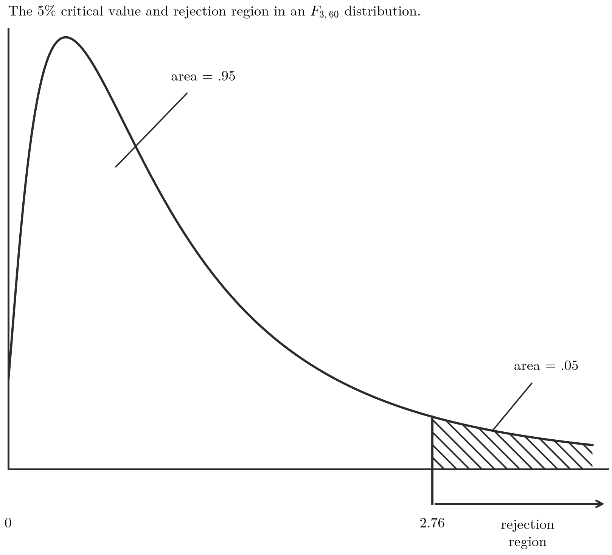
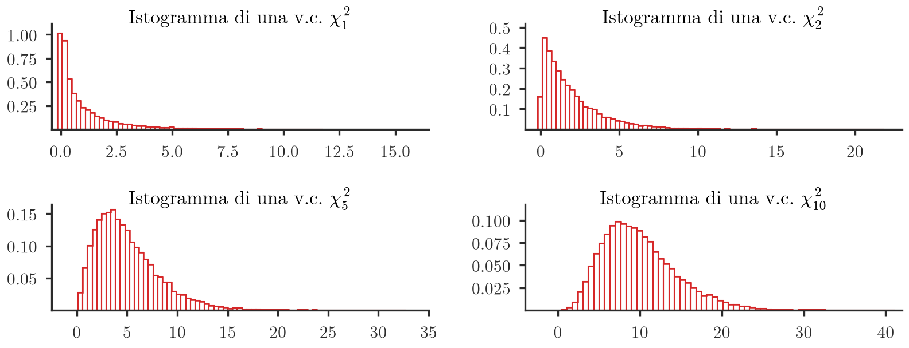

## Esempio introduttivo: differenze salariali tra gruppi

Il test $t$ della regressione semplice e multipla riguarda un singolo parametro alla volta. Si può però voler verificare ipotesi su più parametri contemporaneamente o su combinazioni lineari di parametri. L'esempio seguente è una variante del modello con una sola dummy di genere: il campione è diviso in quattro gruppi, per verificare se esiste una relazione congiunta tra stato civile (sposato o non sposato) ed etnia, stilizzata come persona di colore o non di colore.

> [!example] Esempio
> Si consideri il seguente modello di regressione:
>
> $$\log(wage) = \alpha + \beta_1 educ + \beta_2 exper + \beta_3 tenure + \beta_4 south + \beta_5 urban + \beta_6 marr\_black + \beta_7 single\_black + \beta_8 marr\_nonblack + \beta_9 single\_nonblack + \epsilon$$
>
> La variabile dipendente è il logaritmo del salario, che permette di interpretare le variazioni in termini percentuali. La variabile *exper* indica da quanti anni si lavora e *tenure* da quanti anni si lavora nell'impiego attuale: chi lavora da dieci anni, ma da cinque nella banca attuale, ha *exper* pari a 10 e *tenure* pari a 5. La variabile *south* indica se il lavoratore proviene dal sud o dal nord degli Stati Uniti e *urban* se vive in una città o in campagna.
>
> Quattro variabili dummy suddividono il campione in 4 gruppi diversi e non sovrapposti, che coprono tutti i lavoratori: per ciascuno una sola dummy vale 1 e le altre valgono 0. In particolare, *married_black*, *single_black*, *married_nonblack* e *single_nonblack* distinguono lo stato civile insieme all'etnia. Nell'economia del lavoro lo stato civile è considerato un'approssimazione (proxy) dell'impegno di lungo periodo (commitment) di una persona, che può incidere sulla relazione tra salario e lavoro: chi è sposato può avere un orizzonte più lungo, perché lascia il lavoro o si trasferisce con maggiore difficoltà.
>
> Si vuole valutare se, a parità di istruzione, esperienza, tenure e luogo di residenza, i lavoratori sposati di colore e quelli sposati non di colore ricevono in media lo stesso salario, cioè se, a parità di stato civile, la differenza tra persone di colore e non di colore è statisticamente significativa.
>
> Le stime OLS (comando: `reg lwage educ exper tenure south urban marr_black single_black marr_nonblack single_nonblack`) sono:
>
> | lwage | Coef. | Std. Err. | t | P>\|t\| | [95% Conf. Interval] |
> |---|---|---|---|---|---|
> | educ | .0654751 | .006253 | 10.47 | 0.000 | .0532034 .0777469 |
> | exper | .0141462 | .003191 | 4.43 | 0.000 | .0078837 .0204087 |
> | tenure | .0116628 | .0024579 | 4.74 | 0.000 | .006839 .0164866 |
> | south | -.0919894 | .0263212 | -3.49 | 0.000 | -.1436455 -.0403333 |
> | urban | .1843501 | .0269778 | 6.83 | 0.000 | .1314053 .2372948 |
> | marr_black | .2502685 | .0940889 | 2.66 | 0.008 | .0656162 .4349208 |
> | single_black | (dropped) | | | | |
> | marr_nonbl~k | .4297348 | .0880447 | 4.88 | 0.000 | .2569445 .6025251 |
> | single_non~k | .2408201 | .0960229 | 2.51 | 0.012 | .0523724 .4292678 |
> | _cons | 5.162973 | .1359471 | 37.98 | 0.000 | 4.896173 5.429773 |
>
> (*single_black* viene escluso automaticamente dal software ("dropped") perché le quattro dummy di gruppo sommano a 1 e sono quindi perfettamente collineari con la costante (trappola delle variabili dummy); la dummy esclusa diventa la categoria di riferimento rispetto alla quale si interpretano le altre tre.)
>
> I salari medi attesi per ogni gruppo, condizionati sulle altre variabili, sono:
>
> - Se $married=1$ e $black=1$, cioè $marr\_black=1$:
> $$E[lwage|X] = \alpha + \beta_1 educ + \dots + \beta_6 \times 1 + \beta_8 \times 0 + \beta_9 \times 0$$
> - Se $married=1$ e $black=0$, cioè $marr\_nonblack=1$:
> $$E[lwage|X] = \alpha + \beta_1 educ + \dots + \beta_6 \times 0 + \beta_8 \times 1 + \beta_9 \times 0$$
> - Se $married=0$ e $black=1$, cioè $single\_black=1$:
> $$E[lwage|X] = \alpha + \beta_1 educ + \dots + \beta_6 \times 0 + \beta_8 \times 0 + \beta_9 \times 0$$
> - Se $married=0$ e $black=0$, cioè $single\_nonblack=1$:
> $$E[lwage|X] = \alpha + \beta_1 educ + \dots + \beta_6 \times 0 + \beta_8 \times 0 + \beta_9 \times 1$$
>
> (Le espressioni precedenti pongono $\beta_7=0$: *single_black* è la dummy esclusa, quindi per questo gruppo non compare alcun termine dummy.)
>
> Sulla base del modello, tra le persone sposate, la differenza salariale associata all'etnia è data da:
>
> $$E[lwage|married\_black=1] - E[lwage|married\_nonblack=1] = \beta_6 - \beta_8 = .2502685 - .4297348$$
>
> Il differenziale stimato è negativo, ma l'errore di stima potrebbe essere abbastanza grande da renderlo statisticamente non significativo: serve un test. Una possibile soluzione è calcolare la seguente statistica $t$:
>
> $$t = \frac{\hat\beta_6 - \hat\beta_8 - 0}{\text{st.err.}\left(\hat\beta_6 - \hat\beta_8\right)}$$
>
> Il denominatore, cioè lo standard error di una combinazione lineare di stimatori correlati, non è immediato da calcolare, pur essendo possibile: è la radice quadrata di $\operatorname{Var}(\hat\beta_6) + \operatorname{Var}(\hat\beta_8) - 2\operatorname{Cov}(\hat\beta_6, \hat\beta_8)$, e occorre ricavare i singoli termini, in particolare la covarianza. Il problema economico richiede dunque inferenza su una combinazione lineare di parametri: serve una strategia più generale per questo tipo di test, il test F, sviluppato nelle sezioni seguenti.

## Perché un test t ripetuto non è una soluzione valida per ipotesi congiunte

> [!note] Dimostrazione
> Si consideri un modello di regressione multipla
>
> $$Y = \alpha + \beta_1 X_1 + \beta_2 X_2 + \beta_3 X_3 + \epsilon$$
>
> e si voglia testare se $X_1$, $X_2$ e $X_3$, congiuntamente, sono predittori utili per $Y$. Si tratta di un'ipotesi congiunta (composta), in cui tre ipotesi nulle sui tre parametri sono confrontate con l'alternativa che almeno un coefficiente sia diverso da zero:
>
> $$H_0: \beta_1=\beta_2=\beta_3=0 \quad \text{contro} \quad H_1: \text{almeno un } \beta_j \neq 0,\ j=1,2,3.$$
>
> Se $H_0$ è vera, i tre regressori sono inutili per predire $Y$ e la regressione si riduce a
>
> $$Y = \alpha + \epsilon$$
>
> (il *modello ristretto*). Serve una strategia che permetta di confrontare questo modello ristretto con il *modello completo*.
>
> Un primo tentativo (naïve) consiste nel ripetere il test t tre volte:
>
> 1. Si calcolano tre statistiche $t$, cioè $t_1$, $t_2$ e $t_3$, per le ipotesi $H_0^{(1)}: \beta_1=0$, $H_0^{(2)}: \beta_2=0$ e $H_0^{(3)}: \beta_3=0$, contro l'alternativa bilaterale.
> 2. Si decide secondo lo schema seguente:
>    - se nessuna delle tre ipotesi nulle viene rigettata, non si rigetta nemmeno l'ipotesi congiunta $H_0:\beta_1=\beta_2=\beta_3=0$;
>    - se almeno una delle tre ipotesi viene rigettata, si rigetta anche $H_0:\beta_1=\beta_2=\beta_3=0$.
>
> Questa strategia può portare a risultati errati. Un test su un singolo parametro fissa la probabilità dell'errore di Tipo I, cioè di rigettare l'ipotesi nulla quando è corretta: se $H_0$ è vera, la probabilità di non rigettarla è $1-0.05$ quando $\alpha=0.05$. Si supponga che $t_1$, $t_2$ e $t_3$ siano test indipendenti, per semplicità algebrica (non è un'ipotesi credibile, perché le tre statistiche sono calcolate con la stessa $y$ negli stimatori). Poiché per tre eventi indipendenti $A,B,C$ vale $P(A,B,C)=P(A)P(B)P(C)$, la probabilità di non rigettare congiuntamente le tre ipotesi nulle è
>
> $$0.95 \times 0.95 \times 0.95 = 0.8574$$
>
> L'errore di Tipo I del test congiunto è quindi
>
> $$1 - 0.8574 = 0.1426 \neq 0.05$$
>
> ossia circa il 14%: la probabilità di rigettare erroneamente l'ipotesi nulla è circa $3\times\alpha$. Con la strategia naïve si perde quindi il controllo sul vero livello di significatività del test, cioè sulla probabilità di errore che si accetta effettivamente nel decidere.

## Restrizioni lineari: definizione generale

> [!abstract] Definizione
> Entrambi gli esempi precedenti coinvolgono **restrizioni lineari** sui parametri, cioè vincoli del tipo
>
> $$r_1\beta_1 + r_2\beta_2 + \dots + r_{k-1}\beta_{k-1} + r_k\beta_k = q$$
>
> dove $r_1,\dots,r_k$ e $q$ sono costanti note.
>
> - Nel primo esempio (differenze salariali) si considera $\beta_6 - \beta_8 = 0$, con $r_6=1$, $r_8=-1$, tutti gli altri $r_i=0$ e $q=0$. Si tratta di un'unica combinazione lineare, cioè 1 restrizione.
> - Nel secondo esempio (significatività congiunta) ogni $\beta_j=0$ è una combinazione lineare in cui tutti i pesi $r_i=0$ per $i\neq j$, mentre $r_j=1$ e $q=0$. Ci sono quindi 3 diverse combinazioni lineari che devono essere soddisfatte congiuntamente (3 restrizioni).
>
> Il **test F** consente di valutare in un unico passo se una o più restrizioni lineari sono coerenti con le evidenze empiriche.

## Costruzione del test F: modello completo vs modello ristretto

Un test su parametri multipli si può implementare con la **statistica F**. Il **modello completo** è il modello di regressione originale, non vincolato; il **modello ristretto** è quello stimato imponendo che l'ipotesi nulla sui parametri sia valida. Siano $R_c^2$ e $R_r^2$ gli indicatori di bontà di adattamento ($R^2$) rispettivamente del modello completo e del modello ristretto.

Se l'ipotesi alternativa fosse corretta, ci si aspetta che la capacità predittiva del modello completo sia superiore a quella del modello ristretto, vincolato. In particolare, la differenza tra i due $R^2$ sarà grande. Il test F studia quindi il comportamento della quantità $(R_c^2 - R_r^2)$.

## La statistica F: definizione

> [!abstract] Definizione
> La statistica F è definita come
>
> $$F_{s;\,n-k-1} = \frac{(R_c^2 - R_r^2)/s}{(1-R_c^2)/(n-k-1)}$$
>
> dove:
>
> - $s$ è il numero di vincoli sotto l'ipotesi nulla (nell'esempio di significatività congiunta è 3, poiché si ipotizza $\beta_1=0$, $\beta_2=0$ e $\beta_3=0$);
> - $k$ è il numero totale di regressori nel modello completo (nell'esempio è 3);
> - $n$ è la dimensione del campione.
>
> La forma in termini di $R^2$ è valida solo se modello completo e modello ristretto hanno la stessa variabile dipendente, come negli esempi considerati; altrimenti si usano le somme dei quadrati dei residui dei due modelli.

## Proprietà del test F, regola di decisione e p-value

> [!tip] Teorema
> Si può dimostrare che la statistica $F$ ha le seguenti proprietà:
>
> - Non è mai negativa: $R^2$ non decresce mai quando si aggiungono regressori, quindi $R_c^2 \geq R_r^2$.
> - I valori di $F$ vicini a 0 sono più favorevoli a $H_0$ che a $H_1$. Si respinge quindi l'ipotesi nulla solo quando $F$ è grande: si tratta di un **test unilaterale**.
> - Se l'ipotesi nulla è corretta, la distribuzione di $F$ è ben approssimata da una variabile casuale $F$ con $s$ e $n-k-1$ gradi di libertà (parametri). Per questa distribuzione sono disponibili tabelle.
>
> 
>
> **Figura 1** — Rappresentazione grafica della variabile casuale F. Il grafico (*"The 5% critical value and rejection region in an $F_{3,60}$ distribution"*) mostra la densità di una distribuzione F asimmetrica a destra: l'area fino al valore critico 2.76 è il 95% della probabilità ("area = .95"), l'area a destra di 2.76 ("area = .05", la *rejection region*) è il livello di significatività del 5%.
>
> La decisione si prende con il valore critico o con il p-value. Fissato il livello $\alpha$, il valore critico si ricava da tabelle F adeguate: se la statistica osservata $F^{oss}$ è più grande del valore critico, si respinge l'ipotesi nulla; se è più piccola, non c'è sufficiente evidenza per respingerla. Il p-value, cioè $P_{H_0}(F>F^{oss})$, porta alla stessa decisione: se è più piccolo di $\alpha$ si respinge l'ipotesi nulla, altrimenti non la si può respingere.

## Relazione tra la distribuzione F e la distribuzione chi-quadro

Per $k_2$ sufficientemente grande, $k_1 F(k_1,k_2)$ è ben approssimata da una variabile $\chi^2_{k_1}$, cioè $F(k_1,k_2)\approx\chi^2_{k_1}/k_1$. Questo accade quando $n$ è grande, visto che $F \sim F_{s;\,n-k-1}$ e quindi $k_2 = n-k-1$ cresce con la numerosità campionaria.



**Figura 2** — $\chi^2_{df}$ con diversi gradi di libertà, cioè $df=1,2,5,10$. Il pannello mostra quattro istogrammi di variabili casuali chi-quadro simulate con 1, 2, 5 e 10 gradi di libertà: per $df=1$ la densità è concentrata vicino allo zero e decrescente; al crescere dei gradi di libertà la distribuzione si sposta a destra, si allarga e diventa più simmetrica e campanulare. È la forma della $\chi^2_{df}$, cioè della distribuzione limite di $s\,F$ con $df=s$ quando i gradi di libertà al denominatore sono grandi.

## Esempio: dimensione della classe e reddito rispetto al punteggio del test

> [!example] Esempio
> Si voglia testare se `str` (dimensione della classe) e `avginc` (reddito medio) sono predittori utili per il punteggio del test. Il modello completo è
>
> $$avg\_score = \alpha + \beta_1\, str + \beta_2\, avginc + \epsilon$$
>
> L'ipotesi nulla è quindi $H_0: \beta_1=\beta_2=0$ contro l'alternativa che almeno uno di questi due parametri sia diverso da 0.
>
> Il calcolo a mano della statistica F osservata non è banale, perché richiede vari passaggi: stimare i due modelli (completo e ristretto), calcolare i loro indicatori di bontà di adattamento $R^2$ e valutare $F^{oss}$. Di solito i test F vengono quindi calcolati tramite software statistici o econometrici.
>
> Procedura con Gretl:
>
> 1. Si stimi la regressione completa.
> 2. Dall'output della regressione si utilizzi il menu *Test -> Vincoli lineari*.
> 3. Si definisca il test come segue:
>
> ```
> b[str] = 0
> b[avginc] = 0
> ```
>
> L'output è riportato di seguito:
>
> ```
> Insieme di vincoli
>  1: b[str] = 0
>  2: b[avginc] = 0
>
> Statistica test: F(2, 417) = 218,302, con p-value = 1,3533e-65
> ```
>
> In questo caso si respinge l'ipotesi nulla poiché il p-value è prossimo a 0. Ciò significa che almeno uno dei due regressori è un predittore utile per il punteggio medio.

## Esempio: verifica della differenza salariale tra gruppi con il test F

> [!example] Esempio
> Per verificare se $\beta_6 - \beta_8 \neq 0$ nell'esempio delle differenze salariali, cioè se la differenza tra lavoratori sposati di colore e sposati non di colore è statisticamente significativa, si implementa il test
>
> $$H_0: \beta_6-\beta_8=0 \quad \text{vs.} \quad H_1: \beta_6-\beta_8\neq 0$$
>
> In Gretl si procede così:
>
> 1. Si stimi la regressione completa (`reg lwage` su `educ exper tenure south urban marr_black single_black marr_nonblack single_nonblack`; `reg` è la sintassi di Stata usata per la tabella, in Gretl il comando è `ols`).
> 2. Con la stessa procedura dell'esempio precedente (menu *Test -> Vincoli lineari*) si definisca il test come segue:
>
> ```
> b[marr_black] - b[marr_nonblack] = 0
> ```
>
> L'output è riportato di seguito:
>
> ```
> Insieme di vincoli
>  1: b[marr_black] - b[marr_nonblack] = 0
>
> Statistica test: F(1, 926) = 19,60, con p-value = 0.000
> ```
>
> Il p-value è praticamente nullo (circa 0,00001, riportato come 0.000): la differenza tra i due gruppi (lavoratori sposati di colore vs. sposati non di colore) è significativamente diversa da 0. Il test F risponde così alla domanda dell'esempio introduttivo senza il calcolo diretto della statistica t per la combinazione $\hat\beta_6-\hat\beta_8$.
