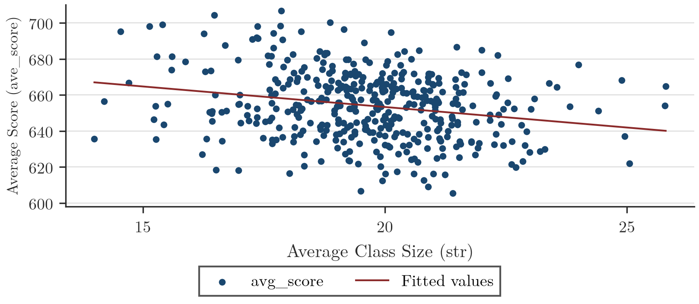
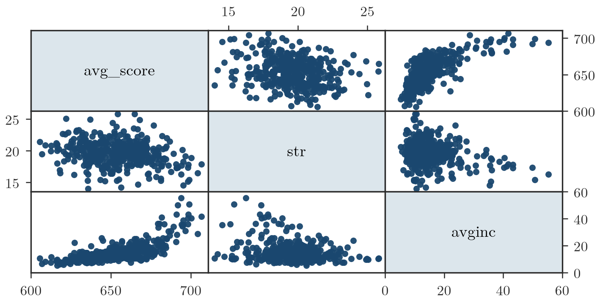
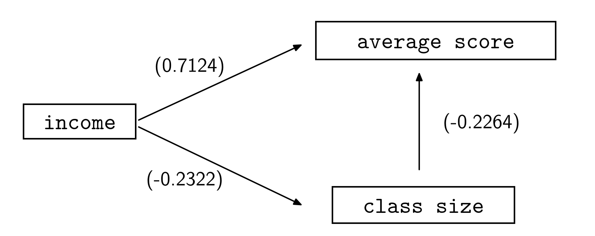
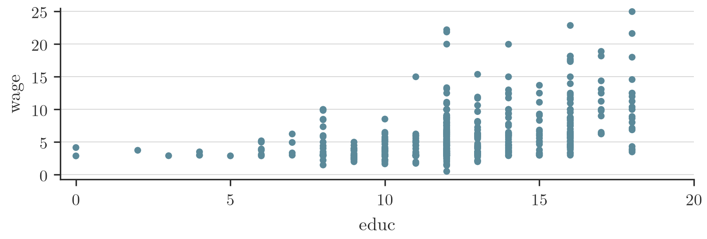
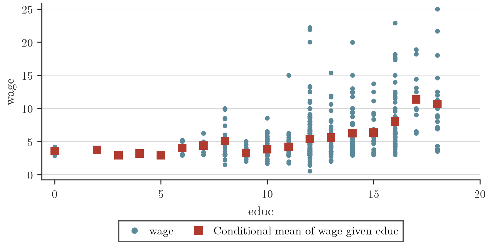
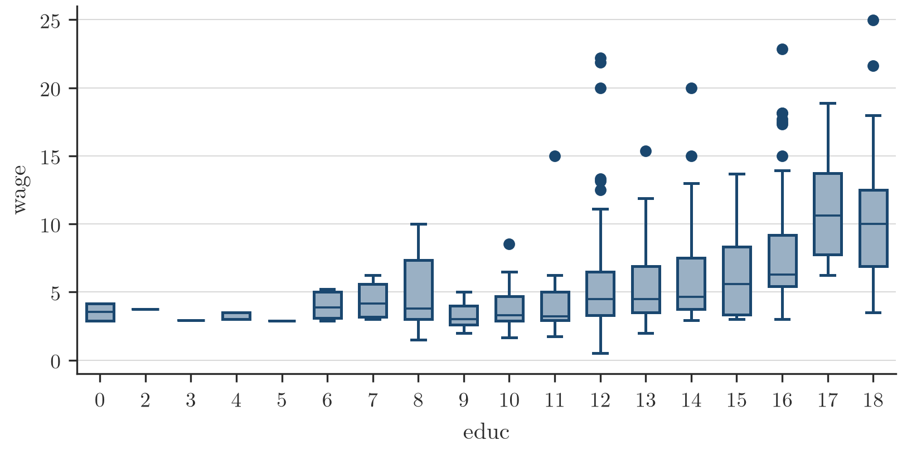

# Regressione semplice: esogeneità e relazione causale

## Le relazioni causa-effetto: richiamo

Oggi vorrei andare un po' nello specifico, ancora mantenendo una componente di intuizione, ==perché secondo me è la cosa più importante da capire==: una volta che uno ha l'intuizione, poi è abbastanza semplice formalizzarla con concetti statistico-matematici. L'altra volta vi ho parlato delle relazioni causa-effetto, che devono avere tre caratteristiche sostanziali. La prima è che tra le variabili di interesse ci deve essere una correlazione, ma non è sufficiente, perché la correlazione, parlando di variabili aleatorie quantitative, è un concetto simmetrico: la correlazione tra Y e X è uguale alla correlazione tra X e Y. La relazione causale invece è unidirezionale: c'è una X che ha un impatto sulla Y ma non viceversa. Avevamo visto un controesempio, scherzoso se volete, dei boy scout e della probabilità di avere un record giudiziario non ottimale. L'associazione tra le variabili mi può spiegare un fenomeno ma anche il suo opposto, e quindi in quel caso non posso parlare di relazione causale.

## Esempio: dimensione della classe e test

Un esempio più legato a quello che faremo in questo corso è quello di cui avete a disposizione i dati. Fa riferimento a un problema posto in California qualche anno fa: investire in una politica pubblica per migliorare il livello scolastico dei bambini può essere utile oppure no? Ci sono dei problemi nel definire un programma di questo tipo, prima di tutto che cosa vuol dire essere utile, ma questo non è un problema dell'econometrico o dello statistico, è un problema più filosofico. Il problema posto è questo: se ho uno stato in cui ci sono bambini che vanno a scuola, qua si parla di bambini della prescolastica, quindi asilo, scuola dell'infanzia, ridurre la dimensione di una classe può avere dei benefici in termini del loro apprendimento? È abbastanza intuitivo pensare di sì, perché classi più piccole vogliono dire che il docente o l'insegnante, il maestro, riescono a dedicare più tempo ad ogni singolo bambino, con dei miglioramenti dal punto di vista delle capacità pratiche e astratte.

Quindi prima di tutto vorrei capire se implementare questa policy è utile. Vuol dire che se riduco la dimensione della classe i bambini andranno meglio a scuola. Andare meglio a scuola vuol dire fare meglio i test di fine anno. Il contro è che per implementare una cosa del genere devo spendere un sacco di soldi: devo assumere più insegnanti, devo riorganizzare le classi, perché se ho 100 bambini devo metterne 10 per classe anziché 20 e quindi avere più classi, devo comprare più attrezzatura. L'investimento è stato quantificato in più o meno 1,8 miliardi di dollari l'anno. Vale la pena farlo? Dipende. Devo vedere se la variabile su cui vado a incidere è in relazione causale con la performance dei bambini a scuola, e quindi devo trovare un modello causale che mi descriva se la dimensione della classe sia un driver, non statistico ma logico, per la performance dei bambini.

> [!question] Da verificare: la trascrizione riporta "L'incontro è che per implementare"; si è letto "Il contro è che", le slide non aiutano.

Per fare questa analisi sono stati raccolti dei dati veri, su distretti scolastici. La California è divisa più o meno in 420 distretti scolastici, e ogni pallino che c'è in quel grafico fa riferimento a un distretto. Sull'asse delle x ho la dimensione media della classe a livello di scuola dell'infanzia in ogni singolo distretto, mentre sull'asse delle y ho il punteggio medio per distretto dei bambini. Il test è qualcosa del tipo competenze di matematica, logica, italiano, adatto per un bambino, comunque una cosa codificata.

Facendo passare una retta che dovrebbe approssimare quella nuvola di punti, mi accorgo che la pendenza della retta è negativa. Vuol dire che se la dimensione media della classe aumenta, la performance tende a diminuire leggermente. Quanto poco non lo so, lo deciderà qualcun altro, però c'è una pendenza negativa. E questo vuol dire, lo vedremo fra un po' in maniera più formalizzata, che la correlazione tra le due variabili è minore di zero. Dal punto di vista della ricerca di una relazione causale, ho il primo ingrediente: una correlazione negativa tra le due variabili.

Il secondo ingrediente è una spiegazione logica che mi dica che una dimensione della classe più piccola può avere degli effetti benefici sulla performance dei bambini. In termini generali dovrebbe funzionare, per quello che vi ho detto sull'attenzione che ogni singolo bambino ha rispetto al docente: in teoria classi più piccole sono un po' più focalizzate, si può lavorare un po' meglio. Non è detto che sia una spiegazione corretta, sto parlando di una cosa plausibile in questo momento. Quindi sembrerebbe che abbiamo trovato una correlazione e una spiegazione più o meno sensata.

Poi c'è il terzo ingrediente, che deve valere affinché io possa parlare di relazione causale: posso escludere altre spiegazioni più convincenti? Questa spiegazione, che la dimensione della classe ha un effetto benefico sulla performance dei bambini, è la migliore che ho, sensata e coerente con la statistica? Non lo so, devo provare a fare degli altri esperimenti e provare dei modelli alternativi. Non troverò una spiegazione esaustiva, perché non posso costruire infiniti modelli che spiegano questa correlazione negativa in maniera alternativa. Però una volta che ho una teoria che voglio verificare, cercherò di considerare una serie di alternative ragionevoli per vedere se questa rimane la strategia migliore oppure c'è qualcosa di meglio. Non ci sarà mai una soluzione corretta, come dicevo la volta scorsa: ci sarà una soluzione che si muove nella giusta direzione con dei criteri di scelta sostanzialmente razionali.

Quindi l'idea qual è? Se stimo la pendenza della retta di regressione posso valutare se la riduzione, per esempio, di un'unità della dimensione della classe mi dà un beneficio di 10 punti al test. Dieci punti magari sono tanti, dipende dalla scala del test. Però il mio problema adesso non è tanto quantificare gli effetti, ma capire se ci sono modelli migliori. E i modelli migliori possono passare, per esempio, per l'analisi di altre variabili congiuntamente. Mi viene in mente il reddito, che è una variabile importante perché ha impatto fondamentalmente su tutte le scelte. Mi chiedo: il reddito può spiegare in maniera più convincente la relazione negativa tra la dimensione della classe e la performance dei bambini? Dal punto di vista della catena logica potrebbe essere, perché potrei pensare che distretti ad alto reddito possono avere delle performance migliori. Se il distretto è ad alto reddito vuol dire che i bambini hanno più libri, semplicemente perché le famiglie se lo possono permettere, e questo si può riflettere in una migliore performance scolastica.

Un'altra cosa potrebbe essere che distretti ad alto reddito hanno scuole mediamente migliori. Qua sono dati americani, quindi il distretto di appartenenza conta. Una delle cose, un po' più sconvolgente, è che dove ci sono le scuole pubbliche buone, la scuola privata costa tantissimo a partire dalle elementari, dell'ordine di decine di migliaia di dollari l'anno. Se non ci si può permettere queste cifre si vorrebbe andare in una scuola pubblica, ma le scuole pubbliche hanno un livello medio abbastanza eterogeneo. In alcuni distretti ci sono scuole pubbliche molto buone, e questo si riflette nel fatto che le case intorno a quei distretti costano estremamente di più. Quindi la scuola pubblica buona, che costa relativamente poco, è in un distretto ricco. Il reddito può avere un effetto sulla qualità della scuola, che avrà un effetto sulla qualità dell'output che i bambini avranno.

Quindi il reddito potrebbe avere un effetto positivo sulla performance e un effetto negativo sulla dimensione. Perché? Perché magari le scuole migliori hanno già di loro delle classi più piccole, perché ci sono più insegnanti. Il concetto di dimensione della classe negli Stati Uniti è un po' strano, perché non ci sono necessariamente classi fisse: viene calcolata la dimensione della classe come rapporto studenti-insegnanti. Una scuola migliore potrebbe avere più insegnanti, potrebbe avere anche altre caratteristiche. Quello che vorrei vedere è se esiste una relazione negativa tra reddito e dimensione della classe e una relazione positiva tra reddito e performance, perché questo potrebbe spiegare che la relazione negativa tra le due variabili iniziali passa per l'effetto reddito. Il reddito ha un effetto di un tipo su una variabile e di un tipo opposto sull'altra; se lo ometto vedo solo la marginale, vedo la correlazione condizionale, quindi potrebbe essere quella una spiegazione, e dal punto di vista logico, in termini generali, potrebbe avere senso.

> [!question] Da verificare: la trascrizione riporta "se lo ometto vedo solo la marginale, vedo la correlazione condizionale"; le due parti si contraddicono e il parlato non permette di stabilire che cosa intendesse.

## Come controllare per il reddito

Come faccio a vedere quale dei due modelli è migliore? È quello che si farà quando si utilizzeranno i modelli statistici. Voglio evitare che il reddito sia un driver, voglio controllare per il reddito. Se due distretti che non differiscono per il reddito hanno una correlazione alta o bassa rispetto alle variabili chiave, vuol dire che il reddito non è un fattore determinante. Se mi condiziono a distretti molto simili e studio la correlazione tra performance e dimensione della classe, quella correlazione non può dipendere dal reddito, perché il reddito è uguale per tutti. Se prendo due distretti molto ricchi e calcolo tra quei due distretti la dipendenza tra la dimensione della classe e la performance dei bambini, quella correlazione non può dipendere dal reddito, perché sto pescando solo variabili in un contesto molto omogeneo. Quindi quello che vorrei fare è valutare se la correlazione che ho stimato prima, che è la pendenza di quella retta rossa, è in qualche modo spiegabile tramite il reddito oppure no.

Posso dividere il mio campione in due sottoinsiemi: distretti ricchi e distretti poveri. All'interno dei due sottocampioni cerco di capire com'è fatta la dipendenza tra le variabili chiave. Se vedo che la dipendenza non cambia, vuol dire che il reddito non è un fattore rilevante, quindi aggiungere l'effetto reddito non ha nessuna utilità pratica. Se invece vedo che le correlazioni cambiano a seconda del fatto che considero distretti ricchi o poveri, allora il reddito è un fattore determinante e devo passare per il reddito per trovare una spiegazione logica per la correlazione negativa che ho osservato tra performance e dimensione della classe. Per validare l'introduzione di una nuova variabile cerco di capire se quella variabile ha effettivamente un impatto sulla relazione che mi interessa.

Alla fine della fiera, al provveditore o al ministro della California interessa: quei due miliardi di dollari l'anno che devo spendere servono oppure no per migliorare la performance? Se mi accorgo che la correlazione negativa è solo un effetto collaterale del reddito, allora probabilmente assumere nuovi docenti non è particolarmente utile, dovrò forse dare sussidi alle famiglie meno ricche, se l'obiettivo è migliorare la performance. Quindi l'idea qual è? Prendere i miei 420 distretti, dividerli in distretti ricchi e distretti poveri e calcolare la correlazione tra performance e dimensione solo tra i distretti ricchi e solo tra i distretti poveri. Se questi due numeri sono diversi vuol dire che il reddito ha un potere esplicativo per quel fenomeno. Se rimangono uguali vuol dire che indipendentemente dal reddito la relazione rimane uguale.

Dal punto di vista operativo: se considerando un modello più complesso i dati mi dicono che non vale la pena, tanto vale utilizzare il modello precedente, quello senza reddito. Se invece i numeri sono diversi, vuol dire che aggiungere il reddito è importante e il modello precedente lo posso scartare perché non è soddisfacente. Ho concluso la mia analisi? No, perché potrebbero esserci altri fattori da tenere in considerazione. Però a quel punto ho un meccanismo di scelta: estendo il modello, cerco di capire se ha un miglioramento rispetto al precedente oppure no, faccio delle valutazioni di natura logica e traggo le mie conclusioni. La strategia è non fissarsi sul modello iniziale, sull'idea iniziale: assieme all'idea iniziale devo cercare di estenderla per capire qual è la spiegazione migliore, che mi spiega alla fine l'indicatore statistico, che è la prima cosa che avevamo visto inizialmente. Io voglio spiegare la correlazione negativa, per capire perché c'è una correlazione.

## Statistiche descrittive e schema causale

Queste sono le statistiche descrittive delle tre variabili in gioco. Avginc è il reddito medio per distretto, STR è la dimensione della classe, student teacher ratio, e average score è il punteggio medio. Come vi avevo raccontato prima, c'è una correlazione negativa tra il punteggio e la dimensione della classe, che è questo numero, meno 0,22. È anche statisticamente significativa, se faccio un test di significatività, quindi è diversa da zero. Poi c'è il reddito medio, che è fortemente correlato col punteggio: i distretti ad alto reddito tendono ad avere performance decisamente migliori rispetto agli altri, la correlazione è altissima, 0,70, ed è significativa. E c'è una correlazione negativa tra reddito e dimensione della classe: i distretti ad alto reddito tendono ad avere classi mediamente piccole. Questi sono i dati grezzi, sono nella pagina Moodle, potete guardarli. *(slide 18)*

> [!question] Da verificare: la trascrizione riporta "0,70 per cento"; la slide 18 riporta 0.7124 per la correlazione tra reddito e punteggio. Si riporta quanto detto a lezione.

Queste sono solo analisi grafiche.

E questo è lo schema logico che vi ho raccontato a parole fino adesso.

Se non considero il reddito, dimenticatevi il primo pezzo del grafo, la prima potenziale relazione causale tra variabili è questa: dimensione della classe, performance. C'è una relazione statisticamente rilevante, negativa, che ha senso dal punto di vista logico e potrebbe essere un buon candidato ad essere una relazione logica. Quando guardo l'effetto reddito mi accorgo che c'è una relazione negativa rispetto a questa variabile e positiva rispetto a questa. Ora, una volta che aggiungo questo fattore di controllo, cosa succede a questa correlazione? Questo numero negativo è una connessione diretta tra quei due blocchi, oppure è spiegato da questa variabile?

Per fare questo, come nel grafichetto che vi ho fatto prima, divido il campione in due pezzi e calcolo la correlazione tra le due variabili. Qua ho semplicemente preso i distretti a basso reddito, con un'analisi molto grossolana: ho calcolato la mediana del reddito, tutti i distretti sotto la mediana erano quelli a basso reddito, sopra la mediana quelli ad alto reddito. È stata una cosa molto grezza, poi lo vediamo meglio col modello di regressione. Quello che vi accorgete è che il livello di correlazione tra le due variabili per i distretti a basso reddito diventa piuttosto piccolo, e il punto grosso non è neanche che il numero non è tanto diverso da meno 0,22: il punto è che se faccio un test di significatività questo numero non è statisticamente significativo. *(slide 21)*

> [!question] Da verificare: il docente dice che per i distretti a basso reddito la correlazione non è statisticamente significativa; la slide 21 riporta -0.1464 e la definisce "debolmente statisticamente significativa". Si riporta quanto detto a lezione.

Il reddito, per i distretti bassi, sembra essere il driver principale che mi causa la correlazione negativa tra le variabili: se considero il reddito, la correlazione condizionale, condizionatamente al reddito basso, è sostanzialmente zero tra dimensione della classe e performance. Se prendo i distretti ad alto reddito, anche qua la correlazione è piuttosto bassa e se faccio un test di significatività è non significativa. Il p-value del test è leggermente più alto, comunque non sufficiente per poter giustificare un livello di significatività. ==Il messaggio principale è questo: se controllo per il reddito, la correlazione tra le variabili che mi interessano e la variabile su cui voglio investire i soldi è non significativa.==

Cosa vuol dire? Vuol dire che questo nuovo modello che passa per il reddito supera l'altro, perché è informazione in più, e le conclusioni inferenziali che ottengo con questo secondo modello escludono il modello precedente. La correlazione marginale non è così importante, perché la correlazione condizionale, condizionata rispetto ai livelli di reddito, statisticamente non è significativa. La spiegazione è logica: questo nuovo modello, a parole, sembra sensato, di conseguenza il modello superiore esclude l'altro e quindi mi devo concentrare su una relazione logica di questo tipo. Se non lo facessi, andrei a spendere due miliardi di dollari l'anno, soldi pubblici, per fare una cosa che sostanzialmente non dipende dalla dimensione della classe ma da qualcos'altro. Probabilmente non avrò un effetto diretto in termini di performance, perché vado a incidere su una variabile che appare solo apparentemente legata alla variabile di interesse, che è la performance dei bambini. Forse dovrei utilizzarli per migliorare le condizioni delle persone poco abbienti, perché quella sembra la variabile chiave che può avere un impatto sulla performance dei bambini.

## Anticipazione: il modello di regressione sull'esempio

Come si può trasferire tutto questo in un modello di regressione? Ve lo anticipo un attimo, poi lo spiegheremo meglio. Questa è la relazione lineare, il modello di regressione che lega il punteggio dei bambini alla dimensione della classe. Questa è la stima del coefficiente che mi lega le variabili. Vi è chiara la tabella?

La pendenza della retta di regressione è meno 2,27. Se faccio un test di significatività per questo coefficiente, cioè voglio vedere se quel parametro è diverso da zero, mi accorgo che il p-value è zero, di conseguenza posso dire che esiste una pendenza negativa, quella linea rossa che vi ho fatto vedere nello scatter plot. E questo è il primo modello.

Cosa succede se aggiungo l'effetto reddito? Costruisco un modello di regressione per cui la mia aspettativa sulla performance dipende dalla dimensione della classe X1 e dal reddito X2, e stimo questo modello. Mi accorgo che adesso la stima del coefficiente che lega la performance alla dimensione della classe si è più che dimezzata: anziché meno 2,2 è meno 0,64. Se faccio un test di significatività il p-value è più grande del 5%. Non è esageratamente grande, però aggiungendo il reddito nel modello l'impatto della dimensione della classe nello spiegare la performance si riduce di molto. A fare un'analisi veramente stretta viene fuori che, condizionatamente al livello di reddito, la dipendenza lineare tra performance e dimensione della classe è zero, che è quello che vi ho raccontato un attimo prima facendo il p-value. Costruire un modello del genere con due variabili equivale a dividere il campione in due pezzi, alto reddito e basso reddito, e calcolare il livello di dipendenza tra i due sottoinsiemi. Poi lo vedremo meglio settimana prossima, o magari domani.

Uno dei problemi principali per cercare di capire se una relazione è causale è cercare di incrementare il modello in maniera logica e vedere se il nuovo modello è un miglioramento rispetto al precedente. Devo costruire un modello più esteso mantenendo sempre un livello di coerenza logica. Non posso mettere in questo modello informazioni del tipo il film di Nicolas Cage, quanta gente ci va a vedere in California, perché magari sono correlati, ma quella correlazione potrebbe dipendere da chissà cosa. ==Devo avere una storia da raccontare quando inserisco una variabile nel modello: non è che mi faccio dire dai dati cosa voglio spiegare. Questa è la cosa più importante.==

## Verso il modello di regressione semplice

Era questo quello che volevo dire per concludere la lezione di due giorni fa. Ora vorrei passare al trattamento più formale del modello di regressione, che come vedrete è il punto di riferimento principale per fare questo tipo di analisi, anche perché è estremamente semplice. Mi concentro sul modello di regressione semplice perché se capite il modello di regressione semplice, e le sottigliezze che stanno alla base della definizione del modello, l'estensione ai casi più complicati è banale: cambia solo un po' l'algebra e niente di più.

L'idea fondamentale è cercare di capire se la relazione causa-effetto è buona. La relazione causa-effetto, si dice, è buona se vale una proprietà statistica del modello, che avevo accennato l'altra volta, il concetto di esogeneità. Vuol dire che le spiegazioni alternative non possono avere un impatto sistematico sulla relazione chiave tra le variabili che vorrei utilizzare. Cosa sono le spiegazioni alternative? Le descriveremo con una variabile specifica all'interno del modello, che tipicamente non è osservabile, che è il termine d'errore. Il termine d'errore include tutte le informazioni che potrebbero avere un impatto sulla mia relazione di interesse ma che non vengono utilizzate. È in pratica un bidone di roba non osservabile, ma che può avere una sua interpretazione.

## Esempio: salario e istruzione

Il problema con cui volevo ragionare un po' era un problema abbastanza classico dell'economia del lavoro: la relazione tra livello di istruzione e salario.

Questi dati non sono particolarmente recenti, ma sono abbastanza standard. Quando vedete i numeri sull'asse delle y, che sono i salari orari in dollari, sono numeri piccoli perché i dati sono degli anni '70, però non è molto diverso da quello che mi aspetterei guardando i dati adesso, a parte la scala sulla sinistra, che è un po' diversa. Perché questo esempio? Perché vi permette di definire un po' di cose in maniera molto intuitiva. Ho sulle x il livello di istruzione, che chiamo educ, education, misurato in anni. Ogni colonna di punti rappresenta la distribuzione dei salari di lavoratori con un livello specifico di istruzione. Se mi concentro su education uguale a 10, questi puntini rappresentano la distribuzione dei salari per lavoratori che hanno studiato esattamente 10 anni. Se prendo quest'altra colonna di punti, ho la distribuzione condizionale dei lavoratori che hanno studiato esattamente 15 anni, e avanti così. Ogni singola fettina del mio scatter rappresenta una distribuzione condizionale, che mi dice, probabilisticamente, qual è la probabilità di trovare in quel sottogruppo un lavoratore che guadagna tanto o che guadagna poco. *(slide 3)*

Vediamo una cosa da questo grafico: al cambiare dell'istruzione non cambia solo la media della distribuzione. Se calcolassi la media per ogni singola colonna di numeri, mi aspetto di trovare numeri che tendono a crescere con il livello di istruzione. Se prendo gente che sta qua, non c'è molta variabilità e il livello medio di salario sarà sotto i 5 dollari l'ora. Se prendo persone qua e calcolo la media, mi aspetto un numero sopra i 5 dollari all'ora. Se prendo le persone che hanno studiato molto, mi aspetto che il centro della distribuzione sia intorno ai 15 dollari. Sui quadratini rossi vi rappresento le medie condizionali: per ogni livello di education stacco la media della distribuzione data la colonna, e vedete che più o meno c'è una tendenza crescente. *(slide 8)*

Cosa vuol dire? Che più studio, più mi aspetto in media di guadagnare. Sono sicuro che se studio molto guadagno di più? No, perché in corrispondenza di questo gruppo, per esempio, ci sono persone che guadagnano meno di quello che ha studiato zero e ci sono persone che guadagnano estremamente di più. È ragionevole. Questa eterogeneità mi dice come varia il salario a seconda delle informazioni che non sono strettamente education. Tutte le persone per colonna hanno lo stesso livello di istruzione ma hanno caratteristiche individuali diverse. Magari quel puntino in alto sui 25 dollari l'ora è semplicemente il figlio di un dirigente, finirà a fare il dirigente. Quello sotto magari è uno che ha deciso di studiare archeologia: se ti va bene guadagni molto, se ti va male vai a fare gli scavi per i cantieri. Oppure ci possono essere degli effetti un po' più sottili, tipo effetto di genere: gli uomini tendenzialmente guadagnano più delle donne, non è giusto però è quello che si osserva nei dati.

Quella eterogeneità che avete nei salari è spiegata da una serie di altri fattori che non sono l'istruzione, perché per ogni colonna di punti l'istruzione è esattamente la stessa, quindi la spiegazione per l'eterogeneità non può essere l'istruzione. Dipende da qualcos'altro: il reddito della famiglia, il tipo di studi che uno fa, se uno è intelligente oppure no, se è uomo o donna. Uno che si laurea in Bocconi magari ha delle aspettative diverse rispetto a uno che si laurea a Cassino, anche semplicemente perché a Milano i salari sono più alti. In generale avete una serie di eterogeneità che non è spiegata dall'education, è spiegata da qualcos'altro. Questo qualcos'altro lo chiameremo termine d'errore e utilizzerò il simbolo greco epsilon.

## Perché una relazione causale

Il problema mio è come descrivere una relazione causale che mette in relazione il livello salariale e il livello di istruzione. Perché farlo? Se sapessi come è fatta la relazione causale, cioè applicassi il modello, potrei cercare di capire se prendere una magistrale è conveniente dal punto di vista del salario atteso oppure no, cioè studiare due anni in più, passando da 13 a 15, non è nemmeno il numero esatto. Posso quantificarla in termini di salario orario: quanto guadagno di più? Vale la pena oppure no? Vorrei quantificare una relazione causale per rispondere a domande pratiche di questo tipo: se io aumento la X o riduco la X, cosa succede alla Y, che è la variabile che mi interessa? Il primo problema è definire un modello coerente, logico, quindi una relazione causa-effetto. Una volta che ho la relazione causa-effetto la potrei utilizzare per fare delle analisi quantitative di qualsiasi natura, tipo analisi di policy, analisi di scelte, analisi di scenario.

Questa è un'altra rappresentazione dei dati: ogni singolo sottogruppo del campione viene approssimato da un box plot che mi dice più o meno come cambia l'indicatore di centralità e come cambia la dispersione del fenomeno. *(slide 6)*

## Il modello di regressione lavora sulle medie

Come lavora il modello di regressione? Lavora sul momento di ordine uno, sostanzialmente lavora sulle medie. Ci interesseranno anche le varianze, cioè la dispersione, però in generale quello che mi interessa è capire come in media il livello dell'istruzione impatta sul salario. Per farlo ho bisogno di costruire un modello statistico che mi approssimi i quadratini rossi. I quadratini rossi sono evidenza campionaria, non sono della popolazione. Un modello statistico di interesse è semplicemente un modello che cerca di spiegare le medie condizionali. In realtà quello che vorrei fare non è spiegare le medie condizionali nel campione, cioè nella nuvoletta di pallini blu che è nel grafico, ma spiegare la popolazione. Nel campione non mi interessa sapere cosa succede: ho un foglio Excel, ho un file con tutti i numeri, se voglio sapere l'unità statistica numero 73 quanto guadagna e quanto ha studiato, lo guardo, non ho bisogno di prevederlo. Quello che vorrei fare è utilizzare queste informazioni per capire come si comportano le variabili nella popolazione.

Quindi non voglio essere troppo preciso nell'approssimare i quadratini rossi: quelli ce li ho già, li ho calcolati. I quadratini rossi potrebbero essere una buona approssimazione della mia media condizionale, ma sono solo un'approssimazione. Voglio trovare un modello sufficientemente robusto che approssimi l'andamento dei quadratini rossi sapendo che quello che mi interessa non è il quadratino rosso ma il quadratino verde, che è la media nella popolazione. Come potrei calcolare la media nella popolazione? Dovrei intervistare tutti i lavoratori negli Stati Uniti in un certo periodo di tempo e calcolare esattamente la loro risposta riguardo al loro reddito. È impossibile. Quindi il mio problema è approssimare, solo approssimare e non essere troppo preciso, la sequenza di quadratini rossi, che sono le medie condizionali, ottenute dall'evidenza campionaria.

## Perché un modello semplice: l'overfitting

Per farlo in generale si utilizzano dei modelli semplici. Se utilizzassi un modello complicato che si adatta molto bene ai puntini rossi lo potrei anche fare, non è particolarmente difficile: schiacciate un bottone sul computer e trovate delle funzioni molto smooth che passano esattamente sopra i quadratini rossi. Però non è quello che mi interessa, perché il quadratino rosso ce l'ho già, non ho bisogno di una funzione complicata per approssimarlo. Li ho calcolati su una tabellina a parte, sono questi numeri qua. Se mi interessa sapere cosa succede se passo dal livello di istruzione 12 a 14, faccio la differenza tra le due medie condizionali e trovo quello che mi interessa. Questo è solo un campione specifico di 500 e qualcosa lavoratori, e io voglio approssimare la popolazione. Voglio una funzione che sia sufficientemente buona per approssimare i quadratini rossi, ma anche per approssimare qualsiasi quadratino rosso io potessi ottenere da campioni diversi della stessa popolazione. *(slide 10)*

Trovare un modello che si adatti super bene ai quadratini rossi non è particolarmente utile, perché vuol dire che il mio modello si adatta troppo bene ai dati che ho, non a tutti i dati che potrei avere, che sono quelli interessanti perché sono ignoti. Se costruissi un modello sui quadratini rossi che ho, e questo modello è perfetto, non c'è errore, entrerei in un problema che si chiama overfitting: ho un modello che si adatta troppo bene ai miei dati, ma non necessariamente si adatta alla popolazione.

Ve lo faccio vedere con un grafico fatto lì per lì. Supponiamo di avere una popolazione fatta da un po' di pallini blu e un po' di pallini rossi. Sono tutte persone con certe caratteristiche, che fanno parte della stessa popolazione. Il campione che ho a disposizione sono i puntini blu: gli altri sono persone che potenzialmente potrei avere nella popolazione ma non ho. Pensiamola così: ho un campione di persone, un po' blu e un po' rosse, le mischio tutte, ma faccio la mia analisi solo sul campione blu e lascio fuori dall'analisi il campione rosso. Dal punto di vista pratico potrei costruire un modello che si adatti bene ai punti blu. Otterrei probabilmente una stima del mio modello che è una cosa del genere: rispetto ai dati che sto utilizzando quel modello è perfetto, non c'è errore. La funzione verde approssima i puntini blu esattamente.

In teoria però quello che voglio non è approssimare il campione, è approssimare il comportamento della popolazione, quindi anche delle persone che non sto utilizzando per stimare il modello. Se vado a calcolare la distanza tra quello che stimo e quello che potrei avere nella popolazione, ho dei punti che sono estremamente distanti. Il modello è molto distante da queste persone che potenzialmente potrebbero essere il mio prossimo campione, un altro campione della stessa popolazione. Il modello funziona molto bene su quello che già ho, ma molto male su quello che potrei avere. Se devo prevedere, per questo valore di x, qual è la y, utilizzo questo punto, che è la migliore approssimazione che posso fare con la funzione che ho stimato, ma l'errore di previsione è gigantesco, è tutta questa roba qua. Il modello va malissimo se una persona non è in quel sottoinsieme della popolazione.

Quindi cosa è preferibile avere? Forse un modello che non vada troppo bene per approssimare la linea blu, ma allo stesso tempo non vada troppo male per approssimare la linea rossa. Ho bisogno di mediare tra la curva verde e la curva verde che stimerei se utilizzassi un campione diverso. Potrebbe avere senso considerare una funzione del tipo così, che non sarà perfetta per il gruppo blu, non sarà perfetta per il gruppo rosso, ma mediamente non sbaglia in maniera sistematica. La linea verde è un modello che fa overfitting rispetto al campione, ma va molto male fuori dal campione, che poi è quello che mi interessa: il modello mi interessa per capire cosa succede su quello che non osservo, non su quello che ho già osservato. ==Trovare un modello che si adatta troppo bene al campione non è necessariamente una buona notizia.==

Se stimate un modello di regressione e avete un R quadro del 99%, non è necessariamente una buona cosa. Un modello con un R quadro del 20% potrebbe invece essere un ottimo modello. Se vi interessa questo tipo di problematiche se ne può parlare in maniera più dettagliata, con delle simulazioni fatte meglio, con modelli più complicati, però era giusto per darvi un'idea. Stimare troppo bene un modello sui dati non è necessariamente una buona notizia, perché non sono sicuro che quell'approssimazione funzioni fuori dal campione, che è quello che mi interessa.

## Perché una retta

Tornando al problema principale, voglio trovare una funzione che non approssimi troppo bene le medie condizionali con i dati rossi, ma rifletta un andamento di lungo periodo. Siccome potrei avere altri dati, il mio modello dovrebbe essere universale, non specifico per il singolo dataset. Il secondo motivo per cui voglio utilizzare una retta di regressione è che è un modello molto semplice. Non ho curve, non ho polinomi, non ho niente di particolarmente sofisticato. Una retta di regressione dipende sostanzialmente da due parametri, un'intercetta e un coefficiente angolare. Una volta che ho stimato due numeri posso caratterizzare in maniera completa il comportamento dei miei dati su tutta la popolazione.

L'altra cosa che volevo sottolineare è che ==il modello di regressione non approssima i dati direttamente, ma approssima una caratteristica dei dati, le medie condizionali==. Trovare un modello che approssimi i pallini blu è impossibile, non esiste una funzione che possa adattarsi completamente ai dati. Quindi l'idea è utilizzare le medie condizionali, perché sono indicatori di centralità sufficientemente stabili.

Ci sono anche modelli statistici che anziché guardare alle medie condizionali guardano ad altri indicatori, i quantili, le mediane. Questa si chiama regressione quantilica, non sarà parte di questo corso, però sappiate che è piuttosto interessante per capire non solo come reagisce in media il fenomeno a una perturbazione, ma anche come reagiscono le code. Questo potrebbe essere interessante in finanza, dove quello che mi interessa è capire cosa succede sulle code delle distribuzioni, cioè perdere tanti soldi o guadagnare tanti soldi, non cosa succede in media, dove non guadagno e non perdo nulla.

## La notazione e il termine d'errore

I rendimenti medi di un portafoglio mediamente sono zero. A me interessa coprirmi da eventi estremi, quindi quello che mi interessa è capire come una variazione della situazione geopolitica impatta le code del mio portafoglio, non la media. In questo corso guarderemo alle medie condizionali, un indicatore di centralità tutto sommato semplice, ma sappiate che si può generalizzare.

Indicherò la media con la lettera E, expectation, e utilizzerò questa notazione: la prima variabile è la variabile su cui voglio fare la media, la seconda, che segue la barra verticale, è il condizionamento. I quadratini rossi mi rappresentano il valore atteso condizionale dei salari rispetto all'istruzione: wage è la variabile Y e education è la variabile X. Il modello di regressione non è altro che questa formula: la media di Y dato X, che definisco con il modello più semplice, una retta.

$$E[Y \mid X] = \alpha + \beta X$$

Una volta che conosco i parametri alfa e beta ho identificato tutto. *(slide 11)*

> [!question] Da verificare: la trascrizione riporta "weight è la variabile y"; la slide 10 riporta "wage" e si adotta questa forma.

Dal punto di vista della stima e dell'inferenza, quello che mi interessa è trovare un legame tra le osservazioni individuali e la media condizionale. Voglio costruire un legame tra le coppie di osservazioni: i sta per l'individuo, l'unità statistica che considero, quindi un lavoratore nel mio esempio precedente; $X_i$ è l'istruzione del lavoratore i-esimo, $Y_i$ è il livello di salario del lavoratore i-esimo. Il legame tra le osservazioni grezze, cioè i puntini blu del mio grafico, e la media condizionale è dato da questa relazione.

$$Y_i = E[Y \mid X = X_i] + \epsilon_i$$

> [!question] Da verificare: la trascrizione riporta "è dato da un qualcosa del genere" e descrive una componente media più una componente idiosincratica, senza dettare la formula; la forma scritta viene dalla slide 11.

Sto dicendo che il salario esatto dell'individuo non medio dipende da due fattori. Una componente media: per il fatto che una persona appartenga a una categoria, cioè a un certo livello di istruzione, mi aspetto che il suo salario atteso sia questo numero, definito da quella formula là. Più una componente idiosincratica, individuale, che rappresenta tutte le caratteristiche di quel lavoratore che non sono l'istruzione: il genere, la famiglia, se è sveglio oppure no, se ha fatto un master in finanza o in storia dell'arte e avanti così. Quindi il salario di una persona dipende da un salario medio, per il fatto che appartiene a un certo gruppo, più una componente individuale che rappresenta tutte le altre caratteristiche di quell'individuo che non sono l'istruzione. *(slide 12)*

==Le caratteristiche di questo oggetto sono cruciali, perché sulla base di queste caratteristiche posso decidere se il modello statistico definito in questo modo è una relazione causale oppure no.== Le caratteristiche di questo oggetto non sono così importanti nel corso di statistica, ma lo sono nel corso di econometria o di economia, perché la relazione tra queste informazioni e X è la ragione pratica ma anche teorica che mi permette di dire se il modello è ben specificato oppure no, se il modello è una relazione causale. In particolare, quello che assumeremo è che la correlazione tra questo fattore e il fattore che sta nel modello deve essere zero. Si chiama esogeneità. Se non valesse quella condizione si parla di endogeneità e ha delle conseguenze pesanti nella stima del modello, come vedremo tramite vari esempi.

Queste sono un po' le definizioni. La Y viene chiamata variabile dipendente, la X viene chiamata regressore o predittore: predittore se uso una letteratura più statistica, regressore se uso una letteratura più economica. Il termine d'errore è epsilon. Epsilon non è osservabile sulla base dei dati, e quindi il problema è che per capire se il modello è corretto devo calcolare le proprietà di qualcosa che non posso misurare direttamente, quindi devo girarci intorno per cercare di capire se il modello è ragionevole oppure no.

## Perché l'errore non deve dipendere da X

Da un punto di vista operativo, cerco di farvi capire perché è importante la relazione tra Y e X. Supponiamo di avere un modello $Y = \alpha + \beta X + \epsilon$, e supponiamo che sulla base di questo modello io voglia prevedere il salario atteso di chi studia esattamente $X_1$ anni. Per calcolare il salario esatto di un individuo che ha studiato $X_1$ anni, che può essere tipo dieci, dovrei calcolare $\alpha + \beta X_1 + \epsilon$. Epsilon sono altri fattori, altre informazioni che non sono istruzione, ma che potrebbero in linea di principio essere collegate al livello di istruzione: più studio, più imparo, quindi i miei skill potrebbero aumentare. Aggiungendo un po' di notazione, faccio dipendere il termine epsilon anche da $X_1$. Immaginatevi che epsilon sia il livello di abilità conseguita: può dipendere da altre cose, ma anche dall'istruzione. Sto legando direttamente le skill di una persona al livello di istruzione. *(slide 13)*

Cosa succede se decido di studiare un po' di più, cioè di aumentare la mia dotazione di istruzione di $\Delta X$, per esempio due anni? $X_1$ passa a $X_1 + \Delta X$. Il salario della stessa persona che ha studiato due anni in più è $\alpha + \beta (X_1 + \Delta X) + \epsilon(X_1 + \Delta X)$. Il beneficio che ottengo, come lo stima il modello, è la differenza tra questa quantità e quella di prima. È la variazione di Y, $\Delta Y$, che è uguale a $\alpha + \beta X_1 + \beta \Delta X + \epsilon(X_1 + \Delta X)$ meno $\alpha + \beta X_1 + \epsilon(X_1)$. Ottengo che la variazione di Y è data da beta per la variazione di X più la variazione di epsilon, dove la variazione di epsilon non è altro che la differenza tra questi due oggetti.

$$\Delta Y = \beta \Delta X + \Delta \epsilon$$

*(slide 14)*

Il problema è che $\Delta \epsilon$ non la posso calcolare, non la conosco, però teoricamente è là. La mia variazione di salario dipende da una parte dal fatto che studio due anni in più, e da una parte da effetti collaterali della mia scelta. La variazione di Y in qualche modo la riesco a calcolare: prendo la differenza di quadratini rossi e calcolo che sono 3 dollari. Ma sulla base del modello non so se quei 3 dollari in più dipendono dalla mia scelta di studiare o da qualcos'altro. Non so identificare quanto vale X e quanto vale tutto il resto: so la somma. I 3 dollari potrebbero essere 1 più 2, oppure 0 più 3, oppure meno 3 più 6, non lo so. Non riesco a identificarlo.

L'unico modo che ho per identificare l'effetto della mia scelta, cioè $\beta \Delta X$, è fissare in qualche modo $\Delta \epsilon$. Se lo fisso, quella variazione cerchiata in blu dipende semplicemente dalla mia scelta. E qual è il modo migliore per fissare un numero? Fissarlo al numero più facile di tutti, non necessariamente il più facile, ma lo 0. Se assumo che la variazione di epsilon sia uguale a 0, tutta quella variazione dipende solo da $\beta \Delta X$. Per poter identificare l'effetto di un fattore della mia scelta ho bisogno di essere sicuro che gli effetti collaterali siano zero. Se $\Delta \epsilon$ non è uguale a zero, vuol dire che $\Delta Y$ non è uguale a $\beta \Delta X$.

> [!question] Da verificare: la trascrizione riporta "Se delta y non è uguale a zero, vuol dire che delta x non è uguale a beta delta x"; la frase è stata scritta come $\Delta \epsilon \neq 0$ implica $\Delta Y \neq \beta \Delta X$, ma la formulazione esatta non è ricavabile dal parlato.

Qual è la condizione tale per cui la variazione di tutto il resto è zero in corrispondenza di una variazione di X? Dal punto di vista statistico, parlo. Qua è tutto lineare, quindi mi basta poco. Cosa mi rappresenta la variazione di epsilon? Mi rappresenta quanto tutte le altre variabili che non sono nel modello cambiano in corrispondenza di una variazione di X, perché vedete che ho scritto esplicitamente che Y dipende da X in maniera diretta. Quand'è che questa variazione è uguale a zero in corrispondenza di una variazione di X? Quando la correlazione tra X e Y è uguale a zero. Questa roba qua mi implica questo.

> [!question] Da verificare: la trascrizione riporta "quando la correlazione tra x e y è uguale a zero"; la slide 15 riporta $\mathrm{Cov}(X, \epsilon) = 0$, cioè la covarianza tra X e il termine d'errore. Si riporta quanto detto a lezione. Nello stesso passaggio la trascrizione riporta "cosa mi rappresenta la variazione di y?", "Quand'è che delta y è uguale a zero" e "X lo posso anche misurare, ma Y no": nel testo si è scritto "variazione di epsilon", "questa variazione" e "l'altra quantità", sulla base della slide 14 ($\Delta\epsilon$), ma il parlato dice Y.

Dal punto di vista formale ho quindi un concetto statistico che mi permette di identificare effettivamente gli impatti delle mie scelte sulla variabile dipendente. È in realtà una correlazione, una struttura di dipendenza, che deve essere uguale a zero. Concettualmente è abbastanza complicato calcolare un qualcosa del genere, perché X lo posso misurare, ma l'altra quantità no. Però se potessi fare questa ipotesi aggiuntiva, allora sarei tranquillo nel dire che questa quantità è uguale a zero, e vuol dire che l'unica spiegazione plausibile per spiegare una variazione della Y è la variazione della X, pesata dal coefficiente beta, che è la pendenza della retta di regressione. *(slide 15)*

Quell'ipotesi si chiama esogeneità, in questo caso esogeneità stretta. Ci sono vari concetti di esogeneità, ma nell'ambito dei modelli di regressione classici si chiama esogeneità stretta. La abbandoneremo nella seconda parte del corso, dove faremo l'esogeneità debole, che è più che sufficiente, ma in generale è questa l'ipotesi. Se questa correlazione fosse diversa da zero, questa quantità non può essere uguale a zero in corrispondenza di una variazione di X, e quindi non so valutare perché osservo variazioni su Y.

## Interpretabilità dei risultati e scopo del corso

Per stimare un modello di regressione decentemente, intendiamoci, il problema che vi sto ponendo adesso non è un problema generale del modello di regressione, è un problema di interpretabilità dei risultati. Se fate un corso di statistica, il problema dell'eterogeneità nell'ambito del modello di regressione non viene considerato, perché lo scopo è trovare un modello che mi serva, sui prossimi dati, per fare delle previsioni. E va benissimo. In realtà il mio problema è che io voglio valutare in maniera precisa questo parametro, perché questo parametro mi dice quanti soldi sto buttando via per l'istruzione dei bambini. Questo parametro mi dice se la scelta che sto facendo è corretta.

Faccio un altro esempio. Uno dei problemi d'Italia è che i consumi sono molto bassi, e quello che vorrei fare è dare impulso ai consumi dando dei bonus, come tipicamente in Italia. Mi veniva in mente la riforma di Matteo Renzi dei mille euro, data prima come sconto fiscale a una certa fascia di lavoratori. Questa roba è costosa, perché per ogni lavoratore di una fascia di reddito media io do un po' di soldi, quindi è un costo. Perché faccio questa cosa? Per dare uno stimolo ai consumi. Mi chiedo se i consumi sono effettivamente migliorati in conseguenza di questa policy. Posso valutare in maniera abbastanza precisa il costo, perché è una minore entrata da parte dello Stato, visto che è uno sconto fiscale. Quello che vorrei capire è se questo stimolo abbia avuto un impatto sui consumi. Quindi potrei calcolare la relazione tra redditi e consumi: consumi è la mia Y, redditi sono la mia X. Facciamo che sono pro capite: la policy varia la X di 1.000 euro. In corrispondenza di una variazione di 1.000 euro, come sono variati i consumi? Io non ho fatto questa analisi, mi interessa abbastanza poco.

In generale mi aspetto che se il parametro che lega consumi e redditi è grande, allora 1.000 euro di soldi in più alle famiglie avranno un impatto sui consumi, e quindi la policy, giusta o sbagliata che sia, ha ottenuto il risultato voluto. Il mio problema è: il modello che sto considerando è corretto oppure no? Quello che sto valutando in termini di variazione di consumi dipende da 1.000 euro in più, oppure dipende da qualcos'altro, dalle condizioni economiche di quel periodo, da qualsiasi altra cosa. Voglio valutare se spendere tanti soldi ha effettivamente un impatto al netto di altri effetti collaterali della manovra stessa, perché se fosse più importante l'effetto collaterale vorrebbe dire che probabilmente sarebbe stato più efficiente utilizzare quei soldi per fare qualcosa di diverso. Non sto facendo un'analisi se hanno fatto bene o hanno fatto male, sto semplicemente ponendo un problema statistico.

Potete investire un sacco di soldi su una policy e stimare che il parametro che lega le due variabili è grande, e quindi aspettarvi che la policy abbia un impatto devastante. Ha un impatto devastante solo se ipotizzate che questa quantità è zero, perché altrimenti non potete dire che la policy ha avuto un impatto: dovete considerare questa combinazione di eventi, non solo questa e non solo questa. La variazione la potete calcolare, ma non sapete da cosa dipende.

L'unico modo per poter essere sicuri che la policy che implemento, cioè il mio investimento, abbia un impatto è fissare quello che non conosco, e quello che non conosco tipicamente lo fisso a zero. Se lo fisso a zero, l'unica spiegazione per la variazione di Y è X, pesata da un coefficiente beta, quindi il mio unico problema è stimare beta, perché è il moltiplicatore. A questo punto mi chiedo: come faccio a stimare beta? Lo scopo dell'analisi nell'ambito dell'economia dei modelli di regressione è capire quanto una policy ha un impatto, cioè valutare correttamente il parametro beta. ==Non interessa avere un modello che si adatti ai dati o che mi serva per fare le previsioni: voglio un modello che mi stimi beta correttamente.== Per farlo ho bisogno di fissare delta epsilon a zero. Quindi lo scopo in questo corso è stimare beta, non trovare un modello che faccia previsioni decenti. Se invece andate in un corso in cui lo scopo è fare previsioni decenti, il fatto che beta sia calcolato bene o male non interessa, l'importante è che la previsione sia corretta.

Nell'ottica dei bambini che vanno a scuola, mettetela da questo punto di vista: se siete un economista volete sapere se spendere 2 miliardi di dollari all'anno per ridurre la dimensione della classe è utile dal punto di vista sistemico. Ora mettetevi nei panni del genitore di un bambino che dovete iscrivere a scuola. Qual è il vostro criterio? Volete iscrivere vostro figlio alla scuola tale per cui il suo voto finale sarà più alto, così andrà nella scuola buona con la borsa di studio l'anno dopo e potrà sopravvivere a un sistema di istruzione estremamente costoso.

Quindi il mio scopo non è migliorare il mondo: come padre è semplicemente trovare la scuola che vada meglio per mio figlio. A quel punto è un problema di forecast: scopro che la variabile che prevede meglio la performance di mio figlio è la dimensione del parcheggio della scuola. Vado a misurare tutte le scuole degli Stati Uniti, misuro il parcheggio e scrivo: ragazzi, se logicamente non ha senso non importa, funziona, è una black box. La previsione la potete vedere così: non mi interessa sapere perché succedono le cose. Al momento non mi interessa sapere quante mozzoline di ferro devo comprare per fare la manutenzione, mi interessa sapere che quel giorno devo avere sette tonnellate in magazzino. Non voglio sapere perché la gente compra quella roba, voglio sapere semplicemente che la mia catena di produzione funziona. Questa è la differenza.

> [!question] Da verificare: la trascrizione riporta "ragazzi, se frega se logicamente non ha senso, funziona" e "mozzoline di ferro"; si è reso il senso della prima frase come "se logicamente non ha senso non importa, funziona" e si è lasciato "mozzoline di ferro" com'è.

Dal punto di vista dello statistico non mi interessa calcolare esattamente il parametro che mi lega le variabili, perché non è necessariamente legato alla capacità previsiva del modello. Se invece voglio usare il modello per fare valutazione di politiche, o per confermare delle congetture economiche e finanziarie di qualsiasi tipo, allora mi interessa sapere qual è il parametro. L'unico modo per stimare correttamente il parametro è essere sicuri che la varianza di Y sia uguale a zero. Non sto dicendo che una cosa sia meglio dell'altra: lo stesso approccio risponde a criteri diversi e in maniera diversa, semplicemente perché i problemi sono diversi.

> [!question] Da verificare: la trascrizione riporta "essere sicuri che la varianza di Y sia uguale a zero"; il discorso precedente riguarda la variazione di epsilon, e la trascrizione non permette di stabilire se il docente intendesse quella.

## La stima: i minimi quadrati

Cerchiamo di capire come si può stimare il parametro del modello di regressione. In generale tutti i libri vi spiegano che il modo per stimare in maniera corretta il parametro è usare il metodo dei minimi quadrati. Vuol dire che prendono le osservazioni sulla Y, prendono il modello e trovano i parametri alfa e beta tali per cui la distanza media tra la Y e la trasformazione lineare della X sia più piccola possibile. Come calcolo la distanza? Con il quadrato, perché voglio evitare che gap positivi e negativi in qualche modo si compensino. *(slide 17)*

Per risolvere il problema calcolo le derivate rispetto ad alfa e beta, le pongo uguali a zero, risolvo il sistema di due equazioni e due incognite: beta è un rapporto di quantità, alfa una differenza di medie. Siccome questa roba l'avrete già vista cento volte, ve lo faccio vedere in maniera leggermente diversa, con un'algebra più corta e più intuitiva.

## La stima con il metodo dei momenti

Considero questo modello di regressione. Ipotizziamo che il modello sia corretto, cioè che la covarianza tra X e Y sia uguale a zero. Non mi metto neanche a capire cosa succede quando stimo un modello che è sbagliato, logicamente. Supponiamo che il modello sia corretto e quello semplice: la covarianza tra X e Y è uguale a zero, questa è l'ipotesi di esogeneità.

> [!question] Da verificare: la trascrizione riporta "la covarianza tra X e Y è uguale a zero" come ipotesi di esogeneità; la slide 15 riporta $\mathrm{Cov}(X, \epsilon) = 0$. Si riporta quanto detto a lezione.

Cos'è beta per questo modello? Lo posso derivare sulla base dei momenti delle variabili in gioco. Calcolo la covarianza tra X e Y. Se i dati sono descritti da una relazione di questo tipo, data da quelle due equazioni lineari, come deve essere fatta la covarianza tra X e Y? Cosa mi aspetto, nella popolazione, supponendo che il modello sia corretto? Faccio finta di essere una divinità e so che Y è data da quella combinazione di X ed epsilon, quindi questa roba è data da alfa più beta X più epsilon. Su questo oggetto ci posso lavorare.

$$\text{Cov}(X, Y) = \text{Cov}(X, \alpha + \beta X + \epsilon)$$

Utilizzo una proprietà statistica semplice della covarianza: la covarianza di una variabile rispetto a una combinazione lineare è data dalla combinazione lineare delle covarianze. Quindi questa roba la posso scrivere come la covarianza tra X e alfa, più la covarianza tra X e beta X, più la covarianza tra X ed epsilon. Il motivo è che se pensate alla covarianza come una sommatoria, ma anche come un integrale, sommatorie e integrali sono operatori lineari: l'integrale di una somma è la somma degli integrali, la sommatoria di una somma è la somma delle somme. Se non vi fidate, potete farvi un esempietto con x, y, z: calcolate la covarianza tra x e y più z, proprio con le definizioni, e vi viene. 

Qui posso lavorarci un po'. La covarianza tra X e alfa, secondo voi, cos'è? È zero, perché la covarianza tra una costante e una variabile casuale è zero: al variare di X, alfa rimane costante. La covarianza tra X ed epsilon è zero per ipotesi. Questa è una scelta mia, non è necessariamente corretta, ma è un'ipotesi che faccio. E la covarianza tra X e beta X? La costante la posso portare fuori dalla covarianza, e mi rimane la covarianza di X con se stessa, che è una varianza. Quindi questa roba è data da beta volte la varianza di X.

$$\text{Cov}(X, Y) = \beta \, \text{Var}(X)$$

Posso quindi derivare beta in funzione dei momenti delle variabili in gioco: beta è uguale alla covarianza tra X e Y fratto la varianza di X. Questo vale nella popolazione, quindi il vero beta, quello che otterrei considerando tutti i lavoratori degli Stati Uniti, è dato dalla covarianza tra education e salario diviso la varianza del livello di istruzione.

$$\beta = \frac{\text{Cov}(X, Y)}{\text{Var}(X)}$$

Come posso utilizzare questo indicatore? Se questo vale nella popolazione, intuitivamente posso utilizzare quella formula in ambito campionario. Se il vero beta è una covarianza fratto una varianza, se prendo un campione posso stimare il numeratore e il denominatore. Per la legge dei grandi numeri il numeratore converge alla vera covarianza e il denominatore converge alla vera varianza, quindi lo stimatore convergerà al vero beta. Uno stimatore di beta lo posso calcolare come la sommatoria degli $X_i$ meno $\bar{X}$, dove $\bar{X}$ è la media campionaria, per $Y_i$ meno $\bar{Y}$, per i che va da 1 a n, dove assumo di avere n osservazioni nel mio campione, quindi n lavoratori, nel caso specifico 526, diviso la sommatoria degli $X_i$ meno la media aritmetica alla seconda. *(slide 18)*

$$\hat{\beta} = \frac{\sum_{i=1}^{n} (X_i - \bar{X})(Y_i - \bar{Y})}{\sum_{i=1}^{n} (X_i - \bar{X})^2}$$

La teoria mi dice: se il modello è corretto, il vero beta, quello che vorrei stimare, è dato da questo rapporto. Io non ho tutta la popolazione, ho solo un campione. Supponiamo che il campione sia rappresentativo abbastanza: posso semplicemente calcolare questo concetto astratto in questo modo. Numeratore e denominatore più o meno convergono a questi due concetti, quindi per n sufficientemente grande questa roba si approssimerà bene al beta. Questo si chiama metodo dei momenti.

Mi piace perché faccio l'ipotesi in maniera specifica: sto includendo nelle condizioni che considero per la stima, brutalmente, la condizione di esogeneità. Questa roba funziona solo se la covarianza tra X e Y è uguale a zero. In quel caso faccio sparire questo elemento per ipotesi e ottengo questo indicatore. Quindi, anziché utilizzare i minimi quadrati, uso il metodo dei momenti. Se guardate il lucido successivo, cosa succede se minimizzo la varianza di Y, cioè se calcolo la distanza minima tra Y e il modello di regressione? Viene fuori che lo stimatore dei minimi quadrati è esattamente la stessa cosa. In questo caso le cose coincidono, non sempre capita, però quello che ho fatto prima non è molto diverso da quello che sto facendo adesso. Ci sono anche motivi profondi per cui questo succede, però nell'altro caso faccio le ipotesi economiche specifiche, cioè l'esogeneità la impongo direttamente. *(slide 17)*

> [!question] Da verificare: la trascrizione riporta "se minimizzo la varianza di y"; la slide 17 riporta "minimizzare la varianza del termine di errore". Si riporta quanto detto a lezione.

## Cosa succede se non vale l'esogeneità

Cosa succede se non vale l'ipotesi di esogeneità per lo stimatore di prima? La covarianza tra X e Y la chiamiamo rho XY, è un simbolo, è un numero, supponiamo che sia diverso da zero. Cosa succede al mio stimatore? Devo calcolare la stessa cosa che ho calcolato prima, e questa roba è uguale a beta volte la varianza di X, saltando un passaggio rispetto a prima, più rho XY.

$$\text{Cov}(X, Y) = \beta \, \text{Var}(X) + \rho_{XY}$$

Se valesse questa condizione, come faccio a calcolare correttamente beta? Poniamo che rho sia un numero noto: beta diventerebbe la covarianza tra X e Y meno rho XY, diviso la varianza di X.

$$\beta = \frac{\text{Cov}(X, Y) - \rho_{XY}}{\text{Var}(X)}$$

Se io sapessi che quella correlazione è diversa da zero, dovrei usare questa formula, e quindi stimare anche questo numero, cosa che non so fare. Tipicamente un software non fa questa cosa qua, anche perché questo numero non è noto. Però questa formula mi dice una cosa più sottile: il software fa finta che questa roba sia uguale a zero. Vuol dire che la stima del mio parametro non è fatta bene, perché sto dimenticando un pezzo. Se utilizzo questa formula anziché quella giusta, la mia stima di beta sarà sistematicamente diversa dal vero beta nella popolazione.

> [!question] Da verificare: la trascrizione riporta "la covarianza tra X e Y" per rho XY; per coerenza con quanto detto subito dopo ("la correlazione tra X ed epsilon è diversa da zero") si intende il legame tra X ed epsilon, ma il parlato non lo precisa.

Cosa succede se ho endogeneità, cioè se la correlazione tra X ed epsilon è diversa da zero? Il software non lo sa, se non glielo dico, e quindi fa finta che questa roba sia uguale a zero. Altera la stima di beta basandosi su questo rapporto: altera un numero che in realtà è sbagliato, perché dovrebbe essere ripulito da questo effetto qua. Se applico la formula sbagliata quando non vale l'ipotesi di esogeneità, la conseguenza diretta è che il mio stimatore di beta non sarà collegato a beta, ma a beta più qualcosa. Ho una distorsione sistematica tra quello che vorrei stimare e quello che effettivamente stimo sulla base dei dati. ==Il problema dell'endogeneità è che gli stimatori che vedremo in questo corso sono distorti, e la distorsione non sparisce neanche se aumento il numero di osservazioni, è sistematica.== La mia policy implication, che voglio valutare sulla base del modello, sarà sistematicamente sbagliata.

Uno studente chiede se l'endogeneità si riferisce all'assenza di esogeneità. Il docente risponde di sì: è il caso in cui la correlazione tra X ed epsilon è diversa da zero, cioè è il contrario.

Il problema sostanziale è: se faccio finta di essere in un contesto corretto, cioè il mio modello è soddisfacente, vuol dire che X è esogeno rispetto ad epsilon, sto facendo l'ipotesi che questa roba sia uguale a zero. Se però il modello che costruisco è sbagliato, perché l'errore è correlato con la X, dovrei utilizzare questa formula per calcolare il parametro. Siccome il software non lo fa, perché io non glielo dico, la mia stima di beta cambierà in maniera sostanziale.

## Ritorno all'esempio della dimensione della classe

Cosa succede da un punto di vista numerico? Torno a quello che vi ho fatto vedere prima sui bambini che vanno a scuola. Qui c'è un problema di endogeneità. Questa è la regressione tra la performance dei bambini e la dimensione della classe più un termine d'errore. Nel termine d'errore c'è l'effetto reddito, perché non è nel modello: vi ho detto che epsilon raccoglie tutto quello che non è dimensione della classe, quindi epsilon classificatelo come reddito. Abbiamo visto che la correlazione tra reddito e dimensione della classe è significativamente diversa da zero. Stimando quel modello sto ipotizzando di fatto che quella correlazione sia uguale a zero, e ottengo che la stima di beta è meno 2,27.

Vi anticipo un po' quello che faremo più avanti. Togliamo il reddito dall'errore e inseriamolo dentro il modello.

> [!question] Da verificare: la trascrizione riporta "Togliamo da epsilon il termine d'errore, perché il candidato adesso è una rottura di scatole"; dal contesto si intende il reddito, ma il parlato non lo dice.

L'epsilon del modello con un regressore ulteriore non sarà più caratterizzato dall'effetto reddito, perché l'effetto reddito adesso è parte della media condizionale, non è la parte residuale. Ristimiamo il modello eliminando una delle possibili cause di endogeneità, una delle cause che mi creano relazione tra epsilon e la dimensione della classe. Guardiamo cosa succede a questo parametro: da meno 2,2 diventa 0,64.

> [!question] Da verificare: la trascrizione riporta "da meno 2,2 diventa 0,64"; poche frasi dopo il docente dice "il meno 2,2 mi diventa meno 0,64", e prima nella lezione aveva detto "anziché -2,2 è -0,64". Il segno di questa frase resta da verificare.

Vuol dire che probabilmente nel modello precedente avevo un problema di endogeneità, che avevo fatto finta di non vedere ma che c'era. I parametri sono cambiati tanto. Ho usato probabilmente la formula sbagliata della prima regressione per stimare il beta, perché ho fatto finta che la correlazione tra reddito e dimensione della classe fosse zero, quando in realtà non lo è. Se scorporo questo effetto, mi accorgo che il meno 2,2 diventa meno 0,64. Quel livello di correlazione tra reddito e dimensione della classe ha un impatto notevole: la distorsione non è piccola, cambia il parametro di tanto. Queste sono le conseguenze di stimare un modello facendo finta che $\Delta\epsilon$ sia uguale a zero, quando in realtà non lo è.

> [!question] Da verificare: la trascrizione riporta "ha un impatto tra note"; si è letto "notevole", ma non è certo.

Tutto il gioco dell'econometria, almeno a questo livello, è cercare di capire quando possiamo dire che la variazione di epsilon è uguale a zero in corrispondenza della variazione di X. Tutto il resto è algebra banale. La difficoltà però è economica più che tecnica. Adesso un po' alla volta metteremo un po' di tecnica, in modo da farvi vedere che quello che vi ho raccontato qualitativamente ha un corrispettivo.
