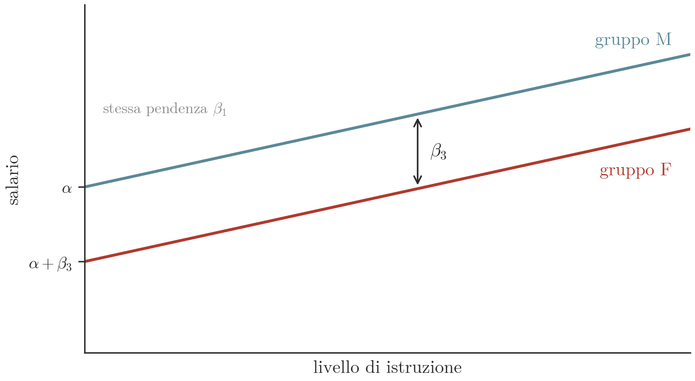

# Collinearità, Frisch-Waugh-Lovell e introduzione al test F

## Perfetta collinearità con le variabili dummy

Riguardo al modello di regressione multipla, ieri abbiamo visto che, in generale, se avete due regressori, o più di due, correlati tra di loro in maniera esatta, vuol dire che potete prevedere esattamente uno conoscendo l'altro. L'esempio che abbiamo visto era introdurre due variabili qualitative, quelle che si chiamano variabili dummy o variabili categoriali, che di solito si utilizzano per identificare l'appartenenza a una categoria. Ieri abbiamo visto uomini e donne, genere maschile e genere femminile. Ovviamente se so che una persona è di genere maschile non sarà di genere femminile, se è di genere femminile non sarà di genere maschile. Cosa succede se aggiungo tutte e due le variabili nel modello?

Il modello di base parte con una parametrizzazione che avevamo visto ieri con quattro parametri, ed esiste una parametrizzazione assolutamente equivalente che ne comporta tre. Quindi supponiamo di stimare il modello con tre parametri. Quello che in realtà avevamo osservato, facendo due conti, è che l'intercetta di questo modello, rispetto alla parametrizzazione originale, è una combinazione di due parametri, il coefficiente della variabile M e l'intercetta originale, mentre il coefficiente della variabile F è dato da una combinazione lineare degli altri coefficienti, quindi $\beta_3 - \beta_2$. $\beta_1$, che è il coefficiente del livello di istruzione, rimane.

Dal punto di vista operativo cosa succede? Pensate ad utilizzare un software. Come funziona un software quando vuole stimare un modello? Supponiamo di voler stimare questo modello. Cosa fate? A voi non interessa, al software non interessa sapere che cos'è la costante, che cos'è il coefficiente angolare della variabile F. Lui ha bisogno in input di alcune variabili, che sono questa e questa, più la costante che mi serve per recuperare l'informazione sul parametro verità certa. Ma se voi date in input due variabili, l'output sarà tre stime, tre numeri: un numero che rappresenta questo, un numero che rappresenta questo, un numero che rappresenta questo.

> [!question] Da verificare: la trascrizione riporta "sul parametro verità certa"; resta aperto.

Il problema qual è, quando c'è collinearità? Che siccome ho due modelli equivalenti, questo e questo e questo, vorrei poter passare dalla stima di questi tre coefficienti, uno, due, tre, alla stima di questi quattro coefficienti, uno, due, tre, quattro. Se voglio risolvere il sistema che mi risolve il problema, ho quattro incognite che sono $\alpha$, $\beta_1$, $\beta_2$, $\beta_3$ e tre equazioni. Il sistema ha infinite soluzioni e quindi il software non sa quale pescare, non posso più passare da un modello all'altro, e pure i modelli sono identici.

Il problema sostanziale qual è? Che voi avete aggiunto una variabile, F o M, una delle due, tanto sono intercambiabili, quindi avete aggiunto un parametro al modello, ma non avete dato al modello informazioni nuove, perché conoscendo F posso ottenere automaticamente M. E viceversa. Quindi ho aggiunto un parametro, ma non ho aggiunto veramente dati, ho aggiunto dati finti, e quindi non avete abbastanza informazioni per identificare tutti i coefficienti.

### Come si risolve il problema

Quindi come posso fare a risolvere il problema, che in realtà è un finto problema, perché, come vi ho detto ieri, ==la collinearità è un problema logico più che matematico==. Di fatto non mi permette di valutare gli effetti marginali, perché l'effetto marginale è: come cambia, qual è l'impatto di una variazione di $X_1$ se tengo fisso $X_2$, $X_3$, $X_4$, tutte le altre variabili. Ma se le variabili sono perfettamente correlate non posso modificare una variabile e sperare che l'altra sia ferma. Questo perché si muovono contemporaneamente, senza incertezza.

E quindi, per risolvere il problema logico, l'idea è: una variabile è in più, non serve a niente. Dal punto di vista operativo vuol dire che uno dei due coefficienti, $\beta_2$ o $\beta_3$, lo posso eliminare, cioè lo fisso a zero. Ho infinite soluzioni a quel sistema, ne fisso una delle quattro possibili: per ottenere un'unica soluzione quello che devo fare è fissare uno dei parametri e ottengo gli altri di conseguenza. Tipicamente queste cose le fa automaticamente un software, qualsiasi software, tranne R: gli altri lo fanno in automatico, R non lo fa in automatico. Elimina una delle variabili che mi creano il problema. Dal punto di vista operativo questo non vuol dire che sto eliminando quella categoria di persone dal database, semplicemente lo sto rappresentando in maniera diversa.

Ora, cosa vuol dire eliminare in un modello di regressione uno dei regressori? Ricordiamoci che il modello che sto studiando era quello dei salari e ho $\alpha + \beta_1 \, \text{education} + \beta_2 M + \beta_3 F + \epsilon$, dove M e F sono definite come ho definito ieri, 1, 0, 0, 1. Cosa vuol dire risolvere quel sistema di tre equazioni in quattro incognite? Vuol dire fissare uno dei parametri. Qual è il modo più semplice per fissare uno dei parametri? Non tutti, perché non devo fissare $\beta_1$, perché quello mi serve, anche perché non è coinvolto dalla relazione esatta. Quindi quello che devo fissare è questo parametro o questo parametro. La cosa più semplice è fissare il numero più semplice che mi viene in mente, cioè zero. Vuol dire che supponiamo di eliminare $\beta_2$, pongo uguale a zero $\beta_2$, vuol dire che sto eliminando il regressore dal modello. È un problema oppure no? La risposta è no, e adesso vi spiego perché. ==Non sto eliminando il lavoratore di genere maschile dal modello, sto solo eliminando un parametro che li rappresenta, ma non sto eliminando il gruppo.==

### Il salario atteso delle donne e degli uomini

Allora cerchiamo di capire cosa mi spiega questo modello. Questo modello mi spiega il salario atteso per persone con certe caratteristiche. Supponiamo di prendere lavoratori donne, con genere femminile, tale per cui la variabile F è uguale a uno. Supponiamo che il livello di istruzione è fissato a un numero generico, quindi non mi crea un problema. Quindi il modello mi prevede il salario atteso per il gruppo di lavoratori tale per cui F uguale a 1 e un certo livello di istruzione. Cosa mi dice questo modello? Mi dice che la regressione è data da $\alpha + \beta_1 \, \text{education} + \beta_3 \cdot 1$. Assumo che la media di y dato x, cioè la covarianza tra y e x, è uguale a zero, quindi sono a posto. Vuol dire che ho costruito un modello tale per cui l'intercetta è $\alpha + \beta_3$. Cos'è l'intercetta? Sono le combinazioni di parametri che non moltiplicano per nessun regressore. Più il coefficiente angolare $\beta_1$ che moltiplica per il livello di istruzione. E questo è il modello di regressione per le donne.

> [!question] Da verificare: la trascrizione riporta "la media di y dato x, cioè la covarianza tra y e x, è uguale a zero"; probabilmente intende l'errore, resta aperto.

Ora posso calcolare il salario atteso per gli uomini. La variabile M non c'è nel modello, però in generale posso calcolare il salario atteso anche per il genere M. E infatti, se M è uguale a 1 implica che F sia uguale a zero, quindi mi basta calcolare il modello di regressione per F uguale a zero. Quindi quello che devo fare è calcolare il salario atteso tale per cui F uguale a zero e un certo livello di istruzione, che può essere qualsiasi cosa. Quindi quello che io ottengo è che il salario per genere maschile è $\alpha + \beta_1 \, \text{education} + \beta_3 \cdot 0$, che sparisce ovviamente, e di conseguenza ho ottenuto due diversi valori attesi condizionali.

Dal punto di vista operativo, cosa ho ottenuto? Ho ottenuto che, se faccio il grafico del mio modello di regressione, questo è il salario e questo è il livello di istruzione, e calcolassi il modello di regressione per il gruppo M, devo scrivere il modello in questa forma. Quindi avrò che, data una certa pendenza $\beta_1$, che mi aspetto positiva, l'intercetta è data da $\alpha$, il parametro $\alpha$, che posso stimare perché adesso ho un sistema di tre equazioni e tre incognite.

Cosa succede per le donne, per il genere femminile? Per loro il coefficiente angolare è sempre $\beta_1$, però cambia l'intercetta, che è data da $\alpha + \beta_3$. $\beta_3$ può essere positivo o negativo, in generale nelle analisi empiriche che vedrete col professor Peruzzi. Vedrete che tipicamente è negativo, è piuttosto grande purtroppo, però in generale avrete una retta di regressione che sta un po' sotto a quella del genere M, con stessa pendenza, sempre $\beta_1$.

Questa intercetta non è altro che $\alpha + \beta_3$. Ma questo cosa vuol dire? Vuol dire, primo, che genere maschile e genere femminile sono rappresentati da questo modello. In più posso anche compararli tra di loro, perché? Perché in realtà il differenziale, indipendentemente da qualsiasi livello di istruzione, il differenziale tra i due gruppi è dato dalla distanza delle intercette, visto che sono rette parallele. Vuol dire che il gap tra genere maschile e genere femminile è dato da $\beta_3$. Supponiamo che $\beta_3$ sia 5 dollari all'ora: vuol dire che indipendentemente dal livello di istruzione il genere femminile guadagna 5 dollari in meno rispetto all'uomo. Se il parametro $\beta_3$ fosse 0,5 vuol dire che sono 50 centesimi di differenza e avanti così.

> [!question] Da verificare: la trascrizione riporta "beta3 sia il 5 dollari all'ora" e poi "5 dollari in meno"; il segno di $\beta_3$ non è detto.

Quindi il problema della collinearità è un problema apparente, si risolve a monte, oppure potete anche chiedere al software che lo risolva in maniera standard. La cosa interessante è che il modello dovrà essere interpretato in maniera conseguente. In generale la variabile che omettete per risolvere il problema della collinearità fa riferimento al gruppo di riferimento. Dopodiché l'altro gruppo mi dice la deviazione rispetto al gruppo di riferimento, la deviazione data dal parametro $\beta_3$, che è il coefficiente della variabile di genere.

### La variabile da togliere non è unica

La soluzione del problema della collinearità in realtà non è unica. Quello che ho fatto io è togliere la variabile M, però avrei potuto togliere la variabile F. I dati, in realtà, identificheranno comunque queste due intercette. Questa sarà sempre l'intercetta del genere maschile, questa sarà l'intercetta del genere femminile. L'unica differenza è come calcolo in funzione dei parametri questi due punti. Se togliessi la variabile F anziché la variabile M, allora questo punto sarà identificato dall'intercetta del modello che stimo, mentre questo punto sarà dato dal parametro, tra virgolette, $\alpha$ più il coefficiente della variabile del genere maschile, della variabile M.

L'unica differenza che avrò in un output è che nel primo caso mi aspetto che $\beta_3$ sia negativo, nel secondo caso deve essere positivo ma identico. Se $\beta_3$ fosse meno 0,3 nel primo modello, nel secondo sarà più 0,3. I dati identificano questi due punti. Come ti chiedo i due punti in funzione dei parametri dipende da che variabile tolgo. Però se andate a vedere il coefficiente di education rimane uguale, se andate a vedere l'$R^2$ del modello rimane uguale, se vado a vedere qualsiasi altra statistica descrittiva, uno standard error, non cambia assolutamente niente. Quindi è una scelta arbitraria.

> [!question] Da verificare: la trascrizione riporta "Come ti chiedo i due punti in funzione dei parametri"; resta aperto.

Quindi se vi chiedessi di dire, con un modello del genere, c'è differenza di salario tra genere maschile e genere femminile, quello che andate a fare è semplicemente cercare di capire se il coefficiente $\beta_3$ è uguale a zero o diverso da zero. Test di significatività. Se vi chiedessi la differenza di genere implica una variazione di salario del 30%, allora dovete andare a vedere se quel $\beta$ corrisponde al 30% oppure è diverso dal 30%. Qualsiasi batteria di test lo potete fare in maniera abbastanza standard.

### Togliere la costante invece di una dummy

In realtà per risolvere il problema della collinearità posso anche volere mantenere entrambe le variabili M e F, ma a quel punto devo togliere qualcos'altro. Secondo voi cosa dovrei togliere per comunque mantenere un modello stimabile dal punto di vista operativo, che non abbia problemi numerici, di soluzioni di sistemi che il computer non può risolvere? Avete già visto le variabili dummy nei corsi precedenti? Sì, forse. Ma rivediamo allora, facciamo anche la casistica, tanto nel computer mi capita sta roba, quindi sarà meglio guardarla.

> [!question] Da verificare: la trascrizione riporta "Sì, forse" senza dire chi risponde, e "tanto nel computer mi capita sta roba"; forse "nel compito", resta aperto.

Quando penso alla relazione lineare esatta tra le variabili M e F, io in realtà so che $M + F = 1$. Oppure $M = 1 - F$, oppure $F = 1 - M$. Ora, ci sono chiaramente due regressori in gioco: questo regressore e questo regressore. Ma sono solo loro due oppure c'è anche implicitamente un altro regressore che gioca un suo ruolo? L'annotazione c'è, però in questo momento non mi serve, perché la relazione è tra M, F e 1. Posso pensare a 1 come un regressore? La risposta è sì. Perché quando scrivo un modello di regressione qualsiasi, questo qua per esempio, implicitamente come faccio a stimare il parametro $\alpha$? Ho bisogno di fissare un regressore associato a questo parametro, perché il regressore associato a questo parametro è una costante, e la costante tale per cui $\alpha$ per $x$ mi dà $\alpha$ è $x$ uguale a 1. Quindi 1 non è altro che il regressore associato a questo parametro. Quindi io posso sempre pensare a questo come il regressore speciale che mi permette di ottenere le informazioni sulla costante del modello. Quindi in realtà in questa relazione non ci sono solo M e F, ma c'è anche il regressore associato ad $\alpha$.

Quindi cosa succede se tolgo $\alpha$ dal modello? Risolvo il problema della collinearità, tanto nel primo esercizio che abbiamo fatto avevo alto M, mi rimanevano queste e queste. Nel secondo, che ve l'ho detto solo a voce, ho tolto F, mi rimangono queste e queste. Se tolgo questa posso mantenere queste due qua.

> [!question] Da verificare: la trascrizione riporta "avevo alto M"; probabilmente "avevo tolto M", resta aperto.

Quindi cosa succede se considero un modello di questo tipo? $\text{wage} = \beta_1 \, \text{education} + \beta_2 M + \beta_3 F$. In questo caso, se volessi calcolare il salario atteso, sapendo che M è uguale a uno, quindi sto prendendo un lavoratore di genere maschile, allora posso ottenere che il mio modello è dato da $\beta_2 + \beta_1 \, \text{education}$. Ovviamente se M è uguale a uno, F è uguale a zero, sta roba sparisce e prendo questo. Cosa succede se voglio calcolare il salario atteso per il genere femminile? Devo calcolare il salario atteso di wage dato F uguale a uno e di conseguenza avrò che il mio modello mi darà $\beta_3 + \beta_1 \, \text{education}$. Quindi ho ottenuto due rette di regressione.

Se vado a vedere i risultati, supponiamo di stimare questo modello dopo aver stimato gli altri due precedenti, quello di cui vi accorgerete è che adesso la stima di $\beta_2$ coinciderà con l'intercetta che ho calcolato nei modelli precedenti del gruppo M, quindi nel primo modello questo numero coinciderà esattamente con $\alpha$, mentre questo parametro $\beta_3$ sarà esattamente l'intercetta che avete calcolato prima del gruppo del genere femminile. Quindi numericamente, indipendentemente dalla variabile che togliete, i dati identificheranno questi due punti. Il punto è che li chiamate semplicemente con parametri diversi. Nel modello in cui tolgo la variabile M, questo sarà l'$\alpha$ di quel modello e questo sarà l'$\alpha + \beta_3$ di questo modello. Se invece stimiamo l'ultimo modello, questo sarà il $\beta_2$ dell'ultimo modello e questo sarà il $\beta_3$ dell'ultimo modello. Il differenziale sarà sempre lo stesso numero, però.

Queste cose le vedrete un po' meglio durante le esercitazioni, proprio farete tutti i casi. Comunque, quello che voglio dire è che ==indipendentemente da come risolvete il problema della collinearità, i risultati saranno sempre equivalenti==. L'unica cosa che cambia è come interpretate i differenziali. Per esempio, uno dei problemi principali con l'ultima parametrizzazione è che se io volessi fare un test statistico per dire c'è una differenza sostanziale tra genere maschile e genere femminile, non mi basta fare un test sul parametro che mi descrive il differenziale.

Devo fare un test per verificare se $\beta_1$ è uguale a $\beta_2$. E fare un test del genere non è necessariamente banalissimo. Perché? Perché coinvolge un parametro, non è che coinvolge due. In realtà coinvolge una combinazione lineare di parametri, perché io vorrei fare un test tipo $\beta_1 - \beta_2 = 0$.

> [!question] Da verificare: la trascrizione riporta "coinvolge un parametro, non è che coinvolge due" e "beta 1 è uguale a beta 2" (nel modello i parametri dei gruppi sono $\beta_2$ e $\beta_3$); resta aperto.

Ora, posso farlo, solo che è un po' più incasinato, perché posso comunque calcolare una statistica t su questa combinazione lineare. Cosa so dalla teoria? Quello che posso dimostrare è che lo stimatore di questo parametro si distribuisce asintoticamente come una variabile casuale normale, quello lo racconto meglio. Se io volessi stimare questa roba qua, semplicemente prendo lo stimatore di questo parametro, meno lo stimatore di questo parametro, ho una differenza di variabili casuali normali, che è normale. Quindi, un test di ipotesi: se prendo il mio stimatore di $\beta_1$ e lo stimatore di $\beta_2$ e faccio la differenza, questa roba mi aspetto che per campioni grandi sia ben approssimata dalla normale e sotto l'ipotesi nulla, ipotizzando che valga questa condizione, la media di questa normale deve essere zero.

Il problema è calcolare la varianza di questo oggetto, perché quando dovete fare una statistica t dovete calcolare la varianza dell'oggetto. Il problema è che la varianza di questo più la varianza di questo meno due volte la covarianza, che nella tabella di output del modello di regressione non ce l'avete. In realtà il software la calcola, si può calcolare, però in generale dovete andarla a trovare. È comunque una seccatura. Quindi qua avrò una varianza da calcolare. A quel punto, siccome vale la teoria statistica che so una normale, posso fare un test. Però è più brigoso che non fare un test per vedere se $\beta_3$ o $\beta_2$ sono uguali o diversi da zero. Là è standard, non c'è nulla da pensare. Qua dovete fare un ragionamento un po' più complicato.

Almeno c'è il vantaggio che dal punto di vista intuitivo avete già i due parametri: li rappresentano già le intercette, quindi numericamente non dovete fare trasformazioni strane, è tutto già là. Quindi poi vedete voi, vi dico tutte le alternative. Il problema della collinearità si risolve eliminando la variabile ridondante.

> [!question] Da verificare: la trascrizione riporta "oggi i due parametri li rappresenta già le intercette" e "non fa il suo problema"; resta aperto.

È un numero che non so calcolare, non so proprio cosa scrivere, metà sigma... O comunque sono troppo pigro per calcolare. In realtà, qua non so, però lo vedrete con le esercitazioni, la covarianza tra gli stimatori si può recuperare da qualche membro particolare dell'output di Gretl, solo che poi supponiamo che anziché avere una combinazione lineare di due parametri, avete una combinazione lineare di cinque parametri: dovete prendere tutte le possibili covarianze tra gli stimatori, quindi diventa anche complicato fare i calcoli. Sicuramente io sbaglierei, quindi sconsiglio.

> [!question] Da verificare: la trascrizione riporta "Ci sono domande a questo frutto chiaro abbastanza? È un numero che non so calcolare, non so proprio cosa scrivere, metà sigma..."; non è chiaro se parli il docente o uno studente che chiede della covarianza, e "metà sigma" resta aperto.

### Come prepararsi sulle parametrizzazioni

Nel compito variabili di questo tipo capitano spesso e ==spesso vi chiederò di dire se appartiene a un gruppo o a un altro, c'è una differenza oppure no==. Ora ==non cercate di ricordarvi a memoria le formule che vi ho fatto vedere adesso alla lavagna==: la cosa che io vi consiglio di fare è perdere 30 secondi del tempo dell'esame e rifarvi i passaggi. Il valore atteso condizionato con la variabile uguale a 1 è questo, con la variabile uguale a 0 è questo. Di conseguenza poi vi fate le differenze e vi ottenete le formule che poi vi servono per implementare i test. Quindi non cercate di imparare, io consiglio di non impararle a memoria. Quello che ho fatto qua dipende dalla parametrizzazione che ho usato in questo momento. Magari nell'esame ne uso un'altra. ==Dovreste essere flessibili abbastanza per poter passare da una parametrizzazione all'altra.== Sulla base della parametrizzazione fate il test che vi serve di conseguenza, quindi fatevi il passaggio in più, la probabilità di errore si riduce drasticamente. Consiglio, però, per poter fare come volete.

> [!question] Da verificare: la trascrizione riporta "nel computo variabili di questo tipo capitano spesso"; si è reso "nel compito".

> [!tip] Esame: variabili di questo tipo capitano spesso; le formule non vanno imparate a memoria ma rifatte durante l'esame, perché la parametrizzazione può essere un'altra.

### La distribuzione asintotica dello stimatore

Comunque, in realtà una volta che ho fatto le mie solite ipotesi nel modello di regressione, quindi devo evitare che ci sia perfetta collinearità, devo avere dati osservati in maniera indipendente dalla popolazione, vale l'ipotesi di esogeneità e ho anche un po' di condizioni sui momenti delle variabili, che vi ho detto non voglio che le code delle distribuzioni siano troppo pesanti perché potrebbero distorcere le mie stime, e quindi la precisione del proprio OLS. Allora in questo caso si possono dimostrare una serie di risultati, tra cui la distribuzione asintotica dello stimatore.

Cosa vuol dire? Che se $n$ è sufficientemente grande, nel modello in cui c'è l'esogeneità, lo stimatore dei minimi quadrati di qualsiasi parametro del mio modello di regressione, quello che chiamo $\beta_j$, si distribuisce come una normale centrata sul vero valore del parametro e con uno standard error che è dato da una formula che posso calcolare. La formula sarà interessante, la discutiamo fra un attimo, però in generale è esattamente quello che abbiamo ottenuto nel modello di regressione semplice, a parte che le formule diventeranno un po' più complicate. Tutti i possibili outcome che io posso avere da diversi campioni si devono distribuire come una normale con questa media e una varianza che in qualche modo posso calcolare. Quindi mi riconduco al caso di modello di regressione semplice con delle formule un po' più complicate, tutto qua.

Come arrivare a questo? Avrei bisogno di un po' di algebra lineare, ve la risparmio, però se avete capito l'intuizione del modello di regressione semplice è di fatto applicare il teorema del limite centrale e la legge dei grandi numeri. Le ipotesi che io faccio qua, soprattutto questa, dati indipendenti, e quella sui momenti, mi permettono solo di applicare la legge dei grandi numeri, il teorema del limite centrale e quindi trovare il risultato. Tutto il resto, l'esogeneità, mi permette di dire che la media del mio stimatore è il vero valore del parametro. L'omoschedasticità è solo un'ipotesi di comodo che tratteremo in dettaglio martedì prossimo.

> [!question] Da verificare: la trascrizione riporta "della risparmio"; si è reso "ve la risparmio".

### Quale distribuzione usare per i test

Quindi cosa vuol dire? Vuol dire che se voi, quello che vi ho anticipato un attimo fa, se voi dovete fare un test di ipotesi su un qualsiasi parametro del modello di regressione, potete usare la statistica t normale, potete usare la distribuzione dei campioni infiniti, quindi una t di Student, o la distribuzione asintotica, le normali. Per comodità e pigrizia uso sempre la normale, tanto avere meno di 30 osservazioni in un campione e avere un modello di regressione multipla vuol dire andare un po' a caso quando si interpreta il risultato, perché troppa incertezza dovuta a un campione troppo piccolo. Quindi in generale, per comodità uso sempre l'approssimazione normale. Ricordatevi che ==la t di Student e la normale sono di fatto sovrapponibili per più di 30 gradi di libertà== della t di Student, non c'è differenza sostanziale. So che non è un modo di dire particolarmente elegante, però va bene così.

> [!question] Da verificare: la trascrizione riporta "la distribuzione dei campioni infiniti, quindi una t di Student"; più avanti dice "campioni finiti".

L'altra cosa che vi volevo dire è che lo stimatore si distribuisce esattamente come una t di Student solo nel caso voi ipotizziate il termine d'errore gaussiano. Fatta l'ipotesi che $\epsilon$ è gaussiano, poi la dovete anche dimostrare, l'ipotesi, prima di fare i calcoli. L'approssimazione asintotica funziona anche se non fate quell'ipotesi, quindi è molto più flessibile, se volete. È il motivo per cui preferisco la distribuzione asintotica rispetto a quelle per campioni finiti, perché richiede molte meno ipotesi.

Ancora meno rispetto a quelle che ho fatto adesso. In più, quando passeremo a lavorare con dati in serie storica che non sono indipendenti ma sono dipendenti tra di loro, la distribuzione in campioni finiti non la potete calcolare, è impossibile, mentre potete calcolare comunque la distribuzione asintotica. Ci sono molte buone ragioni per ragionare sempre facendo finta di avere un campione abbastanza grande, perché non dovete fare l'ipotesi di indipendenza, di fatto, non dovete fare l'ipotesi di stretta esogeneità, molto spesso potete farlo proprio un po' più debole, non dovete ipotizzare soprattutto che il termine d'errore sia gaussiano. Siccome non lo osservate, non lo potete dire. Tra l'altro, se la variabile può assumere valori negativi, neanche è difficile pensare che l'errore possa essere definito su tutta la retta reale.

### La stima dei parametri

Il problema adesso è stimare i parametri. Anche qua non faccio tutti i passaggi, però stimare i parametri di fatto equivale a minimizzare, qua ho fatto un esempio di un modello di regressione multipla con solo due regressori, potete generalizzarlo a qualsiasi numero di regressori. Potete sostanzialmente prendere la $Y$ e cercare di trovare i parametri, in questo caso $\alpha$, $\beta_1$ e $\beta_2$, che rendono più piccola possibile la dispersione delle mie osservazioni, quanto la $Y$ si distanzi in media dal modello di regressione.

> [!question] Da verificare: la trascrizione riporta "a1 e b2" per i parametri ed "estimatori"; la slide 30 riporta il minimo su $\alpha, \beta_1, \beta_2$ e la slide 31 "stimatore", e si adottano queste forme.

Come fare a risolvere questo problema, trovare i parametri ottimali? E questi saranno gli stimatori: semplicemente calcolo la derivata rispetto a questo, calcolo la derivata rispetto a $\beta_1$, calcolo la derivata rispetto a $\beta_2$, pongo queste tre equazioni tutte uguali a zero, risolvo il sistema, ho tre equazioni, tre incognite, avrò una formula che sarà lo stimatore. Problema: se già nel modello di regressione semplice mi serve una pagina di algebra, noiosissima, non serve proprio a niente, in questo caso le pagine diventano due, se aggiungo il regressore diventano quattro e avanti a crescere. Quindi in generale trovare una formula che mi leghi $\beta_1$, il parametro, ai dati è proprio complesso, a meno che non usate l'algebra lineare, le matrici, in quel caso tutto più facile.

*(slide 30)*

### Il teorema di Frisch-Waugh-Lovell

In realtà uno dei risultati più curiosi che mi è capitato di trovare nell'econometria è questo: questa è la formula standard, è quello che di fatto fa il computer, però c'è un modo alternativo per stimare i parametri, qualsiasi parametro del modello di regressione. Io posso trovare lo stimatore dei minimi quadrati di un parametro, diciamo il j-esimo, calcolando questa regressione, in cui la $Y$ è sempre la stessa, e al posto della $X$ prendo un regressore che chiamo col cappellino sopra. Adesso vi spiego che cos'è questo. Se io calcolo lo stimatore dei minimi quadrati di questa regressione e ci applico i dati, otterrò esattamente lo stesso numero che otterrei minimizzando i minimi quadrati in maniera standard. Questa è una conseguenza di ==uno dei teoremi più utili che c'è in econometria, che è il teorema di Frisch-Waugh-Lovell==.

*(slide 31)*

Ora, perché funziona? Anche qua la dimostrazione richiede un po' di algebra lineare, non ve la faccio, però vi faccio vedere come funziona con dati reali. Che cos'è questo? Questo numero, questa quantità, questa variabile è il residuo di una regressione speciale, in cui sostanzialmente calcolo la regressione tra la variabile $j$, quella associata al parametro $\beta_j$, rispetto a tutti gli altri regressori che ho nel modello. In questo caso ho due regressori, quindi se questo è $X_2$, questo è $X_1$, se questo è $X_1$, questo è $X_2$. Se avessi dieci regressori, per $X_5$ dovrò calcolare la regressione tra il quinto regressore e il primo, il secondo, il terzo, il quarto, il sesto, il settimo, l'ottavo, il nono, il decimo, e lo posso fare per tutti. Ora, questa quantità qua non è altro che il residuo tra il valore del regressore e la previsione che posso fare di quel regressore utilizzando gli altri nove regressori, gli altri regressori che non sono quel regressore.

### L'intuizione: la parte prevedibile e la parte che non lo è

Cosa vuol dire? Cerchiamo di capire l'intuizione, dopo cerchiamo di raffinare un po' il ragionamento. Quando noi stimiamo un modello di regressione, che cosa stiamo facendo? Vale per la semplice, vale per la multipla, faccio l'esempio con la semplice perché è più veloce da scrivere. Ho un modello di questo tipo: $Y = \alpha + \beta X + \epsilon$. Ora cosa vuol dire? Vuol dire in pratica che il segnale, l'informazione prodotta dalla $Y$ la divido in due pezzi. Una parte che è completamente prevedibile dalle altre informazioni che ho nel mio modello, quindi dalla $X$, e una parte che non è prevedibile. Quindi di fatto ogni volta che osservo qualcosa posso sempre pensare che è la combinazione di due segnali diversi: una parte che è prevedibile e una parte che non è prevedibile. Questa è la parte non prevedibile, questa è la parte prevedibile.

Da questo punto di vista che cosa mi rappresenta il residuo? Il residuo mi rappresenta la differenza tra la $Y$ e la parte prevedibile, una volta che fisso i parametri nel miglior modo che io posso con le mie stime. Quindi non è altro che questa roba qua. Quindi la componente residuale mi rappresenta l'informazione contenuta in $Y$ che non è prevedibile dalla $X$. Quindi pensate che ogni variabile la posso decomporre in due segnali: uno che è quanto posso prevedere quella variabile usando un po' di informazioni, e un altro che è $\epsilon$, che mi dice quanto non è prevedibile dalle altre informazioni quel segnale, quell'informazione.

Quindi, se è chiaro questo, torniamo a questa regressione. Voglio prevedere la $Y$ tramite questa informazione. Ma cos'è questa informazione? È l'informazione del regressore $X_j$ che non dipende da tutti gli altri regressori. Quindi questo residuo mi racconta quant'è il contributo di questa variabile che non dipende dalle altre variabili del modello. Qua per semplicità ho usato solo una variabile, ma potete metterne tutte. Il residuo mi rappresenta la parte imprevedibile. Quindi pensatela così: questa quantità mi dice qual è l'informazione contenuta in $X_2$ che non è prevedibile con $X_1$. Se questo è $U_1$, se questo è $U_2$, $U_1$ è la componente di $X_1$ che non è prevedibile con $X_2$. In questo esempio con due variabili e basta.

*(slide 32)*

### Il coefficiente come correlazione parziale

A questo punto torniamo al modello di regressione, perché mi piace, perché è facile da interpretare. Ora, in un modello di regressione semplice, cosa mi rappresenta il coefficiente $\beta$? Il legame tra le due variabili. È una correlazione tra due variabili, è la covarianza diviso la varianza, di fatto è la correlazione. Quindi, in un modello di regressione semplice c'è una correlazione marginale. Non ho altre variabili perché $\epsilon$ non conta, di fatto ho una correlazione tra $X$ e $Y$.

In questo modello, che cosa mi rappresenta questo parametro? È la correlazione tra $Y$ e questa. Ma questa che cos'è? È l'informazione di $X_j$ che non è spiegabile con $X_i$. Quindi questo parametro non è altro che la correlazione tra $Y$ e $X_j$ una volta che tolgo l'effetto di $X_i$. Quindi che cos'è una correlazione parziale? A questo punto, questo è il risultato. Questo è lo stimatore del modello di regressione semplice applicato a quella regressione dove questo è il regressore e questa è la $Y$. Questo risultato mi dice che questo parametro è la correlazione tra $X_j$ e $Y$ al netto di $X_i$, dove $i$ è diverso da $j$. Cosa vuol dire? Che lo calcolo come una correlazione marginale, ma sulla base di variabili che sono già state ripulite dall'effetto della terza variabile. Quindi gli do un nome statistico, adesso $\beta_j$. È una correlazione parziale. E questa cosa mi fa piacere perché? Perché quando vi ho spiegato il concetto di effetto marginale, vi ho detto che di fatto era una correlazione parziale.

Fisso la variabile income e cerco di capire cosa succede alla performance quando modifico la dimensione della classe, sto misurando la correlazione tra due variabili una volta che fisso la terza. Quindi questo risultato mi permette di dire che ogni coefficiente del modello di regressione multipla lo posso ancora interpretare come una correlazione, ma non è una correlazione marginale tra due variabili indipendentemente da cosa succede nel resto del mondo, è una correlazione parziale. È una correlazione che calcolo una volta che ripulisco da $X_j$ l'effetto prevedibile tramite $X_i$. Questo dal punto di vista concettuale è il legame tra la statistica e l'economia. E lo posso fare perché c'è un teorema che mi permette di farlo, che appunto si chiama teorema di Frisch-Waugh-Lovell, che ve lo racconto a voce.

### I passaggi del teorema

Ma come funziona il teorema? Ho tre variabili, la $Y$, $X_1$ e $X_2$, ma posso generalizzarlo a qualsiasi numero di regressori, vale sempre il teorema. Allora, cosa posso fare? Prima non avevo fatto il primo passaggio. Non è indispensabile per recuperare il $\beta_j$, si può dimostrare, però se lo fate non capite niente a $\beta_j$. Quindi prendete la regressione di $Y$ e la regredite, supponiamo che lo scopo sia calcolare $\beta_1$, il primo parametro, il parametro associato al primo regressore. Quindi quello che faccio è regredire $Y$ su tutti i regressori che non sono il primo. Quindi $X_2$, $X_3$, $X_4$, quanti ne avete. E da quel modello salvate i residui. Fate la stessa cosa sul regressore 1. Il regressore 1 è quello per cui vi interessa il parametro, quindi la dimensione della classe, e regredite $X_1$ rispetto a tutti gli altri regressori, $X_2$, $X_3$, $X_4$, $X_{10}$, $X_{100}$, quanti ne volete. Da questo modello calcolate i residui, che era quella variabile $u$ che vi ho detto prima. A questo punto voi potete derivare $\beta_1$ come modello di regressione semplice tra questa variabile e questa variabile, tra i residui ottenuti in questo primo passo e i residui ottenuti in questo secondo passo.

> [!question] Da verificare: la trascrizione riporta "se lo fate non capite niente a beta j"; forse "se non lo fate".

Ora, dimostrarlo sono quattro righe, solo che avrei bisogno di una settimana di notazione di algebra lineare per farlo, quindi non è importante. Però quello che volevo far vedere era l'esempio numerico. Uno dice: più o meno il risultato sarà uguale, magari? No, è proprio numericamente esattamente lo stesso numero.

### L'esempio numerico con il punteggio dei test

Supponiamo, per esempio, di voler calcolare questo modello di regressione multipla in cui la performance dei bambini a scuola è regredita sulla dimensione della classe, il reddito e la costante. Il coefficiente che mi interessa è meno 0,6487401, quello che stimo utilizzando minimi quadrati standard.

> [!question] Da verificare: la trascrizione riporta "meno 0,6487, 4,01"; la slide 35 riporta −.6487401 e si adotta questa forma.

*(slide 35)*

Applico la procedura di Frisch-Waugh-Lovell. Faccio la prima regressione in cui prendo la $X_1$ e la regredisco rispetto alla $X_2$. Da questo modello salvo i residui, li chiamo ustr, è un nome, potete chiamarlo come volete. Dopodiché prendo la $Y$ e la regredisco rispetto a $X_2$ e salvo questi residui. L'output di questi modelli non mi interessa, non è interessante. Però a quel punto prendo questa variabile che è la mia nuova $Y$, questa variabile che è la mia nuova $X$ e la calcolo qua. Guardate il risultato. Il risultato è esattamente lo stesso numero a qualsiasi decimale voi andate a guardarlo. È matematicamente lo stesso numero, non è un'approssimazione.

*(slide 36)*

Ora i software non fanno sta roba, perché ci vuole troppo tempo rispetto a non fare uno stimatore in blocco di tutti i parametri. Però questo è un risultato teorico molto utile, perché mi permette di interpretare il coefficiente di questa regressione semplice come una correlazione, perché in una regressione semplice il coefficiente è la correlazione tra due variabili. Solo che la correlazione è tra due variabili che sono già state ripulite dall'effetto di tutte le altre, quindi avete una correlazione al netto di tutti gli impatti, degli effetti collaterali che potreste avere in mente.

Ora il risultato funziona lo stesso anche se anziché prendere i residui della regressione di $Y$ su $X_2$ prendete $Y$ direttamente. Quella roba là non cambia il risultato numerico. Quello che cambia eventualmente sono gli standard error, ma se volete stimare questo parametro è esattamente quella la procedura. Quindi questo è un risultato che è inutile dal punto di vista operativo al momento, ma fra un attimo sarà anche un po' più utile. Interessante dal punto di vista teorico perché mi permette di dare un nome statistico all'effetto marginale con un concetto puramente economico. Correlazione parziale. L'avevamo già vista fissando il reddito, cosa succede se cambio le altre variabili, adesso c'abbiamo anche una giustificazione formale.

### L'errore standard nella regressione multipla

Ora, un'altra cosa interessante, o almeno interessante nell'ambito di questo corso, è: in realtà quello che mi interessa non è neanche tanto stimare il parametro, ma voglio anche stimare il coefficiente di precisione associato alla mia stima, cioè lo standard error. Avevamo visto che lo standard error, nell'ambito del modello di regressione semplice, era abbastanza facile da calcolare ed era qualcosa del tipo: lo standard error del mio stimatore in un modello del tipo $Y = \alpha + \beta X + \epsilon$ è uguale a radice quadrata del fatto la varianza di $X$, in cui devo stimare questo parametro, è di fatto la media dei quadrati dei residui, più o meno, e quindi lo standard error non è altro in realtà che la radice quadrata di questa formula.

> [!question] Da verificare: la trascrizione riporta "radice quadrata del fatto la varianza di x"; resta aperto.

Prendo i residui del modello stimato, ci calcolo questa roba qua, prendo la varianza, per $n - 1$ la varianza della $X$ sulla base del dataset, la calcolo, calcolo il rapporto e ottengo il livello di precisione della mia stima. Comunque, gli ingredienti del mio standard error sono $\sigma^2$, cioè la varianza del termine d'errore, e la varianza di $X$. Più grande è la varianza di $X$, più le $X$ sono disperse, più è preciso il mio stimatore. Più piccola è $\sigma^2$, meglio è per il mio stimatore. Sono due gli ingredienti.

Cosa succede nell'ambito di un modello di regressione multipla? Ovviamente non posso più usare questa formula, perché non vale più, perché ho anche altri effetti, ho anche effetti collaterali degli altri regressori. Comunque, era solo per ricordarvi come si calcola la seconda colonna della tabella di output di un modello di regressione. Quello che è interessante è vedere cosa succede se vado a calcolare con l'algebra standard lo standard error nell'ambito di un modello di regressione multipla. Ottengo quella formula là. È un po' complicato, ma fidatevi.

Ora, il numeratore è sempre quello che avevamo prima, è la varianza del termine d'errore che in qualche modo stimo facendo la media dei quadrati dei residui. Il denominatore è la varianza della $X_j$, è $n$ volte la varianza della variabile associata al coefficiente $j$-esimo. Questa roba qua ce l'avevamo anche prima, di fatto: è $\sigma^2$ diviso $n$ volte la varianza di $X$. Il punto è che nel modello di regressione multipla c'è anche questo pezzo. È $1 - R^2$. L'$R^2$ è semplicemente un coefficiente di bontà dell'adattamento. Ma che cos'è quell'$R^2$? Ci ho messo un pedice $j$ sotto. L'$R^2_j$ mi rappresenta il grado di associazione che c'è tra la variabile $j$ e tutte le altre, quella che otterrei stimando il modello tra $X_j$ e $X_2$, $X_3$, $X_{j-1}$, $X_{j+1}$ e tutte le altre. Quindi questa roba qua mi dice sostanzialmente qual è il livello di legame tra la variabile di interesse, quella per cui stimo il parametro, e tutte le altre variabili del modello, esclusa la $Y$ ovviamente.

> [!question] Da verificare: la trascrizione riporta "il sum x2, x3, x meno j"; resta aperto.

*(slide 40)*

Ora, in un caso di collinearità, cosa mi aspetto da quell'$R^2_j$? Uno studente risponde, ma la risposta non si sente. Esattamente. Perfetta collinearità vuol dire che un regressore è perfettamente legato agli altri, quindi se calcolassi la regressione mi verrebbe l'$R^2$ uguale a 1.

La componente del termine d'errore non conta niente, è zero. Cosa vuol dire, in una formula del genere? Che questo $R^2$ sarà esattamente uguale a 1 e quindi avrò uno zero al denominatore, che è una cosa che tipicamente non ci piace. Vuol dire che avete una varianza esplosiva, cioè varianza infinita. Quindi quando avete collinearità, un altro modo di vedere il problema è che avete un livello di imprecisione talmente alto che il livello di imprecisione del vostro stimatore è infinito, qualsiasi numero va bene. Se doveste fare un test di ipotesi non potreste mai rifiutare nessuna ipotesi nulla di fatto. O se faceste un intervallo di confidenza sarebbe tra meno infinito e più infinito. Probabilità che un parametro non stia dentro: meno infinito e più infinito. È un altro modo buffo per vedere il problema.

> [!question] Da verificare: dopo "Probabilità che un parametro non stia dentro: meno infinito e più infinito" la trascrizione riporta "Quindi di fatto il modello div[caratteri non latini]a", con l'ultima parola non riconoscibile; resta aperto.

### I tre ingredienti dell'errore standard

Quindi ho tre ingredienti adesso che contano per dire quanto preciso è il mio stimatore. Il primo è quanto grande è la varianza dell'errore, supponendo che vada sempre l'omoschedasticità. Il secondo è la variabilità del regressore che mi interessa e il terzo è il legame che c'è tra quel regressore e tutti gli altri. Se questo legame è troppo grande, vuol dire che questo numero tende a uno, vuol dire che questo numero sarà molto piccolo, vuol dire che avrete un effetto inflattivo sulla varianza.

### La quasi collinearità

Calcolare questa quantità, uno fratto questa roba in rosso, è particolarmente utile se volete diagnosticare problemi di non proprio collinearità esatta, perché in quel caso il problema viene risolto a priori da un software, ma vi permette di dire cosa succede se le variabili sono quasi collineari. Cosa vuol dire quasi collineari? Vuol dire che la loro correlazione è alta, ma non così alta da diventare un problema patologico, che però comunque è un problema, perché se ho delle variabili che sono correlate al 99%, quando calcolo la regressione che mi dà quell'$R^2_j$, sarà un numero molto vicino a uno. Vuol dire che il denominatore sarà molto piccolo, non zero, ma molto piccolo. Vuol dire che gli standard error tenderanno ad esplodere. Vuol dire che gli intervalli di confidenza associati alla mia stima saranno enormi e quindi sarò molto incerto nel fare la mia inferenza. Anche là non avrò un intervallo di confidenza tra meno infinito e più infinito, ma magari tra meno 100 e più 100 quando la scala del parametro è 10. Quindi di fatto rende la mia capacità di utilizzare il modello scarsa.

Uno dei problemi pratici è che se il mio campione è molto grande, potrebbe anche essere che zero ci cada dentro. Quindi potrei pensare che un parametro non è statisticamente significativo semplicemente perché ho inserito nel modello regressori che sono non perfettamente collineari, ma quasi. Quindi ho aggiunto informazioni quasi inutili, e quel quasi mi crea un problema.

> [!question] Da verificare: la trascrizione riporta "poi quasi mi crea un problema"; si è reso "e quel quasi".

### Il variance inflation factor

Quindi come fare a capire se c'è un problema di quasi collinearità che può crearmi dei problemi dal punto di vista della stima di un modello? I software tipicamente mi calcolano questo rapporto, uno fratto uno meno $R^2_j$, che chiamano variance inflation factor, che mi dice quanto aumenta lo standard error, sopra la 10 ovviamente, quanto aumenta lo standard error rispetto al caso perfetto in cui i regressori $X_1$, $X_2$, $X_3$ sono tutti indipendenti tra di loro, che è una cosa non interessante però. Se questo numero tipicamente è maggiore di 10 o 12, allora si dice, si pensa, questa è una regola empirica, non è un teorema, che c'è un problema di quasi collinearità e quindi l'effetto inflattivo, l'effetto di aumento artificiale dei miei standard error comincia a essere problematico.

> [!question] Da verificare: la trascrizione riporta "sopra la 10 ovviamente", resta aperto. Riporta anche "l'effetto riflattivo, l'effetto di aumento artificioso, artificiale": si è reso "inflattivo" come nel paragrafo sui tre ingredienti, senza conferma dalle slide.

Quindi questa rappresentazione dello standard error mi permette anche di dire quando c'è un problema di quasi collinearità, di troppa correlazione tra regressori, che è un problema particolarmente sottile e di non facile soluzione. Lo vedrete la prossima volta durante l'esercitazione.

### Le lezioni di martedì e di dicembre

Ah, inciso, martedì prossimo la mattina non farò io lezione, la farà il ricercatore e lo farà anche il pomeriggio, mentre io farò quattro ore. Ci siamo scambiati l'ora di martedì mattina. Quindi martedì farete applicazione al modello di regressione multipla e credo anche un po' di tipo esercizi di poesare. Dopodiché la prossima volta, verso dicembre, farò io un giorno, quattro ore, poi sono tre, in realtà. C'è già nel calendario didattico online, c'è già, però era solo per ricordarvelo. Vi consiglierei di venire alla lezione di martedì perché si cercherà di farvi vedere, come tramite degli esempi, cosa succede quando questo $R^2$ è molto grande, come si calcola. È un problema che è utile conoscere.

> [!question] Da verificare: la trascrizione riporta "Avvicembra quando... ci siamo scambiati l'ora di martedì mattina" (forse "a dicembre"), "esercizi di poesare" e "direzione di questo... poi sono tre, in realtà"; la parte incomprensibile è omessa.

### Come si calcola $R^2_j$

Uno studente chiede, e la domanda si sente solo in parte: "In questo caso, una, due, ma lo generalizzi a 50 variabili. Quell'$R^2$..." Il docente risponde: no, no, tra $X_j$ e tutte le altre. In questo caso, nel modello che sto stimando, nell'esempio, quell'$R^2_j$, supponiamo che $j$ è la variabile 1, che è la dimensione della classe, quell'$R^2_j$ lo ottengo come $R^2$ della regressione in cui la $Y$ è la dimensione della classe, la $j$ è il regressore reddito. Ma se avessi 10 variabili, oltre al reddito avessi anche percentuale di madrelingua nel distretto e altre informazioni, l'$R^2_j$ sarebbe l'$R^2$ tra la dimensione della classe e tutti gli altri regressori. Spiegano pure il regressore. La combinazione di quelle variabili funzionali, in pratica io sto aggiungendo variabili che sono ridondanti, quasi ridondanti nel modello.

> [!question] Da verificare: la trascrizione riporta "Spiegano pure il regressore. La combinazione di quelle variabili funzionali" e "la j è il regressore reddito".

Se sono perfettamente ridondanti, il software ve lo dice: c'è un problema di perfetta collinearità, un problema matematico, un problema di infinite soluzioni e un problema di minimi quadrati. Quindi avete un'equazione delle condizioni del primo ordine dell'ottimizzazione dei minimi quadrati che è un doppione rispetto a un'altra. In questo caso avete un quasi doppione e quel quasi frega perché il software calcola tutto. Il punto è che ve ne dovete accorgere indirettamente perché vi accorgete che aggiungendo magari una variabile esplodono di tre, quattro, cinque, sei volte gli standard error. Quindi roba che prima magari non era significativa, errori standard significativi diventano non significativi.

> [!question] Da verificare: la trascrizione riporta "roba che prima magari non era significativa, errori standard significativi diventano non significativi".

### Un esempio: il differenziale di genere nei salari

L'esempio che vedrete con il professor Perrucci è del tipo: nella prima parte dell'esercitazione voi andrete a stimare un modello in cui cercherete di capire qual è il differenziale di salario tra uomini e donne. E una serie di modelli più o meno standard evidenziano che, a meno di qualche variabilità, la differenza tra uomini e donne è di circa 30% in termini di salari, statisticamente significativo. Dopodiché aggiungo una variabile che mi interessa per un motivo pratico, perché è una specie di dummy che interagisce con una variabile continua, lo vedrete. Comunque aggiungo un regressore in più, automaticamente mi viene fuori che il coefficiente della variabile di genere female non è significativo, la stima è più o meno uguale, anziché 30% è 27%, ma qualitativamente è sempre un numero gigante. Quindi tra l'altro la variabile che ho aggiunto non è neanche lei significativa. Quindi ho aggiunto una roba inutile al modello e anche un parametro di cui ero praticamente sicuro non ho più neanche la correlazione parziale.

In realtà quello che succede è che mi accorgo, passando dal modello senza problemi al modello con problemi, che gli standard error aumentano di cinque, sei volte. Vuol dire che se faccio un test a un denominatore $t$, ho un denominatore gigante che mi comprime la statistica $t$ e quindi non rifiuterò la nulla. Questo è il problema. E là il software non mi dice niente, lui fa solo i calcoli. Tutto il resto dovete accorgervene voi, in generale se avete una tabella sotto. Come si fa a diagnosticare questa roba? Riconoscendo che ==lo standard error è una combinazione di tre ingredienti, non più due==.

> [!question] Da verificare: la trascrizione riporta "professor Perrucci", prima "professor Peruzzi"; dopo "mi comprime la statistica t e quindi" riporta "la rompi meglio grande", omesso perché incomprensibile.

Quindi ricordatevi che non conta solo la varianza della variabile, non conta solo la varianza dell'errore, ma ==conta anche come quella variabile si rapporta a tutte le altre in termini di correlazione==. Ora, questi indicatori si possono calcolare col software, non dovete calcolare la regressione a mano: ogni tanto se schiacciate il pulsante giusto vi viene fuori una tabella con tutti questi numeri per ogni singolo regressore del vostro modello, quindi poi basta solo leggerli. Quindi la regola è: se il numero è maggiore di 10 o 12 potrebbero esserci potenziali problemi. Questa è la parte teorica un po' più complessa, cercate di capire l'intuizione.

### Previsioni, stime e stimatori

Una volta che però abbiamo calcolato la stima, sia che utilizziate il metodo standard, sia che utilizziate il metodo dei momenti che abbiamo visto per il modello di regressione semplice, che si può comunque utilizzare anche se è più complicata l'algebra, una volta che ho stimato il modello posso utilizzare il modello per fare previsioni. E come faccio? Semplicemente la mia previsione per un'osservazione, come il modello prevede una certa osservazione, fissati certi regressori: alla definizione di media condizionale sostituisco, anziché il vero parametro, la stima.

> [!question] Da verificare: la trascrizione riporta "sia che utilizzate il metodo standard, sia che utilizzate ..., sia che utilizzate il metodo dei momenti"; il secondo metodo non si sente, resta aperto.

Mi sono sempre dimenticato di dirvelo, io utilizzo lo stesso simbolo per indicare sia la stima che lo stimatore. La stima è il numero che viene dalla tabella di output, lo stimatore è la formula che mi permette di ottenere quel numero. Utilizzo sempre il nome del parametro perché deve essere chiaro dal contesto. Qua, siccome devo fare una previsione, in questa formula intendo le stime, cioè i numeri stimati dal modello. Se invece ho una relazione di questo tipo, qua non ho dei numeri, ho delle variabili e quindi questo intendo stimatore, quindi questa è una variabile. Uso lo stesso simbolo per evitare di usare simboli ridondanti tra stima e stimatore.

Dopodiché la componente residuale è semplicemente la differenza tra l'osservazione e la previsione. Se prendo la previsione calcolata in questo modo e la sottraggo alla vera osservazione ottengo la componente residuale, che chiamerò residuo, ma è esattamente la stessa cosa che abbiamo visto col modello di regressione semplice, solo che qua ho più variabili. Quindi tutta sta roba è esattamente sempre la stessa.

*(slide 33)*

### L'R quadro

Il coefficiente di correlazione, l'$R^2$ del modello, cioè l'indicatore di bontà di adattamento, è sostanzialmente calcolabile come la correlazione al quadrato tra la variabile $Y$ e i valori predetti, cioè come il modello prevede la $Y$. Potete calcolarlo anche come si fa normalmente nei libri, quindi la somma dei quadrati dei residui diviso la somma della varianza totale della $Y$, ma preferisco vederla così: è una correlazione, che così mi indica che quello è solo un indicatore statistico, non è un indicatore che mi dice se il modello è buono dal punto di vista causale. Quindi è solo una correlazione. Ovviamente la correlazione al quadrato è un numero compreso tra 0 e 1. 1 vuol dire che c'è un buon adattamento, il modello si adatta molto bene ai dati, vuol dire che la mia previsione è molto vicina alla vera osservazione. Se l'$R^2$ è uguale a 0 vuol dire che i miei regressori non sono particolarmente utili per prevedere la $Y$, utili dal punto di vista statistico però, non dal punto di vista causale o logico.

> [!question] Da verificare: la trascrizione riporta "la somma dei quadrati dei residui diviso la somma della varianza totale della y"; la formula completa non è detta.

*(slide 37)*

### L'R quadro aggiustato

Una cosa che in realtà non vi avevo detto col modello di regressione semplice è che in generale, quando voi stimate un modello di regressione avete due stime dell'$R^2$. Una è la correlazione al quadrato che vi ho fatto vedere prima, e un'altra è una cosa che si chiama $R^2$ aggiustato. Ora, perché ci sono due $R^2$? Perché in realtà l'$R^2$ non è particolarmente utile per dire se il modello è buono, nel senso che l'$R^2$, se io aggiungo variabili al modello, aumenta sempre. Cioè, se io aggiungo un regressore in più, l'$R^2$ aumenta, è proprio matematico, non c'è alternativa. E quindi gli statistici, per comparare i due modelli che differiscono magari per uno, due o tre regressori, quello che vorrebbero fare è trovare un indicatore che gli dica: beh, se aggiungo quel modello la bontà di adattamento aumenta del 5%, sono contento. Però aumenta sempre, il 5%, non so se è tanto o poco.

Quindi quello che fanno gli statistici è: calcolo l'$R^2$, dopodiché aumenta sempre col numero dei parametri. Più parametri metto, cioè più variabili metto, più aumenta l'$R^2$. Se però all'$R^2$ ci tolgo una penalità, che è una roba col numero negativo, che dipende dal numero dei parametri, potrei trovare un trade-off tra: aggiungo variabili, miglioro il fit del modello; aggiungo però variabili, peggioro la penalità. Quindi potrebbe essere che l'$R^2$ corretto da questa penalizzazione non sia sempre crescente, ma se aggiungo troppi parametri possa anche peggiorare. Quindi quell'$R^2$ corretto, aggiustato, mi va a dire sostanzialmente che il beneficio dall'aggiungere una variabile dal punto di vista statistico è in qualche modo compensato, più che compensato, dal fatto che aumenta la complessità del modello. Non mi ricordo la formula di penalizzazione, ma di fatto è una funzione del numero dei parametri.

Quindi il motivo per cui avete due indicatori qua è che questo è l'$R^2$ puro e questo è l'$R^2$ meno una penalità, più un numero negativo che vi fa da penalità, che dipende dal numero di regressori. Questo è sempre crescente con i regressori, questo può anche essere decrescente. Quindi, ==in generale accetto di aggiungere una variabile al modello se l'$R^2$ aggiustato aumenta==, perché al netto della penalizzazione comunque è un miglioramento che considero. Dire significativo non è corretto perché non sto facendo un test, non è una procedura inferenziale, ma in qualche modo va in quella direzione. Io non lo guardo, però in generale sappiate che è così.

*(slide 38)*

### Intervalli di confidenza e teorema di Gauss-Markov

Una volta che ho le formule degli standard error, una volta che ho gli stimatori, posso calcolare l'intervallo di confidenza, lo posso fare per qualsiasi parametro e quindi non ho nessun problema. I test li posso fare nel modo standard. Anche in questo caso vale il teorema di Gauss-Markov, quindi nel caso di omoschedasticità e tutte le altre ipotesi devono valere, allora posso dire che stimare i parametri coi minimi quadrati ordinari è il modo migliore per aggregare i dati, cioè sono quelli che mi danno il livello di precisione massima. Fissati i dati, il modo migliore per calcolare il parametro, nel senso che riduce lo standard error, è utilizzare i minimi quadrati. Il teorema di Gauss-Markov dimostra sostanzialmente questo. Non è particolarmente importante, tanto l'omoschedasticità è una cosa che di fatto vedremo non esiste.

> [!question] Da verificare: la trascrizione riporta "il modo migliore per aggregare i dati" e "dato che considero un precisato"; il secondo è omesso.

*(slide 46)*

### La notazione matriciale

L'ultima parte è quella del risparmio. Dateci un'occhiata perché può essere utile. Nei libri di testo tipicamente le cose che ho fatto sono rappresentate quasi sempre in termini di algebra lineare. Qua semplicemente vi racconto come tutto quello che abbiamo fatto prima si può scrivere in funzione di matrici e vettori.

> [!question] Da verificare: la trascrizione riporta "L'ultima parte è quella del risparmio" e "questa parte delle luci"; il secondo è omesso.

Un modello di regressione lo posso scrivere come un vettore di $Y$, dove metto tutte le informazioni relative alla variabile $Y$, un vettore di $n$ righe e una colonna. $X$ è la matrice dei regressori, dove metto tutti i dati sulle variabili. Questo è il vettore dei parametri e questo è il vettore del termine d'errore.

*(slide 50)*

In realtà, se applico il concetto di derivata rispetto a tutto il vettore dei parametri, mi accorgo che lo stimatore dei minimi quadrati lo posso sempre, indipendentemente dal numero dei regressori, lo posso sempre scrivere così. Ma se guardate bene che cos'è: $X$ trasposto $X$ alla meno uno non è altro che il denominatore.

*(slide 51)*

$X$ trasposto $X$, di fatto, è il quadrato di $X$. Cosa c'è nel denominatore del modello di regressione semplice? La somma degli $X$ al quadrato. Cosa c'è al numeratore del modello di regressione semplice? C'è la covarianza tra $X$ e $Y$, che non è altro che il prodotto incrociato tra $X$ e $Y$. Quindi, in generale, è più un'intuizione che un formalismo, avete che al denominatore avete i momenti secondi empirici delle variabili $X$, al numeratore avete il prodotto incrociato tra $X$ e $Y$. Questa è la formula comoda perché intanto così potete scrivere qualsiasi stimatore dei minimi quadrati, indipendentemente dalla dimensione reale del modello. Che abbiate un regressore, ne abbiate duemila, è sempre questa. Tutta la roba che vi può occorrere per poter stimare i minimi quadrati la posso scrivere in cinque righe, tutto. Non ho bisogno di niente di più, ricordandoci che le derivate rispetto a vettori si fanno con delle regole precise che vi danno questo. Quindi, da quel punto di vista, dateci un'occhiata. L'algebra lineare è semplicemente un modo furbo per scrivere tutto quello che abbiamo fatto fino adesso, non ha niente di più né niente di meno. Ed è comodo se vi concentrate di più sugli sviluppi teorici, perché per esempio dimostrare il teorema di Frisch-Waugh-Lovell con le sommatorie è complicato; se usate l'algebra matriciale, in tre righe lo risolvete il problema. È solo un problema meccanico, non ha niente di più.

### Test su più parametri

Ancora un quarto d'ora, l'altra volta ho sbagliato miseramente, pensavo finisse all'una e mezza. Ora, quindici minuti, volevo parlarvi di test ancora. In realtà quello che abbiamo visto fino adesso nel modello di regressione semplice e nel modello di regressione multipla è che noi l'inferenza la sappiamo fare con un parametro, ma potrebbe capitare che in un modello di regressione io possa voler fare un test su più parametri contemporaneamente o su combinazioni lineari di parametri. Adesso qua prendo gli appunti, il materiale su verifica di ipotesi di restrizione multipla, quindi considero questo materiale.

### Il modello con quattro gruppi

L'esempio che ho in mente è stimare una variante del modello di regressione che abbiamo visto fino adesso. Qua, anziché avere solo variabili dummy, quelle qualitative che distinguono il campione in genere maschile e genere femminile, voglio dividere il campione in maniera un po' più articolata, anziché avere due gruppi voglio dividere il mondo in quattro gruppi, perché in qualche modo voglio vedere se c'è una relazione congiunta tra più caratteristiche, in particolare quello che mi interessa è distinguere il mondo in persone che sono sposate di una certa etnia, non sposate con una certa etnia. Nell'ambito dell'economia del lavoro, il matrimonio è considerato come un'approssimazione del livello di impegno che ha una persona, un impegno di lungo periodo, che può avere un suo impatto nel valutare le relazioni tra salario e lavoro. Quindi se uno è sposato potrebbe avere una visione più di lungo periodo rispetto a un altro. È solo un'approssimazione. Semplicemente uno si chiede perché dovrebbe mettere lo stato civile nel modello. È un proxy del commitment, lo chiamo, di quanto uno ha un impegno di lungo periodo. Semplicemente per il fatto che uno sposato fa più fatica a licenziarsi e andare da un'altra parte, magari andare da un'altra parte del mondo, perché deve ragionare in contesti un po' più complessi.

Quindi il modello è questo. Ho la variabile dipendente che è il salario. Avete già visto che possiamo utilizzare la scala logaritmica per poter interpretare queste variazioni in termini di variazioni percentuali. Dopodiché abbiamo le solite variabili: abbiamo education, esperienza, tenure è un'altra roba tipo esperienza. In pratica, mentre l'esperienza è un concetto tipo da quanti anni lavori, tenure è da quanti anni lavori nell'impiego attuale. Tipo uno può lavorare, non so, per dieci anni perché lavora da dieci anni, ma magari solo cinque anni per quella banca specifica. Tenure mi dice cinque anni, experience mi dice dieci. Più o meno è una roba del genere. Dopodiché South mi dice se il lavoratore viene dal sud degli Stati Uniti o dal nord degli Stati Uniti, o se sta in una città oppure se sta in campagna. Dopodiché qua ho le mie quattro variabili dummy che in qualche modo mi definiscono. L'etnia qua è stilizzata un po', ad esempio, l'etnia la considero come persona di colore o non di colore, quindi non è molto articolato come esempio, però giusto per dare un'idea. Questa variabile, married black, mi dice che quell'individuo, l'individuo tale per cui questa variabile vale 1, è sia sposato che di colore. Single black vuol dire che non è sposato e di colore, married non black vuol dire che è sposato non di colore, single non black è non sposato non di colore. Queste quattro categorie mi mappano tutte le persone che ho nel campione, non c'è nessuno che rimane fuori da queste quattro categorie, non c'è sovrapposizione tra le categorie.

> [!question] Da verificare: la trascrizione riporta "quattro variabili d'anni"; la slide 2 del file sul test F riporta "4 variabili dummy" e si adotta questa forma. Inoltre riporta "È solo un'approssimazione, uno statistico che sia corretta", omesso perché incomprensibile.

*(slide 2, test F)*

Quindi di fatto ho un problema di collinearità, perché se sommassi tutte le dummy otterrei 1, perché la dummy vale 1 solo per un gruppo, per una persona la dummy vale 1 solo per una variabile e deve essere 0 altrimenti, quindi è un problema di esatta collinearità. Quello che voglio fare, la domanda che mi pongo, la domanda di ricerca è: a parità di altre caratteristiche, quindi stesso livello di istruzione, stessa esperienza, stesso tenure, stesso dove vivo, mi chiedo: c'è una differenza statistica, c'è una differenza significativa tra lavoratori di tipo sposati di colore rispetto a quelli sposati non di colore? Cioè posizionatamente anche allo stato civile, c'è differenza tra persone di colore oppure no? Come posso risolvere il problema? Questo è il modello e su questa base di questo modello voglio capire qual è questo differenziale.

> [!question] Da verificare: la trascrizione riporta "posizionatamente anche allo stato civile"; resta aperto.

Il problema è che dal punto di vista statistico devo capire matematicamente quali sono i parametri che mi permettono di definire la differenza di valore atteso tra i due gruppi. Per risolvere il problema vado a calcolare il salario atteso, il logaritmo, fissando le $X$. Prendo il modello, lo stimo. Vedete che qua il software mi ha eliminato una delle variabili dummy, perché? Perché c'è un problema di perfetta collinearità. La somma delle dummy mi dà 1 e quindi, per il problema che vi ho detto prima, in una forma un po' più complicata, ho un problema di collinearità. Elimino un gruppo. A caso vi ho detto prima: eliminare un gruppo o un altro, il parametro associato al gruppo oppure di un altro non cambia niente dal punto di vista inferenziale, cambia solo l'interpretazione. Il software mi elimina in automatico single.

*(slide 3, test F)*

### Le intercette dei quattro gruppi

Dopodiché cerco di capire quali sono i differenziali, perché per calcolare i differenziali devo calcolare le aspettative del modello nei vari scenari. Se prendo le persone sposate di colore, il coefficiente $\beta_6$ è moltiplicato per 1, perché là c'è la dummy married black, ma se questa variabile è uguale a 1 tutte le altre dummy sono uguali a 0. Quindi di fatto l'intercetta del mio modello per questo gruppo di persone è data da $\alpha + \beta_6$. Cosa succede per le persone sposate e non di colore, perché black è uguale a 0? In questo caso la variabile married non black è uguale a 1, di conseguenza tutte le altre sono uguali a 0. Di conseguenza il coefficiente che sopravvive è il $\beta_8$. Quindi vuol dire che l'intercetta per quel gruppo è $\alpha + \beta_8$. Per le persone single black, per cui married uguale a zero e black uguale a uno, $\beta_7$ è la variabile che il software mi ha tolto e di conseguenza l'intercetta è solo $\alpha$, perché tutte le altre dummy hanno valore zero, quindi zero per qualsiasi $\beta$. Questo è l'ultimo gruppo, che sono i single non black, per cui l'intercetta è $\alpha + \beta_9$.

> [!question] Da verificare: la trascrizione riporta "a volte 8", "andata solo al 40" e "zero per qualsiasi 40"; le slide 2, 3 e 4 del file sul test F riportano $\beta_7$ per single black (la variabile eliminata) e l'intercetta $\alpha$, e si adottano queste forme.

*(slide 4, test F)*

### Il differenziale tra sposati di colore e sposati non di colore

Ora, torniamo ai due gruppi che mi interessano, sono i married black e i married non black, quindi il differenziale di salario tra questi due gruppi è la differenza di questo con questo, che di fatto è data da $\beta_6 - \beta_8$. Questa stima, questo differenziale, io lo posso calcolare, è dato da questo numero che è il coefficiente $\beta_6$ meno questo numero che è il coefficiente $\beta_8$. Quindi una stima io la posso fare del differenziale. Come al solito, però, il problema è: quel numero, grande o piccolo, è uguale a zero o diverso da zero? Non faccio un test statistico. E quello che potrei fare è prendere lo stimatore di questo differenziale e calcolare un test di tipo $t$.

> [!question] Da verificare: la trascrizione riporta "Non faccio un test statistico"; resta aperto.

Qual è il problema? Il problema è che non è facilissimo calcolare, non è immediato calcolare il denominatore, quindi si può fare, però in realtà non è ovvio calcolare questo rapporto. Dovete andarvi a cercare i vari pezzi. Più che altro la covarianza tra $\beta_6$ e $\beta_8$, perché questo standard error è dato dalla radice quadrata della varianza di questo più la varianza di questo meno due volte la covarianza tra questi due. Quindi dovete farvi i calcoli a mano, so che non ve lo fate. E questo, per pigrizia, è una cosa che non voglio fare.

Quindi, in linea di principio, quello che ho ottenuto è che ho un problema economico che per rispondere ha bisogno di una combinazione lineare di parametri e voglio fare inferenza sulla combinazione lineare di parametri. Voglio sapere se quella combinazione lineare di parametri è statisticamente significativa. Non mi basta sapere che il differenziale è negativo, perché l'errore di stima potrebbe essere sufficientemente grande da dire che, al netto dell'errore campionario, quello che stimo non è rilevante abbastanza. Quindi ho bisogno di una statistica e questa, che per pigrizia è complicata, si può calcolare. Questo è il primo esempio.

*(slide 5, test F)*

### Il secondo esempio: significatività congiunta

Un secondo esempio, è un po' più complicato, è: supponiamo di avere un modello di regressione con tre regressori, facciamo tre ma possono essere qualsiasi. Quello che mi chiedo è: ma l'utilizzare congiuntamente quei tre regressori mi aiuta in qualche modo a prevedere la $Y$? Un ragionamento puramente statistico, cioè usare la $X_1$, $X_2$, $X_3$ è utile complessivamente nel modello oppure no? Quello che voglio fare è di fatto cercare di vedere se i tre coefficienti sono tutti uguali a zero oppure almeno uno diverso da zero. Quindi è un'ipotesi composta in cui ho tre ipotesi nulle su tre parametri contro l'alternativa che almeno una delle tre non venga rifiutata. Quindi di fatto vado a comparare questo modello con questo modello. Sotto la nulla, cioè ipotizzando $\beta_1$, $\beta_2$, $\beta_3$ uguale a zero, di fatto vuol dire che sta roba la butto via, perché è zero per qualcosa, e ottengo un modello di questo tipo. Qua di fatto sto dicendo che la $X$ non serve a niente.

> [!question] Da verificare: la trascrizione riporta "contro l'alternativa che almeno una delle tre non venga rifiutata"; resta aperto.

*(slide 6, test F)*

### Perché tre test t non bastano

Il problema è: come faccio a calcolare un test di questo tipo? Notate che questa scrittura è un modo molto compatto per dire $\beta_1$ uguale a zero, oppure $\beta_2$ uguale a zero, oppure $\beta_3$ uguale a zero. Ora, sono tre test di fatto. Come posso calcolare tre test? L'idea naive è dire: calcolo tre test $t$, test su $\beta_1$, test su $\beta_2$, test su $\beta_3$. Se in tutti e tre i casi non rifiuto la nulla, allora vuol dire che nel loro complesso i tre parametri sono indistinguibili dallo zero. Se in uno dei tre test, basta uno, rifiuto l'ipotesi nulla, vuol dire che esiste almeno un coefficiente diverso da zero e quindi vuol dire che almeno quella $X$ ha una sua utilità per prevedere la $Y$. Potrebbe essere sensata come strategia generale? Non funziona. Perché non funziona? Perché in generale ==perdete controllo sulla probabilità di errore==.

> [!question] Da verificare: la trascrizione riporta "oppure beta2 uguale a zero, oppure beta3 uguale a zero"; la slide 6 riporta H0: $\beta_1 = \beta_2 = \beta_3 = 0$, e si riporta ciò che ha detto il docente.

*(slide 7, test F)*

Ora, come funziona un test di ipotesi nella notazione che abbiamo utilizzato fino adesso? Un test di ipotesi su un unico parametro, un test $t$. Di fatto, stima fissa la probabilità di sbagliare nel senso dell'errore del primo tipo, cioè dico che è vera l'alternativa quando in realtà vera non è, e fissa quella probabilità al 5%, supponiamo 5%. Quindi la probabilità di sbagliare di ogni singolo test è pari al 5%, supponiamo 5%. Ora, cosa vuol dire? Che il 95% dei casi non sbaglio, non faccio quell'errore con un test singolo. Ora, cosa succede se faccio una sequenza di test tutti uguali?

> [!question] Da verificare: la trascrizione riporta "Stima fissa la probabilità di sbagliare" e "della notazione che abbiamo utilizzato"; resta aperto.

Qua faccio una semplificazione formale. Ipotizzo che i tre test su $\beta_1$, $\beta_2$, $\beta_3$ siano tutti indipendenti. Non è vero che sono indipendenti, però, perché per calcolare la statistica test 1, la statistica test 2, la statistica test 3, almeno la $Y$ è in comune, perché uso sempre comunque la $Y$ per calcolare gli stimatori. Quindi in qualche modo non posso dire che sono indipendenti, però facciamo finta che così l'intuizione viene più chiara. La domanda è: se io applico in sequenza i tre test, tutti con probabilità 5% di sbagliare, quindi con probabilità 95% di non sbagliare, la probabilità di non sbagliare mai nessuno dei tre test nel complesso è data dal prodotto delle probabilità di non sbagliare, è data dal 95% per il 95% per il 95%. Quindi la probabilità di non commettere errori è data dalla probabilità di non commettere l'errore nel test 1, di non commettere l'errore nel test 2, di non commettere l'errore nel test 3. Se però faccio questo calcolo ottengo l'86% circa. Cosa vuol dire questo numero, l'86%? Vuol dire che non sbaglio congiuntamente all'86%, vuol dire che la probabilità di errore è 14% circa o di più anche. Cosa succede? Succede, in sostanza, che se io considero sequenze di test e tutte hanno probabilità di errore tollerabile $\alpha$, 5%, l'errore complessivo non è più 5% ma è 14, 16, qualcosa. E questa è una semplificazione; se il test fosse tollerabile forse è ancora peggio.

> [!question] Da verificare: la trascrizione riporta "se il test fosse tollerabile forse è ancora peggio"; resta aperto.

*(slide 8, test F)*

Il problema sostanziale però è che, guardando tre test individualmente quando vorrei fare un test congiunto, perdo completamente il controllo sulla probabilità dell'errore che io sono disposto a tollerare per prendere una decisione. E quindi di fatto, quando decido non so quanto sbaglio. In pratica prendo una decisione a caso. Non ho nessun benchmark a cui aggrapparmi. Quindi ho bisogno di una strategia di test che sia diversa, che non vada a guardare tre test in sequenza, ma in qualche modo mi faccia un test congiunto.

### Il test F

Quello che risponde al problema è il test tipo F. Avete già visto il test tipo F? Quindi è molto semplice. Il test F va a guardare una o più combinazioni lineari di parametri. Va a vedere se una o più combinazioni lineari di parametri sono soddisfatte dai dati. Nel primo esempio che abbiamo fatto, la combinazione lineare di parametri è $\beta_6 - \beta_8$. Nel secondo esempio, il sistema di vincoli che io impongo nello spazio parametrico è $\beta_1 = 0$, $\beta_2 = 0$, $\beta_3 = 0$. Quindi questo è l'esempio 1, questo è l'esempio 2. Entrambi i casi possono essere rappresentati come una o più combinazioni lineari nello spazio parametrico. Voglio trovare una strategia statistica che mi permetta di fare test di questo tipo o test di questo tipo in maniera univoca. Finito il tempo, ne parliamo giovedì prossimo. Comunque non è particolarmente complicato.

*(slide 9, test F)*
