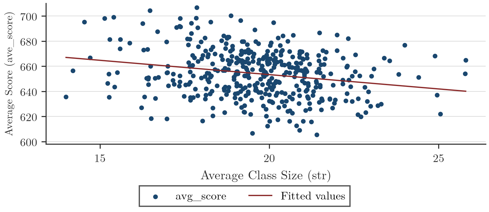
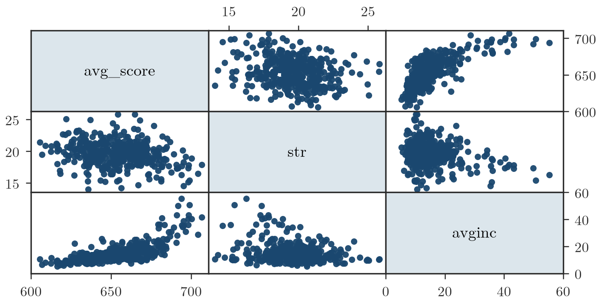
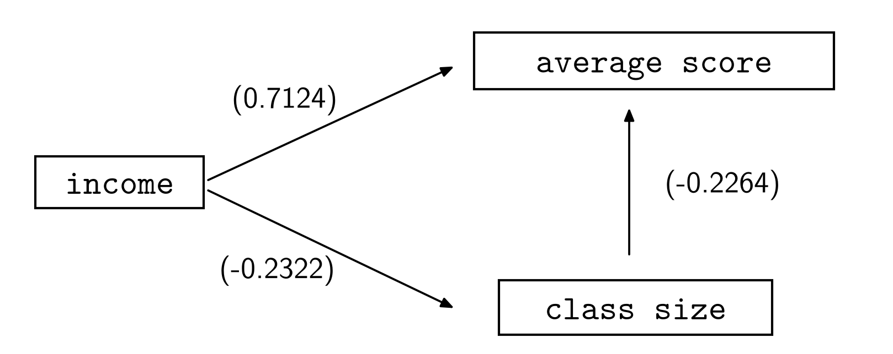
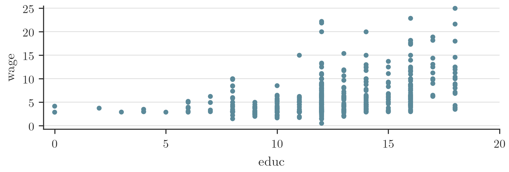
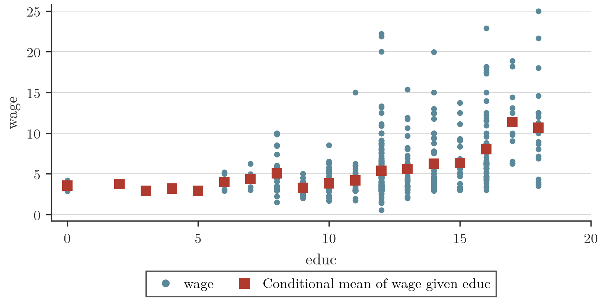
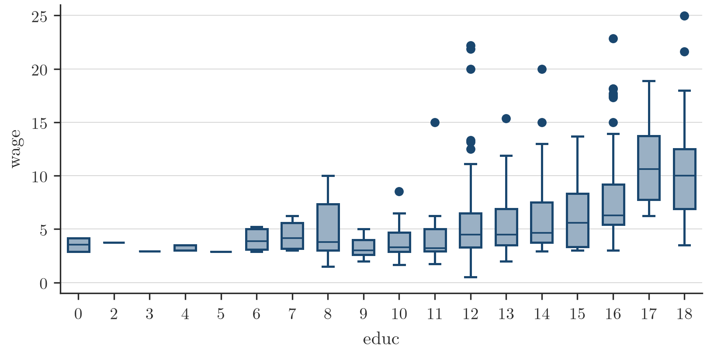

# Regressione semplice: esogeneità e relazione causale

## Le relazioni causa-effetto: richiamo

- Si resta su una componente di intuizione, ==perché secondo me è la cosa più importante da capire==: poi la formalizzazione statistico-matematica è abbastanza semplice.
- Una relazione causa-effetto ha tre caratteristiche sostanziali; la prima è una correlazione tra le variabili di interesse, ma non basta.
- La correlazione è simmetrica (Y con X come X con Y), la relazione causale è unidirezionale: X ha un impatto su Y ma non viceversa.
- Il controesempio dei boy scout e del record giudiziario: l'associazione può spiegare un fenomeno e il suo opposto, quindi non è relazione causale.

## Esempio: dimensione della classe e test

- Il problema posto in California: ridurre la dimensione della classe (asilo, scuola dell'infanzia) migliora l'apprendimento, cioè i test di fine anno? Intuitivamente sì, perché l'insegnante dedica più tempo a ogni bambino.
- Il costo è stato quantificato in circa 1,8 miliardi di dollari l'anno (più insegnanti, più classi, più attrezzatura). Vale la pena solo se la dimensione della classe è un driver logico, non solo statistico, della performance.

> [!question] Da verificare: la trascrizione riporta "L'incontro è che per implementare"; si è letto "Il contro è che".

- I dati sono su circa 420 distretti scolastici: ogni pallino è un distretto, x è la dimensione media della classe, y il punteggio medio al test.

- La retta che approssima la nuvola ha pendenza negativa: la correlazione è minore di zero. Primo ingrediente della relazione causale trovato.
- Secondo ingrediente: una spiegazione logica plausibile (più attenzione a ogni bambino in classi piccole), che non è detto sia corretta.
- Terzo ingrediente: escludere altre spiegazioni più convincenti. Non si troverà mai una spiegazione esaustiva e corretta, ma si considerano alternative ragionevoli con criteri di scelta razionali.
- Stimare la pendenza dice di quanto cambia il punteggio per un'unità di classe in meno (per esempio 10 punti, dipende dalla scala), ma ora il problema è capire se ci sono modelli migliori, per esempio con altre variabili congiuntamente.
- Candidato: il reddito. Distretti ad alto reddito hanno più libri in famiglia e scuole pubbliche mediamente migliori (negli Stati Uniti la scuola privata costa decine di migliaia di dollari l'anno e le case vicino a buone scuole pubbliche costano molto di più).
- Il reddito potrebbe avere effetto positivo sulla performance e negativo sulla dimensione della classe (negli Stati Uniti è il rapporto studenti-insegnanti, e le scuole migliori hanno più insegnanti). Omettendolo, si vede solo la relazione negativa tra le due variabili iniziali.

> [!question] Da verificare: la trascrizione riporta "se lo ometto vedo solo la marginale, vedo la correlazione condizionale"; le due parti si contraddicono.

## Come controllare per il reddito

- Si vuole controllare per il reddito: se due distretti non differiscono per reddito, la correlazione tra dimensione della classe e performance non può dipendere dal reddito, perché il reddito è uguale per tutti.
- Si divide il campione in distretti ricchi e poveri e si guarda la dipendenza in ciascun sottocampione. Se non cambia, il reddito non è rilevante e aggiungerlo non serve. Se cambia, il reddito è determinante e serve per spiegare la correlazione negativa.
- Per il ministro della California la domanda è se quei due miliardi di dollari l'anno servano. Se la correlazione negativa è solo un effetto collaterale del reddito, assumere docenti non serve e forse conviene dare sussidi alle famiglie meno ricche.
- Se le correlazioni nei due gruppi sono diverse, il reddito ha potere esplicativo; se restano uguali, la relazione resta uguale indipendentemente dal reddito.
- Se il modello più complesso non migliora, si tiene il precedente; se i numeri sono diversi, il precedente si scarta. L'analisi non è conclusa, perché potrebbero esserci altri fattori: si estende il modello, si confronta, si valuta in modo logico.
- La strategia è non fissarsi sull'idea iniziale ma estenderla per trovare la spiegazione migliore della correlazione negativa.

## Statistiche descrittive e schema causale

- Variabili: Avginc è il reddito medio per distretto, STR la dimensione della classe (student teacher ratio), average score il punteggio medio.
- La correlazione tra punteggio e dimensione della classe è meno 0,22, statisticamente significativa.
- Reddito e punteggio: correlazione altissima, 0,70, significativa. Reddito e dimensione della classe: correlazione negativa, i distretti ad alto reddito hanno classi mediamente piccole. *(slide 18)*

> [!question] Da verificare: la trascrizione riporta "0,70 per cento"; la slide 18 riporta 0.7124. Si riporta quanto detto a lezione.

- Queste sono solo analisi grafiche.

- Lo schema logico raccontato a parole:

- Senza reddito, il primo candidato è dimensione della classe e performance: relazione negativa, significativa, sensata. Con il reddito (relazione negativa con la dimensione, positiva con la performance) ci si chiede se la correlazione negativa sia diretta o spiegata dal reddito.
- Si divide il campione alla mediana del reddito (analisi grezza, poi si vedrà con la regressione). Nei distretti a basso reddito la correlazione diventa piccola e non è statisticamente significativa. *(slide 21)*

> [!question] Da verificare: la slide 21 riporta -0.1464 e la definisce "debolmente statisticamente significativa"; si riporta quanto detto a lezione.

- Per i distretti a basso reddito il reddito sembra il driver principale: condizionatamente al reddito basso la correlazione è sostanzialmente zero. Per i distretti ad alto reddito la correlazione è bassa e non significativa, con un p-value leggermente più alto.
- ==Il messaggio principale è questo: se controllo per il reddito, la correlazione tra le variabili che mi interessano e la variabile su cui voglio investire i soldi è non significativa.==
- Il modello con il reddito supera l'altro perché è informazione in più; la correlazione marginale non è importante perché quella condizionata al reddito non è significativa. Spendere due miliardi di dollari l'anno sulla dimensione della classe sarebbe spendere su una variabile solo apparentemente legata alla performance; forse conviene migliorare le condizioni delle persone poco abbienti.

## Anticipazione: il modello di regressione sull'esempio

- Modello di regressione tra punteggio e dimensione della classe: la pendenza è meno 2,27, con p-value zero, quindi esiste una pendenza negativa (la linea rossa dello scatter). È il primo modello.
- Aggiungendo il reddito, con la performance che dipende dalla dimensione della classe X1 e dal reddito X2, il coefficiente della dimensione si più che dimezza: anziché meno 2,2 è meno 0,64, con p-value più grande del 5%.
- Condizionatamente al reddito, la dipendenza lineare tra performance e dimensione della classe è zero. Un modello con due variabili equivale a dividere il campione in alto e basso reddito.
- Per capire se una relazione è causale si estende il modello in modo logico e si vede se migliora il precedente. Non si inseriscono variabili senza senso (il film di Nicolas Cage in California).
- ==Devo avere una storia da raccontare quando inserisco una variabile nel modello: non è che mi faccio dire dai dati cosa voglio spiegare. Questa è la cosa più importante.==

## Verso il modello di regressione semplice

- Si passa al trattamento formale del modello di regressione semplice: capito questo, l'estensione ai casi complicati cambia solo l'algebra.
- La relazione causa-effetto è buona se vale l'esogeneità, già accennata: le spiegazioni alternative non possono avere un impatto sistematico sulla relazione chiave tra le variabili.
- Le spiegazioni alternative stanno nel termine d'errore, tipicamente non osservabile: un bidone di informazioni che potrebbero avere impatto sulla relazione ma non sono usate.

## Esempio: salario e istruzione

- Problema classico dell'economia del lavoro: la relazione tra istruzione e salario. I dati sono degli anni '70 (salari orari in dollari, numeri piccoli).
- Sulle x c'è educ, l'istruzione in anni. Ogni colonna di punti è la distribuzione condizionale dei salari dei lavoratori con quel livello di istruzione (per esempio 10 anni, 15 anni). *(slide 3)*

- Al crescere dell'istruzione non cambia solo la media. I quadratini rossi sono le medie condizionali di ogni colonna e hanno una tendenza crescente: sotto i 5 dollari l'ora per chi ha poca istruzione, intorno ai 15 per chi ha studiato molto. *(slide 8)*

- Più studio, più in media guadagno, ma non è sicuro: dentro ogni gruppo c'è eterogeneità (il figlio di un dirigente, chi studia archeologia, l'effetto di genere).
- L'eterogeneità non è spiegata dall'istruzione, uguale in ogni colonna, ma da altro: reddito della famiglia, tipo di studi, intelligenza, genere, sede (Bocconi contro Cassino, i salari a Milano sono più alti). Questo altro si chiama termine d'errore, simbolo epsilon.

## Perché una relazione causale

- Con la relazione causale si può capire se una magistrale (studiare due anni in più, da 13 a 15) conviene in termini di salario orario atteso, e rispondere a domande del tipo: se aumento o riduco X, che cosa succede a Y?
- Il primo problema è definire un modello coerente e logico; poi lo si usa per analisi di policy, di scelte, di scenario.
- Altra rappresentazione dei dati: ogni sottogruppo approssimato da un box plot, che mostra centralità e dispersione. *(slide 6)*

## Il modello di regressione lavora sulle medie

- Il modello di regressione lavora sul momento di ordine uno, cioè sulle medie; interessano anche le varianze, ma l'obiettivo è come in media l'istruzione impatta sul salario.
- Serve un modello statistico che approssimi i quadratini rossi, che sono evidenza campionaria e non della popolazione. Interessa spiegare la popolazione, non il campione: nel campione basta guardare il file.
- Non serve essere troppo precisi sui quadratini rossi, che già si hanno. Interessa il quadratino verde, la media nella popolazione, che non si può calcolare perché richiederebbe di intervistare tutti i lavoratori degli Stati Uniti.

## Perché un modello semplice: l'overfitting

- Si usano modelli semplici. Una funzione complicata che passa esattamente sui quadratini rossi si trova con un bottone, ma non serve: le medie condizionali del campione (500 e qualcosa lavoratori) già si hanno, e la differenza tra due medie dà il passaggio da 12 a 14 anni. *(slide 10)*
- Serve una funzione che approssimi bene anche i quadratini rossi di campioni diversi della stessa popolazione.
- Un modello perfetto sui dati che si hanno porta all'overfitting: si adatta troppo bene ai dati del campione ma non alla popolazione.
- Esempio fatto alla lavagna: la popolazione ha pallini blu e rossi, il campione sono i blu. La funzione verde approssima esattamente i blu, ma sui rossi l'errore di previsione è gigantesco.
- È preferibile un modello che non sia perfetto né per il gruppo blu né per il rosso, ma che mediamente non sbagli in modo sistematico.
- ==Trovare un modello che si adatta troppo bene al campione non è necessariamente una buona notizia.==
- Un R quadro del 99% non è necessariamente una buona cosa; un R quadro del 20% potrebbe essere un ottimo modello.

## Perché una retta

- Si cerca una funzione che rifletta un andamento di lungo periodo, universale e non specifico per il dataset.
- Una retta è un modello molto semplice: due parametri, intercetta e coefficiente angolare, che caratterizzano il comportamento dei dati su tutta la popolazione.
- ==il modello di regressione non approssima i dati direttamente, ma approssima una caratteristica dei dati, le medie condizionali==. Approssimare i pallini blu è impossibile; le medie condizionali sono indicatori di centralità sufficientemente stabili.
- Altri modelli guardano a quantili e mediane: è la regressione quantilica, non parte del corso, interessante per le code delle distribuzioni, per esempio in finanza.

## La notazione e il termine d'errore

- I rendimenti medi di un portafoglio sono mediamente zero: in finanza interessano le code, non la media. In questo corso si guarda alle medie condizionali, ma si può generalizzare.
- La media si indica con E (expectation): prima la variabile su cui si fa la media, dopo la barra verticale il condizionamento. I quadratini rossi sono il valore atteso condizionale dei salari rispetto all'istruzione, con wage come Y ed education come X. Il modello di regressione è la media di Y dato X, definita con una retta; noti alfa e beta è identificato tutto. *(slide 11)*

$$E[Y \mid X] = \alpha + \beta X$$

> [!question] Da verificare: la trascrizione riporta "weight è la variabile y"; la slide 10 riporta "wage" e si adotta questa forma.

- Il legame tra le osservazioni individuali e la media condizionale: i è l'individuo (un lavoratore), $X_i$ la sua istruzione, $Y_i$ il suo salario.

$$Y_i = E[Y \mid X = X_i] + \epsilon_i$$

> [!question] Da verificare: la forma scritta viene dalla slide 11, il parlato non detta la formula.

- Il salario di un individuo ha due componenti: una media, per l'appartenenza a un livello di istruzione, e una idiosincratica, individuale, che raccoglie tutte le caratteristiche diverse dall'istruzione (genere, famiglia, essere sveglio, master in finanza o in storia dell'arte). *(slide 12)*
- ==Le caratteristiche di questo oggetto sono cruciali, perché sulla base di queste caratteristiche posso decidere se il modello statistico definito in questo modo è una relazione causale oppure no.== Conta in econometria più che in statistica.
- Si assume che la correlazione tra il termine d'errore e il fattore nel modello sia zero: si chiama esogeneità. Altrimenti si parla di endogeneità, con conseguenze pesanti sulla stima.
- Definizioni: Y è la variabile dipendente, X il regressore (letteratura economica) o predittore (letteratura statistica), epsilon il termine d'errore. Epsilon non è osservabile, quindi per verificare il modello bisogna girarci intorno.

## Perché l'errore non deve dipendere da X

- Modello $Y = \alpha + \beta X + \epsilon$: per prevedere il salario di chi studia $X_1$ anni si calcola $\alpha + \beta X_1 + \epsilon$. Epsilon potrebbe dipendere dall'istruzione (più studio, più aumentano le skill), quindi si scrive $\epsilon(X_1)$. *(slide 13)*
- Se si studia $\Delta X$ in più (due anni), il salario è $\alpha + \beta (X_1 + \Delta X) + \epsilon(X_1 + \Delta X)$ e il beneficio è la differenza con quello di prima:

$$\Delta Y = \beta \Delta X + \Delta \epsilon$$

*(slide 14)*

- $\Delta \epsilon$ non si può calcolare ma c'è. La variazione di Y si calcola (differenza dei quadratini rossi, per esempio 3 dollari), ma non si sa quanto dipenda dalla scelta di studiare e quanto da altro: i 3 dollari potrebbero essere 1 più 2, 0 più 3, meno 3 più 6.
- L'unico modo per identificare $\beta \Delta X$ è fissare $\Delta \epsilon$, e lo si fissa a 0. Se $\Delta \epsilon$ non è zero, $\Delta Y$ non è uguale a $\beta \Delta X$.

> [!question] Da verificare: la trascrizione riporta "Se delta y non è uguale a zero, vuol dire che delta x non è uguale a beta delta x"; scritta come $\Delta \epsilon \neq 0$ implica $\Delta Y \neq \beta \Delta X$, formulazione non ricavabile dal parlato.

- La variazione di epsilon rappresenta quanto cambiano le altre variabili non nel modello in corrispondenza di una variazione di X. È zero quando la correlazione tra X e Y è uguale a zero.

> [!question] Da verificare: la trascrizione riporta "correlazione tra x e y"; la slide 15 riporta $\mathrm{Cov}(X, \epsilon) = 0$. Nello stesso passaggio il parlato dice Y dove il testo ha scritto variazione di epsilon, sulla base della slide 14.

- È una struttura di dipendenza che deve essere zero; X si misura, l'altra quantità no. Con questa ipotesi l'unica spiegazione di una variazione di Y è la variazione di X pesata da beta, la pendenza. *(slide 15)*
- L'ipotesi si chiama esogeneità stretta, tipica dei modelli di regressione classici; nella seconda parte del corso si userà l'esogeneità debole. Se la correlazione è diversa da zero, non si sa valutare perché Y varia.

## Interpretabilità dei risultati e scopo del corso

- Il problema non è del modello di regressione in generale ma dell'interpretabilità dei risultati. In un corso di statistica l'eterogeneità non è considerata, perché lo scopo è fare previsioni sui prossimi dati.
- Qui interessa valutare con precisione il parametro, che dice quanti soldi si buttano via per l'istruzione dei bambini.
- Esempio: il bonus di mille euro della riforma Renzi, uno sconto fiscale a una fascia di lavoratori, per stimolare i consumi. Il costo è calcolabile (minore entrata dello Stato). Con consumi come Y e redditi come X (pro capite), la policy varia X di 1.000 euro: come sono variati i consumi?
- Se il parametro tra consumi e redditi è grande, 1.000 euro in più hanno un impatto sui consumi. Ma la variazione dipende da 1.000 euro in più o da altro (condizioni economiche del periodo)? Si vuole valutare l'impatto al netto degli effetti collaterali. Si pone un problema statistico, non si giudica la manovra.
- Si può investire molto e stimare un parametro grande, ma la policy ha impatto solo se si ipotizza che questa quantità sia zero; la variazione si calcola, ma non si sa da cosa dipenda.
- L'unico modo per essere sicuri dell'impatto è fissare a zero ciò che non si conosce; allora resta solo da stimare beta, il moltiplicatore.
- ==Non interessa avere un modello che si adatti ai dati o che mi serva per fare le previsioni: voglio un modello che mi stimi beta correttamente.== Per farlo serve fissare delta epsilon a zero. Lo scopo del corso è stimare beta, non fare previsioni decenti.
- Il genitore che sceglie la scuola ha un problema di forecast: se la variabile che prevede meglio la performance è la dimensione del parcheggio, funziona, è una black box. Non interessa il perché (come sapere che serviranno sette tonnellate di ferro in magazzino senza sapere perché la gente le compra).

> [!question] Da verificare: la trascrizione riporta "ragazzi, se frega se logicamente non ha senso, funziona" e "mozzoline di ferro"; si è reso il senso come "se logicamente non ha senso non importa, funziona".

- Per la previsione non interessa il parametro; per valutare politiche o confermare congetture economiche e finanziarie sì. L'unico modo per stimarlo correttamente è essere sicuri che la varianza di Y sia uguale a zero. Non c'è un approccio migliore: i problemi sono diversi.

> [!question] Da verificare: la trascrizione riporta "la varianza di Y sia uguale a zero"; il discorso precedente riguarda la variazione di epsilon, ma non si può stabilire se intendesse quella.

## La stima: i minimi quadrati

- Il metodo dei minimi quadrati trova alfa e beta tali che la distanza media tra Y e la trasformazione lineare di X sia la più piccola possibile. La distanza è al quadrato, perché gap positivi e negativi non si compensino. *(slide 17)*
- Si derivano rispetto ad alfa e beta, si pongono uguali a zero e si risolve il sistema di due equazioni in due incognite: beta è un rapporto di quantità, alfa una differenza di medie. Si mostra un'algebra più corta.

## La stima con il metodo dei momenti

- Si ipotizza che il modello sia corretto e semplice: la covarianza tra X e Y è uguale a zero, ipotesi di esogeneità.

> [!question] Da verificare: la trascrizione riporta "la covarianza tra X e Y"; la slide 15 riporta $\mathrm{Cov}(X, \epsilon) = 0$. Si riporta quanto detto a lezione.

- Se Y è alfa più beta X più epsilon, la covarianza tra X e Y è:

$$\text{Cov}(X, Y) = \text{Cov}(X, \alpha + \beta X + \epsilon)$$

- La covarianza di una variabile con una combinazione lineare è la combinazione lineare delle covarianze (sommatorie e integrali sono operatori lineari). La covarianza tra X e la costante alfa è zero; quella tra X ed epsilon è zero per ipotesi; quella tra X e beta X è beta per la varianza di X.

$$\text{Cov}(X, Y) = \beta \, \text{Var}(X)$$

- Quindi nella popolazione, il vero beta è:

$$\beta = \frac{\text{Cov}(X, Y)}{\text{Var}(X)}$$

- In ambito campionario, per la legge dei grandi numeri numeratore e denominatore convergono alla vera covarianza e alla vera varianza, quindi lo stimatore converge al vero beta. Con n osservazioni (nel caso specifico 526 lavoratori), $\bar{X}$ media campionaria: *(slide 18)*

$$\hat{\beta} = \frac{\sum_{i=1}^{n} (X_i - \bar{X})(Y_i - \bar{Y})}{\sum_{i=1}^{n} (X_i - \bar{X})^2}$$

- Questo si chiama metodo dei momenti: se il campione è abbastanza rappresentativo e n abbastanza grande, il rapporto approssima bene beta.
- Piace perché impone direttamente l'esogeneità tra le condizioni di stima: funziona solo se la covarianza vale zero. Minimizzando la distanza tra Y e il modello lo stimatore dei minimi quadrati coincide con questo; non sempre capita. *(slide 17)*

> [!question] Da verificare: la trascrizione riporta "se minimizzo la varianza di y"; la slide 17 riporta "minimizzare la varianza del termine di errore". Si riporta quanto detto a lezione.

## Cosa succede se non vale l'esogeneità

- La covarianza chiamata rho XY, un numero, è supposta diversa da zero:

$$\text{Cov}(X, Y) = \beta \, \text{Var}(X) + \rho_{XY}$$

- Se rho fosse noto:

$$\beta = \frac{\text{Cov}(X, Y) - \rho_{XY}}{\text{Var}(X)}$$

- Il software non sa stimare rho (non è noto) e fa finta che sia zero: la stima di beta è sistematicamente diversa dal vero beta nella popolazione.

> [!question] Da verificare: la trascrizione riporta "la covarianza tra X e Y" per rho XY; per coerenza con quanto detto dopo si intende il legame tra X ed epsilon, ma il parlato non lo precisa.

- Con endogeneità (correlazione tra X ed epsilon diversa da zero) lo stimatore non è collegato a beta ma a beta più qualcosa: distorsione sistematica.
- ==Il problema dell'endogeneità è che gli stimatori che vedremo in questo corso sono distorti, e la distorsione non sparisce neanche se aumento il numero di osservazioni, è sistematica.== La policy implication sarà sistematicamente sbagliata.
- Uno studente chiede se l'endogeneità sia l'assenza di esogeneità. Il docente risponde di sì: è il caso in cui la correlazione tra X ed epsilon è diversa da zero.
- Se l'errore è correlato con X il modello è sbagliato e andrebbe usata la formula corretta; il software non lo fa perché non gli si dice, e la stima di beta cambia in modo sostanziale.

## Ritorno all'esempio della dimensione della classe

- Nella regressione tra performance e dimensione della classe c'è un problema di endogeneità: nel termine d'errore c'è l'effetto reddito, che non è nel modello. La correlazione tra reddito e dimensione della classe è significativamente diversa da zero; stimando si ipotizza che sia zero, e la stima di beta è meno 2,27.
- Si toglie il reddito dall'errore e lo si inserisce nel modello.

> [!question] Da verificare: la trascrizione riporta "Togliamo da epsilon il termine d'errore, perché il candidato adesso è una rottura di scatole"; dal contesto si intende il reddito.

- L'epsilon del nuovo modello non contiene più l'effetto reddito, che ora è parte della media condizionale. Il parametro da meno 2,2 diventa 0,64.

> [!question] Da verificare: la trascrizione riporta "da meno 2,2 diventa 0,64"; poche frasi dopo dice "meno 0,64". Il segno resta da verificare.

- Probabilmente il modello precedente aveva endogeneità: si era usata la formula sbagliata facendo finta che la correlazione tra reddito e dimensione della classe fosse zero. Da meno 2,2 a meno 0,64: la distorsione non è piccola. Sono le conseguenze di stimare facendo finta che $\Delta\epsilon$ sia zero.

> [!question] Da verificare: la trascrizione riporta "ha un impatto tra note"; si è letto "notevole", ma non è certo.

- Tutto il gioco dell'econometria, a questo livello, è capire quando la variazione di epsilon è uguale a zero in corrispondenza della variazione di X. Il resto è algebra banale; la difficoltà è economica più che tecnica.
