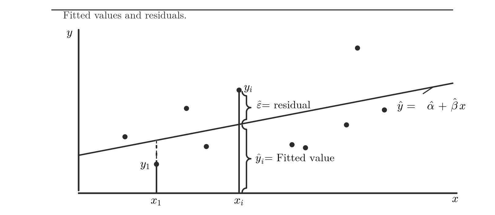
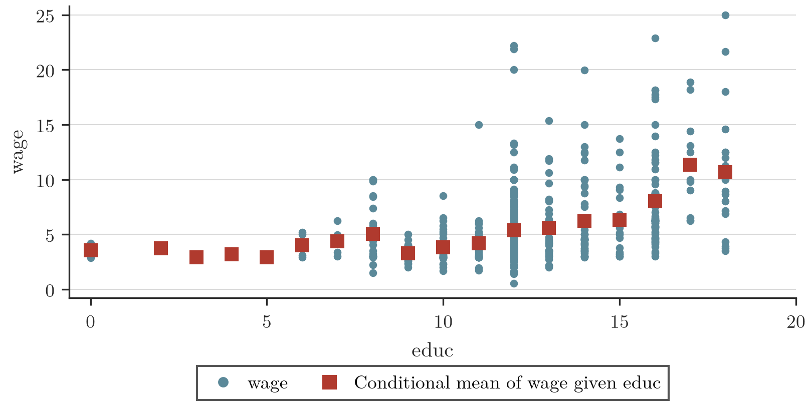
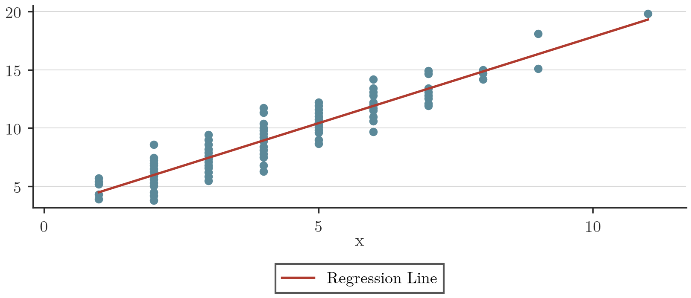
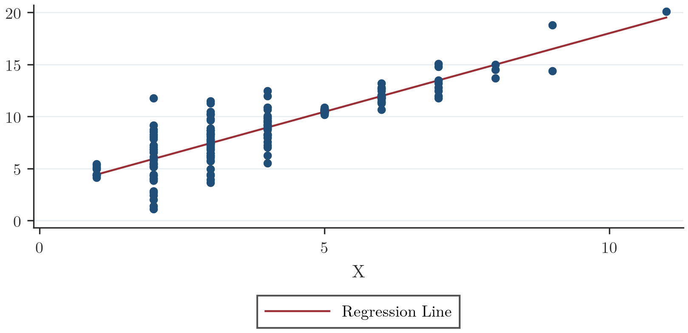
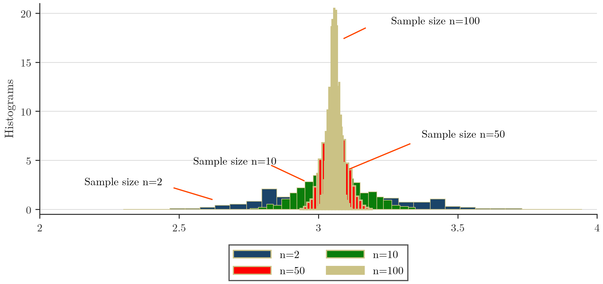

# Esogenità e proprietà dello stimatore OLS

## Ripasso: il modello di regressione e il termine d'errore

- Si parte dal modello di regressione semplice, ipersemplificato, ma quello che si vede su questo modello si trasferisce direttamente nei modelli più complessi.

> [!question] Da verificare: la trascrizione riporta "Poi può avanzare col modello di regressione semplice"; l'inizio della frase non è chiaro.

- Il modello di regressione è un valore atteso condizionato sulla variabile dipendente rispetto a X, il più semplice possibile: la retta.
- ==Questo valore atteso condizionato è da intendere sulla distribuzione di probabilità congiunta della popolazione, non nel campione.==
- È il vero modello nella popolazione, che non conosco e approssimo con una retta; l'ipotesi molto forte, legata all'ipotesi di esogenità, è che il modello sia semplice. Se l'approssimazione non è corretta, entro nell'ambito dell'endogeneità.
- Per legare il campione al vero modello aggiungo un termine d'errore, che descrive le caratteristiche individuali che differiscono tra persone a X fissata (genere, tipo di studio).
- Y è la variabile dipendente, X il regressore, epsilon è il termine d'errore: completamente casuale, non si può osservare e non si potrà mai osservare, rappresenta tutte le caratteristiche che non sono X dell'unità statistica i-esima del campione.

## Esogenità e relazione causale

- Si vuole spiegare le variazioni della variabile dipendente (il salario rispetto a quanto si decide di studiare, i consumi rispetto a più soldi ai lavoratori, il sommerso rispetto ai controlli fiscali).
- L'impatto della politica, il parametro beta, si identifica esattamente solo se posso escludere effetti collaterali, cioè variazioni di epsilon in corrispondenza della variazione di x; altrimenti le variazioni di y dipendono anche da qualcos'altro fuori dal mio controllo.

> [!question] Da verificare: la trascrizione riporta "le variazioni di epsilon, cioè quello che vorrei ottenere", ma la slide 14 riporta ΔY che dipende da ΔX e Δε, e si adotta "y"; "vi ricordo epsilon non è" resta senza seguito.

- Devo essere sicuro che questa roba sia fissa: ipotizzo che sia zero, cioè incorrelazione tra x e epsilon.
- Quindi ==l'ipotesi che mi serve per identificare una relazione causa-effetto minimale è che il mio modello sia corretto==, nel senso che la parte residuale deve essere completamente esogena, non collegata alla parte strutturale del modello.
- Con correlazione non so se la variazione dipende da questo pezzo o da questo pezzo: posso spendere un sacco di soldi senza accorgermi che beta è uguale a zero (bambini a scuola: meglio il reddito delle famiglie che la dimensione della classe, con due miliardi di dollari all'anno in sussidi).
- Con delta epsilon uguale a zero l'effetto della policy è proporzionale a beta, e lo stimatore di beta è la covarianza tra x e y diviso la varianza di x, nel campione. Senza l'ipotesi lo stimatore stima qualcosa di sistematicamente diverso.
- I software fanno finta che questa roba sia zero; se non lo è, quello che ottengo è diverso da quello che vorrei. È il problema pratico.

## Esempio con dati simulati

- Dati simulati: costante uguale a 3, coefficiente angolare uguale a 1,5, termine d'errore scelto correlato con x, quindi la formula covarianza diviso varianza è sbagliata.
- Le varianze sono tutte 1, quindi la covarianza tra x e epsilon, pari a 0,6, è anche la correlazione, molto alta. Il data generating process sono queste due equazioni.
- 200 osservazioni simulate; stimo beta con la covarianza tra x e y fratto la varianza di x, facendo finta che la covarianza tra x e epsilon sia 0.

*(slide 33)*

> [!question] Da verificare: la trascrizione riporta "y" al posto di epsilon; la slide 33 riporta cov(X, ε) = 0,6 e la slide 28 riporta Cov(X, ε) = 0, e si adotta "x e epsilon".

> [!question] Da verificare: "quindi sta lavorando nel 0" dopo "Sono queste due equazioni" non è comprensibile e si omette.

- Tabella fatta con Gretl. const, intercetta alfa: stima 2,96 contro il vero 3, intervallo di confidenza da 2,83 a 3,08, 3 ci sta dentro.
- Beta, vero 1,5, stimato 2,1, intervallo di confidenza tra 2 e 2,25: 1,5 sta fuori, è molto improbabile che sia il vero valore, ma io so a priori che lo è.
- 2,1 non è altro che 1,5 più 0,6; qua funziona perché la varianza di X è uguale a 1, sennò un altro numero, sempre una distorsione.

*(slide 33)*

- Dimenticando l'endogeneità l'impatto della policy lo sbaglio completamente, perché stimo non più beta ma beta più questo, che non so quanto grande sia (può essere 0,1, può essere 0,99 se guardo una correlazione).
- Più dati ho, più vado a sbattere contro 2,1, non contro 1,5, quindi sono molto preciso nello sbagliare. ==la distorsione che vedete qua in questo esempio non sparisce aumentando il campione.== La legge dei grandi numeri non mi aiuta nel teorema del limite centrale.

> [!question] Da verificare: la trascrizione riporta "non mi aiuta nel teorema del limite centrale"; forse "né il teorema", ma non si può stabilire.

## Come ragionare sull'endogeneità

- Nessuno dice se l'ipotesi che la covarianza uguale a zero sia valida: non posso dimostrarlo, ma devo ragionare per rendermi conto se sono in quella condizione.
- Un modo è capire quand'è che c'è correlazione tra x ed epsilon: se il modello ha troppe poche variabili, le altre stanno in epsilon e potrebbero essere legate alla x, il che induce correlazione, endogeneità e stime sistematicamente sbagliate.
- Tolgo informazione a epsilon e la inserisco nel modello: se aggiungendo variabili il parametro di interesse (tra 100 parametri se ne guardano 2, 3, il resto sono fattori di disturbo) cambia di tanto, nel modello con meno variabili c'è probabilmente un problema di variabile omessa. Se non cambia più, probabilmente le variabili importanti le ho messe tutte.
- Sono regole al pollice, non un teorema; il teorema dice che con troppe poche variabili le stime sono sbagliate sistematicamente. Empiricamente non è facile validarlo: aggiungo variabili finché le stime si stabilizzano.
- Capire le cause dell'endogeneità e lavorare su quelle finché il modello non ne soffra più; poi uso le formule standard.
- Senza pensare all'endogeneità quello che stimo non è beta ma beta più delta x. ==Ricordatevi questa tabella==, perché è più importante che la derivazione.

> [!question] Da verificare: la trascrizione riporta "beta più delta x"; la slide 32 riporta ΔY = βΔX + Δε e la slide 33 "(β + Δε)"; nel testo resta la forma detta.

> [!question] Da verificare: "Che poi questa... che la correlazione tra i saggi" e "il teoretiche" dopo "Ricordatevi questa tabella" non sono comprensibili e si omettono.

## Qualità del risultato e verifica dell'endogeneità

- La parte statistica è corretta: lo stimatore dei minimi quadrati o del metodo dei momenti è covarianza tra X e Y diviso varianza di X. Con endogeneità la qualità del risultato è bassissima; con esogeneità la formula dà esattamente l'effetto marginale, il parametro beta. Sennò tutti i modelli che uno stima sono da buttare.
- Esogenità e endogenità sono un'ipotesi: il modello deve essere corretto dal punto di vista logico, una relazione causa-effetto; ogni deviazione porta a risultati sistematicamente sbagliati.
- Se c'è endogeneità: uno, rispecifico il modello; due, uso stimatori non standard, tipo variabili strumentali, che non guarderemo in questo corso.
- Non si è mai sicuri della presenza di endogeneità: oltre al modello di interesse si stimano altre 50 regressioni per escludere alcuni tipi di endogeneità, per essere convinti che non manchino variabili e che siano misurate con una certa precisione.
- ==L'endogeneità non si può mai escludere, però bisogna lavorare per ridurre la probabilità che ci sia==.
- ==Ricordatevi che l'endogeneità è un problema economico, non è un problema statistico.== Per prevedere la Y la stima del parametro non interessa; in ambito economico interessa, perché dice quanto vale la policy, sennò si prendono decisioni costose e sbagliate.
- Alpha, l'intercetta, non è particolarmente interessante e si include a meno di ragioni fortissime per escluderlo.

*(slide 18)*

## Previsione e residuo

- Previsione o valore predetto: si approssima il valore atteso condizionale sostituendo ai veri parametri i parametri stimati, per un certo valore di x prefissato, scelto da voi; si scrive y con il cappellino.
- È una variabile casuale perché alpha e beta sono incerti: ho solo approssimazioni calcolate sul campione.

*(slide 20)*

- Residuo: il termine d'errore valutato per l'individuo i osservato, cioè il salario osservato meno la previsione di salario per un certo x.
- ==La cosa importante da ricordare a questo punto è che questo valore è diverso dal termine d'errore.== Il residuo è la distanza tra osservazione e previsione, riferita a una persona specifica, ed è un numero; epsilon è un concetto più astratto, la distanza tra ogni individuo della popolazione e il vero modello, ed è una variabile casuale. Non sono uno l'approssimazione dell'altro, ma il residuo ha una sua utilità.
- Nel grafico, sulla retta di regressione stimata, il valore predetto è una distanza, la componente residuale è l'altra.

## Quando OLS funziona: modello teorico e modello statistico

- Ci si chiede se covarianza e divisione per varianza danno in media risultati corretti e cosa succede se il campione cresce; tipicamente l'endogeneità nasce dal fatto che il modello che stimo come statistico non corrisponde al modello che descrive i dati nella popolazione.

> [!question] Da verificare: la trascrizione riporta "c'è sottoesogenità"; probabilmente "sotto esogeneità".

- Due concetti: il modello teorico, il processo generatore dei dati, che spiega la relazione nella popolazione tra le variabili e non lo sappiamo; il modello statistico, quello che fate voi, il comandino da mettere dentro un software.
- Se i due modelli coincidono non c'è endogeneità; se divergono potreste avere un problema di endogeneità, che crea problemi nello stimare i parametri di interesse.
- ==tutto il problema legato all'econometria è capire quali sono le proprietà di epsilon, in particolare i suoi momenti condizionali rispetto a X.==

## La media condizionale del termine d'errore

- Il modello statistico è $y = \alpha + \beta x + \varepsilon$, un modello teorico che definisce una media condizionale; ipotizzo che la media condizionale sia alpha più beta x.

*(slide 29)*

- Il valore atteso condizionale di Y dato X è, fissato X, alpha più beta X più la media condizionale di epsilon dato X.

> [!question] Da verificare: nella derivazione la trascrizione riporta "y" dove serve epsilon; le slide 23 e 29 riportano E[ε|X] = 0 ⇒ Cov(X, ε) = 0 e si adotta "epsilon".

- Coincide con la media condizionale vera se il modello è correttamente specificato, e questo implica che il valore atteso condizionale di epsilon dato x è uguale a zero.
- È una condizione leggermente più forte della covarianza tra x e epsilon uguale a zero, ma da essa si dimostra facilmente che la covarianza è zero.
- La covarianza è la media del prodotto incrociato tra x e epsilon meno la media di x per la media di epsilon; ipotizzo la media di epsilon uguale a zero (sennò riscalo epsilon e modifico l'intercetta, non cambia niente), quindi la covarianza tra X ed epsilon è la media del prodotto incrociato.

> [!question] Da verificare: dopo "la media del prodotto incrociato tra x e y" la frase "e qua entriamo in quello che dice il nostro collega" non è comprensibile e si omette.

- Che anche questa media sia zero si dimostra: la media di una variabile è la media delle medie condizionali.

> [!question] Da verificare: anche qui la trascrizione riporta "y" al posto di epsilon; dove si parla della variabile dipendente (la varianza di y dato x) resta "y".

- Salari di 500 e rotti lavoratori in sottogruppi disgiunti, con la media di ogni gruppo nei quadratini rossi. La media dei pallini blu, 1 fratto 526, è uguale alla media dei quadratini rossi pesata per il numero di osservazioni (due persone, vale due; 60 persone, 60). La media delle medie condizionali è uguale alla media marginale, anche nella popolazione.
- ==È un risultato che è abbastanza importante dal punto di vista statistico e si usa molto in econometria.== I passaggi nel caso discreto nei lucidi entro stasera.
- Per il prodotto incrociato: la media rispetto ai possibili valori di x della media rispetto a epsilon di x epsilon fissato x (i quadratini rossi). Fissato x, x è una costante e esce dalla media: media rispetto a x di x per la media di epsilon dato x, che è zero se il modello statistico coincide col modello teorico. Quindi la media rispetto a x di zero per x è zero, un integrale a misura uno di zero.

> [!question] Da verificare: dopo "Ho un integrale a misura uno di zero" la frase "quindi l'integrale di zero mi ne f x, quindi..." non è comprensibile e si omette.

## Esogenità come media condizionale nulla e come covarianza nulla

- La media di epsilon dato X, ==che effettivamente è la definizione corretta di esogenità, implica che la covarianza tra X ed epsilon sia uguale a zero.== Il viceversa non è necessariamente valido, ma questa implicazione è appena dimostrata.
- La media condizionale è un concetto complesso da ricordare, mentre la correlazione e la covarianza sono più naturali; in questo corso i due concetti si possono considerare sostanzialmente equivalenti: dalla covarianza uguale a zero non posso dimostrare il viceversa, ma è un caso patologico, ci sono controesempi.
- ==La cosa importante è che X non deve essere correlato con epsilon.== Come misuro la correlazione, così o così, cambia poco dal punto di vista intuitivo.

> [!question] Da verificare: anche in questo passaggio la trascrizione riporta "y" al posto di epsilon; la slide 29 riporta E[ε|X] = 0 ⇒ Cov(X, ε) = 0 e si adotta "epsilon".

- Primo criterio: capire se il modello che stimiamo è ragionevole per descrivere la relazione causa-effetto del data generating process, il processo che genera i dati.
- Devo capire se il mio modello statistico è una buona approssimazione di qualcos'altro, che purtroppo non è noto; per questo faccio ipotesi sul termine d'errore.

> [!question] Da verificare: la trascrizione riporta "la relazione causa-effetto che il data generating process, che il processo che genera i dati"; il nesso della frase non è chiaro.

## Varianza condizionale dell'errore: omoschedasticità ed eteroschedasticità

- Oltre alla media condizionale di epsilon uguale a zero, che dice che il modello va bene, si può fare un'ipotesi su un altro momento: la varianza di epsilon per ogni fissato valore di x.
- Indipendentemente da questa ipotesi le stime dei minimi quadrati vanno comunque bene, ma ha conseguenze sulla capacità di fare i test sui parametri, cioè sull'inferenza.
- Omoschedasticità: la varianza di epsilon fissato x è sostanzialmente costante. Eteroschedasticità: la varianza dell'errore varia in qualsiasi modo al variare di x.

*(slide 25)*

> [!question] Da verificare: la trascrizione riporta "fissato il però a livello di x"; "il però" non è comprensibile e si omette.

- Parlare di varianza di epsilon fissato x e di varianza della y fissato x è esattamente la stessa cosa: la varianza di y dato x è la varianza di alfa più beta x più epsilon.
- ==Mi manca un pezzo, questo è importante, dato x.== Fissato x, alfa più beta x è una costante, calcolabile in maniera esatta.
- Se traslo una variabile casuale la sua varianza non cambia: aggiungendo 3 a ogni faccia del dado sposto il fenomeno di 3 unità, ma la variabilità tra il più piccolo e il più grande non cambia.

> [!question] Da verificare: la trascrizione riporta "tra 6 e 1 faccio la differenza tra 4 e 1"; probabilmente "tra 9 e 4"; resta come detto.

- Quindi la varianza di alfa più beta x più epsilon, fissato x, è la varianza di epsilon dato x: la dispersione in ogni sottogruppo di lavoratori non dipende dal livello di istruzione, comune per tutti, ma da epsilon, tutto ciò che non c'è nel modello. Questa varianza è il coefficiente di eterogeneità dei lavoratori in ogni singolo sottogruppo.

> [!question] Da verificare: la trascrizione riporta "la variabile di tutto quello che non c'è nel modello"; probabilmente "la variabilità".

## Omoschedasticità ed eteroschedasticità sui dati

- Nel grafico dei salari la varianza condizionale di epsilon è eteroschedastica: al variare di x la dispersione tende ad aumentare condizionatamente, quindi l'ipotesi di omoschedasticità non sembra molto sensata. Non possiamo mai escludere una forma di eteroschedasticità; lo vedremo più avanti.
- La varianza non aumenta sempre con x, può anche diminuire, essere grande, piccola, piccola, grande: basta che non sia costante.

> [!question] Da verificare: nella trascrizione non è chiaro a quali gruppi del grafico si riferiscano "grande" e "piccola".

- Dati simulati omoschedastici: i soggetti si muovono intorno a una retta di regressione e la dispersione per ogni sottogruppo è più o meno costante; nelle code ho meno osservazioni e la variabilità può essere qualsiasi cosa.

- Nel caso eteroschedastico la dispersione aumenta, qua è grande, poi piccola, poi un po' grande: bisogna guardare le oscillazioni della y per ogni fissato livello di x; qua è un caso di non costante.

> [!question] Da verificare: la trascrizione riporta "Cosa mi aspetto da dei dati omoschedastici?" prima del caso eteroschedastico; "come nell'esempio qui da dire" non è comprensibile e si omette.

## Le due ipotesi sul termine d'errore

- Una è che la media condizionale sia uguale a zero: serve per definire un modello corretto dal punto di vista logico, per legare il modello a una relazione causale, non manca niente a quel modello.
- L'altra, aggiuntiva, è sulla varianza condizionale, costante o non costante: è di comodo, si gestisce in maniera più semplice, non è così importante, anche se bisogna starci un po' attenti.

> [!question] Da verificare: la trascrizione riporta "relazione casuale"; la slide 5 riporta "relazione causale" e si adotta questa forma.

## Lo stimatore OLS e il suo legame con il vero beta

- Uno stimatore è una strategia statistica che crea un legame tra dati e parametro. Si vuole capire se covarianza fratto varianza è legato al vero beta, indipendentemente dal campione, e cosa succede se il campione cresce.

> [!question] Da verificare: la trascrizione riporta "quella cosa varianza su varianza"; la slide 18 riporta Cov(X, Y) / Var(X) e si adotta "covarianza su varianza".

- Stimatore dei minimi quadrati, derivato con il metodo dei momenti ma coincidono: la sommatoria delle osservazioni sulla x meno la loro media aritmetica, che chiamo x segnato, per la y i meno la media aritmetica, diviso la sommatoria per i da 1 a n della varianza della x, con n il numero di osservazioni nel campione; ==ipotizzo che i dati siano campionati dalla popolazione in maniera indipendente, questo è importante==.
- Per legarla al vero beta sostituisco y con alfa più beta x più epsilon, ma prima semplifico il numeratore: la sommatoria di x i meno x segnato per y i, meno la sommatoria di x i meno x segnato per y segnato; il termine di destra fa zero, perché y segnato è una costante e le deviazioni dalla media fanno zero.

> [!question] Da verificare: per la media campionaria di x la trascrizione riporta "xi segnato", "x i-enne", "x n"; la slide 37 riporta X̄ e si adotta "x segnato"; "per yi" dove servirebbe "per x i" resta come detto.

- Sostituisco y i con alfa più beta x i più epsilon i: sommatoria per x i meno x segnato che moltiplica alfa più beta x i più epsilon i, tutto diviso la sommatoria degli x i meno x segnato, tutto alla seconda.

> [!question] Da verificare: "E anche qua ho aggiunto, prova, anziché toglierla" non è comprensibile e si omette.

- Uno studente chiede perché il secondo termine è zero; il docente risponde che è una costante, si butta fuori dalla sommatoria, e gli scostamenti rispetto alla media fanno zero.
- Sviluppo ancora il prodotto in tre sommatorie, con alfa, con beta per x i e con epsilon i, diviso la varianza campionaria: il termine con alfa è zero; nel termine con beta posso sottrarre zero, cioè la sommatoria degli x i meno x segnato per x segnato, e raccogliere: a meno di beta, numeratore e denominatore sono la stessa roba e spariscono.
- Resta beta più la sommatoria degli x i meno x segnato per epsilon i fratto la sommatoria degli x i meno x segnato al quadrato.
- Rispetto al vero modello, quello per cui la media condizionale di y dato x è uguale a alfa più beta x, la mia formula è uguale allo stimatore più una componente di rumore che dipende dall'eterogeneità dell'individuo.

*(slide 37)*

> [!question] Da verificare: "y non uguale a" non è comprensibile e si omette; la slide 37 riporta β̂ = β + Σ ωᵢ εᵢ, e si lascia la forma detta dal docente.

## Valore atteso dello stimatore

- Lo stimatore è una variabile casuale perché dipende dai dati: cambiando campione cambia la stima; posso calcolare valore atteso e varianza.
- Valore atteso condizionale, fissato x (tutte le x del campione): un campione con la stessa x, che differisce solo da epsilon (esempio dei colleghi di dottorato: stessa caratteristica, scelte diverse, salari diversi).
- ==Ricordatevi che x è fissato, tutti gli x sono fissati, ma epsilon no.== Epsilon è una variabile casuale.
- La media di una costante più una variabile casuale è la costante più la media della variabile casuale: beta più la media della sommatoria degli x i meno x segnato per epsilon i fratto la sommatoria degli x i meno x segnato alla seconda.
- Il denominatore dipende solo da x, quindi è una costante. ==La media di una costante per una variabile casuale è la costante per la media della variabile casuale, ricordatevi questo.==
- La media di una somma è la somma delle medie (esempio: reddito familiare di una famiglia con due lavoratori); quindi porto dentro la sommatoria l'operatore aspettativa.

> [!question] Da verificare: "e ho il tempo" a chiusura della frase non è comprensibile.

- Fissato x, gli x i meno x segnato escono dalla media: beta più uno fratto la sommatoria degli x i meno x segnato alla seconda, per la sommatoria degli x i meno x segnato per la media di epsilon dato x. Questa deve fare zero se il modello è corretto. Vuol dire che ==in media il mio stimatore è uguale a beta.==

*(slide 38)*

- Prendendo campioni simili e calcolando beta tante volte (beta cappellino uno, due, tre, quattro, cinque, sei, e avanti così), la media di tutte le crocette deve essere il vero beta. Si dice che lo stimatore è non distorto: non devia sistematicamente rispetto al vero valore parametrico.
- Per ora guardo solo la media, non la distribuzione, che si calcola esattamente o in maniera asintotica, approssimata. Per la distribuzione di campioni finiti servono ipotesi maggiori sul termine d'errore; non la faccio perché non serve realmente, sono contrario alla distribuzione di campioni finiti.

> [!question] Da verificare: la trascrizione riporta "campioni infiniti" in entrambi i punti; la slide 43 riporta "campioni finiti", e si adotta questa forma.

- Ho un solo campione, quindi non so quanto sono distante dalla media. ==L'importante da notare è che questa distanza dipende solo da epsilon, quindi dipende solo dall'eterogeneità delle osservazioni.== Non dipende dal fatto che il modello sia sbagliato o che sto sbagliando le formule, e non la so valutare a monte.

## Varianza dello stimatore e consistenza

- Serve la distanza media tra lo stimatore e il vero valore del parametro; la misura è la varianza. Varianza dello stimatore dato X: la varianza di beta più la sommatoria degli x i meno x segnato per epsilon i fratto la sommatoria degli x i meno x segnato alla seconda, dato X.

> [!question] Da verificare: la trascrizione riporta "xi meno il segnato" e "xi meno xi"; la slide 37 riporta X̄ e si adotta "x segnato".

- Beta non conta, perché la varianza è insensibile alla traslazione. Per semplificare ipotizzo omoschedasticità, varianza condizionale di epsilon dato X costante; il caso generale poi.
- Il denominatore, costante fissato X, esce dalla varianza al quadrato. I dati sono indipendenti, quindi la varianza della somma è la somma delle varianze; la varianza di epsilon dato x, se costante, la chiamo sigma quadro e la porto fuori dalla sommatoria: sigma quadro per la sommatoria degli x i meno x segnato alla seconda, fratto la sommatoria degli x i meno x segnato alla seconda, tutta alla seconda; il numeratore si semplifica col quadrato.

*(slide 39)*

- Dividendo per uno su n e uno su n il denominatore è la varianza di x, che con n abbastanza grande converge alla varianza della popolazione della x; più grande n, più piccolo è il numeratore.
- Il denominatore converge a una costante e il numeratore a zero: all'aumentare delle osservazioni la variabilità dello stimatore tende a zero, quindi il mio stimatore è consistente. Con abbastanza dati in un modello corretto il numero in tabella collasserà al vero valore del parametro.

## Distribuzione dello stimatore al crescere di n

- Simulati 10.000 campioni di dimensione 2 dalla stessa popolazione, istogramma blu; poi 10.000 campioni di dimensione 10, con una distribuzione più concentrata.

> [!question] Da verificare: la trascrizione riporta "dimensione n2"; la slide 41 riporta "Sample size n=2" e il docente dice poi "dimensione 2", e si adotta "dimensione 2".

- Con dimensione 10 è impossibile trovare quel numero, non capita mai, perché sono molto più preciso; con 100 la distribuzione è molto più schiacciata attorno alla media, il vero parametro.
- Se n tende all'infinito lo stimatore dà sempre lo stesso numero: media beta e varianza zero, trovo il vero beta. È un risultato teorico asintotico.
- ==E più grande è n, più piccola è la varianza, più schiacciata la distribuzione.== Con 100 osservazioni una stima molto distante dal vero beta non capita mai.

## Le ipotesi e che cosa conta

- ==Queste sono le ipotesi, i risultati fondamentali che ci interessano.== Sotto l'ipotesi di esogeneità lo stimatore è non distorto; sotto indipendenza delle osservazioni e varianza costante, cioè omoschedasticità, tende ad essere consistente.
- Il secondo risultato si può dimostrare anche con dati dipendenti ed eteroschedasticità, ma qua la formula è più semplice.
- Per il modello di regressione semplice, ==se c'è l'esogenità è la cosa cruciale, tutte le altre ipotesi che facciamo sono tipicamente di comodo==, tipo l'indipendenza delle osservazioni e l'omoschedasticità.
- Senza l'esogenità non funziona niente, le altre ipotesi sono discutibili e le vedremo più avanti. La settimana prossima si continua con questa teoria e poi si aggiungono altri ingredienti.
