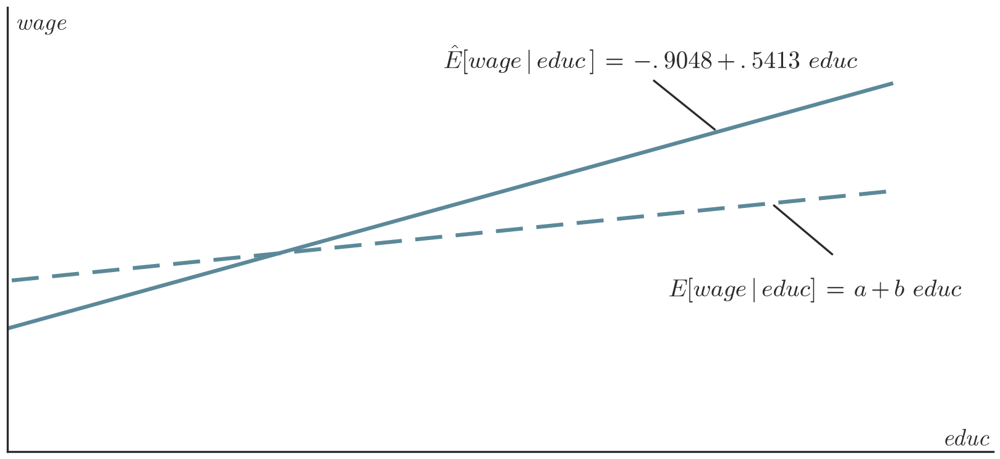
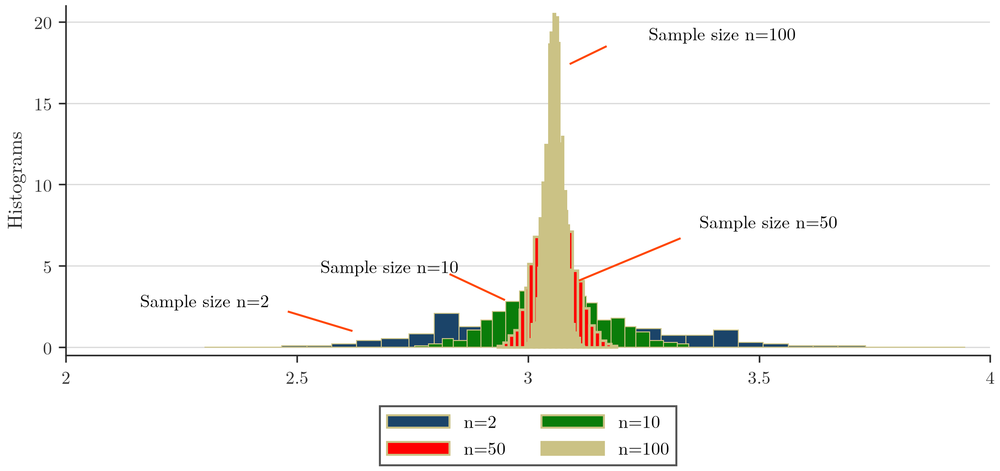
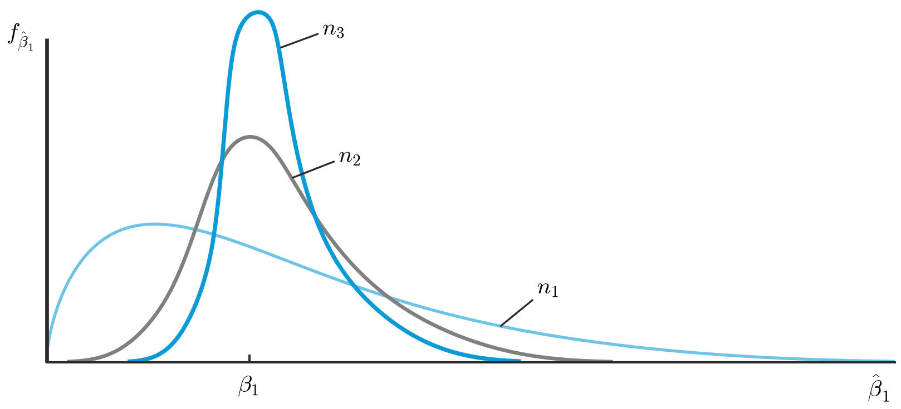
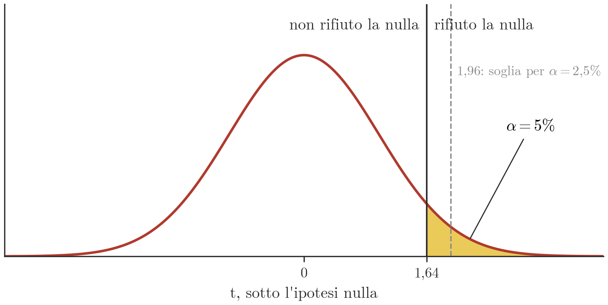
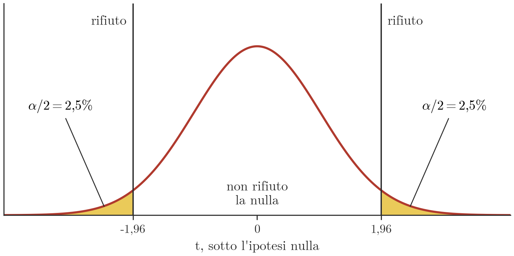

# Inferenza su beta, R quadrato e regressione multipla

## Ripasso: esogeneità e proprietà dello stimatore

- La settimana scorsa: ==ha senso stimare i parametri solo se il termine d'errore è incorrelato col regressore==; in quel caso siamo in una condizione di esogeneità.
- Senza esogeneità la correlazione tra x ed epsilon si trasferisce nello stimatore: in media non è più uguale al vero valore del parametro e, con molte informazioni, la stima converge al vero valore più qualcos'altro.
- Sotto esogeneità, in media lo stimatore è uguale al vero valore del parametro, che è quello che vorrei stimare.

> [!question] Da verificare: la trascrizione riporta "cioè il fatto della mia decisione economica"; probabilmente "l'effetto".

- La varianza dello stimatore è $\sigma^2$, la varianza del termine d'errore, diviso la sommatoria degli $x_i$ meno $\bar{x}$ alla seconda.

> [!question] Da verificare: la trascrizione riporta "degli xi meno il segnato alla seconda"; si adotta $\sum_{i=1}^{n}(X_i-\bar{X})^2$ della slide 39.

- Il denominatore è la varianza campionaria di x: per la legge dei grandi numeri converge alla varianza nella popolazione, una costante, se esistono momenti finiti almeno fino all'ordine due.

> [!question] Da verificare: la trascrizione riporta "Non posso usare le variabili x uguali a così, però posso usare le normali"; senso non chiaro.

- Il numeratore è uno fratto n per una costante, la varianza del termine d'errore.

> [!question] Da verificare: la trascrizione riporta "questo è il denominatore di massima semplicità"; senso non chiaro.

- Questa quantità converge a zero: con campioni grandi qualsiasi campione dà una stima non molto diversa da beta e la distanza media dal vero valore è piccola. Questa proprietà si chiama consistenza, cioè la convergenza dello stimatore.
- In un modello endogeno lo stimatore in media è beta più delta (qui negativo): si concentra intorno a beta più delta e non al vero valore e collassa su quel punto, "molto preciso nello sbagliare". È una distorsione sistematica: non consistenza.

> [!question] Da verificare: la trascrizione riporta "sotto ipotesi di ..." e "la distribuzione delle ... tende": parola mancante, probabilmente endogeneità.

## Il materiale online e la retta stimata contro la retta vera

- Online: i risultati sulla legge delle aspettative iterate e gli appunti con grafici rifatti, una versione più coerente.
- Lo scopo del modello di regressione è stimare la retta di regressione (tratteggiata) sulla base di un campione (punti neri). La retta stimata non è necessariamente la riga verde tratteggiata, che è il vero modello.
- Con più informazioni gli stimatori di alfa e beta convergono al vero valore e la retta stimata converge al vero modello. Se ho eterogeneità, non converge mai.

> [!question] Da verificare: la trascrizione riporta "eterogeneità"; probabilmente "endogeneità".

- Idea grafica:

> [!question] Da verificare: la trascrizione riporta "Quindi io costruisco modello... Estratto che dovrebbe essere per la popolazione"; passaggio non chiaro.

- La popolazione non ce l'ho: stimo sul campione pendenza e intercetta (l'intersezione con l'asse delle y). Le due rette sono diverse, ma con più pallini grigi, se il modello è esatto e il regressore esogeno, la retta stimata dovrebbe convergere al modello, o si spera al modello causale.

## Il teorema di Gauss-Markov

- Risultato non particolarmente importante ma su tutti i libri. Tutti usano i minimi quadrati perché sotto certe condizioni è il modo più preciso di mettere insieme le informazioni: la varianza dello stimatore più piccola possibile.
- Condizioni: modello lineare nei parametri, non nelle variabili; campionamento casuale semplice (le coppie X, Y dei singoli individui sono indipendenti tra loro, non X da Y); esogeneità; omoschedasticità, ==qua è strettamente necessaria==.
- Lo stimatore dei minimi quadrati, o LS, ha la varianza più piccola tra tutti gli stimatori lineari e non distorti.

*(slide 42)*

- Lineare vuol dire scrivibile come sommatoria; OLS è un rapporto di sommatorie e garantisce l'efficienza maggiore, cioè i risultati più precisi.
- Al docente non piace molto: le ipotesi non sono quasi mai verificate e gli stimatori non distorti non sono sempre i più interessanti. Se la distorsione è nota, per esempio 0,5, la si sottrae; con distorsione piccola e guadagno in precisione molto più grande si potrebbe usare uno stimatore diverso. È comunque un vincolo.
- Ricordatevi: ==per questo teorema è importantissima, è chiave, oltre che quella di esogeneità, anche l'ipotesi di omoschedasticità==, cioè la varianza condizionale del termine d'errore è costante rispetto a x.

> [!question] Da verificare: la trascrizione riporta "oltre che quella di omogeneità"; si adotta "esogeneità" (slide 42).

## La distribuzione dello stimatore

- Dimostrazioni non fatte: funziona come per la media aritmetica. Vorrei la distribuzione di probabilità dello stimatore, la variabile casuale che raccoglie le stime da campioni diversi, di cui l'istogramma.
- Due casi: n fissato (20, 35, 47, 100, 10.000) oppure n che tende all'infinito; interessa di più il secondo. I risultati in campioni finiti richiedono ipotesi aggiuntive, tra cui che l'errore, oltre che incorrelato con X, sia gaussiano.

> [!question] Da verificare: la trascrizione riporta "il campione infinito non è particolarmente interessante"; probabilmente "finito".

### Campioni finiti: errore gaussiano

- Con n fissato assumo l'errore gaussiano con media zero e varianza sigma quadro, per ora un parametro noto. Allora questo rapporto ha media zero e varianza uno: lo stimatore si distribuisce più o meno come una normale con media il vero valore del parametro (non distorto) e una varianza calcolabile.
- Due ipotesi importanti: conosco questo numero; epsilon è gaussiano, oltre che incorrelato con x.

*(slide 43)*

- Sono difficili da soddisfare. Epsilon non si osserva: l'ipotesi è di convenienza e non si può validare. Sigma quadro noto è tipico di fisica e chimica, dove è la precisione del macchinario (per esempio 10 alla meno 5 millimetri), non delle scienze sociali (salari, età).
- Il risultato dà un istogramma a campana, ma nella vita reale è insostenibile: non so se epsilon è gaussiana, non so qual è la media.

> [!question] Da verificare: la trascrizione riporta "non so qual è la media"; probabilmente "la varianza".

### La t di Student

- Se epsilon è gaussiano ma sigma quadro va stimato, il rapporto è una t di Student con n meno due gradi di libertà: con 635 osservazioni, 633 gradi di libertà, che controllano la varianza.
- L'unica differenza è il denominatore da stimare: nel caso normale lo conosco, è la varianza campionaria; ora la distribuzione diventa t di Student anziché normale.
- Se n meno 2 è superiore a 30 la t è indistinguibile dalla gaussiana: con più di 30-35 osservazioni uso l'approssimazione normale. Con meno di 30 non mi fiderei comunque, per la troppa variabilità campionaria: tanto vale usare la normale, giustificata anche dalla teoria asintotica.

### Campioni grandi: normalità asintotica

- Con n che tende all'infinito, la deviazione dello stimatore dal vero valore, moltiplicata per il numero di unità campionarie, converge a una normale con media zero e varianza asintotica, funzione di x e sigma quadro: se n è grande lo stimatore è normale con media beta e questa varianza.

> [!question] Da verificare: la trascrizione riporta "moltiplicata per il numero di unità campionarie"; le slide 44 e 45 non riportano il fattore, ma poco dopo il docente dice "devo moltiplicare per radice quadrata di n".

- Con n finito, per esempio 100 osservazioni, calcolo il numeratore e divido per 100: approssimazione normale con media beta e un numero. Se n diverge questo numero è molto piccolo e lo stimatore converge al vero valore, come già sapevamo dalla varianza che collassa a zero.

> [!question] Da verificare: la trascrizione riporta "se n è diverso, cioè un campione molto grande"; probabilmente "se n diverge".

- Con n grande valgono la legge dei grandi numeri e il teorema centrale del limite: la distanza tra stimatore e parametro è gaussiana, ma per una distribuzione non degenere si moltiplica per radice quadrata di n.
- Senza il fattore la varianza collassa a zero e lo stimatore è una variabile casuale degenere: per n all'infinito beta cappellino è uguale a beta con probabilità 1 e diverso con probabilità 0. Non permette di fare inferenza né test; per i test si pesa di più il numeratore con radice quadrata di n. È il teorema centrale del limite, come per la media aritmetica a statistica, perché beta (e alfa) si scrive come un rapporto di medie.

> [!question] Da verificare: la trascrizione riporta "converge a zero valore parametrico"; si legge "al vero valore".

- Spiegazione "all'acqua di rose": per osservazioni indipendenti, la media aritmetica converge, per il teorema centrale del limite, a una normale zero uno.

> [!question] Da verificare: la trascrizione riporta "alla media della popolazione individuo quella varianza della media aritmetica"; la slide 45 riporta $(\bar{Z}-\mu_Z)/\sigma_{\bar{Z}} \to N(0,1)$, passaggio non chiaro.

- Nel modello di regressione il numeratore è fatto di prodotti incrociati (osservazioni meno la media), chiamati z i, indipendenti tra loro perché x e y sono pescati in modo indipendente rispetto all'individuo i. Il numeratore è uno fratto n per la loro media, quindi vale il teorema del limite centrale, con momenti quarti di x e y esistenti: non una t di Student con tre gradi di libertà, con cinque va già bene.
- Il numeratore converge a una normale con media zero e varianza uno; il denominatore converge in probabilità alla varianza di x, una costante; il rapporto è normale, con varianza uno perché la variabilità del numeratore è compensata da quella del denominatore.

*(slide 45)*

- Beta cappellino meno il suo valore atteso, diviso la sua variabilità, è una gaussiana con media zero e varianza uno: da qui il risultato asintotico.
- Legge dei grandi numeri al denominatore, teorema del limite centrale al numeratore: lo stimatore di beta è come una media aritmetica, qui due (covarianza e varianza), che convergono con campione indipendente e identicamente distribuito. L'istogramma di, non so, 10.000 campioni si approssima a una campana.

### Che cosa mostrano i grafici

- Il grafico mostra questo risultato: all'inizio la distribuzione è strana, con code asimmetriche; con più osservazioni si schiaccia intorno al vero valore, 3,2, ed è sempre più una campana, la normale.

> [!question] Da verificare: la trascrizione riporta "che so essere questo, è 3,2"; la slide 41 non riporta il valore del parametro.

- Quelli sono dati reali, su una popolazione disponibile; questo è un grafico astratto.

- Se n è grande lo stimatore è ben approssimato da una gaussiana; se n è piccolo può essere asimmetrico. ==È importante ricordare che ognuna di queste curve qua disegnate ha sempre la stessa media beta, ma non necessariamente è simmetrica.==
- Media e moda possono essere diverse. Più osservazioni, migliore l'approssimazione a campana: intuizione della teoria asintotica. Le derivazioni analitiche non si fanno; è la stessa cosa della media, con notazione più complicata.

## Verifica d'ipotesi su beta

- L'approssimazione serve per fare inferenza: con la distribuzione dei risultati possibili posso fare un test di ipotesi, per esempio per vedere se un valore di interesse del parametro è coerente con le stime.
- Esempio: iscriversi alla magistrale, due anni di studio in più, se il guadagno atteso nella paga oraria è almeno un euro in più (numeri a caso). Serve un test.
- Modello y uguale ad alfa più beta x più epsilon, con covarianza tra x ed y uguale a zero: il modello si comporta bene.

> [!question] Da verificare: la trascrizione riporta "la covarianza... Tra x ed y sia uguale a zero"; probabilmente la covarianza tra x ed epsilon.

- La variazione attesa di y per due anni in più di studio è beta, il moltiplicatore della scelta economica; assumo nessun effetto collaterale, variazioni di y senza rilevanza in media.

> [!question] Da verificare: la trascrizione riporta "variazioni di y non abbiano nessuna rilevanza in media"; probabilmente le variazioni del termine d'errore (la slide 14 pone $\Delta\epsilon=0$).

- La condizione (guadagno maggiore di uno, soglia minima) si verifica se beta è maggiore di un mezzo.
- Stimare beta e confrontarlo con un mezzo non funziona: il beta stimato è l'evidenza campionaria, non quello della popolazione su cui voglio decidere; un campione diverso darebbe un altro risultato e l'errore campionario non lo posso quantificare. Voglio una decisione corretta probabilisticamente, perché misuro solo una sottoporzione della popolazione. Quindi devo fare un test.

### Ripasso del test di ipotesi

- Ripasso: un test decide tra l'ipotesi nulla, H0, e l'alternativa, H1 oppure Ha (stessa roba); una sta per alternativa, una per uno che è diverso da zero.

> [!question] Da verificare: la trascrizione riporta "Negli uffici non so cosa ho messo", "zero vuol dire vero, uno vuol dire falso" e "0, 1 commercio di interruttori"; le slide 52 e 53 scrivono Ha, ma "uffici" non si scioglie.

- Metto la condizione sotto l'alternativa, beta maggiore di un mezzo: se i dati sono più coerenti con questa farò il master. La nulla è il suo opposto, beta minore o uguale di un mezzo.
- Il caso più difficile è beta uguale a un mezzo contro beta maggiore, dove la distinzione è minima: un mezzo è il punto più vicino all'insieme dell'alternativa. Quindi è equivalente scrivere beta uguale a un mezzo.
- Se rifiuto col beta più vicino all'alternativa, rifiuto ancora più violentemente con un beta più piccolo (per esempio beta uguale a un quarto): rifiutando con beta a un mezzo, rifiuto per qualsiasi beta minore di un mezzo. Si prende la condizione più sfavorevole all'alternativa.

### La statistica t sotto la nulla e sotto l'alternativa

- Procedura di Neyman e Pearson. Se credo ciecamente nella nulla, il vero beta è un mezzo: lo stimatore meno un mezzo, diviso lo standard error (la precisione della stima), per la teoria asintotica è una normale con media zero e varianza uno.

> [!question] Da verificare: la trascrizione riporta "beta cappellino, è la varianza quadrata della varianza"; probabilmente "la radice quadrata della varianza di beta cappellino".

- Questa quantità è la t (z con la teoria asintotica: le lettere non sono importanti). Con 100.000 stimatori da 100.000 campioni, l'istogramma è ben approssimato dalla normale 0,1: la distribuzione della t sotto l'ipotesi nulla.
- Se è vera l'alternativa, beta è mediamente maggiore di un mezzo e la media del numeratore è maggiore di 0: con vero beta 5, la media sotto l'alternativa è 5 meno un mezzo. La distribuzione è ancora normale ma shiftata a destra.
- Ho un solo campione: guardo dove cade la t osservata. Se la t osservata sta in un punto del grafico, la curva rossa è più probabile della nera; se sta in un altro punto, è più probabile l'alternativa. Cerco una soglia, una barra verticale, da calcolare razionalmente.
- Dove la curva rossa assegna probabilità zero non si discute; dove assegna una probabilità piccola ma molto più grande della nera è più probabile la nulla. Nell'area intermedia, coerente con entrambe, la decisione è difficile.

### La soglia e l'errore del primo tipo

- Neyman e Pearson: un errore lo posso fare, ne controllo la probabilità. Costruisco la soglia tale che, rispetto alla curva rossa, la probabilità di eccederla sia alfa, tipicamente 1, 5, 10 per cento; più grande in macroeconomia, perché i dati sono pochi.
- L'area gialla è la probabilità di sbagliare: oltre la soglia rifiuto la nulla (più probabile la curva nera), ma la rossa potrebbe essere corretta. È l'errore del primo tipo.
- Con la soglia la probabilità di sbagliare non è mai maggiore di alfa; se alfa è piccola, quell'errore non lo faccio praticamente. Con alfa 2,5 per cento la soglia è 1,96 (tavola della normale): t inferiore a 1,96, nulla; sennò alternativa. Con il 5% la soglia è 1,64: inferiore a 1,64, nulla, alternativa altrimenti. È un test unilaterale a destra.

### L'errore del secondo tipo

- Errore del primo tipo: scelgo l'alternativa quando è vera la nulla. Errore del secondo tipo: scelgo la nulla quando è vera l'alternativa.
- Si fissa il primo e il secondo non si guarda, si spera piccolo: gli errori hanno conseguenze diverse, il secondo è considerato meno grave, il primo più grave.
- Esempio dello space shuttle: la NASA doveva decidere se lanciare, con le guarnizioni a rischio per il freddo, o non lanciare e perdere i diritti televisivi. Errore grave: lancio ed esplode. Errore non grave: non lancio e perdo i soldi della diretta.

> [!question] Da verificare: la trascrizione riporta "si sono rotte le plastiche dei serbatoi, c'era lo spaziale, le guarnizioni" e "In modo visivo. All'epoca si facevano diverse robe, prima..."; senso non chiaro.

- Il primo tipo è quello che fisso; il secondo si spera il più piccolo possibile. La probabilità di errore del secondo tipo si chiama potenza, quanto la procedura sbaglia nell'altra direzione; "è una roba che non ho mai capito bene, quindi vabbè, saltiamo".

> [!question] Da verificare: la trascrizione riporta "la probabilità di errore del secondo tipo si chiama potenza"; il docente aggiunge "è una roba che non ho mai capito bene".

### Il p-value

- Con soglia e t osservata decido, sapendo che la decisione è incerta. Altro modo: il p-value. Voglio sapere quanto sono vicino alla soglia, cioè quanto lontano dalla coda.
- È la probabilità, sotto la nulla (curva rossa), di osservare una t nella direzione dell'alternativa, peggio rispetto alla nulla. Con area gialla al 5%: se è maggiore dell'alfa percento sono a sinistra della soglia, se inferiore al 5% a destra. È equivalente.
- Con alfa 5% e p-value 5,1% sono vicino al bordo, la decisione è incerta e devo stare più attento; con p-value 75% sono più tranquillo.
- Permette di fissare la probabilità a posteriori, non a priori: con la soglia alfa va definito subito (5%, 1,64; 2,5%, 1,96); con il p-value no, posso scegliere dopo.
- È la probabilità, con la nulla vera, che t sia maggiore o uguale della t osservata: se maggiore dell'alfa per cento non rifiuto la nulla, se minore la rifiuto.

### Rifiutare o non rifiutare, mai accettare

- ==l'unica cosa da ricordarsi è che in statistica le ipotesi si rifiutano o non si rifiutano, ma non si accettano mai==.
- Accettare vuol dire che è vero, ma la decisione è sotto incertezza: con p-value maggiore dell'alfa per cento non posso dire con certezza che beta sia minore o uguale di 1,5, solo che è più probabile.

> [!question] Da verificare: la trascrizione riporta "il beta è minore di 1,5. Minore o uguale di 1,5"; la soglia altrove è un mezzo.

- Una statistica t in un punto non permette di rifiutare la nulla; una statistica t in un altro punto, con p-value zero, permette di rifiutarla; ma non si può mai dire che il parametro sia esattamente quel valore. Questo è il test unilaterale a destra.

### Test unilaterale a sinistra

- Si girano le distribuzioni e il p-value si calcola con il minore o uguale, guardando la coda a sinistra; sui richiami di statistica su Moodle ci sono tutti i casi.
- Con beta maggiore o uguale di un mezzo contro beta minore di un mezzo, il p-value è la probabilità sotto la nulla che t sia minore o uguale della t osservata: l'alternativa è dall'altra parte, quindi studio la coda a sinistra.

### Test bilaterale

- Caso più standard: guardo le due code. Per esempio la nulla è beta uguale a un mezzo contro l'alternativa beta diverso da un mezzo.
- La nulla è centrata a zero, l'alternativa può stare a sinistra o a destra: nelle code è più probabile l'alternativa, al centro la nulla.
- Due soglie, con alfa diviso a metà: alfa mezzi percento su ogni coda, la somma fa alfa. Con alfa al 5% le soglie sono, più o meno, meno 1,96 e più 1,96 dalle tavole della normale.
- Se la t sta dentro, i dati non rifiutano la nulla; sulle code non sono coerenti con la nulla e la rifiuto.

### Il p-value sulle due code

- Più complicato: si guarda la probabilità di sbagliare da entrambi i lati usando il valore assoluto della t; se è maggiore di una soglia guardo le due code insieme.
- Il p-value è la probabilità, sotto la nulla, che il valore assoluto di t sia maggiore o uguale del valore assoluto della t osservata. Non serve la distribuzione del valore assoluto: l'evento si scompone in due eventi disgiunti, uno per coda.

> [!question] Da verificare: la trascrizione riporta "lo posso riscrivere utilizzando le probabilità del valore assoluto"; il seguito lascia pensare a una formulazione senza il valore assoluto.

- Probabilità che t sia minore o uguale a meno t osservata, più probabilità che t sia maggiore o uguale a t osservata; per la simmetria della normale rispetto allo zero i due numeri sono uguali, quindi due volte la probabilità sotto la nulla. "Ah, scusate, mi sono dimenticato i valori assoluti, scusate."

> [!warning] Correzione: il docente dimentica i valori assoluti nelle formule ("qua mi sono dimenticato un valore assoluto"); la t osservata va presa in valore assoluto.

- La t osservata si prende in valore assoluto: se viene meno 3,5 diventa 3,5, e il meno va dal lato sinistro. Quindi due volte la probabilità sotto la nulla che t sia maggiore o uguale di t osservato, in valore assoluto. I pacchetti statistici lo fanno in automatico.
- È una regola di decisione sotto incertezza: fisso la probabilità di sbagliare e le soglie. Alternative: il p-value e l'intervallo di confidenza, ancora più intuitivo.

## L'intervallo di confidenza

- Scopo: stimare qualcosa. La stima è un'approssimazione, con incertezza dovuta al campione (la varianza dello stimatore), e sarà sicuramente sbagliata rispetto al vero valore. L'indicatore mette insieme la miglior scommessa e l'incertezza.
- La stima è il centro, più un margine d'errore: limite inferiore il parametro stimato meno il margine, limite superiore il parametro stimato più il margine. Il margine d'errore è il percentile a livello alfa mezzi della distribuzione di interesse (in questo corso la normale), più il livello di imprecisione.

> [!question] Da verificare: la trascrizione riporta "più il livello di imprecisione"; la slide 49 scrive $z_{\alpha/2}\times\hat\sigma_{\hat\beta}$; vale il parlato e si segnala la differenza.

- Il vero valore cade nell'intervallo con probabilità pari all'alfa per cento.

> [!warning] Correzione: il docente si corregge; la probabilità è uno meno alfa per cento, non alfa per cento.

- Con copertura del 95 per cento e intervallo da 1 a 3,5, il vero valore cade con alta probabilità tra 1 e 3,5; più piccolo è l'intervallo, meglio è.
- Limite inferiore e superiore sono variabili casuali, perché lo stimatore lo è.

> [!question] Da verificare: la trascrizione riporta "lasciate stare che anche questa non avrebbe le caselle, supponiamo che sia"; senso non chiaro.

- Con 100 campioni e intervallo al 95%, il vero valore cade dentro circa 95 volte e non cade circa 5 volte: mi aspetto che la realizzazione campionaria sia uno dei 95 piuttosto che dei 5.
- L'ampiezza dipende da z: 95% è il tipico, ma anche 90% (più piccolo) o 99% (più grande). Come i test di ipotesi, serve a decidere se nulla o alternativa sono credibili.

## Leggere l'output della regressione

- Output con salari e istruzione e la costante: stima di beta 0,54, in centesimi (salario in centesimi di euro). Lo standard error è la radice quadrata della varianza stimata dello stimatore, cioè la precisione della stima.
- I software testano parametro uguale a zero contro diverso da zero: se zero non c'è correlazione tra x e y. ==Ricordatevi che beta misura la covarianza tra x e y diviso la varianza di x.==
- La varianza di x è strettamente positiva, quindi conta la covarianza: con coefficiente zero x non permette di prevedere y. In un modello causale la prima condizione è che le variabili siano correlate.

> [!question] Da verificare: la trascrizione riporta "perché se sono incorrelate, quello stiamo parlando"; frase interrotta.

- Viene calcolata la t per la nulla "parametro uguale a zero" e il p-value bilaterale (valore assoluto). Qui è zero: nulla rifiutata, il coefficiente è statisticamente diverso da zero.
- Per la costante il test è molto piccolo e lo standard error molto grande: p-value circa 18,7%, maggiore del 5%; non rifiuto che alpha sia zero, è statisticamente indistinguibile dallo zero: i dati non sono abbastanza informativi.

## L'intervallo di confidenza nell'esempio salari e istruzione

- Il vero valore del parametro è con alta probabilità tra 0,43 e 0,64: in 95 casi su 100 cade in un intervallo fatto così; ho solo questo intervallo e spero sia uno dei 95 buoni. La miglior scommessa su beta è 0,54, con un margine d'errore.
- Per verificare beta uguale a 0,5 cosa posso fare?

*(slide 50)*

### Intervallo di confidenza e test di ipotesi

- Test con beta meno 0,5 fratto lo standard error, oppure guardo se 0,5 cade nell'intervallo: dentro non posso escludere che sia il vero valore, fuori probabilmente non lo è.
- L'intervallo guarda il 95% della pancia della distribuzione, il test il 5% sulle code: sono uno il problema duale dell'altro. ==Cioè la decisione che prendete deve essere assolutamente la stessa, almeno sul test bilaterale.==
- Tre modi per decidere se un parametro è uguale a una costante: test classico, p-value, intervallo. Se 0,5 ci cade dentro la nulla è credibile, altrimenti con alta probabilità no.
- Con disuguaglianza, per esempio beta minore o uguale di 0,5: intervallo tutto sopra 0,5, rifiuto; intervallo dall'altra parte, il vero valore è sempre inferiore a 0,5; quando la nulla è 0,5 non posso rifiutarla, perché non posso escludere che sia il vero valore.

> [!question] Da verificare: la trascrizione riporta "Il caso un po' più infame è quando l'intervallo di confidenza... Quindi, p nulla è 0,5"; frase interrotta.

- Al docente piace l'intuizione geometrica dell'intervallo; nel computer il metodo che fa sbagliare di meno va bene. Le decisioni sono equivalenti: se rifiuto la nulla non rifiuto l'alternativa; o sto sulle code o sulla fascia.

> [!question] Da verificare: la trascrizione riporta "Però nel computer, fatelo un po' come vi pare"; probabilmente "nel compito".

- ==Sul compito capita un esercizio di questo tipo, quindi prendeteci un po' di mano.== Dubbi in ufficio, durante l'esercizio.

> [!tip] Esame: sul compito capita un esercizio di questo tipo (test di ipotesi e intervallo di confidenza); riguardare l'argomento e prenderci mano.

## La bontà di adattamento: l'R quadrato

- Interessa se il modello si adatta ai dati; un adattamento troppo buono al campione può essere overfitting. L'indicatore è l'R quadrato.
- Nei libri: la variabilità di y decomposta in parte stimata e non stimata, con una paginata di algebra noiosissima. In realtà è la correlazione tra i valori predetti del modello e i valori osservati, per costruzione tra 0 e 1; servirà per test più complicati.

*(slide 54)*

- ==l'R quadrato non lo utilizzerei mai per dire se un modello è corretto oppure no==: dice come il modello si adatta ai dati, non nulla sulla realtà (il campione ne è una piccola parte) né sulla relazione causa-effetto.
- Output con endogeneità: una correlazione pari a 0,6 tra X ed Y.

> [!question] Da verificare: la trascrizione riporta "una correlazione pari a 0,6 tra X ed Y"; la slide 33 riporta $\text{cov}(X,\epsilon)=0.6$.

- Il modello è corretto ma lo stimo male, perché faccio finta di non vedere questo 0,6: stimo 1,5 più 0,6 e non 1,5, il vero valore. L'R quadro è 85%, altissimo: non dice nulla sull'endogeneità, lo scopo del corso.

*(slide 56)*

- Il modello salari e istruzione, sensato logicamente (l'altro no): R quadro 16%, correlazione relativamente bassa. Non dice se il modello va bene, né se c'è causalità: è la correlazione tra valori predetti e osservati nel campione; basta una varianza dell'errore molto piccola per R quadro molto grandi.
- ==se mi scrivete nel compito questo modello è meglio di questo, perché l'R quadro è più grande, non va bene==. Non la prendo bene, la prendo proprio personale.

*(slide 57)*

> [!tip] Esame: se nel compito si scrive che un modello è meglio di un altro perché ha l'R quadro più grande, il docente non lo accetta ("non la prendo bene, la prendo proprio personale").

## La legge delle aspettative iterate

- Nei lucidi nuovi, promesso, non serve saperlo: è la legge delle aspettative totali, la media delle medie condizionali e la media marginale. Con la media condizionale su un set informativo molto grande e poi la media su un set molto piccolo, l'informazione aggiuntiva sparisce. La dimostrazione non serve.

> [!question] Da verificare: la trascrizione riporta "Io veramente è stato fatto proprio in sala da lucidi di un altro corso"; senso non chiaro.

> [!tip] Esame: non serve sapere la legge delle aspettative iterate e la sua dimostrazione; il docente la cita ogni tanto.

## Dalla regressione semplice alla regressione multipla

- Si va avanti per differenze col modello di regressione multipla; lucidi un po' cambiati stamattina, la base è quella.
- Due variabili sono troppo poche: nell'esempio dei bambini a scuola (performance contro dimensione della classe), aggiungendo il reddito le conclusioni erano completamente diverse. Voglio più variabili, per specificare meglio un potenziale nesso causale.
- Tre variabili: reddito, dimensione della classe, performance. Con la regressione semplice, se la classe diminuisce di un'unità il punteggio al test attitudinario aumenta mediamente di due punti, significativo perché il p-value è diverso da zero; l'intervallo di confidenza non include lo zero, quindi il parametro è statisticamente diverso da zero e sistematicamente negativo.

*(slide 4, regressione multipla)*

- Non sono sicuro che ci sia una relazione causale: vorrei includere l'effetto reddito, legato sia alla dimensione della classe sia alla performance, in senso diverso.
- Prima si divideva il campione in distretti ricchi e poveri e si calcolava la correlazione condizionale nei due sottocampioni, per vedere se la stima restava stabile rispetto a quella marginale. Questo schema si può incorporare nel modello di regressione multipla.

### Il modello con due regressori

- Y è la performance, X1 la dimensione della classe, X2 l'effetto reddito.

> [!question] Da verificare: la trascrizione riporta "X2 è l'effetto rete"; la slide 11 pone il reddito (avginc) e si adotta "effetto reddito".

- Il valore atteso condizionale nella popolazione dipende da alpha (intercetta), beta1 e beta2 (quanto contano X1 e X2). Come nel modello semplice si aggiunge un termine d'errore, che dice come distretti con le stesse caratteristiche differiscono per qualcosa che non è né dimensione della classe né reddito.

*(slide 8, regressione multipla)*

### Che cosa sono beta1 e beta2

- Nel modello semplice beta1 è una correlazione marginale, la covarianza tra x e y diviso la varianza di x; con più variabili è una correlazione condizionale.
- Tengo fisso il reddito, prendo distretti con lo stesso reddito e riduco di un'unità solo la dimensione della classe: sostituendo nel modello ottengo una formula.

*(slide 9, regressione multipla)*

- Facendo la differenza, con componente residuale nulla, cioè varianza e eterogeneità, la variazione di performance è uguale a beta1, la variazione della policy.

> [!question] Da verificare: la trascrizione riporta "cioè varianza e eterogeneità"; la slide 10 riporta $\Delta\epsilon=0$.

- Beta1 dice quanto conta ridurre di un'unità la dimensione della classe a stesso reddito: correlazione tra X1 e Y fissato X2, non tra X e Y. La variazione di Y non può dipendere dal reddito, che è fissato; l'impatto è proporzionale a beta1. La formula è la stessa ma il concetto è diverso.
- ==Questa è una correlazione condizionale, cioè una correlazione tra Y e X1 fissato X2==; nel modello semplice X2 non c'è, quindi la correlazione è marginale. Corrisponde a dividere il campione in distretti ricchi e poveri. La prossima volta si continua, mercoledì.

*(slide 10, regressione multipla)*
