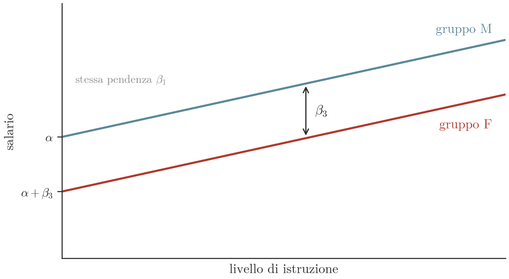

# Collinearità, Frisch-Waugh-Lovell e introduzione al test F

## Perfetta collinearità con le variabili dummy

- Se due o più regressori sono correlati in modo esatto, si prevede esattamente uno conoscendo l'altro.
- L'esempio sono le variabili dummy (qualitative o categoriali), qui genere maschile (M) e genere femminile (F).
- Il modello ha una parametrizzazione con quattro parametri e una equivalente con tre: in questa l'intercetta combina il coefficiente di M e l'intercetta originale, il coefficiente di F è $\beta_3 - \beta_2$ e $\beta_1$, il coefficiente del livello di istruzione, rimane.
- Il software prende in input le variabili più la costante: con due variabili restituisce tre stime.

> [!question] Da verificare: la trascrizione riporta "sul parametro verità certa"; resta aperto.

- Con quattro incognite ($\alpha$, $\beta_1$, $\beta_2$, $\beta_3$) e tre equazioni le soluzioni sono infinite: il software non sa quale pescare e non si passa più da un modello all'altro, pure identici.
- Aggiungere F o M aggiunge un parametro ma non informazione nuova, sono dati finti: non si identificano tutti i coefficienti.

### Come si risolve il problema

- ==la collinearità è un problema logico più che matematico==: non permette di valutare gli effetti marginali, perché con variabili perfettamente correlate non se ne muove una tenendo ferma l'altra.
- Una variabile è in più: si fissa a zero uno dei due coefficienti, $\beta_2$ o $\beta_3$, e gli altri parametri ne seguono; qualsiasi software lo fa in automatico, tranne R.
- Nel modello $\alpha + \beta_1 \, \text{education} + \beta_2 M + \beta_3 F + \epsilon$ non si fissa $\beta_1$, che serve e non è coinvolto dalla relazione esatta: si pone $\beta_2$ uguale a zero.
- ==Non sto eliminando il lavoratore di genere maschile dal modello, sto solo eliminando un parametro che li rappresenta, ma non sto eliminando il gruppo.==

### Il salario atteso delle donne e degli uomini

- Donne (F uguale a uno): $\alpha + \beta_1 \, \text{education} + \beta_3 \cdot 1$, intercetta $\alpha + \beta_3$ e coefficiente angolare $\beta_1$.

> [!question] Da verificare: la trascrizione riporta "la media di y dato x, cioè la covarianza tra y e x, è uguale a zero"; probabilmente intende l'errore.

- Uomini (M uguale a 1 implica F uguale a zero): $\alpha + \beta_1 \, \text{education} + \beta_3 \cdot 0$, con il termine che sparisce: due diversi valori attesi condizionali.
- Nel grafico il gruppo M ha pendenza $\beta_1$, attesa positiva, e intercetta $\alpha$, stimabile con tre equazioni e tre incognite; le donne hanno pendenza $\beta_1$ e intercetta $\alpha + \beta_3$.
- $\beta_3$ può essere positivo o negativo: nelle analisi empiriche col professor Peruzzi è tipicamente negativo e piuttosto grande, quindi la retta delle donne sta un po' sotto quella del genere M.

- Essendo rette parallele, il gap tra genere maschile e femminile a qualsiasi livello di istruzione è la distanza delle intercette, $\beta_3$: con $\beta_3$ pari a 5 dollari all'ora il genere femminile guadagna 5 dollari in meno, con 0,5 sono 50 centesimi.

> [!question] Da verificare: la trascrizione riporta "beta3 sia il 5 dollari all'ora" e poi "5 dollari in meno"; il segno di $\beta_3$ non è detto.

- Il problema è apparente: si risolve a monte o chiedendo al software di risolverlo in maniera standard.
- La variabile omessa è il gruppo di riferimento; l'altro gruppo dà la deviazione, $\beta_3$, coefficiente della variabile di genere.

### La variabile da togliere non è unica

- Si poteva togliere F invece di M: i dati identificano comunque le due intercette e cambia solo come si calcolano in funzione dei parametri (togliendo F, un punto è l'intercetta del modello stimato e l'altro è $\alpha$, tra virgolette, più il coefficiente di M).
- $\beta_3$ passa da negativo a positivo ma identico: meno 0,3 nel primo modello, più 0,3 nel secondo.
- Il coefficiente di education, l'$R^2$, gli standard error e ogni altra statistica non cambiano: è una scelta arbitraria.

> [!question] Da verificare: la trascrizione riporta "Come ti chiedo i due punti in funzione dei parametri"; resta aperto.

- Per la differenza di salario tra generi si testa se $\beta_3$ è uguale a zero o diverso da zero; per una differenza del 30% si verifica se quel $\beta$ corrisponde al 30%; qualsiasi batteria di test si fa in maniera abbastanza standard.

### Togliere la costante invece di una dummy

- Si possono tenere sia M sia F togliendo qualcos'altro.

> [!question] Da verificare: la trascrizione riporta "Sì, forse" senza dire chi risponde, e "tanto nel computer mi capita sta roba"; forse "nel compito".

- $M + F = 1$, cioè $M = 1 - F$ oppure $F = 1 - M$: la relazione coinvolge anche il regressore 1, associato ad $\alpha$ (la costante: $\alpha$ per $x$ dà $\alpha$ con $x$ uguale a 1).
- Togliendo $\alpha$ si risolve la collinearità e si tengono M e F; prima si era tolto M, poi, solo a voce, F.

> [!question] Da verificare: la trascrizione riporta "avevo alto M"; probabilmente "avevo tolto M".

- Nel modello $\text{wage} = \beta_1 \, \text{education} + \beta_2 M + \beta_3 F$ il salario atteso è $\beta_2 + \beta_1 \, \text{education}$ con M uguale a uno e $\beta_3 + \beta_1 \, \text{education}$ con F uguale a uno: due rette di regressione.
- $\beta_2$ coincide con l'intercetta del gruppo M (nel primo modello $\alpha$) e $\beta_3$ con quella del gruppo femminile: i dati identificano sempre gli stessi due punti, cambia il nome dei parametri e il differenziale resta lo stesso numero.
- ==indipendentemente da come risolvete il problema della collinearità, i risultati saranno sempre equivalenti==; cambia solo l'interpretazione dei differenziali.
- Con l'ultima parametrizzazione, per testare la differenza tra i generi bisogna testare se $\beta_1$ è uguale a $\beta_2$, cioè $\beta_1 - \beta_2 = 0$, una combinazione lineare di parametri.

> [!question] Da verificare: la trascrizione riporta "coinvolge un parametro, non è che coinvolge due" e "beta 1 è uguale a beta 2" (i parametri dei gruppi sono $\beta_2$ e $\beta_3$); resta aperto.

- La statistica $t$ si può calcolare: per campioni grandi la differenza degli stimatori è ben approssimata da una normale, con media zero sotto la nulla.
- Serve la varianza: varianza del primo più varianza del secondo meno due volte la covarianza, che non è nella tabella di output ma si può calcolare; è più brigoso del test standard su $\beta_3$ o $\beta_2$ uguali a zero.
- Il vantaggio è che i due parametri sono già le intercette. Il problema della collinearità si risolve eliminando la variabile ridondante.

> [!question] Da verificare: la trascrizione riporta "oggi i due parametri li rappresenta già le intercette" e "non fa il suo problema"; resta aperto.

- La covarianza tra gli stimatori si recupera da qualche membro particolare dell'output di Gretl, ma con una combinazione lineare di cinque parametri servono tutte le covarianze e il docente sconsiglia.

> [!question] Da verificare: la trascrizione riporta "È un numero che non so calcolare, non so proprio cosa scrivere, metà sigma..."; non è chiaro chi parli, e "metà sigma" resta aperto.

### Come prepararsi sulle parametrizzazioni

- Nel compito variabili di questo tipo capitano spesso e ==spesso vi chiederò di dire se appartiene a un gruppo o a un altro, c'è una differenza oppure no==.
- ==non cercate di ricordarvi a memoria le formule che vi ho fatto vedere adesso alla lavagna==: conviene perdere 30 secondi dell'esame e rifare i passaggi (valore atteso condizionato con la variabile uguale a 1, con la variabile uguale a 0, poi le differenze).
- ==Dovreste essere flessibili abbastanza per poter passare da una parametrizzazione all'altra.== Nell'esame la parametrizzazione può essere un'altra e il passaggio in più riduce drasticamente la probabilità di errore.

> [!question] Da verificare: la trascrizione riporta "nel computo variabili di questo tipo capitano spesso"; si è reso "nel compito".

> [!tip] Esame: variabili di questo tipo capitano spesso; le formule non vanno imparate a memoria ma rifatte durante l'esame, perché la parametrizzazione può essere un'altra.

### La distribuzione asintotica dello stimatore

- Con le ipotesi (nessuna perfetta collinearità, dati indipendenti dalla popolazione, esogeneità, condizioni sui momenti: code non troppo pesanti), per $n$ sufficientemente grande lo stimatore dei minimi quadrati di ogni $\beta_j$ si distribuisce come una normale centrata sul vero valore, con standard error dato da una formula calcolabile: come nella regressione semplice, con formule più complicate.
- Si ottiene con il teorema del limite centrale e la legge dei grandi numeri (dati indipendenti e momenti); l'esogeneità dà la media pari al vero valore; l'omoschedasticità è un'ipotesi di comodo, trattata martedì prossimo.

> [!question] Da verificare: la trascrizione riporta "della risparmio"; si è reso "ve la risparmio".

### Quale distribuzione usare per i test

- Per un test si può usare la statistica t normale, la distribuzione dei campioni infiniti, quindi una t di Student, o la distribuzione asintotica, le normali; il docente usa sempre la normale.
- Con meno di 30 osservazioni in una regressione multipla si va a caso nell'interpretare il risultato, per troppa incertezza.
- ==la t di Student e la normale sono di fatto sovrapponibili per più di 30 gradi di libertà==.

> [!question] Da verificare: la trascrizione riporta "la distribuzione dei campioni infiniti, quindi una t di Student"; più avanti dice "campioni finiti".

- La t di Student vale esattamente solo con errore gaussiano, ipotesi da dimostrare; l'approssimazione asintotica richiede molte meno ipotesi, e con serie storiche, dipendenti, la distribuzione in campioni finiti non si calcola mentre l'asintotica sì.
- Non servono indipendenza, stretta esogeneità (spesso ne basta una più debole) né gaussianità dell'errore, che non si osserva; se la variabile può assumere valori negativi, neanche è difficile pensare che l'errore possa essere definito su tutta la retta reale.

### La stima dei parametri

- Stimare equivale a minimizzare la dispersione delle osservazioni, quanto la $Y$ si distanzia in media dal modello; l'esempio ha due regressori ($\alpha$, $\beta_1$, $\beta_2$) ma si generalizza.

> [!question] Da verificare: la trascrizione riporta "a1 e b2" ed "estimatori"; si adottano le forme delle slide 30 e 31 ($\alpha, \beta_1, \beta_2$, "stimatore").

- Si deriva rispetto a ciascun parametro, si pongono le tre equazioni uguali a zero e si risolve il sistema (tre equazioni, tre incognite).
- Nella semplice serve una pagina di algebra, qui due, con un regressore in più quattro: senza matrici è complesso legare $\beta_1$ ai dati.

*(slide 30)*

### Il teorema di Frisch-Waugh-Lovell

- C'è un modo alternativo per stimare qualsiasi parametro: lo stimatore dei minimi quadrati del j-esimo si ottiene da una regressione con la $Y$ di sempre e, al posto della $X$, un regressore con il cappellino sopra, e dà esattamente lo stesso numero; è una conseguenza di ==uno dei teoremi più utili che c'è in econometria, che è il teorema di Frisch-Waugh-Lovell==.

*(slide 31)*

- Il regressore con il cappellino è il residuo della regressione della variabile $j$ su tutti gli altri regressori (con dieci regressori, per $X_5$ la regressione sul primo, secondo, terzo, quarto, sesto, settimo, ottavo, nono e decimo): la differenza tra il regressore e la sua previsione con gli altri.
- La dimostrazione richiede un po' di algebra lineare e il docente la salta.

### L'intuizione: la parte prevedibile e la parte che non lo è

- In $Y = \alpha + \beta X + \epsilon$ il segnale della $Y$ si divide in una parte prevedibile dalla $X$ e una non prevedibile; il residuo è la differenza tra la $Y$ e la parte prevedibile, l'informazione in $Y$ non prevedibile dalla $X$.
- Ogni variabile si decompone in due segnali: quanto si può prevedere con alcune informazioni e $\epsilon$, quanto non è prevedibile.
- Nella regressione con il cappellino il residuo è il contributo di $X_j$ che non dipende dalle altre variabili: l'informazione in $X_2$ non prevedibile con $X_1$; $U_1$ è la componente di $X_1$ non prevedibile con $X_2$, nell'esempio con due variabili.

*(slide 32)*

### Il coefficiente come correlazione parziale

- Nella regressione semplice $\beta$ è covarianza diviso varianza, di fatto la correlazione marginale tra $X$ e $Y$.
- Nella multipla $\beta_j$ è la correlazione tra $X_j$ e $Y$ al netto di $X_i$, con $i$ diverso da $j$: una correlazione marginale su variabili già ripulite dall'effetto della terza, detta correlazione parziale, cioè l'effetto marginale (fisso il reddito e vedo la performance al variare della dimensione della classe).
- Ogni coefficiente si interpreta come correlazione parziale, non marginale: è il legame tra statistica ed economia, reso possibile dal teorema di Frisch-Waugh-Lovell, che il docente racconta a voce.

### I passaggi del teorema

- Con $Y$, $X_1$, $X_2$ (vale per qualsiasi numero di regressori), per calcolare $\beta_1$:
  - si regredisce $Y$ su tutti i regressori che non sono il primo e si salvano i residui;
  - si regredisce $X_1$, il regressore di interesse (la dimensione della classe), su tutti gli altri ($X_2$, $X_3$, $X_4$, $X_{10}$, $X_{100}$) e si salvano i residui, la variabile $u$ di prima;
  - $\beta_1$ è il coefficiente della regressione semplice tra i primi residui e i secondi.
- Il primo passaggio non è indispensabile per recuperare $\beta_j$, ma se lo fate non capite niente a $\beta_j$.

> [!question] Da verificare: la trascrizione riporta "se lo fate non capite niente a beta j"; forse "se non lo fate".

- La dimostrazione è di quattro righe ma servirebbe una settimana di algebra lineare; il risultato è numericamente esattamente lo stesso numero.

### L'esempio numerico con il punteggio dei test

- La performance dei bambini a scuola è regredita su dimensione della classe, reddito e costante: il coefficiente di interesse è meno 0,6487401.

> [!question] Da verificare: la trascrizione riporta "meno 0,6487, 4,01"; la slide 35 riporta −.6487401 e si adotta questa forma.

*(slide 35)*

- Con Frisch-Waugh-Lovell si regredisce $X_1$ su $X_2$ salvando i residui (ustr), si regredisce $Y$ su $X_2$ salvando i residui, e si regredisce la nuova $Y$ sulla nuova $X$: esattamente lo stesso numero a qualsiasi decimale, non un'approssimazione.

*(slide 36)*

- I software non lo fanno, ma il coefficiente si interpreta come correlazione tra variabili già ripulite dall'effetto di tutte le altre.
- Vale anche con $Y$ direttamente invece dei residui di $Y$ su $X_2$: cambiano eventualmente gli standard error.
- È inutile operativamente, ma dà un nome statistico, correlazione parziale, all'effetto marginale: una giustificazione formale.

### L'errore standard nella regressione multipla

- Nella semplice $Y = \alpha + \beta X + \epsilon$ lo standard error è la radice quadrata di un rapporto con ingredienti $\sigma^2$ (media dei quadrati dei residui, più o meno) e la varianza di $X$ per $n - 1$: più grande la varianza di $X$, più preciso lo stimatore; più piccola $\sigma^2$, meglio è.

> [!question] Da verificare: la trascrizione riporta "radice quadrata del fatto la varianza di x"; resta aperto.

- Nella multipla la formula non vale più per gli effetti collaterali degli altri regressori: il numeratore è $\sigma^2$, il denominatore è $n$ volte la varianza della variabile del coefficiente $j$-esimo, e in più c'è il pezzo $1 - R^2$.
- L'$R^2_j$ è l'$R^2$ che si otterrebbe stimando $X_j$ su $X_2$, $X_3$, $X_{j-1}$, $X_{j+1}$ e tutte le altre, esclusa la $Y$: il grado di associazione tra la variabile $j$ e le altre.

> [!question] Da verificare: la trascrizione riporta "il sum x2, x3, x meno j"; resta aperto.

*(slide 40)*

- Con collinearità perfetta $R^2_j$ è uguale a 1 (risponde uno studente, la risposta non si sente; il docente conferma): la componente d'errore è zero, c'è zero al denominatore, varianza infinita, nessuna ipotesi nulla rifiutata e intervallo di confidenza tra meno infinito e più infinito.

> [!question] Da verificare: la trascrizione riporta "Quindi di fatto il modello div[caratteri non latini]a", con l'ultima parola non riconoscibile; resta aperto.

### I tre ingredienti dell'errore standard

- Tre ingredienti: la varianza dell'errore (con omoschedasticità), la variabilità del regressore di interesse e il legame tra quel regressore e gli altri; se il legame è troppo grande $R^2_j$ tende a uno, il denominatore diventa molto piccolo e c'è un effetto inflattivo sulla varianza.

### La quasi collinearità

- Uno fratto la quantità in rosso diagnostica la non perfetta collinearità, perché la perfetta la risolve a priori il software.
- Quasi collineari: correlazione alta ma non patologica; con variabili correlate al 99% $R^2_j$ è molto vicino a uno, il denominatore è molto piccolo, gli standard error esplodono e gli intervalli di confidenza sono enormi (magari tra meno 100 e più 100 quando la scala del parametro è 10).
- Anche con un campione molto grande zero potrebbe cadere dentro: un parametro sembra non significativo solo perché si sono aggiunti regressori quasi collineari, informazioni quasi inutili, e quel quasi crea il problema.

> [!question] Da verificare: la trascrizione riporta "poi quasi mi crea un problema"; si è reso "e quel quasi".

### Il variance inflation factor

- Uno fratto uno meno $R^2_j$ è il variance inflation factor: quanto aumenta lo standard error rispetto al caso in cui $X_1$, $X_2$, $X_3$ sono tutti indipendenti.
- Se è maggiore di 10 o 12 (regola empirica, non un teorema) c'è un problema di quasi collinearità e l'aumento artificiale degli standard error è problematico.

> [!question] Da verificare: la trascrizione riporta "sopra la 10 ovviamente", resta aperto; "l'effetto riflattivo" reso "inflattivo" come nel paragrafo sui tre ingredienti, senza conferma dalle slide.

- Il problema è sottile e di non facile soluzione; si vede la prossima volta all'esercitazione.

### Le lezioni di martedì e di dicembre

- Martedì prossimo la mattina fa lezione il ricercatore, anche il pomeriggio, e il docente fa quattro ore (scambio dell'ora di martedì mattina): applicazione al modello di regressione multipla ed esercizi; consiglia di venire, per vedere cosa succede quando $R^2$ è molto grande.
- Verso dicembre il docente fa un giorno, quattro ore, poi sono tre; è già nel calendario didattico online.

> [!question] Da verificare: la trascrizione riporta "Avvicembra quando... ci siamo scambiati l'ora di martedì mattina" (forse "a dicembre"), "esercizi di poesare" e "poi sono tre, in realtà"; la parte incomprensibile è omessa.

### Come si calcola $R^2_j$

- Uno studente chiede, in parte udibile, di generalizzare a 50 variabili; il docente risponde che $R^2_j$ è tra $X_j$ e tutte le altre.
- Con $j$ la variabile 1, la dimensione della classe, è l'$R^2$ della regressione con la dimensione della classe come variabile dipendente e il reddito come regressore; con 10 variabili (anche la percentuale di madrelingua nel distretto) è l'$R^2$ tra la dimensione della classe e tutti gli altri regressori.

> [!question] Da verificare: la trascrizione riporta "Spiegano pure il regressore. La combinazione di quelle variabili funzionali" e "la j è il regressore reddito".

- Se le variabili sono perfettamente ridondanti il software lo dice (infinite soluzioni, condizione del primo ordine doppione di un'altra); con un quasi doppione calcola tutto e ci si accorge indirettamente, perché aggiungendo una variabile gli standard error esplodono di tre, quattro, cinque, sei volte e ciò che era significativo non lo è più.

> [!question] Da verificare: la trascrizione riporta "roba che prima magari non era significativa, errori standard significativi diventano non significativi".

### Un esempio: il differenziale di genere nei salari

- Con il professor Perrucci: il differenziale di salario tra uomini e donne è circa 30%, significativo; aggiungendo una dummy che interagisce con una variabile continua il coefficiente di female non è più significativo (27%, ancora gigante) e neanche la variabile aggiunta.
- Gli standard error aumentano di cinque, sei volte: il denominatore gigante comprime la statistica $t$ e non si rifiuta la nulla; il software non dice niente.
- Si diagnostica riconoscendo che ==lo standard error è una combinazione di tre ingredienti, non più due==: ==conta anche come quella variabile si rapporta a tutte le altre in termini di correlazione==, oltre alla varianza della variabile e a quella dell'errore.
- Col software, premendo il pulsante giusto, esce una tabella con i numeri per ogni regressore: se maggiore di 10 o 12 potrebbero esserci potenziali problemi.

> [!question] Da verificare: la trascrizione riporta "professor Perrucci", prima "professor Peruzzi".

### Previsioni, stime e stimatori

- Dopo la stima (standard o metodo dei momenti) si fa la previsione sostituendo al vero parametro la stima nella media condizionale.

> [!question] Da verificare: la trascrizione riporta "sia che utilizzate ..., sia che utilizzate il metodo dei momenti"; il secondo metodo non si sente.

- Stesso simbolo per stima (il numero della tabella di output) e stimatore (la formula, cioè una variabile): lo chiarisce il contesto. Il residuo è osservazione meno previsione.

*(slide 33)*

### L'R quadro

- L'$R^2$ è la correlazione al quadrato tra $Y$ e valori predetti (o, come nei libri, somma dei quadrati dei residui diviso somma della varianza totale della $Y$): solo un indicatore statistico, non dice se il modello è buono dal punto di vista causale.
- Sta tra 0 e 1: 1 vuol dire buon adattamento; 0 che i regressori non servono a prevedere la $Y$ dal punto di vista statistico, non causale o logico.

> [!question] Da verificare: la trascrizione riporta "la somma dei quadrati dei residui diviso la somma della varianza totale della y"; la formula completa non è detta.

*(slide 37)*

### L'R quadro aggiustato

- Ci sono due stime: la correlazione al quadrato e l'$R^2$ aggiustato. L'$R^2$ aumenta sempre aggiungendo un regressore, matematicamente, e non dice se un aumento del 5% è tanto o poco.
- L'aggiustato toglie una penalità negativa che dipende dal numero di parametri (formula non ricordata): può anche decrescere con troppi parametri.
- ==in generale accetto di aggiungere una variabile al modello se l'$R^2$ aggiustato aumenta==; dire significativo non è corretto, non è un test, ma va in quella direzione; il docente non lo guarda.

*(slide 38)*

### Intervalli di confidenza e teorema di Gauss-Markov

- Con standard error e stimatori si calcola l'intervallo di confidenza per qualsiasi parametro e i test sono standard.
- Gauss-Markov: con omoschedasticità e le altre ipotesi i minimi quadrati ordinari danno la precisione massima, cioè riducono lo standard error a dati fissati; non è importante, perché l'omoschedasticità di fatto non esiste.

> [!question] Da verificare: la trascrizione riporta "il modo migliore per aggregare i dati" e "dato che considero un precisato"; il secondo è omesso.

*(slide 46)*

### La notazione matriciale

- Ultima parte, "quella del risparmio": conviene darle un'occhiata; mostra come scrivere con matrici e vettori ciò che si è fatto.

> [!question] Da verificare: la trascrizione riporta "L'ultima parte è quella del risparmio" e "questa parte delle luci"; il secondo è omesso.

- Il modello ha un vettore $Y$ di $n$ righe e una colonna, una matrice $X$ dei regressori, un vettore dei parametri e un vettore del termine d'errore.

*(slide 50)*

- Derivando rispetto al vettore dei parametri lo stimatore dei minimi quadrati si scrive sempre così; $X$ trasposto $X$ alla meno uno è il denominatore.

*(slide 51)*

- $X$ trasposto $X$ è il quadrato di $X$: come nella semplice, il denominatore è la somma degli $X$ al quadrato (momenti secondi empirici) e il numeratore il prodotto incrociato tra $X$ e $Y$ (covarianza); vale con un regressore o duemila, in cinque righe.
- L'algebra lineare è solo un modo furbo per scrivere ciò che si è fatto, comodo per gli sviluppi teorici: Frisch-Waugh-Lovell con le sommatorie è complicato, con le matrici in tre righe.

### Test su più parametri

- Ancora un quarto d'ora (pensava finisse all'una e mezza), quindici minuti: finora l'inferenza è su un parametro, ma si possono voler testare più parametri insieme o combinazioni lineari; il materiale è sulla verifica di ipotesi di restrizione multipla.

### Il modello con quattro gruppi

- Invece di due gruppi, quattro, per una relazione congiunta tra caratteristiche: sposati o non sposati, di una certa etnia; il matrimonio è un proxy del commitment, l'impegno di lungo periodo (chi è sposato fa più fatica a licenziarsi).
- Variabile dipendente: il salario, in logaritmo per leggere variazioni percentuali. Regressori: education, esperienza (anni di lavoro), tenure (anni nell'impiego attuale: esperienza dieci, tenure cinque), South.
- Quattro dummy: married black, single black, married non black, single non black (etnia stilizzata, di colore o non di colore); coprono tutto il campione, senza sovrapposizione.

> [!question] Da verificare: la trascrizione riporta "quattro variabili d'anni"; la slide 2 del file sul test F riporta "4 variabili dummy" e si adotta questa forma.

*(slide 2, test F)*

- Esatta collinearità: la somma delle dummy è 1.
- Domanda di ricerca: a parità di istruzione, esperienza, tenure e luogo, c'è differenza significativa tra sposati di colore e sposati non di colore?

> [!question] Da verificare: la trascrizione riporta "posizionatamente anche allo stato civile"; resta aperto.

- Il software elimina in automatico single: non cambia l'inferenza, solo l'interpretazione. Servono i parametri che definiscono la differenza di valore atteso tra i due gruppi, calcolando il salario atteso (il logaritmo) fissando le $X$.

*(slide 3, test F)*

### Le intercette dei quattro gruppi

- Sposati di colore: $\alpha + \beta_6$ ($\beta_6$ moltiplica married black, le altre dummy sono 0).
- Sposati non di colore: $\alpha + \beta_8$.
- Single black: $\beta_7$ è la variabile tolta dal software, quindi l'intercetta è solo $\alpha$.
- Single non black: $\alpha + \beta_9$.

> [!question] Da verificare: la trascrizione riporta "a volte 8", "andata solo al 40" e "zero per qualsiasi 40"; le slide 2, 3 e 4 riportano $\beta_7$ per single black (variabile eliminata) e l'intercetta $\alpha$, e si adottano queste forme.

*(slide 4, test F)*

### Il differenziale tra sposati di colore e sposati non di colore

- Il differenziale tra married black e married non black è $\beta_6 - \beta_8$, stimabile; il problema è se è uguale a zero o diverso, e si potrebbe fare un test $t$.

> [!question] Da verificare: la trascrizione riporta "Non faccio un test statistico"; resta aperto.

- Il denominatore non è immediato: lo standard error è la radice della varianza di $\beta_6$ più la varianza di $\beta_8$ meno due volte la covarianza, da calcolare a mano; per pigrizia il docente non vuole farlo.
- Serve inferenza su una combinazione lineare di parametri: non basta che il differenziale sia negativo, l'errore di stima potrebbe renderlo non rilevante al netto dell'errore campionario. Questo è il primo esempio.

*(slide 5, test F)*

### Il secondo esempio: significatività congiunta

- Con tre regressori (possono essere qualsiasi numero): usare congiuntamente $X_1$, $X_2$, $X_3$ aiuta a prevedere la $Y$? Ipotesi composta: tre ipotesi nulle su tre parametri contro l'alternativa che almeno una delle tre non venga rifiutata; sotto la nulla ($\beta_1$, $\beta_2$, $\beta_3$ uguale a zero) i termini spariscono e la $X$ non serve a niente.

> [!question] Da verificare: la trascrizione riporta "contro l'alternativa che almeno una delle tre non venga rifiutata"; resta aperto.

*(slide 6, test F)*

### Perché tre test t non bastano

- È un modo compatto per dire $\beta_1$ uguale a zero, oppure $\beta_2$ uguale a zero, oppure $\beta_3$ uguale a zero: tre test.

> [!question] Da verificare: la trascrizione riporta "oppure beta2 uguale a zero, oppure beta3 uguale a zero"; la slide 6 riporta H0: $\beta_1 = \beta_2 = \beta_3 = 0$, e si riporta ciò che ha detto il docente.

- Idea naive: tre test $t$; se in tutti e tre non si rifiuta la nulla i parametri sono indistinguibili da zero, se basta uno a rifiutarla c'è almeno un coefficiente diverso da zero. Non funziona: ==perdete controllo sulla probabilità di errore==.

*(slide 7, test F)*

- Ogni test $t$ fissa al 5% la probabilità dell'errore del primo tipo (dire vera l'alternativa quando non lo è): nel 95% dei casi non si sbaglia.

> [!question] Da verificare: la trascrizione riporta "Stima fissa la probabilità di sbagliare" e "della notazione che abbiamo utilizzato"; resta aperto.

- Con tre test supposti indipendenti (semplificazione: la $Y$ è in comune) la probabilità di non sbagliare mai è 95% per 95% per 95%, circa 86%: errore circa 14% o più, quindi 14, 16, qualcosa invece di 5%; forse ancora peggio.

> [!question] Da verificare: la trascrizione riporta "se il test fosse tollerabile forse è ancora peggio"; resta aperto.

*(slide 8, test F)*

- Con tre test individuali si perde il controllo sulla probabilità di errore tollerata: non si sa quanto si sbaglia, si decide a caso, senza benchmark. Serve un test congiunto.

### Il test F

- Il test F guarda una o più combinazioni lineari di parametri e vede se i dati le soddisfano: nel primo esempio $\beta_6 - \beta_8$, nel secondo il sistema $\beta_1 = 0$, $\beta_2 = 0$, $\beta_3 = 0$.
- Finito il tempo, se ne parla giovedì prossimo; non è particolarmente complicato.

*(slide 9, test F)*
