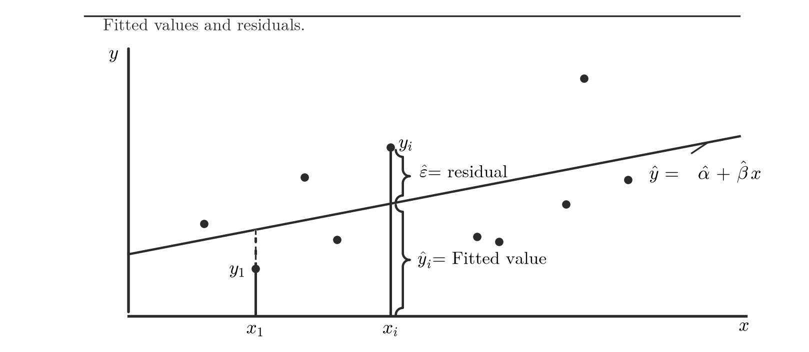
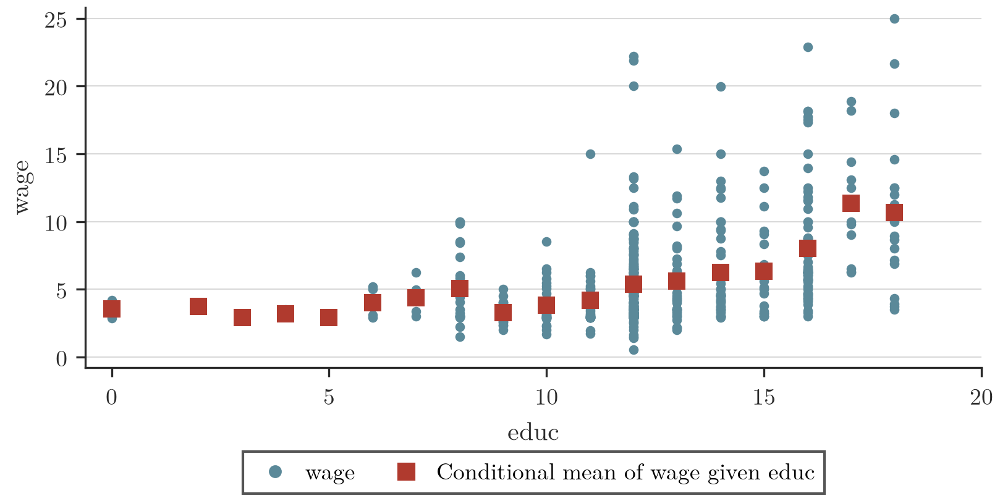
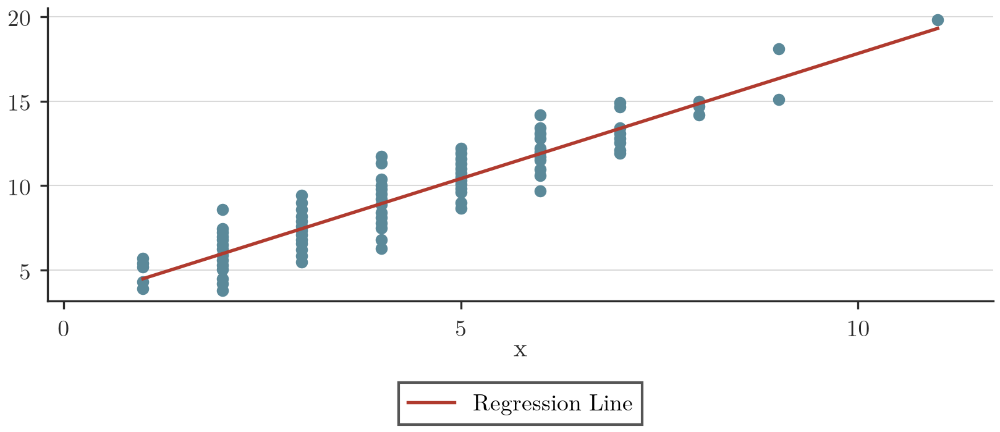
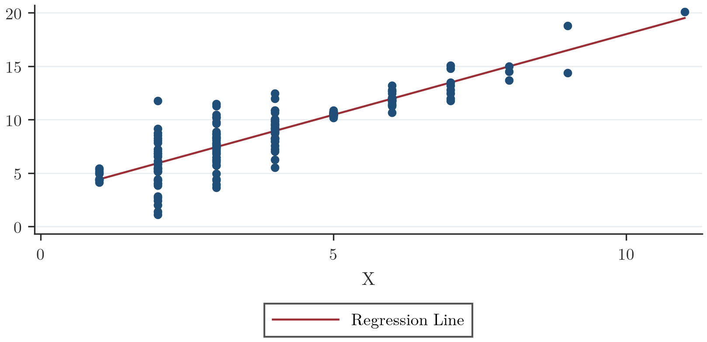
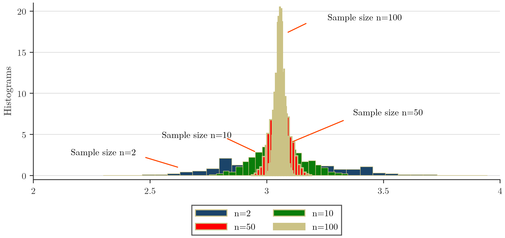

# Esogenità e proprietà dello stimatore OLS

## Ripasso: il modello di regressione e il termine d'errore

Poi può avanzare col modello di regressione semplice, che mi rendo conto è un modello ipersemplificato, ma quello che vediamo su questo modello poi si trasferisce direttamente nei modelli più complessi. Solo che qua la algebra è un po' più semplice, quindi tutto sommato preferisco partire.

> [!question] Da verificare: la trascrizione riporta "Poi può avanzare col modello di regressione semplice"; l'inizio della frase non è chiaro.

Quello che abbiamo visto ieri è la definizione del modello di regressione, che non è altro che un valore atteso condizionato sulla variabile dipendente rispetto a X, e ipotizziamo che questo modello sia il più semplice possibile: il modello più semplice che mi viene in mente che abbia un minimo senso logico è la retta. ==Questo valore atteso condizionato è da intendere sulla distribuzione di probabilità congiunta della popolazione, non nel campione.== Quindi questo valore atteso condizionato rispetto a tutte le possibili osservazioni che io posso ottenere da una popolazione nel suo complesso è diverso da quello che io utilizzo dal punto di vista empirico per poi fare i calcoli, cioè il campione. Quindi questa media io la calcolo su tutti i possibili lavoratori, nell'esempio dei salari e del livello di istruzione, non solo sul campione.

Quindi lo posso pensare come il modello teorico che regola la dinamica, la relazione che c'è tra i dati. In generale è un qualcosa che non conosco e decido di approssimarlo con una retta. Quindi questo è il vero modello nella popolazione e l'ipotesi che faccio, l'ipotesi molto forte, che vedremo è legata all'ipotesi di esogenità, è che il modello sia semplice. Detto questo, la speranza è che questa approssimazione che io faccio della relazione tra le variabili sia corretta. Se non è corretta, entro nell'ambito dell'endogeneità con tutti i problemi che vi ho descritto velocemente ieri.

Dopodiché, l'altra cosa che vi avevo detto: per costruire un legame tra le osservazioni effettive che io osservo nel campione e il vero modello nella popolazione, aggiungo un termine d'errore che mi descrive le caratteristiche individuali delle persone che osservo che differiscono una dall'altra. Quindi epsilon mi rappresenta le caratteristiche di una persona che ha caratteristica X fissata, ma che in qualche modo differisce per altri aspetti. Non so, nel caso di education e salario, questa potrebbe essere il genere oppure il tipo di studio oppure qualsiasi altro aspetto. Quindi queste sono le definizioni: Y è la variabile dipendente, X il regressore, epsilon è il termine d'errore, epsilon è completamente casuale, non si può osservare e non si potrà mai osservare, e rappresenta tutte le caratteristiche che non sono X dell'individuo i-esimo, dell'unità statistica i-esima che io ho nel campione.

## Esogenità e relazione causale

Ritorniamo al problema della relazione causale. Poi la seconda cosa importante che vi ho detto l'altra volta è che io vorrei trovare una spiegazione che descriva le variazioni della variabile dipendente, che sia il salario rispetto a quanto decido di studiare, che sia il livello di consumi sulla base della politica economica di dare più soldi ai lavoratori, che può essere, aumento i controlli fiscali, voglio vedere se riduco il sommerso. Questo è più o meno in un certo paese, questa è più o meno l'idea.

Il problema qual è? Il problema è che io riesco a identificare esattamente l'impatto della mia politica, che di fatto è rappresentata dal parametro beta, solo se posso escludere che non ci siano degli effetti collaterali legati alla mia politica, cioè che in corrispondenza della variazione di x ho anche delle variazioni di epsilon. Quello che osserverò è che le variazioni di y, cioè quello che vorrei ottenere, non solo dipendono da quello che voglio, ma anche da qualcos'altro che è completamente fuori dal mio controllo, vi ricordo epsilon non è.

> [!question] Da verificare: la trascrizione riporta "le variazioni di epsilon, cioè quello che vorrei ottenere"; la slide 14 riporta che "ΔY dipende da una scelta economica, vale a dire ΔX, e da qualcos'altro (Δε)", e si adotta "y". La frase "vi ricordo epsilon non è" resta senza seguito.

Questo cosa vuol dire? Vuol dire sostanzialmente che per poter identificare con chiarezza qual è l'impatto della mia decisione, devo essere sicuro che questa roba sia fissa. Come faccio a fissarla? Ipotizzo che sia zero. Cosa vuol dire essere zero? Vuol dire che c'è incorrelazione tra x e epsilon. Quindi di fatto ==l'ipotesi che mi serve per identificare una relazione causa-effetto minimale è che il mio modello sia corretto==, nel senso che la parte residuale deve essere qualcosa di completamente esogena, deve essere qualcosa di non collegata alla parte strutturale del modello.

Se ho correlazione vuol dire che in pratica io riesco a valutare questa variazione, ma non so se dipende da questo pezzo o da questo pezzo. E questo vuol dire che se investo un sacco di soldi in questo oggetto qua, non mi accorgo che beta sia uguale a zero. E quindi tutta la variazione dipende esattamente da questo effetto collaterale, vuol dire che spendo un sacco di soldi per qualcosa che non serve a niente, quando in realtà dovrei spendere quei soldi per modificare questo secondo fattore. Nel caso dei bambini che vanno a scuola, mi conviene guardare il reddito delle famiglie piuttosto che la dimensione della classe, quindi usare quei due miliardi di euro, di dollari all'anno per portare dei sussidi, portare dei benefici alle persone a reddito basso. Questo potrebbe essere l'idea, non so se è la politica giusta, qualcosa del genere.

Quindi il problema è questo: una volta che fisso questa variazione a zero, ottengo che l'effetto marginale, l'effetto della mia policy è proporzionale al parametro beta. Quello che abbiamo visto anche ieri è che, quando vado a stimare il mio modello, di fatto implementando questa idea astratta, imporre delta epsilon uguale a zero vuol dire che ho un'incorrelazione tra x e epsilon; se utilizzo lo stimatore del parametro che ipotizza questa condizione, allora il mio stimatore di beta sarà dato dalla covarianza tra x e y diviso la varianza di x, nel campione. È il miglior modo che mi viene in mente. Ma se non facessi quell'ipotesi lo stimatore non è più ragionevole perché mi va a stimare qualcosa che sistematicamente è diverso. Quindi cosa fanno i software? Fanno finta che questa roba sia zero, ma se questa roba non è effettivamente zero vuol dire che quello che ottengo sarà diverso da quello che vorrei ottenere. Questo è il problema. È il problema pratico.

## Esempio con dati simulati

Dal punto di vista operativo vi faccio vedere con un esempio con dati simulati cosa succede. Questo è un esempio che ho costruito sulla base di dati simulati, quindi so esattamente come sono fatte le variabili e come è fatta la relazione tra variabili. Quindi ho fissato i parametri alfa e beta, ho simulato i parametri col computer, ho costruito le x e le y in modo che la costante è uguale al numero 3 e il coefficiente angolare di questa retta è uguale a 1,5. Dopodiché cosa ho fatto? Ho aggiunto un termine d'errore. Ma il termine d'errore l'ho scelto in maniera precisa, l'ho scelto in modo che sia correlato con x. Quindi ho costruito un modello in cui so che la formula standard covarianza diviso varianza è sbagliata.

A questo punto ipotizzo che la covarianza tra x e epsilon, in realtà, siccome le varianze sono tutte 1 per comodità, questa è anche la correlazione, oltre che la covarianza, inciso, è pari a 0,6, molto alta. A questo punto questo è il mio processo, data generating process, il processo che genera i dati. Sono queste due equazioni. A quel punto cosa faccio? Ho un dataset, ho 200 osservazioni simulate da questo modello, applico il modello di regressione in cui però faccio finta che la covarianza tra x e epsilon è uguale a 0, vuol dire che beta lo stimo calcolando la covarianza tra x e y fratto la varianza di x. E questi sono i risultati.

*(slide 33)*

> [!question] Da verificare: la trascrizione riporta "la covarianza tra x e y ... è pari a 0,6" e "faccio finta che la covarianza tra x e y è uguale a 0"; la slide 33 riporta cov(X, ε) = 0,6 e la slide 28 riporta Cov(X, ε) = 0, e si adotta "x e epsilon" in entrambi i punti.

> [!question] Da verificare: la trascrizione riporta "quindi sta lavorando nel 0" dopo "Sono queste due equazioni"; non è comprensibile e si omette.

Questa è una tabella standard, l'ho fatta con Gretl, che è il software che uso per questo corso, ma sono tutte uguali tranne questo pezzettino qua che cambia un attimo. Le stime dei parametri sono qua. Dove c'è scritto const, questa è la stima dell'intercetta, è il parametro alfa, la costante, la stimo con 2,96, rispetto a 3 che è il vero valore del parametro ci siamo quasi. Se guardo l'intervallo di confidenza del mio stimatore, vediamo che il limite inferiore è 2,83, il limite superiore è 3,08. 3 ci sta dentro, vuol dire che rispetto a questa riga 3 è plausibile essere il vero valore del parametro. E quindi sono contento, vuol dire che stimando questo modello la costante l'ho stimata abbastanza bene.

Guardiamo adesso il coefficiente beta, che so essere 1,5 nella realtà, ma lo vado a stimare con questo numero, è 2,1. Ora 2,1 è vicino o lontano a 1,5? Dipende dal livello di precisione del mio stimatore ovviamente, è come la statistica base, anziché avere la media avete un parametro, però è la stessa roba. Poi spiegherò meglio cosa sono tutti questi numeri.

Comunque ho un intervallo di confidenza che mi dice che il vero valore del parametro mi aspetto vada tra 2 e 2,25. 1,5 sta fuori dall'intervallo di confidenza, vuol dire che sulla base di questi risultati è molto improbabile che 1,5 sia il vero valore del parametro, ma io lo so a priori che quello è il vero valore del parametro. Quindi quello che ottengo è che se mi dimentico questo pezzo nella procedura di stima ottengo una stima che è abbastanza diversa da quello che dovrebbe essere. E tra l'altro, se ci guardate un attimo, 2,1 non è altro che 1,5 più 0,6. Non è che la distorsione è sempre la correlazione. Qua funziona perché viene esattamente quel numero perché ho la varianza di X che è uguale a 1, sennò avrei un altro numero, sempre una distorsione avrei.

*(slide 33)*

Però quello che volevo dirvi è che se io mi dimentico questo pezzo, se io mi dimentico l'endogeneità, quello che succede è che una stima la trovo. Quello che succede è che l'impatto della mia policy la sbaglio completamente, perché quello che vado a stimare non è più beta ma beta più questo. E questo in generale non so quanto grande è. Può essere 0,1, può essere 0,99 se guardo una correlazione. E questo è un problema, perché non so quanto quello che stimo è lontano da quello che vorrei stimare.

Secondo problema è che questa roba qua non è che sparisce se osservo più dati, perché voi sapete dalla statistica che più dati osservo, più preciso sono, più dati uso per fare le stime, più preciso sono nel fare inferenza. Il problema è che questa parte qua non è comprimibile. Più dati avrò per stimare questo parametro, più avrò a sbattere contro 2,1, non contro 1,5, perché quello che vado a stimare non è 1,5 ma 1,5 più 0,6. Quindi sarò molto preciso nello sbagliare, questa è la sostanza. Quindi ==la distorsione che vedete qua in questo esempio non sparisce aumentando il campione.== La legge dei grandi numeri non mi aiuta nel teorema del limite centrale.

> [!question] Da verificare: la trascrizione riporta "non mi aiuta nel teorema del limite centrale"; forse "né il teorema", ma non si può stabilire.

## Come ragionare sull'endogeneità

E questo è giusto per farvi vedere che cosa succede quando quell'ipotesi non è valida. Il problema è che nessuno vi dice se quell'ipotesi è valida o no. Quindi dovete ragionare, girare intorno per cercare di capire se questa ipotesi è ragionevole oppure non è ragionevole. O se l'ipotesi che la covarianza uguale a zero è ragionevole o no. Quindi questa non è una cosa che posso dimostrare, però devo in qualche modo rendermene conto, se sono in quella condizione.

Uno dei modi per capire se sono in questa condizione è cercare di capire quand'è che c'è il problema dell'endogeneità, quand'è che c'è una correlazione tra x ed epsilon. La cosa che vi ho detto l'altra volta è: supponiamo che il modello ha troppe poche variabili, cosa vuol dire? Che la media condizionale dipende solo da una variabile. Vuol dire che tutte le altre variabili stanno qua dentro e queste variabili potrebbero essere legate alla x e questo mi va a indurre correlazione. E quindi endogeneità e quindi stime sbagliate, sistematicamente sbagliate.

Quindi cosa potrei fare? Potrei cercare di togliere informazione ad epsilon e inserirla dentro il modello. Se facendo questo magari aggiungo variabili alla media condizionale e il parametro legato alla variabile inclusa nel modello cambia di tanto, aggiungendo o no una variabile, allora vuol dire che probabilmente nel modello con meno variabili ho un problema di questo tipo. Se aggiungendo variabili al modello il parametro di interesse, che alla fine di una regressione potete avere 100 parametri, ma quelli che andate a guardare sono quei due, tre che vi interessano per il problema economico che avete, tutto il resto sono fattori di disturbo. Se vi accorgete che la stima del parametro cambia di tanto vuol dire che probabilmente nel modello con meno variabili c'è un problema di variabile omessa che so mi causa un problema di endogeneità.

Quindi, quello che è importante, secondo me, è cercare di capire quali sono le potenziali cause che mi creano endogeneità, per andare a modificare il modello, costruire una serie di modelli che in qualche modo vadano a vedere se quel tipo di problemi pre-codificati sono in qualche modo presenti nel modello che sto utilizzando oppure no. Se a un certo punto, a furia di aggiungere variabili al modello vedo che il parametro di interesse non cambia più, vuol dire che probabilmente le variabili importanti le ho messe tutte. Perché qualsiasi modo di rendere più neutrale possibile il termine d'errore non mi dà più nessuna variazione in termini di stima di beta. Ovviamente sono regole al pollice, non è un teorema. Il teorema mi dice che se il modello ha troppe poche variabili, le stime sono sbagliate sistematicamente. Empiricamente non è facile validarlo, continuo ad aggiungere variabili al modello finché posso, se a un certo punto le stime non cambiano più o comunque si stabilizzano abbastanza, non dico che devono essere esattamente lo stesso numero, ma più o meno dal punto di vista qualitativo mi danno sempre gli stessi risultati, allora vuol dire che probabilmente il problema di variabili omesse non ce l'ho più.

Questo è uno dei potenziali modi di ragionare: capire quali sono le cause dell'endogeneità e lavorare su quelle finché il modello non soffra più di quel problema, a quel punto posso usare le formule standard per la stima e quindi sono a posto. Però fino a questo punto io volevo dire: cosa succede quando faccio finta che questo pezzo non esiste, ipotizzando, stimando una regressione senza pensare al problema dell'endogeneità? La stima del parametro è sistematicamente sbagliata, quello che stimo non è beta ma beta più delta x. Poi formalmente lo dimostriamo anche, perché però questa è l'idea. ==Ricordatevi questa tabella==, perché è più importante che la derivazione.

> [!question] Da verificare: la trascrizione riporta "beta più delta x"; la slide 32 riporta ΔY = βΔX + Δε e la slide 33 "(β + Δε)"; è una formula, quindi nel testo resta la forma detta.

> [!question] Da verificare: la trascrizione riporta "Che poi questa... che la correlazione tra i saggi"; non è comprensibile e si omette. Dopo "Ricordatevi questa tabella" la trascrizione riporta "perché sono più importante che il teoretiche, che la derivazione"; nel testo resta "è più importante che la derivazione", senza "il teoretiche", che non è comprensibile.

## Qualità del risultato e verifica dell'endogeneità

Quindi, per capire se un modello è buono o non buono dal punto di vista della qualità dei risultati, non dalla parte statistica: la parte statistica è corretta. La statistica vi dice lo stimatore dei minimi quadrati o del metodo dei momenti che vi ho descritto l'altra volta, covarianza tra X e Y diviso varianza di X. Quello è corretto. Il punto è che se c'ho l'endogeneità, la qualità del risultato che ottengo è bassissima. Se c'ho esogeneità, la formula statistica mi dà esattamente quello che mi serve, che è un effetto marginale, cioè il parametro beta. La speranza è che ci sia, perché sennò tutti i modelli che uno stima sono da buttare.

Il punto è: l'esogenità e l'endogenità sono un'ipotesi che devo fare, che in pratica mi dicono il modello che io considero deve essere un modello corretto dal punto di vista logico, quindi deve essere una relazione causa-effetto. Qualsiasi deviazione da quella condizione mi porta a dei risultati che sono sistematicamente sbagliati. Cosa vuol dire risultati sbagliati? Che il parametro beta io non lo stimo più correttamente. Dopodiché, quello che devo fare è convincermi che il modello che io stimo non sia influenzato dall'endogeneità. E se il modello è influenzato dall'endogeneità ci sono due soluzioni: uno, rispecifico il modello; due, utilizzo degli stimatori che non sono quelli standard. Tipo variabili strumentali che però non guarderemo in questo corso perché non ho tempo di farlo.

Però il problema è: non sono mai sicuro. La risposta è: non si è mai sicuri della presenza di endogeneità. Quello che dobbiamo fare è, assieme al modello che ci interessa, stimare una batteria di altri modelli e fare una serie di altri esercizi che ci permetta di dire che possiamo escludere alcuni tipi di endogeneità. Che sia la risposta definitiva non lo sapremo mai, però quello che bisogna fare è: non è che se mi interessa la relazione tra X e Y mi basta stimare quella regressione. Devo stimare altre 50 regressioni per essere convinto che non manchino variabili al modello, per essere convinto che le variabili che considero siano misurate con una certa precisione. ==L'endogeneità non si può mai escludere, però bisogna lavorare per ridurre la probabilità che ci sia==, questo è. Quindi non basta stimare un modello, generalmente uno deve valutarne tanti e convincersi che quello che sta facendo è relativamente corretto.

==Ricordatevi che l'endogeneità è un problema economico, non è un problema statistico.== Generalmente in un corso di statistica questa roba qua non vi interessa più di tanto, non credo che abbiate mai visto questa roba quando avete fatto statistica nel modello di regressione. Perché alla fine la stima del parametro non mi interessa se devo prevedere la Y, qualsiasi cosa purché funzioni va bene. Il mio problema, quello che mi interessa in ambito economico, quello che è interessante è la misura del parametro, che abbiamo visto non funziona in questa condizione. Perché è interessante la misura? Perché mi dice quanto vale la mia policy, sennò posso prendere decisioni costose e sbagliate, questo è il rischio.

Quindi questo è un esempio empirico con dati simulati in cui so quali sono i parametri e vedo cosa succede. Quindi, questa in generale, supponiamo che adesso, dimentichiamo per un attimo l'endogeneità e supponiamo di utilizzare il nostro stimatore corretto che mi dice che beta lo stimo con questa formula. Non perdo tanto tempo a descrivervi come si stima alpha, perché alpha, infatti, un parametro di intercetta non è particolarmente interessante, a parte qualche applicazione specifica. In generale è un parametro che includete nel modello a meno che non avete proprio ragioni fortissime per escluderlo, ma neanche. Comunque, in generale la stima di beta è questa formula.

*(slide 18)*

## Previsione e residuo

Mi chiedo se è una strategia ragionevole. Prima però di cercare di capire se la strategia è ragionevole, quello che voglio fare è darvi un altro po' di definizioni. La prima è: come posso usare il modello di regressione? Una volta che ho un modello, una volta che ho un modo per stimare i parametri, come posso usare il modello di regressione per fare la previsione? Semplicemente la previsione del modello o valore predetto si calcola semplicemente approssimando il valore atteso condizionale sostituendo al posto dei veri parametri i parametri stimati, tenendo un'espressione di questo tipo, dove x è un numero. È semplicemente l'ipotesi che fate per la variabile x. Questo passaggio dice: in corrispondenza di un certo valore di x prefissato, scelto da voi, cosa mi aspetto dalla variabile dipendente?

La previsione è un qualcosa che fa riferimento a un valore atteso condizionale stimato, quindi è questo il concetto. Per evitare di scrivere la formula lunga, lo scrivo come y con il cappellino sopra, però non è altro che la stima di un valore atteso condizionale. Cosa mi aspetto dalla y se la x assume un certo valore prefissato? Ovviamente questa è una variabile casuale perché, essendo alpha e beta incerti, evidentemente questa previsione è un numero incerto. Io non conosco i veri alpha e beta della popolazione, ho solo delle approssimazioni calcolate sulla base del campione e quindi evidentemente questa roba qua non è la verità, ma è solo un'approssimazione che faccio sulla base del campione che ho ottenuto per stimare i parametri.

*(slide 20)*

L'altra cosa che è interessante, può essere utile per vari aspetti dal punto di vista operativo, è quanto la mia previsione si discosta dal valore effettivo osservato, supponiamo che lo conosca. E questo lo chiamo residuo, non è altro che il termine d'errore valutato per l'individuo i osservato. Quindi se calcolo la differenza tra il salario osservato e la previsione di salario sulla base di un certo valore x, ottengo la componente residuale. ==La cosa importante da ricordare a questo punto è che questo valore è diverso dal termine d'errore.== Questo non è altro che la distanza tra l'osservazione e la previsione dell'osservazione, mentre il termine d'errore epsilon è un concetto più astratto perché mi dice qual è la distanza tra ogni singolo individuo della popolazione, non del campione, e il vero modello nella popolazione. Cioè questa è un'evidenza campionaria, ma fa riferimento a una persona specifica. Epsilon in generale fa riferimento potenzialmente a qualsiasi individuo io possa osservare nella popolazione. Questo di fatto è un numero, l'altra è una variabile casuale. Questa roba qua non è un'approssimazione del vero epsilon, sono due concetti distinti, però ha una sua utilità.

Questo è semplicemente il grafico, lo devo rifare, è il grafico che mi spiega, data che questa è la retta di regressione stimata, e questa è l'osservazione, il valore predetto è questa distanza, la componente residuale è questa distanza. Niente di particolare.

## Quando OLS funziona: modello teorico e modello statistico

Quello che mi chiedo è: la strategia dei minimi quadrati è una buona strategia per stimare i parametri, ipotizzando che il modello sia ragionevole, c'è sottoesogenità? Cioè voglio capire se usare la covarianza e la divisione di varianza mi dà in media risultati corretti e cosa succede se il campione tende a crescere. Quindi voglio sapere se la strategia statistica funziona e in caso quando funziona e quando non funziona. Soprattutto quello che vi faccio vedere adesso è cercare di capire perché c'è l'endogeneità, qual è il fattore che mi definisce l'endogeneità. Tipicamente l'endogeneità nasce dal fatto che il modello che io stimo come statistico non corrisponde al modello che descrive i dati nella popolazione.

> [!question] Da verificare: la trascrizione riporta "c'è sottoesogenità"; probabilmente "sotto esogeneità".

Quindi quando pensate all'analisi empirica di qualsiasi cosa che facciate, dovreste avere sempre due concetti in mente: quello che fate voi, che è una vostra scelta individuale, e il modello, il processo generatore dei dati, che è un concetto astratto che mi dice: i dati, qualsiasi dato abbiate in mente, è legato ad ulteriori variabili in una maniera predeterminata. Quindi avete un modello teorico che descrive la realtà e un modello empirico che come voi vedete la realtà. Quello che si dimostra è che se questi due modelli coincidono allora non c'è endogeneità, ma se i due modelli divergono allora potreste avere un problema di endogeneità. Quindi avete due concetti: il modello teorico che mi spiega la relazione nella popolazione tra le variabili, e questo non lo sappiamo. Il modello statistico, che è sostanzialmente quello che fate voi, che è poi il comandino da mettere dentro un software per fare i calcoli. Il problema è che se il modello che uno stima è sbagliato rispetto al processo che genera i dati, vi troverete nel caso di endogeneità, che mi crea problemi nello stimare i parametri di interesse. Adesso magari ve lo faccio vedere.

Quindi, il problema chiave quando si lavora nell'ambito dell'econometria, o della statistica, è cercare di capire se le formule che uso per approssimare i parametri vanno bene oppure no. Per capire cosa succede nell'ambito del modello di regressione è importante sapere quali sono le caratteristiche della componente residuale del modello, quindi del termine d'errore. Quindi ==tutto il problema legato all'econometria è capire quali sono le proprietà di epsilon, in particolare i suoi momenti condizionali rispetto a X.==

## La media condizionale del termine d'errore

Cosa sappiamo? Vi ho detto che dovete ragionare in termini di modello. Il modello statistico è quello che facciamo tutti, quindi avete il modello statistico, che chiamiamo $y = \alpha + \beta x + \varepsilon$. È un modello teorico che mi definisce una media condizionale. E quello che ipotizzo è che la media condizionale sia effettivamente il modello di regressione, alpha più beta x.

*(slide 29)*

Partendo dal modello statistico e calcolando le caratteristiche empiriche dei miei dati, cosa posso fare? Potrei calcolare il valore atteso condizionale di Y dato X sulla base di questo modello. Cioè, fissato X, qual è la media di Y? Ma se Y è definito in questo modo, vuol dire che sta roba non è altro che la media di alpha più beta X più epsilon, una volta che fisso la X. E questa roba non è altro che alpha più beta X più la media condizionale di epsilon dato X.

> [!question] Da verificare: nella derivazione la trascrizione riporta "y" dove serve epsilon ("alpha più beta X più Y", "la media condizionale di Y dato X", "il valore atteso condizionale di y dato x", "la covarianza tra x e y", "il prodotto incrociato tra x e y", "la media di y", "riscalare y"); le slide 23 e 29 riportano E[ε|X] = 0 ⇒ Cov(X, ε) = 0 e si adotta "epsilon" in tutti questi punti.

Questa è la media condizionale rispetto alla distribuzione di probabilità nella popolazione, la calcolo sulla base del modello empirico. Quindi di fatto questa roba qua coincide con questa se il modello è correttamente specificato, cioè se il mio modello statistico mi approssima questa cosa qua correttamente. Vuol dire che questa quantità è uguale a questa quantità. Cosa ne implica? Vuol dire che la media condizionale di epsilon dato X deve essere uguale a zero. Cioè, quello che sto dicendo è che se il modello teorico coincide col modello statistico... Deve valere che il valore atteso condizionale di epsilon dato x è uguale a zero.

Come si rapporta questo concetto, questo momento, questa, in realtà, è una variabile casuale, questo momento condizionale di una variabile casuale rispetto al concetto di esogenità che vi avevo rappresentato come una covarianza tra x e epsilon? In realtà questa è una condizione leggermente più forte rispetto alla covarianza tra x e epsilon uguale a zero. Però una volta che io dimostro, io una volta che ipotizzo che questa roba è uguale a zero, posso dimostrare facilmente che la covarianza tra x e epsilon è effettivamente uguale a zero. Vi ricordate perché? Serve anche quello. Però lo facciamo, che è una cosa un po' comunque istruttiva.

Calcoliamo la covarianza tra x e epsilon. Se vi ricordate il corso di statistica di base, sapete che questa covarianza la potete comunque sempre scrivere come la media del prodotto incrociato tra x e epsilon, meno la media di x che moltiplica per la media di epsilon. Ipotizziamo che la media di epsilon sia uguale a zero. Se non fosse uguale a zero, posso semplicemente riscrivere il modello in modo tale per cui la media di epsilon sia uguale a zero. Quindi, siccome sta roba è uguale a zero, per definizione, ma se non fosse uguale a zero posso riscalare epsilon in modo che sia uguale a zero e modifico l'intercetta, non cambia niente, vuol dire che sta roba sparisce.

> [!question] Da verificare: dopo "la media del prodotto incrociato tra x e y" la trascrizione riporta "e qua entriamo in quello che dice il nostro collega"; non è comprensibile e si omette.

Vuol dire che la covarianza tra X ed epsilon è uguale alla media del prodotto incrociato tra X ed epsilon. Se questa roba qua è uguale a zero, non sono sicuro che questa roba qua debba essere necessariamente uguale a zero, ma in realtà posso dimostrarlo. Perché? Perché la media condizionale del prodotto di due variabili, la media di una variabile in realtà la posso comunque scrivere come la media delle medie condizionali. Ve lo ricordate questa proprietà della statistica di base? Ve lo faccio vedere su un grafichetto e dopo ne parliamo dal punto di vista formale. Pensate un attimo a questo grafico.

> [!question] Da verificare: come nel passaggio precedente, la trascrizione riporta "y" al posto di epsilon ("la covarianza tra X ed Y", "il prodotto incrociato tra X e Y", "la media di y dato x"); le slide 23 e 29 riportano E[ε|X] = 0 ⇒ Cov(X, ε) = 0 e si adotta "epsilon". Dove si parla della variabile dipendente (la varianza di y dato x) resta "y".

Cosa ho fatto? Ho una serie di salari per 500 e rotti lavoratori. Per ogni sottogruppo di lavoratori, e i gruppi sono disgiunti, quindi se uno appartiene a questo insieme non appartiene a questo, per costruzione, quello che ho fatto era calcolare la media aritmetica di ogni singolo gruppo e l'ho rappresentata con i quadratini rossi. Cosa mi dice la teoria della statistica di base? Supponiamo che il mio interesse sia calcolare la media marginale dei salari. Cosa posso fare? Posso prendere tutti i pallini blu, ci guardo la coordinata numero due, che mi definisce quanto alto è, ci faccio la media aritmetica, 1 fratto 526, tutte le coordinate, la seconda coordinata dei pallini blu, ottengo la media del campione. Standard.

L'alternativa quale potrebbe essere? Io so qual è il salario medio per ogni singolo sottogruppo e se io faccio la media dei quadratini rossi ottengo esattamente lo stesso numero. Ovviamente la devo pesare per il numero di osservazioni in ogni singolo campione. Qua ho due persone, quindi questo quadratino vale due. Qua una persona, questo quadratino vale uno. Qua ho, non so, 60 persone, questo quadratino vale 60. Però di fatto la media pesata dei quadratini rossi mi dà la media marginale del salario, che potrei ottenere alternativamente dal guardare il salario di tutti i 526 lavoratori, fare uno fratto 526, la somma del salario. Quindi la media delle medie condizionali è uguale alla media marginale. Questo è un concetto generale in statistica che vale anche della popolazione, non solo nel campione. E quindi per calcolare la media marginale di qualcosa posso calcolare la media iterata del valor atteso condizionato.

Questa è l'idea generale. Se volete dei passaggi che dimostrano, almeno nel caso discreto, starò qua, ma li posso mettere nei lucidi entro stasera. ==È un risultato che è abbastanza importante dal punto di vista statistico e si usa molto in econometria.== Si è fatta anche delle applicazioni un po' più avanzate.

Comunque l'idea è questa: devo calcolare questo prodotto incrociato. Allora cosa posso fare? Posso calcolare la doppia media, la media rispetto ai possibili valori di x della media rispetto ad epsilon di x epsilon fissato x. Queste sono i quadratini rossi nella rappresentazione di prima, sono le medie condizionali. Fissato x faccio la media del prodotto. Dopodiché faccio la media rispetto a tutti i possibili valori di x. Quindi questa roba qua corrisponde al calcolare i quadrati rossi, questa roba qua è fare la media su quadrati rossi. Quindi la media, posso scrivere questa media marginale come la media delle medie condizionali, condizionatamente rispetto a x. Ora, guardiamo la media intera. Mi sono dimenticato una qua, scusate. Se manca qualcosa ditemelo, perché tendo ad essere un po' impreciso. Poi sono molto severo nel valutare le vostre imprecisioni, però ormai a una certa età posso farlo.

Quindi l'idea è che devo calcolare questa roba, ma che cos'è questa roba qua? La posso riscrivere in maniera un po' più sensata. Se fisso x, vuol dire che questa la posso considerare come una costante. Se è una costante la posso portare fuori dalla media. Quindi questa roba la posso scrivere come la media rispetto a tutti i possibili valori di x di x per la media di epsilon dato x, qua, qua e tutto qua. Adesso però questa roba la posso calcolare abbastanza facilmente, perché questo oggetto qua è uguale a zero, se il modello è corretto. Quindi se ipotizzo che vale questa condizione, vuol dire che se il modello statistico coincide col modello teorico, vuol dire che questa roba deve essere uguale a zero. Vuol dire che questa roba è la media rispetto a x di zero per x, che è uguale a zero, perché faccio la media, qualsiasi valore di x, quello che c'ho qua dentro è sempre zero, quindi se ne frega. Ho un integrale a misura uno di zero.

> [!question] Da verificare: dopo "Ho un integrale a misura uno di zero" la trascrizione riporta "quindi l'integrale di zero mi ne f x, quindi..."; non è comprensibile e si omette.

## Esogenità come media condizionale nulla e come covarianza nulla

Quindi cosa vuol dire? Vuol dire che, adesso lasciamo perdere i formalismi, la media di epsilon dato X, ==che effettivamente è la definizione corretta di esogenità, implica che la covarianza tra X ed epsilon sia uguale a zero.== Il viceversa non è necessariamente valido, ma questa implicazione l'abbiamo appena dimostrata. Cosa vuol dire? Vuol dire che, da un punto di vista operativo, quando penso all'esogenità devo pensare... Mi sono dimenticato di uguale a zero, scusate. Quando penso all'esogenità devo pensare a questo concetto, ma se vale questo deve valere anche questo.

Questa roba qua è un concetto complesso dal punto di vista statistico e logico da ricordare, mentre la correlazione e la covarianza è un qualcosa di più naturale, se volete. Dal mio punto di vista, all'interno di questo corso, potete considerare questi due concetti sostanzialmente equivalenti. È vero che se la covarianza tra X ed epsilon è uguale a zero non posso dimostrare il viceversa, ma è un caso talmente patologico, ci possono trovare dei controesempi, ma in generale i concetti sono estremamente legati tra di loro. Quindi, in generale, se non vi piace pensare all'esogenità in questo modo, pensatela in questo modo. ==La cosa importante è che X non deve essere correlato con epsilon.== Come misuro la correlazione? Così o così, cambia poco dal punto di vista intuitivo.

> [!question] Da verificare: anche in questo passaggio la trascrizione riporta "y" al posto di epsilon ("la media di Y dato X", "la covarianza tra X ed Y sia uguale a zero", "se la covarianza tra X e Y è uguale a zero", "X non deve essere correlato con Y"); la slide 29 riporta E[ε|X] = 0 ⇒ Cov(X, ε) = 0 e si adotta "epsilon".

Quindi, cosa abbiamo dimostrato? Abbiamo dimostrato che un primo criterio per cercare di capire se stiamo facendo bene è cercare di capire se il modello che noi stimiamo è ragionevole per descrivere la relazione causa-effetto che il data generating process, che il processo che genera i dati. Dal punto di vista operativo ho solo un'idea generale, però almeno è formalizzata. Quello che devo fare è cercare di capire se il mio modello statistico è una buona approssimazione di qualcos'altro. Purtroppo quel qualcos'altro non è noto. Quindi, per capire se ci sono problemi o no nell'ambito del modello di regressione, devo fare ipotesi sostanzialmente sul termine d'errore. Capire come è fatto il termine d'errore è importante per capire se la mia stima di beta sarà buona oppure no.

> [!question] Da verificare: la trascrizione riporta "la relazione causa-effetto che il data generating process, che il processo che genera i dati"; il nesso della frase non è chiaro.

## Varianza condizionale dell'errore: omoschedasticità ed eteroschedasticità

A questo punto non mi interessa solo come funziona la media di epsilon. Porre la media condizionale di epsilon uguale a zero mi dice che il modello va bene, ma in realtà posso fare anche altre ipotesi su epsilon. In particolare, quello che è interessante è cercare di capire come è fatto anche un altro momento di quella variabile casuale. Abbiamo visto che epsilon è cruciale, quindi cerchiamo di descriverlo correttamente.

Un'altra ipotesi che vorrei poter fare sul modello di regressione fa riferimento alla varianza di epsilon per ogni fissato valore di x. In generale questa è un'ipotesi un po' più semplice rispetto alle esogeneità o all'endogeneità. Vedremo che indipendentemente dall'ipotesi che faccio sulla varianza di epsilon, le stime dei minimi quadrati andranno comunque bene, non è quello il problema. Però bisogna stare un po' attenti perché fare un'ipotesi o l'altra sulla varianza condizionale può avere delle conseguenze dal punto di vista della mia capacità di fare i test sui parametri, dal punto di vista quindi dell'inferenza.

Sono due ipotesi principali. Una si chiama omoschedasticità, vuol dire che la varianza di epsilon fissato a livello di x è sostanzialmente costante, cioè la varianza della componente residuale del modello è più o meno sempre la stessa. Questa è l'omoschedasticità. Si parla di eteroschedasticità invece quando la varianza dell'errore tende a variare in qualsiasi modo rispetto al variare di x. Questa si chiama eteroschedasticità.

*(slide 25)*

> [!question] Da verificare: la trascrizione riporta "fissato il però a livello di x"; "il però" non è comprensibile e si omette.

Una cosa: parlare di varianza di epsilon fissato x e parlare di varianza della y fissato x è esattamente la stessa cosa. È più o meno chiara l'intuizione del perché questo succede? No, allora lo vediamo. Parlare della varianza dell'errore fissato x e la varianza di y fissato x è la stessa cosa. Perché? Perché noi abbiamo un modello di regressione che è uguale a questa roba qua. E quello che voglio fare è calcolare la varianza di y per un fissato livello di x qualsiasi esso sia. Quindi quello che voglio fare è calcolare la varianza di y dato x, che è uguale alla varianza di alfa più beta x più epsilon.

==Mi manca un pezzo, questo è importante, dato x.== Fissato x, questa roba qua che cos'è? Alfa più beta x. Cioè, se io dico che il livello di istruzione è 5 e alfa e beta sono parametri, quindi sono numeri che non conosco ma sono numeri, vuol dire che questa pezza qua lo posso calcolare in maniera esatta. Cosa so della varianza? La varianza di una variabile casuale più una costante, che cos'è? Quella varianza dipenderà dalla costante oppure no?

Cosa vuol dire? Supponiamo di avere una variabile casuale X. Cosa vuol dire avere una variabile casuale? Vuol dire avere una funzione che associa ad un numero una probabilità. Lancio un dado: uno, due, tre, quattro, cinque, sei, e avete solo sei facce. Quindi la variabile casuale ha una collezione di numeri, ogni numero ha una sua probabilità. Se ad ogni numero aggiungo una costante... E cos'è la varianza? Mi dice qual è la dispersione del mio fenomeno. Quindi supponiamo che la dispersione indicativamente mi dà un'idea di qual è il range di variazione tra il numero più piccolo e il numero più grande. Se ho una dispersione piccola, tutte le osservazioni sono in un intervallo piccolo; se ho una dispersione grande, sono in un intervallo grande.

Abbiamo un fenomeno che ha questa dispersione. Ogni valore del fenomeno ci aggiungo una costante, ad ogni faccia del dado ci aggiungo 3. Cosa faccio? Semplicemente sposto il mio fenomeno di 3 unità, ma a livello di incertezza, a livello di variabilità tra il più piccolo e il più grande non cambia niente, anziché fare la differenza tra 6 e 1 faccio la differenza tra 4 e 1, sempre quella. Quindi se io traslo una variabile casuale rispetto a una costante, la sua varianza non cambia, che è il livello di dispersione.

> [!question] Da verificare: la trascrizione riporta "tra 6 e 1 faccio la differenza tra 4 e 1"; aggiungendo 3 i valori diventano 4 e 9, quindi probabilmente "tra 9 e 4". Resta come detto.

A questo punto, se fisso x questa che cos'è? È una costante, quindi la varianza di una costante più una variabile casuale è la varianza della variabile casuale, fissato x. Quindi sta roba è la varianza di epsilon dato x. Cosa vuol dire? Che l'eterogeneità dei salari corrisponde all'eterogeneità della componente di salario individuale che non dipende dal livello di istruzione e che ha senso. Quello che vi avevo detto ieri era: quando guardiamo i dati sui salari, se guardiamo il grafico dei dati, abbiamo che effettivamente, avevo detto che la dispersione che voi osservate in ogni singolo sottogruppo della popolazione non dipende dal livello di istruzione, che è comune per tutti, ma dipende da qualcos'altro. E quel qualcos'altro l'avevamo chiamato epsilon. Quindi la variabilità all'interno di ogni singolo sottogruppo non può dipendere dal livello di istruzione, dipende sicuramente da epsilon. E quindi la variabilità che ho qua dentro è sicuramente la variabile di tutto quello che non c'è nel modello, che è il termine d'errore. Quindi questa varianza non è altro che la variabilità, il coefficiente di eterogeneità dei lavoratori in ogni singolo sottogruppo. E questo è il problema formale.

> [!question] Da verificare: la trascrizione riporta "la variabile di tutto quello che non c'è nel modello"; probabilmente "la variabilità".

## Omoschedasticità ed eteroschedasticità sui dati

Se guardo questo grafico, cosa posso dire riguardo alla varianza condizionale di epsilon? È più simile a un concetto di omoschedasticità o a un concetto di eteroschedasticità? Eteroschedasticità. Perché? Perché al variare di x la dispersione delle osservazioni tende ad aumentare condizionatamente. La varianza di questo gruppo di lavoratori, associata a questo gruppo di lavoratori grande, la varianza di questo gruppo di lavoratori è piccola. Quindi in questo modello l'ipotesi di omoschedasticità non sembra essere molto sensata. E tipicamente non possiamo mai escludere che non ci sia in qualche forma una forma di eteroschedasticità. Lo vedremo più avanti in maniera più dettagliata. Quindi questi dati sembrano eteroschedastici, perché al variare della x avete una varianza che aumenta, o non sempre una varianza aumenta con x, può anche diminuire, può anche essere grande, piccola, piccola, grande, può succedere qualsiasi cosa, basta che non sia costante.

> [!question] Da verificare: la trascrizione riporta "La varianza di questo gruppo di lavoratori, associata a questo gruppo di lavoratori grande, la varianza di questo gruppo di lavoratori è piccola"; non è chiaro a quali gruppi del grafico si riferiscano "grande" e "piccola".

Questi sono solo un paio di grafici che posso considerare per farvi vedere cosa vuol dire omoschedasticità o eteroschedasticità. Questi sono dati che ho simulato, quindi so che sono nell'ambito dell'omoschedasticità. Qua abbiamo un campione di soggetti che ruotano intorno a una retta di regressione, si muovono intorno a una retta di regressione. Vedete che la dispersione per ogni singolo sottogruppo è più o meno sempre costante. Qua c'è una certa variabilità, più o meno qua c'è lo uguale, qua c'è lo uguale, qua c'è lo uguale. Questo è un caso di omoschedasticità. Ovviamente nelle code ho meno osservazioni, quindi c'ho variabilità che può essere qualsiasi cosa. Ma in generale, dove c'è il corpo della distribuzione, vedete che la variabilità è più o meno sempre la stessa. Questo è un esempio di omoschedasticità.

Cosa mi aspetto da dei dati omoschedastici? In un contesto di eteroschedasticità, che invece è l'esempio di prima in cui la dispersione aumenta, qua invece è grande, poi diventa piccola, poi ritorna un po' grande, avanti così. Dovete guardare le oscillazioni della y per ogni fissato livello di x. Qua è un caso di non costante.

> [!question] Da verificare: la trascrizione riporta "Cosa mi aspetto da dei dati omoschedastici?" prima del caso eteroschedastico, e chiude con "come nell'esempio qui da dire", non comprensibile e omesso.

## Le due ipotesi sul termine d'errore

Quindi abbiamo, per quanto riguarda il termine d'errore, facciamo di fatto due ipotesi. Una è che la media condizionale sia uguale a zero, quello mi serve proprio per definire un modello corretto dal punto di vista logico, per legare il mio modello a una relazione causale, non manca niente a quel modello. Poi abbiamo anche un'ipotesi aggiuntiva sulla varianza condizionale che può essere costante o non costante. Questa seconda ipotesi è di comodo e comunque si gestisce in maniera più semplice, è abbastanza semplice in generale, non è così importante, anche se bisogna starci un po' attenti.

> [!question] Da verificare: la trascrizione riporta "relazione casuale"; la slide 5 riporta "relazione causale" e si adotta questa forma.

## Lo stimatore OLS e il suo legame con il vero beta

Torniamo al problema principale. Ho uno stimatore, voglio capire cos'è uno stimatore. Una strategia statistica che mi permette di creare un legame tra dati e parametro. Mi chiedo: lo stimatore dei minimi quadrati, o comunque quella cosa covarianza su varianza, è una buona strategia per stimare il parametro beta? Cosa vuol dire buona strategia? Mi aspetto che la mia formula, indipendentemente dal campione che prendo, sia in qualche modo legata al vero valore del parametro, e un'altra cosa che mi piacerebbe è che più dati ho, più sono preciso nello stimare il vero parametro. Voglio capire se covarianza fratto varianza sia effettivamente legato al vero beta e cosa succede se il campione diventa più grande.

> [!question] Da verificare: la trascrizione riporta "quella cosa varianza su varianza"; la slide 18 riporta Cov(X, Y) / Var(X) e si adotta "covarianza su varianza".

Dal punto di vista operativo, oggi faccio un po' di algebra, quindi mettetevela via, ma cerco di farla il più semplice possibile e senza far troppa matematica complicata, anzi matematica complicata oggi non c'è, è un po' noioso, mi rendo conto, portate pazienza.

Comunque, stimatore dei minimi quadrati, beta, ieri ve l'ho derivato non con i minimi quadrati, l'ho derivato con il metodo dei momenti, ma tanto coincidono, chi se ne frega. E sta roba qua è la sommatoria delle osservazioni sulla x meno la loro media aritmetica, che chiamo x segnato, per la y i meno la media aritmetica, diviso, per i che va da 1 a n, dove n è il numero di osservazioni all'interno del campione, ==ipotizzo che i dati siano campionati dalla popolazione in maniera indipendente, questo è importante==, diviso la sommatoria per i che va da 1 a n della varianza della x. Questa è la formula. Potrei anche dividere per uno su n qua, uno su n qua, ma siccome è lo stesso non lo...

Questa formula non mi dice molto e non mi definisce un legame tra il vero beta e il beta che vorrei stimare con questo stimatore, che è la mia approssimazione statistica. Quindi quello che voglio fare è legare il vero beta nel vero modello rispetto alla mia formula statistica. Cosa so? Io so che se uso questa formula e la applico al vero modello, posso sostituire y, la sua vera rappresentazione, quindi alfa più beta x più epsilon. Ma prima di farlo voglio semplificare un po' la vita, perché gli econometri sono pigri, quindi se possono semplificare lo fanno. Come faccio a semplificare il numeratore? Prima cosa, sviluppo questo prodotto come prodotto di questo pezzo per questo meno il prodotto di questo pezzo per questo.

Quindi il numeratore lo posso scrivere come x i meno x segnato per y i meno la sommatoria di x i meno x segnato per y segnato. Questo lo divido per la sommatoria degli x i meno x segnato alla seconda e qua divido per la sommatoria di x i meno x segnato alla seconda. Vi ho detto che semplificavo, ho fatto peggio perché è una roba piccola, la faccio diventare più grande. Ma qual è il vantaggio di quella rappresentazione? Posso semplificare qualcosa? Il termine di destra fa zero, perché? Perché questa è la costante, la porto fuori dalla sommatoria e queste sono semplicemente le deviazioni dalla media di una qualsiasi variabile e fa zero. Quindi sta roba è uguale a zero. Quindi ho ottenuto un qualcosa, adesso sì, leggermente un po' più semplice.

> [!question] Da verificare: per la media campionaria di x la trascrizione riporta "xi segnato", "xi", "il segnato", "x i-enne", "x n"; la slide 37 riporta X̄ e si adotta "x segnato". Più avanti la trascrizione riporta "per yi" dove il calcolo richiederebbe "per x i"; si lascia come detto.

A questo punto voglio costruire il legame tra lo stimatore e il vero beta. E allora cosa faccio? Io so che questa quantità la posso scrivere come alfa più beta x i più epsilon i. E la sostituisco là dentro a questa formula. Quindi quello che ottengo sarà una formula del tipo la sommatoria per x i meno x segnato che moltiplica alfa più beta x i più epsilon i, tutto diviso dalla sommatoria degli x i meno x segnato, tutto alla seconda.

> [!question] Da verificare: la trascrizione riporta "E anche qua ho aggiunto, prova, anziché toglierla"; non è comprensibile e si omette.

Uno studente chiede perché il secondo termine è uguale a zero. Il docente risponde che questa è una costante e quindi la può buttare fuori dalla sommatoria. Si ricordi qual è la proprietà fondamentale della media aritmetica. La media aritmetica, se io calcolo tutti gli scostamenti dell'osservazione rispetto alla loro media, devono fare zero. Quindi se si dimentica questo pezzo, riguarda solo il numeratore, questo numero deve essere esattamente uguale a zero.

Anche qua vi ho detto che semplificavo, ho complicato perché adesso è ancora più complessa, però posso usare lo stesso trucco e sviluppare questo prodotto in questo modo qua. Quindi ho che questa formula è la sommatoria degli x i meno x segnato per alfa, più la sommatoria degli x i meno la media per beta per x i, più la sommatoria degli x i meno la media per epsilon i, tutto diviso dalla varianza campionaria. Adesso cominciamo a semplificare un'altra volta. Cos'è questo numero qua? L'abbiamo appena fatto, è una costante per gli scostamenti, la somma degli scostamenti rispetto alla media aritmetica. Quindi alfa lo porto fuori, questo numeratore diventa zero e quindi questa roba sta lì. È lo stesso ragionamento che ho fatto qua, solo che anziché avere la media aritmetica di y ho un parametro costante, quindi questa roba è zero.

Adesso lavoriamo un attimo su questo, è un po' più complicato. Beta è una costante, lo porto fuori dalla sommatoria. Quindi questa roba è uguale a beta, la sommatoria degli x i meno x segnato, però che cosa so? So che la sommatoria degli x i meno la media, per una costante, mi dà zero. Quindi a questa roba posso sottrarre zero. Se questo meno zero è uguale a questo. Ma che cos'è zero? Zero è la sommatoria degli x i meno x segnato per x segnato. Questo è zero. Magari lo moltiplichiamo anche per beta, tanto beta per zero fa zero. A questo punto divido sta roba e dopodiché questa roba è la sommatoria degli x i meno x segnato per yi, fratto la sommatoria al quadrato, qua ho la sommatoria x i meno x segnato alla seconda. Ora cosa posso fare per concludere?

Questi due pezzi li posso raccogliere, tanto sono uguali, quindi questa componente è uguale per tutti, vado a raccogliere rispetto a questo e questo e ottengo che i primi due addendi diventano la sommatoria beta volte la sommatoria degli x i meno x segnato, fratto la sommatoria degli x i meno x segnato, tutta la seconda. Quindi combinando questi due pezzi ottengo questo pezzo. Dopodiché ho un altro pezzo che è la sommatoria degli x i meno x segnato per epsilon i fratto la sommatoria degli x i meno x segnato al quadrato. Adesso facciamo l'ultimo passaggio. A meno del beta, numeratore e denominatore sono esattamente la stessa roba, quindi si spariscono. Questa x i meno x segnato per se stesso, quindi è la seconda, questa è la seconda, tutto sommato, starà a sparire. Quindi sta roba è uguale a beta più la sommatoria degli x i meno x segnato per epsilon i fratto la sommatoria degli x i meno x segnato al quadrato.

Ricordatevi che sono partito dallo stimatore dei minimi quadrati. Quindi quello che ho dimostrato è che rispetto al vero modello, quello per cui la media condizionale di y dato x è uguale a alfa più beta x, ho trovato che la mia formula è uguale allo stimatore più una componente di rumore che dipende dall'eterogeneità dell'individuo.

*(slide 37)*

> [!question] Da verificare: la trascrizione riporta "quello per cui y non uguale a la media condizionale", dove "y non uguale a" non è comprensibile e si omette; riporta poi "la mia formula è uguale allo stimatore più una componente di rumore", mentre la slide 37 riporta β̂ = β + Σ ωᵢ εᵢ. Si lascia la forma detta dal docente.

## Valore atteso dello stimatore

Mi chiedo: quali sono le proprietà quindi dello stimatore relativamente al vero beta? La media di questo oggetto è legata o no a beta? La varianza di questo oggetto che cos'è? Questa è una variabile casuale, perché lo stimatore è una variabile casuale? Perché dipende dai dati. Se cambio il campione, cambio la stima, quindi lo stimatore è semplicemente la collezione delle possibili stime che posso ottenere da campioni diversi e di conseguenza è una variabile casuale. Una volta ho un campione, un numero; un altro campione, un altro numero. Collezione di numeri con probabilità di pescare un singolo campione è esattamente una variabile casuale. Quindi, siccome è una variabile casuale, posso calcolare valore atteso e varianza.

Calcoliamo il valore atteso condizionale, quindi il valore atteso dello stimatore fissato x, quindi prendo un campione simile a quello che ho, caratterizzato dalla stessa x, che differisce solo da epsilon, dalle altre caratteristiche dei lavoratori che non sono le x. Che cos'è questa roba? È uguale alla media di beta più la sommatoria per i che va da 1 a n di x i meno x segnato, diviso la sommatoria di x i meno x segnato al quadrato fissato x. Qua con x intendo tutti i possibili valori, tutte le x del campione. Quindi sto considerando come cambia, qual è la media di questo stimatore quando ho campioni che sono omogenei tra di loro, quindi che condividono la stessa x anche se non sono le stesse persone, perché quello che cambia sono gli epsilon. Tra me e i miei colleghi che hanno fatto il dottorato siamo persone con la stessa caratteristica, però io ho fatto certe scelte, altri hanno fatto altre scelte e quindi avremo salari diversi. Cosa vuol dire? Vuol dire che noi siamo uguali come persone, campioni diversi, ma differenziamo in epsilon.

Cos'è questa media? È una media di una costante più una variabile casuale. ==Ricordatevi che x è fissato, tutti gli x sono fissati, ma epsilon no.== Quindi epsilon è una variabile casuale. Quindi questo oggetto è una variabile casuale, questa è una costante. La media di una costante più una variabile casuale è uguale alla costante più la media della variabile casuale. Quindi sta roba vale a beta più la media, la sommatoria degli x i meno x segnato, per epsilon i fratto la sommatoria degli x i meno x segnato alla seconda, fissate le caratteristiche del campione. Cosa so di quel... qua un denominatore che dipende solo da x. Fissato x, il denominatore è una costante, quindi lo posso portare tranquillamente. ==La media di una costante per una variabile casuale è la costante per la media della variabile casuale, ricordatevi questo.== Quindi il denominatore lo posso portare fuori dalla media. Quindi sta roba è uguale a beta più uno fratto questo oggetto qua, che moltiplica per la media della sommatoria degli x i meno x segnato per epsilon i.

Cosa so della media? La media di una somma di variabili è uguale alla somma delle medie. Se io ho la x più y e faccio la media, basta calcolare la media di x e la media di y e ho il tempo. Se ho una famiglia e voglio calcolare la media del reddito familiare, supponiamo che la famiglia è fatta da due lavoratori, lavoratore 1 e lavoratore 2, quello che posso fare è calcolare la media del lavoratore 1, la media del lavoratore 2, la media della famiglia è data dalla somma delle medie. Qua è la stessa cosa, solo che ho soltanto una sommatoria, quindi la media della sommatoria è uguale alla somma delle medie. Quindi posso portare dentro la sommatoria l'operatore aspettativa, l'operatore medio.

> [!question] Da verificare: la trascrizione riporta "e ho il tempo" a chiusura della frase; non è comprensibile.

Quindi ottengo che questa roba è uguale a beta più uno fratto la sommatoria dei quadrati, per la sommatoria per i che va da uno a n della media di x i meno x segnato, per epsilon i, fissato x. Ma se fisso x, queste robe sono costanti, quindi le posso portare fuori dalla media, perché sono costanti, quindi questa roba la posso scrivere come beta più uno fratto la sommatoria degli x i meno x segnato alla seconda, la sommatoria degli x i meno x segnato per la media di epsilon, dato x, per i che va da uno a n. Ma qua sono a posto, perché io so che questa roba deve far zero se il modello è corretto, quindi zero per questo, per questo deve far zero. Cosa vuol dire? Questa roba è zero. Vuol dire che ==in media il mio stimatore è uguale a beta.==

*(slide 38)*

Ma che cosa vuol dire questo? Vuol dire che se prendo campioni con caratteristiche simili e calcolo il mio beta tante tante volte e facessi la media di tutti questi beta che calcolo, devo ottenere il vero beta. Cosa vuol dire? Vuol dire che se questo è il vero beta, che io purtroppo non conosco. Cosa vuol dire? Che se ho un campione, il primo campione che ottengo, ottengo una stima che magari è questo beta cappellino, chiamiamolo uno. Supponiamo di essere fortunati: un altro campione, trovo un altro stimatore, beta cappellino due. Un altro campione, beta tre, beta quattro, beta cinque, beta sei, e avanti così. Se potessi fare la media di tutte queste crocette, quello che mi sta dicendo la teoria è che devo ottenere esattamente questo numero. Si dice che lo stimatore è non distorto, vuol dire che non devia sistematicamente rispetto al vero valore parametrico.

Ci può calcolare, però per il momento sto guardando solo la media, non sto guardando la distribuzione. Si può calcolare in due modi: o esattamente o in maniera asintotica, approssimata, ipotizzando che il campione sia abbastanza grande. Per calcolare la distribuzione di campioni finiti però bisogna fare ipotesi maggiori sul termine d'errore, su come è fatto, qual è la sua distribuzione di probabilità. È una cosa che non faccio perché non serve realmente, sono contrario alla distribuzione di campioni finiti.

> [!question] Da verificare: la trascrizione riporta "campioni infiniti" in entrambi i punti; la slide 43 riporta "Distribuzione di β̂ (campioni finiti)" con ε normale, e si adotta "campioni finiti".

Quindi so che il mio stimatore è non distorto, vuol dire che tutte le stime che ottengo devono essere centrate rispetto al vero valore. Qual è il problema? Il problema è che io non so, non ho tanti campioni, ne ho solo uno, quindi io non so se il mio campione mi dà questa crocetta o questa crocetta e quindi non so quanto sono distante rispetto alla media. ==L'importante da notare è che questa distanza dipende solo da epsilon, quindi dipende solo dall'eterogeneità delle osservazioni.== Dipende dal campione, non dipende dal fatto che il modello sia sbagliato o dipende dal fatto che sto sbagliando le formule o cose del genere. Dipende solo dall'eterogeneità che ho a disposizione in quel dataset specifico. E non la so valutare a monte, visto che non so questo valore, non so quant'è la distanza.

## Varianza dello stimatore e consistenza

Allora ho bisogno di capire qual è la distanza media tra il mio stimatore e il vero valore del parametro. Questo stimatore intendo tutti i possibili valori che lo stimatore mi può fornire con campioni diversi. Per farlo, qual è la misura di distanza media in statistica? La varianza. Devo calcolare la varianza del mio stimatore dato X, che è uguale a la varianza di beta più la sommatoria degli x i meno x segnato per epsilon i fratto la sommatoria degli x i meno x segnato alla seconda, dato X.

> [!question] Da verificare: come nella parte precedente, la trascrizione riporta "xi meno il segnato" e "xi meno xi"; la slide 37 riporta X̄ e si adotta "x segnato".

Prima cosa, questa è la varianza di una variabile casuale più una costante. Per quello che vi ho detto prima, beta non conta, perché la varianza è insensibile alla traslazione, quindi questa roba non conta, quindi devo calcolare solo la varianza di questo oggetto. Per semplificare i calcoli, poi faremo i calcoli nel caso generale, ipotizziamo che la varianza condizionale di epsilon dato X sia costante, quindi supponiamo di essere nel caso di omoschedasticità, avendo delle formule un po' più semplici. Salto un po' i passaggi perché sono solo noiosi, ma quello che possiamo dimostrare è che questa varianza è uguale a... Essendo una varianza questa è una costante perché fisso X, quindi quando porto fuori dalla varianza la costante devo elevarla al quadrato, quindi il denominatore qua lo elevo al quadrato, quindi ho la sommatoria degli x i meno x segnato alla seconda, tutto alla seconda.

I dati sono indipendenti, quindi la varianza della somma qual è? La somma delle varianze. Quindi questa roba è uguale alla somma della varianza degli x i meno x segnato, dato x. x i questa è costante, quindi la porto fuori dalla varianza al quadrato, quindi ottengo questa espressione qua. Per la somma degli x i meno x segnato alla seconda, per la varianza di epsilon dato x. Se questa roba è costante, e lo ipotizzo sperando che vada bene, questa quantità la chiamo sigma quadro, non dipende da x, ma se è costante la posso portar fuori da questa sommatoria. Quindi sta roba diventa sigma quadro, la sommatoria degli x i meno x segnato alla seconda, fratto la sommatoria degli x i meno x segnato alla seconda, tutta la seconda. E qua posso semplificare perché il numeratore lo semplifico col quadrato che ho qua. Questo vuol dire che la varianza del mio stimatore è data da una formula di questo tipo.

*(slide 39)*

Se divido per uno su n e uno su n ottengo una formula che è più intuitiva, perché? Perché questo non è altro che la varianza di x, che se ho n abbastanza grande questa converge alla varianza della popolazione della x, se ho abbastanza dati. E questa roba qua è interessante perché è una costante di n, più grande n, più piccolo è il numeratore. Quindi dato che questo denominatore converge a una costante e il numeratore converge a zero, vuol dire che all'aumentare del numero di osservazioni, la mia incertezza, la mia variabilità dello stimatore tende a zero. Cosa vuol dire? Vuol dire che sostanzialmente il mio stimatore è consistente, se ho tanti dati la stima che ottengo da qualsiasi campione non devierà mai dalla media. Vuol dire che il numero che osservo dalla tabella di output, se ho abbastanza dati in un modello corretto, sostanzialmente collasserà al vero valore del parametro.

## Distribuzione dello stimatore al crescere di n

Graficamente è questa roba qua. Questo qua cosa ho fatto? Ho preso tanti campioni, ho stimato beta sulla base di campioni con numerosità diversa. Prima ho preso campioni di dimensione 2, ho simulato col computer 10.000, mi sembra, campioni dalla stessa popolazione con quella numerosità campionaria e ho fatto l'istogramma. Avete questa distribuzione di probabilità, l'istogramma blu. Dopodiché cosa ho fatto? Ho preso campioni più grandi di dimensione 10, ne ho simulati 10.000 campioni con questa dimensione e ho calcolato l'istogramma di tutte le stime che ho ottenuto. Ho ottenuto una distribuzione che è più concentrata.

> [!question] Da verificare: la trascrizione riporta "dimensione n2"; la slide 41 riporta "Sample size n=2" e più avanti il docente dice "dimensione 2", e si adotta "dimensione 2".

Rispetto al campione di dimensione 2, in un contesto di campioni di dimensione 10 è impossibile trovare questo numero. Non capita mai. Perché? Perché sono molto più preciso. Se aumento la dimensionalità campionaria a 100, ottengo una distribuzione molto più schiacciata attorno alla media, attorno al vero parametro, che è il vero valore della popolazione. Se n tende all'infinito, vuol dire che posso osservare tutte le persone della popolazione, tutti i campioni sono gli stessi, lo stimatore mi darà sempre lo stesso numero e quindi avrò una variabile del genere che avrà come media beta e varianza zero. Quindi, potendo osservare tutte le persone della popolazione, troverò il vero beta. Questo ovviamente è un risultato teorico asintotico. Ma questa è l'intuizione: più grande è n, più piccola è la varianza, vuol dire che tutti i possibili valori che io posso ottenere dalla mia procedura di stima saranno più concentrati rispetto alla media che abbiamo dimostrato essere il vero valore del parametro.

Cosa vuol dire? Che se ho 100 osservazioni, anche un numero qua è praticamente impossibile, quindi una stima molto distante dal vero valore del beta è praticamente non capita mai. Qualsiasi numero voi ottenete da questa distribuzione base, di fatto è vicino, numericamente vicino al vero beta. ==E più grande è n, più piccola è la varianza, più schiacciata la distribuzione.==

## Le ipotesi e che cosa conta

==Queste sono le ipotesi, i risultati fondamentali che ci interessano.== Quindi abbiamo uno stimatore che è, sotto l'ipotesi di esogeneità, lo stimatore non distorto; sotto l'ipotesi di indipendenza delle osservazioni e varianza costante, cioè omoschedasticità, tende ad essere consistente. Il secondo risultato si può dimostrare anche se i dati sono dipendenti e anche se c'è eteroschedasticità, ma almeno qua la formula è più semplice, a parte la noia nel dimostrarlo.

Quindi questo è quello che vi volevo raccontare per il modello di regressione semplice, quindi ==se c'è l'esogenità è la cosa cruciale, tutte le altre ipotesi che facciamo sono tipicamente di comodo==, tipo l'indipendenza delle osservazioni e l'omoschedasticità. Senza l'esogenità non funziona niente, tutte le altre ipotesi sono discutibili, solo che adesso noi le vedremo un po' più avanti. La settimana prossima continuiamo con questa teoria e poi aggiungeremo altri ingredienti.
