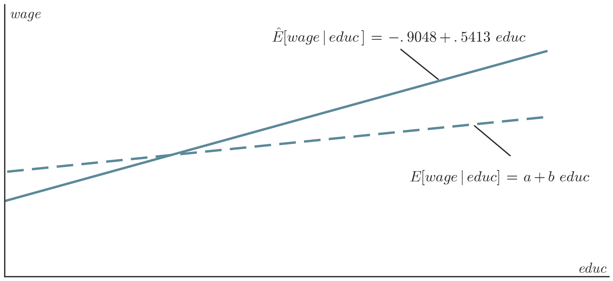
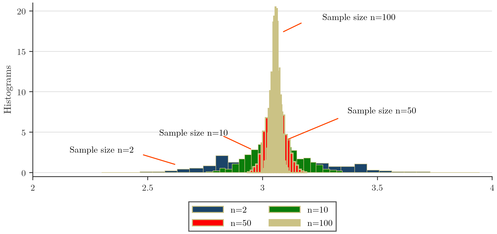
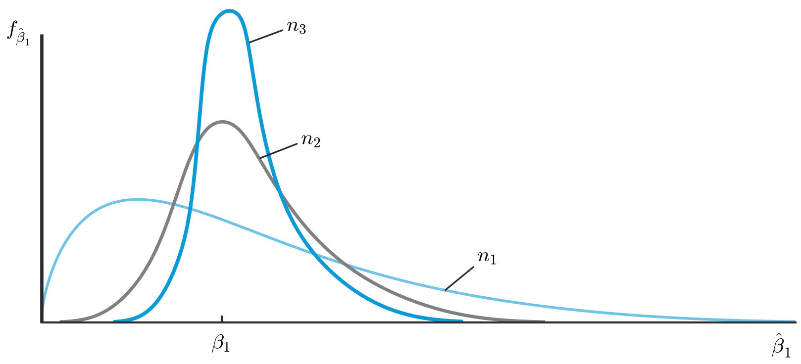
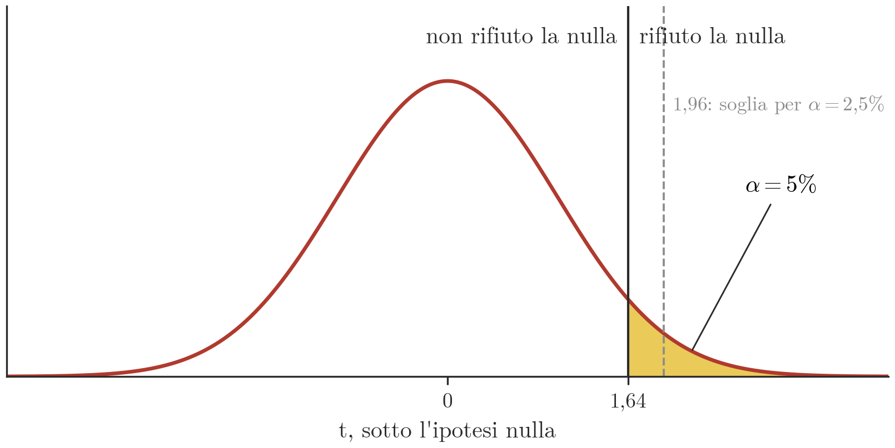
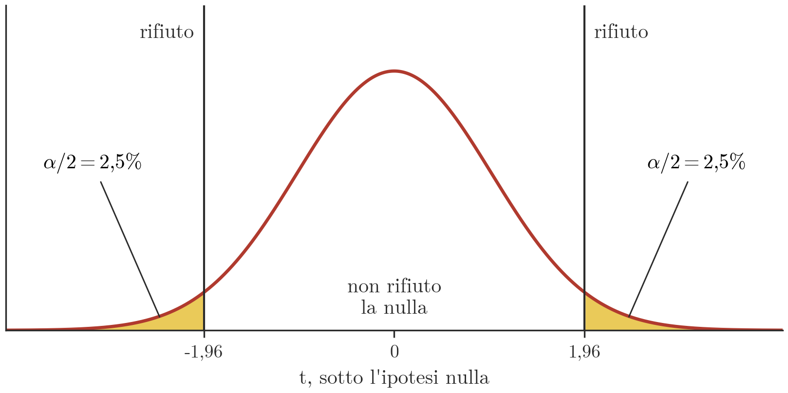

# Inferenza su beta, R quadrato e regressione multipla

## Ripasso: esogeneità e proprietà dello stimatore

Il modello di regressione semplice è vero che è semplificato, ma imparare bene i dettagli di questo modello ci permetterà di lavorare con modelli più complicati in maniera più veloce. Tanti concetti sono gli stessi, cambieranno solo per differenze. Quello di cui abbiamo parlato la settimana scorsa era: ho un modello di regressione, vorrei stimare i parametri. Abbiamo visto che ==ha senso stimare i parametri solo se il termine d'errore è incorrelato col regressore==. In quel caso si dice che siamo in una condizione di esogeneità. Se ho una condizione di esogeneità, la speranza è che le stime dei parametri siano corrette. Cosa succede quando non vale questa condizione? La correlazione tra x ed epsilon si trasferisce nello stimatore e di conseguenza le proprietà dello stimatore non sono più accettabili, nel senso che lo stimatore in media non è più uguale al vero valore del parametro e, quando anche avessi un numero di informazioni sufficientemente grande, la mia stima convergerà al vero valore più qualcos'altro.

La settimana scorsa abbiamo visto due risultati importanti. Abbiamo visto che sotto l'ipotesi di esogeneità, in media lo stimatore è uguale al vero valore del parametro, che è quello che vorrei stimare, cioè il fatto della mia decisione economica.

> [!question] Da verificare: la trascrizione riporta "cioè il fatto della mia decisione economica"; probabilmente "l'effetto", ma la trascrizione non lo conferma.

La varianza dello stimatore si può scrivere come $\sigma^2$, dove sigma quadro è la varianza del termine d'errore, diviso la sommatoria degli $x_i$ meno $\bar{x}$ alla seconda.

> [!question] Da verificare: la trascrizione riporta "degli xi meno il segnato alla seconda"; la slide 39 riporta $\sum_{i=1}^{n}(X_i-\bar{X})^2$ e si adotta questa forma.

Cosa vuol dire? Questo denominatore è di fatto la varianza campionaria di x. Quello che posso pensare è che se n cresce, questo numero, per la legge dei grandi numeri, convergerà alla varianza nella popolazione della variabile x. Quindi convergerà a una costante, assumo che le varianze esistano, quindi esistono momenti almeno fino all'ordine due finiti. Non posso usare le variabili x uguali a così, però posso usare le normali.

> [!question] Da verificare: la trascrizione riporta "Non posso usare le variabili x uguali a così, però posso usare le normali"; il senso non è chiaro e la slide 39 non lo chiarisce.

Cosa succede al numeratore? Al numeratore succede che ho uno fratto n, dove n è la dimensione del campione, per una costante che è la varianza del termine d'errore, questo è il denominatore di massima semplicità.

> [!question] Da verificare: la trascrizione riporta "questo è il denominatore di massima semplicità"; il senso non è chiaro.

Questa roba qua converge a zero. Cosa vuol dire? Vuol dire che se aumento le osservazioni, questa quantità tende a zero. Cosa vuol dire che tende a zero? Vuol dire che con campioni sufficientemente grandi, qualsiasi campione io ottenga non mi darà una stima numericamente molto diversa dal beta. Se la varianza è molto piccola, vuol dire che in una variabile casuale tutte le osservazioni sono concentrate attorno alla media. Ma questo cosa vuol dire? Vuol dire che la distanza proprio, il numero, la distanza media tra il mio stimatore e il vero valore del parametro sarà un numero piccolo. Ma siccome questa roba è sistematica, vuol dire che la stima che io ottengo, il numero che io ottengo, quasi certamente sarà vicino al vero valore di beta. Vuol dire che la differenza tra il vero valore del parametro e quello stimato non può essere tanto grande, questa è una condizione interessante. Questa proprietà si chiama consistenza, cioè la convergenza dello stimatore.

Quindi, sotto ipotesi di..., cosa succede? L'abbiamo visto l'altra volta, il mio stimatore in media è uguale a beta più qualcosa, chiamiamolo delta. Sotto le ipotesi di..., quello che succede, e l'abbiamo visto con gli esempi, è che lo stimatore, supponiamo che su quest'asse descrivo tutte le possibili stime che io posso ottenere applicando i minimi quadrati o il metodo dei momenti. Questo è il vero valore del parametro e questo è beta più delta, dove delta è un numero, in questo caso negativo. Cosa succede sotto ipotesi di...? Succede che le mie stime in media sono centrate non intorno a questo valore del parametro, ma intorno a questo. E cosa vuol dire? Vuol dire che tutte le mie possibili evidenze che possono venire da diversi campioni saranno centrate qua e non qua. Cosa succede se n cresce? Se n cresce la distribuzione delle... tende a concentrarsi intorno alla loro media, ma la loro media non è questa, è questa. Vuol dire che il mio stimatore in un modello endogeno, quindi sbagliato, tende a collassare intorno a questo punto e più osservazioni ho più collasserà, fino a che non si schiaccia esattamente in questo punto. Se n tende all'infinito vuol dire che il mio stimatore sarà una variabile casuale del genere con questa media, quindi sarò molto preciso nello sbagliare. Con errore intendo stimare questa anziché questa. E questa è una distorsione sistematica, quindi qua si parla di non consistenza. Questo era più o meno quello che avevamo visto l'altra volta.

> [!question] Da verificare: la trascrizione riporta "Quindi, sotto ipotesi di ... cosa succede?", "Sotto le ipotesi di ..., quello che succede", "Cosa succede sotto ipotesi di ...?" e "la distribuzione delle ... tende": la parola manca. Dal contesto (stimatore centrato su beta più delta, "modello endogeno" poco dopo) probabilmente endogeneità, ma la trascrizione non lo conferma.

## Il materiale online e la retta stimata contro la retta vera

Bene, a questo punto andrei avanti. Ho messo online, tra ieri sera e stamattina, due cose alla fine: giusto i risultati sulla legge delle aspettative iterate, se vi interessa guardate. Ieri sera ho aggiunto gli appunti di cui ho rifatto i grafici, ho sistemato un po' di inconsistenze della notazione, volevo farlo da tempo. Adesso c'è una versione più definitiva, più coerente. Non è che cambia moltissimo, però alcune cose ho cercato di spiegarle in maniera spero più chiara.

Quindi cosa vuol dire? Lo scopo finale del modello di regressione è stimare la retta di regressione, che è questa linea tratteggiata, e lo devo fare sulla base di un campione, che sono questi punti neri. Se io stimo il mio modello, io cercherò di adattare la mia retta di regressione ai dati, quindi otterrò qualcosa che non è necessariamente la riga verde tratteggiata. Quindi questo è il vero modello e questo è quello che stimo. Cosa mi aspetto però se aumento l'insieme di informazioni? Mi aspetto che gli stimatori di alfa e di beta convergano al vero valore del parametro alfa e beta e di conseguenza la mia retta stimata convergerà al vero modello. Se però ho eterogeneità, la mia retta stimata non convergerà mai al vero modello.

> [!question] Da verificare: la trascrizione riporta "eterogeneità"; dal contesto (retta stimata che non converge al vero modello, regressore esogeno nella frase precedente) probabilmente "endogeneità".

Questa è un po' l'idea grafica.

> [!question] Da verificare: la trascrizione riporta "Quindi io costruisco modello... Estratto che dovrebbe essere per la popolazione"; il passaggio non è chiaro.

Io la popolazione non ce l'ho, mi baso sul campione. Stimo i miei parametri sul campione e identifico una retta con una certa pendenza e una certa intercetta, cioè l'intersezione rispetto all'asse delle y. Ovviamente le due rette saranno diverse, è impossibile trovare il vero valore del parametro. Però la speranza è che se io aumentassi il numero di pallini grigi avrò un'evidenza più chiara rispetto alla popolazione e quindi la mia retta stimata, se il modello è esatto, il regressore è esogeno, dovrebbe convergere a quello che vorrei, che è il modello o si spera il modello causale. Questa è un po' l'idea. Dopodiché queste sono le trattazioni formali che abbiamo visto l'altra volta.

## Il teorema di Gauss-Markov

C'è un risultato che non è particolarmente importante ma c'è su tutti i libri, quindi ve lo racconto. Il mio problema è: la strategia dei minimi quadrati è una buona strategia per stimare i parametri, per ottimizzare il contenuto informativo delle mie osservazioni. In pratica ci sono molti modi per stimare i parametri di un modello e perché tutti usano i minimi quadrati? Perché sotto certe condizioni è il modo più preciso di mettere insieme le informazioni. Cosa vuol dire preciso? Mi fornisce le formule che mi garantiscono la variabilità più piccola, cioè la varianza del mio stimatore più piccola possibile, sotto certe condizioni. Il teorema di Gauss-Markov mi dà un risultato in questa direzione.

Cosa mi dice? Mi dice che se il modello è lineare, e qua intendo lineare nei parametri, non nelle variabili, se le osservazioni sono estratte dalla popolazione con un campionamento casuale semplice, quindi le osservazioni sono indipendenti, non X è indipendente da Y, sennò non staremmo a parlare, ma semplicemente che le coppie di osservazioni X, Y di ogni singolo individuo che appartiene al mio campione sono estratte in maniera indipendente, quindi sono indipendenti tra di loro. Dopodiché vale l'ipotesi di esogeneità e aggiungo l'ipotesi di omoschedasticità, ==qua è strettamente necessaria==. Quello che si può dire è che lo stimatore dei minimi quadrati, o LS, è il miglior stimatore, è quello con varianza più piccola tra tutti gli stimatori lineari e non distorti.

*(slide 42)*

Cosa vuol dire uno stimatore lineare? Vuol dire che di fatto posso scrivere la formula dello stimatore come una sommatoria. E tra gli stimatori non distorti, quelli che in media ci prendono, è quello con varianza più piccola. Cosa vuol dire questo? Vuol dire che se lo stimatore è quello con varianza più piccola, vuol dire che la formula OLS è quella che mi garantisce un'efficienza maggiore nell'utilizzare le informazioni che io osservo.

È quella che mi garantisce dei risultati più precisi. E questo è un risultato che a me non piace molto, però ha una sua importanza. Perché non mi piace molto? Perché intanto devo fare queste ipotesi che di fatto nella realtà non sono quasi mai verificate, e in più perché in fondo in statistica non è sempre detto che gli stimatori non distorti siano gli stimatori più interessanti. Certe volte uno potrebbe dire, a me della distorsione non interessa molto, magari supponiamo che riesca anche a sapere quant'è grande la distorsione, perché se so che uno stimatore è distorto ma so che la distorsione è uguale a 0,5, stimo una cosa distorta, ci sottraggo 0,5, ottengo uno stimatore alternativo del mio parametro. Però in generale uno potrebbe dire: ma se più o meno riesco a ipotizzare che la distorsione è abbastanza piccola, ma il guadagno in termini di precisione è molto più grande, beh a questo punto potrei decidere di utilizzare uno stimatore con caratteristiche diverse. Non sto dicendo che sia la cosa migliore, però è comunque una costrizione, un vincolo.

Quindi comunque, se pensate a tutti gli stimatori che sono scrivibili come sommatoria, e lo stimatore dei minimi quadrati è di fatto un rapporto di sommatorie, e nell'ambito degli stimatori non distorti, allora quello più preciso, quello con varianza più piccola, è lo stimatore dei minimi quadrati. E qua, ovviamente, ricordatevi: ==per questo teorema è importantissima, è chiave, oltre che quella di esogeneità, anche l'ipotesi di omoschedasticità==, cioè la varianza condizionale del termine d'errore è costante rispetto a x.

> [!question] Da verificare: la trascrizione riporta "oltre che quella di omogeneità"; la slide 42 elenca esogeneità e omoschedasticità tra le ipotesi del teorema, come il docente poco prima ("vale l'ipotesi di esogenità e aggiungo l'ipotesi di omoschedasticità"), e si adotta "esogeneità".

## La distribuzione dello stimatore

In realtà, quello che adesso vi enuncio, non faccio le dimostrazioni stavolta perché sono un po' più complicate, però se vi ricordate come funziona la statistica quando fate la media aritmetica, in questo caso funziona allo stesso modo. In generale, quello che vorrei capire è come si comporta non solo la media e la varianza dello stimatore, ma in realtà vorrei sapere qualcosa di più riguardo alla distribuzione di probabilità dello stimatore. Ricordate che lo stimatore è una variabile casuale che colleziona tutte le possibili stime che posso ottenere da campioni diversi, quindi è una sequenza di numeri, ogni numero ha una sua probabilità. Quello che vorrei fare è capire, se potessi avere tutti i campioni diversi, come è fatto l'istogramma: calcolo tutti i campioni, mi calcolo lo stimatore per ogni campione e mi calcolo l'istogramma, voglio sapere la distribuzione di probabilità.

In generale si fanno due distinzioni quando si calcola la distribuzione di uno stimatore. Può essere interessante cercare di capire come è fatta la distribuzione dello stimatore ipotizzando che il numero di osservazioni sia fissato: 20, 35, 47, 100, 10.000. Oppure può essere interessante capire cosa succede al mio stimatore se il numero di osservazioni diverge, tende all'infinito. Cioè cosa succede se io avessi la possibilità di avere campioni sufficientemente grandi da approssimare sufficientemente bene la popolazione. Mi interessa di più il secondo aspetto. Tutto sommato, il campione infinito non è particolarmente interessante, anche perché la maggior parte dei risultati che si possono dimostrare in campioni finiti richiedono ipotesi aggiuntive. Adesso ve le racconto, tra cui ipotizzare che il termine d'errore non solo sia incorrelato con X, ma sia gaussiano.

> [!question] Da verificare: la trascrizione riporta "il campione infinito non è particolarmente interessante"; dal contesto (subito prima "mi interessa di più il secondo aspetto", cioè il caso asintotico; subito dopo i campioni finiti che richiedono ipotesi aggiuntive) probabilmente "finito".

### Campioni finiti: errore gaussiano

Adesso quello che voglio raccontarvi è come si comporta la distribuzione dello stimatore di beta, supponendo di avere un campione finito, n fissato, non cambia. Per dimostrare le proprietà della distribuzione devo assumere che il termine d'errore è gaussiano con media zero e varianza sigma quadro, dove sigma quadro è un parametro, in questo momento ipotizziamo che lo conosciamo, è un numero. Quello che si può dimostrare analiticamente è che sotto queste ipotesi questo rapporto si distribuisce come una variabile casuale con media zero e varianza uno. Questo vuol dire che, semplicemente riscalando per la media e per la varianza, ottengo che lo stimatore più o meno si distribuisce come una variabile casuale normale con media il vero valore del parametro, tanto sappiamo che lo stimatore è non distorto, e varianza, un numero che più o meno posso calcolare. Sto ipotizzando due cose importanti. Uno, questo numero lo conosco. Due, epsilon è gaussiano, oltre che incorrelato con x.

*(slide 43)*

Sono ipotesi che non sono facili da soddisfare. Primo, perché epsilon non lo osservo, quindi non posso dire che sia gaussiano. È un'ipotesi di convenienza, ma non è detto che valga. Ogni volta che faccio un'ipotesi in teoria dovrei validarla. Come faccio a validare un'ipotesi quando non ho neanche le osservazioni? È difficile. Quindi è un'ipotesi che in generale preferisco non fare. Secondo, è difficile sapere che questo numero sia un numero noto. Tipicamente questo numero è noto in applicazioni tipo fisica, chimica, in cui di fatto quel sigma quadro rappresenta il livello di precisione del mio macchinario che misura le cose. So che il macchinario è preciso a 10 alla meno 5 millimetri, non lo so, dico una roba del genere, e quello mi dice come le mie stime, come i miei dati si distribuiscono intorno alla media. Però nelle scienze sociali non è un'ipotesi che posso fare. Come faccio a dire qual è la dispersione delle osservazioni rispetto alla media quando magari le osservazioni sono salari, età o cose del genere. Quindi in generale questo risultato è carino perché mi dice che posso anche costruire l'istogramma delle mie osservazioni, dei miei stimatori e avere la bella forma a campana, ma nella vita reale è insostenibile come ipotesi. Per questi due motivi. Non so se epsilon è gaussiana, non so qual è la media.

> [!question] Da verificare: la trascrizione riporta "non so qual è la media"; dal contesto (il secondo motivo riguarda il sigma quadro, la dispersione) probabilmente "la varianza".

### La t di Student

In realtà, se indebolisco un po' queste condizioni e quantomeno dico che epsilon rimane gaussiano, ma sigma quadro lo devo stimare in qualche modo e si può fare facilmente, allora quello che si dimostra è che questo rapporto si distribuisce come una variabile casuale t di Student con n meno due gradi di libertà, dove n è il numero di osservazioni. Quindi se ho 635 osservazioni, una t di Student con 633 gradi di libertà. Gradi di libertà nella t di Student mi dicono qualcosa sulla varianza, mi controllano la varianza del fenomeno. Quindi l'unica cosa che cambia tra qui e qua è che qua devo stimare il denominatore, mentre qua più o meno no. Questa la conosco, questa è semplicemente la varianza campionaria; se piazzo questa formula al denominatore ottengo il risultato. Se però devo stimare sigma qua, in questo caso l'unica differenza tra qua e qua è che devo stimare sigma quadro. E questo però mi crea dei problemi dal punto di vista del calcolo della distribuzione, che anziché normale diventa t di Student.

Il problema non è così serio, perché in realtà una t di Student diventa di fatto sovrapponibile rispetto alla gaussiana per un numero di gradi di libertà più o meno superiore a 30. Quindi se n meno 2 è superiore a 30, questa distribuzione e questa distribuzione sono di fatto indistinguibili. Dal punto di vista operativo cosa vuol dire? Vuol dire che se ho un campione più grande di 30-35 osservazioni posso usare l'approssimazione normale. Con un campione più piccolo, o comunque un campione talmente basso, con meno di 30 osservazioni, non mi fiderei comunque dei risultati che sto ottenendo. Quindi tanto vale far sempre finta che questa roba qua sia comunque una normale, tanto sbagliare per sbagliare, almeno scelgo la strada facile. Quindi se ho poche osservazioni non sarò mai convinto fino in fondo di quello che ottengo dalla mia evidenza empirica, perché c'è troppa variabilità campionaria. Tra un campione e l'altro piccolo posso avere tanta variabilità. Quindi tanto vale utilizzare l'approssimazione normale, che comunque è giustificata anche dalla teoria asintotica, che va a vedere cosa succede se, anziché considerare un campione fissato, ho un numero di osservazioni che cresce.

### Campioni grandi: normalità asintotica

Supponiamo che n tenda all'infinito, quello che si può dimostrare è che questa quantità, la deviazione del mio stimatore rispetto al vero valore del parametro, moltiplicata per il numero di unità campionarie converge a una normale con media zero e varianza, chiamiamola, questa varianza qua si chiama varianza asintotica, si può calcolare la formula che è una funzione comunque di x e sigma quadro, anche quella. Quindi se n è sufficientemente grande posso dire che il mio stimatore si distribuisce come una normale con media beta e varianza questa roba qua.

> [!question] Da verificare: la trascrizione riporta "moltiplicata per il numero di unità campionarie"; le slide 44 e 45 non riportano il fattore, ma poco dopo il docente dice "devo moltiplicare per radice quadrata di n".

Siccome n tende all'infinito, per approssimare questa quantità ipotizzando che n sia finito, perché poi quando ho un campione conosco quante osservazioni ho, supponiamo che voglio utilizzare questa formula e supponiamo di avere 100 osservazioni, quello che posso fare è calcolare il numeratore, dividere per 100, ottenere una distribuzione, un'approssimazione, basata sulla teoria asintotica della distribuzione dello stimatore, che è normale con media beta e un numero. L'altra cosa che è interessante è che, se n è diverso, cioè un campione molto grande, allora questo numero sarà molto piccolo, vuol dire che lo stimatore convergerà al vero valore parametrico, che lo sapevamo già, perché comunque i risultati sulla varianza che collassa a zero comunque valgono.

> [!question] Da verificare: la trascrizione riporta "se n è diverso, cioè un campione molto grande"; probabilmente "se n diverge", ma la trascrizione non lo conferma.

Quindi, se n è sufficientemente grande, posso applicare la legge dei grandi numeri, il teorema centrale del limite e dimostrare che questa quantità, che è la distanza tra lo stimatore e il vero parametro, è gaussiana. In realtà, per ottenere una distribuzione di probabilità non degenere, devo moltiplicare per radice quadrata di n. Se non moltiplicassi per radice quadrata di n, avrei che, so che la varianza dello stimatore collassa a zero, vuol dire che lo stimatore converge al vero valore parametrico. Che cosa vuol dire? Che converge a una variabile casuale degenere, che per n all'infinito, beta cappellino sarà uguale a beta con probabilità 1 e diverso da beta con probabilità 0. Questo risultato è interessante, però non ci permette di fare inferenza, non ci permette di fare i test. Per fare i test devo pesare un po' di più il numeratore, moltiplicandolo per radice quadrata di n. Questo è il teorema centrale del limite. Pensate che quando fate, nel corso di statistica, l'analisi della media aritmetica è esattamente la stessa cosa. E questo perché? Perché abbiamo visto la formula dello stimatore di beta, ma di alfa uguale, e tutto sommato lo posso scrivere come fosse una media, o meglio come fosse un rapporto di medie.

> [!question] Da verificare: nella frase "se non moltiplicassi per radice quadrata di n, avrei che... la varianza dello stimatore collassa a zero, vuol dire che lo stimatore converge al vero valore parametrico" la trascrizione riporta "converge a zero valore parametrico"; si legge "al vero valore", come nella frase analoga poco prima, ma non è confermato.

Spiegazione un po' all'acqua di rose di perché funziona quel risultato di prima. Io so che, se ho una sequenza di osservazioni indipendenti e calcolo la media aritmetica, alla media della popolazione individuo quella varianza della media aritmetica, il teorema centrale del limite mi dice che questa roba qua converge a una normale zero uno.

> [!question] Da verificare: la trascrizione riporta "alla media della popolazione individuo quella varianza della media aritmetica"; il passaggio non è chiaro, la slide 45 riporta $(\bar{Z}-\mu_Z)/\sigma_{\bar{Z}} \to N(0,1)$ ma non basta a stabilire le parole del docente.

Perché nel modello di regressione funziona uguale? Pensate che avete un numeratore e un denominatore. Il numeratore è fatto da elementi di questo tipo: avete osservazioni meno la media aritmetica, osservazioni meno la media aritmetica. Quei prodotti incrociati li potete chiamare z i. Sono indipendenti tra di loro tutti i singoli prodotti incrociati? Sì, perché x e y sono pescati in maniera indipendente rispetto all'individuo i, quindi il prodotto di cose indipendenti rimane indipendente. Quindi queste quantità sono indipendenti. E come è fatto il numeratore? È uno fratto n, la media di questi oggetti qua, quindi vale il teorema del limite centrale. Deve valere che la varianza di questa roba qua deve essere finita, quindi di fatto devo avere che i momenti quarti di x e y devono esistere. Quindi non posso usare la t di Student con tre gradi di libertà, però quella con cinque va già bene. Quindi di fatto sto dicendo che il numeratore è una media aritmetica e converge a una normale con media zero e varianza uno. Il denominatore è questa roba qua e converge in probabilità alla varianza di x, quindi è una costante. Quindi questa roba converge a una normale, questa roba converge a una costante e di conseguenza il rapporto deve essere normale. Con varianza uno, perché la variabilità di questo oggetto è compensata dalla variabilità del denominatore, uguali.

*(slide 45)*

Cosa vuol dire? Vuol dire che se calcolo questo oggetto qua, lo stimatore di beta cappellino meno il suo valore atteso diviso la sua variabilità, ottengo questo oggetto che è una gaussiana con media zero e varianza uno e di conseguenza ottengo il risultato asintotico che vi ho raccontato prima. Ma di fatto cosa fate? Scomponete la formula dei minimi quadrati come numeratore e denominatore, applicate la legge dei grandi numeri al denominatore, il teorema del limite centrale al numeratore. Il numeratore diventa gaussiano, il denominatore è una costante e questo mi permette di ottenere questo risultato. Dopodiché, se riscalo per questa e aggiungo questa, ottengo che beta asintoticamente si distribuisce come una normale. Non voglio dirvi di più di questo, è un qualcosa che dovreste aver già visto nel corso di statistica. Sappiate che lo stimatore di beta si comporta esattamente come una media aritmetica, solo che anziché guardare solo la media aritmetica qua ne avete due di medie aritmetiche. Una è la covarianza, una è la varianza al denominatore. Ma per le ragioni che vi ho raccontato prima convergono correttamente senza particolari problemi, nel caso almeno di campione indipendente e identicamente distribuito e quindi di conseguenza posso dimostrare che se volessi approssimare la distribuzione di uno stimatore per n sufficientemente grande, allora l'istogramma che ottengo da, non so, 10.000 campioni ben si approssima a una curva campana con una certa media e una certa varianza.

### Che cosa mostrano i grafici

Se guardate il grafico che avevo ottenuto qua. È esattamente questo risultato. Vedete che all'inizio la distribuzione è un po' strana, perché ha le code che sono anche asimmetriche, dopodiché con l'aumentare delle osservazioni vedete che intanto si schiaccia intorno al vero valore del parametro, che so essere questo, è 3,2, e in più la forma è sempre più ben approssimata da una campana, che di fatto è la distribuzione normale.

> [!question] Da verificare: la trascrizione riporta "che so essere questo, è 3,2"; la slide 41 non riporta il valore del parametro.

Questo è un altro grafico, quelli sono dati reali, dei calcoli che ho fatto su un campione, su una popolazione che avevo a disposizione. Questo è un grafico, astratto.

Se n è grande, avete che il vostro stimatore è ben approssimato da una curva gaussiana. Se n è piccolo, non è detto che l'approssimazione sia gaussiana, può anche essere asimmetrica la distribuzione. ==È importante ricordare che ognuna di queste curve qua disegnate ha sempre la stessa media beta, ma non necessariamente è simmetrica.== Qua potrei avere la media e la moda diverse. La moda è questo punto, la media è questo punto. Tutte queste curve hanno la stessa media beta, ma la moda può essere diversa. Però più osservazioni ottengo, migliore sarà l'approssimazione data da una curva simmetrica fatta a campana. Questa è un po' l'intuizione che sta alla base della teoria asintotica. Non andrei sulle derivazioni analitiche perché è un po' noioso, avrei bisogno di definire un po' più di cose, non è lo scopo. Comunque, se avete già visto questi risultati, è esattamente la stessa cosa. Come ho detto prima, se non li avete già visti come stimatore nell'ambito del modello di regressione, pensate che è la stessa cosa che si fa con la media. Un po' più complicata la notazione, ma è esattamente la stessa.

## Verifica d'ipotesi su beta

Detto questo, ho un risultato interessante. Alla fine posso concentrarmi su questa distribuzione, questa approssimazione. E questa approssimazione mi è utile, particolarmente utile, per poter fare inferenza, perché una volta che so qual è la distribuzione di tutti i miei possibili risultati che posso ottenere da un campione con una certa dimensionalità sufficientemente grande, allora posso fare un test di ipotesi. Posso, per esempio, cercare di verificare se un potenziale valore di interesse per il parametro è coerente con le mie stime oppure no. Per esempio, supponiamo di pensare alla decisione di dover decidere se iscrivermi alla magistrale, quindi studiare due anni in più. Magari una persona potrebbe dire: studio due anni in più se il guadagno atteso nella mia paga oraria sia almeno un euro in più. Dico numeri a caso, spererei un po' di più. Però in generale la decisione potrebbe essere: se studio due anni in più mi aspetto minimo di guadagnare un euro in più, se no non vale la pena. Questa è un po' l'idea. Come posso utilizzare questi risultati per validare un'ipotesi del genere? Devo fare un test di ipotesi.

Supponiamo di lavorare con un modello di regressione semplice, quindi y è uguale ad alfa più beta x più epsilon, e suppongo che la covarianza tra x ed y sia uguale a zero, quindi il modello si comporta bene, non ci sono problemi.

> [!question] Da verificare: la trascrizione riporta "la covarianza... Tra x ed y sia uguale a zero"; dal contesto ("il modello si comporta bene, non ci sono problemi") si intende probabilmente la covarianza tra x ed epsilon.

Cosa vuol dire studiare? Cosa mi dice questo modello? Mi dice che la variazione attesa di y in corrispondenza di due anni in più di studio la posso quantificare come questa quantità qua. Questa è l'idea di studio due anni di più, è beta, il moltiplicatore della mia scelta economica.

Assumo che effetti collaterali non ce ne siano, cioè variazioni di y non abbiano nessuna rilevanza in media.

> [!question] Da verificare: la trascrizione riporta "variazioni di y non abbiano nessuna rilevanza in media"; dal contesto probabilmente le variazioni del termine d'errore (la slide 14 pone $\Delta\epsilon=0$), ma la trascrizione non lo conferma.

Come faccio a decidere, dal punto di vista statistico, se il mio guadagno in termini di salari sia maggiore dell'euro, sia maggiore di uno, che è l'euro che mi aspetto di guadagnare in più se studio due anni in più. Minimo, poi se guadagno dieci euro in più sono ancora più contento, ma la soglia minima per fare la magistrale è l'euro in più. Quello che dovrei fare è... questa condizione si verifica se beta è maggiore di un mezzo. Da un certo punto di vista quello che posso fare cos'è? Prendo un campione di dati, stimo beta e vedo se è maggiore di un mezzo o minore di un mezzo. Questa potrebbe essere una scelta ragionevole, ma non funziona molto bene, perché? Perché quello che io stimo, il beta che io stimo, non è il vero valore di beta, non è il valore della popolazione, è semplicemente l'evidenza campionaria, cioè quello che vi ho fatto vedere prima. Adesso dovrebbe essere ancora più chiaro. Quello che io stimo è il beta di questa retta, non il beta di questo, ma la mia decisione la vorrei prendere sul beta nella popolazione. Questo potrebbe essere influenzato da una differenza campionaria, da un errore campionario, che ci sta, si spera sia piccolo, però io non lo posso quantificare. Quindi il punto è che io non mi posso basare su questa pendenza nel decidere, devo tener conto anche del fatto che quello che stimo ha il vero valore più una componente di variabilità che dipende dai dati che ho osservato. E un campione diverso potrebbe darmi un risultato diverso. Quindi in qualche modo voglio prendere una decisione corretta dal punto di vista probabilistico, tenendo conto del fatto che i miei parametri sono stimati sotto incertezza. L'incertezza dovuta al fatto che misuro solo una sottoporzione della popolazione, che è il campione. Quindi devo fare un test.

### Ripasso del test di ipotesi

Come si fa? Siete tranquilli sui test di ipotesi o volete che ci faccia una ripassata? Una ripassata, sì. Come funziona un test di ipotesi? Tipicamente funziona in questo modo: devo decidere tra due ipotesi, tra due condizioni. Una la chiamo ipotesi nulla, una la chiamo ipotesi alternativa. L'ipotesi nulla di solito viene indicata come H0, l'ipotesi alternativa viene indicata come H1 oppure Ha. Negli uffici non so cosa ho messo, forse un po' e un po', però è la stessa roba. Una sta per alternativa, una sta per uno che è diverso da zero. Nella logica, se qualcuno ha fatto un po' di logica formale tipo algebra di Boole, zero vuol dire vero, uno vuol dire falso. 0, 1 commercio di interruttori. Questo è il motivo.

> [!question] Da verificare: la trascrizione riporta "Negli uffici non so cosa ho messo"; le slide 52 e 53 scrivono l'alternativa come Ha, ma la parola "uffici" non si scioglie. La trascrizione riporta anche "zero vuol dire vero, uno vuol dire falso" e "0, 1 commercio di interruttori"; il passaggio non è chiaro e la trascrizione non permette di stabilire se l'abbinamento sia quello detto dal docente.

Quello che potrei fare è cercare di capire se i dati sono coerenti con un'ipotesi nulla. Come potrei costruire il sistema di ipotesi? Potrei mettere questa condizione sotto l'alternativa, quindi potrei dire che beta è maggiore di un mezzo. Se i dati sono più coerenti con questa ipotesi, vuol dire che farò il master. Se i dati sono più coerenti con questa ipotesi, potrei scegliere di non volerlo fare. Una volta che ho definito l'alternativa, come faccio a definire la nulla o viceversa? È il suo opposto. Cos'è il suo opposto? È che beta è minore o uguale di un mezzo. Quindi devo scegliere tra queste due condizioni. Minore o uguale di un mezzo vuol dire che può essere qualsiasi numero che vada da un mezzo a più piccolo. In realtà, qual è il caso più difficile da decidere? Quando beta è effettivamente uguale a un mezzo contro beta che è maggiore, perché là la distinzione è minima. Qua è proprio... un mezzo è il punto più vicino a questo insieme. Quindi in generale, piuttosto di scrivere questa condizione, è equivalente scrivere beta uguale a un mezzo.

Cosa vuol dire? Supponiamo che rifiuto questa ipotesi qua, che i miei dati non siano coerenti con questa ipotesi. Se non sono coerenti col beta più vicino all'alternativa, lo saranno ancora meno se prendo un beta più piccolo. Se decido che questa ipotesi è più ragionevole di questa, se facessi un test del tipo beta uguale a un quarto contro beta maggiore di un mezzo, rifiuterei ancora più violentemente questa ipotesi qua. Quindi l'idea è: prendiamo il caso più complicato e fissiamo beta a un mezzo. Se rifiuto la nulla in questo caso, rifiuterò per qualsiasi beta minore di un mezzo. Questa è un po' l'idea. Quindi, anziché usare questa ipotesi che è un po' più complicata, trasformo questa condizione in quella più sfavorevole rispetto all'alternativa.

### La statistica t sotto la nulla e sotto l'alternativa

Come funziona un sistema di ipotesi? Come funziona la procedura di Neyman e Pearson che mi permette di fare un test, un test statistico? L'idea qual è? Supponiamo che io mi fido dell'ipotesi nulla, cioè io credo ciecamente che l'ipotesi nulla sia quella corretta. Questo cosa vuol dire? Vuol dire che il vero valore del parametro deve essere un mezzo. Cosa vuol dire? Vuol dire che se prendo il mio stimatore, ci sottraggo un mezzo e divido per il livello di precisione della mia stima, chiamiamolo standard error, beta cappellino, è la varianza quadrata della varianza, allora sta roba, per la teoria asintotica, deve essere una normale con media zero e varianza uno.

> [!question] Da verificare: la trascrizione riporta "beta cappellino, è la varianza quadrata della varianza"; probabilmente "la radice quadrata della varianza di beta cappellino".

Questa quantità qua la chiamo t. Se usiamo la teoria asintotica, quelli che parlano bene la chiamano z, però chiamatela come vi pare, tanto sembra normale, le lettere non sono così importanti.

Cosa vuol dire? Facciamo un grafico e cerchiamo di capire cosa vuol dire. Su quest'asse qua faccio il grafico di tutti i valori che può assumere la statistica t, ipotizzando che l'ipotesi nulla sia corretta. In questo caso io sto ipotizzando che la nulla sia corretta, ci sto credendo. E se la nulla è corretta, tutti i miei output, tutte le mie statistiche t calcolate in questo modo, cioè calcolo 100.000 diversi stimatori da 100.000 diversi campioni, ci tolgo un mezzo, divido per il livello di precisione di questi stimatori, otterrò un istogramma che sarà ben approssimato dalla normale 0,1. Quindi, dato che questo è 0, questa è la distribuzione della statistica t sotto l'ipotesi nulla.

Cosa succede se adesso cambio fede e non credo più nella nulla, credo nell'alternativa? Anzi, continuo a credere nella nulla, però cosa succede al mio stimatore se invece dovesse essere vera l'alternativa? In realtà vuol dire che beta sarà mediamente maggiore di un mezzo, vuol dire che la media del numeratore sarà maggiore di 0. Perché supponiamo che il vero beta sia 5 e calcolo la media del numeratore, avrò che la media della distribuzione sotto l'alternativa sarà 5 meno un mezzo. Quindi in generale mi aspetto che la distribuzione di probabilità sotto l'alternativa sia sempre normale, ma shiftata a destra. Questa è la distribuzione della statistica t rispetto a H0; rispetto all'alternativa mi si sposta a destra.

Sulla base di questo, quello che vorrei fare è in qualche modo trovare una regola decisionale per dire: queste curve mi rappresentano tutti i possibili campioni che io posso ottenere giocando con i dati, con tutti i possibili dati nella popolazione. In realtà io ho solo un campione a disposizione, che è quello che utilizzo per fare i calcoli. Quello che potrei fare allora è vedere come la mia osservazione si posiziona rispetto a quest'asse. Quello che mi aspetto è che se la mia statistica t osservata, quella che calcolo sulla base dei dati, sta qua, vuol dire che la curva rossa è più probabile della curva nera. Se invece la mia t osservata è qua, vuol dire che è più probabile l'alternativa, che è quella che mi restituisce questa curva qua. Quindi in generale quello che potrei dire è che, definire una soglia, più o meno qua, che mi dice: se osservo una statistica t, chiamiamola osservata, in questa parte del grafico, allora è più probabile l'ipotesi nulla. Se osservo la statistica t qua, vuol dire che è più probabile l'alternativa. Quindi se avessi una tagliola, una regola... Questa barra qua, tale per cui, che mi divide questa retta, allora qua vuol dire che i dati sono coerenti con la nulla, qua vuol dire che sono più coerenti con l'alternativa. Il problema è che io in questo momento non ce l'ho questa barra verticale e vorrei calcolarla in maniera razionale. Il problema qual è? Se la mia statistica è molto in questa direzione o molto in questa direzione, la decisione è facile.

Quindi se i miei dati mi dicono che la statistica t è qua, vuol dire che la curva rossa assegna a questo valore probabilità zero, quindi non si discute tanto. Mentre se ottengo un'osservazione qua, è molto più probabile la nulla rispetto all'alternativa, perché la probabilità assegnata dalla curva rossa rispetto alla nera in questo punto è molto più grande, sempre piccola ma molto più grande. Il problema in realtà ce l'ho quando sono qua intorno. Se osservo un qualcosa in quest'area, tutto questo segmento è coerente sia con la nulla sia con l'alternativa, quindi qua la decisione diventa più difficile.

### La soglia e l'errore del primo tipo

L'idea di Neyman e Pearson per costruire un test è la seguente. Quando prendo una decisione statistica, allora dico: un errore lo posso fare. Quello che voglio fare è non sbagliare troppo spesso, o comunque voglio controllare la probabilità di sbagliare. Quindi quello che fanno è: costruiamo la tagliola, la soglia qua, tale per cui la probabilità di uno specifico errore è fissata, e la fisso a un livello che chiamiamo alfa. Supponiamo per esempio di fissare questa soglia e supponiamo che la probabilità rispetto alla curva rossa di eccedere questa soglia sia uguale a alfa, tipicamente alfa è fissata all'1, 5, 10 per cento. In applicazioni macroeconomiche anche più grande, perché i dati sono pochi.

Cos'è questa area gialla? È la probabilità di sbagliare. Ma che tipo di errore vado a misurare? Mi dice che in qualche modo, dato che ho fissato questa soglia qua, e supponiamo che la mia statistica t sia qua, mi dice che vado a rifiutare la nulla, quindi sto dicendo che è più probabile la curva nera, ma in realtà potrebbe essere corretta comunque la curva rossa. Quindi questa roba qua mi dice che faccio un errore perché i dati potrebbero essere coerenti con la nulla, ma in realtà la mia decisione è a favore dell'alternativa. Questo si chiama errore del primo tipo.

Quindi perché allora, sapendo che sbaglio, fisso una soglia qua? Primo, perché comunque un errore lo posso fare. Secondo, perché fissando una soglia in cui l'area gialla è alfa per cento vuol dire che la probabilità di sbagliare non può mai essere maggiore di alfa. Quindi se la probabilità alfa è sufficientemente piccola, vuol dire che di fatto questo tipo di errore non lo faccio praticamente. Quindi scelgo alfa. Una volta che so alfa, tipo 2,5 per cento, so che la soglia deve piazzarsi al valore 1,96, basta guardare la tavola della normale: se la mia statistica t è inferiore a 1,96, decido per la nulla, sennò decido per l'alternativa. Tutto qua. Se uso la soglia del 5%, guardo le tavole, mi accorgo che il valore della soglia è centrato su un valore 1,64: inferiore a 1,64, nulla, alternativa. È un test unilaterale a destra, ovviamente. E questa è un po' l'idea.

### L'errore del secondo tipo

In statistica si sceglie di fissare la probabilità dell'errore del primo tipo, ma ci sono due potenziali errori che posso fare. L'errore del primo tipo mi dice che scelgo l'alternativa quando è vera la nulla, ma posso anche scegliere la nulla quando è vera l'alternativa. Questo si chiama errore del secondo tipo. Tipicamente in statistica quell'errore non si va a guardare, si spera che sia piccolo. Ma la giustificazione filosofica sulla base del quale non si dà lo stesso peso all'errore del primo tipo e all'errore del secondo tipo è che tipicamente gli errori hanno conseguenze diverse. Nel senso che ci sono errori gravi e errori meno gravi. L'errore del secondo tipo è considerato meno grave, l'errore del primo tipo è considerato più grave.

L'esempio che noi abbiamo fatto al corso di statistica secoli fa me l'aveva spiegata così, e l'esempio era quando c'è stato l'incidente dello space shuttle che è stato lanciato ed è esploso in aria al lancio. Chi doveva lanciare aveva due possibili decisioni: si sapeva che poteva succedere qualcosa perché c'erano le condizioni climatiche per creare dei problemi alle guarnizioni dei serbatoi. Quello che è successo è che di fatto col freddo si sono rotte le plastiche dei serbatoi, le guarnizioni non hanno più isolato il serbatoio rispetto al motore, la benzina, carburante, è finito sul motore, troppo caldo, è esploso tutto. Il problema qual era? La NASA doveva decidere: lancio sapendo che c'è un problema o non lancio e perdo i diritti televisivi? Ci sono due errori. L'errore grave è lancio ed esplode la nave. Se lancio e non esplode, non ho fatto un errore, ho preso la decisione giusta. C'è l'errore: faccio un lancio e succede l'incidente; l'altro errore è: non faccio il lancio, non sarebbe successo l'incidente, però perdo la diretta televisiva, perdo i soldi. Uno può decidere qual è l'errore grave o quello non grave; col tempo che corrono negli Stati Uniti non lo so, cioè nel senso cos'è più importante, la vita umana o i soldi. Però, in generale, l'errore grave è tipicamente l'esplosione; l'errore non grave è perdere un po' di soldi dovuti ai diritti televisivi.

> [!question] Da verificare: la trascrizione riporta "si sono rotte le plastiche dei serbatoi, c'era lo spaziale, le guarnizioni" e, dopo "è esploso tutto", "In modo visivo. All'epoca si facevano diverse robe, prima..."; il senso non è chiaro.

Ecco, errore del primo tipo e del secondo tipo potete pensarla così. L'errore del primo tipo è quello che fisso, quindi non voglio sbagliare più di tanto in un errore che io considero più grave. L'errore del secondo tipo è un errore che posso fare, ma si spera che sia piccolo possibile. Per quelli che vogliono fare la statistica fatta bene, la probabilità di errore del secondo tipo si chiama potenza. La potenza del test non è altro che cercare di capire quanto il modello, quanto la procedura di test sbaglia nell'altra direzione. È una roba che non ho mai capito bene, quindi vabbè, saltiamo.

> [!question] Da verificare: la trascrizione riporta "la probabilità di errore del secondo tipo si chiama potenza"; il docente stesso aggiunge subito dopo "è una roba che non ho mai capito bene".

### Il p-value

Abbiamo una regola, quindi abbiamo definito una soglia che mi dice da dove finisce la nulla e dove comincia l'alternativa. Abbiamo calcolato, dobbiamo solo decidere qual è la probabilità di errore. Una volta che osservo la statistica t calcolata sulla base delle mie stime del modello, ottengo, posso prendere la decisione, sapendo che comunque la decisione è incerta.

C'è un altro modo per decidere se sono a sinistra o a destra della soglia, e questo si chiama p-value. In fondo, che io sia molto lontano dalla soglia o molto vicino alla soglia, purché a sinistra, prendo sempre la stessa decisione. Però magari vorrei anche avere un'idea di quanto vicino sono alla soglia. Quindi quello che potrei fare è calcolare una misura di quanto lontano sono dalla coda delle distribuzioni. In statistica questo numero si chiama p-value e fondamentalmente, supponiamo che la statistica t osservata sia effettivamente questa. Il p-value mi va a calcolare la probabilità di osservare qualcosa, una statistica t che sia nella direzione dell'alternativa. In questo caso è tutta questa, rispetto all'ipotesi nulla ovviamente. Rispetto alla curva rossa, qual è la probabilità di osservare qualcosa che sia peggio rispetto all'idea di ipotesi nulla? Quindi devo calcolare questa probabilità qua. Siccome ho fissato questa area gialla al 5%, se quest'area nera è maggiore dell'alfa percento, vuol dire che sono automaticamente a sinistra della soglia. Se la probabilità è inferiore al 5%, vuol dire che sono alla destra. È equivalente usare un modo o l'altro.

Però questo mi dice quanto vicino sono alla soglia, perché io posso anche prendere una decisione, poniamo di essere qua, e supponiamo di calcolare questo p-value è il 5,1%, dato che alfa è il 5%. Vuol dire che sono veramente vicino al bordo, vuol dire che la mia decisione è un po' incerta, perché basta veramente che osservo un numero un po' diverso per calcolare le stime e mi cambia la decisione completamente. Quindi, se sono a p-value uguale al 5,1%, più o meno devo stare più attento a fare delle affermazioni. È chiaro che se sono a p-value uguale al 75% vuol dire che sono di qua, mi sento un po' più tranquillo nel prendere la decisione, quindi questo mi dà informazione aggiuntiva.

In più mi permette di fare test fissando la probabilità a posteriori, non a priori. Se io definisco la probabilità alfa per trovare questa sbarra, devo definirla immediatamente. Se alfa uguale al 5%, 1,64; se alfa uguale al 2,5%, 1,96 e avanti così. Dopodiché decido. Se io dovessi calcolare semplicemente la probabilità di osservare qualcosa di più grande della statistica t osservata, non ho bisogno di definire alfa a priori, posso anche scegliere dopo, non mi serve più. Quindi è una procedura piuttosto comoda. Quindi per decidere se è più plausibile la nulla o l'alternativa, si può usare o la soglia o il p-value.

Non è altro che la probabilità, ipotizzando che la nulla sia vera, che la statistica t sia maggiore o uguale della statistica t osservata, cioè quella che calcolo sulla base del campione. E questo è: se è maggiore dell'alfa per cento, non rifiuto la nulla; se è minore dell'alfa per cento, rifiuto la nulla.

### Rifiutare o non rifiutare, mai accettare

Ora, ==l'unica cosa da ricordarsi è che in statistica le ipotesi si rifiutano o non si rifiutano, ma non si accettano mai==. Perché? Perché accettare vuol dire che è vero, ma in realtà la mia è una decisione sotto incertezza, quindi se il mio test mi dice che il p-value è maggiore dell'alfa per cento, io non sono sicuro che effettivamente il beta è minore di 1,5. Minore o uguale di 1,5. È più probabile che sia minore o uguale di 1,5 piuttosto che maggiore, ma non posso accettare l'ipotesi che sia... non posso dire con certezza che sia effettivamente quel numero là. Quindi si parla di rifiuto o non rifiuto. Una statistica osservata qua mi dice che i miei dati non mi permettono di rifiutare l'ipotesi nulla. Una statistica qua, il p-value è zero, mi dicono che la mia evidenza empirica mi permette di rifiutare l'ipotesi nulla. Ma osservare una statistica t qua non mi permette di accettare, non mi permette di dire che il parametro è esattamente quel valore. Quello non lo so, mai. Quindi si rifiuta o non si rifiuta. E questo è il test unilaterale a destra.

> [!question] Da verificare: la trascrizione riporta "il beta è minore di 1,5. Minore o uguale di 1,5"; nel resto del passaggio la soglia è un mezzo, quindi probabilmente "un mezzo".

Quindi se devo decidere se un parametro soddisfa una condizione di questo tipo oppure no, posso implementare una struttura di questo tipo.

### Test unilaterale a sinistra

C'è anche il test unilaterale a sinistra, qua semplicemente giro le distribuzioni e il p-value si calcolerà non con t maggiore o uguale a t osservata, ma con il minore o uguale, perché devo guardare la coda a sinistra. Non è particolarmente interessante, comunque sui richiami di statistica che ci sono sulla pagina Moodle ci sono tutti i casi. Se dovessi fare un test del tipo beta maggiore o uguale di un mezzo contro l'alternativa beta minore di un mezzo, vuol dire che il p-value non è altro che la probabilità sotto la nulla che la statistica t sia minore o uguale della statistica t osservata. Devo guardare la coda a sinistra. E questo perché? Perché qua c'è la nulla, dove c'è la media zero. L'alternativa adesso me l'aspetto qua, non dall'altra parte, quindi quello che devo studiare è quello che succede sulla coda a sinistra, non sulla coda destra. Devo semplicemente girare tutti gli altri.

### Test bilaterale

Il caso invece più standard che si utilizza in statistica è che in qualche modo non ho alternative unilaterali, cioè non devo guardare solo una coda alla volta, devo guardare tutte e due le code contemporaneamente. E questo è il caso in cui, per esempio, la nulla è: beta uguale a un mezzo contro l'alternativa beta diverso da un mezzo. Come funziona questo caso? La nulla è sempre centrata a zero. Il problema è che l'alternativa non so più dov'è, so solo che non è centrata, può essere a sinistra o a destra. Quindi in generale l'alternativa è questa o è questa. Questa è alternativa, questa è alternativa, questa è la nulla. Questa è sempre la statistica t, le curve sono fatte così così però. Cosa vuol dire? Che se ho evidenza, se la mia statistica t è qua o qua vuol dire che è più probabile l'alternativa. Se invece osservo qualcosa qua vuol dire che è più probabile la nulla.

Quindi come posso decidere? Come al solito, definisco due soglie, adesso due perché posso sbagliare da due parti, tale per cui la probabilità di sbagliare è sempre l'alfa percento. Siccome il mondo che stiamo guardando è simmetrico, posso decidere che l'alfa percento lo divido a metà sulla coda sinistra e metà sulla coda destra. Quindi potrei scegliere due soglie tali per cui la probabilità di sbagliare da questa parte è l'alfa mezzi percento e la probabilità di sbagliare qua è l'alfa mezzi percento. La somma deve fare alfa. Perché posso fare un errore da tutte e due le parti, a priori io non lo so. Quindi cosa succede? Sono a posto perché posso calcolare la statistica t osservata se sta qua dentro. Supponiamo che alfa sia al 5% e questa sia la normale, vuol dire che le due soglie sono, più o meno, meno 1,96 e più 1,96 dalle tavole della normale. Quindi se la mia statistica t sta qua dentro vuol dire che è più probabile la nulla, cioè i miei dati non sono in grado di rifiutare l'ipotesi nulla. Se invece sta sulle code vuol dire che i miei dati non sono coerenti con l'ipotesi nulla e quindi sono diversi, rifiuto quell'ipotesi. E quindi siamo a posto.

### Il p-value sulle due code

Però è un po' più complicato quando devo calcolare il p-value, perché il p-value prima era facile: era la probabilità di osservare qualcosa di più grande o qualcosa di più piccolo, qua devo guardare la probabilità di sbagliare da tutti e due i lati. Da questo punto di vista ci viene d'aiuto la matematica delle scuole medie quando pensiamo al valore assoluto. Anziché guardare la statistica t, guardo il suo valore assoluto. Questo perché? Perché il grafico del valore assoluto è qualcosa del genere. Se questa è t, questo è il valore assoluto di t. Quand'è che rifiuto la nulla? Per valori o molto piccoli della statistica t o molto grandi della statistica t. Guardiamo allora, per esempio, fissiamo ad esempio una soglia superiore che è il valore assoluto della statistica t osservata. Valori superiori a questa soglia implicano che la statistica t è molto grande o è molto piccola, giusto? Quindi con un'unica operazione, guardando il valore assoluto, se il valore assoluto della statistica t è maggiore di una soglia, sto guardando contemporaneamente le due code.

Quindi cosa posso fare? Come posso calcolare il p-value? Posso calcolare la probabilità sotto la nulla che il valore, anziché la statistica t, che il valore assoluto della statistica t sia maggiore o uguale del valore assoluto della statistica t osservata, che è quella, come vi ho detto prima, che calcolo sulla base del campione, è il parametro riscalato. Questa roba qua è facile da calcolare. Io so qual è la distribuzione della statistica t di Gaussiana, non so qual è la distribuzione del valore assoluto della statistica t, però in realtà non mi serve questa roba, posso sviluppare questo evento e lo posso riscrivere utilizzando le probabilità del valore assoluto. Di fatto scompongo, anziché questo evento qua mi sta raccontando cosa succede nelle due code, lo scompongo, sono due eventi disgiunti, posso considerare indipendentemente questo e questo.

> [!question] Da verificare: la trascrizione riporta "lo posso riscrivere utilizzando le probabilità del valore assoluto"; il seguito (somma delle probabilità delle due code della statistica t) lascia pensare a una formulazione senza il valore assoluto, ma la trascrizione non lo conferma.

Quindi questa roba non è altro che la probabilità sotto la nulla che t sia minore o uguale, meno la statistica t osservata, oppure t sia maggiore o uguale di più la statistica t osservata. Questa roba qua mi rappresenta questo evento, questa roba qua mi rappresenta questo evento. Sono eventi disgiunti, quindi la probabilità di questi due eventi, usiamo il simbolo giusto, l'unione, la probabilità di questo evento è la somma delle due probabilità, tanto sono due sottoinsiemi separati. Quindi sta roba la posso scrivere come la probabilità sotto la nulla che t sia minore o uguale di meno t osservato, più la probabilità che la statistica t sia maggiore o uguale di t osservato, sotto la nulla. Quindi il p-value di fatto è questa roba qua. Posso ancora semplificare perché siccome la distribuzione è normale simmetrica rispetto allo zero, questa probabilità e questa probabilità sono esattamente lo stesso numero. Quindi questa roba è uguale a due volte la probabilità sotto la nulla. Ah, scusate, mi sono dimenticato i valori assoluti, scusate.

> [!warning] Correzione: il docente si accorge di aver dimenticato i valori assoluti nelle formule che ha scritto ("qua mi sono dimenticato un valore assoluto"); la statistica t osservata va presa in valore assoluto.

Quindi cosa devo fare? Questo evento lo calcolo così: calcolo la statistica che ho osservato, ci calcolo il valore assoluto, quindi se viene meno 3,5 diventa 3,5 e ci metto il meno da qua. Mi sbatto nel lato sinistro della distribuzione. Questa invece è quello che succede sul lato destro, valore assoluto. Quindi t minore o uguale di meno la statistica t osservata, è il valore assoluto. Oppure questa roba è uguale a due volte la probabilità sotto la nulla che t sia maggiore o uguale di t osservato, in valore assoluto. Quindi il p-value lo posso calcolare o così o così. Di solito i pacchetti statistici me lo fanno in automatico, quindi non è particolarmente problematico. Quello è il p-value sulle due code, tipicamente viene chiamato. Questo era per richiamarvi il concetto di test di ipotesi.

È la stessa cosa che avete visto in statistica, alla fine non è altro che una regola di decisione sotto incertezza. Devo fissare la probabilità di sbagliare e fissare delle soglie. Una volta che so qual è la probabilità di sbagliare fisso le soglie e poi decido se sono a sinistra o a destra. Se non voglio fare questo, c'ho altri modi, tipo il p-value, oppure posso pensare a un qualcosa di ancora più intuitivo, che è l'intervallo di confidenza.

## L'intervallo di confidenza

Che cos'è l'intervallo di confidenza? In generale quando lavoro in statistica lo scopo è stimare qualcosa. La stima è solo un'approssimazione di quello che vorrei conoscere, perché c'è un'incertezza dovuta al fatto che sto usando un campione e non la popolazione. Quindi di fatto assieme alla stima ho un grado di incertezza, che è la varianza del mio stimatore. Quindi la stima è troppo poco e tra l'altro il numero che ottengo sarà sicuramente sbagliato rispetto al vero valore del parametro. Non tanto, si spera, ma quello che stimo non sarà mai uguale al vero valore del parametro. Quello che potrei fare è costruire un indicatore che tenga in considerazione sia la stima che la mia miglior scommessa che posso fare su quello che non conosco, cioè sul parametro di interesse, e metta insieme anche il grado di incertezza.

L'intervallo di confidenza, adesso non vado troppo sul dettaglio, è costruito in questo modo: la stima è il centro dell'intervallo, dopodiché ci aggiungo un margine d'errore, che in qualche modo riflette il mio livello di incertezza sulla stima stessa del parametro. Cioè anziché riportare una stima, riporto un intervallo, che è costruito in quel modo: ha come centro la mia miglior scommessa sul parametro e come bordi: prendo il limite inferiore, il parametro stimato meno il margine d'errore, e qua il parametro stimato più il margine d'errore. Il margine d'errore è costruito in questo modo: prendo il percentile a livello alfa mezzi della mia distribuzione di interesse, in generale in questo corso è la normale, più il livello di imprecisione.

> [!question] Da verificare: la trascrizione riporta "più il livello di imprecisione"; la slide 49 scrive il margine d'errore come $z_{\alpha/2}\times\hat\sigma_{\hat\beta}$. Per le formule vale il parlato, quindi si riporta quanto detto dal docente e si segnala la differenza.

Perché faccio questo? Perché questo modo di operare mi garantisce che il vero valore del parametro che io non conosco cadrà in un intervallo fatto in quel modo con probabilità pari all'alfa per cento. Cosa vuol dire? Che se costruisco un intervallo in quel modo, il vero beta che io non conosco cadrà dentro l'intervallo con probabilità tipicamente alta, non alfa per cento, uno meno alfa per cento.

> [!warning] Correzione: il docente si corregge da solo; la probabilità con cui il vero valore cade nell'intervallo è uno meno alfa per cento, non alfa per cento.

Cosa vuol dire? Che se l'intervallo ha una copertura del 95 per cento e, supponiamo che lo calcolo, mi venga da 1 a 3,5, vuol dire che il vero valore del parametro cadrà con alta probabilità tra 1 e 3,5. Più piccolo è l'intervallo di confidenza, meglio è, perché vuol dire che con alta probabilità il mio vero valore cadrà in un intervallo sufficientemente piccolo.

Cosa vuol dire che cade con alta probabilità? Quello che succede in un intervallo di confidenza è che anche questo è una specie di stimatore, solo che lo stimatore mi definisce il limite inferiore e il limite superiore dell'intervallo. Vuol dire che questa roba qua è una variabile casuale e questa roba qua è una variabile casuale. Perché? Perché lo stimatore è una variabile casuale e ce l'ho sia qua che qua. Ok, lasciate stare che anche questa non avrebbe le caselle, supponiamo che sia.

> [!question] Da verificare: la trascrizione riporta "lasciate stare che anche questa non avrebbe le caselle, supponiamo che sia"; il senso non è chiaro.

Quindi cosa vuol dire? Supponiamo di avere 100 campioni diversi, con dati diversi. E per ogni campione uso questa formula per calcolare l'intervallo di confidenza che mette insieme la mia migliore scommessa sulla stima più il margine d'errore. Vuol dire che mi aspetto, con un intervallo a livello 95%, che il vero valore del parametro cada in un intervallo fatto così circa 95 volte e non cada dentro l'intervallo più o meno 5 volte. Cioè non vuol dire che il vero valore del parametro cade sempre in questo intervallo, ma mi dice che il vero valore del parametro cade con probabilità molto alta in un intervallo costruito in questo modo. Cosa vuol dire? Che su 100 intervalli che costruisco, 95 sono soddisfacenti, mi aspetto che quando poi mi calcolo l'intervallo sulla base dei dati, cioè la realizzazione campionaria dell'intervallo di confidenza, sia uno dei 95 piuttosto che sia uno dei 5. Quindi vuol dire che è molto probabile che il vero parametro cada nell'intervallo fatto così.

Ovviamente quanto è grande l'intervallo dipende da quanto posso giocare su z. Un intervallo del 95% è tipicamente quello che tutti guardano, ma uno potrebbe guardare un intervallo più piccolo al 90% o più grande al 99%. È un po' come i test di ipotesi. Perché utilizzare un intervallo di confidenza può essere utile per decidere se un'ipotesi nulla o un'ipotesi alternativa sono credibili.

## Leggere l'output della regressione

Ora supponiamo di calcolare... Prendiamo questo output del modello di regressione. Adesso ci possiamo interpretare tutto. Questo non è altro che il modello di regressione che mette in relazione i salari con il livello di istruzione e questa è la costante. Una tabella, tipicamente una tabella del modello di regressione, vi fornisce questi due numeri, che sono la stima del coefficiente beta, 0,54, che poi sono centesimi visto che il salario è in centesimi, è misurato in centesimi di euro. E questa è la costante. Lo standard error è la stima che io ottengo della varianza dello stimatore sotto radice quadrata. Cosa vuol dire? Che prendo la formula della varianza per un certo fissato n, stimo il parametro sigma quadro e ottengo questi numeri. Quindi questa è la stima, questo è il livello di precisione della mia stima.

Dopodiché, tipicamente tutti i software vi fanno un test di ipotesi e vanno a vedere l'ipotesi: il parametro è uguale a zero, diverso da zero. Questo perché? Perché se il parametro è uguale a zero vuol dire che non c'è correlazione tra x e y. ==Ricordatevi che beta misura la covarianza tra x e y diviso la varianza di x.== Dato che la varianza di x è sempre positiva, strettamente positiva, quello che è importante è la covarianza tra x e y, quindi se il coefficiente è zero vuol dire che non c'è correlazione tra x e y. Vuol dire che x non mi permette di prevedere y. E se pensate a un modello causale, la prima condizione è che le variabili devono essere correlate tra di loro, perché se sono incorrelate, quello stiamo parlando.

> [!question] Da verificare: la trascrizione riporta "perché se sono incorrelate, quello stiamo parlando"; la frase resta interrotta e il senso non è chiaro.

Quindi tipicamente viene calcolata la statistica t per verificare se l'ipotesi nulla, che il parametro sia uguale a zero, è verificata oppure no. E automaticamente viene calcolato il p-value sulle due code. Quindi il p-value bilaterale, vedete che qua è fatto il valore assoluto. Qua avete un p-value uguale a zero, quindi vuol dire che è rifiutata l'ipotesi nulla. Cosa vuol dire? Vuol dire che questo coefficiente è statisticamente diverso rispetto allo zero. Quindi potete fare un test e automaticamente avete il p-value.

Quello che succede per la costante è che il test è molto piccolo e lo standard error è molto grande. Il p-value è circa il 18,7%, maggiore del 5%, quindi vuol dire che non posso escludere che questo numero, cioè questo numero non è tanto distante da zero dal punto di vista probabilistico. Numericamente magari lo è, però dal punto di vista probabilistico questo numero è statisticamente indistinguibile dallo zero. E questo numero mi dice che non sono in grado di rifiutare l'ipotesi che il parametro alpha sia uguale a zero. I dati non sono abbastanza informativi. E questo è quello che abbiamo visto stamattina.

## L'intervallo di confidenza nell'esempio salari e istruzione

L'intervallo di confidenza, vi ho detto, è una formulina che mi dice un limite inferiore e un limite superiore, che mi dice più o meno dove mi aspetto possa cadere il vero valore del parametro. Supponiamo di calcolare questo intervallo di confidenza sia per il parametro beta sia per il parametro alpha. Cosa mi dice questo intervallo? Mi dice che il vero valore del parametro con alta probabilità è incluso tra 0,43 e 0,64. Quindi il vero beta, in 95 casi su 100, mi aspetto cada in un intervallo fatto così. Questo è l'unico intervallo che ho a disposizione. Io spero che sia uno dei 95, ok, buoni e non quelli che sbagliano. Cosa vuol dire? Vuol dire che la mia miglior scommessa sul beta è 0,54, ma siccome la mia scommessa è fatta su un margine d'errore, qua lo considero. Vuol dire che il vero valore del parametro ragionevolmente può essere tra 0,43 e 0,64. Se io volessi verificare l'ipotesi che 0,5 sia il vero valore del parametro, cioè beta uguale a 0,5, cosa posso fare?

*(slide 50)*

### Intervallo di confidenza e test di ipotesi

Posso fare un test tipo questo, ovviamente devo cambiare il test perché non ho più beta meno zero fratto lo standard error, ma devo fare beta meno 0,5 fratto lo standard error. Oppure posso guardare l'intervallo di confidenza, mi chiedo: 0,5 ci cade qua dentro oppure no? Perché se cade qua dentro vuol dire che non posso escludere che quello sia il vero valore. Se invece cade fuori, vuol dire che probabilmente 0,5 non è il vero valore del parametro. Quindi, quello che si può dimostrare, poi ve lo saltiamo, tutto quello che abbiamo fatto oggi in realtà, è che decidere tramite intervallo di confidenza, facendo un sistema di ipotesi, è equivalente. Perché l'intervallo di confidenza mi dice dove il vero valore del parametro deve stare nell'intervallo. Il test di ipotesi guarda se sto fuori dall'intervallo. Avete una distribuzione normale, l'intervallo di confidenza guarda il 95% della pancia della distribuzione, il test di ipotesi guarda il 5% sulle code. Quindi, se sono sulle code non sono sulla pancia, se sono sulla pancia non sono sulle code. Quindi, se il vero valore del parametro cade qua dentro, di certo non è sulle code della distribuzione. Questo si dice dal punto di vista statistico che l'intervallo di confidenza e il test di ipotesi sono uno il problema duale dell'altro. ==Cioè la decisione che prendete deve essere assolutamente la stessa, almeno sul test bilaterale.==

Quindi, se non avete voglia di fare la verifica di ipotesi col test classico per verificare se il parametro è uguale a 0,5 o diverso da 0,5, potete calcolare l'intervallo di confidenza: 0,5 ci cade dentro? Se ci cade dentro vuol dire che l'ipotesi nulla è credibile, se non ci cade dentro vuol dire che con alta probabilità non è credibile. E quindi avete tre modi per decidere se un parametro è uguale a una certa costante o no.

Usare l'intervallo di confidenza può anche essere utile per test con disuguaglianza, perché supponiamo che mi interessa verificare l'ipotesi che beta sia minore o uguale di 0,5. Quindi supponiamo che questo sia 0,5, e supponiamo che l'intervallo di confidenza sia qua. Se l'intervallo di confidenza è qua vuol dire che tutti i veri valori del parametro, con alta probabilità, sono maggiori di 0,5, non può essere minore, quindi vuol dire che con un intervallo del genere vado a rifiutare l'ipotesi così. Se invece avessi un qualcosa del genere, questo 0,5, l'intervallo sta qua dentro, vuol dire che mi aspetto che il vero valore del parametro sta qua dentro, non so se è qua o qua, però sarà sempre inferiore a 0,5. Il caso un po' più infame è quando l'intervallo di confidenza... Quindi, p nulla è 0,5. In questo caso non posso rifiutare la nulla, perché non posso escludere che vero valore del parametro sia quello.

> [!question] Da verificare: la trascrizione riporta "Il caso un po' più infame è quando l'intervallo di confidenza... Quindi, p nulla è 0,5"; la frase resta interrotta e il senso non è chiaro.

Quindi, in generale, a me non dispiace usare intervalli di confidenza perché rispetto al test ipotesi mi dà anche un'intuizione geometrica di quello che sto facendo. Però nel computer, fatelo un po' come vi pare, il metodo che vi fa sbagliare di meno è la cosa che va bene. Non c'è un modo migliore o peggiore. Sappiate che le decisioni sono equivalenti, perché si basano su un problema uguale. Vuol dire che se rifiuto la nulla, non rifiuto l'alternativa e viceversa, in questo stesso modo. O sto sulle code o sto sulla fascia di distribuzione, quindi non posso stare a tutte e due le parti contemporaneamente.

> [!question] Da verificare: la trascrizione riporta "Però nel computer, fatelo un po' come vi pare"; probabilmente "nel compito", ma la trascrizione non lo conferma.

Questo era il richiamo di statistica che vi volevo dare. Però riguardatevi un attimo sta roba. ==Sul compito capita un esercizio di questo tipo, quindi prendeteci un po' di mano.== Poi se avete dubbi ne parliamo con più calma in ufficio, durante l'esercizio.

> [!tip] Esame: sul compito capita un esercizio di questo tipo (test di ipotesi e intervallo di confidenza); il docente consiglia di riguardare l'argomento e di prenderci mano.

## La bontà di adattamento: l'R quadrato

L'ultima cosa che vi volevo raccontare è una cosa che avevo detto che non serviva a niente, però ve la racconto lo stesso. In realtà poi mi serve un po' perché mi serve per spiegare delle altre cose in maniera collaterale. Spesso, quando lavoro con dei modelli statistici, quello che mi interessa sapere è se il modello statistico si adatta bene ai dati oppure no. Avevamo visto l'altra volta che se il modello si adatta troppo bene al campione, potrebbe essere un sintomo di overfitting, non è necessariamente una cosa positiva. In realtà potrebbe essere utile capire qual è il grado di bontà di adattamento della mia retta di regressione stimata rispetto alle osservazioni. L'indicatore che in un modello lineare tipicamente viene utilizzato è l'indicatore R quadrato.

L'R quadrato non è altro, nei libri ve lo spiegano come c'è una componente, la variabilità di y la decompongo in una parte di varianza stimata sulla base del modello e una parte non stimata dal modello. Poi uno fa tutti i conti, viene una paginata di algebra noiosissima e uno trova l'indicatore che è un numero compreso tra 0 e 1. In realtà l'R quadrato non è altro che la correlazione tra i valori predetti del modello e i valori osservati. Cioè guardo quanto è correlata la mia previsione sulla base del modello rispetto alle osservazioni vere e proprie. Non è altro che questo. Per costruzione questo indicatore è compreso tra 0 e 1. Se fate i calcoli vi viene esattamente la formula che trovate nei libri, che serve una paginata di algebra noiosissima per derivarla. Io vi dico che cos'è e poi ci servirà per costruire dei test più complicati.

*(slide 54)*

In realtà ==l'R quadrato non lo utilizzerei mai per dire se un modello è corretto oppure no==. Perché? Perché l'R quadrato mi dice semplicemente come il modello si adatta ai dati, non mi dice nulla su come è correlato il mio modello, l'output del mio modello, rispetto a quello che osservo. Ma quello che osservo è solo una piccola parte di quello che è la realtà, è solo un campione. In più non mi dice nulla sulla relazione causa-effetto.

Giusto per farvi vedere cosa succede, questo è l'output del modello di regressione di cui vi avevo detto c'era endogeneità. Quindi avevo detto che c'era una correlazione pari a 0,6 tra X ed Y.

> [!question] Da verificare: la trascrizione riporta "una correlazione pari a 0,6 tra X ed Y"; la slide 33 riporta $\text{cov}(X,\epsilon)=0.6$.

Questo modello di base è sbagliato, cioè non è il modello sbagliato, il modello è corretto ma lo stimo in maniera sbagliata perché faccio finta di non vedere questo 0,6. Tant'è che lo stimatore del coefficiente di interesse, il mio parametro di policy, è sbagliato nettamente. Quello che stimo non è 1,5 che è il vero valore del parametro, ma è 1,5 più 0,6. Quindi il modello è sbagliato. Se vado a calcolare l'R quadro sulla base di questo modello è l'85%, che in generale è altissimo. Il coefficiente di bontà d'adattamento di questo modello, che è sbagliato, è grande. Cosa vuol dire? Vuol dire che l'R quadro non mi dice nulla se c'è endogeneità oppure no, che è lo scopo del corso.

*(slide 56)*

Adesso prendiamo un modello, adesso non dico che sia corretto, ma è sensato dal punto di vista logico. L'altro non è neanche sensato dal punto di vista logico. È il modello che lega salari e istruzione. Potrebbe essere non il miglior modello del mondo, posso aggiungere altre informazioni, però l'aspetto è che comunque ha un senso logico. L'R quadro è il 16%, vuol dire che la correlazione tra modello e dati è relativamente bassa. Quindi l'R quadro non mi dice nulla se il modello va bene o va male, semplicemente mi dice come il modello si adatta ai dati, ma non vuol dire che ci sia una relazione causale. Pensate solo che è la correlazione tra i valori predetti dal modello nel campione e i valori osservati nel campione. Niente di più. Quindi basta avere semplicemente una varianza del termine d'errore molto piccola per avere degli R quadro molto grandi, dati molto concentrati, la retta si adatta. Ma nulla di più. Quindi la cosa importante è: ==se mi scrivete nel compito questo modello è meglio di questo, perché l'R quadro è più grande, non va bene==. Non la prendo bene, la prendo proprio personale.

*(slide 57)*

> [!tip] Esame: se nel compito si scrive che un modello è meglio di un altro perché ha l'R quadro più grande, il docente non lo accetta ("non la prendo bene, la prendo proprio personale").

## La legge delle aspettative iterate

Nei lucidi nuovi, ve l'avevo promesso, non serve che le sappiate ste robe, ma era il risultato che spesso si usa in econometria, questa è la legge delle aspettative totali, che è la media delle medie condizionali e la media marginale, e questa è un'altra cosa che potrebbe essere utile. Io veramente è stato fatto proprio in sala da lucidi di un altro corso, che se calcolate la media condizionale rispetto a un set informativo molto grande e poi calcolate la media di questa cosa rispetto a un set molto piccolo, l'informazione aggiuntiva sparisce, non serve. Quindi questa si chiama legge delle aspettative. La dimostrazione dopo, non guardateci, ma era solo perché ogni tanto li cito questi risultati.

> [!question] Da verificare: la trascrizione riporta "Io veramente è stato fatto proprio in sala da lucidi di un altro corso"; il senso non è chiaro.

> [!tip] Esame: il docente dice che non serve sapere la legge delle aspettative iterate e la sua dimostrazione; l'ha aggiunta ai lucidi perché ogni tanto cita questi risultati.

## Dalla regressione semplice alla regressione multipla

Questo è quello che vi volevo dire nell'ambito del modello di regressione semplice. Andrei avanti col modello di regressione multipla. Siccome abbiamo sviluppato in maniera abbastanza dettagliata il modello di regressione semplice, adesso andrei più veloce col modello di regressione multipla e andrei per differenze. Anche qua stamattina ho un po' cambiato i lucidi, quindi se li avete scaricati ieri... Adesso ci sto lavorando anche su questi. Comunque la base è quella, non è che cambio tanto, alcune cose cerco di migliorarle.

Il problema è che nella realtà due variabili, ci faccio poco. Un modello fatto di due variabili è troppo piccolo. E quello che avevo visto è che tipicamente, intuitivamente, la prima lezione, solo pensare al problema dei bambini che vanno a scuola, rispetto alla dimensione della classe, performance verso dimensione della classe, in quel caso guardare solo due variabili era troppo poco. Quando ho aggiunto il reddito, poi le conclusioni che ho osservato sulla base del punto di vista logico erano completamente diverse. Quindi quello che vorrei fare è costruire un modello in cui ho più informazioni disponibili. Più variabili. E questo mi aiuterà anche a specificare in maniera migliore un potenziale nesso causale che lega le variabili.

Pensiamo ancora all'esempio dei bambini che vanno a scuola e pensiamo che ho tre variabili in gioco: il reddito, la dimensione della classe e la performance. Ora so tutto del modello di regressione semplice, so che, questo è l'output, è la stima, una variazione unitaria della dimensione della classe, cioè se la classe diminuisce di un'unità, il punteggio al test attitudinario aumenta mediamente di due punti, che è un numero statisticamente significativo perché questo p-value, il test di significatività, è diverso da zero. Quindi c'è un miglioramento sistematico. Se guardo l'intervallo di confidenza, vedete che lo zero non è incluso e quindi di conseguenza il parametro è statisticamente diverso da zero. In realtà è sistematicamente negativo perché l'intervallo assume solo valori negativi.

*(slide 4, regressione multipla)*

Il problema qual è? Che di questo modello non sono sicuro che ci sia una relazione causale, perché la storia che vi ho raccontato potrebbe aver senso, ma vorrei includere nel modello l'effetto reddito, che per quello che vi ho detto nelle lezioni precedenti è legato sia alla dimensione della classe sia alla performance, in senso diverso. Quindi quello che voglio fare è definire un modello di questo tipo. Il mio problema è questo, è roba che abbiamo già visto. Il mio problema sostanziale qual è? Come faccio a scrivere un modello di regressione che in qualche modo incorpori questa informazione? Cosa avrei fatto per cercare di capire se il reddito era importante? Nelle lezioni precedenti, quello che abbiamo fatto era dividere il campione in due gruppi, distretti ricchi e distretti poveri, e calcolare la correlazione condizionale tra performance e dimensione della classe nei due sottocampioni per vedere se la stima nei due sottocampioni rimaneva più o meno stabile rispetto alla stima marginale oppure no. Posso farlo all'interno di un modello di regressione, questo tipo di ragionamento, oppure non è possibile? In realtà, uno schema di questo tipo, in cui di fatto divido il campione in vari sottostrati, lo posso fare facilmente nell'ambito del modello di regressione, quindi uno schema logico di questo tipo può essere incorporato in un modello di regressione con più variabili. Questo è il modello di regressione multipla.

### Il modello con due regressori

Prendiamo il caso con due regressori, che è il caso dell'esempio. Y è la performance, X1 è la dimensione della classe, X2 è l'effetto reddito.

> [!question] Da verificare: la trascrizione riporta "X2 è l'effetto rete"; la slide 11 della regressione multipla pone come secondo regressore il reddito (avginc) e si adotta "effetto reddito".

E ipotizzo che il modello, cioè il mio valore atteso condizionale, il mio vero modello nella popolazione, dipenda da alpha, beta1, beta2, X1 e X2. Alpha e beta1 e beta2 sono i parametri del modello, alpha l'intercetta, beta1 e beta2 quanto conta la variabile X1, quanto conta la variabile X2, e così via. Se voglio legare esattamente come ho fatto nel modello di regressione semplice, l'osservazione del singolo distretto rispetto alla media condizionale, che è il modello di regressione, ci devo aggiungere un termine d'errore che mi dice come distretti che hanno stesse caratteristiche differiscono uno dall'altro. Sono caratteristiche dei distretti che non sono né la dimensione della classe né il livello di reddito, ma esattamente quello che abbiamo fatto fino ad adesso.

*(slide 8, regressione multipla)*

### Che cosa sono beta1 e beta2

Stesso ragionamento, un po' più formalizzato rispetto alle lezioni precedenti. Cosa sono beta1 e beta2, i parametri del modello? Ricordatevi che nel modello di regressione semplice beta1 è una correlazione marginale tra x e y, cioè la covarianza tra x e y diviso la varianza di x, di fatto è la correlazione tra due variabili. Beta1 e beta2 che cosa sono in questo contesto di modello con più variabili? È ancora una correlazione o qualcosa di diverso? È un qualcosa che sta in mezzo, in realtà, ve lo anticipo. È una correlazione, ma non è una correlazione marginale, è una correlazione condizionale.

L'esercizio è sempre quello: cerchiamo di capire qual è l'aspettativa, la performance attesa di y per due livelli della dimensione della classe e del reddito. Fisso due costanti, il modello mi dice che la mia aspettativa deve essere calcolata in questo modo. Adesso cosa faccio? Tengo fisso il reddito, cioè prendo distretti di fatto con lo stesso reddito e cerco di capire cosa succede alla performance se modifico solo una delle due variabili, cioè la dimensione della classe. Cosa vuol dire? Vuol dire che come prevede il mio modello, se riduco di un'unità la dimensione della classe ma prendo distretti che sono identici dal punto di vista del reddito, quindi ottengo che se sostituisco al modello di regressione questa quantità da qua avrò una formula del genere.

*(slide 9, regressione multipla)*

Ultima cosa e poi vi lascio: se faccio la differenza, mi accorgo che la variazione di performance attesa è data semplicemente da questa quantità. E se ipotizzo che la componente residuale sia nulla, cioè varianza e eterogeneità, vuol dire che la variazione di performance è uguale a beta1, la variazione della policy, che è ridurre di un'unità la dimensione della classe.

> [!question] Da verificare: la trascrizione riporta "cioè varianza e eterogeneità"; il senso non è chiaro, la slide 10 della regressione multipla riporta $\Delta\epsilon=0$.

Chiudo dicendo: che cos'è beta1? Beta1 mi dice non in generale quanto conta ridurre di un'unità la dimensione della classe, ma mi dice quanto conta ridurre di un'unità la dimensione della classe in contesti in cui i distretti hanno lo stesso reddito. Quindi non è più una correlazione tra X e Y, è una correlazione tra X1 e Y fissato X2. Qua sto prendendo distretti uguali. Quindi la variazione di Y non può dipendere dall'effetto reddito, perché l'ho fissato, quella quantità là. Sto prendendo due distretti uguali e il mio esperimento è modificare la dimensione della classe solo tra distretti uguali. Mi chiedo: in un contesto in cui ho depurato il mio modello dall'effetto reddito, qual è la variazione in termini di performance? È data da questa formula qua. Quindi vuol dire che, a stesso livello di reddito, una variazione unitaria, una variazione di dx di questa dimensione avrà un impatto proporzionale a beta1. La formula è la stessa ma il concetto è diverso. ==Questa è una correlazione condizionale, cioè una correlazione tra Y e X1 fissato X2==, nel modello di regressione semplice non fisso X2 perché non c'è nel modello e quindi è una correlazione marginale. È esattamente quello che ho fatto gli altri giorni dicendo: ho un campione grande, lo divido in due parti, distretti ricchi e distretti poveri, e calcolo la correlazione. È questo quello che si fa nel modello di regressione. La prossima volta continueremo ad analizzare questo modello, mercoledì.

*(slide 10, regressione multipla)*
