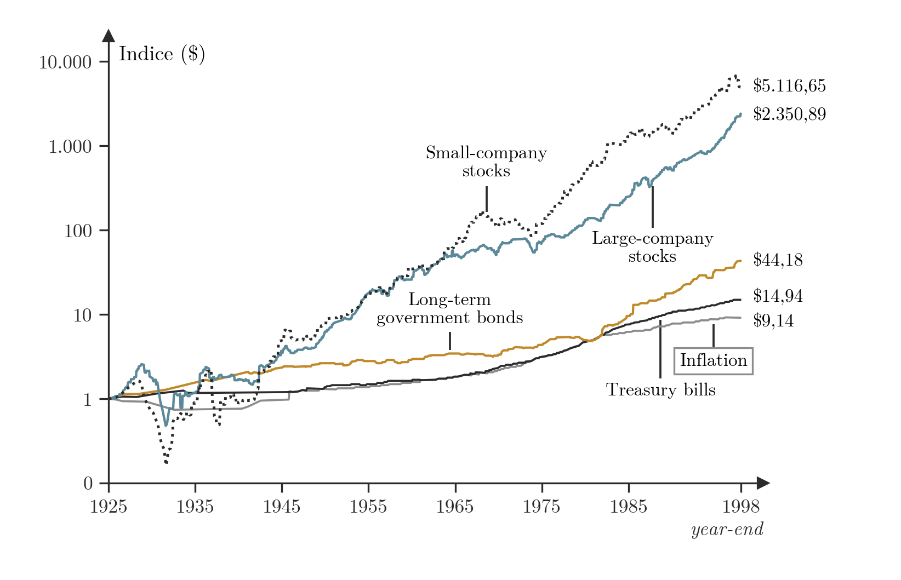
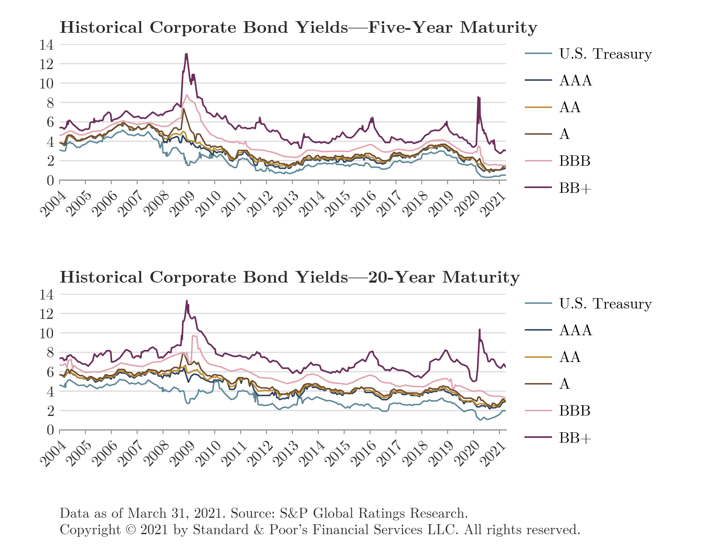

## Oggetto del capitolo

Il capitolo riguarda la valutazione di convenienza dei progetti di investimento dell'impresa. Si parte da alcuni casi di cronaca, si stabiliscono i due principi su cui si fonda la valutazione (il valore del tempo e il prezzo del rischio), si individuano i flussi di cassa rilevanti e si confrontano i criteri di decisione: valore attuale netto, valore attuale modificato, indice di redditività, tasso interno di rendimento, tempo di recupero. L'ultima parte estende l'analisi alle opzioni reali di espansione, attesa e abbandono. Il riferimento bibliografico è il testo indicato con la sigla BBS, paragrafi 5.1, 5.2, 5.3, 5.4 e 5.6.

Il capitolo è la prima parte del primo argomento del corso, le decisioni di investimento dell'impresa indebitata, che prosegue con il [[FSTR 02-full Costo del Capitale|calcolo del costo del capitale]]. Seguono i [[FSTR 03 Modelli Valutazione Finanziaria Parte1|metodi DCF]], i [[FSTR 06 Multipli di Borsa lez01|multipli di borsa]], la crescita esterna con la [[FSTR 12 Valutazione Operazioni di Integrazione|valutazione delle operazioni di integrazione]] e il *deal* con la [[FSTR 08 Financial Due Diligence|due diligence]]. Il quadro del programma è nell'[[FSTR 00 Intro Corso|introduzione al corso]].

## Decisioni di investimento nella cronaca: aperture ed espansioni

I casi di cronaca recente che seguono riguardano la **crescita organica**, cioè interna e non per acquisizioni: l'ampliamento della rete di vendita e della capacità produttiva. Sono investimenti di espansione, la prima categoria di investimenti analizzata, e per ciascuno si pone la domanda di quanto costi e quanto renda.

> [!example] Esempio
> **Eurospin.** Nel secondo semestre del 2025 il Gruppo prosegue il piano di sviluppo con nuove aperture e con ristrutturazioni di punti vendita in diverse regioni, e offre 136 posti di lavoro negli store, in buona parte collegati al piano di crescita. Le inaugurazioni in calendario sono San Giorgio a Cremano (Napoli) e Modica (Ragusa) il 2 ottobre, Alife e Piedimonte Matese (Caserta) il 3 ottobre, San Gavino Monreale (Sardegna) e Vallefoglia (Pesaro e Urbino) il 16 ottobre. Altre aperture seguiranno nei mesi successivi e si aggiungeranno ai discount inaugurati di recente in Lazio (Ardea, Nettuno, Spinaceto, con la riapertura di Guidonia), in Lombardia (Castelmarte, Parabiago), in Piemonte (Gravellona Toce) e in Umbria (Terni). Il Gruppo opera in 1.300 sedi tra Italia, Slovenia, Croazia e Malta. Secondo informazioni non ufficiali, Eurospin EKO, la società che gestisce le filiali in Slovenia e Croazia, ha individuato le prime sedi in Serbia: sono state pubblicate molte offerte di lavoro per la sede centrale serba, con programmi di formazione di diversi mesi in Croazia e in Italia, ma l'azienda non ha rilasciato dichiarazioni ufficiali sull'espansione in quel mercato.
>
> **KFC.** L'espansione in Italia continua: a marzo 2025 sono stati inaugurati 3 ristoranti, per un totale di 120, con 45 nuovi posti di lavoro.
>
> **Jysk.** La catena danese di articoli per la casa e il giardino raggiunge i 100 negozi in Italia. L'11 aprile 2025 apre in contemporanea tre punti vendita, Olbia (il negozio numero 100), L'Aquila e Nocera Superiore (Salerno), e porta il numero degli store a 102 in un solo giorno. La scelta di Olbia dipende dalla crescita del mercato sardo, dove Jysk ha già aperto altri quattro negozi (Sassari, Sestu, Oristano, Carbonia). L'apertura rientra in un piano di espansione che prevede nuovi store su tutto il territorio italiano entro la primavera 2025.
>
> **Stabilimento di Foggia.** Un investimento da 100 milioni di euro, tra il 2028 e il 2030, per un mulino di nuova generazione in uno stabilimento produttivo già esistente.
>
> **Ferrero.** Il gruppo produce i Nutella Biscuits in Italia e da poco anche in Canada e in Nord America: espande lo stabilimento in Ontario e potenzia la capacità produttiva dello stabilimento in Francia, il più grande sito di produzione di Nutella al mondo.
>
> **Enel.** Il piano strategico 2026-2028, illustrato nella relazione sulla gestione del bilancio, prevede 53 miliardi di euro di investimenti lordi, con gli obiettivi di accelerare la crescita, massimizzare la produttività del capitale e garantire un profilo rischio-rendimento bilanciato.
>
> **Conad.** L'apertura di un nuovo punto vendita, con pannelli sul tetto e area parcheggi, è un progetto di investimento a sé stante rispetto al gruppo.

## Caso Famila (SELEX): costo e rendimento di una nuova apertura

> [!example] Esempio
> **Contesto.** Nel 2023 le Imprese Socie SELEX sostengono la crescita dell'insegna Famila con 19 nuove aperture e la ristrutturazione di 21 punti vendita, per un investimento complessivo di 100 milioni di euro. Maniele Tasca dichiara che gli investimenti per le nuove aperture e per il rinnovamento della rete sono «fondamentali per competere con successo e rendere l'insegna Famila sempre più distintiva ed apprezzata dal mercato». Prosegue inoltre la campagna "Spesa Difesa", dedicata ai prodotti a marchio SELEX, con l'obiettivo di sostenere il potere d'acquisto delle famiglie a fronte dei rincari registrati sul mercato.
>
> **Dati del piano.** Il piano comprende 19 nuove aperture e 21 ristrutturazioni, per 40 progetti in totale. Il costo stimato è di 500.000-800.000 euro per ristrutturazione e di 3.000.000-5.000.000 euro per nuova apertura (solo allestimento, senza acquisto dell'immobile). Si stima quanto rende aprire un nuovo punto vendita e in quanti anni si recupera l'investimento.
>
> **Costo di una nuova apertura.** Si assume un costo medio di 700.000 euro per ristrutturazione. Il costo delle ristrutturazioni è quindi 700.000 × 21 = 14.700.000 euro e quello delle nuove aperture è la parte restante dell'investimento complessivo, da dividere per il numero di aperture:
>
> $$100.000.000 - 14.700.000 = 85.300.000$$
>
> $$\frac{85.300.000}{19} \approx 4.489.474$$
>
> **Rendimento.** L'EBITDA medio della grande distribuzione organizzata (GDO) italiana è il 5,7% del fatturato. Con un fatturato previsto di 20-30 milioni di euro l'anno, l'EBITDA annuo del punto vendita va da 1.140.000 a 1.710.000 euro. Il tempo di recupero (*pay-back*), in anni, si ottiene dividendo il costo di apertura per l'EBITDA stimato:
>
> $$\text{fatturato di 20 milioni}: \quad \frac{4.489.474}{1.140.000} \approx 3{,}94 \text{ anni}$$
>
> $$\text{fatturato di 30 milioni}: \quad \frac{4.489.474}{1.710.000} \approx 2{,}63 \text{ anni}$$
>
> Il tempo di recupero indica in quanti anni si ricostruisce la spesa sostenuta, ma non esprime un tasso di rendimento. Per misurare il rendimento in termini di tasso serve il tasso interno di rendimento (TIR), introdotto più avanti.

Un investimento non coincide sempre con l'avvio di un'attività da zero: spesso è incrementale, come l'ampliamento di un punto vendita esistente. Si consideri, in una situazione ispirata a un caso reale, un'insegna come Conad che amplia i metri quadri e l'organico per circa 10 milioni di euro; la direzione finanziaria chiede in quanto tempo l'investimento rientra. Maggiore superficie e maggiori dipendenti comportano maggiori costi e maggiori ricavi, per cui occorre individuare KPI specifici: nella GDO il KPI abituale dei punti vendita è il fatturato per metro quadro. Si stima il fatturato del nuovo negozio e quello aggiuntivo rispetto al vecchio, poi si ragiona in termini di redditività e di recupero dell'investimento.

## Decisioni di investimento nella cronaca: abbandono e rinvio

Nei casi di espansione il business va bene e l'alternativa è incrementare. In altri casi il progetto parte, o non parte, e nei primi periodi viene abbandonato per motivi strategici o economici, o perché la scelta si ritiene sbagliata; in altri ancora viene rinviato. I sei casi seguenti riguardano progetti abbandonati o rinviati.

> [!example] Esempio
> **Google Stadia (abbandono).** Google chiude la piattaforma di cloud gaming Stadia il 18 gennaio 2023, con stop immediato allo Stadia Store (e-commerce e transazioni in-game). La notizia ha suscitato critiche: c'è chi ha dato per finito l'intero business dei videogiochi online e chi ha incolpato Phil Harrison, vicepresidente e general manager di Stadia, che aveva chiamato in causa la crisi dell'energia e l'inflazione. Una spiegazione più semplice chiama in causa una serie di errori strategici di Google nell'approccio al gaming. Il contesto è quello del taglio dei costi: la chiusura è l'ultima mossa del CEO di Alphabet, Sundar Pichai, dopo l'annuncio di voler rendere l'azienda più efficiente del 20%. Nel 2022 il prezzo delle azioni Alphabet è sceso del 34% e a luglio di quell'anno la società ha registrato entrate e profitti deludenti. Pichai ha dichiarato che il taglio dei costi potrebbe includere anche prodotti e personale.
>
> **Amazon Astro for Business (abbandono).** A meno di un anno dal lancio, Amazon interrompe nel luglio 2024 la produzione della versione aziendale del robot Astro, presentata a novembre 2023 come possibile strumento di sorveglianza aziendale. Il robot ha un design simile a quello del personaggio Wall-E della Disney, pesa circa 9 kg e offre, tra le altre funzioni, navigazione autonoma, rilevamento di intrusioni e videochiamate. La versione domestica, lanciata a fine 2021, continua a essere venduta, sempre su invito, al prezzo di 1.599 dollari.
>
> **Maserati MC20 Folgore (abbandono).** La versione totalmente elettrica della MC20 non è mai uscita.
>
> **Amazon Fire Phone (abbandono).** Lo smartphone è stato commercializzato negli Stati Uniti, in esclusiva con AT&T, dal luglio 2014 e ritirato nel 2015. Nel 2014 Amazon ha contabilizzato una svalutazione di 170 milioni di dollari per scorte invendute e impegni verso i fornitori.
>
> **Volkswagen (rinvio).** Nel 2021 il Gruppo Volkswagen aveva presentato un progetto di elettrificazione che prevedeva 6 fabbriche di batterie (gigafactory) entro la fine del 2030. Al momento ha scelto tre siti: Salzgitter (Germania), Valencia (Spagna) e St. Thomas (Ontario, Canada). Il terzo stabilimento doveva restare in Europa, ma l'azienda ha voluto sfruttare gli incentivi americani dell'Inflation Reduction Act (IRA). Secondo il CEO Blume i tre impianti hanno una capacità produttiva fino a 200 GWh all'anno. La quarta gigafactory è rinviata per il calo della domanda di auto elettriche.
>
> **Grand Theft Auto (rinvio).** La serie ha una storia di rinvii. L'uscita di GTA V per PlayStation 3 e Xbox 360, prevista inizialmente per la primavera del 2013, è stata posticipata al 17 settembre 2013 per consentire ulteriori rifiniture. Le versioni successive sono uscite in date diverse: PlayStation 4 e Xbox One il 18 novembre 2014, PC il 14 aprile 2015, PlayStation 5 e Xbox Series X/S il 15 marzo 2022. La tradizione prosegue con GTA 6: annunciato a dicembre 2023 con uscita prevista nel 2025, è stato rinviato a fine maggio 2026 e poi, con un ennesimo rinvio, al 19 novembre 2026.

Nell'abbandono il progetto ha già una storia e ci si chiede se convenga proseguire. Occorre valutare l'impatto in termini di valore dello stop al progetto, della dismissione delle attrezzature, dei costi di setup già sostenuti e del laboratorio di progettazione.

Il rinvio introduce le opzioni reali. Se l'investimento è avviato e poi posticipato (in inglese *postponed*), c'è un periodo di attesa: il progetto è pronto a partire e i costi sono già stati sostenuti, ma produce ricavi solo in un periodo successivo. Non è indifferente disporre del denaro nel periodo zero, nel primo o nel secondo, e ciò cambia la valutazione.

> [!example] Esempio
> **Nice.** Il verbale di assemblea di Nice, azienda che produce automazioni per cancelli, riporta la decisione di rinviare il lancio di nuovi prodotti della linea Screen per completare la brevettazione di ulteriori componenti tecnologici prima della commercializzazione (l'anno, 2006, è indicato a titolo illustrativo). L'azienda sceglie di partire con una linea di componenti tutti brevettati. I costi sono già stati sostenuti e si ritiene che lanciare prodotti e servizi tra un anno anziché oggi darà più ricavi: l'alternativa è lanciare subito, con ricavi certi perché si è pronti, oppure attendere un anno per flussi di cassa prospettici probabilmente più alti.
>
> **Digital Bros.** La casa di sviluppo di videogiochi ha posticipato il lancio di un videogioco, evento frequente nel settore: un progetto di investimento può essere un prodotto all'interno di una linea aziendale che genera già flussi di cassa. Dalla relazione sulla gestione del bilancio risulta che il lancio della versione PC di Assetto Corsa 2 è posticipato all'estate successiva per consentire il lancio, in primavera, della nuova stagione di Assetto Corsa Competizione: lanciare il nuovo titolo avrebbe cannibalizzato il precedente, trattandosi di prodotti simili. Il progetto non è in discussione: il videogioco è pronto e gli scenari sono due. Lanciarlo oggi insieme all'altro, con determinati flussi di cassa, oppure tra un anno, quando l'altro videogioco è già acquisito e Assetto Corsa 2 ha un effetto novità. Che i flussi siano maggiori attendendo non è certo e, nella valutazione delle opzioni, va ponderato con probabilità.

Le opzioni reali, che misurano il valore della flessibilità, sono trattate più avanti: un progetto può andare bene, andare male, essere abbandonato o posticipato, e la valutazione di un singolo progetto dato non coglie queste alternative.

## La fattibilità dell'investimento

I casi esaminati sono decisioni su un progetto di investimento e coprono le alternative possibili: effettuare o espandere il progetto (Eurospin, KFC, Jysk, Famila, Ferrero, Enel, Conad), rinviarlo (Volkswagen, Grand Theft Auto, Nice, Digital Bros) o abbandonarlo (Stadia, Astro, Maserati MC20 Folgore, Fire Phone). La valutazione serve a stabilire quale di queste alternative sia conveniente.

> [!abstract] Definizione
> L'analisi di **fattibilità** di un investimento stabilisce se il progetto è conveniente. Si può effettuarlo oppure posticiparlo, abbandonarlo o espanderlo. Le variabili da considerare sono due: il tempo e il rischio.

Nella ragioneria, a parità di ricavi, interessa relativamente in quale esercizio si verifichino: il confronto tra il conto economico di un anno e quello di tre anni dopo non valuta né la rischiosità dei risultati né la variabile temporale. Nella finanza tempo e rischio sono invece centrali.

## Flussi reddituali e flussi di cassa

Il principio base della finanza d'azienda contrappone i **flussi reddituali** ai **flussi di cassa**. Dalla distinzione si passa a due piani di analisi. Il primo è la fattibilità, che riguarda le soluzioni tecniche alternative con cui realizzare il progetto, per esempio due diverse configurazioni di un magazzino. Il secondo è la valutazione finanziaria, riassunta dal principio «*Cash is King*»: ai fini della valutazione contano i flussi di cassa. La valutazione finanziaria analizza il cash flow, cioè il differenziale tra la situazione di liquidità prima e dopo le decisioni valutate, e ogni problema di valutazione si riconduce a un flusso di cassa, grande o piccolo, anticipato o posticipato.

## Il valore del tempo

La valutazione di convenienza di un progetto si fonda su due principi: il tempo ha un valore e il rischio ha un prezzo. Il primo è trattato in questa sezione.

### Equivalenze finanziarie e tasso privo di rischio

> [!abstract] Definizione
> Chi dispone di denaro può sempre acquistare un titolo di Stato e garantirsi un rendimento con una rischiosità prossima allo zero. Indicato con $r$ il tasso privo di rischio, come quello dei depositi, valgono le equivalenze:
>
> $$100 \text{ euro investiti oggi equivalgono a } 100 \times (1+r) \text{ euro tra un anno}$$
>
> $$100 \text{ euro tra un anno equivalgono a } \frac{100}{1+r} \text{ euro oggi}$$
>
> Un investimento che rende meno di $r$ **distrugge ricchezza**.

Poiché nessuno è obbligato a realizzare un investimento, l'alternativa a un progetto è impiegare il denaro senza rischio, per esempio in BTP, titoli di Stato poliennali emessi dallo Stato italiano, e ogni progetto si confronta con il tasso privo di rischio. Il passaggio da 100 euro di oggi a $100\,(1+r)$ tra un anno è la **capitalizzazione**, che porta i flussi avanti nel tempo e li rende maggiori; l'operazione inversa è l'**attualizzazione**, e 100 euro tra un anno valgono meno di 100 euro oggi.

> [!example] Esempio
> Un titolo di Stato con rendimento $r = 3{,}5\%$ trasforma 100 euro di oggi in 103,50 euro tra un anno. Un progetto di investimento da 100 euro che rende soltanto il 2% dà invece 102 euro tra un anno. Attualizzando al tasso di mercato $r = 3{,}5\%$:
>
> $$\frac{102}{1{,}035} \approx 98{,}55 \text{ euro oggi}$$
>
> Il progetto genera un utile nominale, ma 102 euro tra un anno valgono oggi meno dei 100 euro investiti: rispetto all'alternativa priva di rischio distrugge ricchezza.

> [!example] Esempio
> Con il tasso dei titoli di Stato al 3,5%, si vuole stabilire se conviene investire 1.400 euro oggi in un progetto che restituisce 1.456 euro tra un anno esatto.
>
> L'aumento di 56 euro in un anno corrisponde a un rendimento del 4%, superiore al 3,5%: l'investimento nel progetto è conveniente. A parità di capitale iniziale, i titoli di Stato danno 1.449 euro tra un anno (1.400 × 1,035) e il progetto 1.456 euro. Attualizzando 1.456 euro al tasso di mercato si ottiene un valore odierno di:
>
> $$\frac{1.456}{1{,}035} \approx 1.406{,}76 \text{ euro}$$
>
> La ricchezza creata è quindi $1.406{,}76 - 1.400 = 6{,}76$ euro.

### Principi fondamentali

Dal valore del tempo discendono due principi.

1. Per creare ricchezza non basta realizzare un utile, cioè un aumento del capitale iniziale: occorre conseguire un rendimento superiore al tasso di mercato $r$. Si passa così da una misura assoluta di performance a una misura relativa.
2. La valutazione di un progetto di investimento è la misurazione relativa della sua bontà rispetto a quanto paga il mercato. L'analisi riguarda quindi la capacità di impiegare nel modo migliore il capitale investito e, di conseguenza, di remunerare il capitale raccolto sul mercato (si tratta di rendimenti alternativi rispetto a quello già offerto dal mercato).

## Il prezzo del rischio

> [!abstract] Definizione
> Il secondo principio della valutazione di convenienza è che **il rischio ha un prezzo**. Le opportunità di investimento presenti sul mercato sono spesso rischiose, nel senso che il rendimento promesso potrebbe non verificarsi. Per correre il rischio e finanziare simili iniziative, gli individui chiedono promesse di rendimenti più elevati di quelli non rischiosi, e le imprese devono impegnarsi a raggiungere tali rendimenti per non distruggere valore.

I dati storici mostrano quanto rendimento il mercato abbia riconosciuto al rischio. Un dollaro investito alla fine del 1925 e mantenuto fino alla fine del 1998 vale 5.116,65 USD se investito in azioni di piccole imprese (*small-company stocks*), 2.350,89 USD in azioni di grandi imprese (*large-company stocks*), 44,18 USD in obbligazioni di Stato a lungo termine (*long-term government bonds*) e 14,94 USD in buoni del Tesoro (*Treasury bills*). Nello stesso periodo l'inflazione, cioè la perdita di potere d'acquisto del denaro, porta l'indice dei prezzi a 9,14 volte il valore iniziale. Tutte le serie partono da 1 USD e l'asse verticale ha scala logaritmica, per cui a distanze uguali corrispondono variazioni percentuali uguali.

**Figura 1** — Crescita di 1 USD investito a fine 1925 in azioni di piccole e grandi imprese, obbligazioni di Stato a lungo termine, buoni del Tesoro e inflazione fino a fine 1998 (scala logaritmica): le azioni, soprattutto quelle di piccole imprese, chiudono molto al di sopra delle altre serie, ma con oscillazioni più ampie, come il calo dei primi anni Trenta.

Il grafico dà la percezione del prezzo del rischio: chi non rischia, con buoni del Tesoro e obbligazioni di Stato, ottiene nel tempo il rendimento più basso, mentre le azioni di grandi imprese e, ancora più in alto, quelle di piccole imprese statunitensi, comunque di dimensioni molto superiori a quelle italiane, hanno i rendimenti più alti, con perdite profonde lungo il percorso. I valori sono però medie. L'ente che emette i titoli di Stato è sempre lo stesso, mentre le imprese che oggi compongono il paniere azionario in larga parte non sono quelle dell'inizio della serie, perché molte hanno chiuso o sono fallite. Per la singola impresa il dollaro investito in azioni può quindi essere azzerato per sempre dalla chiusura dell'azienda: progetti di investimento e aziende portano con sé un'elevata rischiosità.

Anche tra i titoli di debito il rendimento richiesto cresce con il rischio, che le società di rating esprimono con un giudizio, il rating. I grafici dei rendimenti storici (*yield*) a 5 e a 20 anni di scadenza confrontano i titoli del Tesoro statunitense, assunti come riferimento a rischio minimo, con obbligazioni societarie di rating AAA, AA, A, BBB e BB+, da gennaio 2004 a marzo 2021 (dati S&P Global Ratings Research al 31 marzo 2021). A parità di scadenza lo yield è tanto più alto quanto peggiore è il rating: il Treasury è mediamente la linea più bassa e le obbligazioni societarie AAA, AA e A gli stanno immediatamente sopra. Gli spread tra i rating si allargano nelle fasi di crisi: tra la fine del 2008 e l'inizio del 2009 lo yield a 5 anni dei titoli BB+ sale a circa il 13%, mentre quello del Treasury scende a circa l'1,5%; a marzo 2020 si ripete un picco più contenuto.

**Figura 2** — Rendimento del debito di imprese con rating diverso (scadenze a 5 e a 20 anni, 2004-2021): lo yield aumenta al peggiorare del rating e gli spread rispetto al Treasury si allargano nelle crisi del 2008-2009 e del 2020.

Come caso estremo si consideri un'azienda che commercializza frutta secca in Congo durante una guerra civile, con rating degradato a BB+: il rendimento richiesto è molto più alto, in proporzione al rischio.

Un confronto più recente riguarda il valore di un portafoglio investito in azioni e di uno investito in obbligazioni, entrambi con un valore iniziale di circa 10.000 euro a metà degli anni Ottanta. Nel 2025 il portafoglio azionario vale circa 240.000 euro (con un massimo di circa 245.000), quello obbligazionario circa 50.000 euro, dopo un massimo di circa 61.000 intorno al 2020. La traiettoria delle azioni è molto più irregolare: scende sotto quella delle obbligazioni nel 2002-2003 e nel 2008-2009 e subisce flessioni marcate anche nel 2020 e nel 2022.

**Figura 3** — Valore di un portafoglio azionario e di uno obbligazionario dalla metà degli anni Ottanta al 2025: le azioni crescono di circa 24 volte, le obbligazioni di circa 5, con fasi in cui il portafoglio azionario scende sotto quello obbligazionario.

Il rapporto tra rischio e rendimento vale anche tra obbligazioni e azioni. L'obbligazione è un prestito e comporta un impegno forte alla restituzione da parte dell'azienda, con un valore giuridico forte. Se l'azienda fallisce, le azioni perdono ogni valore e i 100 euro investiti sono persi. L'obbligazionista è invece un creditore fin dall'emissione: nella liquidazione giudiziale, in cui il tribunale nomina un curatore, o nel concordato preventivo partecipa alla ripartizione dell'attivo, e la restituzione del capitale non è certa, ma esiste una probabilità che avvenga.

Data l'elevata rischiosità di progetti e imprese, il tasso di attualizzazione dei flussi di cassa di un'azienda, calcolato con le formule illustrate più avanti, è del 10, 11 o 12%, contro il 3% dei BTP. Tassi così alti non indicano rendimenti anomali: attualizzano il rischio. La correlazione tra rischio e rendimento è il riferimento in ogni decisione finanziaria: davanti al tasso che risulta dai calcoli ci si chiede quanto sia rischioso il mercato in cui opera l'azienda e come quel rendimento si confronti con quello dei titoli del governo americano.

## Il Corporate Finance Circuit

> [!abstract] Definizione
> Il **Corporate Finance Circuit** è lo schema dei flussi finanziari dell'impresa. Nell'attivo (gli impieghi, a cui corrispondono le *attese* di rendimento) si trova il capitale investito netto (**C.I.N.**) «al lavoro». Nel passivo (le fonti, che sono *diritti contingenti*) si collocano i **creditori**, titolari dei debiti finanziari, e gli **azionisti**, titolari dei mezzi propri.
>
> Le risorse (*investimenti*) arrivano a creditori e azionisti dal **mercato dei capitali**, che offre anche **impieghi alternativi** per le stesse risorse, e da creditori e azionisti passano al C.I.N. I **flussi di cassa generati** dal C.I.N. tornano al mercato dei capitali come *remunerazione* delle risorse conferite, e il circuito si chiude.

**Figura 4** — Corporate Finance Circuit: le risorse (frecce rosse, investimenti) vanno dal mercato dei capitali a creditori e azionisti e da questi al C.I.N.; i flussi di cassa generati (freccia blu) tornano al mercato come remunerazione.

Nello stato patrimoniale l'attivo sta a sinistra e il passivo a destra. Il passivo comprende i debiti verso le banche, che finanziano l'attivo, verso i fornitori e verso i dipendenti; l'altro grande blocco è il patrimonio netto, che appartiene ai soci. A finanziare l'attivo sono dunque, in sostanza, i creditori terzi e i soci. Nello schema del circuito il C.I.N. è lo stato patrimoniale riclassificato, a sinistra, mentre a destra si trovano creditori e azionisti, che lo finanziano e ricevono i flussi generati dall'azienda.

Gli stakeholder sono i soggetti con interessi nell'azienda, ma i flussi di cassa remunerano le aspettative di due soli soggetti, i creditori e i soci. Se un'azienda come Diadora produce flussi di cassa per milioni di euro, a chi non è né creditore né azionista non interessa, perché non ne è toccato. Valutare un'azienda richiede perciò di calcolare l'ammontare dei flussi di cassa generati e di stabilire quali vanno a una categoria e quali all'altra. Le aziende si valutano per conto di chi le vuole comprare o di chi le vuole finanziare. In entrambi i casi questi soggetti si aspettano di avere indietro del denaro: con un finanziamento una certa remunerazione, da azionista un'altra, e per acquistare le azioni un certo prezzo.

## I flussi finanziari di riferimento: FCFO, FCFF e FCFE

Le valutazioni aziendali usano tre flussi di cassa, che si ricavano uno dall'altro con uno schema a cascata organizzato per aree: gestione corrente, investimenti, gestione straordinaria, capitale di terzi e capitale proprio. Il rendiconto finanziario è lo schema più utile per seguire la circolazione di questi flussi, perché quantifica quelli che creditori e azionisti si aspettano di ricevere. Il conto economico e lo stato patrimoniale non servono a questo scopo. Nel metodo indiretto esistono più configurazioni del flusso di cassa, ma le aree fondamentali restano le stesse.

> [!abstract] Definizione
> Schema a cascata del calcolo dei flussi, per area:
>
> | Area | Voce |
> |---|---|
> | Gestione corrente | MOL (margine operativo lordo) |
> | | $-$ variazione del capitale circolante netto operativo (CCNO) |
> | | $=$ cash flow gestionale lordo |
> | | $-$ flusso fiscale operativo (imposte $+$ scudi $-$ variazione dei debiti per imposte) |
> | | $=$ cash flow gestionale netto (**FCFO**) |
> | Investimenti | $-/+$ investimenti/disinvestimenti in capitale fisso |
> | | $=$ free cash flow to the firm (**FCFF**) |
> | Gestione straordinaria | $+/-$ proventi/oneri straordinari |
> | Capitale di terzi | $-$ oneri finanziari netti |
> | | $+$ scudo fiscale sugli oneri finanziari |
> | | $+/-$ aumento/riduzione dei debiti finanziari |
> | Capitale proprio | $=$ free cash flow to equity (**FCFE**) |

La prima area è la gestione corrente, o area operativa: l'azienda fa girare il capitale investito netto e genera un MOL, cioè un EBITDA. Per un calcolo rapido si prende la differenza tra valore e costi della produzione (A meno B) e si sommano di nuovo gli ammortamenti, ottenendo in modo approssimato l'EBITDA da bilancio, che poi va normalizzato e aggiustato. Il FCFO è il flusso di questa area al netto delle imposte.

L'EBITDA non può essere assunto come flusso di cassa, perché non diventa interamente denaro sul conto corrente. Se produrre un banco costa 100 euro e lo si vende a 300 a una scuola, il margine di 200 euro dà un EBITDA positivo; se però la fattura è emessa a una pubblica amministrazione che non paga, l'EBITDA va rettificato con la variazione del capitale circolante. Esistono aziende che falliscono con un EBITDA positivo: quando i ricavi non diventano cassa e si devono pagare stipendi e materiali, l'attività è costretta a chiudere. Succede spesso a chi lavora con la pubblica amministrazione, per esempio a chi fornisce a un ospedale consumabili e servizi che l'ospedale non paga. Lo stesso vale per un'impresa edile che costruisce City Life e non incassa gli appartamenti dall'agenzia che ne gestisce la vendita: ha anticipato cemento, operai, progettazione e autorizzazioni, e il conto economico mostra ricavi enormi, ma i soldi anticipati non sono rientrati. Una situazione simile emerge solo dal rendiconto finanziario.

Il rendiconto mostra se un'azienda consuma le proprie risorse. Il segnale più evidente è un cash flow gestionale quasi nullo o negativo: l'azienda produce un EBITDA e lo assorbe interamente nel capitale circolante, cioè il reddito diventa tutto crediti, e gli stipendi non si pagano con i crediti. L'area operativa deve quindi produrre cassa e liquidità.

Nel passaggio dal MOL al FCFO, fornitori e personale entrano con la variazione del capitale circolante ($\Delta$CCNO). Le imposte si sottraggono: il loro effetto ricorre in tutti gli esercizi ed è mitigato dallo scudo fiscale sugli interessi sul debito. La seconda area è quella degli investimenti: l'azienda non può vivere in eterno con i macchinari, le attrezzature e gli impianti che ha, e una parte del flusso viene sottratta per gli investimenti. Sottraendo al FCFO gli investimenti, o sommando i disinvestimenti, in capitale fisso si ottiene il FCFF.

Restano da remunerare i soggetti del passivo, creditori e soci. Dal FCFF si ottiene il FCFE considerando i proventi e gli oneri straordinari e i flussi dell'area del capitale di terzi (oneri finanziari netti, scudo fiscale e variazione dei debiti finanziari). Nel rendiconto l'area finanziaria precede quella degli azionisti, benché in entrambi i casi si tratti di sottrazioni: gli azionisti sono remunerati per ultimi, ricevono qualcosa solo se avanza e altrimenti nulla, mentre i creditori hanno un debito da restituire. L'area finanziaria è quindi un'area di impegni obbligatori. Comprende gli oneri finanziari e i rimborsi in uscita, ma anche le accensioni di nuovi finanziamenti in entrata: un finanziamento di un milione concesso nell'anno e incassato va collocato in questa sezione.

Il FCFE è il flusso che spetta al capitale proprio: residua dopo aver pagato tutti ed è espresso in dividendi o in variazioni delle voci del capitale proprio. Questa posizione spiega perché chi investe per ottenere dividendi pretende un rendimento alto: viene dopo tutti gli altri e, a differenza di creditori e dipendenti, non ha un rimborso garantito per legge. La distribuzione dei dividendi è deliberata dall'assemblea e non è obbligatoria; molte aziende non ne distribuiscono per anni perché capitalizzano gli utili e li mettono a riserva. Se Enel decide di investire nel fotovoltaico senza distribuire dividendi, il socio di minoranza ottiene dall'investimento un rendimento nullo in dividendi e non ha altro da fare. Per una quotata la scelta influisce anche sul prezzo del titolo, e se una società così grande non distribuisce dividendi può nascere una reazione di protesta tra gli azionisti. In genere i flussi sono gestiti in modo da dedicarne una parte agli investimenti e una a chi ha creduto nella società. Ciò non vale per le aziende non quotate.

Le aziende non quotate sono la quasi totalità delle imprese italiane: le quotate sono poche centinaia, a fronte di circa 4,75 milioni di imprese attive, di cui circa 1,1 milioni di SRL (ISTAT, 2024), e la quota delle non quotate supera di gran lunga il 95%. Le PMI italiane sono molto indebitate, quindi l'area finanziaria pesa molto: confrontando i bilanci di aziende americane e italiane dello stesso business, si nota che in Italia si tende a fare debito in banca. Una PMI italiana non penserebbe di quotarsi per avere denaro, mentre negli Stati Uniti la quotazione è molto più frequente, perché in borsa ci sono molte più aziende e quotarsi e restare quotati costa meno.

Si consideri una SRL, una fonderia di Vicenza, che ha bisogno di mezzo milione di euro. L'imprenditore non si rivolge a Borsa Italiana: chiama il direttore della banca, promette un business plan con la proiezione dei flussi di cassa entro un mese, spiega che deve ampliare la linea produttiva e chiede una linea di credito da mezzo milione, cioè capitale di terzi. Si fa così soprattutto nei business maturi. Nel mondo delle start-up e dei percorsi innovativi si cercano invece business angels, persone disposte a perdere il capitale messo come capitale di rischio, cioè equity.

Nei bilanci reali i rendiconti non seguono uno schema riga per riga: sono costruiti in modo molto vario, con più o meno righe e dettaglio. Lo schema del FCFO ha poche righe, mentre nel bilancio se ne trovano una cinquantina, e la realtà va ricondotta allo schema, che ne è una semplificazione. Nel rendiconto di Enel, in milioni di euro, nomi e gerarchia sono quelli del metodo indiretto, che parte dal reddito generato. Il rendiconto parte dal risultato netto d'esercizio, ultima riga del conto economico, lo corregge degli ammortamenti e arriva a grandi linee al MOL; toglie poi la variazione del circolante e arriva al flusso di cassa della gestione operativa.

Segue il cash flow da attività di investimento, dove Enel inserisce tutto, anche le partecipazioni (per esempio l'acquisto del 70% di una società che fa capo a un parco fotovoltaico) e il rifacimento del camino di una centrale. Le voci sono investimenti in attività materiali non correnti e in imprese o rami di impresa; sono possibili anche disinvestimenti, per cui se Enel vende la partecipazione in un parco eolico entra denaro, con segno più. Seguono poi creditori e azionisti, a volte in blocchi non separati. Tra le voci dei creditori ci sono il rimborso di debiti finanziari (le rate di mutuo o finanziamento), le altre variazioni di indebitamento finanziario e l'emissione e il rimborso di obbligazioni: emettendole entra denaro e si contrae un debito, quindi si creano nuovi creditori da remunerare. Per gli azionisti ci sono i dividendi e i coupon pagati su obbligazioni ibride, che possono avere diritti particolari.

Le ultime righe del rendiconto sono le voci di quadratura: tutto quanto sta sopra deve corrispondere esattamente alla variazione delle disponibilità liquide. L'ultimo importo del cash flow, quello che residua dopo aver pagato tutti i soggetti, è la variazione delle disponibilità liquide da un anno all'altro, cioè la variazione del conto in banca dell'azienda, che si ritrova nello stato patrimoniale. Nella costruzione del rendiconto la quadratura raramente torna al primo tentativo, perché qualche voce non coincide; solo una quadratura perfetta indica che il rendiconto è corretto.

Le voci provengono sia dal conto economico sia dallo stato patrimoniale. Dal conto economico si prendono il risultato d'esercizio, gli ammortamenti da rimontare e gli oneri finanziari. La variazione del capitale circolante è nello stato patrimoniale, in crediti e debiti; gli investimenti sono la variazione delle immobilizzazioni dello stato patrimoniale, ripulite dagli ammortamenti. Il rendiconto incrocia quindi i due schemi: si calcolano le variazioni e se ne ricava un flusso di cassa, con la prova del nove che il denaro in azienda sia variato esattamente di quell'importo.

## Esempio Ferrari: dal FCFO al FCFE

> [!example] Esempio
> Lo schema FCFO, FCFF, FCFE si applica al rendiconto finanziario di Ferrari N.V., la società capogruppo, per gli esercizi 2024 e 2023 (importi in migliaia di euro).
>
> | Voce | 2024 | 2023 |
> |---|---|---|
> | Cash and cash equivalents at the beginning of the year | 97.432 | 110.702 |
> | Net profit | 811.541 | 382.759 |
> | Income tax benefit | (29.249) | (28.811) |
> | Amortization and depreciation | 3.309 | 703 |
> | Financial income | (4.132) | (11.092) |
> | Financial expenses | 145.089 | 131.040 |
> | Other non-cash expenses/(income), net | 26.653 | (6.721) |
> | Change in trade receivables | 6.180 | 1.025 |
> | Change in trade payables | 1.245 | (5.782) |
> | Change in other operating assets and liabilities | 50.303 | 37.053 |
> | Finance costs paid | (139.623) | (77.797) |
> | **Total cash flows from operating activities (FCFO)** | **871.316** | **422.377** |
> | Investments in property, plant and equipment | (109) | (1.585) |
> | Investments in subsidiaries | (15.000) | (9.000) |
> | **Total cash flows used in investing activities (CAPEX)** | **(15.109)** | **(10.585)** |
> | Proceeds from financial liabilities with related parties | 2.900.000 | 2.900.000 |
> | Repayments of financial liabilities with related parties | (3.300.000) | (2.159.120) |
> | Proceeds from bonds and notes | 496.145 | - |
> | Repayments of bonds and notes | - | (575.702) |
> | Proceeds from borrowings from banks and other financial institutions | 225.000 | 250.000 |
> | Repayments of borrowings from banks and other financial institutions | (78.333) | (47.500) |
> | Repayments of lease liabilities | (509) | (672) |
> | Change in Ferrari Group cash management pools | 4.954 | (2.808) |
> | Dividends paid to owners | (439.918) | (328.631) |
> | Share repurchases | (581.084) | (460.629) |
> | Total cash flows used in financing activities | (773.745) | (425.062) |
> | Total change in cash and cash equivalents | 82.462 | (13.270) |
> | Cash and cash equivalents at the end of the year | 179.894 | 97.432 |
>
> Nella colonna 2024 il **FCFO** coincide con il totale dei flussi da attività operative, 871.316, e il **CAPEX** con il totale dei flussi da attività di investimento, (15.109). Il **FCFF** è la loro somma:
>
> $$FCFF = 871.316 - 15.109 = 856.207$$
>
> Il **FCFE** si ottiene sommando al FCFF i flussi netti dei creditori, cioè le voci di finanziamento che precedono i flussi degli azionisti (debiti verso parti correlate, prestiti obbligazionari, finanziamenti bancari, debiti per leasing, variazione dei conti di tesoreria di gruppo):
>
> $$2.900.000 - 3.300.000 + 496.145 + 225.000 - 78.333 - 509 + 4.954 = 247.257$$
>
> $$FCFE = 856.207 + 247.257 = 1.103.464$$
>
> Le due voci successive, dividendi pagati (439.918) e riacquisto di azioni proprie (581.084), per un totale di 1.021.002, remunerano gli azionisti. Il FCFE al netto di questa remunerazione coincide con la variazione delle disponibilità liquide dell'esercizio: $1.103.464 - 1.021.002 = 82.462$.
>
> Nel prospetto gli oneri finanziari pagati (139.623) rientrano nell'attività operativa, quindi il totale di 871.316 è già al netto degli interessi, mentre nello schema teorico gli oneri finanziari appartengono all'area del capitale di terzi. L'identificazione di FCFO e FCFF con i totali del prospetto è perciò un'approssimazione, che non altera il FCFE.

## Esempio DeLonghi: determinare FCFO, CAPEX, FCFF e FCFE

> [!example] Esempio
> Lo stesso schema si applica al rendiconto finanziario di DeLonghi (importi in euro). Si chiede di individuare FCFO, CAPEX, FCFF e FCFE.
>
> | Voce | Nota | 2024 | 2023 |
> |---|---|---|---|
> | Risultato netto | | 269.654.801 | 36.578.045 |
> | Imposte sul reddito del periodo | | (5.799.291) | (3.335.128) |
> | Proventi per dividendi | | (289.221.640) | (51.922.552) |
> | Ammortamenti | | 460.821 | 424.843 |
> | Variazione netta fondi e altre componenti non monetarie | | (1.290) | 4.089.124 |
> | **Flussi finanziari assorbiti dalla gestione corrente (A)** | | **(24.906.599)** | **(14.165.668)** |
> | Crediti commerciali | | (2.352.958) | (11.280.078) |
> | Debiti commerciali | | (3.958.562) | 4.076.770 |
> | Altre variazioni delle voci del capitale circolante netto | | 14.446.730 | (392.804) |
> | Pagamento imposte sul reddito | | - | (9.972.483) |
> | **Flussi finanziari generati (assorbiti) da movimenti di capitale circolante (B)** | | **8.135.210** | **(17.568.595)** |
> | **Flussi finanziari generati dalla gestione corrente e da movimenti di CCN (A+B)** | | **(16.771.389)** | **(31.734.263)** |
> | Investimenti in immobilizzazioni materiali | | - | (21.803) |
> | Altri flussi finanziari da immobilizzazioni materiali | | 9.883 | 27.462 |
> | Investimenti netti in partecipazioni e altre attività finanziarie | | (345.560.448) | (48.000.000) |
> | Incasso dividendi | | 289.221.640 | 51.922.552 |
> | **Flussi finanziari assorbiti da attività di investimento (C)** | | **(56.328.925)** | **3.928.211** |
> | **Flusso netto operativo (A+B+C)** | | **(73.100.314)** | **(27.806.052)** |
> | Esercizio stock option | | 12.713.591 | 5.100.544 |
> | Distribuzione dividendi | | (101.017.542) | (72.429.271) |
> | Pagamento interessi su finanziamenti | | (23.690.861) | (22.327.436) |
> | Rimborso finanziamenti e altre variazioni nette delle fonti di finanziamento | | 187.582.382 | 116.623.070 |
> | **Flussi di cassa generati (assorbiti) dalla variazione di voci di PN e/o attività di finanziamento (D)** | | **75.587.570** | **26.966.907** |
> | Variazione delle disponibilità liquide e mezzi equivalenti (A+B+C+D) | | 2.487.256 | (839.145) |
> | Disponibilità liquide e mezzi equivalenti all'inizio del periodo | 18 | 1.631.063 | 2.470.208 |
> | Disponibilità liquide e mezzi equivalenti alla fine del periodo | 18 | 4.118.319 | 1.631.063 |
>
> **Soluzione (colonna 2024).** Il **FCFO** è il totale dei flussi della gestione corrente e dei movimenti di capitale circolante (A+B): (16.771.389). Il **CAPEX** è il totale dei flussi da attività di investimento (C): (56.328.925). Il **FCFF** è il flusso netto operativo (A+B+C):
>
> $$FCFF = -16.771.389 - 56.328.925 = -73.100.314$$
>
> Nella sezione D i flussi dei creditori sono il pagamento di interessi (23.690.861) e il rimborso e le altre variazioni nette delle fonti di finanziamento, positive per 187.582.382, per un saldo netto di 163.891.521. Il **FCFE** è la somma del FCFF e di questo saldo:
>
> $$FCFE = -73.100.314 + 163.891.521 = 90.791.207$$
>
> Gli altri due flussi della sezione D riguardano i soci: l'incasso per l'esercizio di stock option (12.713.591) e la distribuzione di dividendi (101.017.542). Come i dividendi e i riacquisti di azioni nel caso Ferrari, sono collocati sotto il FCFE. La quadratura con la cassa conferma il calcolo: $90.791.207 + 12.713.591 - 101.017.542 = 2.487.256$, pari alla variazione delle disponibilità liquide.
>
> Il totale della sezione D (75.587.570) sommato ai dividendi (101.017.542) dà 176.605.112: è l'insieme dei flussi di finanziamento al lordo dei dividendi e non il FCFE, perché non comprende il FCFF.

Anche nel rendiconto di DeLonghi la struttura è la stessa di quello di Enel: dal risultato netto e dalle imposte si ottiene una sorta di risultato operativo, poi le variazioni di crediti commerciali, debiti commerciali e altre voci del circolante, cioè nuovamente la $\Delta$CCN, e si arriva a quello che si può chiamare free cash flow from operations, il flusso prima della gestione degli investimenti. Seguono il CAPEX, cioè gli investimenti in immobilizzazioni materiali e gli investimenti netti in partecipazioni. Questi sono i flussi da cui vanno presi quelli per la valutazione con il metodo dei flussi di cassa. Anche gli altri metodi di valutazione d'azienda, i multipli dell'EBITDA e il DCF, richiedono di sapere quali flussi considerare.

## I cinque metodi per valutare un investimento

I cinque metodi principali per valutare un investimento sono il valore attuale netto (VAN), il tasso interno di rendimento (TIR), il tempo di recupero (TR), l'indice di redditività (IR) e il tempo di recupero attualizzato (TRA). Per ciascuno si considerano la formula, il criterio decisionale, i punti di forza e di debolezza e il campo di applicazione pratica. Al VAN si affianca una variante, il valore attuale modificato (VAM).

I cinque metodi sono correlati tra loro: esprimono tutti una valutazione che tiene conto dell'investimento iniziale e dei flussi generati dal progetto, e alcuni considerano anche l'attualizzazione. Ne servono più di uno perché un'azienda deve spesso confrontare progetti di investimento diversi, e gli investimenti sono spesso disomogenei. Per mettere a confronto, per esempio, l'apertura di un punto vendita di proprietà con quella di un punto vendita in affitto occorre considerare che nel primo caso si deve acquistare l'immobile, con un esborso in un certo momento, mentre nel secondo si paga il canone di locazione e non c'è l'esborso iniziale. Le formule di attualizzazione sono inoltre le stesse che si applicano ai flussi di cassa del rendiconto finanziario di un'azienda: il concetto di attualizzare i flussi a un certo tasso è sempre quello.

Gli investimenti dei casi di cronaca sono singoli progetti e non aziende, quindi occorrono metodi appositi, alcuni dei quali si prestano meglio di altri a certi investimenti. I metodi lavorano sui flussi di cassa e non sul conto economico: nel VAN compare al numeratore il FCFO, che si ricava dal rendiconto finanziario. Per applicare la formula occorre saper ricavare il FCFO, perché il flusso di cassa di un progetto non è dato: va calcolato a partire da quanto il progetto può rendere, da quanto costa e dal risultato atteso. Oltre al FCFO serve l'esborso al momento zero, $I_0$ con segno meno, che si contrappone ai flussi futuri.

La valutazione si colloca nel momento zero, in $I_0$, e un flusso tra un anno non equivale a un flusso di oggi. Se l'investimento parte oggi e nel 2027 produce un milione di euro, quello non è un FCFO di oggi ma un FCFO al momento uno, e vale meno di un milione, per esempio 900 o 800 mila euro. La regola è attualizzare i flussi a partire dal momento uno. Se il progetto parte tra un anno, tutti i flussi partono tra un anno e vanno riportati indietro di un anno, perché la valutazione si colloca oggi, in $T_0$. Lo stesso principio vale per le opzioni reali, dove la possibilità di aspettare un anno ha senso finanziario in questi termini.

Una proiezione dei flussi di cassa previsionali quasi puntuale non si trova nel budget. Il budget è un documento previsionale, ma di solito ha un orizzonte di un anno, i 12 mesi successivi, ed è molto dettagliato su tutte le funzioni aziendali. Serve invece un documento che si spinga oltre l'anno: il business plan, o piano economico finanziario, che contiene tendenzialmente i flussi di cassa previsionali. Proposte di questo tipo arrivano a chi lavora in azienda, presso un advisor, in un private equity o in una banca. Il business plan si mostra a chi si deve convincere a investire, o a preferire un investimento a un altro: lo presenta, per esempio, chi chiede di investire nella propria startup.

Lo stesso vale per un imprenditore della distribuzione che chiede a una banca 10 milioni di euro per aprire un nuovo punto vendita. Il direttore della banca chiede il bilancio dell'azienda, per capire se sia solvibile, ma poiché si presenta un investimento e non l'acquisto di un'azienda chiede anche il business plan dell'investimento. L'ufficio finanziario deve produrre un documento analogo al caso dell'apertura di un supermercato svolto più avanti: all'investimento iniziale si contrappone una previsione di flussi, per mostrare che l'investimento sta in piedi e produce una remunerazione soddisfacente, magari più soddisfacente di un'alternativa.

Con 10 milioni di euro a disposizione l'imprenditore ha due strade: acquistare nei prossimi tre anni i punti vendita Famila, con un'operazione che rileva il marchio, oppure aprire undici nuovi punti vendita in tutto il Triveneto. Per confrontarle si calcola il VAN dell'una e dell'altra e si applicano i cinque metodi.

## Il valore attuale netto (VAN)

> [!abstract] Definizione
> Il **valore attuale netto** è la somma tra l'investimento iniziale, cambiato di segno, e il valore attuale (VA) dei flussi di cassa operativi attesi, attualizzati al WACC:
>
> $$VAN = -I_0 + VA = -I_0 + \sum_{t=1}^{N} \frac{FCFO_t}{(1+WACC)^t}$$
>
> Il criterio decisionale è $VAN > 0$.

Il VAN considera sia il fattore tempo sia il rischio, tiene conto dei flussi di medio-lungo periodo e della dimensione del progetto in valore assoluto, perché confronta euro con euro (un milione contro mezzo milione), e ha la proprietà additiva: il VAN di più progetti con lo stesso rischio si somma. Non considera invece il razionamento di capitale né le opportunità future, cioè che cosa accade nei periodi successivi. Trova applicazione nei progetti di grande dimensione, con cash flow poco volatili e stime affidabili del WACC: si attualizza infatti un flusso che si suppone uguale in ogni anno, e nulla garantisce che lo sia.

### Esempio 1: progetto conveniente

> [!example] Esempio
> Un progetto richiede un investimento iniziale (capex) di 10.000 euro, dura 5 anni e genera flussi di cassa operativi (FCFO) costanti di 3.000 euro all'anno. Il WACC, che è il tasso di attualizzazione, è il 9,0%.
>
> $$VAN = -10.000 + \frac{3.000}{(1+0{,}09)^1} + \frac{3.000}{(1+0{,}09)^2} + \frac{3.000}{(1+0{,}09)^3} + \frac{3.000}{(1+0{,}09)^4} + \frac{3.000}{(1+0{,}09)^5}$$
>
> $$VAN = -10.000 + 2.752{,}29 + 2.525{,}04 + 2.316{,}55 + 2.125{,}28 + 1.949{,}79$$
>
> $$VAN = -10.000 + 11.668{,}95 = 1.668{,}95$$
>
> Il valore attuale dei flussi è 11.668,95 euro e il valore attuale netto del progetto è 1.668,95 euro. Il VAN è positivo, quindi il progetto è conveniente.

### Esempio 2: progetto non conveniente

> [!example] Esempio
> Un progetto richiede un investimento iniziale (capex) di 12.000 euro, dura 4 anni e genera FCFO costanti di 3.000 euro all'anno. Il WACC è l'8,0%: significa che l'azienda si aspetta almeno l'8% di rendimento annuo per compensare il rischio del progetto, il costo del capitale preso a prestito e il rendimento atteso dagli azionisti.
>
> $$VAN = -12.000 + \frac{3.000}{(1+0{,}08)^1} + \frac{3.000}{(1+0{,}08)^2} + \frac{3.000}{(1+0{,}08)^3} + \frac{3.000}{(1+0{,}08)^4}$$
>
> $$VA = 2.777{,}78 + 2.572{,}02 + 2.381{,}50 + 2.205{,}09 \approx 9.936{,}38$$
>
> $$VAN = -12.000 + 9.936{,}38 = -2.063{,}62$$
>
> L'investimento di 12.000 euro che genera 3.000 euro l'anno per 4 anni non è sufficiente a coprire il costo del capitale dell'8%. Il progetto non è conveniente, perché il capitale investito non viene remunerato al tasso richiesto da azionisti e finanziatori.

L'esempio usa l'8% e non il tasso privo di rischio del 3,5%, perché i progetti d'investimento, come l'apertura di un bar o il lancio di un'applicazione, comportano rischio, a differenza di un BTP. Il capitale necessario può provenire da finanziatori che credono nel progetto e lo sostengono con capitale di rischio, e in parte da una banca a titolo di credito. Tutti vanno remunerati, e il WACC è mediamente il rendimento atteso da azionisti e creditori (il calcolo è trattato nel [[FSTR 02-full Costo del Capitale|capitolo sul costo del capitale]]).

## Il valore attuale modificato (VAM)

> [!abstract] Definizione
> Il **valore attuale modificato** ha la stessa struttura del VAN, ma attualizza i flussi con un tasso diverso:
>
> $$VAM = -I_0 + VA = -I_0 + \sum_{t=1}^{N} \frac{FCFO_t}{(1+r_0)^t}$$
>
> Il tasso $r_0$ è il tasso di attualizzazione riferito al solo investimento, indipendente dalla struttura finanziaria adottata (il costo del capitale *unlevered*, trattato nel [[FSTR 02-full Costo del Capitale|capitolo sul costo del capitale]]). Il criterio decisionale è $VAM > 0$.

La convenienza di un investimento non dovrebbe dipendere da come lo si finanzia: un progetto rende o non rende, indipendentemente dal fatto che il capitale sia messo da azionisti o da creditori. Il VAM applica questo ragionamento. Si immagina di realizzare l'investimento interamente con mezzi propri, e $r_0$ è il tasso di un progetto (nella valutazione d'impresa, di un'azienda) non indebitato.

I punti di forza sono quelli del VAN, con in più la separazione tra il valore dell'investimento e quello del finanziamento: il VAM prescinde dal modo in cui il progetto è finanziato. Il finanziamento non è trascurato, ma concettualmente separato, e porta con sé il vantaggio fiscale, o scudo fiscale. Con un investimento finanziato interamente con capitale di rischio le imposte si pagano in base al conto economico; con un mutuo si pagano interessi, che sono costi deducibili dal bilancio e riducono quindi le imposte. Con mezzi interamente propri questo vantaggio non c'è. Lo scudo fiscale ricorre in tutte le formule in cui è presente capitale di terzi, perché gli interessi sono deducibili: oltre all'aspettativa di rendimento dei finanziatori, è l'effetto principale dell'uso di capitale altrui e incide in modo significativo sui flussi.

Punti di debolezza e applicazione pratica coincidono con quelli del VAN. Il modello è ripreso per la valutazione d'impresa nel capitolo sul [[FSTR 04-full Modelli Valutazione Finanziaria Parte2|modello VAM]].

## L'effetto del razionamento di capitale

Il razionamento di capitale è il limite alle risorse che l'impresa può investire. Il VAN indica se un progetto è percorribile, non se il capitale necessario è disponibile. Si consideri un bar da aprire in uno spazio libero del campus, con un investimento di mezzo milione di euro che ne restituisce 700.000 in tre anni: con VAN positivo il progetto sarebbe intrapreso, ma non lo è se l'impresa non dispone di mezzo milione. I criteri di valutazione servono a confrontare più progetti, e il vincolo di capitale incide sul confronto. Se l'alternativa al bar è un'applicazione per gli studenti realizzabile con 2.000 euro, a parità di VAN i 2.000 euro sono reperibili e il mezzo milione no; anche con un VAN più alto per il bar, la mancanza del capitale lo esclude. Occorre perciò valutare sempre gli investimenti alternativi. L'esempio seguente mostra con i numeri perché il solo VAN non basta a scegliere tra due progetti.

> [!example] Esempio
> Si considerano due progetti di investimento, entrambi con WACC del 7%.
>
> | | Progetto A | Progetto B |
> |---|---|---|
> | Investimento iniziale | −50.000 | −1.500.000 |
> | Flusso anno 1 | 70.000 | 900.000 |
> | Flusso anno 2 | 70.000 | 900.000 |
> | VAN | 76.561 | 127.216 |
>
> Il progetto B ha il VAN più alto in valore assoluto, ma richiede un esborso iniziale trenta volte superiore a quello di A. In presenza di razionamento di capitale l'impresa potrebbe non essere in grado di intraprenderlo. La selezione deve quindi considerare insieme il VAN e il razionamento di capitale.

## L'indice di redditività (IR)

> [!abstract] Definizione
> L'**indice di redditività** è il rapporto tra il valore attuale dei flussi e l'investimento iniziale:
>
> $$IR = \frac{VA}{I_0}$$
>
> Il criterio decisionale è $IR > 1$.

L'IR considera il fattore tempo e il rischio e i flussi di medio-lungo termine, ha la proprietà additiva ed è utile nel caso di razionamento di capitale. Come il VAN, non considera le opportunità future. Si applica ai progetti di grande dimensione, con cash flow poco volatili e stime affidabili del WACC.

Nell'esempio sul razionamento di capitale l'IR vale $126.561/50.000 \approx 2{,}53$ per il progetto A e $1.627.216/1.500.000 \approx 1{,}08$ per il progetto B: per ogni euro investito il progetto A genera più valore attuale, anche se il suo VAN è inferiore.

### Esempio: indice di redditività

> [!example] Esempio
> Un progetto richiede un esborso iniziale di 200.000 euro e genera un flusso costante di 66.000 euro per i 4 periodi successivi. Il WACC stimato è il 10%. Si vuole stabilire se all'azienda conviene intraprendere l'investimento.
>
> $$VA = \frac{66.000}{1{,}10^1} + \frac{66.000}{1{,}10^2} + \frac{66.000}{1{,}10^3} + \frac{66.000}{1{,}10^4} \approx 209.211$$
>
> $$IR = \frac{VA}{I_0} = \frac{209.211}{200.000} \approx 1{,}046$$
>
> Poiché $IR > 1$, il progetto è conveniente dal punto di vista finanziario. Il VAN corrispondente è $209.211 - 200.000 = 9.211$.

## Il tasso interno di rendimento (TIR)

> [!abstract] Definizione
> Il **tasso interno di rendimento** è lo specifico tasso di attualizzazione per cui il VAN di un progetto è pari a zero ed esprime il tasso di rendimento reale del progetto:
>
> $$TIR = r \;\Rightarrow\; VAN = -I_0 + \sum_{t=1}^{N} \frac{FCFO_t}{(1+r)^t} = 0$$
>
> Il criterio decisionale è $TIR > WACC$: il rendimento del progetto deve superare il costo-opportunità del capitale, cioè il ritorno offerto da progetti alternativi con lo stesso profilo di rischio.

Il TIR (in inglese IRR) non va confuso con il WACC. Il WACC è il tasso al quale si attualizzano i flussi di cassa operativi per ottenere il VAN del progetto: è uno «standard di redditività» (le aspettative di chi conferisce capitale) e non una misura di redditività, e con esso si confronta il rendimento del progetto, cioè il TIR, per stabilire se l'investimento conviene.

Il TIR considera il fattore tempo e il rischio, tiene conto dei flussi di lungo periodo ed è una misura sintetica. Non considera la dimensione del progetto né la posizione dei flussi nel tempo e non funziona per i progetti con flussi alternati, cioè con flussi che cambiano segno più volte. Si applica alla comparazione di progetti simili e ai progetti di finanziamento, che hanno flussi costanti.

## Il tempo di recupero (TR)

> [!abstract] Definizione
> Il **tempo di recupero** (*pay-back*) è il minimo numero di anni $t$ per cui la somma dei flussi operativi copre l'investimento iniziale:
>
> $$t \rightarrow \min\left(\sum_{i=1}^{t} FCFO_i \geq I_0\right)$$
>
> Il criterio decisionale è $t \leq CUT\text{-}OFF$, dove il cut-off è il tempo limite.

L'unico punto di forza del TR è la semplicità. Non considera il fattore tempo e il rischio né i flussi di medio-lungo termine, e il cut-off è arbitrario. Si applica quando le misure dei flussi e del WACC non sono affidabili, ai progetti poco importanti o a basso rischio e ai progetti con cash flow di lungo termine bassi.

## Il tempo di recupero attualizzato (TRA)

> [!abstract] Definizione
> Il **tempo di recupero attualizzato** è il minimo numero di anni $t$ per cui il valore attuale cumulato dei flussi operativi copre l'investimento iniziale:
>
> $$t \rightarrow \min\left(\sum_{s=1}^{t} \frac{FCFO_s}{(1+WACC)^s} \geq I_0\right)$$
>
> Il criterio decisionale è $t \leq CUT\text{-}OFF$.

Il TRA considera il fattore tempo e il rischio e sta a metà strada tra il rigore teorico e la semplicità di applicazione. Non considera i flussi di medio-lungo termine e il cut-off è arbitrario. Si applica quando i cash flow di lungo termine sono incerti o poco significativi.

### Esempio: tempo di recupero attualizzato

> [!example] Esempio
> Un progetto richiede un esborso iniziale di 152.000 euro e genera un flusso costante di 65.000 euro per i 4 periodi successivi. Il WACC stimato è il 9%. Si vuole stabilire in quanti anni l'azienda recupera l'investimento. I flussi attualizzati sono:
>
> $$t=1: \quad \frac{65.000}{(1+0{,}09)^1} = \frac{65.000}{1{,}09} \approx 59.633$$
>
> $$t=2: \quad \frac{65.000}{(1+0{,}09)^2} = \frac{65.000}{1{,}1881} \approx 54.709$$
>
> $$t=3: \quad \frac{65.000}{(1+0{,}09)^3} = \frac{65.000}{1{,}295029} \approx 50.192$$
>
> $$t=4: \quad \frac{65.000}{(1+0{,}09)^4} = \frac{65.000}{1{,}41158161} \approx 46.048$$
>
> Il valore attuale cumulato dei flussi è:
>
> $$\text{dopo 1 anno} = 59.633$$
>
> $$\text{dopo 2 anni} = 59.633 + 54.709 = 114.342$$
>
> $$\text{dopo 3 anni} = 114.342 + 50.192 = 164.534$$
>
> Dopo due anni il valore attuale cumulato (114.342) è inferiore all'investimento iniziale di 152.000, dopo tre anni (164.534) lo supera. L'investimento viene quindi recuperato in tre anni: **TRA = 3 anni**. La decisione finale sull'avvio del progetto resta arbitraria, perché dipende dal cut-off scelto.

## Esempio riepilogativo: apertura di un supermercato

Il caso riguarda l'apertura di un nuovo supermercato e contiene i dati che servono al valutatore per giudicare un investimento: l'ammontare dell'investimento iniziale, i flussi di cassa che il progetto dovrebbe generare e le aspettative di tasso degli investitori. A parità di metratura i costi possono differire, perché un punto vendita può trovarsi in un'area residenziale oppure in un'area semi industriale, fuori dalle abitazioni: a fronte dello stesso investimento da 10 milioni, i flussi di cassa possono essere diversi e il confronto tra le due ubicazioni dipende da essi.

> [!example] Esempio
> L'investimento iniziale è di 10 milioni di euro, il WACC (le aspettative di rendimento degli investitori) è l'8%, la durata è di 10 anni e l'FCFO annuo è di 1,5 milioni di euro.
>
> $$VA = \sum_{t=1}^{10} \frac{1.500.000}{(1+0{,}08)^t} \approx 10.065.122$$
>
> $$VAN = -10.000.000 + 10.065.122 \approx 65.000$$

Supporre un FCFO costante è una semplificazione della realtà, perché non esiste un anno uguale all'altro. La semplificazione si adotta sempre, a meno che il valutatore non disponga di una proiezione puntuale dei flussi molto attendibile, all'euro (per esempio 1.422.000 euro nell'anno 1 e 1.526.700 euro nell'anno 2); altrimenti la previsione è indicativa (quel punto vendita genererà all'incirca 1,5 milioni all'anno).

Il VAN è positivo, quindi in base al criterio il progetto va accettato. Se questi fossero gli unici elementi, tra due progetti con VAN positivo sarebbe preferibile quello con VAN più alto: un VAN di 65.000 euro è preferibile a uno di 10 mila euro e a maggior ragione a un VAN negativo. La lettura economica è però diversa: si prevede di spendere 10 milioni per avere un ritorno di 10 milioni e 65 mila euro in 10 anni, e se le impalcature restano a noleggio dieci mesi in più il VAN è già consumato. Il progetto ha quindi un VAN positivo, ma è molto rischioso. Le formule non mostrano la significatività di ciò che si valuta: i 10 milioni sono una previsione e non un dato di consuntivo, perché il punto vendita non esiste ancora, e i preventivi si discostano dalla realtà di una certa percentuale, sempre in senso peggiorativo. Nel formulare un parere, oltre al principio e alla formula, occorre segnalare questo aspetto.

Il TIR è una formula di equivalenza: nella formula del VAN si pone il VAN uguale a zero e si sostituiscono gli altri elementi, cioè la durata di 10 anni, il flusso operativo di 1,5 milioni e l'investimento iniziale di 10 milioni. L'unico elemento mancante è il tasso, che risulta pari all'8,14%. Il rendimento è appena più soddisfacente delle attese degli investitori, che si aspettano l'8%, e si ottiene se tutto va bene, cioè se l'investimento iniziale da 10 milioni è confermato. L'investimento iniziale è collocato al momento zero, che coincide con la partenza del progetto: al momento zero si sborsano i 10 milioni e dopo si iniziano a produrre flussi.

Il tempo di recupero indica dopo quanti anni l'imprenditore rientra dei 10 milioni investiti. Con un flusso di 1,5 milioni all'anno i flussi cumulati sono 1,5 milioni dopo il primo anno, 3 dopo due, 4,5 dopo tre e così via; alla fine del sesto anno il cumulato è di 9 milioni a fronte dei 10 spesi, alla fine del settimo di 10,5 milioni. I flussi cumulati raggiungono quindi i 10 milioni tra il sesto e il settimo anno, ossia in circa sette anni.

Questo calcolo è una semplificazione, perché 1,5 milioni ricevuti tra sette anni non valgono la stessa cifra di oggi: il tempo ha un valore. Il tempo di recupero attualizzato conserva lo stesso schema, ma attualizza i flussi in entrata: alla fine dell'anno uno, riferito al momento zero, il flusso vale circa 1.388.000 euro e non 1.500.000. Il valore attuale cumulato arriva a 10.065.000 euro e supera la soglia dei 10 milioni a ridosso del decimo anno: il TRA è di 9,9 anni. La differenza rispetto ai sette anni del calcolo grossolano (10 milioni divisi per 1,5 milioni all'anno) dipende dall'attualizzazione: nel confronto grafico tra la curva dei flussi cumulati e quella dei flussi cumulati attualizzati, rispetto alla linea dell'investimento iniziale, il punto di pareggio (*break even*) si sposta molto più a destra.

## Scelta del modello

La scelta del metodo dipende dall'affidabilità delle misure disponibili, cioè del WACC e dei cash flow (soprattutto nel lungo termine).

| WACC | Cash flow | Metodo da usare |
|---|---|---|
| Affidabile | Affidabili | VAN e indice di redditività (quest'ultimo come misura sintetica nel caso di razionamento di capitale) |
| Affidabile | Non affidabili | Tempo di recupero attualizzato |
| Non affidabile | Affidabili | TIR o tempo di recupero |
| Non affidabile | Non affidabili | Tempo di recupero |

Le misure contabili non sono stime del valore creato. Se è possibile ricorrere al TIRM (tasso interno di rendimento modificato, variante del TIR), è comunque il VAN la misura da usare.

A volte non si dispone di tutte le informazioni: i dati possono essere talmente grossolani da non permettere di calcolare il WACC e quindi di attualizzare i flussi. Un tasso di attualizzazione si trova comunque, ma è una prima stima. Nella prassi i metodi più usati sono il VAN, il TIR e, in parte, il tempo di recupero attualizzato. Il VAN e il TIR esprimono lo stesso concetto, il primo in euro e il secondo come tasso, e le due formule usano gli stessi elementi.

Il tempo di recupero, a differenza del VAN che dà una risposta netta, è un criterio soggettivo: indica soltanto in quanti anni l'investimento si recupera, e un recupero attualizzato in dieci anni può non convenire per un investimento di 10 milioni di euro. Un progetto con VAN negativo va invece respinto senza margine di discussione: distrugge ricchezza, e chi dispone di 10 milioni di euro ha convenienza a investirli in un BTP o in un conto deposito, perché altrimenti si ritroverebbe con meno denaro di quello di partenza. Una volta attualizzati i flussi, questo vale qualunque sia l'orizzonte considerato.

L'unico caso in cui si affronta un progetto con VAN negativo è un motivo strategico. Si considerino i negozi di Nike, Adidas, Mango e Bassetti lungo il percorso dalla stazione di Venezia al ponte di Calatrava, spesso quasi senza clienti: il loro VAN è negativo, ma chi arriva a Venezia deve trovarvi lo store di Adidas. Sono i *flagship store* (negozi bandiera o rappresentativi), un concetto più di marketing che di finanza: servono a presidiare un luogo in cui il marchio deve essere presente. Lo stesso vale per i negozi della Galleria Vittorio Emanuele a Milano o di via Monte Napoleone, nel quadrilatero della moda, dove alcuni punti vendita restano quasi vuoti mentre lo stesso negozio in altre zone della città, a Roma o in un centro commerciale di alta gamma, è pieno. Il motivo per affrontare un investimento con VAN negativo è quindi strategico e non finanziario.

Lo stesso vale per le acquisizioni, dove l'aspetto strategico (le sinergie) può essere il meno visibile. Si consideri l'acquisizione di Tecnica Dolomite: l'acquirente non punta agli utili, ma al laboratorio di ricerca sullo sviluppo di nuovi materiali e al responsabile dello sviluppo prodotto, risorse chiave che non riuscirebbe a ottenere in altro modo. L'azienda può andare male, con il bilancio in rosso, EBITDA negativo e flussi di cassa negativi da sostenere, ma l'acquirente inserisce quelle persone nel proprio laboratorio e le impiega su un altro prodotto, per esempio scarpe da running invece degli scarponi da sci su cui lavoravano. È un altro motivo per derogare alla regola del VAN. Fuori dalle ragioni strategiche, di marketing o di sviluppo prodotto, di norma è il VAN a guidare le decisioni.

Il lancio di un nuovo prodotto o di un nuovo packaging richiede spesso una linea produttiva dedicata. L'azienda di acqua minerale Dolomia, per proporre ai ristoranti di fascia alta una bottiglia di vetro più tondeggiante e bombata, invece di quella solita con il tappo lungo, ha dovuto valutare l'investimento in una nuova linea, perché i macchinari per tappatura, imbottigliamento ed etichettatura erano diversi da quelli delle bottiglie lunghe. La scelta era tra il posizionamento come acqua di nicchia venduta a 5 euro a bottiglia, con un design curato, e la permanenza nei supermercati o tra i clienti a domicilio. Il caso seguente applica i diversi metodi a una decisione di questo tipo.

> [!example] Esempio
> Un'azienda alimentare valuta il lancio di una nuova gamma di snack o merendine con una nuova linea produttiva: occorre acquistare macchinari e attrezzature e avviare la produzione. L'investimento iniziale è di 4 milioni di euro, la durata è di cinque anni (la vita, anche di marketing, di uno snack) e il WACC è del 10%. Il flusso di cassa non è costante: come accade al lancio di un prodotto, è crescente. Nel primo anno entrano 650.000 euro, perché il prodotto comincia a essere collocato; tra il secondo e il terzo anno si va a regime, tra il quarto e il quinto si sviluppa, e alla fine del quinto anno il flusso è quasi il doppio di quello del lancio. I flussi complessivi sono di 4.650.000 euro, superiori ai 4 milioni investiti.
>
> Poiché i flussi sono diversi, ciascuno si porta indietro al tempo zero: il flusso del primo anno, 650.000 euro, di un periodo; gli 800.000 euro del secondo anno di due periodi; e così via. Il valore attualizzato dei flussi dei cinque anni è di 3.418.000 euro, inferiore al CAPEX di 4 milioni. Il flusso di 1.300.000 euro del quinto anno, attualizzato a quel tasso rischioso, vale oggi circa 800.000 euro, quasi la metà. Il VAN è quindi negativo, di circa 581.000 euro: chi dispone di 4 milioni non deve impiegarli in questo investimento.
>
> La ragione sta nel tempo e nel rischio. I flussi sono quelli di una linea di snack e non le cedole di un BTP: se la proiezione è quella di Ferrero e alla fine del primo anno Mulino Bianco copia lo snack, i flussi dal secondo al quinto anno probabilmente non ci saranno, oppure saranno più che dimezzati. Rispetto a un investimento di 4 milioni in BTP il rischio è incorporato nel WACC: i flussi sono portati indietro al 10% perché l'investimento è molto rischioso. Flussi privi di rischio, come le cedole di un BTP, si attualizzerebbero con il tasso dei BTP, l'Euribor o altri tassi bassi.
>
> Il TIR si ottiene dalla stessa formula del VAN ponendola uguale a zero, con i 4 milioni iniziali e l'attualizzazione dei flussi dei cinque anni, e risulta del 4,70%. Il progetto rende il 4,70%, ma le aspettative degli investitori sono del 10%. Gli investitori sono sia creditori sia azionisti e il WACC del 10% è ponderato tra debito ed equity: un progetto che rende il 4,70% non interessa a chi si aspetta il 10%. Anche l'indice di redditività è minore di uno, per cui il progetto non è adottabile.
>
> Il tempo di recupero semplice, calcolato in modo grossolano e senza WACC, è di cinque anni, ma non corrisponde alla realtà. Con il tempo di recupero attualizzato l'investimento non si recupera entro la durata del progetto: alla fine del quinto anno sono entrati 3.418.000 euro attualizzati, a fronte di 4 milioni investiti, e si è ancora sotto. Il tempo di recupero attualizzato supera quindi l'orizzonte temporale del progetto.

## Le opzioni reali: superare i limiti del VAN

> [!abstract] Definizione
> Quando si valuta un progetto con il VAN si assume implicitamente che l'impresa lo detenga in modo «passivo». Si ignorano così le **opzioni reali** collegate al progetto, da cui manager più «sofisticati» potrebbero trarre vantaggio, e il VAN non riflette il **valore del management**.
>
> I manager che detengono opzioni reali non devono essere passivi: possono prendere decisioni per trarre vantaggio dagli esiti favorevoli e ridurre le perdite. L'opportunità di prendere decisioni di questo tipo aggiunge valore tutte le volte in cui gli esiti di un progetto sono incerti.

L'opzione è intesa come facoltà di scegliere, cioè come possibilità di decidere se fare qualcosa o non farla a fronte di un investimento. Le opzioni reali non sono le opzioni finanziarie (put e call) e non sono titoli, cedole o coupon, benché il nome sia lo stesso. Il limite del VAN semplice è che il management non ha alcun potere decisionale e i flussi di cassa sono fissi, come nell'esempio della linea di snack: una situazione che nella realtà non si presenta.

Le opzioni reali più note sono tre: effettuare investimenti addizionali in futuro (**espansione**), aspettare di investire in seguito (**attesa**, o rinvio) e **abbandonare** il progetto. Il valore di un'opzione reale è la differenza tra il VAN con l'opzione e il VAN senza opzione, cioè tra il poter scegliere e il non poter fare nulla:

$$\text{valore dell'opzione} = VAN_{\text{con opzione}} - VAN_{\text{senza opzione}}$$

Per l'abbandono si riprenda il caso del Fire Phone di Amazon, un progetto che va male mentre i concorrenti lo superano. Nella valutazione del VAN al momento zero si possono considerare due scenari: nello scenario A il telefono è lanciato e l'investimento ha pieno successo; nello scenario B, dopo un anno, le vendite risultano insoddisfacenti e alla fine dell'anno uno si smantellano i laboratori e le linee produttive e si incassa quanto è realizzabile.

L'opzione opposta all'abbandono è l'espansione: se il telefono ha tanto successo, con gli incassi del primo anno si può aprire, a venti chilometri di distanza, un altro impianto per produrre altri telefoni e raddoppiare i volumi. La terza opzione, intermedia, è l'attesa, già vista nel rinvio di Assetto Corsa 2 da parte di Digital Bros: invece di lanciare subito un videogioco, con flussi in parte cannibalizzati dai titoli già in circolazione, si attende un anno per ottenere un effetto sorpresa o per sfruttare l'anno dei mondiali di calcio, quando un videogioco di calcio ha una spinta che quest'anno non avrebbe. Nella valutazione si aprono così, dentro il VAN, due scenari paralleli: il lancio immediato e il lancio dopo un anno con flussi di cassa più elevati.

## L'opzione di espansione

Si valuta un investimento in una linea produttiva con due scenari equiprobabili, ciascuno con probabilità del 50%. Questa probabilità, fissata per semplicità, è una scelta del valutatore in base alle valutazioni del progetto: pesi diversi, per esempio il 70% e il 30%, darebbero un VAN diverso. Nello scenario peggiore (*worst case*) i flussi di cassa sono bassi e il VAN è negativo. Nello scenario migliore (*best case*) i flussi sono elevati e possono essere reinvestiti: danno accesso a un ulteriore investimento di espansione, con l'attivazione di una seconda linea produttiva.

Nel caso senza opzione il management non decide nulla: si stima soltanto come andranno le cose, calcolando il VAN dei due scenari e ponderandoli per le rispettive probabilità. Rispetto all'esempio della linea di snack, dove c'era un solo scenario con probabilità del 100%, il modello si avvicina alla realtà. L'espansione è invece un sottoprogetto che si apre solo se si verifica lo scenario ottimistico, i cui incassi finanziano il nuovo investimento: si realizza quindi con la probabilità di quello scenario, e il VAN complessivo del progetto è la somma del VAN senza opzione e del VAN dell'espansione pesato per quella probabilità. Il problema è determinare quanto vale l'opzione di espansione.

### Esempio 1: linea produttiva di microchip

> [!example] Esempio
> Un'azienda valuta di avviare una linea produttiva per microchip. L'investimento iniziale è di 95.000k euro, il WACC stimato è il 9% e il periodo di incassi è di 4 anni. Gli importi delle tabelle sono espressi, come l'investimento iniziale, in migliaia di euro.
>
> | Scenario | T1 | T2 | T3 | T4 |
> |---|---|---|---|---|
> | Ottimistico | 105.000 | 8.000 | 8.000 | 8.000 |
> | Pessimistico | 70.000 | 6.000 | 6.000 | 6.000 |
>
> Nello scenario ottimistico si considera la possibilità di ampliare il progetto con una seconda linea produttiva, per una spesa di 97.000k euro e con i flussi previsti seguenti:
>
> | | T1 (investimento) | T2 | T3 | T4 |
> |---|---|---|---|---|
> | Espansione | −97.000 | 55.000 | 55.000 | 55.000 |
>
> **VAN del progetto senza opzione.** I fattori di sconto al 9% sono $DF_t = 1/(1+0{,}09)^t$. Nello scenario ottimistico:
>
> | Anno | CF | Fattore $DF_t$ | Valore attuale |
> |---|---|---|---|
> | 1 | 105.000 | 0,917431 | 96.330 |
> | 2 | 8.000 | 0,841680 | 6.733 |
> | 3 | 8.000 | 0,772183 | 6.177 |
> | 4 | 8.000 | 0,708425 | 5.667 |
> | **Totale VA flussi** | | | **114.909** |
>
> $$VAN_{\text{ott}} = 114.909 - 95.000 = 19.909$$
>
> I valori attuali sono arrotondati all'unità, mentre il totale è calcolato sui valori non arrotondati. Nello scenario pessimistico:
>
> | Anno | CF | Fattore $DF_t$ | Valore attuale |
> |---|---|---|---|
> | 1 | 70.000 | 0,917431 | 64.220 |
> | 2 | 6.000 | 0,841680 | 5.050 |
> | 3 | 6.000 | 0,772183 | 4.633 |
> | 4 | 6.000 | 0,708425 | 4.251 |
> | **Totale VA flussi** | | | **78.154** |
>
> $$VAN_{\text{pess}} = 78.154 - 95.000 = -16.846$$
>
> Il valore atteso del progetto senza opzione, con probabilità del 50% per ciascuno scenario, è:
>
> $$EV_{\text{base}} = \tfrac{1}{2}\cdot 19.909 + \tfrac{1}{2}\cdot(-16.846) \approx 1.531$$
>
> **Valore dell'opzione di espansione.** La seconda linea viene decisa alla fine del primo anno, quando lo scenario ottimistico si è già realizzato e gli incassi di 105.000 rendono disponibile la spesa di 97.000. Il ragionamento si svolge però a T0: la spesa di 97.000 è quindi un investimento al tempo uno ($I_1$ e non $I_0$) e si attualizza di un anno (fattore 0,917431), non di zero. I flussi della seconda linea, 55.000 in ciascuno degli anni T2, T3 e T4, si attualizzano con i fattori degli anni 2, 3 e 4. Valorizzare i flussi dell'opzione con i periodi sbagliati, per esempio attualizzando gli incassi del secondo anno e lasciando l'esborso a −97.000, è un errore: alla data di valutazione i 97.000 valgono 88.991. Il VAN dell'opzione è espresso a T0 e viene pesato per la probabilità del 50% dello scenario ottimistico.
>
> | Anno | CF opzione | Fattore $DF_t$ | Valore attuale |
> |---|---|---|---|
> | 1 | −97.000 | 0,917431 | −88.991 |
> | 2 | 55.000 | 0,841680 | 46.292 |
> | 3 | 55.000 | 0,772183 | 42.470 |
> | 4 | 55.000 | 0,708425 | 38.963 |
> | **VAN opzione a T0** | | | **≈ 38.735** |
>
> $$EV_{\text{opt}} = 0{,}5 \cdot 38.735 \approx 19.368$$
>
> $$EV_{\text{tot}} = EV_{\text{base}} + EV_{\text{opt}} = 1.531 + 19.368 = 20.899$$
>
> Il valore dell'opzione è il VAN con l'opzione meno il VAN senza opzione: il VAN senza opzione è 1.531, il VAN con opzione è 20.899 e il valore dell'opzione è
>
> $$20.899 - 1.531 = 19.368$$

### Esempio 2: punto vendita della grande distribuzione in Veneto

> [!example] Esempio
> Un'azienda della grande distribuzione organizzata valuta di aprire il primo punto vendita in Veneto. L'investimento iniziale è di 5.000k euro, il WACC stimato è il 10% e il periodo di incassi è di 4 anni. Gli importi delle tabelle sono espressi in migliaia di euro. I flussi previsti nei due scenari, ciascuno con probabilità del 50%, sono:
>
> | Scenario | T1 | T2 | T3 | T4 |
> |---|---|---|---|---|
> | Ottimistico | 1.500 | 1.900 | 1.900 | 2.000 |
> | Pessimistico | 1.000 | 1.000 | 1.000 | 1.000 |
>
> Nello scenario ottimistico si considera la possibilità di ampliare il progetto alla fine dell'anno 1, aprendo un secondo punto vendita e reinvestendo interamente i flussi incassati nel primo anno dal primo punto vendita: per esempio un mini store piccolissimo ma in un luogo strategico, come piazza San Marco, a fronte di soli 1.500 di investimento contro i 5.000 spesi per il progetto principale. I flussi di incasso previsti dall'espansione sono 2.000 in T2 e 2.100 in T3 e in T4.
>
> **Progetto principale.**
>
> | Scenario | T0 | T1 | T2 | T3 | T4 | VAN | Probabilità | VAN atteso |
> |---|---|---|---|---|---|---|---|---|
> | Ottimistico | −5.000 | 1.500 | 1.900 | 1.900 | 2.000 | 727 | 50% | 364 |
> | Pessimistico | −5.000 | 1.000 | 1.000 | 1.000 | 1.000 | −1.830 | 50% | −915 |
>
> Il VAN del progetto senza opzione è $364 - 915 = -551$.
>
> **Progetto di espansione.** L'espansione è decisa alla fine del primo anno e finanziata reinvestendo l'incasso di T1 (1.500). L'alternativa è non espandere, senza alcuna spesa e senza alcun flusso. Il VAN dell'espansione a T0 è:
>
> $$-\frac{1.500}{1{,}10} + \frac{2.000}{1{,}10^2} + \frac{2.100}{1{,}10^3} + \frac{2.100}{1{,}10^4} \approx 3.301$$
>
> | Decisione | Investimento (T1) | T2 | T3 | T4 | VAN | Probabilità | VAN atteso |
> |---|---|---|---|---|---|---|---|
> | Espando | −1.500 | 2.000 | 2.100 | 2.100 | 3.301 | 50% | 1.651 |
> | Non espando | 0 | 0 | 0 | 0 | 0 | 50% | 0 |
>
> Il VAN dell'opzione, pesato per la probabilità del 50% dello scenario ottimistico, è $0{,}5 \times 3.301 \approx 1.651$. Il VAN del progetto con opzione è la somma del VAN atteso senza opzione e del VAN dell'opzione: $-551 + 1.651 =$ **1.099**. Il risultato è calcolato sui valori non arrotondati ($-551{,}36 + 1.650{,}67 = 1.099{,}31$); sommando i valori arrotondati si otterrebbe 1.100. La somma è lecita perché i VAN sono additivi: espressi in euro, si sommano anche quando uno è negativo e l'altro positivo, se due progetti sono considerati congiuntamente.
>
> L'opzione, esercitabile solo nello scenario favorevole, trasforma un progetto con VAN atteso negativo (−551), che senza opzione non verrebbe avviato, in un progetto con VAN atteso positivo (1.099).

## L'opzione di attesa

L'opzione di attesa consiste nel rinviare il lancio di un progetto già sviluppato per ottenere un maggiore riscontro di pubblico. Diversamente dall'espansione, dove l'uscita è al momento uno, il progetto è sviluppato e tenuto pronto al momento zero: l'investimento è tutto in $I_0$ e ciò che si attende è il lancio, cioè il momento in cui iniziano ad arrivare i ricavi. Con l'opzione si spende quindi l'intero importo al momento zero; a quel punto si può lanciare subito, con esiti favorevoli o meno, oppure attendere.

> [!example] Esempio
> Un'azienda informatica valuta di sviluppare un nuovo videogioco e di lanciarlo sul mercato. L'investimento iniziale è di 8.000k euro, il WACC stimato è il 9% e il periodo di incassi è di 4 anni. Gli importi delle tabelle sono espressi in migliaia di euro. I flussi previsti nei due scenari, ciascuno con probabilità del 50%, sono:
>
> | Scenario | T1 | T2 | T3 | T4 |
> |---|---|---|---|---|
> | Ottimistico | 2.800 | 2.800 | 2.800 | 2.800 |
> | Pessimistico | 1.600 | 2.400 | 2.400 | 2.400 |
>
> Una volta sviluppato il videogioco, l'azienda può attendere un anno prima di lanciarlo, per ottenere maggiore riscontro di pubblico. I flussi di incasso previsti in questo caso sono 2.880 in ciascuno degli anni T2, T3, T4 e T5.
>
> **Progetto senza opzione.**
>
> | Scenario | WACC | T0 | T1 | T2 | T3 | T4 | VAN | Probabilità | VAN atteso |
> |---|---|---|---|---|---|---|---|---|---|
> | Ottimistico | 9% | −8.000 | 2.800 | 2.800 | 2.800 | 2.800 | 1.071 | 50% | 536 |
> | Pessimistico | 9% | −8.000 | 1.600 | 2.400 | 2.400 | 2.400 | −959 | 50% | −479 |
>
> Il VAN del progetto senza opzione è $536 - 479 \approx 56$.
>
> **Progetto con opzione di attesa.** Lo scenario ottimistico resta quello del progetto senza opzione. Nello scenario pessimistico il lancio è rinviato di un anno, per evitare la cannibalizzazione o uno scenario avverso: l'investimento iniziale di 8.000 resta in T0, in T1 si è speso ma non ci sono incassi e i flussi di 2.880 arrivano in T2, T3, T4 e T5. Sono alti perché si è atteso, e superiori anche a quelli dello scenario ottimistico del lancio immediato.
>
> | Scenario | WACC | T0 | T1 | T2 | T3 | T4 | T5 | VAN | Probabilità | VAN atteso |
> |---|---|---|---|---|---|---|---|---|---|---|
> | Ottimistico | 9% | −8.000 | 2.800 | 2.800 | 2.800 | 2.800 | - | 1.071 | 50% | 536 |
> | Pessimistico (attesa) | 9% | −8.000 | attesa | 2.880 | 2.880 | 2.880 | 2.880 | 560 | 50% | 280 |
>
> Il VAN del progetto con opzione è $536 + 280 \approx 816$. Poiché
>
> $$VAN_{\text{con opzione}} = VAN_{\text{senza opzione}} + VAN_{\text{opzione}}$$
>
> il valore dell'opzione è
>
> $$VAN_{\text{opzione}} = VAN_{\text{con opzione}} - VAN_{\text{senza opzione}} \approx 759$$
>
> Il valore è calcolato sui valori non arrotondati (815,60 − 56,30 = 759,30); sottraendo i valori arrotondati si otterrebbe 760.

## L'opzione di abbandono

L'opzione di abbandono consiste nell'interrompere il progetto, smantellando e vendendo l'impianto.

> [!example] Esempio
> Un'azienda di gelati valuta di sviluppare un nuovo gelato-soft con una linea produttiva dedicata. L'investimento iniziale è di 200.000 euro, il WACC stimato è il 10% e il periodo di incassi è di 4 anni. I flussi previsti nei due scenari, ciascuno con probabilità del 50%, sono:
>
> | Scenario | T1 | T2 | T3 | T4 |
> |---|---|---|---|---|
> | Ottimistico | 70.000 | 70.000 | 70.000 | 70.000 |
> | Pessimistico | 20.000 | 2.000 | 2.000 | 2.000 |
>
> Nello scenario pessimistico il flusso del primo anno è di 20.000 euro anziché 70.000 e quelli successivi sono di soli 2.000 euro all'anno: mantenere aperta la linea non è conveniente, e l'azienda può interrompere la produzione nel corso del primo anno, smantellare e vendere l'impianto, ricavandone 170.000 euro. Si vuole stabilire quanto vale questa opzione.
>
> **Progetto senza opzione.**
>
> | Scenario | WACC | T0 | T1 | T2 | T3 | T4 | VAN | Probabilità | VAN atteso |
> |---|---|---|---|---|---|---|---|---|---|
> | Ottimistico | 10% | −200.000 | 70.000 | 70.000 | 70.000 | 70.000 | 21.891 | 50% | 10.945 |
> | Pessimistico | 10% | −200.000 | 20.000 | 2.000 | 2.000 | 2.000 | −177.297 | 50% | −88.648 |
>
> Il VAN del progetto senza opzione è $10.945 - 88.648 = -77.703$.
>
> **Progetto con opzione di abbandono.** Lo scenario ottimistico non cambia. Nello scenario pessimistico la produzione si interrompe nel corso del primo anno: in T1 si considera il solo ricavo della cessione dell'impianto, 170.000, e non ci sono flussi in T2, T3 e T4.
>
> | Scenario | WACC | T0 | T1 | T2 | T3 | T4 | VAN | Probabilità | VAN atteso |
> |---|---|---|---|---|---|---|---|---|---|
> | Ottimistico | 10% | −200.000 | 70.000 | 70.000 | 70.000 | 70.000 | 21.891 | 50% | 10.945 |
> | Pessimistico (abbandono in T1) | 10% | −200.000 | 170.000 |  |  |  | −45.455 | 50% | −22.727 |
>
> Il VAN del progetto con opzione è $10.945 - 22.727 = -11.782$. Poiché $VAN_{\text{con opzione}} = VAN_{\text{senza opzione}} + VAN_{\text{opzione}}$, il valore dell'opzione è
>
> $$VAN_{\text{opzione}} = VAN_{\text{con opzione}} - VAN_{\text{senza opzione}} = -11.782 - (-77.703) = 65.921$$
>
> Il valore di abbandono in T1 ammette due interpretazioni. Nella prima, adottata nel calcolo precedente, si ricavano soltanto i 170.000 euro dello smantellamento. Nella seconda l'abbandono avviene alla fine del primo anno, dopo un anno completo di attività, e si tiene conto anche dei 20.000 euro incassati in quell'anno, perché sono comunque stati acquisiti dall'azienda: in T1 si hanno allora 190.000 euro e non 170.000, da attualizzare di un periodo.

## Limiti e potenzialità delle opzioni reali

Nella pratica, e soprattutto per le imprese di piccole dimensioni, le opzioni reali sono spesso inapplicabili per tre ragioni. Le opzioni di espansione e di attesa si basano su flussi prospettici spesso lontani nel tempo e di difficile determinazione. Le probabilità di accadimento degli eventi sono difficili da determinare e non sempre riconducibili a modelli teorici. Infine, ammesso di voler modellizzare i progetti, questi sono spesso nuovi e non simili ai flussi dell'impresa nel suo complesso, oppure è difficile trovare progetti comparabili.

La scarsa comparabilità dei progetti riguarda l'intero percorso di valutazione degli investimenti. Il VAN rende confrontabili progetti diversi: tra l'apertura di un punto vendita ad Abano con un VAN di un milione e l'acquisizione di una catena con un VAN di un milione e mezzo, i due valori si possono mettere a confronto. Nella realtà i due progetti sono però poco comparabili, perché il primo consiste nel costruire da zero un punto vendita e il secondo nell'acquisire una catena, con tutte le conseguenze e le implicazioni del caso. Il confronto tra i VAN è quindi molto riduttivo.

Pur essendo spesso inapplicabili, le opzioni reali servono ad abbinare alla tecnicità un approccio elastico e di tipo manageriale, e avvicinano il metodo del VAN alla realtà. Indicano alcuni aspetti su cui riflettere: se il progetto da lanciare è modulare, se attendere per implementarlo comporta un vantaggio o uno svantaggio e se, a progetto iniziato, conviene continuare o smantellare tutto. Restano però un modello che semplifica fortemente la realtà e sono di difficile applicazione: forniscono un'indicazione di massima.
