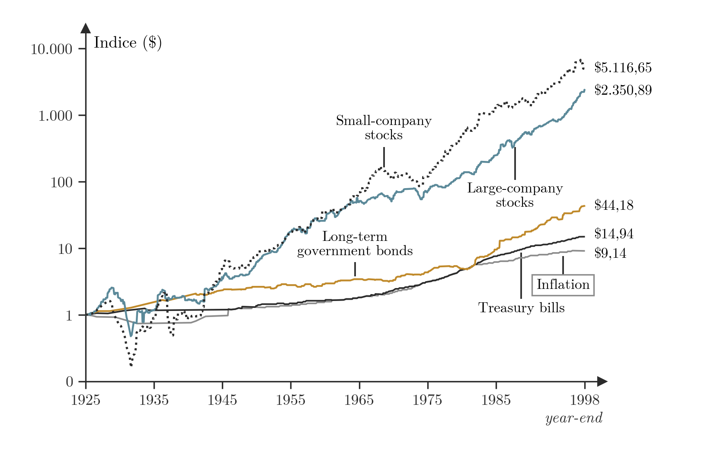
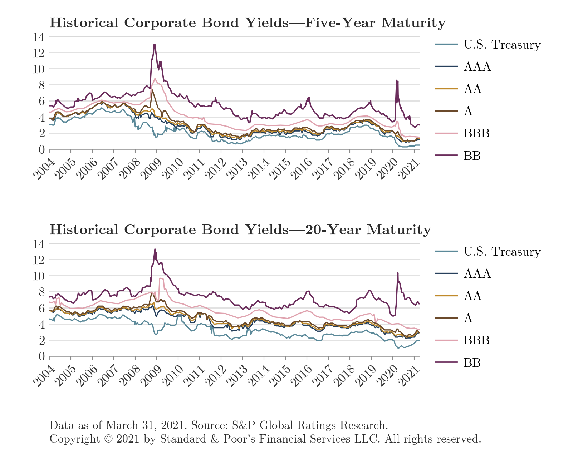
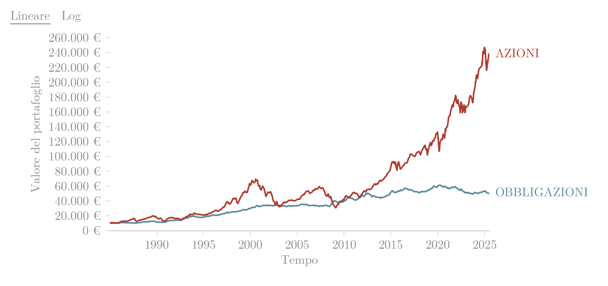
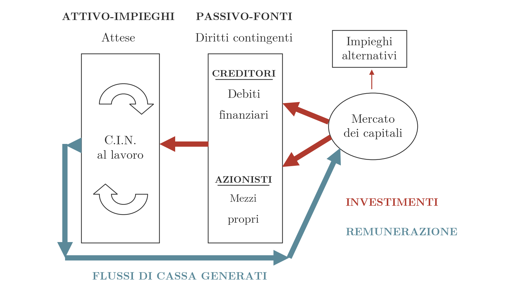

## Oggetto del capitolo

Il capitolo riguarda la valutazione di convenienza dei progetti di investimento dell'impresa. Si parte da alcuni casi di cronaca, si stabiliscono i due principi su cui si fonda la valutazione (il valore del tempo e il prezzo del rischio), si individuano i flussi di cassa rilevanti e si confrontano i criteri di decisione: valore attuale netto, valore attuale modificato, indice di redditività, tasso interno di rendimento, tempo di recupero. L'ultima parte estende l'analisi alle opzioni reali di espansione, attesa e abbandono. Il riferimento bibliografico è il testo indicato con la sigla BBS, paragrafi 5.1, 5.2, 5.3, 5.4 e 5.6.

Il capitolo è la prima parte del primo argomento del corso, le decisioni di investimento dell'impresa indebitata, che prosegue con il [[FSTR 02-full Costo del Capitale|calcolo del costo del capitale]]. Seguono i [[FSTR 03 Modelli Valutazione Finanziaria Parte1|metodi DCF]], i [[FSTR 06 Multipli di Borsa lez01|multipli di borsa]], la crescita esterna con la [[FSTR 12 Valutazione Operazioni di Integrazione|valutazione delle operazioni di integrazione]] e il *deal* con la [[FSTR 08 Financial Due Diligence|due diligence]]. La collocazione nel programma è descritta nell'[[FSTR 00 Intro Corso|introduzione al corso]].

## Decisioni di investimento nella cronaca: aperture ed espansioni

I casi di cronaca recente che seguono illustrano decisioni di investimento reali. I primi tre riguardano l'ampliamento della rete di vendita.

> [!example] Esempio
> **Eurospin.** Nel secondo semestre del 2025 il Gruppo prosegue il piano di sviluppo con nuove aperture e con ristrutturazioni di punti vendita in diverse regioni, e offre 136 posti di lavoro negli store, in buona parte collegati al piano di crescita. Secondo l'articolo del 2 ottobre 2025, le inaugurazioni in calendario sono San Giorgio a Cremano (Napoli) e Modica (Ragusa) il 2 ottobre, Alife e Piedimonte Matese (Caserta) il 3 ottobre, San Gavino Monreale (Sardegna) e Vallefoglia (Pesaro e Urbino) il 16 ottobre. Altre aperture seguiranno nei mesi successivi e si aggiungeranno ai discount inaugurati di recente in Lazio (Ardea, Nettuno, Spinaceto, con la riapertura di Guidonia), in Lombardia (Castelmarte, Parabiago), in Piemonte (Gravellona Toce) e in Umbria (Terni). Il Gruppo opera in 1.300 sedi tra Italia, Slovenia, Croazia e Malta. Secondo informazioni non ufficiali, Eurospin EKO, la società che gestisce le filiali in Slovenia e Croazia, ha individuato le prime sedi in Serbia: sono state pubblicate molte offerte di lavoro per la sede centrale serba, con programmi di formazione di diversi mesi in Croazia e in Italia, ma l'azienda non ha rilasciato dichiarazioni ufficiali sull'espansione in quel mercato.
>
> **KFC.** L'espansione in Italia continua: a marzo 2025 sono stati inaugurati 3 ristoranti, per un totale di 120, con 45 nuovi posti di lavoro.
>
> **Jysk.** La catena danese di articoli per la casa e il giardino raggiunge i 100 negozi in Italia. L'11 aprile 2025 apre in contemporanea tre punti vendita, Olbia (il negozio numero 100), L'Aquila e Nocera Superiore (Salerno), e porta il numero degli store a 102 in un solo giorno. La scelta di Olbia dipende dalla crescita del mercato sardo, dove Jysk ha già aperto altri quattro negozi (Sassari, Sestu, Oristano, Carbonia). L'apertura rientra in un piano di espansione che prevede nuovi store su tutto il territorio italiano entro la primavera 2025.

> [!lezione] Dalla lezione del 10 novembre 2026: altri casi di crescita organica
> A lezione sono stati mostrati altri esempi di investimenti e progetti di espansione, ritagliati da fonti esterne e riportati nel testo originale.
>
> - Un investimento da 100 milioni di euro, tra il 2028 e il 2030, per un mulino di nuova generazione in uno stabilimento produttivo già esistente a Foggia.
> - Ferrero, che produce i Nutella Biscuits in Italia e da poco anche in Canada e in Nord America, con l'espansione dello stabilimento in Ontario e il potenziamento della capacità produttiva nello stabilimento in Francia, il più grande sito di produzione di Nutella al mondo.
> - Il piano strategico 2026-2028 di Enel, tratto dalla relazione sulla gestione del bilancio, con 53 miliardi di euro di investimenti lordi e gli obiettivi di accelerare la crescita, massimizzare la produttività del capitale e garantire un profilo rischio-rendimento bilanciato.
> - L'apertura di un nuovo punto vendita Conad, con pannelli sul tetto e area parcheggi, che è un progetto di investimento a sé stante rispetto al gruppo.
>
> Sono tutti casi di crescita organica, cioè non per acquisizioni ma interna, e quindi investimenti di espansione, la prima categoria di investimenti analizzata. Si vedrà quali conti fa un gruppo come Ferrero quando amplia la produzione in America: il ragionamento economico che la porta a produrre lì, quanto costa e quanto rende aprire uno stabilimento.

## Caso Famila (SELEX): costo e rendimento di una nuova apertura

> [!example] Esempio
> **Contesto.** Nel 2023 le Imprese Socie SELEX sostengono la crescita dell'insegna Famila con 19 nuove aperture e la ristrutturazione di 21 punti vendita, per un investimento complessivo di 100 milioni di euro. Maniele Tasca dichiara che gli investimenti per le nuove aperture e per il rinnovamento della rete sono «fondamentali per competere con successo e rendere l'insegna Famila sempre più distintiva ed apprezzata dal mercato». Prosegue inoltre la campagna "Spesa Difesa", dedicata ai prodotti a marchio SELEX, con l'obiettivo di sostenere il potere d'acquisto delle famiglie a fronte dei rincari registrati sul mercato.
>
> **Dati del piano.** Il piano comprende 19 nuove aperture e 21 ristrutturazioni, per 40 progetti in totale. Il costo stimato è di 500.000-800.000 euro per ristrutturazione e di 3.000.000-5.000.000 euro per nuova apertura (solo allestimento, senza acquisto dell'immobile). L'esempio vuole stimare quanto rende aprire un nuovo punto vendita e in quanti anni si recupera l'investimento.
>
> **Costo di una nuova apertura.** Si assume un costo medio di 700.000 euro per ristrutturazione. Il costo delle ristrutturazioni è quindi 700.000 × 21 = 14.700.000 euro e quello delle nuove aperture è la parte restante dell'investimento complessivo, da dividere per il numero di aperture:
>
> $$100.000.000 - 14.700.000 = 85.300.000$$
>
> $$\frac{85.300.000}{19} \approx 4.489.474$$
>
> **Rendimento.** L'EBITDA medio della grande distribuzione organizzata italiana è il 5,7% del fatturato. Con un fatturato previsto di 20-30 milioni di euro l'anno, l'EBITDA annuo del punto vendita va da 1.140.000 a 1.710.000 euro. Il tempo di recupero (*pay-back*), in anni, si ottiene dividendo il costo di apertura per l'EBITDA stimato:
>
> $$\text{fatturato di 20 milioni}: \quad \frac{4.489.474}{1.140.000} \approx 3{,}94 \text{ anni}$$
>
> $$\text{fatturato di 30 milioni}: \quad \frac{4.489.474}{1.710.000} \approx 2{,}63 \text{ anni}$$
>
> Il tempo di recupero indica in quanti anni si ricostruisce la spesa sostenuta, ma non esprime un tasso di rendimento. Per misurare il rendimento in termini di tasso serve il tasso interno di rendimento (TIR), introdotto più avanti.

> [!lezione] Dalla lezione del 13 novembre 2026: investimenti incrementali e KPI di settore
> Un investimento non coincide sempre con una start up da zero: spesso è incrementale, come l'ampliamento di un punto vendita esistente. Nell'esempio presentato a lezione, che simula una situazione realmente accaduta, un'insegna come Conad amplia i metri quadri e l'organico per circa 10 milioni di euro. La direzione finanziaria chiede in quanto tempo l'investimento rientra.
>
> L'incremento di superficie e di dipendenti implica maggiori costi e maggiori ricavi, per cui occorre individuare KPI specifici. Nella grande distribuzione organizzata (GDO) il KPI abituale dei punti vendita è il fatturato per metro quadro, specifico del settore. Si stima il fatturato del nuovo negozio e quello aggiuntivo rispetto al vecchio, si ragiona in termini di redditività e poi di recupero dell'investimento. Le domande sono quanto può rendere l'apertura e, soprattutto per l'imprenditore, in quanti anni si recupera l'investimento.

## Decisioni di investimento nella cronaca: abbandono e rinvio

Altri quattro casi riguardano progetti abbandonati o rinviati.

> [!example] Esempio
> **Google Stadia (abbandono).** Google chiude la piattaforma di cloud gaming Stadia il 18 gennaio 2023, con stop immediato allo Stadia Store (e-commerce e transazioni in-game). La notizia ha suscitato critiche: c'è chi ha dato per finito l'intero business dei videogiochi online e chi ha incolpato Phil Harrison, vicepresidente e general manager di Stadia, che aveva chiamato in causa la crisi dell'energia e l'inflazione. Secondo l'articolo (3 ottobre 2022) la spiegazione è più semplice e riguarda una serie di errori strategici di Google nell'approccio al gaming. Il contesto è quello del taglio dei costi: la chiusura è l'ultima mossa del CEO di Alphabet, Sundar Pichai, dopo l'annuncio di voler rendere l'azienda più efficiente del 20%. Il prezzo delle azioni Alphabet è sceso del 34% nell'anno e a luglio la società ha registrato entrate e profitti deludenti. Pichai ha dichiarato che il taglio dei costi potrebbe includere anche prodotti e personale.
>
> **Amazon Astro for Business (abbandono).** A meno di un anno dal lancio, Amazon interrompe nel luglio 2024 la produzione della versione aziendale del robot Astro, presentata a novembre 2023 come possibile strumento di sorveglianza aziendale. Il robot ha un design simile a quello del personaggio Wall-E della Disney, pesa circa 9 kg e offre, tra le altre funzioni, navigazione autonoma, rilevamento di intrusioni e videochiamate. La versione domestica, lanciata a fine 2021, continua a essere venduta, sempre su invito, al prezzo di 1.599 dollari.
>
> **Volkswagen (rinvio).** Nel 2021 il Gruppo Volkswagen aveva presentato un progetto di elettrificazione che prevedeva 6 fabbriche di batterie (gigafactory) entro la fine del 2030. Al momento ha scelto tre siti: Salzgitter (Germania), Valencia (Spagna) e St. Thomas (Ontario, Canada). Il terzo stabilimento doveva restare in Europa, ma l'azienda ha voluto sfruttare gli incentivi americani dell'Inflation Reduction Act (IRA). Il CEO Blume ha affermato che i tre impianti hanno una capacità produttiva fino a 200 GWh all'anno. La quarta gigafactory è rinviata per il calo della domanda di auto elettriche.
>
> **Grand Theft Auto (rinvio).** La serie ha una storia di rinvii. L'uscita di GTA V per PlayStation 3 e Xbox 360, prevista inizialmente per la primavera del 2013, è stata posticipata al 17 settembre 2013 per consentire ulteriori rifiniture. Le versioni successive sono uscite in date diverse: PlayStation 4 e Xbox One il 18 novembre 2014, PC il 14 aprile 2015, PlayStation 5 e Xbox Series X/S il 15 marzo 2022. La tradizione è stata rispettata con GTA 6: annunciato a dicembre 2023 con uscita prevista nel 2025, è stato rinviato a fine maggio 2026 e poi, con un ennesimo rinvio, al 19 novembre 2026.

> [!lezione] Dalla lezione del 13 novembre 2026: l'abbandono a investimento già avviato
> Nei casi di espansione il business va bene e l'alternativa è incrementare. In altri casi il progetto parte, o non parte, e nei primissimi periodi viene abbandonato per motivi strategici o economici, o perché la scelta si ritiene sbagliata. Esempi citati sono la Maserati MC20 Folgore, totalmente elettrica, che non è mai uscita, e lo smartphone Fire di Amazon, per il quale, secondo il docente, sono stati spesi 170 milioni di dollari senza venderne nemmeno uno. Verifica sulle fonti giornalistiche: il Fire Phone è stato in realtà commercializzato (negli Stati Uniti, in esclusiva con AT&T, dal luglio 2014) e ritirato nel 2015; i 170 milioni di dollari sono la svalutazione di scorte invendute e impegni verso i fornitori contabilizzata da Amazon nel 2014, non la spesa di sviluppo. Resta valido come caso di progetto abbandonato.
>
> Esiste in questi casi una storia già iniziata, e ci si chiede se convenga andare avanti. Occorre valutare l'impatto in termini di valore dello stop al progetto, della dismissione delle attrezzature, dei costi di setup già sostenuti e del laboratorio di progettazione.

> [!lezione] Dalla lezione del 13 novembre 2026: il rinvio e il valore dell'attesa
> Il rinvio introduce le opzioni reali. Se l'investimento è avviato e poi posticipato, c'è un periodo di attesa: il progetto è pronto a partire e i costi sono già stati sostenuti, ma produce ricavi solo in un periodo successivo. Non è indifferente avere il denaro nel periodo zero, uno o due, e ciò cambia la valutazione. Il termine inglese *postponed* indica questo concetto.
>
> Un primo esempio è Nice, azienda che produce automazioni per cancelli. L'estratto del verbale di assemblea, riferito al 2006 (l'anno è solo illustrativo), riporta la decisione di rinviare il lancio di nuovi prodotti della linea Screen per completare la brevettazione di ulteriori componenti tecnologici prima della commercializzazione. Strategicamente l'azienda sceglie di partire con una linea di componenti tutti brevettati. I costi sono già stati sostenuti e l'azienda ritiene che avrà più ricavi lanciando prodotti e servizi tra un anno anziché oggi. L'alternativa è quindi lanciare subito, con ricavi certi perché si è pronti, oppure attendere un anno per flussi di cassa prospettici probabilmente più alti.
>
> Un secondo esempio è Digital Bros, casa di sviluppo di videogiochi, che ha posticipato il lancio di un videogioco, evento frequente. Un progetto di investimento può essere un prodotto all'interno di una linea aziendale che genera già flussi di cassa. Dall'estratto della relazione sulla gestione del bilancio risulta che il lancio della versione PC di Assetto Corsa 2 è stato posticipato all'estate successiva per consentire il lancio, in primavera, della nuova stagione di Assetto Corsa Competizione: lanciare il nuovo titolo avrebbe cannibalizzato il precedente, trattandosi di prodotti simili. Non si tratta di abbandonare o meno il progetto: il videogioco è pronto e gli scenari sono due. Lanciarlo oggi insieme all'altro, con determinati flussi di cassa, oppure tra un anno, quando l'altro videogioco è già acquisito e Assetto Corsa 2 ha un effetto novità. Che i flussi siano maggiori attendendo non è certo, e nelle opzioni andrà ponderato con delle probabilità.
>
> Il modulo successivo a quello sulla valutazione dei progetti riguarda le opzioni, cioè il valore della flessibilità: nella vita reale le situazioni sono più articolate del semplice "ho un progetto e lo valuto", perché un progetto può andare bene, andare male, essere abbandonato o posticipato.

## La fattibilità dell'investimento

I casi esaminati sono decisioni su un progetto di investimento e coprono le alternative possibili: effettuare o espandere il progetto (Eurospin, KFC, Jysk, Famila), rinviarlo (Volkswagen, Grand Theft Auto) o abbandonarlo (Stadia, Astro). La valutazione serve a stabilire quale di queste alternative sia conveniente.

> [!abstract] Definizione
> L'analisi di **fattibilità** di un investimento stabilisce se il progetto è conveniente. Si può effettuarlo oppure posticiparlo, abbandonarlo o espanderlo. Le variabili da considerare sono due: il tempo e il rischio.

> [!lezione] Dalla lezione del 13 novembre 2026: tempo e rischio nella finanza e nella ragioneria
> Per decidere se fare, attendere, abbandonare o espandere occorre padroneggiare due grandezze, il tempo e il rischio. Nella ragioneria, a parità di ricavi, interessa relativamente in quale esercizio si verifichino: confrontare il conto economico di un anno con quello di tre anni dopo non comporta una valutazione della rischiosità dei risultati né della variabile temporale. Nella finanza, invece, tempo e rischio sono centrali.
>
> La valutazione finanziaria si fa analizzando i flussi di cassa, cioè il cash flow, inteso come il differenziale tra la situazione di liquidità prima e dopo le decisioni valutate. Il concetto accompagna tutto il corso, perché ogni argomento viene ricondotto al flusso di cassa, grande o piccolo, anticipato o posticipato.

## Flussi reddituali e flussi di cassa

Il principio base della finanza d'azienda contrappone i **flussi reddituali** ai **flussi di cassa**. Dalla distinzione si passa a due piani di analisi. Il primo è la fattibilità, che riguarda le soluzioni tecniche alternative con cui realizzare il progetto, per esempio due diverse configurazioni di un magazzino. Il secondo è la valutazione finanziaria, riassunta dal principio «*Cash is King*»: ai fini della valutazione contano i flussi di cassa.

## Il valore del tempo

La valutazione di convenienza di un progetto si fonda su due principi: il tempo ha un valore e il rischio ha un prezzo. Questa sezione riguarda il primo principio.

### Equivalenze finanziarie e tasso privo di rischio

> [!abstract] Definizione
> Chi dispone di denaro può sempre acquistare un titolo di Stato e garantirsi un rendimento con una rischiosità prossima allo zero. Indicato con $r$ il tasso privo di rischio, come quello dei depositi, valgono le equivalenze:
>
> $$100 \text{ euro investiti oggi equivalgono a } 100 \times (1+r) \text{ euro tra un anno}$$
>
> $$100 \text{ euro tra un anno equivalgono a } \frac{100}{1+r} \text{ euro oggi}$$
>
> Un investimento che rende meno di $r$ **distrugge ricchezza**.

> [!lezione] Dalla lezione del 13 novembre 2026: capitalizzazione e attualizzazione
> L'alternativa a un progetto non è lasciare il denaro fermo ma impiegarlo senza rischio, per esempio in BTP, titoli di Stato poliennali emessi dallo Stato italiano. Il passaggio da 100 euro di oggi a $100\,(1+r)$ tra un anno è la **capitalizzazione**, che porta i flussi avanti e li rende maggiori; l'operazione inversa è l'attualizzazione, e 100 euro tra un anno valgono meno di 100 euro oggi. Gli investimenti si confrontano sempre con il tasso privo di rischio.

> [!example] Esempio
> Un titolo di Stato con rendimento $r = 3{,}5\%$ trasforma 100 euro di oggi in 103,50 euro tra un anno. Un progetto di investimento da 100 euro che rende soltanto il 2% dà invece 102 euro tra un anno. Attualizzando al tasso di mercato $r = 3{,}5\%$:
>
> $$\frac{102}{1{,}035} \approx 98{,}55 \text{ euro oggi}$$
>
> Il progetto genera un utile nominale, ma 102 euro tra un anno valgono oggi meno dei 100 euro investiti: rispetto all'alternativa priva di rischio distrugge ricchezza.

> [!example] Esempio
> Con il tasso dei titoli di Stato al 3,5%, si vuole stabilire se conviene investire 1.400 euro oggi in un progetto che restituisce 1.456 euro tra un anno esatto.
>
> L'aumento di 56 euro in un anno corrisponde a un rendimento del 4%, superiore al 3,5%: l'investimento nel progetto è conveniente. A parità di capitale iniziale, i titoli di Stato danno 1.449 euro tra un anno (1.400 × 1,035) e il progetto 1.456 euro. Attualizzando 1.456 euro al tasso di mercato si ottiene un valore odierno di:
>
> $$\frac{1.456}{1{,}035} \approx 1.406{,}76 \text{ euro}$$
>
> La ricchezza creata è quindi $1.406{,}76 - 1.400 = 6{,}76$ euro.

### Principi fondamentali

Dal valore del tempo discendono due principi.

1. Per creare ricchezza non basta realizzare un utile, cioè un aumento del capitale iniziale: occorre conseguire un rendimento superiore al tasso di mercato $r$. Si passa così da una misura assoluta di performance a una misura relativa.
2. La valutazione di un progetto di investimento è la misurazione relativa della sua bontà rispetto a quanto paga il mercato. L'analisi riguarda quindi la capacità di impiegare nel modo migliore il capitale investito e, di conseguenza, di remunerare il capitale raccolto sul mercato (si tratta di rendimenti alternativi rispetto a quello già offerto dal mercato).

## Il prezzo del rischio

> [!abstract] Definizione
> Il secondo principio della valutazione di convenienza è che **il rischio ha un prezzo**. Le opportunità di investimento presenti sul mercato sono spesso rischiose, nel senso che il rendimento promesso potrebbe non verificarsi. Per correre il rischio e finanziare simili iniziative, gli individui chiedono promesse di rendimenti più elevati di quelli non rischiosi, e le imprese devono impegnarsi a raggiungere tali rendimenti per non distruggere valore.

I dati storici mostrano quanto rendimento il mercato abbia riconosciuto al rischio.

Un dollaro investito alla fine del 1925 e mantenuto fino alla fine del 1998 vale 5.116,65 USD se investito in azioni di piccole imprese (*small-company stocks*), 2.350,89 USD in azioni di grandi imprese (*large-company stocks*), 44,18 USD in obbligazioni di Stato a lungo termine (*long-term government bonds*) e 14,94 USD in buoni del Tesoro (*Treasury bills*). Nello stesso periodo l'inflazione porta l'indice dei prezzi a 9,14 volte il valore iniziale. Tutte le serie partono da 1 USD e l'asse verticale ha scala logaritmica, per cui a distanze uguali corrispondono variazioni percentuali uguali.

**Figura 1** — Crescita di 1 USD investito a fine 1925 in azioni di piccole e grandi imprese, obbligazioni di Stato a lungo termine, buoni del Tesoro e inflazione fino a fine 1998 (scala logaritmica): le azioni, soprattutto quelle di piccole imprese, chiudono molto al di sopra delle altre serie, ma con oscillazioni più ampie, come il calo dei primi anni Trenta.

Le azioni hanno quindi remunerato il rischio con rendimenti cumulati molto superiori a quelli di obbligazioni e buoni del Tesoro, ma con perdite profonde lungo il percorso.

Anche tra i titoli di debito il rendimento richiesto cresce con il rischio. I grafici dei rendimenti storici (*yield*) a 5 e a 20 anni di scadenza confrontano i titoli del Tesoro statunitense con obbligazioni societarie di rating AAA, AA, A, BBB e BB+, da gennaio 2004 a marzo 2021 (dati S&P Global Ratings Research al 31 marzo 2021). A parità di scadenza lo yield è tanto più alto quanto peggiore è il rating, e gli spread tra i rating si allargano nelle fasi di crisi: tra la fine del 2008 e l'inizio del 2009 lo yield a 5 anni dei titoli BB+ sale a circa il 13%, mentre quello del Treasury scende a circa l'1,5%; a marzo 2020 si ripete un picco più contenuto.

**Figura 2** — Rendimento del debito di imprese con rating diverso (scadenze a 5 e a 20 anni, 2004-2021): lo yield aumenta al peggiorare del rating e gli spread rispetto al Treasury si allargano nelle crisi del 2008-2009 e del 2020.

Un confronto più recente riguarda il valore di un portafoglio investito in azioni e di uno investito in obbligazioni, entrambi con un valore iniziale di circa 10.000 euro a metà degli anni Ottanta. Nel 2025 il portafoglio azionario vale circa 240.000 euro (con un massimo di circa 245.000), quello obbligazionario circa 50.000 euro, dopo un massimo di circa 61.000 intorno al 2020. La traiettoria delle azioni è molto più irregolare: scende sotto quella delle obbligazioni nel 2002-2003 e nel 2008-2009 e subisce flessioni marcate anche nel 2020 e nel 2022.

**Figura 3** — Valore di un portafoglio azionario e di uno obbligazionario dalla metà degli anni Ottanta al 2025: le azioni crescono di circa 24 volte, le obbligazioni di circa 5, con fasi in cui il portafoglio azionario scende sotto quello obbligazionario.

> [!lezione] Dalla lezione del 13 novembre 2026: perché i rendimenti delle imprese superano quelli dei titoli di Stato
> Le attività imprenditoriali hanno tecnicamente un rendimento più alto di obbligazioni e titoli di Stato: il tema è in che modo si remunera il capitale raccolto sul mercato. Il confronto si fa con il tasso privo di rischio perché non si è obbligati a fare l'investimento e si potrebbero comprare titoli di Stato. L'obiettivo delle imprese, che competono in un mercato rischioso, è finanziare investimenti che rendano più del mercato.
>
> A lezione è stato mostrato per il mercato americano il grafico di ciò che sarebbe diventato un dollaro investito nel 1926, con serie fino a un anno finale recente. L'area piena è l'inflazione, cioè la perdita di potere d'acquisto del denaro. Le serie con i rendimenti più bassi sono i Treasury bills e i government bond, ed è la prova del fatto che hanno i rischi più bassi: chi non rischia ha nel tempo un rendimento più basso. Sopra stanno le large cap stocks e, ancora più in alto, le piccole imprese americane, che comunque sono enormi rispetto alle italiane. Il grafico dà la percezione del prezzo del rischio, ma si tratta di medie.
>
> Dal grafico non traspare che l'ente che emette i titoli di Stato è sempre lo stesso, mentre le aziende che oggi performano nel paniere probabilmente non sono quelle del 1926, perché molte hanno chiuso o sono fallite. Il dollaro investito in azioni potrebbe quindi essere stato azzerato per sempre dalla chiusura dell'azienda. Riferito alla singola azienda, il dato mostra che progetti di investimento e aziende portano con sé un'elevata rischiosità.
>
> Per questo il tasso di attualizzazione dei flussi di cassa di un'azienda, che si ottiene con le formule che seguono e si vedrà anche nella valutazione d'azienda, risulta del 10, 11, 12 per cento, contro il 3% dei BTP. Tassi così alti non indicano rendimenti anomali: si sta attualizzando il rischio.

> [!lezione] Dalla lezione del 13 novembre 2026: rating, obbligazioni e azioni
> Le società di rating analizzano quanto sono rischiose le aziende ed esprimono il giudizio con il rating. Nel grafico dello yield dei corporate bond per rating Standard & Poor's, la linea del rating più alto, lo Stato americano con rating AAA e rischio minimo, è mediamente la più bassa, come nel grafico precedente, e le obbligazioni di aziende AAA, AA e A le stanno immediatamente appoggiate. Come caso estremo il docente propone un'azienda che commercializza frutta secca in Congo durante una guerra civile, con rating degradato a BB+: il rendimento richiesto è molto più alto, in proporzione al rischio.
>
> La correlazione tra rischio e rendimento accompagna tutte le decisioni finanziarie. Nella valutazione delle aziende e dei tassi va tenuta come riferimento: davanti al tasso che risulta dai calcoli ci si chiede quanto sia rischioso il mercato in cui opera l'azienda e come quel rendimento si confronti con i titoli del governo americano.
>
> Lo stesso vale tra obbligazioni e azioni. L'obbligazione è un prestito e comporta un impegno forte alla restituzione da parte dell'azienda, con un valore giuridico forte. Se l'azienda fallisce, le azioni sono da buttare e i 100 euro investiti sono persi. Con le obbligazioni in genere si apre una procedura di liquidazione o di concordato, viene nominato un liquidatore e l'obbligazione diventa un credito: non è detto, ma esiste una probabilità che il capitale venga restituito.

## Il Corporate Finance Circuit

> [!abstract] Definizione
> Il **Corporate Finance Circuit** rappresenta lo schema dei flussi finanziari dell'impresa. Nell'attivo (impieghi, a cui sono associate le *attese* di rendimento) si trova il capitale investito netto (**C.I.N.**) «al lavoro». Nel passivo (fonti, che costituiscono *diritti contingenti*) si collocano i **creditori**, titolari dei debiti finanziari, e gli **azionisti**, titolari dei mezzi propri.
>
> Le risorse (*investimenti*) arrivano a creditori e azionisti dal **mercato dei capitali**, che offre anche **impieghi alternativi** per le stesse risorse, e da creditori e azionisti passano al C.I.N. I **flussi di cassa generati** dal C.I.N. tornano al mercato dei capitali come *remunerazione* delle risorse conferite, e il circuito si chiude.

**Figura 4** — Corporate Finance Circuit: le risorse (frecce rosse, investimenti) vanno dal mercato dei capitali a creditori e azionisti e da questi al C.I.N.; i flussi di cassa generati (freccia blu) tornano al mercato come remunerazione.

> [!lezione] Dalla lezione del 13 novembre 2026: a chi vanno i flussi di cassa
> Nello stato patrimoniale l'attivo è a sinistra e il passivo a destra. Il passivo comprende i debiti verso le banche, che finanziano l'attivo, i fornitori e i debiti verso i dipendenti; l'altro grande blocco è il patrimonio netto, che appartiene ai soci. Chi finanzia l'attivo sono dunque, fondamentalmente, i creditori terzi e i soci.
>
> Gli stakeholder sono i soggetti con interessi nell'azienda, ma i flussi di cassa remunerano le aspettative di due soli soggetti, i creditori e i soci. Se un'azienda come Diadora produce flussi di cassa per milioni di euro, a chi non è né creditore né azionista non interessa, perché non ne è toccato. Valutando un'azienda occorre calcolare l'ammontare dei flussi di cassa generati e stabilire quali vanno a una categoria e quali all'altra.
>
> Sul mercato del lavoro si valuteranno aziende per conto di chi le vuole comprare o di chi le vuole finanziare. In entrambi i casi questi soggetti si aspettano di avere indietro del denaro: con un finanziamento una certa remunerazione, da azionista un'altra, e per acquistare le azioni un certo prezzo. A sinistra c'è lo stato patrimoniale riclassificato, il capitale investito netto; a destra creditori e azionisti, che finanziano e ricevono i flussi generati dall'azienda.

## I flussi finanziari di riferimento: FCFO, FCFF e FCFE

Le valutazioni aziendali usano tre flussi di cassa, che si ricavano uno dall'altro con uno schema a cascata organizzato per aree: gestione corrente, investimenti, gestione straordinaria, capitale di terzi e capitale proprio.

> [!abstract] Definizione
> Schema a cascata del calcolo dei flussi, per area:
>
> | Area | Voce |
> |---|---|
> | Gestione corrente | MOL (margine operativo lordo) |
> | | $-$ variazione del capitale circolante netto operativo (CCNO) |
> | | $=$ cash flow gestionale lordo |
> | | $-$ flusso fiscale operativo (imposte $+$ scudi $-$ variazione dei debiti per imposte) |
> | | $=$ cash flow gestionale netto (**FCFO**) |
> | Investimenti | $-/+$ investimenti/disinvestimenti in capitale fisso |
> | | $=$ free cash flow to the firm (**FCFF**) |
> | Gestione straordinaria | $+/-$ proventi/oneri straordinari |
> | Capitale di terzi | $-$ oneri finanziari netti |
> | | $+$ scudo fiscale sugli oneri finanziari |
> | | $+/-$ aumento/riduzione dei debiti finanziari |
> | Capitale proprio | $=$ free cash flow to equity (**FCFE**) |

Dal MOL si arriva quindi al FCFO, il flusso della gestione corrente al netto delle imposte. Dal FCFO si ottiene il FCFF aggiungendo o sottraendo gli investimenti e i disinvestimenti in capitale fisso. Dal FCFF si ottiene il FCFE considerando i proventi e gli oneri straordinari e i flussi dell'area del capitale di terzi (oneri finanziari netti, scudo fiscale e variazione dei debiti finanziari). Il FCFE è il flusso che spetta al capitale proprio.

## Esempio Ferrari: dal FCFO al FCFE

> [!example] Esempio
> Lo schema FCFO, FCFF, FCFE si applica al rendiconto finanziario di Ferrari N.V., la società capogruppo, per gli esercizi 2024 e 2023 (importi in migliaia di euro).
>
> | Voce | 2024 | 2023 |
> |---|---|---|
> | Cash and cash equivalents at the beginning of the year | 97.432 | 110.702 |
> | Net profit | 811.541 | 382.759 |
> | Income tax benefit | (29.249) | (28.811) |
> | Amortization and depreciation | 3.309 | 703 |
> | Financial income | (4.132) | (11.092) |
> | Financial expenses | 145.089 | 131.040 |
> | Other non-cash expenses/(income), net | 26.653 | (6.721) |
> | Change in trade receivables | 6.180 | 1.025 |
> | Change in trade payables | 1.245 | (5.782) |
> | Change in other operating assets and liabilities | 50.303 | 37.053 |
> | Finance costs paid | (139.623) | (77.797) |
> | **Total cash flows from operating activities (FCFO)** | **871.316** | **422.377** |
> | Investments in property, plant and equipment | (109) | (1.585) |
> | Investments in subsidiaries | (15.000) | (9.000) |
> | **Total cash flows used in investing activities (CAPEX)** | **(15.109)** | **(10.585)** |
> | Proceeds from financial liabilities with related parties | 2.900.000 | 2.900.000 |
> | Repayments of financial liabilities with related parties | (3.300.000) | (2.159.120) |
> | Proceeds from bonds and notes | 496.145 | – |
> | Repayments of bonds and notes | – | (575.702) |
> | Proceeds from borrowings from banks and other financial institutions | 225.000 | 250.000 |
> | Repayments of borrowings from banks and other financial institutions | (78.333) | (47.500) |
> | Repayments of lease liabilities | (509) | (672) |
> | Change in Ferrari Group cash management pools | 4.954 | (2.808) |
> | Dividends paid to owners | (439.918) | (328.631) |
> | Share repurchases | (581.084) | (460.629) |
> | Total cash flows used in financing activities | (773.745) | (425.062) |
> | Total change in cash and cash equivalents | 82.462 | (13.270) |
> | Cash and cash equivalents at the end of the year | 179.894 | 97.432 |
>
> Nella colonna 2024 il **FCFO** coincide con il totale dei flussi da attività operative, 871.316, e il **CAPEX** con il totale dei flussi da attività di investimento, (15.109). Il **FCFF** è la loro somma:
>
> $$FCFF = 871.316 - 15.109 = 856.207$$
>
> Il **FCFE** si ottiene sommando al FCFF i flussi netti dei creditori, cioè le voci di finanziamento che precedono i flussi degli azionisti (debiti verso parti correlate, prestiti obbligazionari, finanziamenti bancari, debiti per leasing, variazione dei conti di tesoreria di gruppo):
>
> $$2.900.000 - 3.300.000 + 496.145 + 225.000 - 78.333 - 509 + 4.954 = 247.257$$
>
> $$FCFE = 856.207 + 247.257 = 1.103.464$$
>
> Le due voci successive, dividendi pagati (439.918) e riacquisto di azioni proprie (581.084), per un totale di 1.021.002, remunerano gli azionisti. Il FCFE al netto di questa remunerazione coincide con la variazione delle disponibilità liquide dell'esercizio: $1.103.464 - 1.021.002 = 82.462$.
>
> Nel prospetto gli oneri finanziari pagati (139.623) rientrano nell'attività operativa, quindi il totale di 871.316 è già al netto degli interessi, mentre nello schema teorico gli oneri finanziari appartengono all'area del capitale di terzi. L'identificazione di FCFO e FCFF con i totali del prospetto è perciò un'approssimazione, che non altera il FCFE.

## Esempio DeLonghi: determinare FCFO, CAPEX, FCFF e FCFE

> [!example] Esempio
> Lo stesso schema si applica al rendiconto finanziario di DeLonghi (importi in euro). Si chiede di individuare FCFO, CAPEX, FCFF e FCFE.
>
> | Voce | Nota | 2024 | 2023 |
> |---|---|---|---|
> | Risultato netto | | 269.654.801 | 36.578.045 |
> | Imposte sul reddito del periodo | | (5.799.291) | (3.335.128) |
> | Proventi per dividendi | | (289.221.640) | (51.922.552) |
> | Ammortamenti | | 460.821 | 424.843 |
> | Variazione netta fondi e altre componenti non monetarie | | (1.290) | 4.089.124 |
> | **Flussi finanziari assorbiti dalla gestione corrente (A)** | | **(24.906.599)** | **(14.165.668)** |
> | Crediti commerciali | | (2.352.958) | (11.280.078) |
> | Debiti commerciali | | (3.958.562) | 4.076.770 |
> | Altre variazioni delle voci del capitale circolante netto | | 14.446.730 | (392.804) |
> | Pagamento imposte sul reddito | | – | (9.972.483) |
> | **Flussi finanziari generati (assorbiti) da movimenti di capitale circolante (B)** | | **8.135.210** | **(17.568.595)** |
> | **Flussi finanziari generati dalla gestione corrente e da movimenti di CCN (A+B)** | | **(16.771.389)** | **(31.734.263)** |
> | Investimenti in immobilizzazioni materiali | | – | (21.803) |
> | Altri flussi finanziari da immobilizzazioni materiali | | 9.883 | 27.462 |
> | Investimenti netti in partecipazioni e altre attività finanziarie | | (345.560.448) | (48.000.000) |
> | Incasso dividendi | | 289.221.640 | 51.922.552 |
> | **Flussi finanziari assorbiti da attività di investimento (C)** | | **(56.328.925)** | **3.928.211** |
> | **Flusso netto operativo (A+B+C)** | | **(73.100.314)** | **(27.806.052)** |
> | Esercizio stock option | | 12.713.591 | 5.100.544 |
> | Distribuzione dividendi | | (101.017.542) | (72.429.271) |
> | Pagamento interessi su finanziamenti | | (23.690.861) | (22.327.436) |
> | Rimborso finanziamenti e altre variazioni nette delle fonti di finanziamento | | 187.582.382 | 116.623.070 |
> | **Flussi di cassa generati (assorbiti) dalla variazione di voci di PN e/o attività di finanziamento (D)** | | **75.587.570** | **26.966.907** |
> | Variazione delle disponibilità liquide e mezzi equivalenti (A+B+C+D) | | 2.487.256 | (839.145) |
> | Disponibilità liquide e mezzi equivalenti all'inizio del periodo | 18 | 1.631.063 | 2.470.208 |
> | Disponibilità liquide e mezzi equivalenti alla fine del periodo | 18 | 4.118.319 | 1.631.063 |
>
> **Soluzione (colonna 2024).** Il **FCFO** è il totale dei flussi della gestione corrente e dei movimenti di capitale circolante (A+B): (16.771.389). Il **CAPEX** è il totale dei flussi da attività di investimento (C): (56.328.925). Il **FCFF** è il flusso netto operativo (A+B+C):
>
> $$FCFF = -16.771.389 - 56.328.925 = -73.100.314$$
>
> Nella sezione D i flussi dei creditori sono il pagamento di interessi (23.690.861) e il rimborso e le altre variazioni nette delle fonti di finanziamento, positive per 187.582.382, per un saldo netto di 163.891.521. Il **FCFE** è la somma del FCFF e di questo saldo:
>
> $$FCFE = -73.100.314 + 163.891.521 = 90.791.207$$
>
> Gli altri due flussi della sezione D riguardano i soci: l'incasso per l'esercizio di stock option (12.713.591) e la distribuzione di dividendi (101.017.542). Come i dividendi e i riacquisti di azioni nel caso Ferrari, sono collocati sotto il FCFE. La quadratura con la cassa conferma il calcolo: $90.791.207 + 12.713.591 - 101.017.542 = 2.487.256$, pari alla variazione delle disponibilità liquide.
>
> Il totale della sezione D (75.587.570) sommato ai dividendi (101.017.542) dà 176.605.112: è l'insieme dei flussi di finanziamento al lordo dei dividendi e non il FCFE, perché non comprende il FCFF.

> [!lezione] Dalla lezione del 13 novembre 2026: le aree del rendiconto e l'area operativa
> Il rendiconto finanziario è lo schema più utile per capire come circolano i flussi di cassa, perché quantifica quelli che i due finanziatori si aspettano di ricevere. Conto economico e stato patrimoniale non servono a questo scopo. Nel metodo indiretto esistono più configurazioni del flusso di cassa, ma le aree fondamentali non cambiano.
>
> La prima area è quella operativa: l'azienda fa girare il capitale investito netto e genera un MOL, cioè un EBITDA. Per un calcolo rapido i valutatori prendono la differenza tra valore e costi della produzione (A meno B) e rimettono gli ammortamenti, ottenendo grossolanamente l'EBITDA da bilancio, che poi va normalizzato e aggiustato.
>
> L'EBITDA non può essere preso come flusso di cassa perché non diventa interamente denaro sul conto corrente. Se produrre un banco costa 100 euro e lo si vende a 300 a una scuola, il margine di 200 euro dà un EBITDA positivo; ma se si emette fattura a una pubblica amministrazione e questa non paga, l'EBITDA va rettificato con la variazione del capitale circolante. Esistono aziende che falliscono con l'EBITDA positivo: se i ricavi non diventano cassa e si pagano stipendi e materiali, si deve chiudere. Succede spesso a chi lavora con la pubblica amministrazione, per esempio fornendo a un ospedale consumabili e servizi che l'ospedale non paga. Altro esempio è l'impresa edile che costruisce City Life e non incassa gli appartamenti dall'agenzia che ne gestisce la vendita: ha anticipato cemento, operai, progettazione e autorizzazioni, e sulla carta il conto economico mostra ricavi enormi, ma si è "fuori coi soldi". Questa situazione non si vede dal conto economico ma solo dal rendiconto finanziario.
>
> Il rendiconto mostra se un'azienda si sta "mangiando" i soldi. Lo si vede in modo lampante quando il cash flow gestionale è quasi zero o negativo: l'azienda produce un EBITDA e lo assorbe tutto nel capitale circolante, cioè produce un reddito che diventa interamente crediti, e gli stipendi non si pagano con i crediti. L'azienda deve quindi produrre cassa e liquidità dall'area operativa.

> [!lezione] Dalla lezione del 13 novembre 2026: l'ordine di remunerazione dei soggetti nel rendiconto
> La seconda area è quella degli investimenti: l'azienda non può vivere in eterno con macchinari, attrezzature e impianti che ha, e una parte del flusso viene sottratta per gli investimenti. Fornitori e personale si gestiscono con la variazione del capitale circolante ($\Delta$CCNO). Poi si calcolano le imposte, con segno meno, il cui effetto ricorre in tutti gli esercizi ed è mitigato dallo scudo fiscale sugli interessi sul debito.
>
> Dopo il FCFO restano da remunerare i soggetti del passivo, creditori e soci. Il docente chiede perché nel rendiconto l'area finanziaria venga prima dell'area degli azionisti, trattandosi in entrambi i casi di sottrazioni. Gli azionisti sono remunerati per ultimi: se avanza qualcosa lo ricevono, altrimenti no. I creditori hanno invece un debito da restituire, quindi l'area finanziaria è un'area di impegni obbligatori, quasi come lo Stato. Comprende gli oneri finanziari e i rimborsi in uscita, ma anche le accensioni di nuovi finanziamenti in entrata: un finanziamento di un milione concesso nell'anno e incassato va collocato in questa sezione.
>
> L'ultima voce è il free cash flow relativo all'equity, che residua dopo aver pagato tutti, ed è espresso in dividendi o in variazioni delle voci del capitale proprio. Questa posizione spiega perché chi investe per ottenere dividendi pretende un rendimento alto: viene dopo tutti gli altri e non ha un rimborso garantito per legge, a differenza di creditori e dipendenti. È l'assemblea a deliberare la distribuzione dei dividendi, che non è obbligatoria, e molte aziende non ne danno per anni perché capitalizzano gli utili e li mettono a riserva.
>
> Se Enel decide di investire sul fotovoltaico e di non distribuire dividendi, il socio di minoranza ottiene dall'investimento un rendimento nullo in dividendi e non ha altro da fare. Per una quotata la scelta influisce anche sul prezzo del titolo, e se una società così grande non distribuisce dividendi può nascere una reazione di protesta tra gli azionisti. In genere i flussi sono gestiti in modo da dedicarne una parte agli investimenti e una a chi ha creduto nella società. Questo non vale per le aziende non quotate.

> [!lezione] Dalla lezione del 13 novembre 2026: aziende non quotate, capitale di terzi e capitale di rischio
> Le aziende non quotate sono circa il 95% di quelle che si incontreranno: in Italia le quotate sono poche centinaia, a fronte di circa 950.000 SRL e di un milione di imprese, per cui nel territorio italiano la probabilità di dover affrontare il rendiconto di un'azienda non quotata è circa cento volte superiore. Le cifre sono approssimazioni del docente: con poche centinaia di quotate su circa un milione di società, la quota delle non quotate supera di gran lunga il 95%. Le PMI italiane sono molto indebitate, quindi l'area finanziaria pesa molto: confrontando i bilanci di aziende americane e italiane dello stesso business, si nota che in Italia si tende a fare debito in banca. Una PMI del territorio non penserebbe di quotarsi per avere denaro, mentre negli Stati Uniti è molto più frequente, perché in borsa ci sono molte più aziende e quotarsi e restare quotati costa meno.
>
> Si consideri una SRL, una fonderia di Vicenza, che ha bisogno di mezzo milione di euro. L'imprenditore non chiama Borsa Italiana: chiama il direttore della banca, promette un business plan con la proiezione dei flussi di cassa entro un mese, spiega che deve ampliare la linea produttiva e chiede una linea di credito da mezzo milione, cioè capitale di terzi. Si fa così soprattutto nei business maturi. Nel mondo delle start-up e dei percorsi innovativi si cercano invece business angels, persone disposte a perdere il capitale messo come capitale di rischio, cioè equity. In generale le aziende italiane che hanno bisogno di denaro vanno in banca.

> [!lezione] Dalla lezione del 13 novembre 2026: come si leggono i rendiconti di Enel e De' Longhi
> Il rendiconto mostrato di Enel, in milioni di euro, è ciò che si trova fuori dal libro di testo: non esiste uno schema riga per riga e nei bilanci i rendiconti sono costruiti in modo molto vario, con più o meno righe e dettaglio. Se sul libro la formula dell'FCFO è scritta in tre righe, nel bilancio ce ne sono una cinquantina, e bisogna ricondurre la realtà al libro, che è una semplificazione. Si vede che nomi e gerarchia sono quelli del metodo indiretto, che parte dal reddito generato.
>
> Il rendiconto parte dal risultato netto d'esercizio, ultima riga del conto economico, lo corregge degli ammortamenti e arriva a grandi linee al MOL; toglie poi la variazione del circolante e arriva al flusso di cassa della gestione operativa. Segue il cash flow da attività di investimento, dove Enel inserisce tutto, anche le partecipazioni (per esempio l'acquisto del 70% di una società che fa capo a un parco fotovoltaico) e il rifacimento del camino di una centrale. Le voci sono investimenti in attività materiali non correnti e in imprese o rami di impresa; sono anche possibili disinvestimenti, per cui se Enel vende la partecipazione in un parco eolico entra denaro, con segno più.
>
> Mancano poi creditori e azionisti, a volte in blocchi non separati. Tra le voci dei creditori ci sono il rimborso di debiti finanziari (le rate di mutuo o finanziamento), le altre variazioni di indebitamento finanziario e l'emissione e il rimborso di obbligazioni: emettendole entra denaro e si contrae un debito, quindi si creano nuovi creditori da remunerare. Per gli azionisti ci sono i dividendi e i coupon pagati su obbligazioni ibride, che possono avere diritti particolari.
>
> Nel rendiconto De' Longhi la struttura è identica: dal risultato netto e dalle imposte si ottiene una sorta di risultato operativo, poi le variazioni di crediti commerciali, debiti commerciali e altre voci del circolante, cioè nuovamente $\Delta$CCN, e si arriva a quello che si può chiamare free cash flow from operations, il flusso prima della gestione degli investimenti. Seguono CAPEX, investimenti in immobilizzazioni materiali e investimenti netti in partecipazioni. Questi sono i flussi da cui vanno presi quelli per la valutazione con il metodo dei flussi di cassa: i metodi di valutazione trattati più avanti sono i multipli dell'EBITDA, i flussi di cassa e i DCF, ed è necessario sapere quali flussi prendere.

> [!lezione] Dalla lezione del 13 novembre 2026: la quadratura del rendiconto
> Le ultime righe del rendiconto sono le voci di quadratura: tutto quanto sta sopra deve corrispondere esattamente alla variazione delle disponibilità liquide. L'ultimo importo del cash flow, quello che residua dopo aver pagato tutti i soggetti, è la variazione delle disponibilità liquide da un anno all'altro, cioè la variazione del conto in banca dell'azienda, che si ritrova nello stato patrimoniale. Costruendo il rendiconto da soli la quadratura non torna quasi mai, per qualche voce, ma la quadratura perfetta è il modo per capire se è corretto.
>
> Le voci provengono da entrambi gli schemi. Dal conto economico si prendono il risultato d'esercizio, gli ammortamenti da rimontare e gli oneri finanziari. La variazione del capitale circolante è nello stato patrimoniale, in crediti e debiti; gli investimenti sono la variazione delle immobilizzazioni dello stato patrimoniale, ripulite dagli ammortamenti. Si incrociano quindi i due schemi, si calcolano le variazioni e se ne ricava un flusso di cassa, con la prova del nove che il denaro in azienda sia variato esattamente di quell'importo.

## I cinque metodi per valutare un investimento

I cinque metodi principali per valutare un investimento sono il valore attuale netto (VAN), il tasso interno di rendimento (TIR), il tempo di recupero (TR), l'indice di redditività (IR) e il tempo di recupero attualizzato (TRA). Per ciascuno si indicano la formula, il criterio decisionale, i punti di forza e di debolezza e il campo di applicazione pratica. Subito dopo il VAN si presenta una sua variante, il valore attuale modificato (VAM).

> [!lezione] Dalla lezione del 13 novembre 2026: valutare un singolo progetto con i flussi di cassa
> Gli investimenti citati nei casi di cronaca sono singoli progetti e non aziende, quindi occorrono metodi appositi. Alcuni si prestano meglio ad alcuni investimenti, e il VAN e il TIR sono già noti dagli altri corsi.
>
> Si dimentica il conto economico e si lavora sui flussi di cassa: nel VAN compare al numeratore l'FCFO, che si ricava dal rendiconto finanziario. Senza saperlo ricavare non si riesce a valutare un investimento pur conoscendo la formula. Quando verrà chiesto di valutare un investimento nessuno fornirà il flusso di cassa: va calcolato, partendo da quanto può rendere, quanto costa e il risultato atteso. Oltre all'FCFO serve l'esborso al momento zero, $I_0$ con segno meno, che si contrappone ai flussi futuri.
>
> Il docente avverte che confondere i tempi è una causa frequente di errore negli esercizi e nelle prove d'esame: occorre restare lucidi sul fatto che ci si colloca nel momento zero, in $I_0$, e che un flusso tra un anno non equivale a un flusso di oggi. Se l'investimento parte oggi e nel 2027 produce un milione di euro, quello non è un FCFO di oggi ma un FCFO al momento uno, e vale meno di un milione, per esempio 900 o 800 mila euro. La regola è attualizzare i flussi a partire dal momento uno. Se il progetto parte tra un anno, tutti i flussi partono tra un anno e vanno riportati indietro di un anno, perché ci si colloca oggi, in $T_0$; lo si ritroverà negli esercizi sulle opzioni, dove la possibilità di aspettare un anno ha senso finanziario in questi termini.

## Il valore attuale netto (VAN)

> [!abstract] Definizione
> Il **valore attuale netto** è la somma tra l'investimento iniziale, cambiato di segno, e il valore attuale (VA) dei flussi di cassa operativi attesi, attualizzati al WACC:
>
> $$VAN = -I_0 + VA = -I_0 + \sum_{t=1}^{N} \frac{FCFO_t}{(1+WACC)^t}$$
>
> Il criterio decisionale è $VAN > 0$.

Il VAN considera sia il fattore tempo sia il rischio, tiene conto dei flussi di medio-lungo periodo e della dimensione del progetto (in valore assoluto) e ha la proprietà additiva: il VAN di più progetti con lo stesso rischio si somma. Non considera invece il razionamento di capitale né le opportunità future, cioè che cosa accade nei periodi successivi. Trova applicazione nei progetti di grande dimensione, con cash flow poco volatili e stime affidabili del WACC.

> [!lezione] Dalla lezione del 13 novembre 2026: il VAN e la disponibilità del capitale
> Tra i punti a favore, il VAN dà significato ai flussi distribuiti nel tempo e considera la dimensione del progetto: sono euro contro euro, un milione contro mezzo milione. Non considera il razionamento del capitale. Si supponga uno spazio libero nel campus dove aprire un bar, con un investimento di mezzo milione che restituisce 700 mila euro in tre anni: con un VAN maggiore di zero lo si farebbe, ma se non si dispone di mezzo milione di euro non lo si fa. Il VAN dice che il progetto è percorribile ma non tiene conto del fatto che la cifra potrebbe non essere disponibile.
>
> Questo conta perché i metodi si usano per confrontare più progetti. Tra il bar e un'app per gli studenti, realizzata da tre giovani con strumenti di intelligenza artificiale per 2.000 euro, a parità di VAN 2.000 euro si trovano, mezzo milione no. Anche se il bar avesse un VAN più alto, non si ha il capitale: nella realtà occorre sempre valutare investimenti alternativi.
>
> Un'ulteriore semplificazione è che il VAN si presta quando i flussi di cassa sono abbastanza stabili, perché si attualizza un flusso che si suppone sempre lo stesso negli anni, ma nulla garantisce che sia così.

### Esempio 1: progetto conveniente

> [!example] Esempio
> Un progetto richiede un investimento iniziale (capex) di 10.000 euro, dura 5 anni e genera flussi di cassa operativi (FCFO) costanti di 3.000 euro all'anno. Il WACC, che è il tasso di attualizzazione, è il 9,0%.
>
> $$VAN = -10.000 + \frac{3.000}{(1+0{,}09)^1} + \frac{3.000}{(1+0{,}09)^2} + \frac{3.000}{(1+0{,}09)^3} + \frac{3.000}{(1+0{,}09)^4} + \frac{3.000}{(1+0{,}09)^5}$$
>
> $$VAN = -10.000 + 2.752{,}29 + 2.525{,}04 + 2.316{,}55 + 2.125{,}28 + 1.949{,}79$$
>
> $$VAN = -10.000 + 11.668{,}95 = 1.668{,}95$$
>
> Il valore attuale dei flussi è 11.668,95 euro e il valore attuale netto del progetto è 1.668,95 euro. Il VAN è positivo, quindi il progetto è conveniente.

### Esempio 2: progetto non conveniente

> [!example] Esempio
> Un progetto richiede un investimento iniziale (capex) di 12.000 euro, dura 4 anni e genera FCFO costanti di 3.000 euro all'anno. Il WACC è l'8,0%: significa che l'azienda si aspetta almeno l'8% di rendimento annuo per compensare il rischio del progetto, il costo del capitale preso a prestito e il rendimento atteso dagli azionisti.
>
> $$VAN = -12.000 + \frac{3.000}{(1+0{,}08)^1} + \frac{3.000}{(1+0{,}08)^2} + \frac{3.000}{(1+0{,}08)^3} + \frac{3.000}{(1+0{,}08)^4}$$
>
> $$VA = 2.777{,}78 + 2.572{,}02 + 2.381{,}50 + 2.205{,}09 \approx 9.936{,}38$$
>
> $$VAN = -12.000 + 9.936{,}38 = -2.063{,}62$$
>
> L'investimento di 12.000 euro che genera 3.000 euro l'anno per 4 anni non è sufficiente a coprire il costo del capitale dell'8%. Il progetto non è conveniente, perché il capitale investito non viene remunerato al tasso richiesto da azionisti e finanziatori.

> [!lezione] Dalla lezione del 13 novembre 2026: perché non si usa il tasso privo di rischio
> Nell'esempio si usa l'8% e non il tasso privo di rischio del 3,5%, perché aprire un bar o lanciare un'app comporta una rischiosità, a differenza di un BTP: i tassi usati per gli investimenti non sono quelli privi di rischio. Come calcolarlo e che significato attribuirgli si vedrà più avanti. Chi non dispone del capitale per aprire il bar potrebbe trovare finanziatori che credono nel progetto e lo finanziano con capitale di rischio, e in parte una banca a titolo di credito, e vanno tutti remunerati. Il WACC è mediamente il rendimento atteso dai due soggetti, gli azionisti e il capitale preso a prestito.

## Il valore attuale modificato (VAM)

> [!abstract] Definizione
> Il **valore attuale modificato** ha la stessa struttura del VAN, ma attualizza i flussi con un tasso diverso:
>
> $$VAM = -I_0 + VA = -I_0 + \sum_{t=1}^{N} \frac{FCFO_t}{(1+r_0)^t}$$
>
> Il tasso $r_0$ è il tasso di attualizzazione riferito al solo investimento, indipendente dalla struttura finanziaria adottata (il costo del capitale *unlevered*, trattato nel [[FSTR 02-full Costo del Capitale|capitolo sul costo del capitale]]). Il criterio decisionale è $VAM > 0$.

I punti di forza sono quelli del VAN, con in più la separazione tra il valore dell'investimento e quello del finanziamento: il VAM prescinde dal modo in cui il progetto è finanziato. Punti di debolezza e applicazione pratica coincidono con quelli del VAN. Il modello è ripreso per la valutazione d'impresa nel capitolo sul [[FSTR 04-full Modelli Valutazione Finanziaria Parte2|modello VAM]].

> [!lezione] Dalla lezione del 13 novembre 2026: perché valutare l'investimento a prescindere dal finanziamento
> Per un bar in cui investire mezzo milione di euro, la convenienza dell'investimento non dovrebbe dipendere da come lo si finanzia: che i soldi siano messi da azionisti o da creditori non dovrebbe fare la differenza. Un osservatore esterno direbbe che il bar o rende o non rende, e non che convenga aprirlo se il mezzo milione lo presta il presidente della banca e non convenga se è del proprietario. Questo ragionamento, presente nel libro di testo e nelle slide, secondo il docente è sensato e porta al valore attuale modificato: un calcolo del valore attuale con un tasso diverso dal WACC. Si immagina di fare l'investimento interamente con mezzi propri, e $r_0$ è il tasso di un progetto (e poi di un'azienda) non indebitato.
>
> La forza del metodo è separare il valore dell'investimento da quello del finanziamento. Il finanziamento non si trascura, ma concettualmente lo si separa. Porta con sé il vantaggio fiscale: se il bar è finanziato interamente con capitale di rischio si pagano imposte in base al conto economico, mentre con un mutuo si pagano interessi che sono costi deducibili nel bilancio e quindi meno imposte. Con soldi interamente propri questo vantaggio non c'è.
>
> Lo scudo fiscale ricorrerà in tutte le formule da qui alla fine del corso: dove c'è capitale di terzi c'è la possibilità di dedurre gli interessi. È l'impatto fondamentale dell'uso di denaro altrui, al di là dell'aspettativa di tasso dei finanziatori, ed è significativo in termini di flusso.

## L'effetto del razionamento di capitale

Il VAN non considera il razionamento di capitale, cioè il limite alle risorse che l'impresa può investire. L'esempio seguente mostra perché il solo VAN non basta a scegliere tra due progetti.

> [!example] Esempio
> Si considerano due progetti di investimento, entrambi con WACC del 7%.
>
> | | Progetto A | Progetto B |
> |---|---|---|
> | Investimento iniziale | −50.000 | −1.500.000 |
> | Flusso anno 1 | 70.000 | 900.000 |
> | Flusso anno 2 | 70.000 | 900.000 |
> | VAN | 76.561 | 127.216 |
>
> Il progetto B ha il VAN più alto in valore assoluto, ma richiede un esborso iniziale trenta volte superiore a quello di A. In presenza di razionamento di capitale l'impresa potrebbe non essere in grado di intraprenderlo. La selezione deve quindi considerare insieme il VAN e il razionamento di capitale.

## L'indice di redditività (IR)

> [!abstract] Definizione
> L'**indice di redditività** è il rapporto tra il valore attuale dei flussi e l'investimento iniziale:
>
> $$IR = \frac{VA}{I_0}$$
>
> Il criterio decisionale è $IR > 1$.

L'IR considera il fattore tempo e il rischio e i flussi di medio-lungo termine, ha la proprietà additiva ed è utile nel caso di razionamento di capitale. I punti di debolezza coincidono con quelli del VAN: non considera il razionamento di capitale e non considera le opportunità future. Si applica ai progetti di grande dimensione, con cash flow poco volatili e stime affidabili del WACC.

Nell'esempio sul razionamento di capitale l'IR vale $126.561/50.000 \approx 2{,}53$ per il progetto A e $1.627.216/1.500.000 \approx 1{,}08$ per il progetto B: per ogni euro investito il progetto A genera più valore attuale, anche se il suo VAN è inferiore.

### Esempio: indice di redditività

> [!example] Esempio
> Un progetto richiede un esborso iniziale di 200.000 euro e genera un flusso costante di 66.000 euro per i 4 periodi successivi. Il WACC stimato è il 10%. Si vuole stabilire se all'azienda conviene intraprendere l'investimento.
>
> $$VA = \frac{66.000}{1{,}10^1} + \frac{66.000}{1{,}10^2} + \frac{66.000}{1{,}10^3} + \frac{66.000}{1{,}10^4} \approx 209.211$$
>
> $$IR = \frac{VA}{I_0} = \frac{209.211}{200.000} \approx 1{,}046$$
>
> Poiché $IR > 1$, il progetto è conveniente dal punto di vista finanziario. Il VAN corrispondente è $209.211 - 200.000 = 9.211$.

## Il tasso interno di rendimento (TIR)

> [!abstract] Definizione
> Il **tasso interno di rendimento** è lo specifico tasso di attualizzazione per cui il VAN di un progetto è pari a zero ed esprime il tasso di rendimento reale del progetto:
>
> $$TIR = r \;\Rightarrow\; VAN = -I_0 + \sum_{t=1}^{N} \frac{FCFO_t}{(1+r)^t} = 0$$
>
> Il criterio decisionale è $TIR > WACC$: il rendimento del progetto deve superare il costo-opportunità del capitale, cioè il ritorno offerto da progetti alternativi con lo stesso profilo di rischio.

Il TIR non va confuso con il WACC. Il WACC è il tasso al quale si attualizzano i flussi di cassa operativi per ottenere il VAN del progetto. Non è quindi una misura di redditività, ma uno «standard di redditività» (le aspettative di chi conferisce capitale) con cui si confronta il rendimento del progetto, cioè il TIR, per stabilire se l'investimento conviene.

Il TIR considera il fattore tempo e il rischio, tiene conto dei flussi di lungo periodo ed è una misura sintetica. Non considera la dimensione del progetto né la posizione dei flussi nel tempo e non funziona per i progetti con flussi alternati, cioè con flussi che cambiano segno più volte. Si applica alla comparazione di progetti simili e ai progetti di finanziamento, che hanno flussi costanti.

## Il tempo di recupero (TR)

> [!abstract] Definizione
> Il **tempo di recupero** (*pay-back*) è il minimo numero di anni $t$ per cui la somma dei flussi operativi copre l'investimento iniziale:
>
> $$t \rightarrow \min\left(\sum_{i=1}^{t} FCFO_i \geq I_0\right)$$
>
> Il criterio decisionale è $t \leq CUT\text{-}OFF$, dove il cut-off è il tempo limite.

L'unico punto di forza del TR è la semplicità. Non considera il fattore tempo e il rischio né i flussi di medio-lungo termine, e il cut-off è arbitrario. Si applica quando le misure dei flussi e del WACC non sono affidabili, ai progetti poco importanti o a basso rischio e ai progetti con cash flow di lungo termine bassi.

## Il tempo di recupero attualizzato (TRA)

> [!abstract] Definizione
> Il **tempo di recupero attualizzato** è il minimo numero di anni $t$ per cui il valore attuale cumulato dei flussi operativi copre l'investimento iniziale:
>
> $$t \rightarrow \min\left(\sum_{s=1}^{t} \frac{FCFO_s}{(1+WACC)^s} \geq I_0\right)$$
>
> Il criterio decisionale è $t \leq CUT\text{-}OFF$.

Il TRA considera il fattore tempo e il rischio e sta a metà strada tra il rigore teorico e la semplicità di applicazione. Non considera i flussi di medio-lungo termine e il cut-off è arbitrario. Si applica quando i cash flow di lungo termine sono incerti o poco significativi.

### Esempio: tempo di recupero attualizzato

> [!example] Esempio
> Un progetto richiede un esborso iniziale di 152.000 euro e genera un flusso costante di 65.000 euro per i 4 periodi successivi. Il WACC stimato è il 9%. Si vuole stabilire in quanti anni l'azienda recupera l'investimento. I flussi attualizzati sono:
>
> $$t=1: \quad \frac{65.000}{(1+0{,}09)^1} = \frac{65.000}{1{,}09} \approx 59.633$$
>
> $$t=2: \quad \frac{65.000}{(1+0{,}09)^2} = \frac{65.000}{1{,}1881} \approx 54.709$$
>
> $$t=3: \quad \frac{65.000}{(1+0{,}09)^3} = \frac{65.000}{1{,}295029} \approx 50.192$$
>
> $$t=4: \quad \frac{65.000}{(1+0{,}09)^4} = \frac{65.000}{1{,}41158161} \approx 46.048$$
>
> Il valore attuale cumulato dei flussi è:
>
> $$\text{dopo 1 anno} = 59.633$$
>
> $$\text{dopo 2 anni} = 59.633 + 54.709 = 114.342$$
>
> $$\text{dopo 3 anni} = 114.342 + 50.192 = 164.534$$
>
> Dopo due anni il valore attuale cumulato (114.342) è inferiore all'investimento iniziale di 152.000, dopo tre anni (164.534) lo supera. L'investimento viene quindi recuperato in tre anni: **TRA = 3 anni**. La decisione finale sull'avvio del progetto resta arbitraria, perché dipende dal cut-off scelto.

## Scelta del modello

La scelta del metodo dipende dall'affidabilità delle misure disponibili, cioè del WACC e dei cash flow (soprattutto nel lungo termine).

| WACC | Cash flow | Metodo da usare |
|---|---|---|
| Affidabile | Affidabili | VAN e indice di redditività (quest'ultimo come misura sintetica nel caso di razionamento di capitale) |
| Affidabile | Non affidabili | Tempo di recupero attualizzato |
| Non affidabile | Affidabili | TIR o tempo di recupero |
| Non affidabile | Non affidabili | Tempo di recupero |

Le misure contabili non sono stime del valore creato. Se è possibile ricorrere al TIRM (tasso interno di rendimento modificato, variante del TIR), è comunque il VAN la misura da usare.

## Le opzioni reali: superare i limiti del VAN

> [!abstract] Definizione
> Quando si valuta un progetto con il VAN si assume implicitamente che l'impresa lo detenga in modo «passivo». Si ignorano così le **opzioni reali** collegate al progetto, da cui manager più «sofisticati» potrebbero trarre vantaggio, e il VAN non riflette il **valore del management**.
>
> I manager che detengono opzioni reali non devono essere passivi: possono prendere decisioni per trarre vantaggio dagli esiti favorevoli e ridurre le perdite. L'opportunità di prendere decisioni di questo tipo aggiunge valore tutte le volte in cui gli esiti di un progetto sono incerti.

Le opzioni reali più note sono tre: effettuare investimenti addizionali in futuro (**espansione**), aspettare di investire in seguito (**attesa**, o rinvio) e **abbandonare** il progetto. Il valore di un'opzione reale è la differenza tra il VAN con l'opzione e il VAN senza opzione:

$$\text{valore dell'opzione} = VAN_{\text{con opzione}} - VAN_{\text{senza opzione}}$$

## L'opzione di espansione

Si valuta un investimento in una linea produttiva con due scenari equiprobabili, ciascuno con probabilità del 50%. Nello scenario peggiore (*worst case*) i flussi di cassa sono bassi e il VAN è negativo. Nello scenario migliore (*best case*) i flussi sono elevati e possono essere reinvestiti: danno accesso a un ulteriore investimento di espansione, con l'attivazione di una seconda linea produttiva. Il problema è determinare quanto vale l'opzione di espansione.

### Esempio 1: linea produttiva di microchip

> [!example] Esempio
> Un'azienda valuta di avviare una linea produttiva per microchip. L'investimento iniziale è di 95.000k euro, il WACC stimato è il 9% e il periodo di incassi è di 4 anni. Gli importi delle tabelle sono espressi, come l'investimento iniziale, in migliaia di euro.
>
> | Scenario | T1 | T2 | T3 | T4 |
> |---|---|---|---|---|
> | Ottimistico | 105.000 | 8.000 | 8.000 | 8.000 |
> | Pessimistico | 70.000 | 6.000 | 6.000 | 6.000 |
>
> Nello scenario ottimistico si considera la possibilità di ampliare il progetto con una seconda linea produttiva, per una spesa di 97.000k euro e con i flussi previsti seguenti:
>
> | | T1 (investimento) | T2 | T3 | T4 |
> |---|---|---|---|---|
> | Espansione | −97.000 | 55.000 | 55.000 | 55.000 |
>
> **VAN del progetto senza opzione.** I fattori di sconto al 9% sono $DF_t = 1/(1+0{,}09)^t$. Nello scenario ottimistico:
>
> | Anno | CF | Fattore $DF_t$ | Valore attuale |
> |---|---|---|---|
> | 1 | 105.000 | 0,917431 | 96.330 |
> | 2 | 8.000 | 0,841680 | 6.733 |
> | 3 | 8.000 | 0,772183 | 6.177 |
> | 4 | 8.000 | 0,708425 | 5.667 |
> | **Totale VA flussi** | | | **114.909** |
>
> $$VAN_{\text{ott}} = 114.909 - 95.000 = 19.909$$
>
> I valori attuali sono arrotondati all'unità, mentre il totale è calcolato sui valori non arrotondati. Nello scenario pessimistico:
>
> | Anno | CF | Fattore $DF_t$ | Valore attuale |
> |---|---|---|---|
> | 1 | 70.000 | 0,917431 | 64.220 |
> | 2 | 6.000 | 0,841680 | 5.050 |
> | 3 | 6.000 | 0,772183 | 4.633 |
> | 4 | 6.000 | 0,708425 | 4.251 |
> | **Totale VA flussi** | | | **78.154** |
>
> $$VAN_{\text{pess}} = 78.154 - 95.000 = -16.846$$
>
> Il valore atteso del progetto senza opzione, con probabilità del 50% per ciascuno scenario, è:
>
> $$EV_{\text{base}} = \tfrac{1}{2}\cdot 19.909 + \tfrac{1}{2}\cdot(-16.846) \approx 1.531$$
>
> **Valore dell'opzione di espansione.** La seconda linea viene decisa alla fine del primo anno, quando lo scenario ottimistico si è già realizzato: la spesa di 97.000 è quindi un flusso di T1 e si attualizza di un anno (fattore 0,917431), non di zero. I flussi della seconda linea, 55.000 in ciascuno degli anni T2, T3 e T4, si attualizzano con i fattori degli anni 2, 3 e 4. Il VAN dell'opzione è espresso a T0 e viene pesato per la probabilità del 50% dello scenario ottimistico.
>
> | Anno | CF opzione | Fattore $DF_t$ | Valore attuale |
> |---|---|---|---|
> | 1 | −97.000 | 0,917431 | −88.991 |
> | 2 | 55.000 | 0,841680 | 46.292 |
> | 3 | 55.000 | 0,772183 | 42.470 |
> | 4 | 55.000 | 0,708425 | 38.963 |
> | **VAN opzione a T0** | | | **≈ 38.735** |
>
> $$EV_{\text{opt}} = 0{,}5 \cdot 38.735 \approx 19.368$$
>
> $$EV_{\text{tot}} = EV_{\text{base}} + EV_{\text{opt}} = 1.531 + 19.368 = 20.899$$
>
> Il valore dell'opzione è il VAN con l'opzione meno il VAN senza opzione: il VAN senza opzione è 1.531, il VAN con opzione è 20.899 e il valore dell'opzione è
>
> $$20.899 - 1.531 = 19.368$$

### Esempio 2: punto vendita della grande distribuzione in Veneto

> [!example] Esempio
> Un'azienda della grande distribuzione organizzata valuta di aprire il primo punto vendita in Veneto. L'investimento iniziale è di 5.000k euro, il WACC stimato è il 10% e il periodo di incassi è di 4 anni. Gli importi delle tabelle sono espressi in migliaia di euro. I flussi previsti nei due scenari, ciascuno con probabilità del 50%, sono:
>
> | Scenario | T1 | T2 | T3 | T4 |
> |---|---|---|---|---|
> | Ottimistico | 1.500 | 1.900 | 1.900 | 2.000 |
> | Pessimistico | 1.000 | 1.000 | 1.000 | 1.000 |
>
> Nello scenario ottimistico si considera la possibilità di ampliare il progetto alla fine dell'anno 1, aprendo un secondo punto vendita e reinvestendo interamente i flussi incassati nel primo anno dal primo punto vendita. I flussi di incasso previsti dall'espansione sono 2.000 in T2 e 2.100 in T3 e in T4.
>
> **Progetto principale.**
>
> | Scenario | T0 | T1 | T2 | T3 | T4 | VAN | Probabilità | VAN atteso |
> |---|---|---|---|---|---|---|---|---|
> | Ottimistico | −5.000 | 1.500 | 1.900 | 1.900 | 2.000 | 727 | 50% | 364 |
> | Pessimistico | −5.000 | 1.000 | 1.000 | 1.000 | 1.000 | −1.830 | 50% | −915 |
>
> Il VAN del progetto senza opzione è $364 - 915 = -551$.
>
> **Progetto di espansione.** L'espansione è decisa alla fine del primo anno e finanziata reinvestendo l'incasso di T1 (1.500). Il suo VAN a T0 è:
>
> $$-\frac{1.500}{1{,}10} + \frac{2.000}{1{,}10^2} + \frac{2.100}{1{,}10^3} + \frac{2.100}{1{,}10^4} \approx 3.301$$
>
> | Decisione | Investimento (T1) | T2 | T3 | T4 | VAN | Probabilità | VAN atteso |
> |---|---|---|---|---|---|---|---|
> | Espando | −1.500 | 2.000 | 2.100 | 2.100 | 3.301 | 50% | 1.651 |
> | Non espando | 0 | 0 | 0 | 0 | 0 | 50% | 0 |
>
> Il VAN dell'opzione, pesato per la probabilità del 50% dello scenario ottimistico, è $0{,}5 \times 3.301 \approx 1.651$. Il VAN del progetto con opzione è la somma del VAN atteso senza opzione e del VAN dell'opzione: $-551 + 1.651 =$ **1.099**. Il risultato è calcolato sui valori non arrotondati ($-551{,}36 + 1.650{,}67 = 1.099{,}31$); sommando i valori arrotondati si otterrebbe 1.100.
>
> L'opzione, esercitabile solo nello scenario favorevole, trasforma un progetto con VAN atteso negativo (−551) in un progetto con VAN atteso positivo (1.099).

## L'opzione di attesa

L'opzione di attesa consiste nel rinviare il lancio di un progetto già sviluppato per ottenere un maggiore riscontro di pubblico.

> [!example] Esempio
> Un'azienda informatica valuta di sviluppare un nuovo videogioco e di lanciarlo sul mercato. L'investimento iniziale è di 8.000k euro, il WACC stimato è il 9% e il periodo di incassi è di 4 anni. Gli importi delle tabelle sono espressi in migliaia di euro. I flussi previsti nei due scenari, ciascuno con probabilità del 50%, sono:
>
> | Scenario | T1 | T2 | T3 | T4 |
> |---|---|---|---|---|
> | Ottimistico | 2.800 | 2.800 | 2.800 | 2.800 |
> | Pessimistico | 1.600 | 2.400 | 2.400 | 2.400 |
>
> Una volta sviluppato il videogioco, l'azienda può attendere un anno prima di lanciarlo, ottenendo maggiore riscontro di pubblico. I flussi di incasso previsti in questo caso sono 2.880 in ciascuno degli anni T2, T3, T4 e T5.
>
> **Progetto senza opzione.**
>
> | Scenario | WACC | T0 | T1 | T2 | T3 | T4 | VAN | Probabilità | VAN atteso |
> |---|---|---|---|---|---|---|---|---|---|
> | Ottimistico | 9% | −8.000 | 2.800 | 2.800 | 2.800 | 2.800 | 1.071 | 50% | 536 |
> | Pessimistico | 9% | −8.000 | 1.600 | 2.400 | 2.400 | 2.400 | −959 | 50% | −479 |
>
> Il VAN del progetto senza opzione è $536 - 479 \approx 56$.
>
> **Progetto con opzione di attesa.** Lo scenario ottimistico non cambia. Nello scenario pessimistico il lancio è rinviato di un anno: in T1 non ci sono incassi, i flussi di 2.880 arrivano in T2, T3, T4 e T5 e l'investimento iniziale resta in T0.
>
> | Scenario | WACC | T0 | T1 | T2 | T3 | T4 | T5 | VAN | Probabilità | VAN atteso |
> |---|---|---|---|---|---|---|---|---|---|---|
> | Ottimistico | 9% | −8.000 | 2.800 | 2.800 | 2.800 | 2.800 | – | 1.071 | 50% | 536 |
> | Pessimistico (attesa) | 9% | −8.000 | attesa | 2.880 | 2.880 | 2.880 | 2.880 | 560 | 50% | 280 |
>
> Il VAN del progetto con opzione è $536 + 280 \approx 816$. Poiché
>
> $$VAN_{\text{con opzione}} = VAN_{\text{senza opzione}} + VAN_{\text{opzione}}$$
>
> il valore dell'opzione è
>
> $$VAN_{\text{opzione}} = VAN_{\text{con opzione}} - VAN_{\text{senza opzione}} \approx 759$$
>
> Il valore è calcolato sui valori non arrotondati (815,60 − 56,30 = 759,30); sottraendo i valori arrotondati si otterrebbe 760.

## L'opzione di abbandono

L'opzione di abbandono consiste nell'interrompere il progetto, smantellando e vendendo l'impianto.

> [!example] Esempio
> Un'azienda di gelati valuta di sviluppare un nuovo gelato-soft con una linea produttiva dedicata. L'investimento iniziale è di 200.000 euro, il WACC stimato è il 10% e il periodo di incassi è di 4 anni. I flussi previsti nei due scenari, ciascuno con probabilità del 50%, sono:
>
> | Scenario | T1 | T2 | T3 | T4 |
> |---|---|---|---|---|
> | Ottimistico | 70.000 | 70.000 | 70.000 | 70.000 |
> | Pessimistico | 20.000 | 2.000 | 2.000 | 2.000 |
>
> Nello scenario pessimistico l'azienda può interrompere la produzione nel corso del primo anno, smantellare e vendere l'impianto, ricavandone 170.000 euro. Si vuole stabilire quanto vale questa opzione.
>
> **Progetto senza opzione.**
>
> | Scenario | WACC | T0 | T1 | T2 | T3 | T4 | VAN | Probabilità | VAN atteso |
> |---|---|---|---|---|---|---|---|---|---|
> | Ottimistico | 10% | −200.000 | 70.000 | 70.000 | 70.000 | 70.000 | 21.891 | 50% | 10.945 |
> | Pessimistico | 10% | −200.000 | 20.000 | 2.000 | 2.000 | 2.000 | −177.297 | 50% | −88.648 |
>
> Il VAN del progetto senza opzione è $10.945 - 88.648 = -77.703$.
>
> **Progetto con opzione di abbandono.** Lo scenario ottimistico non cambia. Nello scenario pessimistico la produzione si interrompe nel corso del primo anno: in T1 si considera il solo ricavo della cessione dell'impianto, 170.000, e non ci sono flussi in T2, T3 e T4.
>
> | Scenario | WACC | T0 | T1 | T2 | T3 | T4 | VAN | Probabilità | VAN atteso |
> |---|---|---|---|---|---|---|---|---|---|
> | Ottimistico | 10% | −200.000 | 70.000 | 70.000 | 70.000 | 70.000 | 21.891 | 50% | 10.945 |
> | Pessimistico (abbandono in T1) | 10% | −200.000 | 170.000 | – | – | – | −45.455 | 50% | −22.727 |
>
> Il VAN del progetto con opzione è $10.945 - 22.727 = -11.782$. Poiché $VAN_{\text{con opzione}} = VAN_{\text{senza opzione}} + VAN_{\text{opzione}}$, il valore dell'opzione è
>
> $$VAN_{\text{opzione}} = VAN_{\text{con opzione}} - VAN_{\text{senza opzione}} = -11.782 - (-77.703) = 65.921$$
>
> Se l'abbandono avvenisse invece alla fine del primo anno, dopo un anno completo di attività, al ricavo della cessione si sommerebbe il flusso operativo dello stesso anno.

## Limiti e potenzialità delle opzioni reali

Nella pratica, e soprattutto per le imprese di piccole dimensioni, le opzioni reali sono spesso inapplicabili per tre ragioni. Le opzioni di espansione e di attesa si basano su flussi prospettici spesso lontani nel tempo e di difficile determinazione. Le probabilità di accadimento degli eventi sono difficili da determinare e non sempre modellizzabili con modelli teorici. Infine, ammesso di voler modellizzare i progetti, questi sono spesso nuovi e non simili ai flussi dell'impresa nel suo complesso, oppure è difficile trovare progetti comparabili.

Pur essendo spesso inapplicabili, le opzioni reali servono ad abbinare alla tecnicità un approccio elastico e di tipo manageriale. Indicano alcuni aspetti su cui riflettere: se il progetto da lanciare è modulare, se attendere per implementarlo comporta un vantaggio o uno svantaggio e se, a progetto iniziato, conviene continuare o smantellare tutto.
