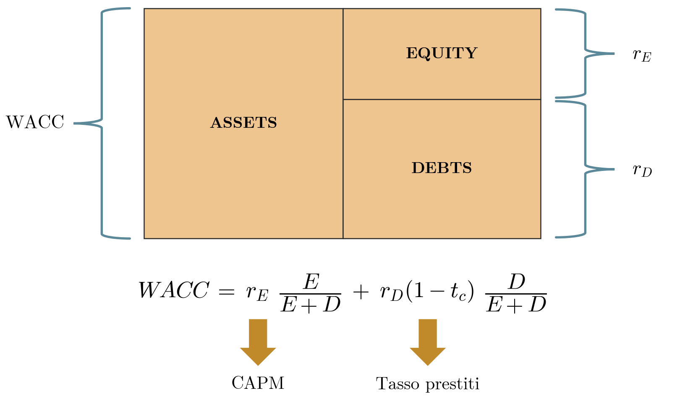
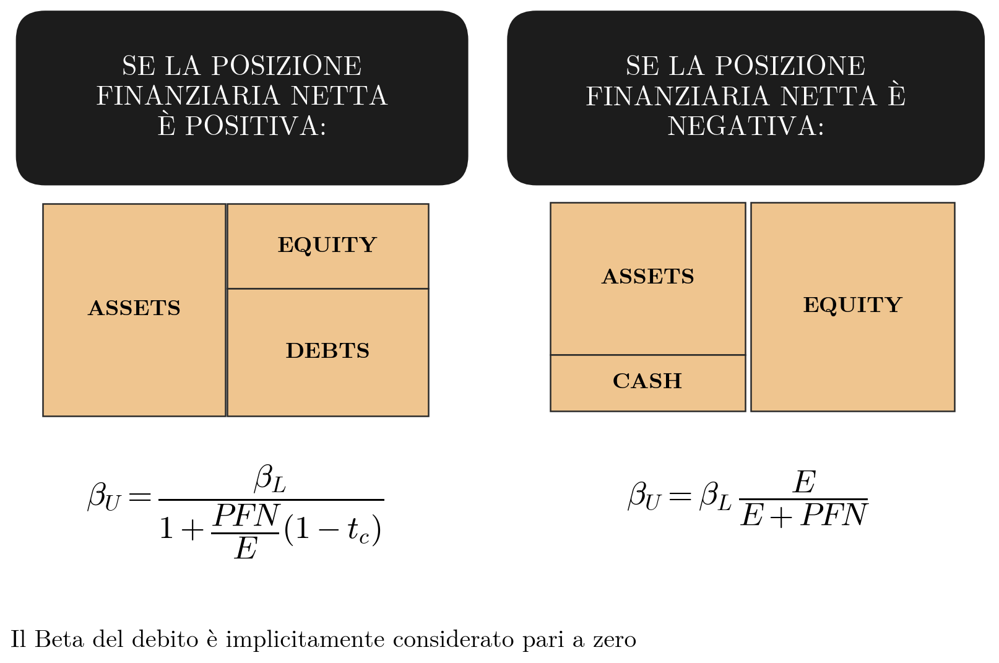

## Oggetto del capitolo

Il capitolo riguarda il tasso di sconto con cui valutare un progetto di investimento quando l'impresa si finanzia anche con debito. Il tasso si costruisce a partire dal costo del debito e dal costo del capitale proprio, stimato con il CAPM, e si sintetizza nel costo medio ponderato del capitale (WACC). Serve ad attualizzare i flussi del progetto, sia nel [[FSTR 01-full Progetti di Investimento|calcolo del valore attuale netto]] sia nei [[FSTR 03 Modelli Valutazione Finanziaria Parte1|metodi DCF di valutazione d'impresa]]. La collocazione del capitolo nel programma è descritta nell'[[FSTR 00 Intro Corso|introduzione al corso]]. Riferimento bibliografico: capitolo 7.3 del testo BBS, fino all'equazione 7.21.

## Il tasso di sconto di un progetto: Assets, Equity, Debts e WACC

L'impresa è rappresentata con tre blocchi: l'attivo (assets), finanziato dal capitale proprio (equity) e dal debito (debts). Le due fonti di finanziamento hanno rischio e rendimento richiesto diversi. Il tasso di sconto dell'attivo nel suo complesso è il WACC, il rendimento richiesto dagli azionisti è $r_E$ e quello richiesto dai finanziatori è $r_D$.

**Figura 1** — Struttura assets, equity e debts: l'attivo, a cui corrisponde il WACC, è finanziato dal capitale proprio, il cui costo si stima con il CAPM, e dal debito, il cui costo è il tasso sui prestiti.

Lo schema è uno stato patrimoniale riclassificato, cioè un prospetto a fonti e impieghi, e non lo stato patrimoniale civilistico: la voce del capitale circolante contiene sia attività sia passività e non è quindi né un attivo né un passivo. La riclassificazione mette in luce che a determinati impieghi corrispondono determinate fonti.

> [!abstract] Definizione
> Gli **assets** sono l'insieme dei beni e delle risorse economiche dell'azienda: impianti, macchinari, immobili, brevetti, capitale circolante, competenze, tecnologia. Sono gli elementi che permettono all'azienda di produrre beni, erogare servizi e generare flussi di cassa. Il tasso con cui si attualizzano i flussi generati dagli assets è il **WACC** (Weighted Average Cost of Capital).
>
> L'**equity** è la proprietà dell'azienda e sopporta l'intero rischio residuo della gestione. Riceve i flussi solo dopo che tutti i creditori sono stati soddisfatti e pretende un rendimento adeguato al rischio assunto, indicato con $r_E$.
>
> I **debts** comprendono tutte le forme di finanziamento ottenute da banche, obbligazionisti e altri creditori. Hanno un costo esplicito sotto forma di interessi ($r_D$), richiedono rimborsi programmati, godono di priorità rispetto agli azionisti nella distribuzione dei flussi e hanno un rischio minore dell'equity.
>
> Il WACC combina i due costi, ciascuno pesato per l'incidenza della rispettiva fonte sul totale:
>
> $$WACC = r_E\,\frac{E}{E+D} + r_D(1-t_c)\,\frac{D}{E+D}$$

Il costo del capitale proprio $r_E$ si stima con il CAPM, mentre $r_D$ è il tasso a cui l'impresa ottiene i prestiti. Il fattore $(1-t_c)$ porta il costo del debito al netto dello scudo fiscale: gli interessi passivi sono deducibili, quindi l'aliquota $t_c$ riduce l'onere effettivo del debito.

Gli assets sono di pertinenza di tutti gli stakeholders, soci o finanziatori terzi. Le fonti che ne rendono possibile l'esistenza, cioè la possibilità di far girare il capitale, provengono da due categorie di stakeholders: chi finanzia in qualità di socio e chi finanzia in qualità di creditore, di solito una banca. I fornitori non rientrano tra i finanziatori, perché sono già compresi nel circolante e quindi negli assets.

Un socio può essere anche creditore. In alcuni bilanci compare tra le voci del passivo la dicitura "soci conto finanziamento": anziché conferire capitale in beni o in denaro, i soci prestano denaro alla società, e il prestito è trattato come tale. Per quella porzione i soci sono creditori. I finanziamenti soci sono frequenti soprattutto quando l'azienda è provvisoriamente in tensione di liquidità: i soci prestano denaro in via temporanea e la somma viene poi restituita.

## L'aliquota fiscale nella valutazione

L'aliquota da impiegare dipende dall'uso che se ne fa.

| Impiego | Aliquota |
|---|---|
| Margini | IRES (24%) più IRAP (3,9%), in totale 27,9% |
| WACC | Solo IRES (24%) |

Indicare l'aliquota con $t_c$ è una semplificazione del carico fiscale effettivo: il reddito d'esercizio di una SRL o di una SPA è tassato con l'IRES e con l'IRAP, che hanno basi imponibili diverse, e il calcolo dell'imponibile spetta al commercialista. Negli esercizi e nei business plan si semplifica assumendo un carico fiscale del 28 o del 30% sull'utile ante imposte; la proiezione del carico fiscale su più anni nel conto economico è stimata tra il 27 e il 30%. Gli esempi del capitolo adottano le aliquote della tabella.

Nel WACC si usa la sola IRES perché è l'imposta che consente di dedurre gli interessi passivi: dal monte imponibile su cui si calcola l'IRES si tolgono gli interessi pagati sui finanziamenti, e l'imponibile si abbassa. Lo scudo fiscale è dunque legato agli interessi passivi e, tramite questi, all'IRES, e nel suo calcolo si usa il risparmio del 24%.

## Il costo del debito

> [!abstract] Definizione
> Il **costo del debito** $r_D$ è il rendimento richiesto dai finanziatori che prestano denaro all'impresa: banche, obbligazionisti, istituzioni finanziarie. Il creditore si aspetta un rendimento che compensi il valore del tempo e il rischio che l'impresa non rimborsi il finanziamento. Tale rendimento è il tasso di interesse effettivo del prestito.

Prestano denaro all'impresa le banche, gli obbligazionisti se l'azienda ha emesso obbligazioni, altre istituzioni finanziarie ed enti statali o parastatali che finanziano la crescita e gli investimenti a un costo del denaro agevolato, come Invitalia e Simest. Rientra nel costo del debito anche il finanziamento soci, se è fruttifero.

> [!example] Esempio
> Un'azienda ottiene un finanziamento di 1 milione di euro al 5% annuo, quindi $r_D = 5\%$. Gli interessi annui sono 50.000 euro. Poiché sono deducibili, con IRES al 24% l'imposta si riduce di 12.000 euro e l'onere netto è 38.000 euro, pari al 3,8% del finanziamento. Con l'effetto fiscale l'onere effettivo diventa
>
> $$r_D^{\,\text{post-tax}} = 5\% \times (1-24\%) = 3{,}8\%$$

Nella situazione contabile di un'azienda compaiono più finanziamenti, ciascuno con il proprio tasso: per esempio un anticipo export, un mutuo a 5 anni con la banca, un mutuo a 30 anni, il debito verso Simest per l'acquisto di un macchinario. Con una semplificazione, $r_D$ è la media ponderata del costo di tutti i debiti, con pesi pari al valore di ciascun finanziamento sul totale. Occorre quindi considerare sia il tasso sia il peso di ogni debito nella struttura complessiva:

$$r_D = \frac{\sum_i (\text{Debito}_i \times \text{tasso}_i)}{\sum_i \text{Debito}_i}$$

$$r_D^{\,\text{post-tax}} = r_D \times (1-t_c)$$

Se un'azienda ha un mutuo da 20 milioni di euro al 5% e un finanziamento da 500.000 euro all'1%, $r_D$ è molto più vicino al 5% che alla semplice media dei due tassi. Per debiti si intendono sempre i debiti finanziari, cioè quelli che maturano interessi, e non i debiti verso i fornitori. Per esempio, con l'IRES al 24% un tasso medio del 4,70% corrisponde, dopo lo scudo fiscale, a un costo effettivo del 3,57%.

## Il costo del capitale proprio

> [!abstract] Definizione
> Il **costo del capitale proprio** $r_E$ è il rendimento che l'azionista si aspetta dall'investimento nell'impresa. L'azionista si espone al rischio dell'azienda e pretende un compenso adeguato: $r_E$ è l'obiettivo di rendimento che l'impresa deve garantire ai suoi proprietari affinché accettino di investire capitale rischioso.

Il capitale proprio non ha garanzie. Assorbe i rischi operativi, finanziari e di mercato: l'azienda è esposta ogni giorno al mercato, alle decisioni aziendali, alla concorrenza, alle vicende interne e allo sviluppo dei prodotti. Se l'azienda chiude o fallisce, il capitale conferito è perso. In caso di liquidazione gli azionisti vengono dopo tutti. Nella liquidazione giudiziale il ricavato paga prima i crediti prededucibili, poi quelli assistiti da privilegio, pegno o ipoteca nell'ordine fissato dalla legge (sui beni mobili i crediti di lavoro dei dipendenti vengono subito dopo le spese di giustizia e prima di quelli tributari dello Stato), poi i creditori chirografari, comprese le banche prive di garanzie (art. 221 del Codice della crisi d'impresa e dell'insolvenza; artt. 2777 e 2778 c.c.); solo se avanza qualcosa la somma va agli azionisti. Essendo ultimi nella gerarchia di rimborso, assorbono tutto il rischio rispetto agli altri soggetti, e per questo $r_E$ è quasi sempre più elevato di $r_D$.

In prima approssimazione $r_E$ si scompone in un elemento certo e in un elemento di rischiosità. Il primo è il tasso privo di rischio, che non dipende dal fatto di essere un'azienda ma dal fatto che delle somme sono vincolate per un determinato periodo: remunera il valore del tempo. Spostare il denaro nel tempo prevede già di per sé una remunerazione, data dal tasso fisso: 100 euro oggi valgono più di 100 euro tra un anno, e 100 euro tra un anno oggi ne valgono 98.

Al tasso privo di rischio si aggiunge un premio per il rischio, che ha due componenti: il rischio sistematico, misurato dal beta, e il rischio del Paese in cui l'impresa opera. La condizione di rischio dipende quindi dal settore (per esempio industria pesante, telecomunicazioni, aerospaziale) e dal luogo in cui si esercita il business.

## Il CAPM

> [!abstract] Definizione
> Il **Capital Asset Pricing Model** (CAPM) determina il costo del capitale proprio come somma di un tasso privo di rischio e di un compenso per il rischio:
>
> $$r_E = r_f + \beta\,(R_m - r_f)$$
>
> | Componente | Nome | Interpretazione |
> |---|---|---|
> | $r_E$ | Costo del capitale proprio | Rendimento richiesto dagli investitori |
> | $r_f$ | Tasso privo di rischio | «Valore del tempo» |
> | $\beta$ | Moltiplicatore del rischio sistematico | «Quantità di rischio» |
> | $(R_m - r_f)$ | Premio per il rischio di mercato | «Prezzo del rischio» |
>
> Il termine $\beta\,(R_m - r_f)$ nel suo insieme è il **premio per il rischio**.

Il beta è una caratteristica dell'impresa o del settore, mentre il premio per il rischio di mercato dipende dal mercato, cioè dal Paese a cui l'investimento si riferisce. Occorre quindi stabilire come tenere conto del rischio Paese quando si fissano $r_f$ e il premio.

## Il rischio Paese nel CAPM

Il **rischio Paese** è la componente di rischiosità del Paese a cui l'investimento si riferisce. Se l'azienda o il progetto valutato sono situati in Italia, si ragiona sulla rischiosità dell'Italia. Dipende dalla solidità dei conti pubblici, dal livello del debito sovrano, dall'affidabilità delle istituzioni, dalla stabilità politica (guerre civili, conflitti armati, governi che cambiano con frequenza), dalla corruzione, dall'efficienza del sistema giudiziario, dalla qualità delle infrastrutture, dal rating del Paese, dallo spread sovrano e dai CDS. Sono gli aspetti che le società di rating valutano per stabilire quanto sia rischioso investire in un Paese, per esempio quando confermano il rating dell'Italia: più il Paese è rischioso, più alto è il rendimento richiesto.

Il rischio Paese va misurato accanto al premio per il rischio di mercato, sia per un progetto di investimento sia per il business di un'azienda, come l'apertura di una filiale o l'acquisizione di un'azienda in quel Paese. Ne è un caso un'impresa veneta con una controllata produttiva in Ucraina, dove un missile ha distrutto il capannone adiacente, a tre o quattro metri da quello della controllata. Investire in un'azienda nella zona industriale di Kiev non comporta lo stesso rischio che investire nella periferia di Berlino o negli Stati Uniti.

Conta il Paese in cui si trova il business, non la sede legale, che può non coincidere con il luogo del core business. Una società con sede legale a Milano, dove c'è solo un ufficio, e tutti gli impianti produttivi in Congo ha il rischio in Africa: occorre considerare il Paese in cui si svolgono effettivamente le operations.

Il rischio Paese può essere incorporato nel CAPM in due modi: nel tasso privo di rischio (Alternativa 1) o nel premio per il rischio (Alternativa 2). Entrambe sono corrette; l'importante è la coerenza, cioè applicarne una sola lungo tutta la stima.

Una misura del rischio Paese è il Country Risk Assessment di Coface, pubblicato ogni anno. Coface è una multinazionale attiva in gran parte nell'assicurazione dei crediti delle imprese: l'azienda presenta il monte dei propri crediti alla società, che li assicura; l'azienda paga un premio e, se per determinati motivi non incassa un credito, la società la rimborsa. Più il credito è rischioso, più alto è il premio. Il Country Risk Assessment classifica 160 Paesi su una scala di otto classi, con l'indicazione dei declassamenti (downgrade) e dei miglioramenti (upgrade) più recenti. La metodologia combina la competenza macroeconomica nella valutazione del rischio Paese, la comprensione del contesto di business e dati microeconomici raccolti in 70 anni di esperienza di pagamento. Coface valuta il rischio di credito medio delle imprese di un Paese a partire da dati macroeconomici, finanziari e politici.

| Classe | Giudizio (Coface) | Rischio Paese |
|---|---|---|
| A1 | Very low | Molto basso |
| A2 | Low | Basso |
| A3 | Satisfactory | Soddisfacente |
| A4 | Reasonable | Ragionevole |
| B | Fairly high | Abbastanza alto |
| C | High | Alto |
| D | Very high | Molto alto |
| E | Extreme | Estremo |

La mappa di Coface mostra che il rischio Paese varia sensibilmente da un'area all'altra: Nord America, Europa occidentale e settentrionale e Australia rientrano per lo più nelle classi più basse, mentre Africa, ampie aree dell'Asia, parte dell'Europa orientale e parte dell'America meridionale sono in classi più alte. La scala cromatica va dal verde scuro (A1, very low) al viola più scuro (E, extreme), e i Paesi in verde scuro sono pochi. L'Italia è nella classe B (fairly high). Per questo il premio per il rischio Paese va considerato nella stima del costo del capitale.

Quella di Coface non è l'unica mappa del rischio Paese né un riferimento mondiale. Allianz ne pubblica una con altri colori (verde, giallo, arancio e viola) e altri parametri: i verdi sono molto simili a quelli della mappa Coface, quindi le conclusioni sono più o meno le stesse, e in questa l'Italia è verde.

## Il tasso privo di rischio

> [!abstract] Definizione
> Come riferimento per il **tasso privo di rischio** $r_f$ si usa il rendimento dei bond governativi a rischio minimo nel Paese o nell'area di riferimento dell'impresa da valutare, il più prossimo in termini geografici. Per la valutazione delle imprese italiane si usa il **Bund tedesco a 10 anni** (esempio: 2,20%).
>
> I BTP italiani non sono privi di rischio: il loro rendimento incorpora già il rischio Paese dell'Italia.

Il Bund è il titolo di debito emesso dalla Germania, e il suo rendimento è pubblicato dalla banca centrale tedesca. La probabilità che la Germania non restituisca il Bund fra dieci anni è prossima a zero. Il BTP, anche nella variante BTP Valore, è proposto ai risparmiatori italiani come titolo a rendimento certo, ma è meno certo di un titolo tedesco: da qui lo spread, il differenziale di rendimento rispetto al Bund, che nel caso dell'Italia misura il rischio, seppur minimo, legato al fatto di essere in Italia.

La tabella riporta il rendimento dei titoli di Stato decennali di venti Paesi e lo spread rispetto al Bund, in punti percentuali (dati ritardati di almeno 15 minuti, al 10 novembre 2025, ore 13:21 GMT). La Germania è il benchmark e il suo spread è nullo per definizione. Il BTP italiano rende il 3,45% contro il 2,71% del Bund, con uno spread di +0,74 punti percentuali: sul titolo italiano il mercato richiede un rendimento superiore a quello del Bund. Gli spread sono riportati come nella fonte e in alcuni casi differiscono di un centesimo dalla differenza tra i rendimenti arrotondati. A novembre 2026 il Bund a dieci anni rendeva circa il 3,37-3,38% e lo spread dell'Italia verso il Bund era di 1,05 punti percentuali.

| Paese | Rendimento | Spread vs Bund |
|---|---|---|
| Australia | 4,43% | +1,73 |
| Austria | 2,99% | +0,29 |
| Belgio | 3,25% | +0,54 |
| Canada | 3,26% | +0,55 |
| Danimarca | 2,60% | -0,11 |
| Finlandia | 3,06% | +0,36 |
| Francia | 3,45% | +0,75 |
| Germania | 2,71% | (riferimento) |
| Grecia | 3,35% | +0,64 |
| Irlanda | 2,91% | +0,20 |
| Italia | 3,45% | +0,74 |
| Giappone | 1,77% | -0,93 |
| Paesi Bassi | 2,86% | +0,15 |
| Nuova Zelanda | 4,25% | +1,54 |
| Portogallo | 3,04% | +0,34 |
| Spagna | 3,21% | +0,50 |
| Svezia | 2,66% | -0,04 |
| Svizzera | 0,17% | -2,54 |
| Regno Unito | 4,57% | +1,87 |
| Stati Uniti | 4,13% | +1,42 |

I valori numerici degli esempi di questo capitolo (BTP al 4,40%, Bund al 2,20%) sono indicativi e non coincidono con quelli della tabella.

## Alternativa 1: il rischio Paese nel tasso privo di rischio

Il CAPM usa come tasso privo di rischio il rendimento dei bond governativi del Paese di riferimento dell'impresa da valutare, comprensivo del rischio Paese (esempio: BTP italiano a 10 anni, 4,40%), e come premio per il rischio di mercato il premio base, cioè quello dei Paesi con rischio Paese minimo (esempio: Stati Uniti, 4,12%).

## Alternativa 2: il rischio Paese nel premio per il rischio

Il tasso privo di rischio è quello puro (il Bund) e il premio per il rischio di mercato è formato da due componenti.

> [!abstract] Definizione
> Il **Market Risk Premium** (MRP), o premio per il rischio «base», è il premio che un investitore richiede per investire nel mercato azionario invece che in un titolo privo di rischio. Si calcola sui mercati con rischio Paese molto contenuto, tipicamente gli Stati Uniti, e riflette il rischio sistematico globale, non specifico del Paese. Deriva da serie storiche di rendimenti azionari e obbligazionari e viene aggiornato annualmente da Damodaran.
>
> Il **Country Risk Premium** (CRP), o spread di rischio specifico del Paese, è il premio richiesto per investire in un Paese con rischiosità superiore a quella dei Paesi di riferimento. Si ricava dal CDS (Credit Default Swap sul debito sovrano), che misura il rischio percepito dagli investitori che lo Stato non onori i suoi impegni finanziari, ad esempio il CDS Italia. Riflette la percezione sul debito pubblico e le condizioni politiche ed economiche ed è comparabile a uno spread. Il CDS, o lo spread legato al rating del Paese, viene «azionarizzato», cioè trasformato in CRP moltiplicandolo per un coefficiente che corregge la volatilità relativa.

Nella formulazione di Damodaran il coefficiente è il rapporto tra la volatilità del mercato azionario del Paese e quella dei suoi titoli di Stato:

$$CRP = \text{spread sovrano} \times \frac{\sigma_{\text{azioni}}}{\sigma_{\text{obbligazioni}}}$$

I valori di riferimento sono quelli di Damodaran (2024). L'Equity Risk Premium degli Stati Uniti, che costituisce l'MRP, è il 4,12%. Il Country Risk Premium dell'Italia, ricavato dal CDS, è l'1,08%. Il premio per il rischio di mercato applicabile all'Italia è la loro somma:

$$4{,}12\% + 1{,}08\% = 5{,}20\%$$

## Esempio: il costo del capitale proprio per un'impresa italiana

> [!example] Esempio
> Il CAPM $r_E = r_f + \beta\,(R_m - r_f)$ si applica a un'impresa italiana con i due metodi corrispondenti alle due alternative.
>
> **Metodo 1** (Alternativa 1, rischio Paese nel tasso privo di rischio). Il tasso privo di rischio è il rendimento del BTP, che include il rischio Paese, e il premio è quello di un mercato a rischio minimo (Stati Uniti):
>
> $$r_E = \underbrace{r_{BTP}}_{4{,}40\%} + \beta\,\underbrace{MRP_{USA}}_{4{,}12\%} = 4{,}40\% + 4{,}12\%\,\beta$$
>
> **Metodo 2** (Alternativa 2, rischio Paese nel premio per il rischio). Il tasso privo di rischio è il Bund, risk free «puro», e il premio è quello del mercato a rischio minimo più il premio specifico dell'Italia:
>
> $$r_E = \underbrace{r_{Bund}}_{2{,}20\%} + \beta\,(\underbrace{MRP_{USA}}_{4{,}12\%} + \underbrace{CRP_{Italia}}_{1{,}08\%}) = 2{,}20\% + 5{,}20\%\,\beta$$

I due metodi usano lo stesso beta. Il premio degli Stati Uniti misura il solo rischio generico di mercato, che non dipende dall'essere in Italia ma dall'essere sul mercato: è il premio di un portafoglio che comprende tutte le imprese, in un Paese a rischio minimo. Nel primo metodo il rischio Paese dell'Italia è già incluso nel BTP; nel secondo il Bund non viene maggiorato e il rischio specifico dell'Italia, rappresentato dal CDS, si somma al premio degli Stati Uniti.

I due metodi allocano la stessa componente di rischio Paese in punti diversi della formula e danno stime che tendono a convergere, senza coincidere in generale. La differenza tra i due risultati è

$$(4{,}40\% - 2{,}20\%) - 1{,}08\%\,\beta = 2{,}20\% - 1{,}08\%\,\beta$$

perché nel primo metodo lo spread tra BTP e Bund (2,20 punti percentuali) entra per intero nel tasso privo di rischio, mentre nel secondo il rischio Paese (1,08%) è moltiplicato per il beta. Le due stime coincidono solo per $\beta = 2{,}20/1{,}08 \approx 2{,}037$; per beta inferiori il primo metodo dà il valore più alto. La tabella confronta i risultati per alcuni valori del beta, scelti a titolo illustrativo.

| $\beta$ | Metodo 1 | Metodo 2 | Differenza (punti percentuali) |
|---|---|---|---|
| 0,50 | 6,46% | 4,80% | 1,66 |
| 1,00 | 8,52% | 7,40% | 1,12 |
| 1,50 | 10,58% | 10,00% | 0,58 |
| 2,037 | 12,79% | 12,79% | 0,00 |

Con i dati di mercato di novembre 2026 (BTP al 4,42%, Bund al 3,38%, CDS dell'Italia poco superiore all'1%, premio di mercato degli Stati Uniti), i due metodi danno valori abbastanza simili. Si sceglie l'una o l'altra alternativa in base ai dati disponibili.

## Il coefficiente beta

> [!abstract] Definizione
> Il **beta** misura quanto varia il rendimento di un titolo al variare del rendimento di mercato:
>
> $$\beta = \frac{COV(R_t;\,R_m)}{VAR(R_m)}$$
>
> dove $R_t$ è il rendimento del titolo valutato e $R_m$ quello del mercato.

La covarianza misura quanto i rendimenti del titolo si muovono insieme a quelli del mercato (è una misura affine alla correlazione), mentre la varianza esprime la variabilità dei rendimenti di mercato. Per il calcolo si usano i rendimenti di un indice di mercato (ad esempio FTSE MIB o S&P) e quelli del titolo, su base giornaliera o settimanale, relativi agli ultimi due o cinque anni.

Il beta nasce con il CAPM di Sharpe (1964) e Lintner (1965) ed è stimato sui rendimenti dei titoli quotati; le tavole di Damodaran ne riportano i valori per settore, calcolati sulle società quotate americane, a partire dal 1999. Per questo si parla sempre di rendimento del titolo. In Italia il ragionamento si presta meno, perché le società con titoli quotati sono poche, a fronte di circa 1,1 milioni di SRL (ISTAT, 2024). Per l'applicazione, al posto del singolo titolo si può assumere il settore a cui appartiene l'impresa.

I dati sono pubblici: le quotazioni dei tassi dei bond, cioè dei BTP, e le tavole di Damodaran sul premio per il rischio. Per il beta si usano le tavole di Damodaran o simili, che riportano sia il beta del settore, dato dai beta delle singole imprese, sia quello della singola impresa. I due non coincidono, perché il beta della singola impresa risente di fattori più specifici di quelli del settore: esistono, per esempio, il beta dell'ILVA e il beta del settore metallurgia. Entrambi risentono del diverso grado di indebitamento delle imprese, quindi sono beta levered.

Il beta dipende da tre grandezze: la ciclicità dei ricavi, la leva operativa e l'indebitamento. La ciclicità dei ricavi è propria di alcuni settori e delle imprese che vi appartengono, ed è più evidente nei sottosegmenti che nelle categorie generali come food and beverage. Le imprese che producono gelati hanno una stagionalità annuale dei ricavi molto simile tra loro, diversa da quella di un'impresa di abbigliamento o automobilistica. Alcune imprese sono inoltre più esposte di altre: chi vende sciroppi per la tosse concentra la pubblicità in autunno e non ne ha a luglio, mentre i prodotti per il mal di testa si pubblicizzano a giugno-luglio e a gennaio-marzo, in corrispondenza delle chiusure di bilancio e delle sessioni d'esame. Ogni impresa e ogni settore ha le proprie ciclicità.

La leva operativa, o rischio operativo, è la proporzione tra costi fissi e costi variabili. Un call center vive di personale e ha quasi solo costi variabili: alla chiusura i costi fissi sono al massimo un centinaio di cuffie e di computer. Un'impresa siderurgica come l'ILVA ha quasi solo costi fissi, molto più rilevanti, perché chiudere un altoforno non è come chiudere un call center.

Il terzo fattore è l'indebitamento, o rischio finanziario (la leva), che nelle imprese italiane sposta il peso sul beta e distorce in parte il ragionamento. La sottocapitalizzazione in termini di capitale proprio è tipica delle PMI italiane: se ogni fabbisogno di risorse è coperto dalla banca, il passivo si gonfia di debiti verso terzi e il capitale di rischio resta scarso. L'indebitamento comporta lo scudo fiscale. Si considerino due imprese con 100 euro di capitale, la prima finanziata per il 60% con debito bancario e per il 40% con equity, la seconda interamente con equity: solo la prima ha lo scudo fiscale sui 60 euro di debito, e le due non si trovano nella stessa condizione perché quella indebitata sfrutta un risparmio fiscale.

La ciclicità dei ricavi e il rischio operativo possono differire poco tra imprese dello stesso settore, perché l'appartenenza a un settore determina la struttura dei costi e la ciclicità dei ricavi, mentre il livello di indebitamento può essere molto diverso. Per questo, nel confronto tra imprese con leve diverse, il beta osservato richiede una rettifica per la leva finanziaria, tanto più in Italia, dove le imprese sono molto indebitate. La rettifica si ottiene con il beta unlevered descritto più avanti.

La tabella associa i valori del beta ai settori tipici.

| Valore | Interpretazione | Settori tipici |
|---|---|---|
| $\beta > 1$ | Il titolo (l'azienda) varia più che proporzionalmente al variare del mercato | Settori fortemente ciclici: automotive, costruzioni e materiali edili, lusso e alta moda, turismo, compagnie aeree, high-tech |
| $\beta = 1$ | Il titolo (l'azienda) varia proporzionalmente al variare del mercato | Settori ciclici al pari dell'economia: trasporti e logistica, assicurazioni, GDO |
| $0 < \beta < 1$ | Il titolo (l'azienda) varia meno che proporzionalmente al variare del mercato e assorbe il ciclo economico | Settori non ciclici: energie rinnovabili, utilities, farmaceutico, healthcare, gestione rifiuti, telecomunicazioni, beni di consumo primari |

Con $\beta > 1$ il beta amplifica le variazioni del mercato: con $\beta = 1{,}5$, se il mercato sale dell'1% il titolo sale dell'1,5%. In una fase di crescita economica e di prosperità le persone cambiano la macchina, fanno più viaggi o comprano casa: per questo l'automotive, le compagnie aeree e le imprese di costruzioni e materiali edili amplificano l'andamento del mercato. Con $\beta = 1$, o molto vicino a uno, il titolo sale e scende come il mercato.

Con $0 < \beta < 1$ i titoli seguono il mercato in maniera meno amplificata: sono i settori delle utilities, dei farmaceutici e dei beni essenziali, nei quali non si acquista per impulso, per euforia o per un picco di disponibilità di reddito, e che sono quindi più indifferenti al mercato quando sale e scende. Le imprese dei settori non ciclici hanno in comune contratti pluriennali, tariffe regolate (nelle utilities) e abbonamenti periodici. Il caso $\beta < 0$ non compare nella classificazione: corrisponderebbe a un titolo che va nella direzione opposta al mercato, per cui il mercato sale e il titolo scende, o viceversa. Sono casi talmente eccezionali che tecnicamente il beta si considera quasi sempre maggiore di zero.

## Il beta unlevered e il tasso di sconto di un progetto

Usare un tasso di sconto per valutare un progetto pone tre criticità:

1. la struttura finanziaria del progetto non è nota al momento della valutazione (quanto equity e quanto debito, e in che misura il progetto sarà finanziato con mezzi propri o dei creditori), mentre il beta incorpora per definizione la leva finanziaria;
2. l'impresa può non essere quotata, e quindi difficilmente confrontabile; i beta disponibili provengono inoltre da tavole americane, costruite su imprese quotate con molto capitale proprio e poco capitale di terzi: per un'impresa italiana come Diadora, con un passivo e un capitale di terzi enormi rispetto all'equity, si prenderebbe il beta del settore shoes o sportswear americano, formato da imprese poco indebitate (nel settore shoes il rapporto D/E a valori di mercato è dell'11,9% a gennaio 2026);
3. il progetto può essere realizzato in un settore diverso da quello in cui l'impresa opera abitualmente, e il beta disponibile può non corrispondergli.

La soluzione è usare il **beta unlevered** dell'impresa, o del settore, in cui il progetto viene lanciato. Si ipotizza cioè che il progetto sia finanziato interamente con equity: il costo del capitale proprio in assenza di debito, $r_{E,D=0} = r_0$, si ottiene con il beta unlevered:

$$r_0 = r_f + \beta_U\,(R_m - r_f)$$

dove $r_f$ e il premio per il rischio di mercato sono determinati secondo una delle due alternative di trattamento del rischio Paese. Senza l'effetto del debito, il beta rappresenta la ciclicità del settore a prescindere dal fatto che il progetto o l'impresa siano molto o poco indebitati. La scelta si giustifica anche perché un progetto dovrebbe essere accettato o respinto a prescindere dai benefici derivanti dalla politica finanziaria: il debito riduce il costo delle fonti di finanziamento, ma è un effetto della struttura finanziaria e non del progetto.

Il beta osservato sul titolo di un'impresa comparabile, che riflette la sua struttura finanziaria, è il beta levered $\beta_L$. Il beta unlevered $\beta_U$ è quello depurato dall'effetto della leva. Il calcolo dipende dal segno della posizione finanziaria netta (PFN), cioè del debito finanziario al netto della cassa, dell'impresa comparabile; $E$ è il valore di mercato del capitale proprio. Le formule corrispondono alla 7.19 bis e alla 7.20 del testo BBS.

> [!abstract] Definizione
> Se la PFN è **positiva**, l'attivo è finanziato da equity e debito (Assets = Equity + Debts):
>
> $$\beta_U = \frac{\beta_L}{1 + \dfrac{PFN}{E}(1-t_c)}$$
>
> Se la PFN è **negativa**, la cassa supera il debito e l'attivo, sommato alla cassa, è finanziato interamente dal capitale proprio (Assets + Cash = Equity):
>
> $$\beta_U = \beta_L\,\frac{E}{E+PFN}$$
>
> In entrambe le formule il beta del debito è implicitamente considerato pari a zero.

**Figura 2** — Struttura finanziaria e beta unlevered: con PFN positiva l'attivo è finanziato da equity e debito, con PFN negativa l'attivo sommato alla cassa coincide con l'equity. A ciascun caso corrisponde la propria formula del beta unlevered, con beta del debito nullo.

Le due formule si raccordano in corrispondenza di PFN nulla, dove entrambe danno $\beta_U = \beta_L$. Con PFN positiva $\beta_U < \beta_L$: il debito accresce il beta dell'equity rispetto a quello delle attività. Con PFN negativa il fattore $E/(E+PFN)$ supera 1 e quindi $\beta_U > \beta_L$: la cassa, trattata come debito negativo con beta nullo, riduce il beta dell'equity, per cui il beta delle sole attività operative è più alto di quello osservato.

Nella formula con PFN negativa non compare il fattore $(1 - t_c)$, cioè lo scudo fiscale: chi ha cassa e non ha debito non paga interessi e non ha quindi lo scudo fiscale sugli interessi. Per coerenza il beta si depura anche dall'effetto della cassa: lo scopo è ragionare sul beta senza l'effetto del debito e senza quello della cassa, perché il progetto va accettato o respinto a prescindere dal fatto che l'impresa abbia debito o cassa.
