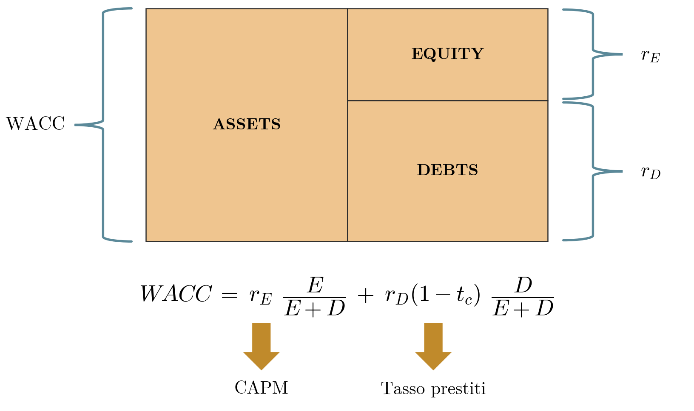
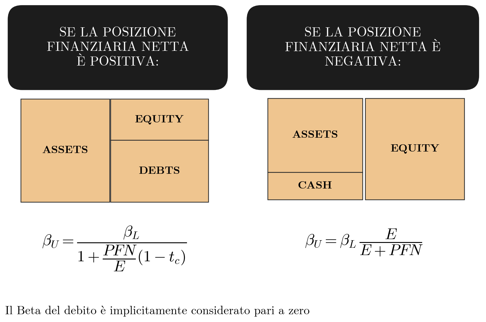

## Oggetto del capitolo

Il capitolo riguarda il tasso di sconto con cui valutare un progetto di investimento quando l'impresa si finanzia anche con debito. Il tasso si costruisce a partire dal costo del debito e dal costo del capitale proprio, stimato con il CAPM, e si sintetizza nel costo medio ponderato del capitale (WACC). Serve ad attualizzare i flussi del progetto, sia nel [[FSTR 01-full Progetti di Investimento|calcolo del valore attuale netto]] sia nei [[FSTR 03 Modelli Valutazione Finanziaria Parte1|metodi DCF di valutazione d'impresa]]. La collocazione del capitolo nel programma è descritta nell'[[FSTR 00 Intro Corso|introduzione al corso]]. Riferimento bibliografico: capitolo 7.3 del testo indicato con la sigla BBS, fino all'equazione 7.21.

## Il tasso di sconto di un progetto: Assets, Equity, Debts e WACC

L'impresa è rappresentata con tre blocchi: l'attivo (assets), finanziato dal capitale proprio (equity) e dal debito (debts). Le due fonti di finanziamento hanno rischio e rendimento richiesto diversi. Il tasso di sconto dell'attivo nel suo complesso è il WACC, il rendimento richiesto dagli azionisti è $r_E$ e quello richiesto dai finanziatori è $r_D$.

**Figura 1** — Struttura assets, equity e debts: l'attivo, a cui corrisponde il WACC, è finanziato dal capitale proprio, il cui costo si stima con il CAPM, e dal debito, il cui costo è il tasso sui prestiti.

> [!abstract] Definizione
> Gli **assets** sono l'insieme dei beni e delle risorse economiche dell'azienda: impianti, macchinari, immobili, brevetti, capitale circolante, competenze, tecnologia. Sono gli elementi che permettono all'azienda di produrre beni, erogare servizi e generare flussi di cassa. Il tasso con cui si attualizzano i flussi generati dagli assets è il **WACC** (Weighted Average Cost of Capital).
>
> L'**equity** è la proprietà dell'azienda e sopporta l'intero rischio residuo della gestione. Riceve i flussi solo dopo che tutti i creditori sono stati soddisfatti e pretende un rendimento adeguato al rischio assunto, indicato con $r_E$.
>
> I **debts** comprendono tutte le forme di finanziamento ottenute da banche, obbligazionisti e altri creditori. Hanno un costo esplicito sotto forma di interessi ($r_D$), richiedono rimborsi programmati, godono di priorità rispetto agli azionisti nella distribuzione dei flussi e hanno un rischio minore dell'equity.
>
> Il WACC combina i due costi, ciascuno pesato per l'incidenza della rispettiva fonte sul totale:
>
> $$WACC = r_E\,\frac{E}{E+D} + r_D(1-t_c)\,\frac{D}{E+D}$$

Il costo del capitale proprio $r_E$ si stima con il CAPM, mentre $r_D$ è il tasso a cui l'impresa ottiene i prestiti. Il fattore $(1-t_c)$ porta il costo del debito al netto dello scudo fiscale: gli interessi passivi sono deducibili, quindi l'aliquota $t_c$ riduce l'onere effettivo del debito.

## L'aliquota fiscale nella valutazione

L'aliquota da impiegare dipende dall'uso che se ne fa.

| Impiego | Aliquota |
|---|---|
| Margini | IRES (24%) più IRAP (3,9%), in totale 27,9% |
| WACC | Solo IRES (24%) |

Nel WACC si usa la sola IRES perché è l'imposta che consente di dedurre gli interessi passivi, e quindi quella su cui agisce lo scudo fiscale del debito. Gli esempi del capitolo adottano queste aliquote, che restano una semplificazione del carico fiscale effettivo della società.

## Il costo del debito

> [!abstract] Definizione
> Il **costo del debito** $r_D$ è il rendimento richiesto dai finanziatori che prestano denaro all'impresa: banche, obbligazionisti, istituzioni finanziarie. Il creditore si aspetta un rendimento che compensi il valore del tempo e il rischio che l'impresa non rimborsi il finanziamento. Tale rendimento è il tasso di interesse effettivo del prestito.

> [!example] Esempio
> Un'azienda ottiene un finanziamento di 1 milione di euro al 5% annuo, quindi $r_D = 5\%$. Gli interessi annui sono 50.000 euro. Poiché sono deducibili, con IRES al 24% l'imposta si riduce di 12.000 euro e l'onere netto è 38.000 euro, pari al 3,8% del finanziamento. Con l'effetto fiscale l'onere effettivo diventa
>
> $$r_D^{\,\text{post-tax}} = 5\% \times (1-24\%) = 3{,}8\%$$

Quando l'azienda ha più finanziamenti contemporanei, $r_D$ è la media ponderata del costo di tutti i debiti, con pesi pari al valore di ciascun finanziamento. Occorre quindi considerare sia il tasso sia il peso di ogni debito nella struttura complessiva:

$$r_D = \frac{\sum_i (\text{Debito}_i \times \text{tasso}_i)}{\sum_i \text{Debito}_i}$$

$$r_D^{\,\text{post-tax}} = r_D \times (1-t_c)$$

## Il costo del capitale proprio

> [!abstract] Definizione
> Il **costo del capitale proprio** $r_E$ è il rendimento che l'azionista si aspetta dall'investimento nell'impresa. L'azionista si espone al rischio dell'azienda e pretende un compenso adeguato: $r_E$ è l'obiettivo di rendimento che l'impresa deve garantire ai suoi proprietari affinché accettino di investire capitale rischioso.

Il capitale proprio non ha garanzie. Assorbe i rischi operativi, finanziari e di mercato e riceve i flussi solo dopo che tutti i creditori sono stati soddisfatti. Nella pratica $r_E$ risulta quasi sempre più elevato del costo del debito.

## Il CAPM

> [!abstract] Definizione
> Il **Capital Asset Pricing Model** (CAPM) determina il costo del capitale proprio come somma di un tasso privo di rischio e di un compenso per il rischio:
>
> $$r_E = r_f + \beta\,(R_m - r_f)$$
>
> | Componente | Nome | Interpretazione |
> |---|---|---|
> | $r_E$ | Costo del capitale proprio | Rendimento richiesto dagli investitori |
> | $r_f$ | Tasso privo di rischio | «Valore del tempo» |
> | $\beta$ | Moltiplicatore del rischio sistematico | «Quantità di rischio» |
> | $(R_m - r_f)$ | Premio per il rischio di mercato | «Prezzo del rischio» |
>
> Il termine $\beta\,(R_m - r_f)$ nel suo insieme è il **premio per il rischio**.

Il beta è una caratteristica dell'impresa o del settore, mentre il premio per il rischio di mercato dipende dal mercato, cioè dal Paese a cui l'investimento si riferisce. Resta da stabilire come tenere conto del rischio Paese quando si fissano $r_f$ e il premio.

## Il rischio Paese nel CAPM

Il **rischio Paese** è la componente di rischiosità del Paese a cui l'investimento si riferisce. Se l'azienda o il progetto valutato sono situati in Italia, si ragiona sulla rischiosità dell'Italia. Dipende dalla solidità dei conti pubblici, dal livello del debito sovrano, dall'affidabilità delle istituzioni, dalla stabilità politica, dall'efficienza del sistema giudiziario, dalla qualità delle infrastrutture, dal rating del Paese, dallo spread sovrano e dai CDS.

Il premio per il rischio Paese può essere considerato in due modi. Con l'Alternativa 1 si carica il rischio Paese nel tasso privo di rischio, con l'Alternativa 2 lo si carica nel premio per il rischio. Entrambe sono corrette: l'importante è la coerenza, cioè applicarne una sola lungo tutta la stima.

Una misura del rischio Paese è il Country Risk Assessment di Coface, che classifica 160 Paesi su una scala di otto classi, con l'indicazione dei declassamenti (downgrade) e dei miglioramenti (upgrade) più recenti. La metodologia combina la competenza macroeconomica nella valutazione del rischio Paese, la comprensione del contesto di business e dati microeconomici raccolti in 70 anni di esperienza di pagamento. Coface valuta il rischio di credito medio delle imprese di un Paese a partire da dati macroeconomici, finanziari e politici.

| Classe | Giudizio (Coface) | Rischio Paese |
|---|---|---|
| A1 | Very low | Molto basso |
| A2 | Low | Basso |
| A3 | Satisfactory | Soddisfacente |
| A4 | Reasonable | Ragionevole |
| B | Fairly high | Abbastanza alto |
| C | High | Alto |
| D | Very high | Molto alto |
| E | Extreme | Estremo |

La mappa di Coface mostra che il rischio Paese varia sensibilmente da un'area all'altra: Nord America, Europa occidentale e settentrionale e Australia rientrano per lo più nelle classi più basse, mentre Africa, ampie aree dell'Asia, parte dell'Europa orientale e parte dell'America meridionale sono in classi più alte. Per questo il premio per il rischio Paese va considerato nella stima del costo del capitale.

## Il tasso privo di rischio

> [!abstract] Definizione
> Come riferimento per il **tasso privo di rischio** $r_f$ si usa il rendimento dei bond governativi a rischio minimo nel Paese o nell'area di riferimento dell'impresa da valutare, il più prossimo in termini geografici. Per la valutazione delle imprese italiane si usa il **Bund tedesco a 10 anni** (esempio: 2,20%).
>
> I BTP italiani non sono privi di rischio: il loro rendimento incorpora già il rischio Paese dell'Italia.

La tabella riporta il rendimento dei titoli di Stato decennali di venti Paesi e lo spread rispetto al Bund, in punti percentuali (dati ritardati di almeno 15 minuti, al 10 novembre 2025, ore 13:21 GMT). Lo spread del Bund è nullo per definizione. Il BTP italiano rende il 3,45% contro il 2,71% del Bund, con uno spread di +0,74 punti percentuali: sul titolo italiano il mercato richiede un rendimento superiore a quello del Bund. Gli spread sono riportati come nella fonte e in alcuni casi differiscono di un centesimo dalla differenza tra i rendimenti arrotondati.

| Paese | Rendimento | Spread vs Bund |
|---|---|---|
| Australia | 4,43% | +1,73 |
| Austria | 2,99% | +0,29 |
| Belgio | 3,25% | +0,54 |
| Canada | 3,26% | +0,55 |
| Danimarca | 2,60% | -0,11 |
| Finlandia | 3,06% | +0,36 |
| Francia | 3,45% | +0,75 |
| Germania | 2,71% | (riferimento) |
| Grecia | 3,35% | +0,64 |
| Irlanda | 2,91% | +0,20 |
| Italia | 3,45% | +0,74 |
| Giappone | 1,77% | -0,93 |
| Paesi Bassi | 2,86% | +0,15 |
| Nuova Zelanda | 4,25% | +1,54 |
| Portogallo | 3,04% | +0,34 |
| Spagna | 3,21% | +0,50 |
| Svezia | 2,66% | -0,04 |
| Svizzera | 0,17% | -2,54 |
| Regno Unito | 4,57% | +1,87 |
| Stati Uniti | 4,13% | +1,42 |

I valori numerici degli esempi di questo capitolo (BTP al 4,40%, Bund al 2,20%) sono indicativi e non coincidono con quelli della tabella.

## Alternativa 1: il rischio Paese nel tasso privo di rischio

Con l'Alternativa 1 il rischio Paese è caricato nel tasso privo di rischio. Il CAPM usa quindi come tasso privo di rischio il rendimento dei bond governativi del Paese di riferimento dell'impresa da valutare, comprensivo del rischio Paese (esempio: BTP italiano a 10 anni, 4,40%), e come premio per il rischio di mercato il premio base, cioè quello dei Paesi con rischio Paese minimo (esempio: Stati Uniti, 4,12%).

## Alternativa 2: il rischio Paese nel premio per il rischio

Con l'Alternativa 2 il tasso privo di rischio è quello puro (il Bund) e il premio per il rischio di mercato è formato da due componenti.

> [!abstract] Definizione
> Il **Market Risk Premium** (MRP), o premio per il rischio «base», è il premio che un investitore richiede per investire nel mercato azionario invece che in un titolo privo di rischio. Si calcola sui mercati con rischio Paese molto contenuto, tipicamente gli Stati Uniti, e riflette il rischio sistematico globale, non specifico del Paese. Deriva da serie storiche di rendimenti azionari e obbligazionari e viene aggiornato annualmente da Damodaran.
>
> Il **Country Risk Premium** (CRP), o spread di rischio specifico del Paese, è il premio richiesto per investire in un Paese con rischiosità superiore a quella dei Paesi di riferimento. Si ricava dal CDS (Credit Default Swap sul debito sovrano), che misura il rischio percepito dagli investitori che lo Stato non onori i suoi impegni finanziari, ad esempio il CDS Italia. Riflette la percezione sul debito pubblico e le condizioni politiche ed economiche ed è comparabile a uno spread. Il CDS, o lo spread legato al rating del Paese, viene «azionarizzato», cioè trasformato in CRP moltiplicandolo per un coefficiente che corregge la volatilità relativa.

Nella formulazione di Damodaran il coefficiente è il rapporto tra la volatilità del mercato azionario del Paese e quella dei suoi titoli di Stato:

$$CRP = \text{spread sovrano} \times \frac{\sigma_{\text{azioni}}}{\sigma_{\text{obbligazioni}}}$$

I valori di riferimento sono quelli di Damodaran (2024). L'Equity Risk Premium degli Stati Uniti, che costituisce l'MRP, è il 4,12%. Il Country Risk Premium dell'Italia, ricavato dal CDS, è l'1,08%. Il premio per il rischio di mercato applicabile all'Italia è la loro somma:

$$4{,}12\% + 1{,}08\% = 5{,}20\%$$

## Esempio: il costo del capitale proprio per un'impresa italiana

> [!example] Esempio
> Il CAPM $r_E = r_f + \beta\,(R_m - r_f)$ si applica a un'impresa italiana con i due metodi corrispondenti alle due alternative.
>
> **Metodo 1** (Alternativa 1, rischio Paese nel tasso privo di rischio). Il tasso privo di rischio è il rendimento del BTP, che include il rischio Paese, e il premio è quello di un mercato a rischio minimo (Stati Uniti):
>
> $$r_E = \underbrace{r_{BTP}}_{4{,}40\%} + \beta\,\underbrace{MRP_{USA}}_{4{,}12\%} = 4{,}40\% + 4{,}12\%\,\beta$$
>
> **Metodo 2** (Alternativa 2, rischio Paese nel premio per il rischio). Il tasso privo di rischio è il Bund, risk free «puro», e il premio è quello del mercato a rischio minimo più il premio specifico dell'Italia:
>
> $$r_E = \underbrace{r_{Bund}}_{2{,}20\%} + \beta\,(\underbrace{MRP_{USA}}_{4{,}12\%} + \underbrace{CRP_{Italia}}_{1{,}08\%}) = 2{,}20\% + 5{,}20\%\,\beta$$

I due metodi allocano la stessa componente di rischio Paese in punti diversi della formula e danno stime che tendono a convergere, senza coincidere in generale. La differenza tra i due risultati è

$$(4{,}40\% - 2{,}20\%) - 1{,}08\%\,\beta = 2{,}20\% - 1{,}08\%\,\beta$$

perché nel primo metodo lo spread tra BTP e Bund (2,20 punti percentuali) entra per intero nel tasso privo di rischio, mentre nel secondo il rischio Paese (1,08%) è moltiplicato per il beta. Le due stime coincidono solo per $\beta = 2{,}20/1{,}08 \approx 2{,}037$; per beta inferiori il primo metodo dà il valore più alto. La tabella confronta i risultati per alcuni valori del beta, scelti a titolo illustrativo.

| $\beta$ | Metodo 1 | Metodo 2 | Differenza (punti percentuali) |
|---|---|---|---|
| 0,50 | 6,46% | 4,80% | 1,66 |
| 1,00 | 8,52% | 7,40% | 1,12 |
| 1,50 | 10,58% | 10,00% | 0,58 |
| 2,037 | 12,79% | 12,79% | 0,00 |

## Il coefficiente beta

> [!abstract] Definizione
> Il **beta** misura quanto varia il rendimento di un titolo al variare del rendimento di mercato:
>
> $$\beta = \frac{COV(R_t;\,R_m)}{VAR(R_m)}$$
>
> dove $R_t$ è il rendimento del titolo valutato e $R_m$ quello del mercato.

La covarianza misura quanto i rendimenti del titolo si muovono insieme a quelli del mercato (è una misura affine alla correlazione), mentre la varianza esprime la variabilità dei rendimenti di mercato. Per il calcolo si usano i rendimenti di un indice di mercato (ad esempio FTSE MIB o S&P) e quelli del titolo, su base giornaliera o settimanale, relativi agli ultimi due o cinque anni.

Il beta dipende dal livello di rischio operativo, legato al rapporto tra costi fissi e costi variabili, e dal livello di rischio finanziario, cioè dalla leva. La ciclicità dei ricavi e il rischio operativo possono differire poco tra imprese dello stesso settore, mentre il rischio finanziario può essere molto diverso: è il caso tipico della sottocapitalizzazione delle PMI italiane. Per questo, nel confronto tra imprese con leve diverse, il beta osservato richiede una rettifica per la leva finanziaria, che si ottiene con il beta unlevered descritto più avanti.

La tabella associa i valori del beta ai settori tipici.

| Valore | Interpretazione | Settori tipici |
|---|---|---|
| $\beta > 1$ | Il titolo (l'azienda) varia più che proporzionalmente al variare del mercato | Settori fortemente ciclici: automotive, costruzioni, lusso e alta moda, turismo, compagnie aeree, high-tech |
| $\beta = 1$ | Il titolo (l'azienda) varia proporzionalmente al variare del mercato | Settori ciclici al pari dell'economia: trasporti, assicurazioni |
| $0 < \beta < 1$ | Il titolo (l'azienda) varia meno che proporzionalmente al variare del mercato e assorbe il ciclo economico | Settori non ciclici: energie rinnovabili, utilities, farmaceutico, healthcare, gestione rifiuti, telecomunicazioni, beni di consumo primari |

Le aziende dei settori non ciclici hanno in comune contratti pluriennali, tariffe regolate (nelle utilities) e abbonamenti periodici.

## Il beta unlevered e il tasso di sconto di un progetto

Usare un tasso di sconto per valutare un progetto pone tre criticità:

1. la struttura finanziaria del progetto non è nota al momento della valutazione (quanto equity e quanto debito);
2. l'impresa può non essere quotata, e quindi difficilmente confrontabile;
3. il progetto può essere realizzato in un settore diverso da quello in cui l'impresa opera abitualmente.

La soluzione è usare il **beta unlevered** dell'impresa, o del settore, in cui il progetto viene lanciato. Si ipotizza cioè che il progetto sia finanziato interamente con equity: il costo del capitale proprio in assenza di debito, $r_{E,D=0} = r_0$, si ottiene con il beta unlevered:

$$r_0 = r_f + \beta_U\,(R_m - r_f)$$

dove $r_f$ e il premio per il rischio di mercato sono determinati secondo una delle due alternative di trattamento del rischio Paese. La scelta si giustifica anche perché un progetto dovrebbe essere accettato o respinto a prescindere dai benefici derivanti dalla politica finanziaria: il debito riduce il costo delle fonti di finanziamento, ma è un effetto della struttura finanziaria e non del progetto.

Il beta osservato sul titolo di un'impresa comparabile, che riflette la sua struttura finanziaria, è il beta levered $\beta_L$. Il beta unlevered $\beta_U$ è quello depurato dall'effetto della leva. Il calcolo dipende dal segno della posizione finanziaria netta (PFN), cioè del debito finanziario al netto della cassa, dell'impresa comparabile; $E$ è il valore di mercato del capitale proprio.

> [!abstract] Definizione
> Se la PFN è **positiva**, l'attivo è finanziato da equity e debito (Assets = Equity + Debts):
>
> $$\beta_U = \frac{\beta_L}{1 + \dfrac{PFN}{E}(1-t_c)}$$
>
> Se la PFN è **negativa**, la cassa supera il debito e l'attivo, sommato alla cassa, è finanziato interamente dal capitale proprio (Assets + Cash = Equity):
>
> $$\beta_U = \beta_L\,\frac{E}{E+PFN}$$
>
> In entrambe le formule il beta del debito è implicitamente considerato pari a zero.

**Figura 2** — Struttura finanziaria e beta unlevered: con PFN positiva l'attivo è finanziato da equity e debito, con PFN negativa l'attivo sommato alla cassa coincide con l'equity. A ciascun caso corrisponde la propria formula del beta unlevered, con beta del debito nullo.

Le due formule si raccordano in corrispondenza di PFN nulla, dove entrambe danno $\beta_U = \beta_L$. Con PFN positiva $\beta_U < \beta_L$: il debito accresce il beta dell'equity rispetto a quello delle attività. Con PFN negativa il fattore $E/(E+PFN)$ supera 1 e quindi $\beta_U > \beta_L$: la cassa, trattata come debito negativo con beta nullo, riduce il beta dell'equity, per cui il beta delle sole attività operative è più alto di quello osservato.
