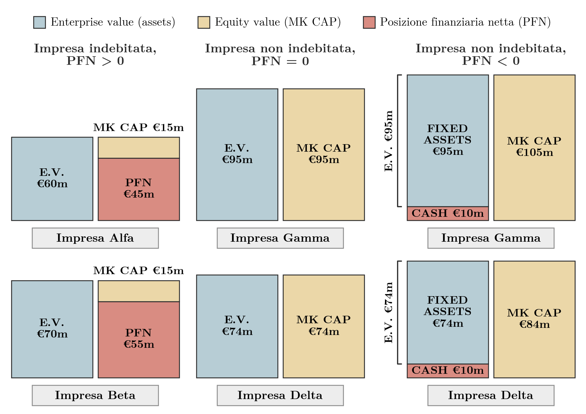
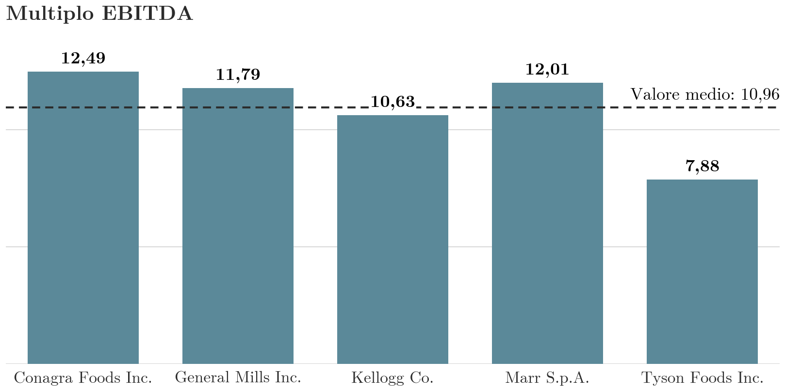

## Inquadramento

Questo capitolo presenta i metodi **DCF** (Discounted Cash Flow) come passaggio dal valore dei singoli investimenti al valore dell'intera impresa. Al centro stanno i **modelli sintetici**, in entrambe le ottiche di valutazione, asset side ed equity side. Il testo di riferimento è il capitolo 8 del testo BBS, fino al paragrafo 8.4.

I tassi di sconto usati in questi modelli, il WACC per l'ottica assets e il costo dell'equity per l'ottica equity, derivano dalle decisioni di investimento dell'impresa indebitata ([[FSTR 02-full Costo del Capitale|il costo del capitale]]). Dopo i metodi DCF la sequenza degli argomenti passa ai multipli di borsa ([[FSTR 06 Multipli di Borsa lez01|i multipli di borsa]]), alla crescita esterna con la valutazione delle operazioni di integrazione e alla due diligence. I modelli DCF analitici e il terminal value sono sviluppati in [[FSTR 04-full Modelli Valutazione Finanziaria Parte2|i metodi DCF analitici e il VAM]].

## Le grandezze di riferimento per la valutazione dell'impresa

> [!abstract] Definizione
> La valutazione d'impresa si conduce in due ottiche, **assets** ed **equity**. In ciascuna si individuano grandezze di riferimento sul piano del valore stimato, patrimoniale, reddituale, finanziario e del costo del capitale.
>
> | Dimensione | Ottica assets | Ottica equity |
> |---|---|---|
> | Valore stimato | Asset value (enterprise value, EV) | Equity value (capitalizzazione di mercato, MK CAP) |
> | Patrimoniale | CIN rettificato | Capitale proprio rettificato |
> | Reddituale | NOPAT normalizzato | Reddito di bilancio normalizzato |
> | Finanziario | FCFF (indicato anche come FCFO) | FCFE |
> | Costo del capitale | WACC | Costo dell'equity |

L'**enterprise value** è il valore del capitale investito nell'attività operativa. Si scompone nel valore del capitale di rischio, cioè l'**equity value** o capitalizzazione di mercato (MK CAP), e nel valore del debito netto, la **posizione finanziaria netta** (PFN, in inglese net financial position, NFP), che è il debito finanziario al netto della cassa:

$$EV = MK\,CAP + PFN$$

L'equity value è dunque la parte dell'EV di pertinenza degli azionisti: $MK\,CAP = EV - PFN$.

## Relazione tra enterprise value ed equity value: esempi numerici

Gli esempi seguenti applicano la relazione $EV = MK\,CAP + PFN$ ai tre casi possibili per il segno della PFN. I valori sono in milioni di euro.

### Impresa indebitata (PFN > 0)

> [!example] Esempio
> | Impresa | Enterprise value (EV) | Equity value (MK CAP) | Debito (PFN) |
> |---|---|---|---|
> | Alfa | 60 | 15 | 45 |
> | Beta | 70 | 15 | 55 |
>
> Verifica: per Alfa 15 + 45 = 60, per Beta 15 + 55 = 70. Le due imprese hanno lo stesso equity value. Beta ha una PFN superiore di 10 e un EV superiore di 10: a parità di equity value, l'EV varia in misura pari alla PFN.

### Impresa non indebitata (PFN = 0)

> [!example] Esempio
> | Impresa | Enterprise value (EV) | Equity value (MK CAP) |
> |---|---|---|
> | Gamma | 95 | 95 |
> | Delta | 74 | 74 |
>
> Senza debito, enterprise value ed equity value coincidono.

### Impresa non indebitata con liquidità netta (PFN < 0)

Le imprese Gamma e Delta hanno la stessa attività operativa del caso precedente (immobilizzazioni per 95 e 74) e in più una cassa di 10. La PFN è quindi pari a $-10$.

> [!example] Esempio
> | Impresa | Immobilizzazioni (attivo operativo) | Cassa | PFN | Equity value (MK CAP) | EV = MK CAP + PFN |
> |---|---|---|---|---|---|
> | Gamma | 95 | 10 | -10 | 105 | 95 |
> | Delta | 74 | 10 | -10 | 84 | 74 |
>
> Per Gamma 105 - 10 = 95, per Delta 84 - 10 = 74.

La cassa aumenta di 10 il valore per gli azionisti e lascia invariato l'EV, perché non fa parte del capitale investito nell'attività operativa. Con liquidità netta il passaggio dal valore dell'attivo operativo al valore per gli azionisti somma la cassa anziché sottrarre il debito. Se si chiamasse enterprise value l'intero attivo, cassa compresa (105 per Gamma, 84 per Delta), l'EV coinciderebbe con l'equity value e non rispetterebbe più la relazione $EV = MK\,CAP + PFN$.

**Figura 1** — Scomposizione dell'enterprise value in equity value (MK CAP) e posizione finanziaria netta (PFN), con blocchi di altezza proporzionale ai valori in milioni di euro. Con PFN positiva l'EV supera l'equity value della PFN, con PFN nulla i due valori coincidono, con PFN negativa l'EV corrisponde alle sole immobilizzazioni (95 e 74) e l'equity value (105 e 84) lo supera della liquidità netta (10).

## Richiami: EBIT, EBITDA e NOPAT

> [!abstract] Definizione
> Il **NOPAT** (Net Operating Profit After Taxes) è l'utile netto operativo, cioè l'EBIT al netto delle imposte. Misura il profitto netto generato dalle attività caratteristiche. Poiché parte dall'EBIT, prima degli oneri finanziari, non dipende dalla struttura finanziaria dell'impresa:
> $$NOPAT = EBIT \times (1 - t_c)$$

L'EBITDA coincide con il margine operativo lordo (MOL). Il conto economico seguente mostra la sequenza dall'EBITDA al reddito netto e il calcolo del NOPAT.

> [!example] Esempio
> | Voce | Valore |
> |---|---|
> | Ricavi | 150.000 |
> | Costo del venduto | -70.000 |
> | **EBITDA** | **80.000** |
> | Ammortamenti | -25.000 |
> | **EBIT** | **55.000** |
> | Oneri finanziari | -10.000 |
> | **EBT** (risultato prima delle imposte) | **45.000** |
> | Imposte (20%) | -9.000 |
> | **Reddito netto** | **36.000** |
>
> $$NOPAT = EBIT \times (1-t_c) = 55.000 \times (1-20\%) = 44.000$$

Il NOPAT (44.000) supera il reddito netto (36.000) di 8.000, pari agli oneri finanziari al netto del risparmio d'imposta: $10.000 \times (1 - 20\%)$.

## Esercizio svolto: EBIT e NOPAT dell'azienda Alfa

L'azienda Alfa di questo esercizio è distinta dall'impresa Alfa dell'esempio sull'enterprise value.

> [!example] Esempio
> **Dati.** Fatturato di € 568.000; acquisto di materie prime € 372.000; costo del lavoro € 58.000; affitto dell'immobile produttivo € 43.000; ammortamenti € 12.000; oneri finanziari € 22.000. Il carico fiscale stimato è il 27,9%.
>
> **Richieste.** Calcolare EBITDA e NOPAT, e il reddito netto d'esercizio.
>
> **Conto economico**
>
> | Voce | Valore |
> |---|---|
> | Fatturato | 568.000 |
> | Acquisto materie prime | -372.000 |
> | Costo del lavoro | -58.000 |
> | Affitti | -43.000 |
> | **EBITDA** | **95.000** |
> | Ammortamenti | -12.000 |
> | **EBIT** | **83.000** |
> | Oneri finanziari | -22.000 |
> | **EBT** | **61.000** |
> | Imposte d'esercizio | -17.019 |
> | **Reddito netto** | **43.981** |
>
> **Calcolo del NOPAT**
>
> | Voce | Valore |
> |---|---|
> | EBIT | 83.000 |
> | Imposte sull'EBIT | -23.157 |
> | **NOPAT** | **59.843** |

Le imposte sull'EBIT (23.157, cioè $83.000 \times 27{,}9\%$) differiscono dalle imposte d'esercizio (17.019, cioè $61.000 \times 27{,}9\%$) perché è diversa la base imponibile a cui si applica l'aliquota: l'EBIT nel primo caso, l'EBT nel secondo. La differenza, 6.138, è il risparmio d'imposta sugli oneri finanziari ($22.000 \times 27{,}9\%$), detto scudo fiscale. Ne segue il raccordo tra NOPAT e reddito netto: $59.843 - 22.000 + 6.138 = 43.981$.

## Richiami: capitale investito netto e capitale circolante netto

Lo stato patrimoniale riclassificato in ottica finanziaria contrappone al capitale investito netto le fonti di finanziamento:

| Capitale investito netto | Fonti di finanziamento |
|---|---|
| Capitale circolante netto (CCN) | Patrimonio netto (equity) |
| Capitale immobilizzato netto | Posizione finanziaria netta (PFN, debt) |

> [!abstract] Definizione
> Il **capitale investito netto operativo** (CIN) è la somma del capitale circolante commerciale (CCN) e delle immobilizzazioni caratteristiche nette:
> $$CIN = CCN + \text{Immobilizzazioni caratteristiche nette}$$

Le due colonne hanno per costruzione lo stesso totale, quindi $CIN = \text{Patrimonio netto} + PFN$. Nelle formule successive il capitale investito netto operativo è indicato con CINO, il capitale circolante netto operativo con CCNO e il patrimonio netto (capitale proprio) con C.P.

## La valutazione assoluta (DCF)

La **valutazione assoluta** si concentra sull'impresa. Poggia sull'analisi delle sue caratteristiche (modello di business, strategie, management, patrimonio e così via) e sulla previsione delle performance economico-finanziarie future. Considera le sue politiche finanziarie, di finanziamento e di dividendo, e misura il suo rischio operativo e finanziario. Si basa su un criterio analitico di stima.

Il risultato è un insieme di **valori finanziari**, detti anche valori fondamentali o **valori intrinseci**. Hanno significato economico perché fondati sul principio di convenienza economica dell'investimento in capitale di rischio aziendale.

Per rischio operativo si intende il rischio di perdite derivanti da fallimenti o inadeguatezza dei processi interni, delle risorse umane e dei sistemi tecnologici, oppure da eventi esterni. Il rischio finanziario incide sulla liquidità aziendale ed è legato all'equilibrio tra flussi monetari in entrata e in uscita.

Un esempio di rendiconto finanziario di un'impresa reale è quello consolidato di Brembo, in migliaia di euro, per gli esercizi chiusi al 31 dicembre 2020 e 2019.

| Voce | 31.12.2020 | 31.12.2019 |
|---|---|---|
| **Disponibilità liquide e mezzi equivalenti all'inizio del periodo** | **168.559** | **195.871** |
| Risultato prima delle imposte | 156.044 | 307.691 |
| Ammortamenti/Svalutazioni | 207.550 | 196.630 |
| Plusvalenze/Minusvalenze | -1.695 | -2.157 |
| Proventi e oneri da partecipazioni al netto dei dividendi ricevuti | -413 | -3.984 |
| Componente finanziaria dei fondi a benefici definiti e debiti per il personale | 407 | 577 |
| Accantonamenti a fondi relativi al personale | 2.423 | 2.502 |
| Altri accantonamenti ai fondi al netto degli utilizzi | 48.618 | -52 |
| Risultato derivante da attività operative cessate | -304 | -6.422 |
| **Flusso monetario generato dalla gestione reddituale** | **412.630** | **494.785** |
| Imposte correnti pagate | -48.873 | -65.961 |
| Utilizzi dei fondi relativi al personale | -4.580 | -4.813 |
| *(Aumento) diminuzione delle attività a breve:* | | |
| rimanenze | -23.913 | -7.604 |
| attività finanziarie | 136 | -5 |
| crediti commerciali | 4.387 | 14.558 |
| crediti verso altri e altre attività | -9.175 | -6.306 |
| *Aumento (diminuzione) delle passività a breve:* | | |
| debiti commerciali | 910 | -90.846 |
| debiti verso altri e altre passività | 18.382 | -26.374 |
| Effetto delle variazioni dei cambi sul capitale circolante | -16.503 | -814 |
| **Flusso monetario netto generato/(assorbito) da attività operativa** | **333.401** | **306.620** |
| *Investimenti in immobilizzazioni:* | | |
| materiali | -162.052 | -213.657 |
| di cui diritto di utilizzo beni in leasing | -37.755 | -38.165 |
| immateriali | -28.273 | -38.111 |
| finanziarie | -182.862 | -131 |
| Prezzo di realizzo, o valore di rimborso, di immobilizzazioni | 4.205 | 6.589 |
| **Flusso monetario netto generato/(assorbito) da attività di investimento** | **-368.982** | **-245.310** |
| Dividendi pagati nel periodo | 0 | -71.541 |
| Acquisto azioni proprie | 0 | -11.329 |
| Dividendi pagati nel periodo ad azionisti di minoranza | -640 | -800 |
| Variazione di fair value di strumenti derivati | 648 | -1.920 |
| Nuovi contratti per beni in leasing | 35.616 | 38.167 |
| Rimborso passività per beni in leasing | -24.826 | -24.436 |
| Mutui e finanziamenti assunti nel periodo da banche e altri finanziatori | 425.000 | 103.518 |
| Rimborso di mutui e finanziamenti a lungo termine | -122.492 | -120.205 |
| **Flusso monetario netto generato/(assorbito) da attività di finanziamento** | **313.306** | **-88.546** |
| **Flusso monetario complessivo** | **277.725** | **-27.236** |
| Effetto delle variazioni dei cambi sulle disponibilità liquide e mezzi equivalenti | -1.054 | -76 |
| **Disponibilità liquide e mezzi equivalenti alla fine del periodo** | **445.230** | **168.559** |

Il flusso monetario complessivo è la somma dei flussi dell'attività operativa, di investimento e di finanziamento: nel 2020, $333.401 - 368.982 + 313.306 = 277.725$. Aggiungendo questo flusso e l'effetto dei cambi (-1.054) alla liquidità iniziale (168.559) si ottiene la liquidità finale di 445.230.

## La valutazione relativa (multipli)

> [!abstract] Definizione
> La valutazione relativa esprime un **valore relativo** dell'impresa, fondato sul confronto con imprese simili (*comparables*). Richiede l'applicazione di moltiplicatori, i **multipli di mercato**, ricavati dai prezzi che il mercato segna per i comparables, e conduce a **valori di mercato**, detti anche **prezzi probabili**.
>
> I multipli di mercato sono rapporti tra il prezzo di mercato (quotazione) di uno strumento azionario e una data grandezza di bilancio.

### Esempio: individuazione dei comparables nel settore automotive

Il primo passo è scegliere le imprese confrontabili. Partendo da Brembo, si considerano quattro imprese del settore automotive e se ne confrontano sede, dimensione e valutazione.

> [!example] Esempio
> | Azienda | Attività | Sede principale | Dipendenti | Valutazione (USD) |
> |---|---|---|---|---|
> | Brembo | Tecnologie di freni a disco per veicoli | Stezzano (IT) | 10.868 (+3%) | 3,5 miliardi |
> | Kongsberg Automotive | Sviluppo, produzione e vendita di prodotti per l'industria automotive | Zurigo (CH) | 11.234 (+3%) | 265,9 milioni |
> | Ford Otosan | Produzione, assemblaggio, importazione, esportazione e vendita di veicoli a motore e ricambi in Turchia | Istanbul (TR) | 14.145 | n.d. |
> | Subaru | Gruppo con attività automotive e aerospaziali (già Fuji Heavy Industries) | Tokyo (JP) | 36.910 | 13,2 miliardi |
> | BorgWarner | Soluzioni tecnologiche per veicoli a combustione, ibridi ed elettrici | Auburn Hills (US) | 49.300 (-1%) | 9,2 miliardi |

### Esempio: P/E e P/BV di Brembo, Sogefi e Valeo

Si considerano poi come comparables di Brembo due società della componentistica automotive, Sogefi e Valeo, e si confrontano due multipli: il P/E (prezzo su utili) e il P/BV (prezzo su valore contabile del patrimonio netto).

> [!example] Esempio
> | Azienda | P/E | P/BV |
> |---|---|---|
> | Brembo | 16,48 | 2,02 |
> | Sogefi | 51,53 | 0,54 |
> | Valeo | 22,99 | 1,09 |

Brembo ha il P/E più basso del gruppo (16,48 contro 51,53 e 22,99) e il P/BV più alto (2,02 contro 0,54 e 1,09). I multipli di imprese dello stesso settore possono quindi differire molto, e in senso opposto a seconda del multiplo considerato.

### Esempio: multiplo dell'EBITDA nel settore alimentare

> [!example] Esempio
> Il multiplo dell'EBITDA è il rapporto tra capitalizzazione ed EBITDA. Importi in migliaia di euro.
>
> | Azienda | Capitalizzazione | EBITDA | Multiplo EBITDA |
> |---|---|---|---|
> | Conagra Foods Inc. | 17.383.003 | 1.391.339 | 12,49 |
> | General Mills Inc. | 35.364.038 | 2.999.013 | 11,79 |
> | Kellogg Co. | 24.665.300 | 2.319.281 | 10,63 |
> | Marr S.p.A. | 1.269.299 | 105.674 | 12,01 |
> | Tyson Foods Inc. | 19.542.863 | 2.479.693 | 7,88 |
>
> Il valore medio del multiplo nel gruppo è $(12{,}49 + 11{,}79 + 10{,}63 + 12{,}01 + 7{,}88)/5 = 10{,}96$.

**Figura 2** — Multiplo EBITDA nel settore alimentare: i valori vanno da 7,88 (Tyson Foods) a 12,49 (Conagra Foods), con media semplice 10,96. Kellogg e Tyson Foods si collocano sotto la media, le altre tre società sopra.

Moltiplicando il multiplo (per esempio la media del gruppo) per l'EBITDA dell'impresa da valutare si ottiene una stima del suo valore per analogia con i comparables. In senso stretto, il numeratore dei multipli della tabella è la capitalizzazione di mercato, mentre l'EBITDA è un margine calcolato prima degli oneri finanziari: un rapporto coerente con l'EBITDA avrebbe al numeratore l'enterprise value (multiplo EV/EBITDA). Il tema è ripreso in [[FSTR 06 Multipli di Borsa lez01|l'ottica assets e l'ottica equity nei multipli]].

## Valutazione assoluta e valutazione relativa: un approccio complementare

Sul piano professionale si ritiene oggi più corretto associare le valutazioni assolute e relative. Il ricorso ai multipli in senso **complementare** serve a individuare le **leve del valore** e le **leve di prezzo** (variabili di contesto) che guidano i prezzi del mercato finanziario, e a coprire meglio lo spettro delle informazioni rilevanti per la valutazione.

## I metodi DCF: formule generali

> [!abstract] Definizione
> Le formule generali dei metodi DCF dipendono dall'ottica di valutazione.
>
> Ottica assets (il valore dell'attività operativa è la somma dei FCFF attualizzati al WACC):
> $$V = \sum_{t=1}^{\infty} \frac{FCFF_t}{(1 + WACC)^t}$$
>
> Ottica equity (il valore del capitale proprio è la somma dei FCFE attualizzati al costo dell'equity):
> $$E = \sum_{t=1}^{\infty} \frac{FCFE_t}{(1 + r_E)^t}$$
>
> I due valori sono legati da
> $$E = V - D$$
> dove $D$ è il valore del debito finanziario netto (PFN).

Per poter usare tassi di sconto stabili, WACC e $r_E$ costanti nel tempo, i metodi assumono la costanza nel tempo del rischio operativo e del rischio finanziario.

## I flussi finanziari di riferimento: dal MOL a FCFF e FCFE

Il flusso di cassa rilevante per le valutazioni aziendali si costruisce a cascata a partire dal MOL e attraversa cinque aree: gestione corrente, investimenti, straordinaria, capitale di terzi e capitale proprio.

> [!abstract] Definizione
> | Area | Voce | Flusso intermedio |
> |---|---|---|
> | Gestione corrente | MOL | |
> | | - Variazione CCNO | |
> | | | **Cash flow gestionale lordo** |
> | | - Flusso fiscale operativo (imposte + scudi - variazione dei debiti per imposte) | |
> | | | **Cash flow gestionale netto** |
> | Investimenti | -/+ Investimenti/disinvestimenti in capitale fisso | |
> | | | **Free cash flow to the firm (FCFF)** |
> | Straordinaria | +/- Proventi/oneri straordinari | |
> | Capitale di terzi | - Oneri finanziari netti | |
> | | + Scudo fiscale sugli oneri finanziari | |
> | | +/- Aumento/riduzione dei debiti finanziari | |
> | Capitale proprio | | **Free cash flow to equity (FCFE)** |

Il FCFF è il flusso disponibile per tutti i finanziatori, equity e debito. Il FCFE è il flusso residuo che spetta ai soli azionisti, dopo la gestione straordinaria, gli oneri finanziari al netto dello scudo fiscale e la variazione dei debiti finanziari.

## I metodi DCF: modelli sintetici e modelli analitici

> [!abstract] Definizione
> | Modello sintetico | Modello analitico |
> |---|---|
> | Il valore degli assets o dell'equity si ottiene con **formule compatte**, che prevedono per esempio flussi costanti oppure flussi che crescono a un tasso costante. | Il valore degli assets o dell'equity si ottiene come somma di un **valore frutto di un piano esplicito** (3-7 anni) e di un **terminal value** attualizzato, calcolato con un metodo sintetico. |

Di norma si utilizza il metodo analitico. Il suo vantaggio rispetto ai metodi sintetici emerge nei periodi di discontinuità, per esempio grandi investimenti pluriennali o abbattimento del debito: in queste fasi i flussi non sono né costanti né crescenti a tasso costante, e solo un piano esplicito può rappresentarli. Il terminal value del metodo analitico è a sua volta ottenuto con un modello sintetico, come quelli illustrati di seguito. Il metodo analitico è trattato in [[FSTR 04-full Modelli Valutazione Finanziaria Parte2|i metodi DCF analitici]] e il terminal value in [[FSTR 05 Annotazioni sul Terminal Value|le annotazioni sul terminal value]].

## FCFF e FCFE in steady state e in steady growth

Le formule generali del flusso di cassa si semplificano sotto due ipotesi limite: i flussi costanti nel tempo (steady state) e i flussi che crescono a un tasso costante $g$ (steady growth).

### Steady state

> [!abstract] Definizione
> | Formula generale | Steady state |
> |---|---|
> | MOL | MOL |
> | - Variazione CCNO | 0 (variazione nulla) |
> | Cash flow gestionale lordo | → MOL |
> | - Flusso fiscale operativo | - Imposte operative |
> | Cash flow gestionale netto | → MOL netto |
> | -/+ Investimenti/disinvestimenti in capitale fisso | -/+ Ammortamenti |
> | Free cash flow to the firm (FCFF) | → **NOPAT** |
> | +/- Proventi/oneri straordinari | +/- Proventi/oneri straordinari |
> | - Oneri finanziari netti | - Oneri finanziari netti |
> | + Scudo fiscale sugli oneri finanziari | + Scudo fiscale sugli oneri finanziari |
> | +/- Aumento/riduzione dei debiti finanziari | 0 (nessuna variazione) |
> | Free cash flow to equity (FCFE) | → **Reddito di bilancio** |

In steady state il capitale circolante non varia, gli investimenti in capitale fisso si limitano a reintegrare gli ammortamenti e il debito finanziario resta costante. Il MOL al netto delle imposte operative e degli ammortamenti è il NOPAT, quindi il **FCFF coincide con il NOPAT**. Aggiungendo oneri finanziari, scudo fiscale e componenti straordinarie si arriva al reddito di bilancio, quindi il **FCFE coincide con il reddito di bilancio**.

### Steady growth

> [!abstract] Definizione
> | Formula generale | Steady growth |
> |---|---|
> | MOL | MOL × (1+g) |
> | - Variazione CCNO | - g × CCNO |
> | Cash flow gestionale lordo | → MOL × (1+g) - g × CCNO |
> | - Flusso fiscale operativo | - Imposte operative × (1+g) |
> | Cash flow gestionale netto | → MOL netto × (1+g) - g × CCNO |
> | -/+ Investimenti/disinvestimenti in capitale fisso | - (g × C.F. + Amm. × (1+g)) |
> | Free cash flow to the firm (FCFF) | → **NOPAT × (1+g) - g × CINO** |
> | +/- Proventi/oneri straordinari | +/- Proventi/oneri straordinari × (1+g) |
> | - Oneri finanziari netti | - Oneri finanziari netti × (1+g) |
> | + Scudo fiscale sugli oneri finanziari | + Scudo fiscale × (1+g) |
> | +/- Aumento/riduzione dei debiti finanziari | + g × Debiti finanziari |
> | Free cash flow to equity (FCFE) | → **Reddito di bilancio × (1+g) - g × C.P.** |

Le grandezze economiche (MOL, imposte operative, ammortamenti, oneri finanziari, scudo fiscale) e quelle patrimoniali (CCNO, capitale fisso C.F., debiti finanziari) sono riferite all'ultimo esercizio e crescono al tasso $g$. Gli ammortamenti moltiplicati per $(1+g)$ si sottraggono al MOL netto $\times (1+g)$ e lasciano il $NOPAT \times (1+g)$. Restano da sottrarre l'aumento del CCNO ($g \times CCNO$) e la crescita del capitale fisso ($g \times C.F.$), che insieme valgono $g \times CINO$, perché $CINO = CCNO + C.F.$ Ne risulta $FCFF = NOPAT \times (1+g) - g \times CINO$.

Per il FCFE si aggiunge che il debito finanziario cresce anch'esso al tasso $g$ e produce una nuova raccolta di $g \times D$. Poiché $CINO - D = C.P.$, il FCFE diventa:

$$FCFE = \text{Reddito di bilancio} \times (1+g) - g \times CINO + g \times D = \text{Reddito di bilancio} \times (1+g) - g \times C.P.$$

## Le formule dei modelli sintetici

Le formule compatte si ottengono sostituendo i flussi appena descritti nelle formule generali e sommando la serie. Per un flusso costante $F$ scontato al tasso $i$, la somma dei valori attuali è $F/i$. Per un flusso che cresce ogni anno al tasso $g$, con primo flusso $F_1$, è $F_1/(i-g)$, purché $g < i$.

> [!abstract] Definizione
> **Steady state**
> $$V = \frac{NOPAT}{WACC}$$
> $$E = \frac{R.BILANCIO}{r_E}$$
>
> **Steady growth**
> $$V = \frac{NOPAT(1+g) - CINO \cdot g}{WACC - g}$$
> $$E = \frac{R.BILANCIO(1+g) - C.P. \cdot g}{r_E - g}$$
>
> Nelle formule $V$ è il valore in ottica assets (enterprise value), $E$ il valore in ottica equity (equity value), $g$ il tasso di crescita costante, $CINO$ il capitale investito netto operativo, $C.P.$ il capitale proprio, $WACC$ il costo medio ponderato del capitale e $r_E$ il costo dell'equity, cioè il rendimento atteso dagli azionisti.

## Esempio steady state: valutazione dell'impresa Alfa

> [!example] Esempio
> **Dati.** Si riprendono i risultati dell'esercizio sull'azienda Alfa: NOPAT 59.843 e reddito netto 43.981. Il WACC stimato è il 5,8% e il rendimento atteso per gli azionisti ($r_E$) è il 7,5%. Si vuole il valore dell'impresa in ottica assets e in ottica equity.
>
> **Ottica assets.**
>
> $$EV = \frac{NOPAT}{WACC} = \frac{59.843}{5{,}8\%} = 1.031.776$$
>
> **Ottica equity.**
>
> $$E = \frac{R.BILANCIO}{r_E} = \frac{43.981}{7{,}5\%} = 586.413$$
>
> **Posizione finanziaria netta implicita.** Dalla relazione $E = EV - PFN$:
>
> $$PFN = EV - E = 1.031.776 - 586.413 = 445.363$$
>
> | Grandezza | Valore |
> |---|---|
> | Enterprise value (ottica assets) | 1.031.776 |
> | Equity value (ottica equity) | 586.413 |
> | PFN implicita | 445.363 |

In steady state il FCFE coincide con il reddito netto. Il passaggio dal NOPAT al reddito netto si verifica con i dati dell'esercizio: $59.843 - 22.000 + 6.138 = 43.981$, cioè NOPAT, meno oneri finanziari, più scudo fiscale ($22.000 \times 27{,}9\%$).

## Esempio steady growth: valutazione dell'impresa Alfa

> [!example] Esempio
> **Dati.** Stessi NOPAT (59.843), reddito netto (43.981), WACC (5,8%) e $r_E$ (7,5%) dell'esempio precedente. L'azienda ha un capitale investito netto operativo di € 760.000, un capitale proprio di € 302.000 e prevede di crescere a un tasso costante $g$ del 2,0%.
>
> **Ottica assets.**
>
> $$EV = \frac{NOPAT(1+g) - CINO \cdot g}{WACC - g}$$
>
> Numeratore: $59.843 \times 1{,}02 - 760.000 \times 0{,}02 = 61.039{,}86 - 15.200 = 45.839{,}86 \approx 45.840$.
>
> Denominatore: $5{,}8\% - 2{,}0\% = 3{,}8\%$.
>
> $$EV = \frac{45.839{,}86}{3{,}8\%} = 1.206.312$$
>
> **Ottica equity.**
>
> $$E = \frac{R.BILANCIO(1+g) - C.P. \cdot g}{r_E - g}$$
>
> Numeratore: $43.981 \times 1{,}02 - 302.000 \times 0{,}02 = 44.860{,}62 - 6.040 = 38.820{,}62 \approx 38.821$.
>
> Denominatore: $7{,}5\% - 2{,}0\% = 5{,}5\%$.
>
> $$E = \frac{38.820{,}62}{5{,}5\%} = 705.829$$
>
> **Posizione finanziaria netta implicita.**
>
> $$PFN = EV - E = 1.206.312 - 705.829 = 500.483$$
>
> | Grandezza | Valore |
> |---|---|
> | Enterprise value (ottica assets) | 1.206.312 |
> | Equity value (ottica equity) | 705.829 |
> | PFN implicita | 500.483 |
