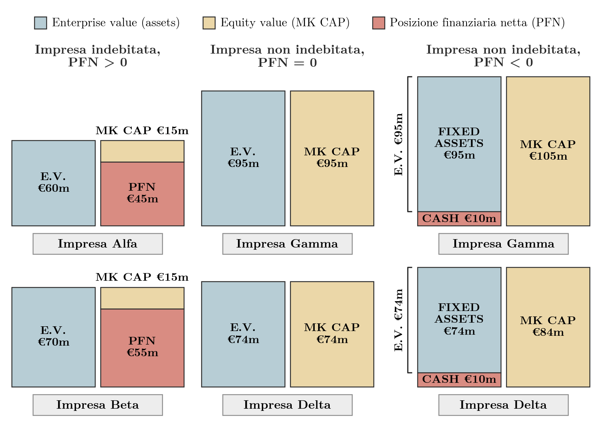
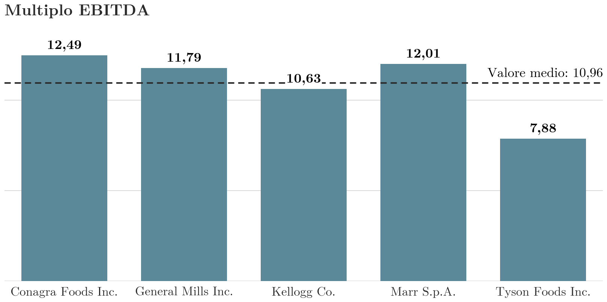

## Inquadramento

Questo capitolo presenta i metodi **DCF** (Discounted Cash Flow) come passaggio dal valore dei singoli investimenti al valore dell'intera impresa. Al centro stanno i **modelli sintetici**, in entrambe le ottiche di valutazione, asset side ed equity side. Il testo di riferimento è il capitolo 8 del testo BBS, fino al paragrafo 8.4.

I tassi di sconto usati in questi modelli, il WACC per l'ottica assets e il costo dell'equity per l'ottica equity, derivano dalle decisioni di investimento dell'impresa indebitata ([[FSTR 02-full Costo del Capitale|il costo del capitale]]). Dopo i metodi DCF la sequenza degli argomenti passa ai multipli di borsa ([[FSTR 06 Multipli di Borsa lez01|i multipli di borsa]]), alla crescita esterna con la valutazione delle operazioni di integrazione e alla due diligence. I modelli DCF analitici e il terminal value sono sviluppati in [[FSTR 04-full Modelli Valutazione Finanziaria Parte2|i metodi DCF analitici e il VAM]].

## Le grandezze di riferimento per la valutazione dell'impresa

> [!abstract] Definizione
> La valutazione d'impresa si conduce in due ottiche, **assets** ed **equity**. In ciascuna si individuano grandezze di riferimento sul piano del valore stimato, patrimoniale, reddituale, finanziario e del costo del capitale.
>
> | Dimensione | Ottica assets | Ottica equity |
> |---|---|---|
> | Valore stimato | Asset value (enterprise value, EV) | Equity value (capitalizzazione di mercato, MK CAP) |
> | Patrimoniale | CIN rettificato | Capitale proprio rettificato |
> | Reddituale | NOPAT normalizzato | Reddito di bilancio normalizzato |
> | Finanziario | FCFF (indicato anche come FCFO) | FCFE |
> | Costo del capitale | WACC | Costo dell'equity |

I dati contabili non bastano a determinare il valore effettivo dell'impresa, che spesso dipende da aspetti prospettici non riflessi nei bilanci, i quali guardano al passato. In un'operazione di M&A la valutazione è invece prospettica e richiede di scegliere grandezze e tassi coerenti con l'ottica adottata. In entrambe le ottiche la grandezza reddituale è normalizzata, cioè aggiustata con il lavoro svolto nella due diligence; il reddito di bilancio dell'ottica equity è l'ultima riga del conto economico.

In ottica asset l'azienda è osservata nella sua interezza e nel suo valore complessivo, in ottica equity dal punto di vista degli azionisti e dei soci, e quindi non anche dei creditori. L'**enterprise value** è il valore del capitale investito nell'attività operativa, cioè il valore complessivo dell'azienda. Si scompone in due parti, che corrispondono a interessi contrapposti: il valore del capitale di rischio, di competenza degli azionisti, cioè l'**equity value** o capitalizzazione di mercato (MK CAP), e il valore del debito netto, di competenza dei creditori, la **posizione finanziaria netta** (PFN, in inglese net financial position, NFP), che è il debito finanziario al netto della cassa:

$$EV = MK\,CAP + PFN$$

Ne segue che $MK\,CAP = EV - PFN$.

L'enterprise value risponde alla domanda su quanto valga il business a prescindere da come è finanziato: l'azienda è valutata nel suo complesso, senza guardare se contenga debiti o liquidità. L'equity value risponde a un'altra domanda, di cassa e di regolamento: quanto si deve pagare agli attuali soci per acquistare il 100% delle quote ed entrare in possesso dell'equity. Questo prezzo non coincide con il valore dell'azienda. Se si afferma che Riello vale 20 milioni, senza considerare debiti ed equity, la cifra è il suo enterprise value; per acquisire il 100% delle quote si ragiona invece in logica di equity value. Nella PFN sono rappresentati i creditori: oltre ai soci, altri stakeholder determinano l'ammontare della PFN, anche quando questa è una disponibilità presso una banca.

La scomposizione dell'EV in equity value e PFN non va confusa con uno stato patrimoniale contabile, perché lo stato patrimoniale è a valori di costo, quindi contabili, e non a valori di transazione. L'art. 2423 del Codice civile disciplina la redazione del bilancio; l'iscrizione delle immobilizzazioni al costo di acquisto o di produzione è prevista dall'art. 2426, n. 1, sui criteri di valutazione. In un'ottica di fonti e impieghi il concetto è però assimilabile, perché l'azienda ha un valore nel suo complesso e gli impieghi sono sostenuti da fonti messe dai soci o dai creditori. In una compravendita siedono di solito al tavolo compratori e venditori, che ragionano sulla parte equity; accanto a loro stanno i creditori, come la banca e gli altri soggetti che hanno pretese di remunerazione.

## Relazione tra enterprise value ed equity value: esempi numerici

Gli esempi seguenti applicano la relazione $EV = MK\,CAP + PFN$ ai tre casi possibili per il segno della PFN. I valori sono in milioni di euro. Il caso di PFN nulla è raro: di norma l'impresa ha una PFN positiva o negativa.

Nelle transazioni la PFN è spesso oggetto di negoziazione: viene inclusa nel perimetro dell'operazione, e quindi nel prezzo, oppure esclusa. Per la stessa azienda il valore concordato per la transazione, cioè l'enterprise value, non cambia al variare della PFN, come il valore di un immobile non dipende dal fatto che sia gravato da un mutuo o da ipoteche né che contenga beni di valore. Ciò che avviene in termini di PFN è un meccanismo di aggiustamento del prezzo, che non riguarda il valore dell'azienda.

### Impresa indebitata (PFN > 0)

> [!example] Esempio
> | Impresa | Enterprise value (EV) | Equity value (MK CAP) | Debito (PFN) |
> |---|---|---|---|
> | Alfa | 60 | 15 | 45 |
> | Beta | 70 | 15 | 55 |
>
> Verifica: per Alfa 15 + 45 = 60, per Beta 15 + 55 = 70. Le due imprese hanno lo stesso equity value. Beta ha una PFN superiore di 10 e un EV superiore di 10: a parità di equity value, l'EV varia in misura pari alla PFN.

Con una PFN positiva l'acquirente si porta dietro un debito, che dal giorno dopo l'acquisto deve rimborsare: per Alfa il capitale residuo è 45. Quando si acquista un'azienda con PFN positiva, stimata e calcolata dalla due diligence, il debito si scala dal prezzo. In un esempio distinto da quello della tabella, se l'azienda è valorizzata 100 e contiene 45 milioni di debiti, il prezzo pagato è quindi 55.

In questo secondo esempio il totale attivo del bilancio civilistico è 60 e comprende anche cespiti come un robot ammortizzato al 100% e quindi iscritto a zero: rispetto a esso l'azienda ha un plusvalore. Si parte dal bilancio e si porta il valore a 100 con i metodi di valutazione, DCF e multipli. Il valore di 100 non coincide però con l'importo versato dall'acquirente, perché l'aggiustamento si basa sempre sulla PFN.

### Impresa non indebitata (PFN = 0)

> [!example] Esempio
> | Impresa | Enterprise value (EV) | Equity value (MK CAP) |
> |---|---|---|
> | Gamma | 95 | 95 |
> | Delta | 74 | 74 |
>
> Senza debito, enterprise value ed equity value coincidono.

Nell'esempio distinto dalla tabella del caso precedente, con un attivo contabile di 60 e un'azienda valorizzata 100, senza debiti né liquidità, il prezzo per il 100% delle quote è 100: quando la PFN non c'è, il prezzo pagato corrisponde all'enterprise value, come per Gamma (95) e Delta (74).

### Impresa non indebitata con liquidità netta (PFN < 0)

Le imprese Gamma e Delta hanno la stessa attività operativa del caso precedente (immobilizzazioni per 95 e 74) e in più una cassa di 10. La PFN è quindi pari a $-10$.

> [!example] Esempio
> | Impresa | Immobilizzazioni (attivo operativo) | Cassa | PFN | Equity value (MK CAP) | EV = MK CAP + PFN |
> |---|---|---|---|---|---|
> | Gamma | 95 | 10 | -10 | 105 | 95 |
> | Delta | 74 | 10 | -10 | 84 | 74 |
>
> Per Gamma 105 - 10 = 95, per Delta 84 - 10 = 74.

La cassa aumenta di 10 il valore per gli azionisti e lascia invariato l'EV, perché non fa parte del capitale investito nell'attività operativa. Con liquidità netta il passaggio dal valore dell'attivo operativo al valore per gli azionisti somma la cassa anziché sottrarre il debito. Se si chiamasse enterprise value l'intero attivo, cassa compresa (105 per Gamma, 84 per Delta), l'EV coinciderebbe con l'equity value e non rispetterebbe più la relazione $EV = MK\,CAP + PFN$.

Chi acquista una catena di supermercati della grande distribuzione, come Aliper, PAM o Esselunga, trova liquidità, cioè una PFN negativa, perché queste imprese hanno il ciclo inverso del circolante e quindi un circolante negativo. Il cliente paga subito alla cassa, mentre Esselunga paga il fornitore, per esempio Danone, a 60 giorni: non ha crediti verso i clienti e tiene in cassa la liquidità incassata fino al pagamento. L'acquirente si trova così un'azienda piena di cassa per effetto del business stesso, con conti correnti in attivo per esempio per 10 milioni.

Nell'esempio dell'azienda valorizzata 100, con una liquidità di 10 il valore dell'azienda resta 100, ma il venditore può chiedere che l'acquirente paghi, oltre ai 100 per l'azienda, anche la liquidità contenuta, oppure che questa sia scorporata. La separazione tra equity value ed enterprise value e il loro reciproco aggiustamento sono il tema ricorrente delle negoziazioni. Se l'azienda vale 100 e contiene liquidità per 10, il prezzo per il 100% delle quote è 110, perché il denaro che resta nell'azienda va pagato: acquistando il 100% delle quote l'acquirente diventa socio e dispone di quella liquidità.

Quando la PFN è negoziata ed esclusa dall'operazione, alla vigilia dell'atto notarile si lascia di solito solo una piccola provvista, il minimo necessario per riprendere l'attività il giorno dopo la cessione. Se la liquidità è elevata, perché l'azienda oltre al ciclo inverso del circolante genera cassa da vent'anni e ha in bilancio molte disponibilità liquide con, come contropartita contabile, riserve di capitale e di patrimonio, i soci prima della vendita distribuiscono un dividendo straordinario che svuota la cassa e riduce le riserve, posta contabile e non disponibilità reale. Il grosso della PFN è così portato fuori dall'azienda e ci si avvicina molto al caso di PFN nulla.

**Figura 1** — Scomposizione dell'enterprise value in equity value (MK CAP) e posizione finanziaria netta (PFN), con blocchi di altezza proporzionale ai valori in milioni di euro. Con PFN positiva l'EV supera l'equity value della PFN, con PFN nulla i due valori coincidono, con PFN negativa l'EV corrisponde alle sole immobilizzazioni (95 e 74) e l'equity value (105 e 84) lo supera della liquidità netta (10).

## Richiami: EBIT, EBITDA e NOPAT

Le grandezze reddituali si ricavano dal bilancio riclassificato: chi valuta un gruppo dall'esterno, come un CFO o un manager di private equity, parte dal bilancio e lo riclassifica per ottenere EBIT ed EBITDA.

> [!abstract] Definizione
> Il **NOPAT** (Net Operating Profit After Taxes) è l'utile netto operativo, cioè l'EBIT al netto delle imposte. Misura il profitto netto generato dalle attività caratteristiche. Poiché parte dall'EBIT, prima degli oneri finanziari, non dipende dalla struttura finanziaria dell'impresa:
> $$NOPAT = EBIT \times (1 - t_c)$$

L'EBITDA coincide con il margine operativo lordo (MOL). Il conto economico seguente mostra la sequenza dall'EBITDA al reddito netto e il calcolo del NOPAT.

> [!example] Esempio
> | Voce | Valore |
> |---|---|
> | Ricavi | 150.000 |
> | Costo del venduto | -70.000 |
> | **EBITDA** | **80.000** |
> | Ammortamenti | -25.000 |
> | **EBIT** | **55.000** |
> | Oneri finanziari | -10.000 |
> | **EBT** (risultato prima delle imposte) | **45.000** |
> | Imposte (20%) | -9.000 |
> | **Reddito netto** | **36.000** |
>
> $$NOPAT = EBIT \times (1-t_c) = 55.000 \times (1-20\%) = 44.000$$

Il NOPAT (44.000) supera il reddito netto (36.000) di 8.000, pari agli oneri finanziari al netto del risparmio d'imposta: $10.000 \times (1 - 20\%)$.

Le voci del conto economico remunerano soggetti diversi: dopo l'EBIT l'azienda paga i creditori con gli oneri finanziari, cioè gli interessi sul debito, poi lo Stato con le imposte e infine i soci con i dividendi. Dopo i costi operativi e gli ammortamenti si arriva all'EBIT, 55.000 nell'esempio; se dall'EBIT si sottrae per primo quanto dovuto allo Stato, restano due soggetti, creditori e azionisti, tra cui si divide ciò che rimane, cioè il NOPAT. Il NOPAT è il livello di marginalità da cui si vede in modo pulito la redditività di un'azienda che ha già pagato tutti, Stato compreso, a esclusione di soci e creditori. Questo risultato intermedio non esiste nel conto economico civilistico e di solito nemmeno in quello riclassificato, dove si vedono l'EBIT e, come ultima riga, l'utile o la perdita d'esercizio: il NOPAT non si legge nel conto economico ma si costruisce con la formula.

Le imposte del NOPAT sono calcolate sull'EBIT, prima di pagare gli oneri finanziari, e non coincidono con i 9.000 del conto economico dell'esempio. Pagare gli interessi ai creditori non è un'attività caratteristica, e nemmeno distribuire dividendi, mentre le imposte sul reddito sono un onere che scaturisce dall'attività: lo Stato è trattato come un qualsiasi fornitore o dipendente che emette fattura. Nella logica reddituale il NOPAT è così l'analogo dell'FCFF: in un rendiconto finanziario in ottica asset si arriva a un livello di flussi di cassa subito prima di remunerare creditori e soci, e lo stesso risultato si ricerca nel conto economico.

Il NOPAT è un'approssimazione di un flusso di cassa ricavata dal conto economico, che non sempre dà un flusso di cassa affidabile; è comunque la grandezza più simile a un flusso di cassa che il conto economico offra. Il metodo DCF muove nel tempo flussi di cassa, e l'EBITDA non li rappresenta, perché non tiene conto degli ammortamenti e delle imposte: per questo nei DCF si usa il NOPAT. Nel metodo dei multipli dell'EBITDA ci si può invece fermare all'EBITDA.

## Esercizio svolto: EBIT e NOPAT dell'azienda Alfa

L'azienda Alfa di questo esercizio è distinta dall'impresa Alfa dell'esempio sull'enterprise value.

> [!example] Esempio
> **Dati.** Fatturato di € 568.000; acquisto di materie prime € 372.000; costo del lavoro € 58.000; affitto dell'immobile produttivo € 43.000; ammortamenti € 12.000; oneri finanziari € 22.000. Il carico fiscale stimato è il 27,9%.
>
> **Richieste.** Calcolare EBITDA e NOPAT, e il reddito netto d'esercizio.
>
> **Conto economico**
>
> | Voce | Valore |
> |---|---|
> | Fatturato | 568.000 |
> | Acquisto materie prime | -372.000 |
> | Costo del lavoro | -58.000 |
> | Affitti | -43.000 |
> | **EBITDA** | **95.000** |
> | Ammortamenti | -12.000 |
> | **EBIT** | **83.000** |
> | Oneri finanziari | -22.000 |
> | **EBT** | **61.000** |
> | Imposte d'esercizio | -17.019 |
> | **Reddito netto** | **43.981** |
>
> **Calcolo del NOPAT**
>
> | Voce | Valore |
> |---|---|
> | EBIT | 83.000 |
> | Imposte sull'EBIT | -23.157 |
> | **NOPAT** | **59.843** |

Le imposte sull'EBIT (23.157, cioè $83.000 \times 27{,}9\%$) differiscono dalle imposte d'esercizio (17.019, cioè $61.000 \times 27{,}9\%$) perché è diversa la base imponibile a cui si applica l'aliquota: l'EBIT nel primo caso, l'EBT nel secondo. La differenza, 6.138, è il risparmio d'imposta sugli oneri finanziari ($22.000 \times 27{,}9\%$), detto scudo fiscale. Ne segue il raccordo tra NOPAT e reddito netto: $59.843 - 22.000 + 6.138 = 43.981$.

## Richiami: capitale investito netto e capitale circolante netto

Lo stato patrimoniale riclassificato in ottica finanziaria contrappone al capitale investito netto le fonti di finanziamento:

| Capitale investito netto | Fonti di finanziamento |
|---|---|
| Capitale circolante netto (CCN) | Patrimonio netto (equity) |
| Capitale immobilizzato netto | Posizione finanziaria netta (PFN, debt) |

> [!abstract] Definizione
> Il **capitale investito netto operativo** (CIN) è la somma del capitale circolante netto (CCN) e delle immobilizzazioni caratteristiche nette:
> $$CIN = CCN + \text{Immobilizzazioni caratteristiche nette}$$

Del capitale circolante esistono due versioni: il capitale circolante commerciale (CCC), che comprende crediti verso clienti, debiti verso fornitori e rimanenze, e il capitale circolante netto (CCN). Nello stato patrimoniale restano altre poste, cioè il TFR, i ratei e risconti, i crediti e debiti tributari, i debiti previdenziali, gli altri crediti e gli acconti. Non sono immobilizzazioni, non sono equity e non sono PFN: vanno quindi per differenza nel capitale circolante, che a quel punto è il CCN, netto anche di tutte queste voci. Il CCN comprende quindi le rimanenze e la generalità dei crediti e dei debiti operativi.

Le due colonne dello stato patrimoniale riclassificato hanno per costruzione lo stesso totale, quindi $CIN = \text{Patrimonio netto} + PFN$. Nelle formule successive il capitale investito netto operativo è indicato con CINO, il capitale circolante netto operativo con CCNO e il patrimonio netto (capitale proprio) con C.P.

## La valutazione assoluta (DCF)

La **valutazione assoluta** si concentra sull'impresa. Poggia sull'analisi delle sue caratteristiche (modello di business, strategie, management, patrimonio e così via) e sulla previsione delle performance economico-finanziarie future. Considera le sue politiche finanziarie, di finanziamento e di dividendo, e misura il suo rischio operativo e finanziario. Si basa su un criterio analitico di stima: si parte dai bilanci e dai business plan dell'impresa, senza ricorrere a parametri o indicatori esterni.

Il risultato è un insieme di **valori finanziari**, detti anche valori fondamentali o **valori intrinseci**. Hanno significato economico perché fondati sul principio di convenienza economica dell'investimento in capitale di rischio aziendale.

Per rischio operativo si intende il rischio di perdite derivanti da fallimenti o inadeguatezza dei processi interni, delle risorse umane e dei sistemi tecnologici, oppure da eventi esterni. Il rischio finanziario incide sulla liquidità aziendale ed è legato all'equilibrio tra flussi monetari in entrata e in uscita.

Nei DCF il valore dell'azienda dipende dalla sua capacità di generare flussi di cassa futuri, attualizzati a un certo tasso. Il principio è quello del VAN: come il VAN valuta un investimento, il DCF valuta l'azienda trattandola come se fosse il progetto. I punti di forza del metodo sono due: consente di ragionare sulla capacità prospettica dell'impresa di generare risorse e di stimare sia i flussi di cassa attesi sia il rischio associato.

I limiti riguardano anzitutto la previsione del futuro, che è una forte assunzione: i flussi prospettici sono attualizzati a oggi, ma nulla garantisce che si realizzino. I flussi sono inoltre specifici dell'azienda, quindi il metodo guarda l'azienda e non il settore. Se i flussi stimati non sono attendibili, la valutazione non è credibile in una trattativa, a maggior ragione quando formule come la rendita perpetua proiettano per milioni di euro flussi che non lo sono. Alla base dei DCF c'è quindi una condizione delicata: i flussi di cassa devono essere sostenibili e credibili.

Un esempio di rendiconto finanziario di un'impresa reale è quello consolidato di Brembo, in migliaia di euro, per gli esercizi chiusi al 31 dicembre 2020 e 2019.

| Voce | 31.12.2020 | 31.12.2019 |
|---|---|---|
| **Disponibilità liquide e mezzi equivalenti all'inizio del periodo** | **168.559** | **195.871** |
| Risultato prima delle imposte | 156.044 | 307.691 |
| Ammortamenti/Svalutazioni | 207.550 | 196.630 |
| Plusvalenze/Minusvalenze | -1.695 | -2.157 |
| Proventi e oneri da partecipazioni al netto dei dividendi ricevuti | -413 | -3.984 |
| Componente finanziaria dei fondi a benefici definiti e debiti per il personale | 407 | 577 |
| Accantonamenti a fondi relativi al personale | 2.423 | 2.502 |
| Altri accantonamenti ai fondi al netto degli utilizzi | 48.618 | -52 |
| Risultato derivante da attività operative cessate | -304 | -6.422 |
| **Flusso monetario generato dalla gestione reddituale** | **412.630** | **494.785** |
| Imposte correnti pagate | -48.873 | -65.961 |
| Utilizzi dei fondi relativi al personale | -4.580 | -4.813 |
| *(Aumento) diminuzione delle attività a breve:* | | |
| rimanenze | -23.913 | -7.604 |
| attività finanziarie | 136 | -5 |
| crediti commerciali | 4.387 | 14.558 |
| crediti verso altri e altre attività | -9.175 | -6.306 |
| *Aumento (diminuzione) delle passività a breve:* | | |
| debiti commerciali | 910 | -90.846 |
| debiti verso altri e altre passività | 18.382 | -26.374 |
| Effetto delle variazioni dei cambi sul capitale circolante | -16.503 | -814 |
| **Flusso monetario netto generato/(assorbito) da attività operativa** | **333.401** | **306.620** |
| *Investimenti in immobilizzazioni:* | | |
| materiali | -162.052 | -213.657 |
| di cui diritto di utilizzo beni in leasing | -37.755 | -38.165 |
| immateriali | -28.273 | -38.111 |
| finanziarie | -182.862 | -131 |
| Prezzo di realizzo, o valore di rimborso, di immobilizzazioni | 4.205 | 6.589 |
| **Flusso monetario netto generato/(assorbito) da attività di investimento** | **-368.982** | **-245.310** |
| Dividendi pagati nel periodo | 0 | -71.541 |
| Acquisto azioni proprie | 0 | -11.329 |
| Dividendi pagati nel periodo ad azionisti di minoranza | -640 | -800 |
| Variazione di fair value di strumenti derivati | 648 | -1.920 |
| Nuovi contratti per beni in leasing | 35.616 | 38.167 |
| Rimborso passività per beni in leasing | -24.826 | -24.436 |
| Mutui e finanziamenti assunti nel periodo da banche e altri finanziatori | 425.000 | 103.518 |
| Rimborso di mutui e finanziamenti a lungo termine | -122.492 | -120.205 |
| **Flusso monetario netto generato/(assorbito) da attività di finanziamento** | **313.306** | **-88.546** |
| **Flusso monetario complessivo** | **277.725** | **-27.236** |
| Effetto delle variazioni dei cambi sulle disponibilità liquide e mezzi equivalenti | -1.054 | -76 |
| **Disponibilità liquide e mezzi equivalenti alla fine del periodo** | **445.230** | **168.559** |

Il flusso monetario complessivo è la somma dei flussi dell'attività operativa, di investimento e di finanziamento: nel 2020, $333.401 - 368.982 + 313.306 = 277.725$. Aggiungendo questo flusso e l'effetto dei cambi (-1.054) alla liquidità iniziale (168.559) si ottiene la liquidità finale di 445.230.

## La valutazione relativa (multipli)

> [!abstract] Definizione
> La valutazione relativa esprime un **valore relativo** dell'impresa, fondato sul confronto con imprese simili (*comparables*). Richiede l'applicazione di moltiplicatori, i **multipli di mercato**, ricavati dai prezzi che il mercato segna per i comparables, e conduce a **valori di mercato**, detti anche **prezzi probabili**.
>
> I multipli di mercato sono rapporti tra il prezzo di mercato (quotazione) di uno strumento azionario e una data grandezza di bilancio.

La valutazione è detta relativa perché mette in relazione l'impresa da valutare con altre aziende, di cui si applicano i multipli. Per valutare Brembo con i multipli, per esempio, non si usa il rendiconto finanziario di Brembo S.p.A., come nei DCF, ma il confronto con i comparables.

### Esempio: individuazione dei comparables nel settore automotive

Il primo passo è scegliere le imprese confrontabili. Le imprese di confronto sono spesso quotate, perché per esse è disponibile molto più materiale. Partendo da Brembo, si considerano quattro imprese del settore automotive e se ne confrontano sede, dimensione e valutazione.

> [!example] Esempio
> | Azienda | Attività | Sede principale | Dipendenti | Valutazione (USD) |
> |---|---|---|---|---|
> | Brembo | Tecnologie di freni a disco per veicoli | Stezzano (IT) | 10.868 (+3%) | 3,5 miliardi |
> | Kongsberg Automotive | Sviluppo, produzione e vendita di prodotti per l'industria automotive | Zurigo (CH) | 11.234 (+3%) | 265,9 milioni |
> | Ford Otosan | Produzione, assemblaggio, importazione, esportazione e vendita di veicoli a motore e ricambi in Turchia | Istanbul (TR) | 14.145 | n.d. |
> | Subaru | Gruppo con attività automotive e aerospaziali (già Fuji Heavy Industries) | Tokyo (JP) | 36.910 | 13,2 miliardi |
> | BorgWarner | Soluzioni tecnologiche per veicoli a combustione, ibridi ed elettrici | Auburn Hills (US) | 49.300 (-1%) | 9,2 miliardi |

### Esempio: P/E e P/BV di Brembo, Sogefi e Valeo

Si considerano poi come comparables di Brembo due società della componentistica automotive, Sogefi e Valeo, e si confrontano due multipli: il P/E (prezzo su utili) e il P/BV (prezzo su valore contabile del patrimonio netto).

> [!example] Esempio
> | Azienda | P/E | P/BV |
> |---|---|---|
> | Brembo | 16,48 | 2,02 |
> | Sogefi | 51,53 | 0,54 |
> | Valeo | 22,99 | 1,09 |

Brembo ha il P/E più basso del gruppo (16,48 contro 51,53 e 22,99) e il P/BV più alto (2,02 contro 0,54 e 1,09). I multipli di imprese dello stesso settore possono quindi differire molto, e in senso opposto a seconda del multiplo considerato.

### Esempio: multiplo dell'EBITDA nel settore alimentare

> [!example] Esempio
> Il multiplo dell'EBITDA è il rapporto tra capitalizzazione ed EBITDA. Importi in migliaia di euro.
>
> | Azienda | Capitalizzazione | EBITDA | Multiplo EBITDA |
> |---|---|---|---|
> | Conagra Foods Inc. | 17.383.003 | 1.391.339 | 12,49 |
> | General Mills Inc. | 35.364.038 | 2.999.013 | 11,79 |
> | Kellogg Co. | 24.665.300 | 2.319.281 | 10,63 |
> | Marr S.p.A. | 1.269.299 | 105.674 | 12,01 |
> | Tyson Foods Inc. | 19.542.863 | 2.479.693 | 7,88 |
>
> Il valore medio del multiplo nel gruppo è $(12{,}49 + 11{,}79 + 10{,}63 + 12{,}01 + 7{,}88)/5 = 10{,}96$.

**Figura 2** — Multiplo EBITDA nel settore alimentare: i valori vanno da 7,88 (Tyson Foods) a 12,49 (Conagra Foods), con media semplice 10,96. Kellogg e Tyson Foods si collocano sotto la media, le altre tre società sopra.

Moltiplicando il multiplo (per esempio la media del gruppo) per l'EBITDA dell'impresa da valutare si ottiene una stima del suo valore per analogia con i comparables. In senso stretto, il numeratore dei multipli della tabella è la capitalizzazione di mercato, mentre l'EBITDA è un margine calcolato prima degli oneri finanziari: un rapporto coerente con l'EBITDA avrebbe al numeratore l'enterprise value (multiplo EV/EBITDA). Il tema è ripreso in [[FSTR 06 Multipli di Borsa lez01|l'ottica assets e l'ottica equity nei multipli]].

L'applicazione del multiplo è un'operazione aritmetica elementare, come moltiplicare un EBITDA per 3,2. La difficoltà sta a monte: occorrono un multiplo rappresentativo e un EBITDA altrettanto rappresentativo. L'EBITDA, primo fattore del prodotto, viene quindi lavorato con la due diligence fino a normalizzarlo; il secondo fattore, il multiplo, deve essere il più appropriato.

Il multiplo da adottare non è univoco. Nel gruppo dei cinque operatori del food occorre decidere se prendere, per esempio, quello di Kellogg o quello di General Mills, e ampliando la ricerca si trovano molti altri comparables, tutti diversi. Le imprese del gruppo sono in larga parte statunitensi. Si consideri un'impresa padovana che produce cereali: tra le imprese americane del gruppo producono cereali General Mills e Kellogg, comparabili per prodotto, ma occorre valutare come li producono. Negli Stati Uniti il costo del personale può essere molto diverso e il mercato finale è diverso, perché prevale il consumo interno statunitense, mentre un grande operatore veneto dei derivati dei cereali come Cereal Docks vende soprattutto in Italia (il 78,4% del fatturato nel 2024) e ha performance in termini di EBITDA influenzate dal sistema Italia. Applicare all'impresa padovana il multiplo di Kellogg equivale a proiettare su di essa le stesse prospettive di crescita di imprese americane, ipotesi non scontata.

Il multiplo dell'EBITDA è il più diffuso, ma è molto approssimativo e non viene mai usato da solo. Se si chiede a un advisor quanto vale un'azienda con un EBITDA di un milione di euro, la risposta può essere che nel fashion il multiplo è 8, quindi 8 milioni; ma il contratto di compravendita non si fonda sul prodotto dell'EBITDA per 8. Nelle valutazioni effettive si approfondiscono sia l'EBITDA sia il multiplo, e il metodo è sempre accompagnato da altri: nessuna trattativa si conclude sul solo multiplo dell'EBITDA, rappresentativo ma troppo approssimativo e poco dettagliato.

Il multiplo fornisce comunque un'indicazione in chiave prospettica, perché sintetizza le prospettive di sviluppo che il mercato attribuisce ai comparables. Se un'impresa dei sistemi frenanti ha un EBITDA di 10 milioni e le imprese comparabili, che operano nello stesso mercato, sono valutate 4,5 volte l'EBITDA, l'impresa, allineata ai suoi comparables, ha un valore stimato di $4{,}5 \times 10 = 45$ milioni.

Il multiplo dell'EBITDA è uno tra molti, e con i comparables se ne considerano sempre diversi. Per le aziende con costi fissi elevati può non essere il più appropriato, perché non tiene conto degli ammortamenti. Per un'azienda come Ilva, che vive di altoforni, un multiplo privo di ammortamenti non rappresenta il capitale investito e ne trascura una parte rilevante; il multiplo dell'EBITDA è invece utilizzabile per un'azienda che non si basa interamente su un altoforno o sullo sfruttamento di una miniera. Per un'azienda come Zara, che realizza fatturato sui volumi di vendita, conta di più la capacità potenziale di sviluppare vendite che la redditività netta dell'EBITDA, e servono quindi multipli ancorati alle sales e non agli ammortamenti. Con la rete di negozi in affitto pesano personale, magazzino, utenze e pubblicità; con l'IFRS 16 anche i negozi in locazione sono però iscritti come diritti d'uso e ammortizzati, e gli ammortamenti non sono trascurabili: nell'esercizio chiuso al 31 gennaio 2025 il gruppo Inditex, a cui appartiene Zara, ha registrato ammortamenti per 2.997 milioni di euro, di cui 1.536 sui diritti d'uso, su vendite di 38.632 milioni.

## Valutazione assoluta e valutazione relativa: un approccio complementare

Sul piano professionale si ritiene oggi più corretto associare le valutazioni assolute e relative, perché i due metodi differiscono per il sistema di osservazione: con i multipli si guarda all'esterno, ai multipli osservati sul mercato, mentre con il DCF si resta all'interno dell'impresa e si osserva quanta cassa genera o genererà. Il ricorso ai multipli in senso **complementare** serve a individuare le **leve del valore** e le **leve di prezzo** (variabili di contesto) che guidano i prezzi del mercato finanziario, e a coprire meglio lo spettro delle informazioni rilevanti per la valutazione.

Nella prassi, accanto ai DCF e ai multipli dell'EBITDA, si usa talvolta, anche come confronto, un terzo metodo: il **patrimonio netto rettificato**. Consiste nella ricognizione degli asset aziendali e nella stima, tramite perizie giurate, del loro valore commerciale, soprattutto per gli immobili.

I multipli dell'EBITDA e i DCF si basano sulle prospettive di guadagno e di reddito dell'azienda, ricavate da dati esterni (i multipli) o dai flussi di cassa generati dall'azienda (i DCF). In entrambi i casi non si considera il patrimonio, e non emerge il valore di mercato di alcuni asset importanti. Si consideri un'azienda che taglia la lamiera di acciaio con un robot laser di ultima generazione, pagato un milione di euro e dotato di intelligenza artificiale integrata, capace di tagliare cento sagome al minuto, invece che con una taglierina azionata da un operaio: né i DCF né i multipli rilevano la differenza. Il bilancio dice ancora meno: il braccio robotizzato viene probabilmente ammortizzato secondo le tabelle fiscali con aliquota del 25%, per cui in quattro anni il robot da un milione di euro arriva a zero, mentre può tagliare per altri dieci anni. Un valore contabile nullo non esprime il valore di un bene ancora in uso.

Emerge così il disallineamento tra il valore netto contabile, calcolato con i principi contabili, e un valore di mercato, di recupero o di realizzo. Per questo la valutazione d'azienda comprende la rettifica del patrimonio, cioè la sua riconduzione a valori di mercato, soprattutto per le immobilizzazioni. Un fabbricato iscritto a bilancio al costo storico, cioè al costo di acquisto, vale poco in bilancio ma può essersi apprezzato nel tempo. Lo stesso vale per le location dei negozi, per le aree rivalutate col tempo, per le città turistiche e per le zone interessate da una riqualificazione residenziale o da una nuova linea metropolitana.

Un esempio è la zona di Milano intorno a Porta Garibaldi e a piazza Gae Aulenti, dove si trovano la Torre Unicredit e il Bosco Verticale. Accanto ci sono le case ringhiera, casette milanesi di mattoni con cortile interno e ballatoio con ringhiera, che prima della costruzione di quei palazzi, in una zona malfamata, non valevano niente. Oggi un appartamento in affitto al Bosco Verticale costa circa 15.000 euro al mese, e le case ringhiera adiacenti possono essersi apprezzate. Si supponga che la sede legale e gli uffici di un'azienda siano in una casa ringhiera di Milano, acquistata vent'anni prima a 300.000 euro e che ora vale 3 milioni. A bilancio il valore dell'edificio diminuisce con l'ammortamento: al 3% annuo, in dieci anni si riduce del 30%. Nessuno venderebbe un edificio del genere al costo d'acquisto di 300.000 euro, né tanto meno al valore di libro, mentre i multipli dell'EBITDA e i DCF non considerano quanto vale una sede in quella posizione.

## I metodi DCF: formule generali

> [!abstract] Definizione
> Le formule generali dei metodi DCF dipendono dall'ottica di valutazione.
>
> Ottica assets (il valore dell'attività operativa è la somma dei FCFF attualizzati al WACC):
>
> $$V = \sum_{t=1}^{\infty} \frac{FCFF_t}{(1 + WACC)^t}$$
>
> Ottica equity (il valore del capitale proprio è la somma dei FCFE attualizzati al costo dell'equity):
>
> $$E = \sum_{t=1}^{\infty} \frac{FCFE_t}{(1 + r_E)^t}$$
>
> I due valori sono legati da
>
> $$E = V - D$$
>
> dove $D$ è il valore del debito finanziario netto (PFN).

Per poter usare tassi di sconto stabili, WACC e $r_E$ costanti nel tempo, i metodi assumono la costanza nel tempo del rischio operativo e del rischio finanziario.

Nelle formule dei DCF va inserito un tasso di sconto, il WACC oppure $r_E$, dato dal costo del capitale. Per trovare il valore complessivo dell'azienda si considerano i flussi di cassa che residuano immediatamente prima di remunerare creditori e soci. Nel rendiconto finanziario è l'FCFF: il flusso che resta dopo tutte le voci della gestione, compresi gli investimenti e l'area tributaria, quando manca solo l'area finanziaria (rimborso e accensione di finanziamenti, interessi e dividendi), che remunera creditori e soci. È il flusso adatto perché idealmente è quello che interessa a creditori e azionisti: un potenziale creditore e un potenziale azionista guarderebbero entrambi al flusso che l'azienda è in grado di destinare a loro.

Il tasso appropriato per attualizzare un flusso di pertinenza sia dei creditori sia degli azionisti, cioè sia del debito sia dell'equity, è il WACC, che rappresenta le aspettative di entrambi. La formula è compatta: ha la forma di una rendita perpetua, con somma da uno all'infinito, non richiede di sviluppare i flussi e si applica molto rapidamente. Attualizzato al WACC e proiettato nel tempo, l'FCFF dà l'enterprise value, cioè il valore dell'azienda a beneficio di tutti, in base a quanto è in grado di dare ai creditori e agli azionisti nel loro complesso.

Per gli azionisti il flusso rilevante è quello che arriva a loro nel rendiconto finanziario, l'FCFE. I creditori sono pagati prima, nell'area finanziaria, e l'FCFE è l'ultima riga del rendiconto, il flusso che residua per gli azionisti, la cui aspettativa è il tasso $r_E$. Il valore dell'equity per i soci si ottiene applicando una rendita perpetua che proietta all'infinito il loro flusso.

Il limite di questo approccio è l'ipotesi di un flusso costante per un orizzonte illimitato: prendere l'FCFE del 2025 dal bilancio depositato e il tasso $r_E$ per affermare che l'azienda vale tanto non ha fondamento, perché nulla indica che il flusso resti uguale. L'uso dei flussi di cassa non rende quindi di per sé attendibile il metodo. Con il solo bilancio, quando dell'azienda non si sa altro, il tasso di crescita $g$ può essere ricavato dalla crescita prevista del settore, secondo le ricerche di mercato e gli studi annuali delle associazioni di categoria; poiché è costante e si applica a una rendita perpetua, va assunto con molta cautela e resta soggetto al limite della crescita nominale di lungo periodo dell'economia.

## I flussi finanziari di riferimento: dal MOL a FCFF e FCFE

Il flusso di cassa rilevante per le valutazioni aziendali si costruisce a cascata a partire dal MOL e attraversa cinque aree: gestione corrente, investimenti, straordinaria, capitale di terzi e capitale proprio.

> [!abstract] Definizione
> | Area | Voce | Flusso intermedio |
> |---|---|---|
> | Gestione corrente | MOL | |
> | | - Variazione CCNO | |
> | | | **Cash flow gestionale lordo** |
> | | - Flusso fiscale operativo (imposte + scudi - variazione dei debiti per imposte) | |
> | | | **Cash flow gestionale netto** |
> | Investimenti | -/+ Investimenti/disinvestimenti in capitale fisso | |
> | | | **Free cash flow to the firm (FCFF)** |
> | Straordinaria | +/- Proventi/oneri straordinari | |
> | Capitale di terzi | - Oneri finanziari netti | |
> | | + Scudo fiscale sugli oneri finanziari | |
> | | +/- Aumento/riduzione dei debiti finanziari | |
> | Capitale proprio | | **Free cash flow to equity (FCFE)** |

L'FCFF è il flusso disponibile per tutti i finanziatori, equity e debito. L'FCFE è il flusso residuo che spetta ai soli azionisti: si ottiene dopo la gestione straordinaria, gli oneri finanziari al netto dello scudo fiscale e la variazione dei debiti finanziari.

Nei rendiconti finanziari delle società quotate i flussi hanno denominazioni diverse, tra cui flusso di cassa delle attività operative, flusso di cassa della gestione caratteristica (FCGC) e free cash flow operativo. L'OIC sul rendiconto finanziario dà indicazioni di massima sullo schema ma non sui nomi, a differenza dello stato patrimoniale civilistico, con lettere maiuscole e numeri romani.

Qualunque sia la denominazione (FCF, FCFO, FCGC), in un rendiconto scaricato da AIDA o di una società quotata si prende il flusso che residua prima di remunerare il capitale di terzi e il capitale proprio e si individua che cosa manchi da togliere: l'area del capitale di terzi e l'area dei soci, cioè i dividendi. Le componenti straordinarie, che qui si trascurano, sono diventate residuali con i nuovi principi contabili.

L'area dei finanziamenti comprende la variazione dei debiti finanziari e gli interessi pagati: trattandosi di flussi, possono essere entrate (nuovo indebitamento) o uscite (rimborsi di finanziamenti, che riducono i debiti finanziari, e interessi). Nelle formule compare inoltre, con segno positivo, lo scudo fiscale, che non figura nei rendiconti finanziari perché non è una voce da valorizzare ma conta in ottica M&A: è un risparmio di denaro ed è legato all'area dell'indebitamento.

## I metodi DCF: modelli sintetici e modelli analitici

> [!abstract] Definizione
> | Modello sintetico | Modello analitico |
> |---|---|
> | Il valore degli assets o dell'equity si ottiene con **formule compatte**, che prevedono per esempio flussi costanti oppure flussi che crescono a un tasso costante. | Il valore degli assets o dell'equity si ottiene come somma di un **valore frutto di un piano esplicito** (3-5 anni) e di un **terminal value** attualizzato, calcolato con un metodo sintetico. |

Di norma si utilizza il metodo analitico. Il suo vantaggio rispetto ai metodi sintetici emerge nei periodi di discontinuità, per esempio grandi investimenti pluriennali o abbattimento del debito: in queste fasi i flussi non sono né costanti né crescenti a tasso costante, e solo un piano esplicito può rappresentarli. Il terminal value del metodo analitico è a sua volta ottenuto con un modello sintetico, come quelli illustrati di seguito. Il metodo analitico è trattato in [[FSTR 04-full Modelli Valutazione Finanziaria Parte2|i metodi DCF analitici]] e il terminal value in [[FSTR 05 Annotazioni sul Terminal Value|le annotazioni sul terminal value]].

Le formule del modello sintetico sono approssimate perché hanno la forma della rendita perpetua, che proietta all'infinito un flusso costante o crescente a tasso costante. Il margine di manovra sulla crescita è limitato: la formula è una sola e il tasso di crescita si applica sempre in avanti.

Nel modello analitico il piano esplicito evita di forzare le formule, perché la crescita del business si costruisce con un business plan anziché con un tasso costante. Il business plan copre almeno tre o quattro anni. Dove possibile lo si ottiene con una simulazione informatica o chiedendo a tutte le aree aziendali di proiettare ricavi, costi e le altre voci, in modo da prevedere il business con ragionevole certezza. Un piano a sette anni ha poca attendibilità, perché con l'incertezza geopolitica una previsione così lunga è molto azzardata.

La durata del piano va scelta in modo da rappresentare la realtà dell'impresa valutata: per un'impresa che avvia un'attività il piano copre i primi anni, con flussi molto particolari e obiettivi di crescita. Le ipotesi su cui poggia il piano sono fissate da chi lo redige e comprendono le analisi di scenario, di norma tre: scenario normale, ottimistico e pessimistico. Poiché dalle ipotesi dipende il valore, devono essere coerenti con il mercato in cui opera l'impresa: ipotizzare una crescita dei ricavi del 5% in un settore che non cresce è un errore, e la crescita dei costi va fissata tenendo conto dell'andamento dell'inflazione. Nelle ipotesi sui ricavi va stabilito se la crescita viene dai volumi o dai prezzi, che possono salire ogni anno anche a parità di volumi; in quelle sui costi, quali voci pesano di più, come trasporti ed energia.

Dal business plan si ricava il rendiconto finanziario previsionale. Se si disponesse del piano di Brembo e l'ultimo rendiconto fosse quello del 2025, il rendiconto previsionale avrebbe le colonne 2026, 2027, 2028 e 2029 o 2030, cioè quattro o cinque FCFF da utilizzare, come nella valutazione dei progetti di investimento, in cui si dispone di quattro o cinque anni di flusso. Questi flussi sono ragionevolmente certi, perché stimati nel dettaglio dagli analisti o dall'azienda.

Al quinto o sesto anno il piano finisce e non si hanno più dati: ci si affida a stime ricavate dai bilanci, con le incertezze che comportano, e si ipotizza una proiezione dei flussi fino alla fine della vita dell'impresa. Questa proiezione è il terminal value, che prosegue dalla fine del piano verso il futuro. I flussi del piano e il terminal value si riportano entrambi al tempo zero.

## FCFF e FCFE in steady state e in steady growth

Le formule generali del flusso di cassa si semplificano sotto due ipotesi limite: i flussi costanti nel tempo (steady state) e i flussi che crescono a un tasso costante $g$ (steady growth).

### Steady state

> [!abstract] Definizione
> | Formula generale | Steady state |
> |---|---|
> | MOL | MOL |
> | - Variazione CCNO | 0 (variazione nulla) |
> | Cash flow gestionale lordo | → MOL |
> | - Flusso fiscale operativo | - Imposte operative |
> | Cash flow gestionale netto | → MOL netto |
> | -/+ Investimenti/disinvestimenti in capitale fisso | -/+ Ammortamenti |
> | Free cash flow to the firm (FCFF) | → **NOPAT** |
> | +/- Proventi/oneri straordinari | +/- Proventi/oneri straordinari |
> | - Oneri finanziari netti | - Oneri finanziari netti |
> | + Scudo fiscale sugli oneri finanziari | + Scudo fiscale sugli oneri finanziari |
> | +/- Aumento/riduzione dei debiti finanziari | 0 (nessuna variazione) |
> | Free cash flow to equity (FCFE) | → **Reddito di bilancio** |

In steady state il capitale circolante non varia, gli investimenti in capitale fisso si limitano a reintegrare gli ammortamenti e il debito finanziario resta costante. Il MOL al netto delle imposte operative e degli ammortamenti è il NOPAT, quindi il **FCFF coincide con il NOPAT**. Aggiungendo oneri finanziari, scudo fiscale e componenti straordinarie si arriva al reddito di bilancio, quindi il **FCFE coincide con il reddito di bilancio**. Il nome steady state deriva dall'ipotesi che l'impresa replichi se stessa per sempre, ipotesi abbastanza improbabile.

### Steady growth

> [!abstract] Definizione
> | Formula generale | Steady growth |
> |---|---|
> | MOL | MOL × (1+g) |
> | - Variazione CCNO | - g × CCNO |
> | Cash flow gestionale lordo | → MOL × (1+g) - g × CCNO |
> | - Flusso fiscale operativo | - Imposte operative × (1+g) |
> | Cash flow gestionale netto | → MOL netto × (1+g) - g × CCNO |
> | -/+ Investimenti/disinvestimenti in capitale fisso | - (g × C.F. + Amm. × (1+g)) |
> | Free cash flow to the firm (FCFF) | → **NOPAT × (1+g) - g × CINO** |
> | +/- Proventi/oneri straordinari | +/- Proventi/oneri straordinari × (1+g) |
> | - Oneri finanziari netti | - Oneri finanziari netti × (1+g) |
> | + Scudo fiscale sugli oneri finanziari | + Scudo fiscale × (1+g) |
> | +/- Aumento/riduzione dei debiti finanziari | + g × Debiti finanziari |
> | Free cash flow to equity (FCFE) | → **Reddito di bilancio × (1+g) - g × C.P.** |

Se l'impresa cresce per esempio dell'1% all'anno, questo 1% è il tasso di crescita $g$: ogni anno l'impresa ha la dimensione dell'anno precedente moltiplicata per $1 + g$. L'ipotesi è più vicina alla realtà dello steady state, ma con un effetto rilevante: la crescita si applica ogni anno a un valore già cresciuto, e quando la formula è proiettata all'infinito il valore cambia molto. Scegliere $g$ pari a 1% oppure a 1,8% produce risultati molto diversi.

Le grandezze economiche (MOL, imposte operative, ammortamenti, oneri finanziari, scudo fiscale) e quelle patrimoniali (CCNO, capitale fisso C.F., debiti finanziari) sono riferite all'ultimo esercizio e crescono al tasso $g$. Il modello contiene quindi alcune semplificazioni. Se l'impresa cresce dell'1%, anche il MOL cresce dell'1% ogni anno, ma per crescere servono più magazzino, più crediti e più denaro immobilizzato: si assume che a una performance di $1 + g$ corrispondano rimanenze e crediti di $1 + g$, e la liquidità che si blocca erode una parte del MOL cresciuto. Il termine $g \times CCNO$ esprime questa quota di circolante assorbita. Si assume inoltre che non si possa crescere senza ingrandirsi e senza investire in nuovi impianti: gli ammortamenti e gli investimenti in capitale fisso salgono anch'essi del tasso $g$, e il modello amplifica così anche la parte patrimoniale, facendo dipendere ogni voce da $g$. Un'impresa che cresce dell'1% può però non avere bisogno di nuovi investimenti in impianti per due o tre anni: in tal caso le ipotesi forzano il ragionamento.

Gli ammortamenti moltiplicati per $(1+g)$ si sottraggono al MOL netto $\times (1+g)$ e lasciano il $NOPAT \times (1+g)$. Restano da sottrarre l'aumento del CCNO ($g \times CCNO$) e la crescita del capitale fisso ($g \times C.F.$), che insieme valgono $g \times CINO$, perché $CINO = CCNO + C.F.$ Ne risulta $FCFF = NOPAT \times (1+g) - g \times CINO$.

Per il FCFE si aggiunge che il debito finanziario cresce anch'esso al tasso $g$ e produce una nuova raccolta di $g \times D$. Poiché $CINO - D = C.P.$, il FCFE diventa:

$$FCFE = \text{Reddito di bilancio} \times (1+g) - g \times CINO + g \times D = \text{Reddito di bilancio} \times (1+g) - g \times C.P.$$

## Le formule dei modelli sintetici

Le formule compatte si ottengono sostituendo i flussi appena descritti nelle formule generali e sommando la serie. Per un flusso costante $F$ scontato al tasso $i$, la somma dei valori attuali è $F/i$. Per un flusso che cresce ogni anno al tasso $g$, con primo flusso $F_1$, è $F_1/(i-g)$, purché $g < i$.

> [!abstract] Definizione
> **Steady state**
> $$V = \frac{NOPAT}{WACC}$$
> $$E = \frac{R.BILANCIO}{r_E}$$
>
> **Steady growth**
> $$V = \frac{NOPAT(1+g) - CINO \cdot g}{WACC - g}$$
> $$E = \frac{R.BILANCIO(1+g) - C.P. \cdot g}{r_E - g}$$
>
> Nelle formule $V$ è il valore in ottica assets (enterprise value), $E$ il valore in ottica equity (equity value), $g$ il tasso di crescita costante, $CINO$ il capitale investito netto operativo, $C.P.$ il capitale proprio, $WACC$ il costo medio ponderato del capitale e $r_E$ il costo dell'equity, cioè il rendimento atteso dagli azionisti.

Queste formule servono quando non si dispone dei flussi di cassa del rendiconto finanziario e si parte dal conto economico. In steady state si attualizzano quindi il NOPAT e il reddito di bilancio, che sostituiscono FCFF e FCFE, con una formula del tipo rendita perpetua. In steady growth entrambi crescono del fattore $(1+g)$, ma la crescita degli asset erode margine e riduce il flusso: in ottica assets il NOPAT è ridotto dal capitale investito ($CINO \cdot g$), in ottica equity il reddito di bilancio è ridotto dall'effetto della crescita sul capitale proprio ($C.P. \cdot g$).

## Esempio steady state: valutazione dell'impresa Alfa

> [!example] Esempio
> **Dati.** Si riprendono i risultati dell'esercizio sull'azienda Alfa: NOPAT 59.843 e reddito netto 43.981. Il WACC stimato è il 5,8% e il rendimento atteso per gli azionisti ($r_E$) è il 7,5%. Si vuole il valore dell'impresa in ottica assets e in ottica equity.
>
> **Ottica assets.**
>
> $$EV = \frac{NOPAT}{WACC} = \frac{59.843}{5{,}8\%} = 1.031.776$$
>
> **Ottica equity.**
>
> $$E = \frac{R.BILANCIO}{r_E} = \frac{43.981}{7{,}5\%} = 586.413$$
>
> **Posizione finanziaria netta implicita.** Dalla relazione $E = EV - PFN$:
>
> $$PFN = EV - E = 1.031.776 - 586.413 = 445.363$$
>
> | Grandezza | Valore |
> |---|---|
> | Enterprise value (ottica assets) | 1.031.776 |
> | Equity value (ottica equity) | 586.413 |
> | PFN implicita | 445.363 |

In steady state il FCFE coincide con il reddito netto. Il passaggio dal NOPAT al reddito netto si verifica con i dati dell'esercizio: $59.843 - 22.000 + 6.138 = 43.981$, cioè NOPAT, meno oneri finanziari, più scudo fiscale ($22.000 \times 27{,}9\%$).

## Esempio steady growth: valutazione dell'impresa Alfa

> [!example] Esempio
> **Dati.** Stessi NOPAT (59.843), reddito netto (43.981), WACC (5,8%) e $r_E$ (7,5%) dell'esempio precedente. L'azienda ha un capitale investito netto operativo di € 760.000, un capitale proprio di € 302.000 e prevede di crescere a un tasso costante $g$ del 2,0%.
>
> **Ottica assets.**
>
> $$EV = \frac{NOPAT(1+g) - CINO \cdot g}{WACC - g}$$
>
> Numeratore: $59.843 \times 1{,}02 - 760.000 \times 0{,}02 = 61.039{,}86 - 15.200 = 45.839{,}86 \approx 45.840$.
>
> Denominatore: $5{,}8\% - 2{,}0\% = 3{,}8\%$.
>
> $$EV = \frac{45.839{,}86}{3{,}8\%} = 1.206.312$$
>
> **Ottica equity.**
>
> $$E = \frac{R.BILANCIO(1+g) - C.P. \cdot g}{r_E - g}$$
>
> Numeratore: $43.981 \times 1{,}02 - 302.000 \times 0{,}02 = 44.860{,}62 - 6.040 = 38.820{,}62 \approx 38.821$.
>
> Denominatore: $7{,}5\% - 2{,}0\% = 5{,}5\%$.
>
> $$E = \frac{38.820{,}62}{5{,}5\%} = 705.829$$
>
> **Posizione finanziaria netta implicita.**
>
> $$PFN = EV - E = 1.206.312 - 705.829 = 500.483$$
>
> | Grandezza | Valore |
> |---|---|
> | Enterprise value (ottica assets) | 1.206.312 |
> | Equity value (ottica equity) | 705.829 |
> | PFN implicita | 500.483 |
