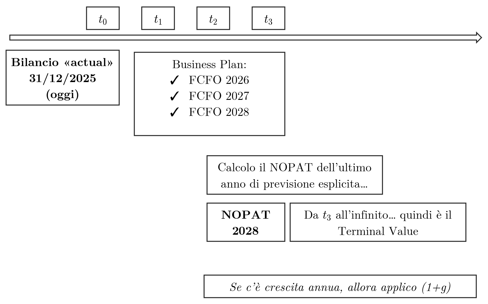

## Inquadramento

Il capitolo tratta i metodi DCF analitici, nei quali il valore degli assets o dell'equity è la somma di un valore esplicito, derivato dai flussi di un piano, e di un *terminal value* attualizzato. Affronta la durata della vita dell'impresa, il terminal value in steady state e in crescita, la verifica del suo peso sul valore complessivo, i modelli di crescita a più stadi e il modello del valore attuale modificato (VAM) nella versione sintetica e in quella analitica.

I flussi di riferimento (FCFF, FCFE, NOPAT) e le formule sintetiche sono definiti in [[FSTR 03 Modelli Valutazione Finanziaria Parte1|i modelli DCF sintetici e i flussi finanziari]]. Il tasso $r_0$ è il costo del capitale unlevered ([[FSTR 02-full Costo del Capitale|il costo del capitale e il beta unlevered]]) e il VAM nasce come criterio per valutare i progetti ([[FSTR 01-full Progetti di Investimento|il valore attuale modificato nelle decisioni di investimento]]). Le condizioni di validità del terminal value e il suo peso sul valore sono approfonditi in [[FSTR 05 Annotazioni sul Terminal Value|le annotazioni sul terminal value]].

## Modelli sintetici e modelli analitici

> [!abstract] Definizione
> I metodi DCF (*Discounted Cash Flow*) si articolano in due famiglie di modelli.
>
> | Modello | Come si ottiene il valore degli assets o dell'equity |
> |---------|------------------------------------------------------|
> | **Sintetico** | Con formule compatte, che prevedono per esempio flussi costanti oppure flussi con tasso di crescita costante. |
> | **Analitico** | Come somma di un valore frutto di un piano esplicito di 3-7 anni e del *terminal value* attualizzato, a sua volta frutto di un metodo sintetico. |

Di norma si utilizza il metodo analitico. Il suo vantaggio sui metodi sintetici emerge nei periodi di discontinuità, per esempio grossi investimenti pluriennali o abbattimento del debito: in queste fasi i flussi non sono né costanti né crescenti a tasso costante, e solo un piano esplicito può rappresentarli.

## Terminal value con vita utile illimitata

> [!abstract] Definizione
> L'ipotesi sulla durata della vita utile dell'impresa determina come si imposta il *terminal value* (TV). Nella prassi valutativa si assume una **durata illimitata**: l'impresa è assimilata a una **rendita perpetua**.
>
> Indicato con $N$ il numero di anni del periodo di previsione puntuale dei flussi attesi, il TV è riferito alla fine dell'anno $N$ ed è il valore di una rendita **posticipata**, con flussi a fine anno. Può essere di due tipi:
>
> - **economico**, se si ipotizza che l'impresa mantenga anche dopo l'anno $N$ una redditività superiore al costo-opportunità del capitale;
> - **di equilibrio**, se si ipotizza una redditività pari a quella minima attesa, il che esclude la creazione di valore dopo l'anno $N$.

Il rapporto tra crescita, rendimento del capitale investito e creazione di valore nel terminal value è sviluppato in [[FSTR 05 Annotazioni sul Terminal Value|la formula del terminal value e le sue condizioni di validità]].

## Terminal value con vita utile limitata

L'ipotesi di vita illimitata è discutibile e va giudicata in base ai contesti aziendali reali. Si assume una durata limitata per le imprese la cui operatività è soggetta a limiti oggettivi.

> [!abstract] Definizione
> | Natura del limite | Condizione | Esempi |
> |-------------|-----------------------------|------------------------------|
> | **Normativa** | L'impresa opera in regime di autorizzazione o di concessione. | Reti autostradali, pubblici servizi. |
> | **Ambientale** | L'attività si basa sullo sfruttamento di risorse naturali. | Cave, miniere, giacimenti. |
> | **Giuridica** | L'impresa ha una vita limitata per statuto. | *Joint venture*, associazioni in partecipazione, reti d'imprese, consorzi. |

Talora anche ragioni di natura economica, cioè la scarsa rinnovabilità delle risorse distintive e delle capacità competitive, portano a ipotizzare una durata limitata.

### Casi di durata limitata tratti dalla stampa

Alcuni articoli di cronaca recente mostrano situazioni in cui la vita dell'impresa non può essere assunta come illimitata. La terza colonna indica la categoria di limite alla quale ciascun caso è riconducibile.

| Caso | Fatti riportati | Limite riconducibile a |
|--------------|------------------------------------------|------------------|
| Parcheggio Europa | L'amministrazione ha deciso di non rinnovare le concessioni a terzi in materia di parcheggi e di affidarle in gestione diretta alla partecipata APS; dieci dipendenti rischiano il posto. | Normativa (concessione non rinnovata) |
| Freudenberg, Rho (12 novembre 2025) | La multinazionale, che produce sistemi di filtraggio per macchinari industriali, apre la procedura di licenziamento collettivo per 42 lavoratori motivandola con i dazi imposti dagli Stati Uniti, senza alcuna crisi aziendale in corso; la produzione è spostata negli Stati Uniti. | Economica (dazi) |
| Gac-Fca (aggiornamento dell'8 luglio 2025) | Un tribunale della provincia cinese dello Hunan dichiara la bancarotta e la liquidazione della Gac-Fiat Chrysler Automobiles, *joint venture* nata nel 2009 da un accordo tra Fiat e Guangzhou Automobile Group e destinata a rilanciare la presenza del costruttore torinese in Cina. | Giuridica (*joint venture*) |
| Ssense (29 agosto 2025) | Il rivenditore di moda cede sotto il peso delle tariffe statunitensi e presenta istanza di fallimento. | Economica (tariffe) |
| Georg Fischer, Verona | Nove mesi di cassa integrazione per i lavoratori coinvolti dalla decisione della società (GF Industry and Infrastructure Flow Solutions) di cessare l'attività a Verona. Il segretario generale della Fiom Cgil scaligera, Martino Braccioforte, la definisce una decisione di carattere prettamente finanziario. | Economica (decisione finanziaria) |
| Cipriani Serramenti, Grassina | Chiude la storica azienda e 15 lavoratori perdono il posto; la Fillea Cgil attribuisce la chiusura a scelte imprenditoriali sbagliate. | Economica (scelte imprenditoriali) |

Nei casi di questo tipo l'ipotesi di vita illimitata va verificata caso per caso e il terminal value riconsiderato di conseguenza.

### Valore terminale contabile e di liquidazione

Se si ipotizza una durata limitata, è più corretto inserire nella valutazione il valore di liquidazione dell'azienda. Il valore terminale assume allora uno di due significati.

> [!abstract] Definizione
> - **Valore terminale contabile**: dipende dal valore contabile che le attività e le passività del patrimonio aziendale avranno al termine del periodo di previsione analitica.
> - **Valore terminale di liquidazione**: è funzione dei valori di cessione delle attività e di estinzione delle passività del patrimonio aziendale.

## Impostazione generale dei modelli DCF analitici

> [!abstract] Definizione
> Nell'ottica assets il valore dell'impresa (operativo) è la somma dei flussi di cassa operativi attualizzati al WACC lungo l'orizzonte di previsione esplicita, più il valore attuale del terminal value:
>
> $$V = \sum_{t=1}^{N} \frac{FCFF_t}{(1+WACC)^t} + \frac{TV}{(1+WACC)^N}$$
>
> Nell'ottica equity il valore del capitale proprio è la somma dei flussi disponibili per gli azionisti attualizzati al costo dell'equity $r_E$, più il valore attuale del terminal value:
>
> $$E = \sum_{t=1}^{N} \frac{FCFE_t}{(1+r_E)^t} + \frac{TV}{(1+r_E)^N}$$

In entrambe le espressioni il secondo addendo è il valore attuale del TV, cioè il TV riferito alla fine dell'anno $N$ diviso per il fattore di sconto. Il risultato economico assunto come base per il primo periodo di previsione del TV può richiedere una normalizzazione.

## Terminal value con flussi in steady state

> [!abstract] Definizione
> Se si ipotizza che dopo il periodo di previsione esplicita i flussi si stabilizzino in **steady state**, cioè senza crescita, il TV è il valore di una rendita perpetua del NOPAT (ottica assets) o del reddito netto (ottica equity).
>
> **Ottica assets**
>
> $$V = \sum_{t=1}^{N} \frac{FCFF_t}{(1+WACC)^t} + \underbrace{\frac{NOPAT}{WACC}}_{TV} \cdot \frac{1}{(1+WACC)^N}$$
>
> **Ottica equity**
>
> $$E = \sum_{t=1}^{N} \frac{FCFE_t}{(1+r_E)^t} + \underbrace{\frac{ReddNetto}{r_E}}_{TV} \cdot \frac{1}{(1+r_E)^N}$$

In steady state il FCFF coincide con il NOPAT e il FCFE con il reddito netto, come si ricava in [[FSTR 03 Modelli Valutazione Finanziaria Parte1|i flussi in steady state e in steady growth]]. Anche qui il secondo addendo è il valore attuale del TV, e il risultato economico del primo periodo di previsione del TV può richiedere una normalizzazione.

### Esempio: schema temporale del terminal value

> [!example] Esempio
> La data di riferimento è il bilancio «actual» al 31/12/2025, indicato come $t_0$. Il business plan fornisce le previsioni esplicite del flusso di cassa operativo per tre anni: $FCFO_{2026}$ in $t_1$, $FCFO_{2027}$ in $t_2$ e $FCFO_{2028}$ in $t_3$, quindi $N = 3$. I FCFO del piano sono i FCFF della formula.
>
> Al termine dell'orizzonte si calcola il NOPAT dell'ultimo anno di previsione esplicita, il $NOPAT_{2028}$. Da $t_3$ all'infinito questo flusso è la base del terminal value. Se oltre l'orizzonte è prevista una crescita annua costante, il flusso base si moltiplica per $(1+g)$.
>
> Con $N = 3$ la formula dell'ottica assets diventa:
>
> $$V = \frac{FCFO_{2026}}{1+WACC} + \frac{FCFO_{2027}}{(1+WACC)^2} + \frac{FCFO_{2028}}{(1+WACC)^3} + \frac{NOPAT_{2028}}{WACC} \cdot \frac{1}{(1+WACC)^3}$$

**Figura 1** — Schema temporale del terminal value: il bilancio al 31/12/2025 fissa l'istante iniziale, il business plan copre i tre anni successivi (2026, 2027, 2028) e il NOPAT dell'ultimo anno esplicito è il flusso da cui si calcola il terminal value dalla fine del terzo anno all'infinito; in presenza di crescita annua il flusso base si moltiplica per (1+g).

## Terminal value con flussi in crescita

> [!abstract] Definizione
> Se si ipotizza che dopo il periodo di previsione esplicita i flussi crescano a un tasso costante $g$, il TV è il valore di una rendita perpetua crescente, che tiene conto anche della crescita del capitale investito (o del capitale proprio).
>
> **Ottica assets**
>
> $$V = \sum_{t=1}^{N} \frac{FCFF_t}{(1+WACC)^t} + \frac{NOPAT(1+g) - CINO \cdot g}{WACC - g} \cdot \frac{1}{(1+WACC)^N}$$
>
> **Ottica equity**
>
> $$E = \sum_{t=1}^{N} \frac{FCFE_t}{(1+r_E)^t} + \frac{ReddNetto(1+g) - CP \cdot g}{r_E - g} \cdot \frac{1}{(1+r_E)^N}$$
>
> Nelle formule $NOPAT$, $ReddNetto$, $CINO$ e $CP$ si riferiscono all'ultimo anno di previsione esplicita; $CINO$ è il capitale investito netto operativo e $CP$ il capitale proprio.

Il numeratore è il flusso del primo anno del TV. Parte dal NOPAT (o dal reddito netto) dell'ultimo anno esplicito, lo fa crescere del tasso $g$ e sottrae l'incremento di capitale necessario a sostenere quella crescita, $CINO \cdot g$ (o $CP \cdot g$): la crescita dei flussi economici va infatti finanziata da un corrispondente aumento del capitale investito. Per $g = 0$ le formule coincidono con quelle dello steady state. La scomposizione del flusso in NOPAT e investimento netto è ricavata in [[FSTR 03 Modelli Valutazione Finanziaria Parte1|i flussi in steady growth]].

La rendita converge solo se $g < WACC$ nell'ottica assets e $g < r_E$ nell'ottica equity. Anche in questo caso il secondo addendo è il valore attuale del TV e il risultato economico del primo periodo di previsione del TV può richiedere una normalizzazione.

## Peso del terminal value e altri sanity check

Per valutare la correttezza e la convenienza di un metodo analitico si quantifica il peso del terminal value sul valore degli assets o dell'equity, cioè il rapporto tra il valore attuale del TV e il valore complessivo:

$$\frac{TV_{Assets}}{V_{Assets}} \qquad \frac{TV_{equity}}{Equity}$$

Valori elevati, superiori all'85-90%, possono indicare tre situazioni:

- errori nella stima dei flussi del periodo di previsione esplicita;
- un periodo di previsione esplicita troppo breve, che per esempio non coglie l'intero fenomeno di rientro dall'investimento;
- l'inutilità di una stima analitica: il periodo esplicito non coglie discontinuità o fenomeni rilevanti, come investimenti importanti, e conviene allora un metodo sintetico.

Altri sanity check utili nella valutazione sono la coerenza tra l'evoluzione del fatturato e quella del capitale fisso e l'evoluzione del rapporto MOL / ricavi di gestione. Due esempi numerici di peso del TV, pari al 75% e all'88% del valore, sono svolti in [[FSTR 05 Annotazioni sul Terminal Value|il calcolo del peso del terminal value]].

## Modelli multi-step per il terminal value

Una crescita del business superiore al tasso di crescita generale dell'economia è difficile da mantenere a lungo: prima o poi ogni business giunge alla maturità. Anche una crescita dell'impresa superiore a quella del proprio business è difficile da sostenere nel tempo, e presupporrebbe che si verificassero insieme quattro condizioni:

- l'impresa gode di un forte vantaggio competitivo;
- investe risorse ingenti per alimentare il proprio sviluppo;
- la concorrenza non ha la capacità di reagire;
- esistono barriere all'entrata tali da scoraggiare l'ingresso di nuovi competitor, attratti dagli alti tassi di crescita.

Una crescita perpetua superiore al tasso di sviluppo di lungo periodo dell'economia è poco realistica. Per questo sono stati definiti modelli che tengono conto delle diverse fasi di sviluppo dell'impresa, detti modelli *multi-step*, in cui la crescita è trattata in modo diverso a seconda degli assunti valutativi di base.

### Modello a due stadi

> [!abstract] Definizione
> Il modello a due stadi (o fasi) distingue:
>
> - una fase iniziale di crescita superiore alla normalità ($g^h$), cioè superiore alla media del settore di riferimento;
> - una fase successiva di crescita a un tasso normale, sostenibile nel lungo periodo ($g^{lt}$).
>
> Si applica a imprese con vantaggi peculiari (brevetti, barriere all'entrata e simili) destinati a svanire dopo un periodo di tempo limitato.

### Modello a tre stadi

Il modello a tre stadi aggiunge alla fase di crescita elevata e a quella di crescita normale del modello a due stadi un periodo intermedio di transizione.

> [!abstract] Definizione
> | Periodo | Crescita | Caratteristiche |
> |----------|----------|--------------------------------------|
> | Iniziale ($t$) | Sostenuta | Ricavi in rapida espansione, alti margini di profitto, contenuta distribuzione dei dividendi, elevata attrattività degli investimenti. |
> | Di transizione ($t_1$) | In diminuzione | Minori opportunità di investimento, margini di profitto in riduzione, *pay out* più elevato. |
> | Stabilizzato ($t_2$) | Stabilizzata | Vengono meno le opportunità di investire a rendimenti eccedenti; il *pay out* e il ROE divengono stabili. |

## Il modello del valore attuale modificato (VAM)

Nel modello del Valore Attuale Modificato (VAM) il valore dell'impresa si scompone nel valore unlevered e nel valore attuale dello scudo fiscale.

### Derivazione del VAM sintetico in steady state

In steady state il flusso disponibile per tutti i finanziatori si ottiene sommando gli oneri finanziari, che spettano ai creditori, e il reddito netto, che spetta agli azionisti. Poiché il reddito netto è pari al NOPAT meno gli oneri finanziari più lo scudo fiscale, la somma si riduce a NOPAT più scudo fiscale.

> [!note] Dimostrazione
> Il flusso per tutti i finanziatori è
>
> $$Flusso\ per\ tutti = \underbrace{EBIT(1-t_c)}_{NOPAT} + \underbrace{Oneri\ finanziari \cdot t_c}_{SCUDO\ FISCALE}$$
>
> dove lo scudo fiscale è il beneficio fiscale generato dalla deducibilità degli oneri finanziari.
>
> Il NOPAT si attualizza al tasso $r_0$, costo del capitale unlevered, e lo scudo fiscale al tasso $r_D$, costo del debito:
>
> $$Valore\ per\ tutti = \frac{EBIT(1-t_c)}{r_0} + \frac{Oneri\ finanziari \cdot t_c}{r_D}$$
>
> Gli oneri finanziari sono pari a $D \cdot r_D$, cioè al debito per il suo costo:
>
> $$= \frac{EBIT(1-t_c)}{r_0} + \frac{D \cdot r_D \cdot t_c}{r_D}$$
>
> Semplificando $r_D$ nel secondo termine si ottiene
>
> $$= \frac{EBIT(1-t_c)}{r_0} + D\,t_c$$
>
> Il valore si scompone quindi in
>
> $$V = V_U + V_{TS}$$
>
> dove $V_U$ è il valore unlevered, ottenuto scontando a $r_0$, e $V_{TS}$ è il valore attuale dello scudo fiscale (*tax shield*), pari a $D\,t_c$ per un debito $D$ costante e perpetuo.

### Vantaggi del VAM rispetto agli altri metodi

Il VAM presenta tre vantaggi. Non richiede di conoscere il valore di mercato dell'equity, ed è quindi adatto alle imprese non quotate. Il tasso $r_0$ non dipende dall'indebitamento, per cui non va rideterminato al variare della politica aziendale di indebitamento. Infine il modello è trasparente: evidenzia i driver di generazione del valore aziendale, perché il valore operativo unlevered e il valore dello scudo fiscale compaiono come addendi distinti.

### VAM sintetico in steady growth

> [!abstract] Definizione
> Nell'ipotesi di **steady growth** tutte le variabili aziendali (margini, flussi e grandezze patrimoniali) crescono allo stesso tasso $g$, costante e perpetuo. Il valore è
>
> $$V = \frac{EBIT_N(1-t_c)(1+g) - g \cdot CIN_N}{r_0 - g} + \frac{D_N r_D t_c}{r_D - g}$$
>
> dove $N$ è l'ultimo anno prima dell'inizio della crescita costante, $EBIT_N$ l'EBIT di quell'anno, $CIN_N$ il capitale investito netto e $D_N$ il debito a fine anno $N$.

Il primo addendo è il valore unlevered, una rendita perpetua crescente scontata a $r_0$. Il secondo è il valore dello scudo fiscale, una rendita perpetua crescente scontata a $r_D$. Poiché $CIN_N$ e $D_N$ sono riferiti alla fine dell'anno $N$, il primo flusso successivo comprende l'investimento netto $g \cdot CIN_N$ e gli oneri finanziari $D_N r_D$, su cui si calcola lo scudo. Per $g = 0$ si ritrova la scomposizione $V = V_U + D\,t_c$ dello steady state. La rendita converge se $g < r_0$ e $g < r_D$.

Se lo stesso tasso di crescita $g$ si usa sia per i flussi operativi sia per il debito, può avere senso scontare anche i benefici fiscali al tasso $r_0$ anziché a $r_D$. Si ottiene così la **versione di Ruback** (*capital cash flow*):

$$V = \frac{EBIT_N(1-t_c)(1+g) - g \cdot CIN_N}{r_0 - g} + \frac{D_N r_D t_c}{r_0 - g}$$

I due addendi hanno lo stesso denominatore: il numeratore complessivo è il flusso operativo più lo scudo fiscale, attualizzato in blocco a $r_0$.

### VAM analitico: le componenti del valore

> [!abstract] Definizione
> Ipotizzando una crescita $g$ per il calcolo del *terminal value*, il modello VAM dà il valore dell'impresa come somma di quattro componenti:
>
> $$V = V_{U,Pr.esplicita} + V_{TS,Pr.esplicita} + TV_U + TV_{TS}$$

La prima componente è il valore unlevered del periodo di previsione esplicita, cioè la somma attualizzata al tasso $r_0$ dei flussi di cassa operativi dei primi $N$ anni:

$$V_{U,Pr.esplicita} = \sum_{i=1}^{N} \frac{FCFO_i}{(1+r_0)^i}$$

La seconda è il valore dello scudo fiscale del periodo di previsione esplicita, cioè la somma attualizzata al tasso $r_D$ del beneficio fiscale generato dagli oneri finanziari dei primi $N$ anni:

$$V_{TS,Pr.esplicita} = \sum_{i=1}^{N} \frac{Oneri\ finanziari_i \cdot t_c}{(1+r_D)^i}$$

Il terminal value della componente unlevered, terza componente, è la rendita perpetua crescente del NOPAT dell'anno $N$, al netto dell'investimento che fa crescere il capitale investito netto, attualizzata al tasso $r_0$:

$$TV_U = \frac{EBIT_N(1-t_c)(1+g) - g \cdot CIN_N}{r_0 - g} \cdot \frac{1}{(1+r_0)^N}$$

Resta il terminal value dello scudo fiscale, quarta componente: la rendita perpetua crescente del beneficio fiscale sul debito a fine anno $N$, attualizzata al tasso $r_D$:

$$TV_{TS} = \frac{D_N r_D t_c}{r_D - g} \cdot \frac{1}{(1+r_D)^N}$$

Le componenti 3 e 4 coincidono con i due addendi del VAM sintetico in steady growth, riportati al tempo 0 con il fattore di sconto dell'anno $N$. Se $D_N$ indicasse invece il debito su cui maturano gli oneri finanziari dell'anno $N$, il primo flusso del terminal value dello scudo sarebbe $D_N r_D t_c (1+g)$. Con $g = 0$ il terminal value dello scudo si riduce a $D_N t_c / (1+r_D)^N$.
