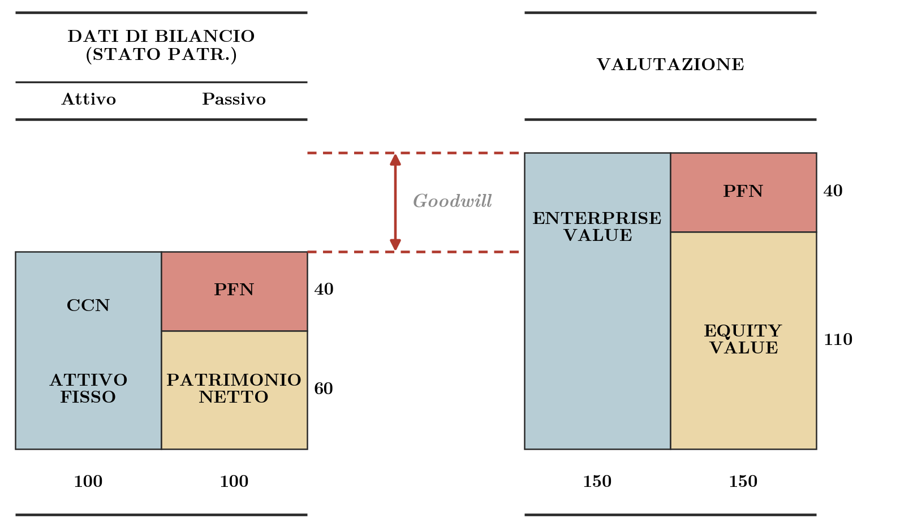
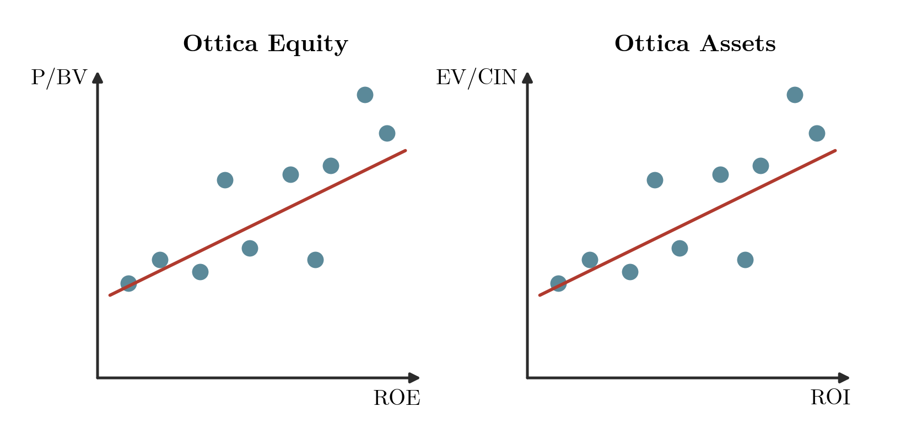
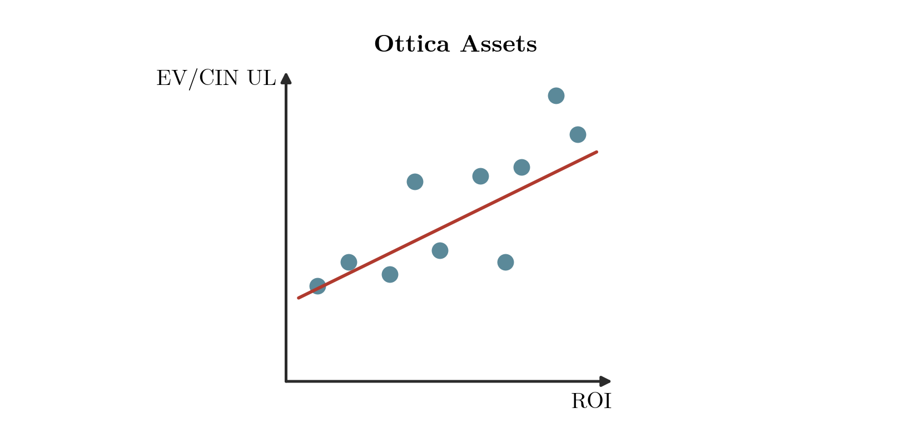

## Introduzione

Il capitolo completa la trattazione dei multipli di borsa avviata in [[FSTR 06 Multipli di Borsa lez01|il capitolo sul funzionamento e sulle tipologie dei multipli]] e ne affronta i limiti di impiego. Dopo aver richiamato Enterprise Value, Equity Value e i principali indicatori di redditività, si individuano le differenze tra imprese che rendono i multipli poco confrontabili e si derivano i determinanti del P/E. Seguono i rimedi: la scelta del campione, le rettifiche al singolo multiplo e le *value maps*, che stimano per regressione il multiplo dell'impresa da valutare a partire dalla sua redditività. Il capitolo termina con la procedura completa per valutare un'impresa non quotata.

Lettura di riferimento: capitolo 10 del testo BBS.

## Enterprise Value ed Equity Value: richiami

> [!abstract] Definizione
> Il valore di un'impresa si legge secondo due ottiche.
>
> | Ottica di bilancio | Ottica valutativa |
> |---|---|
> | **Capitale Investito Netto** = Patrimonio Netto + PFN | **Enterprise Value (EV)**: valore dell'intera azienda, cioè la sua capacità di produrre flussi di cassa |
>
> Il Capitale Investito Netto è espresso a valori di bilancio (storici); l'EV è espresso a valori di mercato. Per questo l'EV non coincide necessariamente con il Capitale Investito.

Un esempio numerico chiarisce la differenza. Nell'ottica di bilancio l'attivo (capitale circolante netto più attivo fisso) vale 100 ed è finanziato per 40 dalla posizione finanziaria netta e per 60 dal patrimonio netto. Nell'ottica valutativa l'Enterprise Value vale 150 e si scompone nella stessa PFN di 40 e in un Equity Value di 110.

**Figura 1** — Raccordo tra bilancio e valutazione: a parità di PFN (40), l'Enterprise Value (150) supera il capitale investito (100) e l'Equity Value (110) supera il patrimonio netto contabile (60); la differenza di 50 è il goodwill.

Il **goodwill** è la differenza tra EV e capitale investito: $150 - 100 = 50$. Poiché la PFN è la stessa nelle due ottiche, coincide anche con la differenza tra Equity Value e patrimonio netto contabile: $110 - 60 = 50$. Ne discendono due conclusioni generali: l'Enterprise Value è maggiore del Capitale Investito (CCN più attivo fisso), e l'Equity Value è maggiore del Patrimonio Netto contabile. Il goodwill misura la parte del valore che il mercato riconosce alla capacità dell'impresa di generare flussi di cassa e che i valori storici di bilancio non rilevano.

## Indicatori di bilancio e di mercato: richiami

Le grandezze seguenti servono a costruire i multipli e le relazioni delle sezioni successive.

> [!abstract] Definizione
> **Book value (BV)**: valore del Patrimonio Netto riportato nel bilancio. Per azione:
> $$BV_{\text{azione}} = \frac{\text{Patrimonio Netto}}{n^\circ \text{ azioni}}$$
>
> **Capitale Investito Netto (CIN)**: valore contabile dell'attivo di bilancio, pari alla somma del Capitale Circolante Netto (CCN) e dell'Attivo Fisso.
>
> **Debito (D)**: Posizione Finanziaria Netta. Se è un debito, si assume positiva; se è negativa, l'impresa dispone di liquidità superiore all'indebitamento (posizione finanziaria netta attiva).
>
> **ROE**: redditività del capitale proprio, quoziente tra due valori di bilancio, l'Utile d'esercizio ($E$) e il Patrimonio Netto:
> $$ROE = \frac{E}{\text{Patrimonio Netto}}$$
>
> **ROI**: redditività del capitale investito, quoziente tra il Reddito Operativo (EBIT) e il Capitale Investito Netto:
> $$ROI = \frac{EBIT}{CIN}$$
>
> **ROS**: redditività delle vendite, quoziente tra il Reddito Operativo (di solito l'EBIT) e i Ricavi (*Sales*):
> $$ROS = \frac{EBIT}{Sales}$$
>
> **P/BV**: prezzo di mercato di un'azione diviso il BV di un'azione.
>
> **EPS** (*earnings per share*, utili per azione): quoziente tra gli utili della società ($E$) e il numero di azioni in circolazione:
> $$EPS = \frac{E}{n^\circ \text{ azioni}}$$
>
> **DPS** (*dividend per share*, dividendo per azione): quota di utile messa a disposizione come dividendo, che si ottiene sottraendo dall'utile una quota $b$ di ritenzione. Il dividendo per azione è quindi l'utile per azione moltiplicato per il complemento a uno della percentuale di ritenzione:
> $$DPS = EPS \times (1-b)$$
>
> **$r_E$**: costo del capitale proprio, cioè il rendimento atteso dagli azionisti.

Il ROI è riferito al reddito operativo e non all'utile netto. Nelle relazioni delle *value maps* compare infatti il prodotto $ROI\,(1-t_c)$, che rapporta al capitale investito il reddito operativo al netto delle imposte (NOPAT): con l'utile netto al numeratore le imposte verrebbero dedotte due volte.

## Le criticità nell'impiego dei multipli

Le criticità si dividono in due famiglie. La prima riguarda la comparabilità tra l'impresa da valutare e le imprese del campione: crescita e redditività, leva finanziaria, leva operativa, principi contabili e profili fiscali. La seconda riguarda la costruzione del singolo multiplo: proventi e oneri straordinari, investimenti extra, crediti fiscali, perdite e bilanci consolidati. Tra le rettifiche del singolo multiplo rientra anche l'effetto di diluizione dei prezzi.

Si parte dalla comparabilità, con la relazione teorica tra il P/E e le grandezze che lo determinano.

## Comparabilità: i determinanti del multiplo P/E

> [!note] Dimostrazione
> Si vuole individuare da quali grandezze dipende il multiplo Prezzo/Utili, per capire quali differenze tra imprese ne compromettono il confronto.
>
> **Modello di Gordon.** Il prezzo dell'azione è il valore attuale dei dividendi attesi, che crescono al tasso costante $g$ e sono attualizzati al costo del capitale proprio $r_E$:
> $$P = \frac{EPS(1-b)}{r_E - g}$$
>
> Qui $b$ è la quota di utili reinvestita, $(1-b)$ la quota distribuita e $DPS = EPS(1-b)$ il dividendo per azione atteso; $EPS$ indica l'utile per azione atteso nel primo esercizio.
>
> **Costo del capitale proprio e crescita.** La seconda proposizione di Modigliani-Miller in presenza di imposte, nell'ipotesi di debito costante e perpetuo, esprime il costo del capitale proprio in funzione del costo del capitale unlevered $r_0$, del costo del debito $r_D$, dell'aliquota fiscale $t_c$ e del rapporto Debito/Equity:
> $$r_E = r_0 + (r_0 - r_D)(1-t_c)\frac{D}{E}$$
>
> La crescita è il prodotto tra redditività del capitale proprio e quota di utili reinvestita: $g = ROE \cdot b$. Sostituendo entrambe le relazioni nel modello di Gordon si ottiene:
> $$P = \frac{EPS(1-b)}{r_0 + (r_0 - r_D)(1-t_c)\dfrac{D}{E} - ROE \cdot b}$$
>
> **Determinanti del P/E.** Dividendo entrambi i membri per $EPS$:
> $$\frac{P}{EPS} = \frac{1-b}{r_0 + (r_0 - r_D)(1-t_c)\dfrac{D}{E} - ROE \cdot b}$$
>
> dove $b$ è la quota di utili reinvestita.
>
> **Lettura dei termini.** Ciascuna grandezza è collegata a una fonte di difformità tra le imprese:
>
> | Termine | Fonte di difformità |
> |---|---|
> | $EPS$, al denominatore del multiplo | regole contabili, che determinano l'utile |
> | $r_0$ e il differenziale $(r_0 - r_D)$ | rischio operativo |
> | $(1-t_c)$ | profili fiscali |
> | $D/E$ | rischio finanziario (leva finanziaria) |
> | $ROE \cdot b$ | crescita e redditività |
>
> Il numeratore $(1-b)$ è la quota di utili distribuita.
>
> Differenze in uno qualsiasi di questi elementi producono P/E diversi tra imprese anche quando gli altri coincidono. Da qui nascono le criticità di comparabilità elencate sopra.

## Rimedi alle difformità contabili, fiscali e di leva operativa

Per le difformità dovute ai regimi contabili e ai regimi fiscali si privilegiano comparable dello stesso paese, soggette alle stesse regole contabili e allo stesso sistema fiscale.

Per la leva operativa si rettifica il livello di leva delle comparable in base al rapporto tra costi fissi e costi variabili dell'impresa da valutare. Il rimedio ha un limite pratico: la suddivisione tra costi fissi e variabili spesso non è disponibile, e la rettifica risulta troppo laboriosa rispetto ai vantaggi che offre.

## Rimedi alle difformità di crescita e redditività

Per le differenze di crescita e redditività tra imprese comparabili esistono tre strade. La prima è rettificare il profilo di crescita delle comparable, adeguandolo a quello dell'impresa da valutare; il procedimento è complesso e il multiplo perde di immediatezza. La seconda è selezionare un campione di imprese con profili di crescita e redditività simili, che però potrebbero non esistere. La terza è ricorrere alle *value maps*, che si fondano sulle relazioni tra redditività e multipli di borsa e richiedono un campione di numerosità statistica adeguata. Quest'ultimo metodo è sviluppato nelle sezioni seguenti.

## Value maps: le relazioni tra redditività e multipli in assenza di crescita

> [!tip] Teorema
> Le *value maps* collegano un indicatore di redditività contabile a un multiplo di mercato. In assenza di crescita le relazioni teoriche sono tre.
>
> **1. ROE e P/BV (ottica equity)**
> $$\frac{P_0}{BV_0} = \frac{ROE}{r_E}$$
>
> Il multiplo mette in relazione la redditività del patrimonio netto con il costo del capitale di rischio.
>
> - Se $ROE = r_E$, il valore di stima del capitale dell'impresa è uguale al suo *book value*, calcolato come differenza tra valore netto contabile delle attività e delle passività.
> - Se $ROE > r_E$, il management crea nuova ricchezza e il valore di mercato risulta maggiore del valore contabile.
> - Se $ROE < r_E$, il valore di mercato del capitale è minore del valore contabile.
>
> **2. ROI ed EV/CIN (ottica assets)**
> $$\frac{EV_0}{CIN_0} = \frac{ROI\,(1-t_c)}{WACC}$$
>
> Il multiplo mette in relazione la redditività del capitale investito netto, al netto delle imposte, con il costo medio ponderato del capitale.
>
> - Se $ROI\,(1-t_c) = WACC$, il valore di stima dell'impresa è uguale al suo *book value*, calcolato come Capitale Investito Netto.
> - Se $ROI\,(1-t_c) > WACC$, il management crea nuova ricchezza e il valore di mercato risulta maggiore del valore contabile.
> - Se $ROI\,(1-t_c) < WACC$, il valore di mercato è minore del valore contabile.
>
> **3. ROS ed EV/Sales (ottica assets)**
> $$\frac{EV_0}{Sales_0} = \frac{ROS_0\,(1-t_c)}{WACC}$$
>
> A parità di WACC (e di aliquota), l'EV/Sales dipende dal ROS.

> [!note] Dimostrazione
> Le tre relazioni discendono dalle formule di valutazione in steady state (flussi costanti, nessun investimento netto), richiamate in [[FSTR 03 Modelli Valutazione Finanziaria Parte1|il capitolo sui modelli sintetici di valutazione]].
>
> **Ottica equity.** In steady state il valore del capitale è il reddito di bilancio capitalizzato al costo del capitale proprio. Per azione, $P_0 = EPS / r_E$: è il caso $b = 0$ della formula del P/E ricavata sopra. Dividendo per il book value per azione e ricordando che $ROE = EPS / BV_0$:
> $$\frac{P_0}{BV_0} = \frac{EPS}{BV_0 \cdot r_E} = \frac{ROE}{r_E}$$
>
> **Ottica assets.** In steady state il flusso disponibile per l'impresa coincide con il NOPAT, per cui $EV_0 = NOPAT / WACC = EBIT\,(1-t_c) / WACC$. Dividendo per il capitale investito e per i ricavi:
> $$\frac{EV_0}{CIN_0} = \frac{EBIT}{CIN_0}\cdot\frac{1-t_c}{WACC} = \frac{ROI\,(1-t_c)}{WACC}, \qquad \frac{EV_0}{Sales_0} = \frac{ROS_0\,(1-t_c)}{WACC}$$
>
> **Condizioni di creazione di valore.** Con $ROE = r_E$ la prima relazione dà $P_0 = BV_0$; con $ROI\,(1-t_c) = WACC$ la seconda dà $EV_0 = CIN_0$. Sopra queste soglie il multiplo supera l'unità, sotto le soglie è inferiore a uno.

## Value maps: stima per regressione e applicazione

Nella pratica le relazioni teoriche si stimano con una regressione lineare su un campione di imprese comparabili. In un diagramma a dispersione il multiplo di mercato si riporta sull'asse verticale e l'indicatore di redditività sull'asse orizzontale, con un punto per ogni impresa e una retta interpolante. Nelle formule che seguono $\alpha$ e $\beta$ sono l'intercetta e il coefficiente angolare della retta, $\varepsilon$ è l'errore di regressione e l'indice *imp.* indica l'impresa oggetto di valutazione.

**Figura 2** — Value maps in ottica equity e in ottica assets: ogni punto è un'impresa comparabile e la retta di regressione rossa mostra la relazione crescente tra P/BV e ROE (a sinistra) e tra EV/CIN e ROI (a destra); la retta stimata sul campione fornisce il multiplo dell'impresa da valutare a partire dal suo ROE o dal suo ROI.

### Ottica equity: P/BV e ROE

Il multiplo si stima sul campione e si applica poi al ROE dell'impresa da valutare. Moltiplicato per il patrimonio netto contabile ($CP$, capitale proprio) dell'impresa, fornisce direttamente il valore del capitale:

$$P/BV = \alpha + \beta \times ROE + \varepsilon$$
$$(P/BV)_{\text{imp.}} = \alpha + \beta \times ROE_{\text{imp.}}$$
$$E_{\text{imp.}} = (P/BV)_{\text{imp.}} \times CP_{\text{imp.}}$$

### Ottica assets: EV/CIN e ROI

In ottica assets il multiplo applicato al capitale investito fornisce l'Enterprise Value, da cui si sottrae la PFN per ottenere il valore del capitale:

$$EV/CIN = \alpha + \beta \times ROI + \varepsilon$$
$$(EV/CIN)_{\text{imp.}} = \alpha + \beta \times ROI_{\text{imp.}}$$
$$EV_{\text{imp.}} = (EV/CIN)_{\text{imp.}} \times CIN_{\text{imp.}}$$
$$E_{\text{imp.}} = EV_{\text{imp.}} - PFN_{\text{imp.}}$$

### Ottica assets: EV/Sales e ROS

La stessa procedura vale per la relazione tra ROS ed EV/Sales:

**Figura 3** — Value map EV/Sales e ROS: la retta di regressione sul campione di comparabili mostra la relazione crescente tra redditività delle vendite e multiplo EV/Sales, e permette di stimare il multiplo dell'impresa da valutare dal suo ROS.

$$EV/SALES = \alpha + \beta \times ROS + \varepsilon$$
$$(EV/SALES)_{\text{imp.}} = \alpha + \beta \times ROS_{\text{imp.}}$$
$$EV_{\text{imp.}} = (EV/SALES)_{\text{imp.}} \times SALES_{\text{imp.}}$$
$$E_{\text{imp.}} = EV_{\text{imp.}} - PFN_{\text{imp.}}$$

### Value maps unlevered: crescita, redditività e indebitamento insieme

Il multiplo EV/CIN osservato sulle comparable dipende anche dalla loro struttura finanziaria. Per risolvere congiuntamente i problemi di crescita e redditività e quello dell'indebitamento si costruisce la *value map* sul multiplo **EV/CIN unlevered** (UL), cioè calcolato su un Enterprise Value depurato dal valore dello scudo fiscale del debito. Il legame tra ROI e multiplo unlevered è più stretto di quello tra ROI e multiplo levered, che non dipende solo dal ROI.

**Figura 4** — Value map unlevered: la regressione di EV/CIN unlevered su ROI mostra la relazione crescente nel campione di comparabili; a differenza della versione levered, il multiplo non incorpora l'effetto della struttura finanziaria delle imprese del campione.

La relazione stimata e la sua applicazione all'impresa da valutare sono:

$$EV/CIN\ UL = \alpha + \beta \times ROI + \varepsilon$$
$$(EV/CIN\ UL)_{\text{imp.}} = \alpha + \beta \times ROI_{\text{imp.}}$$
$$EV\ UL_{\text{imp.}} = (EV/CIN\ UL)_{\text{imp.}} \times CIN_{\text{imp.}}$$

L'Enterprise Value levered si ottiene aggiungendo il valore dello scudo fiscale del debito, calcolato sull'indebitamento dell'impresa da valutare:

$$EV_{\text{imp.}} = EV\ UL_{\text{imp.}} + D \times t_c$$
$$E_{\text{imp.}} = EV_{\text{imp.}} - PFN_{\text{imp.}}$$

Il valore creato dal debito è così modulato sull'impresa specifica e non sul campione di comparable. Il problema di comparabilità dovuto a crescita e redditività è risolto dall'uso del ROI come variabile esplicativa, quello dovuto alla diversa leva finanziaria dall'uso del multiplo unlevered.

> [!note] Dimostrazione
> La scomposizione dell'Enterprise Value in valore unlevered e scudo fiscale è quella del modello del valore attuale modificato, richiamato in [[FSTR 04-full Modelli Valutazione Finanziaria Parte2|il capitolo sul valore attuale modificato]]. In steady state, con debito costante $D$ e perpetuo, lo scudo fiscale annuo $D \cdot r_D \cdot t_c$ attualizzato al costo del debito vale $D\,t_c$, e il valore unlevered è il NOPAT capitalizzato al costo del capitale unlevered:
> $$EV = \frac{EBIT\,(1-t_c)}{r_0} + D\,t_c$$
>
> Il multiplo unlevered di una comparable si ottiene invertendo questa relazione, con il debito $D$ e l'aliquota $t_c$ della comparable stessa: $EV\ UL = EV - D \cdot t_c$. In steady state, dividendo per il capitale investito:
> $$\frac{EV\ UL}{CIN} = \frac{ROI\,(1-t_c)}{r_0}$$
>
> Il multiplo unlevered dipende quindi dalla sola redditività operativa (oltre che da $r_0$ e da $t_c$), mentre il multiplo levered contiene anche il termine $t_c \cdot D/CIN$ legato all'indebitamento:
> $$\frac{EV}{CIN} = \frac{ROI\,(1-t_c)}{r_0} + t_c\,\frac{D}{CIN}$$
> È questa la ragione per cui la regressione sul multiplo unlevered lega più strettamente il multiplo al ROI.

## Impiego di un singolo multiplo: rettifiche alle criticità

Per ciascuna criticità legata al singolo multiplo la soluzione operativa è la seguente.

| Criticità | Soluzione |
|---|---|
| Proventi e oneri straordinari | Uso del P/E *adjusted*; uso di multipli in ottica *assets* |
| Investimenti extra | Rettifica «contabile» del riferimento di prezzo o di EV |
| Crediti fiscali | Rettifica «contabile» del riferimento di prezzo o di EV e simulazione dell'imposizione fiscale |
| Presenza di perdite | Impiego del multiplo EV/Sales |
| Effetto di diluizione dei prezzi | Uso di corsi di borsa riferiti a periodi non influenzati da eventi straordinari (ad esempio un aumento di capitale) |
| Strutture di gruppo (bilanci consolidati) | Rettifica del patrimonio e delle componenti di reddito di pertinenza di terzi |

Con utili negativi il P/E perde significato; il multiplo EV/Sales, calcolato sui ricavi, resta applicabile.

## Procedura di valutazione di un'impresa non quotata con i multipli

Il procedimento di base (scelta del campione e dei multipli, media, moltiplicazione per la grandezza dell'impresa, sottrazione della PFN) è descritto in [[FSTR 06 Multipli di Borsa lez01|il capitolo sul funzionamento dei multipli]]. Tenendo conto delle criticità trattate sopra, la procedura completa si articola in otto passi.

1. Selezione delle *comparable*, possibilmente dello stesso paese.
2. Scelta dei multipli più appropriati.
3. Pulitura delle criticità relative al singolo multiplo.
4. Selezione di un sotto-campione di imprese con redditività e crescita simili e deleveraggio dei multipli.
5. Calcolo della media dei multipli oppure, con le *value maps*, riferimento al multiplo EV/CIN unlevered.
6. Moltiplicazione del riferimento medio (o del risultato della *value map*) per la grandezza patrimoniale o economica propria dell'impresa da valutare.
7. Somma del valore degli scudi fiscali dell'impresa da valutare ($D \times t_c$), quando i multipli sono stati depurati dell'effetto della leva.
8. Sottrazione, se i multipli sono *asset side*, del valore della posizione finanziaria netta dell'impresa da valutare.

Ogni gruppo di passi risponde a una famiglia di criticità. Comparable dello stesso paese attenuano le difformità di regime contabile e fiscale (passo 1); la scelta dei multipli e la loro pulitura riguardano il singolo multiplo (passi 2 e 3); il sotto-campione omogeneo, il deleveraggio e le *value maps* trattano le difformità di crescita, redditività e leva finanziaria (passi 4 e 5). Gli ultimi tre passi riportano il multiplo, o il risultato della *value map*, al valore dell'impresa, aggiungendo lo scudo fiscale e sottraendo la PFN.
