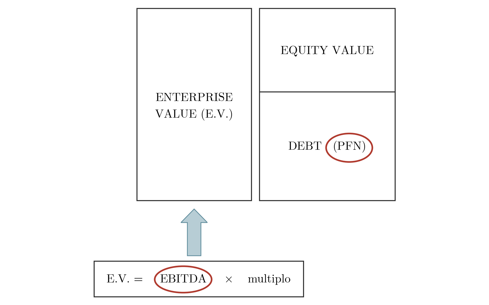

## Collocazione nel corso

La due diligence supporta le operazioni di acquisizione e la financial due diligence (F.D.D.) ne è la componente finanziaria. Nel corso l'argomento segue le decisioni di investimento dell'impresa indebitata, i [[FSTR 03 Modelli Valutazione Finanziaria Parte1|metodi DCF]] e i [[FSTR 06 Multipli di Borsa lez01|multipli di borsa]], con cui si passa dal valore degli investimenti al valore d'impresa, e [[FSTR 12 Valutazione Operazioni di Integrazione|la crescita esterna con il valore delle operazioni di integrazione]]. Un quadro generale dell'attività è offerto dal [[FSTR 09 La Due Diligence|capitolo sulla due diligence]].

## Struttura di un report di financial due diligence

Un report di F.D.D. è organizzato tipicamente in cinque parti.

L'*executive summary* riporta la normalizzazione dell'EBITDA, gli aggiustamenti (normalizzazione) della PFN, gli aspetti contrattuali e i *deal breakers*, cioè gli elementi che possono far fallire l'operazione. La parte su business, clienti e fornitori descrive il business e il mercato in cui opera l'azienda, le eventuali *related parties*, i principali clienti e fornitori e le tempistiche di incasso e di pagamento. La parte H.R. contiene l'organigramma funzionale, la remunerazione e il costo medio per FTE (*full time equivalent*), gli incentivi e i bonus.

La parte sui dati storici è la più estesa e comprende le analisi seguenti.

- Il conto economico riclassificato e l'analisi delle sue voci.
- L'analisi dei ricavi e dei costi, con la descrizione di quelli non ricorrenti o non inerenti.
- La descrizione dell'EBITDA, se possibile per prodotto o divisione, con il grafico dell'EBITDA bridge (il passaggio dall'EBITDA contabile a quello rettificato), l'analisi della *Quality of Earnings* (QoE) e l'evidenza degli *adjustments*.
- Lo stato patrimoniale riclassificato secondo il criterio gestionale, con l'analisi delle principali voci e grandezze (CCN, PFN).
- La composizione delle immobilizzazioni, anche finanziarie, con l'analisi dei CAPEX distinti in ampliamento e sostituzione.
- Il dettaglio di crediti e debiti commerciali e diversi.
- L'analisi delle rimanenze di magazzino: rotazione, obsolescenza, merci a lenta movimentazione (*slow-moving*).
- L'andamento del CCN.
- La composizione dettagliata e l'andamento della PFN, con gli eventuali elementi di aggiustamento e la descrizione dei *debt-like items*.
- L'analisi delle poste valutative (fondi rischi e fondi svalutazione).

L'ultima parte riguarda i dati prospettici: contiene la revisione del business plan e l'analisi della sua sostenibilità.

## Perché analizzare EBITDA e PFN

Nel metodo dei multipli l'Enterprise Value si ottiene moltiplicando l'EBITDA per un multiplo. Il prezzo pagato per l'azienda, cioè l'Equity Value, si ricava sottraendo all'Enterprise Value il debito, misurato dalla PFN.

> [!abstract] Definizione
> Enterprise Value ed Equity Value dipendono da EBITDA e PFN secondo le relazioni
>
> $$E.V. = EBITDA \times \text{multiplo}$$
>
> $$\text{Equity Value} = \text{Enterprise Value (E.V.)} - \text{Debt (PFN)}$$
>
> L'Enterprise Value è quindi la somma di Equity Value e PFN.

**Figura 1** — Dall'EBITDA all'Equity Value: l'Enterprise Value, ottenuto come EBITDA per multiplo, si scompone in Equity Value (blocco superiore) e debito misurato dalla PFN (blocco inferiore). EBITDA e PFN sono le due grandezze evidenziate perché la prima determina l'Enterprise Value e la seconda è la quota da sottrarre per ottenere il prezzo.

L'attenzione della due diligence si concentra perciò sulla corretta determinazione dell'EBITDA, da cui l'Enterprise Value discende tramite il multiplo, e della PFN, che viene sottratta per ottenere il prezzo.

## I tre indicatori: EBITDA, PFN e CCN

### EBITDA

L'EBITDA è la grandezza a cui si applica il multiplo per valutare l'azienda e deve essere sostenibile nel tempo. Per questo lo si normalizza da elementi non ricorrenti e da elementi non inerenti, e se ne verificano il trend e l'eventuale stagionalità. L'obiettivo è evitare che il prezzo pagato dall'acquirente non sia congruo.

### PFN

Poiché l'Equity Value è pari all'Enterprise Value meno la PFN, un debito sottostimato fa salire il prezzo. La PFN va quindi normalizzata, in modo che rappresenti il reale valore dell'indebitamento aziendale. Si vuole così evitare che una PFN anomalamente bassa costringa l'acquirente a pagare un prezzo immotivatamente elevato.

### CCN

Il capitale circolante netto (CCN) varia in base a tre grandezze principali: i crediti commerciali e le rimanenze di magazzino, che lo aumentano, e i debiti commerciali, che lo riducono. La stagionalità del business può influire sul suo livello. La verifica serve a evitare che un CCN anomalamente basso costringa l'acquirente a esborsi finanziari subito dopo l'acquisizione.

## EBITDA: definizione e normalizzazione

> [!abstract] Definizione
> L'**EBITDA** (*Earnings Before Interest, Taxes, Depreciation and Amortization*) si calcola nel conto economico civilistico come
>
> $$EBITDA = \text{A) Valore della produzione} - \text{B) Costi della produzione} + \text{Ammortamenti e svalutazioni delle immobilizzazioni}$$

> [!abstract] Definizione
> La **normalizzazione** consiste nell'eliminare dalla redditività d'esercizio gli elementi eccezionali per loro natura o estranei al core business dell'azienda, siano essi positivi o negativi. Si ottiene così un livello «normale» di redditività, utilizzabile nei modelli di valutazione e sostenibile nel tempo.

La normalizzazione riguarda tre categorie di elementi: gli elementi non ricorrenti o straordinari, le politiche di bilancio (per esempio le capitalizzazioni) e i costi e ricavi non collocati correttamente (per esempio le spese bancarie).

## EBITDA: esempio di normalizzazione

L'esempio parte dal conto economico degli esercizi 2020 e 2019 di una società e dalle informazioni raccolte durante la due diligence sull'esercizio 2020. Si calcola l'EBITDA del 2020 e lo si normalizza.

### Dati di partenza

> [!example] Esempio
> Conto economico (importi in euro)
>
> | Conto economico | 31-12-2020 | 31-12-2019 |
> |---|---|---|
> | A) Valore della produzione | | |
> | 1) ricavi delle vendite e delle prestazioni | 2.617.002 | 3.324.713 |
> | 2), 3) variazioni delle rimanenze di prodotti in corso di lavorazione, semilavorati e finiti e dei lavori in corso su ordinazione | | |
> | 2) variazioni delle rimanenze di prodotti in corso di lavorazione, semilavorati e finiti | (88.956) | 74.438 |
> | 5) altri ricavi e proventi | | |
> | contributi in conto esercizio | 31.749 | 0 |
> | altri | 27.141 | 2.478 |
> | Totale altri ricavi e proventi | 58.890 | 2.478 |
> | **Totale valore della produzione** | **2.586.936** | **3.401.629** |
> | B) Costi della produzione | | |
> | 6) per materie prime, sussidiarie, di consumo e di merci | 1.900.051 | 2.648.636 |
> | 7) per servizi | 222.851 | 263.091 |
> | 8) per godimento di beni di terzi | 260 | 0 |
> | 9) per il personale | | |
> | a) salari e stipendi | 57.594 | 60.660 |
> | b) oneri sociali | 18.457 | 19.231 |
> | c), d), e) trattamento di fine rapporto, trattamento di quiescenza, altri costi del personale | | |
> | c) trattamento di fine rapporto | 4.453 | 4.689 |
> | Totale costi per il personale | 80.504 | 84.580 |
> | 10) ammortamenti e svalutazioni | | |
> | a), b), c) ammortamento delle immobilizzazioni immateriali e materiali, altre svalutazioni delle immobilizzazioni | 36.696 | 37.294 |
> | a) ammortamento delle immobilizzazioni immateriali | 5.691 | 5.598 |
> | b) ammortamento delle immobilizzazioni materiali | 31.005 | 31.696 |
> | d) svalutazioni dei crediti compresi nell'attivo circolante e delle disponibilità liquide | 5.436 | 5.640 |
> | Totale ammortamenti e svalutazioni | 42.132 | 42.934 |
> | 11) variazioni delle rimanenze di materie prime, sussidiarie, di consumo e merci | (74.949) | (14.824) |
> | 13) altri accantonamenti | 5.355 | 0 |
> | 14) oneri diversi di gestione | 7.716 | 11.157 |
> | **Totale costi della produzione** | **2.183.920** | **3.035.574** |
> | **Differenza tra valore e costi della produzione (A − B)** | **403.016** | **366.055** |

Durante la due diligence sull'esercizio 2020 sono emerse le informazioni seguenti.

- È stata pagata una buonuscita di 100.000 euro a un amministratore della società e il costo è stato registrato tra i costi per servizi.
- La società ha vinto una causa con un cliente, per la quale negli esercizi precedenti aveva accantonato 161.000 euro, e ha rilasciato l'intero fondo.
- È stato ceduto per 300.000 euro un immobile non più operativo, con valore netto contabile di 205.000 euro.
- Sono state contabilizzate spese bancarie per 1.500 euro, incluse tra gli oneri finanziari.

L'analisi dei costi di manutenzione degli ultimi cinque esercizi ha dato i valori seguenti.

| | 2016 | 2017 | 2018 | 2019 | 2020 |
|---|---|---|---|---|---|
| Costo storico impianti e attrezzature | 752.435 | 766.564 | 767.567 | 770.433 | 774.361 |
| Manutenzione ordinaria | 90.292 | 95.821 | 92.108 | 23.113 | 15.487 |
| Manutenzione straordinaria | - | - | - | - | - |
| Incidenza della manutenzione | 12% | 13% | 12% | 3% | 2% |

L'incidenza è il rapporto tra manutenzione ordinaria e costo storico di impianti e attrezzature (nel 2016, 90.292 / 752.435 = 12%).

Lo scadenzario dei crediti verso clienti degli ultimi cinque esercizi mostra questi valori.

| | 2016 | 2017 | 2018 | 2019 | 2020 |
|---|---|---|---|---|---|
| Valore nominale dei crediti commerciali | 1.108.388 | 1.232.715 | 1.706.443 | 1.903.221 | 2.104.112 |
| Crediti scaduti da oltre 12 mesi | 116.655 | 118.899 | 122.456 | 126.433 | 128.490 |

Il legale della società ha comunicato per iscritto una possibile perdita di 32.000 euro per un contenzioso con un cliente, su merce fatturata nel 2019 e contestata, emersa a maggio 2020. L'azienda non ha ancora recepito in bilancio l'esito del contenzioso.

### Calcolo dell'EBITDA 2020

L'EBITDA civilistico si ottiene aggiungendo alla differenza tra valore e costi della produzione (403.016 euro) gli ammortamenti delle immobilizzazioni materiali e immateriali. Le svalutazioni dei crediti (5.436 euro) e gli altri accantonamenti (5.355 euro) restano tra i costi.

> [!example] Esempio
>
> | Voce | Importo |
> |---|---|
> | A) Valore della produzione | 2.586.936 |
> | B) Costi della produzione | (2.183.920) |
> | + ammortamenti delle immobilizzazioni materiali | 31.005 |
> | + ammortamenti delle immobilizzazioni immateriali | 5.691 |
> | **EBITDA 2020** | **439.712** |

### Normalizzazione dell'EBITDA 2020

Ogni rettifica (*adjustment*) positiva aumenta l'EBITDA, ogni rettifica negativa lo riduce. L'ultima riga della tabella è l'EBITDA rettificato.

> [!example] Esempio
>
> | Voce | Adjustment 2020 | Nota | Motivazione |
> |---|---|---|---|
> | EBITDA civilistico | 439.712 | | |
> | Buonuscita amministratore | 100.000 | 1 | Costo non ricorrente |
> | Rilascio fondo | (161.000) | 2 | Ricavo non di «competenza» del 2020 |
> | Plusvalenza immobile | (5.000) | 3 | Ricavo non inerente |
> | Spese bancarie | (1.500) | 4 | Operative, da includere nell'EBITDA |
> | Livello congruo di manutenzioni annue | (77.253) | 5 | Manutenzioni medie 2016-2018 pari a 92.740; maggiori manutenzioni congrue rispetto a quelle del 2020: 77.253 |
> | Contenzioso cliente | (32.000) | 6 | Di competenza e non presente a bilancio |
> | Crediti incagliati e non svalutati | (61.293) | 7 | Media dei crediti scaduti da oltre 12 mesi pari a 122.587; si applica prudenzialmente una svalutazione del 50% |
> | Contributi in conto esercizio | (31.749) | 8 | Ricavi non ricorrenti e non inerenti |
> | **EBITDA rettificato** | **169.917** | | |

Le rettifiche, numerate come nella tabella, si giustificano come segue.

1. La buonuscita di 100.000 euro all'amministratore, registrata tra i costi per servizi, è un costo non ricorrente. Si somma all'EBITDA, eliminando il suo effetto negativo.
2. Il rilascio del fondo di 161.000 euro, accantonato negli esercizi precedenti per la causa poi vinta con il cliente, è un provento che non appartiene alla competenza del 2020. Si sottrae.
3. La plusvalenza sulla cessione dell'immobile non più operativo è un ricavo non inerente all'attività caratteristica e si sottrae. La tabella rettifica 5.000 euro, ma i dati forniti (prezzo di cessione 300.000 euro, valore netto contabile 205.000 euro) indicano una plusvalenza di 95.000 euro. Il totale di 169.917 euro è calcolato con la rettifica di 5.000; con 95.000 euro l'EBITDA rettificato sarebbe 79.917 euro.
4. Le spese bancarie di 1.500 euro sono state contabilizzate tra gli oneri finanziari, quindi sotto l'EBITDA. Poiché sono costi operativi, vanno incluse nell'EBITDA, che si riduce di 1.500 euro.
5. Le manutenzioni ordinarie hanno un'incidenza del 12-13% sul costo storico degli impianti nel 2016-2018 e solo del 3% e del 2% nel 2019 e nel 2020. Il livello congruo è la media del triennio 2016-2018, anteriore al calo: (90.292 + 95.821 + 92.108) / 3 = 92.740 euro. Le manutenzioni 2020 sono 15.487 euro e la differenza, 92.740 − 15.487 = 77.253 euro, si sottrae per riportare la spesa a un livello sostenibile nel tempo.
6. La possibile perdita di 32.000 euro sul contenzioso con il cliente, emersa a maggio 2020, è di competenza del 2020 anche se non è ancora recepita in bilancio. Si sottrae.
7. La media dei crediti scaduti da oltre 12 mesi nel periodo 2016-2020 è (116.655 + 118.899 + 122.456 + 126.433 + 128.490) / 5 = 122.587 euro. Si applica prudenzialmente una svalutazione del 50%, pari a 61.293 euro, che non è ancora stata effettuata in bilancio.
8. I contributi in conto esercizio (31.749 euro, assenti nel 2019) sono ricavi non ricorrenti e non inerenti. Si sottraggono.

Il passaggio dall'EBITDA civilistico a quello rettificato è

$$439.712 + 100.000 - 161.000 - 5.000 - 1.500 - 77.253 - 32.000 - 61.293 - 31.749 = 169.917$$

Le rettifiche riducono l'EBITDA di 269.795 euro. A parità di multiplo, l'Enterprise Value diminuisce di 269.795 euro moltiplicati per il multiplo.

## PFN: definizione e normalizzazione

> [!abstract] Definizione
> La **posizione finanziaria netta (PFN)** è la differenza tra i debiti finanziari (non solo i debiti bancari) e le disponibilità liquide:
>
> $$PFN = \text{Debiti finanziari} - \text{Disponibilità liquide}$$
>
> La PFN è positiva se i debiti finanziari superano le disponibilità liquide e negativa se sono inferiori a esse.

La PFN rappresenta il debito che serve a finanziare il business. Può variare alla data di *closing* dell'operazione, per cui si procede a un *price adjustment* (aggiustamento del prezzo). Ai fini della transazione la sua definizione è spesso fissata per contratto e può comprendere, per esempio, i debiti, i fornitori scaduti e il TFR (trattamento di fine rapporto).

Per normalizzare la PFN occorre stabilire quali voci rientrano nei debiti finanziari. L'analisi riguarda:

1. la composizione in base alle linee di debito;
2. le condizioni (tasso, scadenze, durata dei finanziamenti);
3. le garanzie e i *covenants*;
4. le passività di natura finanziaria (*debt-like items*);
5. le passività potenziali non a bilancio (contratti derivati, leasing);
6. i fornitori scaduti oltre il livello normale;
7. i debiti maturati e non pagati (contributi, bonus, indennità agli agenti);
8. i titoli classificati impropriamente come liquidità (SBF, Ri.Ba.);
9. i debiti finanziari inclusi tra gli altri debiti o tra i debiti verso fornitori;
10. i finanziamenti intercompany;
11. i finanziamenti da soci o da altri investitori;
12. le passività altamente probabili.

Nella normalizzazione si aggiungono ai debiti finanziari contabili i *debt-like items*, cioè le passività di natura finanziaria che il bilancio non classifica tra i debiti finanziari. Dalle disponibilità liquide, invece, vanno escluse le voci che non sono liquidità: i conti correnti con particolari vincoli per lo smobilizzo, i titoli e le partecipazioni, i crediti finanziari.

## PFN: esempio di normalizzazione

L'esempio parte da un estratto dello stato patrimoniale e dalle informazioni raccolte durante la due diligence sull'esercizio 2020. Si calcola la PFN del 2020 e la si normalizza.

### Dati di partenza

> [!example] Esempio
> Stato patrimoniale, attivo (estratto, importi in euro)
>
> | Voce | Importo |
> |---|---|
> | IV) DISPONIBILITÀ LIQUIDE | |
> | 1) Depositi bancari e postali | 8.785.438 |
> | 3) Denaro e valori in cassa | 781 |
> | **Totale IV) DISPONIBILITÀ LIQUIDE** | **8.786.219** |
> | Totale C) ATTIVO CIRCOLANTE | 17.173.791 |
> | Totale D) RATEI E RISCONTI | 60.379 |
> | **Totale STATO PATRIMONIALE ATTIVO** | **43.384.898** |
>
> Stato patrimoniale, passivo (estratto, importi in euro)
>
> | Voce | Importo |
> |---|---|
> | 4) DEBITI VERSO BANCHE | |
> | a) Entro 12 mesi | 3.237.664 |
> | b) Oltre 12 mesi | 14.996.999 |
> | **Totale 4) DEBITI VERSO BANCHE** | **18.234.663** |
> | 5) DEBITI VERSO ALTRI FINANZIATORI | |
> | b) Oltre 12 mesi | 220 |
> | **Totale 5) DEBITI VERSO ALTRI FINANZIATORI** | **220** |
> | 7) DEBITI VERSO FORNITORI | |
> | a) Entro 12 mesi | 4.815.885 |
> | Totale 7) DEBITI VERSO FORNITORI | 4.815.885 |
> | 12) DEBITI TRIBUTARI | |
> | a) Entro 12 mesi | 659.101 |
> | Totale 12) DEBITI TRIBUTARI | 659.101 |
> | 13) DEBITI VERSO ISTITUTI DI PREVIDENZA E DI SICUREZZA SOCIALE | |
> | a) Entro 12 mesi | 94.154 |
> | Totale 13) DEBITI VERSO ISTITUTI DI PREVIDENZA E DI SICUREZZA SOCIALE | 94.154 |
> | 14) ALTRI DEBITI | |
> | a) Entro 12 mesi | 308.073 |
> | Totale 14) ALTRI DEBITI | 308.073 |
> | Totale D) DEBITI | 24.112.096 |
> | Totale E) RATEI E RISCONTI | 44.000 |
> | **Totale STATO PATRIMONIALE PASSIVO** | **43.384.898** |

Le informazioni raccolte durante la due diligence sull'esercizio 2020 sono le seguenti.

- Alcuni clienti pagano tramite Ri.Ba. (ricevute bancarie). La società contabilizza le Ri.Ba. tra le disponibilità bancarie anche quando sono state presentate alla banca ma non ancora incassate. Al 31 dicembre 2020 ammontavano a 360.000 euro.
- Al 31 dicembre 2020 risultano debiti verso fornitori di impianti per 55.000 euro, con scadenza 31 gennaio 2021.
- Nel 2020 la società ha accantonato 55.000 euro nei fondi rischi e oneri per una controversia legale con un cliente che le ha fatto causa. La società è stata condannata in primo grado al risarcimento dell'importo.
- Al 31 dicembre 2020 lo scadenziario fornitori presenta uno scaduto superiore a 180 giorni di 77.000 euro.
- La società ha concordato con un ex dirigente una buonuscita di 155.000 euro, iscritta tra gli altri debiti inclusi nel capitale circolante commerciale al 31 dicembre 2020. Il pagamento è concordato in rate semestrali nei cinque anni successivi.

### Calcolo della PFN 2020

La PFN civilistica è la somma dei debiti verso banche e verso altri finanziatori, al netto delle disponibilità liquide: 18.234.663 + 220 − 8.786.219 = 9.448.664 euro.

> [!example] Esempio
>
> | Voce | Importo |
> |---|---|
> | Disponibilità liquide | (8.786.219) |
> | Debiti verso banche | 18.234.663 |
> | Debiti verso altri finanziatori | 220 |
> | **PFN 2020** | **9.448.664** |

### Normalizzazione della PFN 2020

Ogni rettifica della tabella aumenta la PFN.

> [!example] Esempio
>
> | Voce | Adjustment 2020 | Nota | Motivazione |
> |---|---|---|---|
> | PFN civilistica | 9.448.664 | | |
> | Ri.Ba. presentate | 360.000 | 1 | Le Ri.Ba. sono un credito e non «cash» |
> | Controversia legale | 55.000 | 2 | Esborso ragionevolmente certo |
> | Scaduto fornitori | 77.000 | 3 | Scaduto maggiore della dilazione «fisiologica» |
> | Buonuscita dirigente | 155.000 | 4 | Debito finanziario |
> | **PFN rettificata** | **10.095.664** | | |

1. Le Ri.Ba. presentate alla banca e non ancora incassate sono state contabilizzate tra le disponibilità bancarie, ma sono crediti e non liquidità. Escluse dalle disponibilità liquide, aumentano la PFN di 360.000 euro.
2. La società è stata condannata in primo grado e ha accantonato 55.000 euro nei fondi rischi e oneri. L'esborso è ragionevolmente certo e la somma si aggiunge alla PFN come passività di natura finanziaria.
3. Lo scaduto verso i fornitori oltre 180 giorni, pari a 77.000 euro, supera la dilazione fisiologica dei pagamenti commerciali e si include nella PFN.
4. La buonuscita di 155.000 euro all'ex dirigente, da pagare in rate semestrali nei cinque anni successivi, è un debito finanziario iscritto tra gli altri debiti del capitale circolante commerciale. Passa dal capitale circolante alla PFN, che aumenta di 155.000 euro.

La PFN rettificata è 9.448.664 + 360.000 + 55.000 + 77.000 + 155.000 = 10.095.664 euro, cioè 647.000 euro in più di quella civilistica. A parità di Enterprise Value l'Equity Value si riduce dello stesso importo.

I debiti verso fornitori di impianti per 55.000 euro, in scadenza il 31 gennaio 2021, non sono rettificati nella tabella.

Dalla lettura dei documenti della dataroom emergono altri elementi il cui impatto resta da quantificare e che non sono inclusi nella tabella: gli adempimenti ambientali (amianto), la messa a norma antincendio delle uscite del capannone e il fatto che uno dei primi dieci fornitori sia una parte correlata.
