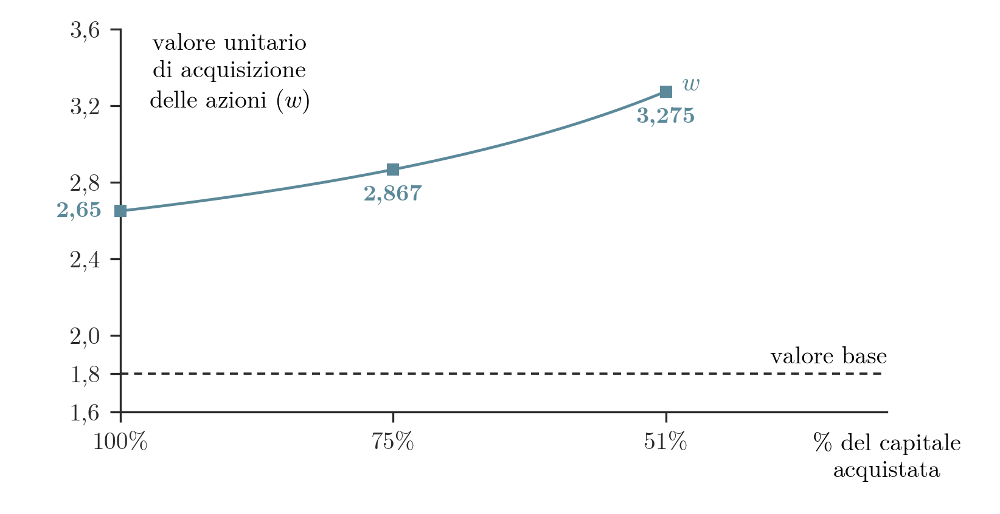

## Introduzione

La crescita esterna consiste nell'integrazione tra imprese. Il capitolo classifica queste operazioni secondo il profilo industriale e quello giuridico, poi imposta la valutazione dell'impresa acquisita: il suo valore è la somma del valore *stand alone* e del valore delle sinergie. Seguono i tipi di sinergie, il ruolo dei benefici privati nel prezzo di un pacchetto di controllo e l'effetto della quota di capitale acquistata sul prezzo per azione. Il capitolo si chiude con i premi di controllo e gli sconti di minoranza.

## Tipi di integrazione

Le operazioni di crescita esterna si classificano secondo due profili: quello industriale, che riguarda la natura economica dell'operazione, e quello giuridico, che riguarda la forma tecnica con cui si realizza.

### Profilo industriale

Un'integrazione **orizzontale** riunisce imprese che operano nella stessa linea di business. Nell'integrazione **verticale** un'impresa estende il proprio controllo a monte, verso le materie prime, oppure a valle, verso il consumatore finale. Le integrazioni **conglomerali** coinvolgono aziende che operano in settori non correlati; un esempio è il gruppo Tata, presente tra l'altro nella ristorazione, nell'acciaio, nell'auto e negli hotel.

### Profilo giuridico

Sotto il profilo giuridico l'integrazione assume tre forme.

Nella **fusione per unione** una società nuova nasce dalle società fuse, che perdono la propria precedente identità giuridica; il loro patrimonio è trasferito nella nuova società. Nella **fusione per incorporazione** l'incorporante mantiene la propria identità, mentre le incorporate la perdono e i loro patrimoni confluiscono nell'incorporante. Il **semplice acquisto delle azioni** dell'impresa in vendita lascia invece distinte le due società: cambia chi detiene le azioni della società acquistata, che conserva la propria identità giuridica.

Casi reali di ciascuna forma sono raccolti negli [[FSTR 10 Esempi di Sinergie|esempi di integrazione industriale e giuridica]].

## Il valore nelle operazioni di integrazione

Il valore di un'impresa è pari ai flussi di cassa *stand alone* attesi, cioè quelli che l'impresa genera da sola, scontati a un determinato tasso di rendimento. Quando l'impresa è oggetto di acquisizione o di fusione, il valore complessivo dipende da due componenti: i flussi di cassa *stand alone* e i flussi differenziali che l'acquisizione rende ottenibili, detti **sinergie**.

> [!abstract] Definizione
> Il valore di acquisizione è la somma del valore *stand alone* e del valore delle sinergie:
>
> $$W_{acq} = W_S + W_D$$
>
> dove $W_{acq}$ è il valore di acquisizione, $W_S$ il valore *stand alone* e $W_D$ il valore delle sinergie.

### Effetto delle sinergie sul valore: due casi

> [!example] Esempio
> La società B intende acquistare la società A. Per ciascuna componente il valore si ottiene dividendo il flusso di cassa (FC) per il tasso di rendimento (R), cioè come valore di una rendita perpetua a flusso costante: $W = FC/R$. Il valore *stand alone* è quindi $100/10\% = 1.000$. Il flusso differenziale da sinergie è attualizzato a un tasso proprio, l'8%, diverso da quello dei flussi *stand alone*.
>
> Nel primo caso i flussi da sinergie ammontano a 50 e il loro valore è $50/8\% = 625$. Il valore di acquisizione è $1.000 + 625 = 1.625$.
>
> Nel secondo caso B, dopo l'acquisizione, sostituisce il management di A. Alcuni clienti, i cui rapporti commerciali dipendevano dalla presenza del vecchio management, scelgono di non rinnovare i contratti, e i flussi di cassa legati alle sinergie diminuiscono da 50 a 40. Il loro valore scende a $40/8\% = 500$ e il valore di acquisizione a $1.000 + 500 = 1.500$.
>
> | Voce | Primo caso | Secondo caso |
> |---|---|---|
> | FC *stand alone* | 100 | 100 |
> | R *stand alone* | 10% | 10% |
> | W *stand alone* | 1.000 | 1.000 |
> | FC sinergie | 50 | 40 |
> | R sinergie | 8% | 8% |
> | W sinergie | 625 | 500 |
> | Valore di acquisizione | 1.625 | 1.500 |
>
> Una riduzione di 10 nel flusso annuo da sinergie abbassa quindi di 125 il valore di acquisizione, da 1.625 a 1.500, mentre il valore *stand alone* resta invariato.

## Tipologie di sinergie ed effetto sul valore

Il valore riconosciuto in un'operazione dipende da chi acquisisce. Se l'impresa è acquistata da una persona fisica o da un altro investitore generico, vale il valore *stand alone* definito sopra. Se è acquisita, incorporata o fusa da un'altra impresa, il valore riconosciuto è il valore *stand alone* più le sinergie. In quest'ultimo caso le sinergie si classificano in due modi: per origine e per effetto sul valore.

### Sinergie per origine

Le sinergie **generiche** si sviluppano a prescindere dal settore delle imprese e dalle parti coinvolte; un esempio è la riduzione del numero dei componenti del consiglio di amministrazione dopo l'integrazione.

Le sinergie **endemiche** dipendono dal settore in cui opera l'impresa, ad esempio perché vi è un'integrazione verticale: un reparto dell'impresa acquisita viene smantellato perché già presente nell'impresa acquirente.

Le sinergie **specifiche** dipendono dalle parti coinvolte. L'impresa A si integra con B anziché con C perché con B ottiene risparmi sui costi di trasporto dei beni; un'integrazione con un soggetto alternativo non produrrebbe lo stesso valore.

I **benefici privati** maturano in capo a chi controlla l'impresa, anziché all'insieme indistinto degli investitori, ed emergono soltanto in caso di acquisizione.

### Sinergie per effetto sul valore

Alla classificazione per origine si affianca quella per il canale attraverso cui le sinergie modificano il valore.

| Effetto sul valore | Denominazione | Come agisce |
|---|---|---|
| Flussi di cassa | sinergie operative | Modificano i flussi generati, ad esempio con la razionalizzazione dei processi o l'integrazione di funzioni. |
| Costo del capitale | sinergie finanziarie | Modificano il tasso di attualizzazione, per un cambiamento del profilo di rischio o della struttura finanziaria. |
| Scudi fiscali | sinergie fiscali | Aggiungono il valore dei risparmi d'imposta, ad esempio quelli legati alla deducibilità degli interessi sul nuovo debito. |

La quantificazione dei tre effetti è sviluppata nel capitolo sulla [[FSTR 12 Valutazione Operazioni di Integrazione|valutazione delle operazioni di integrazione]].

## Benefici privati e valore di una quota di controllo

Quando l'acquisizione non riguarda l'intero pacchetto azionario, ma solo una quota sufficiente a garantire il controllo della società, il valore di acquisizione dipende da tre componenti: i flussi di cassa *stand alone*, i flussi differenziali prodotti dalle sinergie e i flussi riferibili ai cosiddetti benefici privati.

> [!abstract] Definizione
> I **benefici privati** sono flussi di cassa di cui godono gli azionisti-manager di controllo. Possono ridurre i flussi *stand alone*, ad esempio con remunerazioni più elevate degli standard di mercato, oppure non avere alcun effetto sui flussi aziendali, ad esempio quando le risorse intangibili della società sono usate per sviluppare altri business non legati a essa.

### Valore di acquisizione con benefici privati

> [!abstract] Definizione
> Il valore di acquisizione di una quota di controllo $\alpha$ è
>
> $$W_\alpha = (W_S + W_D)\times \alpha + W_{PB^*} + (1-\alpha)\times W_{PB}$$
>
> dove:
>
> - $\alpha$ è la quota di controllo acquisita;
> - $W_S$ è il valore *stand alone*;
> - $W_D$ è il valore delle sinergie;
> - $W_{PB^*}$ è il valore dei benefici privati **senza** effetto sui flussi *stand alone*;
> - $W_{PB}$ è il valore dei benefici privati **con** effetto sui flussi *stand alone*.

### Benefici divisibili e indivisibili

La formula si ottiene separando la parte di valore che si ripartisce in proporzione alla quota di partecipazione (benefici divisibili) dalla parte che resta per intero a chi controlla (benefici indivisibili).

> [!note] Dimostrazione
> Si parte dall'equazione
>
> $$W_\alpha = (W_S + W_D - W_{PB})\times \alpha + W_{PB} + W_{PB^*} \qquad (1)$$
>
> Il termine $(W_S + W_D - W_{PB})$ è il valore divisibile, proporzionale alla quota di partecipazione. Dipende dalle sinergie che hanno impatto sui flussi, depurate dei benefici privati con effetto sui flussi, che non si ripartiscono tra gli azionisti. Vale $W_D - W_{PB} = W_{DIV}$, il valore delle sinergie divisibili. Di questo valore l'acquirente riceve la frazione $\alpha$.
>
> Il termine $W_{PB} + W_{PB^*}$, indicato anche con $W_{IND}$, è il valore dei benefici indivisibili, con e senza effetto sui flussi. Va per intero al socio di maggioranza, qualunque sia $\alpha$.
>
> Sviluppando il prodotto in (1) e raccogliendo i termini in $W_{PB}$ si ottiene
>
> $$W_\alpha = (W_S + W_D)\times \alpha - \alpha\, W_{PB} + W_{PB} + W_{PB^*} = (W_S + W_D)\times \alpha + W_{PB^*} + (1-\alpha)\times W_{PB} \qquad (2)$$
>
> che è la formula del paragrafo precedente.
## Il valore di acquisizione delle partecipazioni di controllo

### Formula sintetica

Poiché $W_{DIV} = W_D - W_{PB}$ e $W_{IND} = W_{PB} + W_{PB^*}$, la (1) si scrive in termini di sinergie e opportunità divisibili e indivisibili.

> [!abstract] Definizione
> $$W_\alpha = (W_S + W_{DIV})\,\alpha + W_{IND}$$
>
> dove:
>
> - $W_\alpha$ è il valore di acquisizione del pacchetto;
> - $W_S$ è il valore *stand alone* dell'azienda target, cioè dell'impresa oggetto di acquisizione;
> - $W_{DIV}$ è il valore delle sinergie e opportunità divisibili;
> - $\alpha$ è la frazione del capitale acquisita;
> - $W_{IND}$ è il valore delle sinergie e opportunità indivisibili.

### Esempio numerico

> [!example] Esempio
> Gli importi sono in milioni (ML). I dati sono:
>
> - $W_S = 180$;
> - numero di azioni $N = 100$;
> - $W_{DIV} = 20$;
> - $W_{IND} = 65$.
>
> Il valore *stand alone* per azione è $180/100 = 1{,}8$.
>
> Con l'acquisizione del 100% del capitale:
>
> $$W_{ACQ}(100\%) = 180 + 20 + 65 = 265$$
> $$w = 265/100 = 2{,}65$$
>
> Il valore di un pacchetto pari al 60% del capitale si ottiene applicando $\alpha = 0{,}6$ ai soli termini divisibili:
>
> $$W_{ACQ}(60\%) = W_S\times 0{,}6 + W_{DIV}\times 0{,}6 + W_{IND} = 180\times 0{,}6 + 20\times 0{,}6 + 65 = 185$$
> $$w = 185/(100\cdot 60\%) = 3{,}083$$
>
> Il valore unitario **aumenta al diminuire** della percentuale di capitale acquisito: acquistando meno del 100%, il valore delle sinergie e opportunità indivisibili ($W_{IND}$) si concentra su un numero minore di azioni e ne fa salire il valore unitario.

### Sensitività rispetto alla quota acquisita

Il valore unitario di acquisizione è $w = W_\alpha / (N\alpha)$. Con i dati dell'esempio diventa

$$w(\alpha) = \frac{W_S + W_{DIV}}{N} + \frac{W_{IND}}{N\,\alpha} = 2 + \frac{0{,}65}{\alpha}$$

La prima componente (2 per azione) non dipende da $\alpha$. La seconda è il valore indivisibile ripartito sulle sole azioni acquistate e cresce quando $\alpha$ scende, con pendenza sempre maggiore: la curva è convessa.

| Quota acquisita $\alpha$ | Valore del pacchetto $W_\alpha$ | Valore unitario $w$ |
|---|---|---|
| 100% | 265 | 2,65 |
| 75% | 215 | 2,867 |
| 60% | 185 | 3,083 |
| 51% | 167 | 3,275 |

Il grafico seguente riporta il valore unitario per i pacchetti del 100%, del 75% e del 51%, a confronto con il valore base di 1,8 per azione.

**Figura 1** — Valore unitario di acquisizione delle azioni al variare della quota di capitale acquistata: il valore unitario passa da 2,65 con il 100% a 2,867 con il 75% e a 3,275 con il 51%, sempre al di sopra del valore base di 1,8, e cresce con pendenza maggiore man mano che la quota scende verso la soglia di controllo, perché il valore indivisibile si distribuisce su un numero minore di azioni.

## Premi e sconti nelle valutazioni

Il valore base di un'acquisizione viene aggiustato con premi e sconti.

### Premio di controllo

Se l'acquisizione delle partecipazioni consente di controllare la società, il valore di acquisizione deve incorporare i benefici del controllo. L'aggiustamento che li riflette è il **premio di controllo**.

Il premio è determinato dalla presenza di benefici privati, sia di natura monetaria sia di natura non monetaria, come il potere di decidere gli indirizzi strategici e la quotazione in Borsa. Nel modello della sezione precedente questi benefici, che spettano solo a chi controlla, confluiscono in $W_{IND}$, ed è questo termine a far crescere il valore unitario al diminuire della quota acquisita.

### Sconto di minoranza

Quando viene ceduta una quota di minoranza, l'acquirente è disposto a pagare un prezzo inferiore, per gli svantaggi di essere azionista di minoranza. Lo **sconto di minoranza** dipende da due fattori. Il primo è l'impossibilità di decidere gli indirizzi strategici, e dà luogo a uno sconto per mancanza di controllo. Il secondo è la difficoltà di negoziare partecipazioni di scarso rilievo ai fini del controllo, e dà luogo a uno sconto per mancanza di liquidità.
