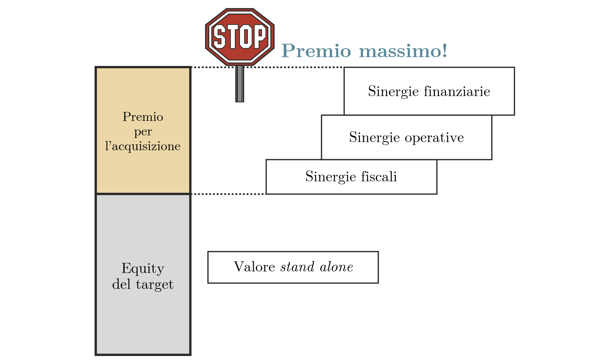

## Introduzione e riferimenti

Il capitolo quantifica il valore creato da un'operazione di integrazione. Il valore di acquisizione è la somma del valore *stand alone* del target e del valore delle sinergie, $W_{acq} = W_S + W_D$, con la notazione del capitolo sulle [[FSTR 11 Le Sinergie|sinergie]]. Qui $W_D$ si scompone in tre strati e si stima su un esempio numerico. Il confronto con il prezzo pagato dà il valore creato per l'acquirente e il premio massimo che questi può riconoscere al venditore. Seguono i rapporti di concambio minimo e massimo in una fusione per incorporazione e le motivazioni economiche, valide e dubbie, delle fusioni.

Lettura di riferimento: capitolo 9 del testo BBS.

## I tre effetti delle sinergie sul valore

Le sinergie di un'operazione di integrazione, fusione o acquisizione, incidono sul valore dell'impresa risultante attraverso tre differenziali rispetto alla situazione delle imprese separate.

| Differenziale | Su che cosa incide | Sinergie corrispondenti |
|---|---|---|
| A. Quantità | i flussi di cassa | operative |
| B. Qualità | il rischio, quindi il tasso di attualizzazione | finanziarie |
| C. Struttura finanziaria | il rapporto debt/equity obiettivo, quindi il debito e i suoi scudi fiscali | fiscali |

Le denominazioni operative, finanziarie e fiscali sono quelle della [[FSTR 11 Le Sinergie|classificazione delle sinergie per effetto sul valore]].

## Il modello di stratificazione del valore

La quantificazione delle sinergie si effettua con il **modello di stratificazione del valore**, che presuppone il [[FSTR 04-full Modelli Valutazione Finanziaria Parte2|modello del valore attuale modificato]] in *steady state*. In questa ipotesi il valore *unlevered* di un flusso operativo al netto delle imposte (FCFO) è $W_U = FCFO / r_0$, dove $r_0$ è il costo del capitale *unlevered* (indicato anche con $K_{eu}$). Con debito costante e perpetuo $D$, lo scudo fiscale vale $D\,t_c$, dove $t_c$ è l'aliquota dell'imposta societaria. Il valore *levered* è quindi $W_L = W_U + D\,t_c$ e il valore dell'equity è $W_E = W_L - D$.

> [!abstract] Definizione
> Date due imprese A e B, il valore delle sinergie $W_D$ è la somma di tre strati, elencati in ordine di difficoltà di stima crescente.
>
> 1. **Valore dei flussi incrementali**
> Capitalizza, al costo del capitale unlevered dell'entità combinata $r_{0,A+B}$, i maggiori flussi operativi $\Delta FCFO_A$ e $\Delta FCFO_B$ prodotti dall'integrazione:
> $$W_{flussi} = \frac{\Delta FCFO_A}{r_{0,A+B}} + \frac{\Delta FCFO_B}{r_{0,A+B}}$$
>
> 2. **Valore del debito incrementale**
> Il maggiore debito $\Delta D$ dell'entità combinata genera un maggiore scudo fiscale:
> $$W_{TS} = \Delta D \cdot t_c$$
>
> 3. **Valore della modifica del costo del capitale**
> È la differenza tra il valore unlevered dei flussi stand alone $FCFO_A + FCFO_B$ attualizzati al tasso dell'entità combinata e la somma dei valori unlevered stand alone, ciascuno attualizzato al tasso della propria impresa:
> $$W_{c.cap.} = \frac{FCFO_A+FCFO_B}{r_{0,A+B}} - \left(\frac{FCFO_A}{r_{0,A}}+\frac{FCFO_B}{r_{0,B}}\right)$$
>
> Il valore delle sinergie è la somma dei tre strati:
> $$W_D = W_{flussi} + W_{TS} + W_{c.cap.}$$

Il modello non include i benefici privati trattati nel capitolo sul [[FSTR 11 Le Sinergie|valore di una quota di controllo]]. Si pone quindi $W_{PB} = W_{PB^*} = 0$, da cui $W_{DIV} = W_D$ e $W_{IND} = 0$, e il valore di acquisizione di una quota $\alpha$ del capitale è $\alpha\,(W_S + W_D)$. L'esempio che segue riguarda l'acquisto dell'intero capitale ($\alpha = 1$).

> [!note] Dimostrazione
> Il valore delle sinergie è la differenza tra il valore levered dell'entità combinata e la somma dei valori levered stand alone di A e di B. Con $\Delta FCFO = \Delta FCFO_A + \Delta FCFO_B$ e $W_L = W_U + D\,t_c$:
>
> $$W_{L,A+B} = \frac{FCFO_A+FCFO_B+\Delta FCFO}{r_{0,A+B}} + (D_A+D_B+\Delta D)\,t_c$$
>
> $$W_{L,A}+W_{L,B} = \frac{FCFO_A}{r_{0,A}}+\frac{FCFO_B}{r_{0,B}} + (D_A+D_B)\,t_c$$
>
> Nella differenza i termini $(D_A+D_B)\,t_c$ si elidono. Resta il termine $\Delta FCFO / r_{0,A+B}$, che è $W_{flussi}$, il termine $\Delta D\,t_c$, che è $W_{TS}$, e la differenza tra $(FCFO_A+FCFO_B)/r_{0,A+B}$ e $FCFO_A/r_{0,A}+FCFO_B/r_{0,B}$, che è $W_{c.cap.}$. Quindi
>
> $$W_{L,A+B}-(W_{L,A}+W_{L,B}) = W_{flussi}+W_{TS}+W_{c.cap.} = W_D$$

## Esempio: valutazione stand alone di A e B

> [!example] Esempio
> Si considerano l'impresa acquirente (A) e l'impresa target (B). I valori delle ultime righe si ricavano dalle precedenti: $W_U = FCFO/r_0$, $W_L = W_U + D \times t_c$, $W_E = W_L - D$.
>
> | | Impresa acquirente (A) | Impresa target (B) |
> |---|---|---|
> | Flusso di cassa operativo al netto delle imposte (FCFO) | 4.000 | 3.000 |
> | Costo del capitale unlevered ($r_0 = K_{eu}$) | 20% | 15% |
> | Valore unlevered $W_U$ | 20.000 | 20.000 |
> | Indebitamento finanziario netto ($D$) | 10.000 | 8.000 |
> | Aliquota dell'imposta societaria ($t_c$) | 37% | 37% |
> | Valore levered $W_L$ | 23.700 | 22.960 |
> | Valore dell'equity $W_E$ | 13.700 | 14.960 |
>
> Per A: $W_U = 4.000/0{,}20 = 20.000$, $W_L = 20.000 + 10.000 \times 0{,}37 = 23.700$, $W_E = 23.700 - 10.000 = 13.700$. Per B: $W_U = 3.000/0{,}15 = 20.000$, $W_L = 20.000 + 8.000 \times 0{,}37 = 22.960$, $W_E = 22.960 - 8.000 = 14.960$. Il valore stand alone del target è il valore del suo equity, $W_S = 14.960$.
>
> Le stime degli effetti dell'acquisizione sono:
>
> $$\Delta FCFO = 1.000 \qquad \Delta D = 6.000 \qquad r_{0,A+B} = K_{eu} = 16\%$$

## La determinazione del valore di acquisizione

> [!example] Esempio
> Con i dati precedenti il valore di acquisizione si ottiene sommando al valore stand alone del target i tre strati delle sinergie.
>
> Flussi operativi incrementali:
>
> $$W_{flussi} = \frac{1.000}{0{,}16} = 6.250$$
>
> Riduzione del rischio, cioè modifica del costo del capitale:
>
> $$W_{c.cap.} = \frac{3.000+4.000}{0{,}16} - \frac{3.000}{0{,}15} - \frac{4.000}{0{,}20} = 43.750 - 20.000 - 20.000 = 3.750$$
>
> La somma dei valori unlevered stand alone, 40.000, corrisponde a un tasso implicito del 17,5% sui flussi complessivi di 7.000. Attualizzati al 16% gli stessi flussi valgono 43.750.
>
> Maggiori scudi fiscali, generati dal debito incrementale (differenza di struttura finanziaria):
>
> $$W_{TS} = 6.000 \times 0{,}37 = 2.220$$
>
> Il valore delle sinergie e il valore di acquisizione sono:
>
> $$W_D = 6.250 + 3.750 + 2.220 = 12.220$$
>
> $$W_{acq} = W_S + W_D = 14.960 + 12.220 = 27.180$$
>
> | Strato | Calcolo | Valore | Valore cumulato |
> |---|---|---|---|
> | Valore stand alone del target | $W_E$ di B | 14.960 | 14.960 |
> | Flussi operativi incrementali | $1.000/0{,}16$ | 6.250 | 21.210 |
> | Riduzione del rischio | $7.000/0{,}16 - 3.000/0{,}15 - 4.000/0{,}20$ | 3.750 | 24.960 |
> | Maggiori scudi fiscali | $6.000 \times 0{,}37$ | 2.220 | 27.180 |
>
> Verifica con la dimostrazione precedente: il valore levered dell'entità combinata è $(7.000+1.000)/0{,}16 + (10.000+8.000+6.000)\times 0{,}37 = 50.000 + 8.880 = 58.880$. Sottraendo la somma dei valori levered stand alone, $23.700 + 22.960 = 46.660$, si ottiene 12.220.

## Valore stand alone e valore di acquisizione: il premio massimo

Il valore stand alone del target è la base del valore di acquisizione. Il premio per l'acquisizione è ciò che l'acquirente riconosce in più rispetto a tale base, e trova copertura solo nelle sinergie. L'acquirente non dovrebbe quindi pagare un premio superiore al valore complessivo delle sinergie attese, fiscali, operative e finanziarie. Il premio massimo coincide con $W_D$ e il prezzo massimo con il valore di acquisizione:

$$\text{premio}_{MAX} = W_D \qquad P_{MAX} = W_S + W_D = W_{acq}$$

**Figura 1** — Premio massimo nell'acquisizione: sopra il valore stand alone del target, il premio per l'acquisizione arriva al massimo alla sommità dei tre gradini delle sinergie fiscali, operative e finanziarie, cioè al valore complessivo delle sinergie.

Nell'esempio numerico il premio massimo è 12.220 e il prezzo massimo per l'equity del target è 27.180. Nello schema il valore stand alone del target è il valore dell'equity, pari a 14.960. Sommando il debito netto del target, 8.000, il limite in termini di valore dell'impresa è 35.180, pari a 22.960 più 12.220.

## NPV di investimenti e acquisizioni

Il problema di valutazione è lo stesso per un investimento e per un'acquisizione: verificare l'effetto dell'iniziativa sul valore dell'impresa. Il valore attuale netto (NPV) si definisce perciò in modo analogo nei due casi.

> [!abstract] Definizione
> $$NPV(\text{investimento}) = \text{V.A. lordo} - \text{Inv. iniziale}$$
>
> $$NPV(\text{acquisizione}) = W_{acq} - P$$
>
> Il valore attuale lordo è il valore attuale dei flussi dell'investimento prima di sottrarre l'esborso iniziale. $W_{acq} = W_S + W_D$ è il valore complessivo dell'acquisizione, comprensivo delle sinergie stimate con il modello di stratificazione, e $P$ è il prezzo pagato.

Poiché $W_{acq} = W_S + W_D$, il NPV dell'acquisizione si riscrive come

$$NPV(\text{acquisizione}) = W_D - (P - W_S)$$

La differenza $P - W_S$ è il premio pagato sul valore stand alone, cioè il guadagno degli azionisti del target. Il valore delle sinergie si ripartisce quindi tra il venditore, che incassa il premio, e l'acquirente, che trattiene il resto. La somma dei due guadagni è $W_D$ qualunque sia il prezzo, che ne determina solo la ripartizione.

L'acquisizione crea valore per l'acquirente se $P < W_{acq}$, cioè se il premio è inferiore al valore delle sinergie. Al prezzo $P = W_{acq}$ il NPV è nullo e le sinergie passano per intero al venditore; oltre questo prezzo l'acquisizione distrugge valore per gli azionisti dell'acquirente. Nell'esempio il NPV è positivo per ogni prezzo inferiore a 27.180.

## Il rapporto di concambio: RC massimo e RC minimo

Si considera la fusione tra società indipendenti, realizzata per incorporazione di B in A.

> [!note] Dimostrazione
> **Definizione.** Il rapporto di concambio (RC) è il numero di azioni dell'incorporante (A) ottenute per ogni azione dell'incorporata (B). È un prezzo negoziato tra le parti. Gli azionisti di B ricevono $N_B\,RC$ nuove azioni di A, e dopo la fusione il numero di azioni in circolazione è $N_A + N_B\,RC$.
>
> Si indicano con $N_A$ e $N_B$ il numero di azioni in circolazione di A e B, con $W_A$ e $W_B$ il valore stand alone del capitale degli azionisti di A e di B e con $W_{A+B}$ il valore del capitale dell'entità combinata dopo la fusione.
>
> **RC massimo, per gli azionisti dell'incorporante.**
> Gli azionisti di A detengono la frazione $N_A/(N_A+N_B\,RC)$ di $W_{A+B}$. Al limite la loro ricchezza dopo la fusione eguaglia quella precedente, $W_A$:
>
> $$W_{A+B}\,\frac{N_A}{N_A+N_B\,RC_{MAX}} = W_A$$
>
> Moltiplicando per il denominatore si ha $W_{A+B}N_A = W_A N_A + W_A N_B\,RC_{MAX}$, da cui
>
> $$RC_{MAX} = \frac{N_A}{N_B}\left(\frac{W_{A+B}-W_A}{W_A}\right)$$
>
> che si può riscrivere come
>
> $$RC_{MAX} = \frac{N_A}{N_B}\frac{W_{A+B}}{W_A} - \frac{N_A}{N_B} = \frac{W_{A+B}}{N_B\dfrac{W_A}{N_A}} - \frac{N_A}{N_B}$$
>
> **RC minimo, per gli azionisti dell'incorporata.**
> Gli azionisti di B detengono la frazione $N_B\,RC/(N_A+N_B\,RC)$ di $W_{A+B}$. Al limite la loro ricchezza eguaglia $W_B$:
>
> $$W_{A+B}\,\frac{N_B\,RC_{MIN}}{N_A+N_B\,RC_{MIN}} = W_B$$
>
> Moltiplicando per il denominatore si ha $W_{A+B}N_B\,RC_{MIN} = W_B N_A + W_B N_B\,RC_{MIN}$, da cui
>
> $$RC_{MIN} = \frac{W_B\,N_A}{N_B(W_{A+B}-W_B)}$$
>
> che si può riscrivere come
>
> $$RC_{MIN} = \frac{\dfrac{W_B}{N_B}\,N_A}{W_{A+B}-W_B}$$

Un RC più alto aumenta la frazione del capitale combinato spettante agli azionisti di B e riduce quella degli azionisti di A. Oltre $RC_{MAX}$ gli azionisti di A scendono sotto $W_A$; sotto $RC_{MIN}$ gli azionisti di B ricevono meno di $W_B$. Il rapporto negoziato cade quindi tra $RC_{MIN}$ e $RC_{MAX}$.

L'intervallo esiste solo se $W_{A+B} \ge W_A + W_B$. Poiché il valore combinato comprende le sinergie, $W_{A+B} = W_A + W_B + W_D$, la condizione equivale a $W_D \ge 0$. Agli estremi l'intero $W_D$ va a una sola delle due parti: con $RC_{MAX}$ gli azionisti di A hanno esattamente $W_A$ e quelli di B hanno $W_B + W_D$; con $RC_{MIN}$ vale il contrario. Il rapporto negoziato all'interno dell'intervallo ripartisce $W_D$ tra le due compagini.

## Validi motivi per una fusione

Le motivazioni economicamente valide per una fusione sono quattro.

Le **economie di scala** abbassano i costi medi unitari: un'impresa più grande aumenta le quantità prodotte e ripartisce i costi fissi su un volume di produzione maggiore, con minori inefficienze operative e amministrative.

Le **economie di integrazione verticale** riducono i costi aumentando l'efficienza. L'integrazione può essere a monte, sul lato della fornitura, oppure a valle, verso il cliente finale; il controllo dei fornitori può ridurre i costi. È la soluzione migliore quando due attività sono strettamente collegate.

La **combinazione di risorse complementari** consente alla fusione di completare ciò che manca alle imprese coinvolte. Ad esempio un'impresa ha un prodotto esclusivo ma scarse capacità distributive, mentre l'altra ha la rete distributiva ma non il prodotto. Le piccole imprese possono inoltre beneficiare dell'organizzazione di quelle grandi già esistenti.

Un quarto motivo è l'**eccesso di fondi**. Le imprese mature (*cash cows*) hanno pochi progetti a valore attuale netto positivo, e per esse le acquisizioni, spesso pagate per contante, sono una valida alternativa all'impiego dei fondi all'interno dell'impresa.

## Ragioni dubbie per una fusione: la diversificazione

Tra le ragioni addotte per una fusione ma economicamente dubbie rientra la **diversificazione**. La diversificazione in sé è positiva, ma è più facile per l'azionista, che può diversificare da solo il proprio portafoglio, che per l'impresa. Gli investitori non pagano un premio per le aziende diversificate: si osserva anzi il cosiddetto *discount* di gruppo.
