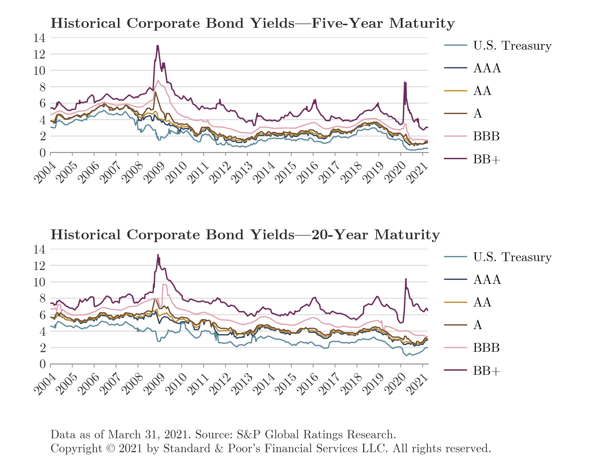
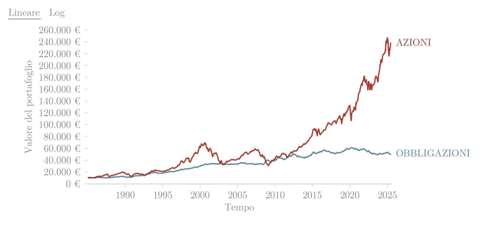
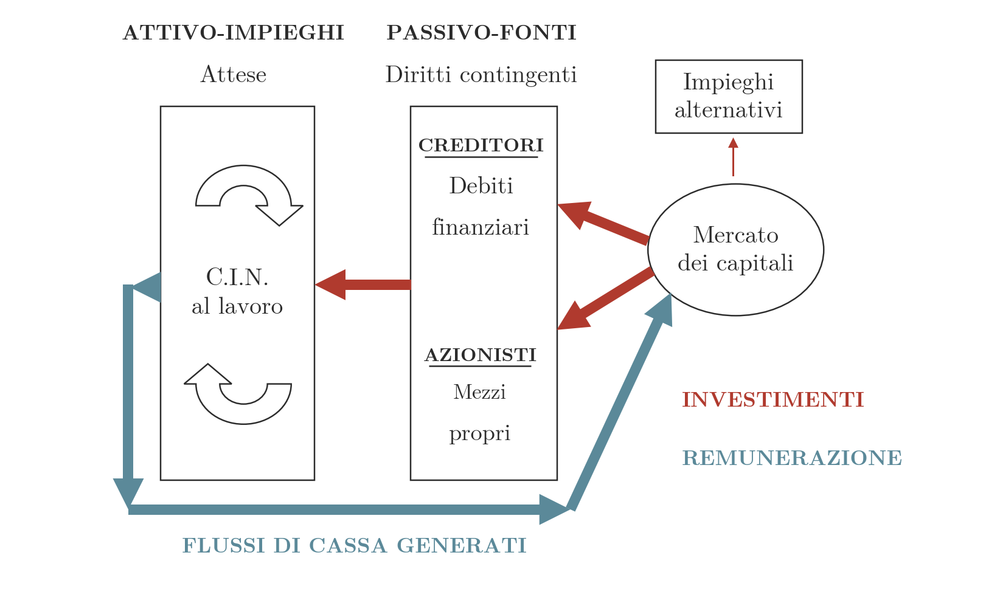

# Tempo, rischio e metodi di valutazione degli investimenti

## Il modulo sulla valutazione degli investimenti

Il modulo relativo alla valutazione degli investimenti. Avevamo visto, se vi ricordate, le varie modalità con cui può avvenire un investimento e le valutazioni che vengono fatte. Domanda: se Conad deve ampliare un punto vendita e voi siete nell'ufficio della direzione finanziaria di Conad, vi chiederanno in quanto tempo rientrate dell'investimento di ampliare la superficie dei metri quadri e inaugurare un nuovo punto vendita. Queste sono un po' le tematiche per ricondurle alla realtà. Qual è il tema? Capire come valutare questo, che valore può avere un investimento che spesso può essere incrementale, quindi non sempre è un investimento di start up da zero, può essere anche incrementale. Questa è una simulazione di quello che potrebbe essere successo un giorno.

Vedete qual è l'idea, qui parlano del valore dell'investimento di circa 10 milioni di euro con un ampliamento dell'organico, dei metri quadri. Bisogna trovare dei KPI, in questo caso si trovano dei KPI specifici, quindi un incremento di superficie, un incremento di dipendenti, quindi avrete una serie di maggiori costi, maggiori ricavi. Solitamente nella GDO per trovare un KPI si guarda al fatturato per metro quadro, quando si guardano i punti vendita, ma questo è specifico della GDO, e quindi si cerca di trovare il fatturato stimato e il fatturato aggiuntivo rispetto al vecchio negozio. Dopodiché si fanno dei ragionamenti in termini di redditività e poi in termini di recupero dell'investimento. Le domande che ci si fanno sono quanto potrebbe rendere aprire un nuovo punto vendita e, solitamente, la domanda che spesso fa l'imprenditore è quanti anni recupero l'investimento.

## Progetti abbandonati

Ci sono poi dei casi dove i progetti non vanno a buon fine, quindi questi che avete visto erano casi di espansione, quindi casi in cui da una situazione iniziale l'alternativa è espandersi, incrementare, perché il business sta andando bene. Ci sono dei casi in cui il business inizia, parte o magari non parte, oppure è agli albori, quindi nei primissimi periodi, e dopo, per motivi strategici o economici o perché si ritiene che è stata fatta una scelta sbagliata, l'investimento viene abbandonato. In questo caso questa è una Maserati che non è mai uscita, una Maserati totalmente elettrica, il progetto della MC20 Folgore è stato abbandonato. Qual è il tema? È che c'è una storia iniziata, quindi anche in quel caso vi potrebbe essere chiesto di dire: ma mi conviene andare avanti o no? Se abbandono, quant'è l'impatto in termini di valore di stoppare il progetto e abbandonarlo e magari dismettere le attrezzature o i costi di setup che ho sostenuto e magari dismettere il laboratorio di progettazione?

Questo è un cellulare che non avete mai visto perché non è mai uscito. Amazon aveva immaginato di introdurre il suo cellulare, lo smartphone Fire, che non è mai uscito, e hanno speso 170 milioni di dollari per svilupparlo e non hanno mai venduto uno. Quindi in questo caso è un caso di progetto abbandonato. Quindi qui il progetto di investimento non è in espansione in termini di abbandono.

> [!question] Da verificare: la trascrizione riporta "qui il progetto di investimento non è in espansione in termini di abbandono"; la frase non è chiara e nessuna slide la chiarisce.

## Progetti posticipati

Un'altra eventualità che succede è il fatto che il progetto venga rimandato. Stiamo vedendo questi casi perché questo ci serve per vedere l'argomento che stiamo per affrontare, che è quello delle opzioni reali. Nel caso l'investimento venga iniziato e poi viene posticipato, c'è un periodo di attesa. Questo capita nella realtà perché per strategie magari il progetto è pronto per partire, quindi ho sostenuto i costi, il progetto è pronto. A questo punto il progetto inizia a produrre i ricavi in un periodo successivo, quindi c'è un periodo di attesa. Quando parlo di periodo, avete già capito che mi sto riferendo, quando lo vedremo, al concetto che avevamo detto l'altra volta, che non è indifferente avere il denaro nel periodo uno, zero, due, e quindi questa cosa cambia la valutazione.

In questo caso questa è l'azienda Lanice, non so se la conoscete, quella che fa le automazioni per i cancelli e questi meccanismi. Questo è un estratto del verbale di assemblea. Dove scrivono sotto che decidono, questo succedeva nel 2006, ma è solo l'esempio, di rinviare il lancio di nuovi prodotti della linea screen, perché? Per completare la brevettazione di ulteriori componenti tecnologici prima della commercializzazione. Strategicamente hanno deciso di partire con una linea con componenti tutte brevettate e quindi sono già stati sostenuti i costi, è strategico, quindi l'azienda ritiene che avrà più ricavi se non lancia il prodotto e i servizi oggi, è più strategico se li lancia tra un anno. Quello è lo scenario, lo vedremo dopo nelle opzioni. Se io lo lancio oggi, la linea screen, ho questi ricavi; se li lancio tra un anno probabilmente avrò maggiori ricavi, quindi qual è l'alternativa? Attendo un anno per avere dei flussi di cassa prospettati più alti oppure la lancio oggi che sono pronto? Quando vedete postponed, posticipato, è questo il concetto.

> [!question] Da verificare: la trascrizione riporta "Lanice" e "linea screen" per l'azienda delle automazioni per cancelli e per la linea di prodotti; nessuna slide conferma i due nomi.

Questa è una casa di sviluppo software, di videogiochi, la Digital Bros, che ha deciso di posporre il lancio di un videogioco, questo capita frequentemente. Stiamo parlando di progetti di investimento, quindi può essere che l'azienda ha più prodotti che generano flussi di cassa, quindi il nostro progetto di investimento potrebbe essere un prodotto all'interno della linea dell'azienda. Lanciare in questo caso Assetto Corsa 2, quello di destra, avrebbe cannibalizzato Assetto Corsa Competizione, perché evidentemente sono prodotti simili oppure avevano già fatto delle campagne sul primo videogioco, quello di sinistra, quindi questo nuovamente è un estratto della relazione sulla gestione del bilancio della Digital Bros dove spiegano i motivi del fatto che rimandano il lancio di Assetto Corsa 2. Lo vedete più o meno alla terza riga: il lancio della versione per PC di Assetto Corsa 2 è stato posticipato all'estate successiva per permettere il lancio nella primavera della nuova stagione di Assetto Corsa Competizione.

Perché l'hanno fatto? Perché evidentemente a volte si assume di poter massimizzare i flussi di cassa se si attende, perché ci potrebbe essere stato in questo caso un effetto cannibalizzazione, quindi qui non è un problema di abbandonare il progetto o no. Io ho il videogioco pronto e i due scenari quali sono? Lo lancio oggi ed esce insieme all'altro e ho determinati flussi di cassa di Assetto Corsa 2. Se lo lancio tra un anno, probabilmente l'altro videogioco è già stato acquisito, Assetto Corsa 2 ha un effetto novità e i flussi di cassa sono maggiori. Non lo so se saranno maggiori, quindi lo vedremo dopo nelle opzioni, bisognerà ponderarlo con delle probabilità il fatto che ci sia questo accadimento, non ne sono certo, quindi l'alternativa è lanciarlo oggi probabilmente con dei flussi certi oppure attendere magari un anno per il lancio e fare una previsione sui flussi di cassa che ci saranno in questo scenario. L'argomento che vedremo dopo.

## Il valore della flessibilità e perché valutare un progetto

Adesso tra poco vediamo come valutare i progetti di investimento. Il modulo dopo è quello delle opzioni, il valore della flessibilità, quindi la possibilità di dare un valore al fatto che davanti a me, nella vita reale, si presentano cose molto più articolate rispetto al fatto di dire: ho un progetto e lo valuto. Non è così nella realtà. Un progetto che potrebbe andare bene, andare male, lo abbandono, lo posticipo. Vediamo questo.

Perché è importante valutare un progetto di investimento? Perché devo valutare se conviene farlo o no, oppure se conviene attendere, quindi posticipare il lancio di quella linea di ricavi, abbandonarlo o espanderlo. E per considerare queste variabili devo impadronirmi di due variabili che sono il tempo e il rischio. Fondamentalmente a parità di flussi, di ricavi, nel mondo della ragioneria tu hai una serie di ricavi, però ti interessa relativamente in che esercizio si verificano. Che tu guardi un conto economico di un anno piuttosto che fra tre anni e confronti i risultati, non c'è un esercizio di valutazione del fatto che ci sia una rischiosità in quei risultati o una variabile di tempo.

*(slide 15)*

==Invece per noi, nel mondo della finanza, questi due concetti sono importanti.== Quindi, come avevamo detto l'altra volta, lo sforzo che facciamo è di guardare sì la fattibilità e quindi il principio base è di valutare comunque la fattibilità o la convenienza, però abbinarlo alla valutazione finanziaria. La valutazione finanziaria si fa analizzando i flussi di cassa, quindi analizzando il cash flow, ed è la variazione, questo famoso cash flow che lo vedremo ampiamente, è il flusso di cassa, è il differenziale tra una situazione di liquidità che tu hai prima di fare le tue valutazioni e quella che hai dopo. ==Questo concetto ci accompagnerà su tutte le lezioni, tutto quello che vedrete qui verrà distillato e si ricondurrà al fatto che tutto diventa flusso di cassa==, tanto, poco, prima, dopo.

*(slide 16)*

## Il tempo ha un valore

Nella valutazione di convenienza vedete che ci sono due elementi: uno è il tempo e uno è il rischio. Il tempo, diversamente da altre materie, per noi il tempo ha un valore e il rischio ha un prezzo.

> [!question] Da verificare: la trascrizione riporta "il rischio ha un prezzo, ha un elemento"; la slide 17 riporta "il rischio ha un prezzo" e si adotta questa forma, il frammento "ha un elemento" non si è potuto interpretare.

Quindi, cosa vuol dire che il tempo ha un valore? Se voi avete una disponibilità di denaro, come dicevamo l'altra volta, potreste investirlo a rischio praticamente nullo. Basta comprare, a grandi linee, immaginate di comprare dei BTP, dei buoni del Tesoro poliennali emessi dallo Stato italiano, quindi tendenzialmente con delle obbligazioni emesse da uno Stato con un rischio prossimo allo zero. Quindi l'alternativa di non fare niente, nel nostro caso immaginiamo che sia quella di metterli, non di lasciarli lì, ma di metterli in qualcosa che rende senza rischio. E questo vorrebbe dire che, se $r$ è il rischio di rendimento, vale questa equivalenza, se è vero che io oggi ho 100 euro, vuol dire che tra un anno saranno aumentati del rendimento, quindi di 1 più $r$. Però è vero anche il contrario, che 100 euro tra un anno sono meno di 100 euro oggi. Quindi, se vale nel futuro, vale anche nel passato. La prima parte è capitalizzazione, io sto portando avanti i flussi in avanti di un anno e quindi diventano qualcosa di più di quello che ho adesso; viceversa ho l'attualizzazione.

> [!question] Da verificare: la trascrizione riporta "se R è il rischio di rendimento"; la slide 19 indica r come tasso privo di rischio, e poco sotto il docente dice "R, che è il tasso privo di rischio". Si riporta ciò che ha detto il docente.

*(slide 19)*

## Un investimento che rende meno del tasso privo di rischio

Se io avessi un investimento che rende meno di $r$, che è il tasso privo di rischio, se mi propongono un investimento che rende meno dei BTP, per semplificare molto, sto distruggendo ricchezza. Perché? Perché l'alternativa è metterlo nei BTP e ottenere un rendimento. Quindi, immaginiamo di avere questi 100 euro e che questo tasso privo di rischio sia 3,5%. Se io oggi metto quei 100 euro in un BTP, tra un anno avrò 103 euro e 50. Se io metto i 100 euro in un progetto che rende il 2%, tra un anno avrò 102 euro. Quindi, qual è l'ammontare di ricchezza, di valore che io ho perso in questo caso? Sono i 102 euro che io ottengo dall'investimento alla fine dell'anno, attualizzati ad oggi al tempo zero, quindi 102 sono al tempo uno, attualizzati ad oggi al tasso privo di rischio. Quindi, tecnicamente io, se avessi fatto l'investimento da 102 euro, avrei distrutto ricchezza per 1,45 euro. Oggi, al tempo zero attualizzato, avrei 98 euro.

> [!question] Da verificare: la trascrizione riporta "98 euro"; la slide 20 riporta 102 / 1,035 = 98,55, cifra coerente con la perdita di 1,45 euro detta dal docente, e si riporta ciò che ha detto il docente. La trascrizione riporta anche "la montare di ricchezza"; "l'ammontare" è la lettura probabile e nessuna slide la conferma.

*(slide 20)*

## Il progetto da 1.400 euro

Gli investimenti solitamente si confrontano sempre con una situazione di tasso privo di rischio, quindi se il rendimento privo di rischio è del 3,5%, se oggi abbiamo 1.400 euro, ad esempio, saremmo disposti a riceverne 1.456 tra un anno per averli messi in un progetto di investimento? Oggi abbiamo una ricchezza di 1.400 euro. Se li mettiamo nell'investimento, otteniamo 1.456 euro tra un anno. È conveniente questo investimento dal punto di vista del tempo e del valore? Quindi il ragionamento qual è? Che 1.400 euro che diventano 1.456 euro tra un anno sono 56 euro in più. Quindi quell'investimento ha reso il 4%, ok? Quindi 1.400 per un anno diventano 1.456, quindi quel progetto di investimento mi sta rendendo il 4% annuo. Quindi i titoli di Stato rendono il 3,5, quindi vedete che tra le due alternative è più conveniente in questo caso investire nel progetto, il progetto rischioso ha una remunerazione maggiore dei titoli di Stato, di un investimento non rischioso o a tasso quasi nullo.

*(slide 21, slide 22)*

Da qui però nasce anche una riflessione: perché il progetto rende di più rispetto ai titoli di Stato? Perché ha un rendimento più alto? Perché tecnicamente le attività imprenditoriali hanno un rendimento più alto delle obbligazioni o dei titoli di Stato? Perché secondo voi? Esatto, quindi il tema è questo. Quindi l'idea è di capire in che modo io remunero il capitale raccolto sul mercato. Perché l'ho confrontato col tasso di rischio? Perché a rischio nullo? Perché l'alternativa, l'avevamo detto l'altra volta, è che non sono obbligato a fare l'investimento, potrei anche comprare dei DTP. Quindi è per quello che si prende un tasso free risk per confrontare il rendimento degli investimenti. Quindi l'obiettivo delle imprese, di fatto, che competono in un mercato rischioso, è quello di finanziare investimenti che rendano più del mercato.

> [!question] Da verificare: la trascrizione riporta "DTP" e "tasso di rischio"; "DTP" è probabilmente BTP, come detto poco sopra, e "tasso di rischio" è probabilmente il tasso privo di rischio, dato che il docente prosegue con "a rischio nullo". Nessuna slide li conferma con queste parole.

## Il prezzo del rischio: il dollaro investito nel 1926

Solo per darvi un colpo d'occhio di quello che succede nel mondo, anche a conferma di questo ragionamento sul confronto sui rischi, sui rendimenti. In questo grafico c'è un po' tutto. Vedete che avete diverse linee che sono, questo è riferito al mercato americano, però vi dà proprio un po' l'idea di quello che succede. Se aveste messo un dollaro nel 1926, cosa sarebbe diventato? Qui arriva fino al 2025 il grafico, cioè il 22. Se i vostri antenati avessero messo un dollaro, cosa sarebbe diventato oggi. Al di là di quello che sarebbe diventato, vedete come si spalma la curva dei rendimenti, sapendo che in quest'area piena è l'inflazione, la quantità di perdita di potere d'acquisto di quel denaro.

> [!question] Da verificare: la trascrizione riporta "nel 1926" e "fino al 2025 il grafico, cioè il 22"; la slide 27 riporta "1$ alla fine del 1925" e non indica l'anno finale. Si riporta ciò che ha detto il docente e il dubbio sull'ultimo anno (2025 o 2022) resta aperto.

*(slide 27)*

E vedete che le linee, questa rosa, sono i Treasury bills, quindi sono i buoni del Tesoro, e questi sono i government bond. Quindi questi due, la 4 e la 5, quindi la rosa e quella tratteggiata e la 3, quindi 3, 4 e 5, quindi questo blocco di strisce qui sotto, che è quello che ha i rendimenti più bassi, è la prova provata del fatto che hanno i rischi più bassi. Quindi chi non rischia ha un rendimento più basso nel tempo. Mentre le due linee sopra, quelle tratteggiate, vedete che questa qui sono le large cap stocks, quindi le grandi aziende, e quella più sopra ancora le PMI americane, che poi sono giganti rispetto alle nostre, però tecnicamente sono enormi. Questo è una media, è una media anche delle performance. Verrebbe da pensare che se uno avesse un dollaro da mettere, effettivamente sarebbe da metterlo qui, nella una, senza pensarci due volte, visto che la media dei rendimenti dei titoli di Stato è più bassa. Questo dà la percezione del prezzo del rischio.

## Ciò che il grafico non mostra

C'è una cosa che dal grafico non traspare, nel senso che se tu guardi il paniere di questo grafico, il sottostante, l'ente che emette questi bond è sempre lo stesso della carta della Costituzione americana, probabilmente.

> [!question] Da verificare: la trascrizione riporta "è sempre lo stesso della carta della Costituzione americana, probabilmente"; la frase non è chiara e nessuna slide la chiarisce.

Le aziende che sono qui, che stanno performando qui, probabilmente non sono le stesse che erano qui, perché hanno chiuso e sono fallite. Quindi c'è questo un po' il tema che dal grafico non si vede, è vero che il rendimento è alto, è vero che sono aziende magari piccole che performano molto, però probabilmente sono poche le aziende che esistevano nel 1926 e che oggi ti stanno rendendo così. Quindi probabilmente il dollaro che hai messo qui, magari qui l'hai azzerato e l'hai perso per sempre perché l'azienda ha chiuso. Questa è una media, quindi riferito alla singola azienda questo discorso ti fa capire che i progetti di investimento e le aziende portano con sé un'elevata rischiosità. Quindi, quando calcoliamo il tasso relativo alle aziende, dopo lo vedremo nella valutazione anche delle aziende, non solo dei progetti, vengono fuori dei tassi alti. Dieci, undici, i BTP sono a tre. Non so come fa a venirmi dieci, undici un tasso di attualizzazione dei flussi di cassa di un'azienda. Perché prendo il cash flow di un'azienda e dalle formule che poi vedremo lo attualizzo e viene fuori 10, 11, 12 per cento, che i BTP sono al 3?

Vuol dire che sto calcolando dei rendimenti molto alti, ma è semplicemente la spiegazione di questo, il fatto che tu stai attualizzando il rischio.

## Il rating e il rendimento delle obbligazioni

Questa è un'altra faccia del rischio, che è legato ai rating delle società. Sapete che le società di rating sono modellate per analizzare quanto rischiose sono le aziende e si esprimono in termini di rating. Questo è il rating dato da Standard & Poor's ed è il rating correlato al rendimento dei bond, dei corporate bond. Se un bond lo emette un'azienda che ha rating BB+, quanto rende? Se il bond lo emette US, il governo, quanto rende quel bond? E vedete che anche guardando i rating e non guardando i rendimenti, la musica è la stessa. Dopo magari sulle slide vedete meglio, però questa linea blu scuro è questa. Quindi è il rating più alto, è il rating dello Stato, quindi l'America, paese a rischio minimo, quindi ha il rating migliore, la AAA. E quanto rende un bond emesso dallo Stato, dallo Stato americano, quanto rende? Mediamente vedete che è la linea sempre quella più bassa, come nell'altro. E poi a seguire, quanto rende un'obbligazione emessa da un'azienda che ha la AAA, A o AA, è il giallo e l'arancio e il viola? Ed è questa, che è immediatamente appoggiata a quella dei bond su cui non rischi nulla. E quanto rende un'obbligazione emessa dall'azienda che commercializza frutta secca in Congo durante una guerra civile, che è degradata BB+? Qua. È BB+, però quanto rischi?

> [!question] Da verificare: la trascrizione riporta "l'American paese a rischio minimo" e "il rating migliore della AAA"; si legge "l'America, paese a rischio minimo" e "il rating migliore, la AAA", ma nessuna slide lo conferma. La trascrizione riporta anche "Dopo magari sulle slide sul pizzillo vedete meglio"; "sul pizzillo" non si è potuto interpretare ed è omesso.

==Quindi la correlazione rischio-rendimento accompagna tutte le decisioni finanziarie, non si scappa==, questo è una delle regole del gioco. Anche quando valutiamo le aziende, quando valutiamo i tassi, tenete questo un po' come faro, anche quando avete un confronto, ragionate sul tasso che vi viene fuori nelle soluzioni, nelle vostre considerazioni, ragionate sul mercato in cui opera quell'azienda, sulla rischiosità e su quanto è confrontato quel rendimento con, ad esempio, i titoli del governo americano. Perché vedete che c'è una correlazione strettissima.

## Obbligazioni contro azioni

Questo poi è la ciliegina sulla torta. Obbligazioni contro azioni, questo proprio là, l'evidenza.

> [!question] Da verificare: la trascrizione riporta "Questo non è anche bello commento. Obbligazioni e controazioni"; la slide 29 riporta "Obbligazioni vs Azioni" e si adotta "obbligazioni contro azioni", mentre la frase "Questo non è anche bello commento" non si è potuta interpretare ed è omessa.

Se non altro perché l'obbligazione gode di determinate caratteristiche, perché essendo un prestito diventa un impegno, un obbligo e un impegno fortissimo alla restituzione da parte dell'azienda. È più questo il significato. Il valore giuridico di un bond, di un'obbligazione è forte perché obbliga l'azienda a restituire il capitale. Quindi voi che acquistate, che mettete 100 euro su un'obbligazione, dormite sonni più tranquilli, non tranquilli, ma più tranquilli di avere 100 euro su un'azione, a meno che non fallisca l'azienda, allora lì. Però anche se quell'azienda dovesse fallire, sicuramente le azioni le potete buttare nel cestino, quindi i vostri 100 euro li potete buttare nel tritacarte se l'azienda fallisce. Se avete il capitale in obbligazioni, tendenzialmente si apre una procedura magari di liquidazione, di concordato, viene nominato un liquidatore, l'azienda viene gestita e comunque l'obbligazione diventa un credito dei creditori, per cui non è detto però c'è una probabilità che quel capitale vi venga restituito.

> [!question] Da verificare: la trascrizione riporta "Se avete il centrale in obbligazioni"; probabilmente "il capitale in obbligazioni", nessuna slide lo conferma.

## A chi vanno i flussi di cassa

Questo grafico qui ci torna anche utile dopo perché le aziende sono finanziate: gli impieghi, tutto quello che può far funzionare le aziende, da chi è finanziato? Un'azienda come si finanzia? Da quali soggetti? Se guardate uno stato patrimoniale di un'azienda, a sinistra avete l'attivo, a destra cosa avete? Il passivo. E il passivo da cosa è composto? Da quali blocchi principalmente? Banche. E quindi i finanziatori sono le banche, le banche stanno finanziando l'attivo. Poi chi finanzia la parte più strutturale, quindi magari ci saranno i fornitori, debiti per i dipendenti, ma l'altro grande blocco qual è? Nello stato patrimoniale? Ok, e poi ci sono solo debiti nel passivo. Il patrimonio netto, e chi è il patrimonio netto? Chi sono? A chi appartiene il patrimonio netto? Ai soci. Ai soci, ok. Quindi chi è che sta finanziando l'attivo? Le banche, fondamentalmente, quindi i creditori terzi, i soci, ok.

Perché ragioniamo su questo? Perché se l'azienda funziona e produce un cash flow, chi deve remunerare? A chi va quel cash flow? A cosa serve che l'azienda genera un cash flow? Che beneficio ha di quel cash flow? Perché ci rompiamo la testa per calcolare i flussi di cassa di un'azienda? A chi devono andare questi flussi di cassa? Chiamiamoli gli stakeholder, a chi ha degli interessi in quell'azienda. A noi qui. Stamattina, se la Diadora produce dei flussi di cassa, a noi non è che interessa particolarmente. Ma perché non ci interessa? Perché noi non siamo impattati dai flussi di cassa che la Diadora produrrà stamattina, anche se fossero milioni di euro. Domanda banale, ma noi non siamo né creditori né azionisti della Diadora, quindi non siamo impattati. Quindi i suoi flussi di cassa andranno a remunerare le aspettative di due soggetti: i creditori e i soci. E questo lo vedremo dopo.

Quando tu valuti un'azienda, e dopo ci arriveremo, quando tu valuti un'azienda devi calcolare quell'ammontare di flussi di cassa che genera l'azienda e devi calcolare quali flussi di cassa andranno a una categoria di soggetti e quali all'altra.

> [!question] Da verificare: la trascrizione riporta "quella montante di flussi di cassa"; probabilmente "quell'ammontare", come per "la montare di ricchezza" detto prima; nessuna slide lo conferma.

Quando voi andrete poi sul mercato del lavoro e dovrete valutare le aziende, perché valutate le aziende? Perché o lavorerete per qualcuno che le vuole comprare o qualcuno che le vuole finanziare. Quindi, se qualcuno mi chiederà di valutare un'azienda, nella sua testa c'è o di volerla comprare o di volerla finanziare con un finanziamento. E in entrambi i casi questi due soggetti si aspettano dei soldi indietro perché non fanno beneficenza. Vi sarà chiesto di dire: ma se io sostengo quell'azienda, quanto è la mia remunerazione? E direte: se gli fai un finanziamento avrai questa remunerazione, se sei un azionista avrai questa, se vuoi comprarla, vuoi comprare le azioni, devi pagare questo. Vedete che a sinistra avete una sorta di stato patrimoniale riclassificato, a destra avete i creditori e gli azionisti, sono i due soggetti che finanziano e che ricevono i flussi di cassa che genera l'azienda, quel capitale investito netto.

## Lo schema del rendiconto finanziario

Perché ci rompiamo la testa sul rendiconto finanziario? Perché alla fine è lo schema più utile per farci capire come girano i flussi di cassa. Siccome questi soggetti si aspettano di ricevere dei flussi di cassa, andiamo a vedere lo schema che quantifica quali sono i flussi di cassa. Il conto economico no, l'abbiamo visto. Lo stato patrimoniale neanche. Lo schema che aiuta è il rendiconto finanziario. Questo è uno schema generico di rendiconto finanziario. Voi avete una parte di flusso di cassa che l'azienda produce col suo core business, lo possiamo chiamare il cash flow gestionale, l'FCGC. Dopo ci sono magari più configurazioni di flusso di cassa, però i concetti, queste aree qui fondamentalmente non cambiano nel metodo indiretto. Dopo magari il calcolo, il conteggio, però fondamentalmente cercate di capire le aree intanto.

> [!question] Da verificare: la trascrizione riporta "FCGC"; la slide 31 riporta "cash flow gestionale lordo" e "cash flow gestionale netto (FCFO)" ma nessuna sigla uguale a FCGC, quindi la sigla resta aperta.

*(slide 31)*

Il primo è l'area operativa, l'azienda fa una serie di attività, fa girare il capitale investito netto, quindi genera un MOL, un EBITDA. E abbiamo detto che noi potremmo tranquillamente, ad esempio, ricavarlo dal conto economico. Spesso i valutatori, se vi dicono così, un calcolo rapido per vedere così a spanne quant'è un EBITDA, prendete un conto economico, fate A meno B, differenza tra valore della produzione e costo della produzione, rimontate gli ammortamenti e grossolanamente avete un EBITDA. Da bilancio, dopo ovviamente va normalizzato e aggiustato, però è quello lì.

> [!question] Da verificare: la trascrizione riporta "fatela meno B" e il frammento "quelle EBITDA diventa quelle EBITDA"; si legge "fate A meno B" in base alla spiegazione che segue ("differenza tra valore della produzione e costo della produzione"), mentre il frammento non si è potuto interpretare ed è omesso.

Però perché non possiamo prenderlo come flusso di cassa? Per tutti i motivi che abbiamo visto l'altra volta. Quindi è impattato da cosa? L'EBITDA. Perché l'EBITDA non è cassa? Perché l'EBITDA non diventa tutto soldi in conto corrente? Perché se noi produciamo i banchi e le sedie e li vendiamo alle scuole, abbiamo l'EBITDA, perché se ci costa 100 euro a banco produrli e noi li vendiamo a 300 euro, noi facciamo un EBITDA di 200 euro per ogni banco e quindi abbiamo un EBITDA positivo.

> [!question] Da verificare: la trascrizione riporta "le BDA" in tutte le occorrenze di questo passaggio; la slide 9 riporta "EBITDA" e il contesto (MOL, EBITDA, conto economico) lo conferma, quindi si adotta EBITDA, anche nella risposta alla domanda "Quindi è impattato da cosa?", dove la trascrizione riporta "Le BDA" e il senso resta poco chiaro.

Poi emettiamo la fattura alla scuola, che è una pubblica amministrazione, e la scuola non ci paga. E quindi noi cosa ci facciamo con quell'EBITDA? E quindi il ragionamento è che l'EBITDA va pulito, rettificato, aggiustato, corretto dalla variazione del circolante. Questo l'avevate visto forse. Il fatto che per passare dall'EBITDA a un flusso di cassa è necessario passare per la variazione del capitale circolante. ==È importante, questo nella finanza è un passaggio fondamentale, perché ci sono aziende che falliscono con l'EBITDA positivo.== Perché se tu non incassi mai, se i tuoi ricavi non diventano cassa, puoi andare a casa e chiudere tutto. Se tu non sei in grado di portare a casa i tuoi crediti e nel frattempo stai pagando gli stipendi, stai pagando i materiali, questo succede molto spesso, ad esempio in chi lavora con la pubblica amministrazione. Voi fornite i consumabili a un ospedale, gli fornite le mascherine, le siringhe per le punture, gli fornite una serie di servizi e l'ospedale non vi paga. Voi siete un'impresa edile, costruite City Life e l'agenzia commerciale che gestisce la vendita degli immobili non vi paga gli appartamenti, quindi voi avete anticipato cemento, operai, maestranze, progettazione, architetti, autorizzazioni, burocrazie, quindi avete pagato e non incassate niente. Certo, sulla carta il conto economico ha dei ricavi incredibili perché voi avete fatturato magari a vari soggetti, ma se questi non vi pagano, voi siete fuori con tutti i soldi.

> [!question] Da verificare: la trascrizione riporta "le BDA" in tutte le occorrenze di questo passaggio; come poco sopra si adotta EBITDA, confermato dalla slide 9 e dal contesto. La trascrizione riporta anche "FCGC" e la sigla resta aperta, come indicato sopra.

Quando sentite l'espressione essere fuori coi soldi, questa cosa qua è molto più grave di qualsiasi altra cosa, perché tecnicamente non la vedi dal conto economico, la vedi solo dal rendiconto finanziario. Il rendiconto finanziario ti dà l'idea se un'azienda si sta mangiando soldi e sta andando a gambe all'aria o no. Certo, lo vedi se è indebitata, se ha debito. Lo vedi in maniera molto lampante se, ad esempio, questo cash flow gestionale, questo FCGC è quasi zero o negativo, vuol dire che tu produci un EBITDA e te lo mangi tutto col capitale circolante. Quindi magari produci un utile, un reddito, che diventa tutto crediti. Quindi non diventa soldi, diventa crediti. Ma se io produco un reddito e diventa tutto crediti, con cosa pago gli stipendi? Con i crediti. E quindi questo è un primo tema, per cui l'azienda è impegnata a produrre un cash flow, quindi a produrre cassa, liquidità dall'area operativa.

## Investimenti, imposte, creditori e soci

Poi c'è l'area degli investimenti. L'azienda non può vivere in eterno con le dotazioni che ha, quindi con i macchinari, le attrezzature, gli impianti produttivi che ha, quindi una parte del flusso di cassa ovviamente viene sottratta per gli investimenti. E quindi rimane un flusso di cassa a beneficio di chi? A questo punto immaginate di avere depurato l'effetto del circolante, lo Stato l'abbiamo pagato, le imposte le abbiamo pagate, le abbiamo pagate qua. Quindi i soggetti che aspettano soldi da noi, se sono fornitori, dipendenti, personale, ce li gestiamo col delta CCNO, quei debiti correnti operativi io li governo con la variazione del capitale circolante. Poi chi altri aspetta soldi da me rispetto al reddito che ho generato e al cash flow che ho generato? Lo Stato, e quindi quello va pagato, per cui calcolo le imposte. L'effetto delle imposte, e questo lo troveremo sempre in tutti gli esercizi, in tutti gli esempi, è mitigato da quello che si chiama scudo fiscale sugli interessi sul debito. Dopo vedremo cos'è, o l'avete già visto, lo riprendiamo. E quindi le imposte operative con segno meno, pagato lo Stato, pago gli investimenti perché compro macchinari, rinnovo, compro i computer.

Alla fine, dopo l'FCFO cosa resta? Devo pagare chi? Devo remunerare chi? Dopo aver pagato i fornitori, il personale, lo Stato, chi resta in un'azienda? Nel passivo di stato patrimoniale che cosa avevate? Debiti, patrimonio netto. Quindi restano i creditori e i soci, per cui i creditori vengono remunerati rimborsando i debiti e pagando gli interessi.

> [!question] Da verificare: la trascrizione riporta "dopo l'FCFO cosa resta"; la slide 31 riporta l'FCFO prima degli investimenti e l'FCFF dopo di essi. Si riporta ciò che ha detto il docente e resta aperto se intendesse FCFF.

Perché questa parte qui l'hanno messa prima di questa? Tanto sono due sottrazioni, perché viene messa prima questa e dopo questa nel rendiconto finanziario? È un caso o ha tipo un significato? Vi viene in mente niente? Perché mettono prima l'area finanziaria e dopo l'area degli azionisti? Gli azionisti vengono forse remunerati per ultimi? Però gli azionisti sono quelli che, se avanza qualcosa, se lo prendono, sennò no. I creditori no. I creditori, l'azienda ha un debito, va restituito. Quindi l'area finanziaria è un'area di impegni obbligatori, quasi come lo Stato, quindi per quello viene messa. Quindi questo qui è l'ultimo, che residua, il free cash flow relativo all'equity, dopo che ho pagato tutti e ho pagato i creditori. I creditori li pago con gli oneri finanziari e li pago con il rimborso dei finanziamenti in uscita. È chiaro che a questo punto potrei avere, in questo caso, una variazione, perché se quell'anno i miei creditori mi hanno dato un milione di euro come finanziamento, siccome mi è entrato un milione di euro nella cassa, da qualche parte devo metterlo, lo metto in questa sezione qui, quindi nell'area finanziaria. Quindi qui avrò sì l'uscita di oneri finanziari e rimborso di finanziamenti, ma anche l'accensione di nuovi finanziamenti, quindi sia i soldi che entrano che quelli che escono, fondamentalmente. A quel punto ho pagato tutti: dipendenti, Stato, creditori, banche, finanziatori vari. E mi resta il free cash flow da dare agli azionisti, che è questo qui, che è espresso in dividendi o in variazioni di capitale, variazioni delle voci di capitale proprio e tendenzialmente variazioni di capitale oppure dividendi.

*(slide 31)*

## La posizione dei soci e i dividendi

Vedete i dividendi che gerarchia hanno in un cash flow? Capite perché uno che mette soldi per avere dei dividendi pretende almeno un rendimento alto? E beh cavolo, vengo dopo tutta sta gente e ti credo almeno dammi un rendimento alto. Non posso avere lo stesso rendimento di un creditore o di un dipendente, per dire, di qualcuno che ha un rimborso garantito per legge. Questo non te lo garantisce nessuno, tanto che è l'assemblea che delibera la distribuzione dei dividendi. Lo vedete nelle società quotate in borsa, quando esce la notizia che viene distribuito un dividendo per azione, ma non è obbligatorio. Ci sono molte aziende che dividendi non ne danno per anni perché capitalizzano gli utili e li mettono a riserva. Se voi avete le azioni di Enel e Enel decide che quest'anno investe su fotovoltaico e non distribuisce neanche un dividendo, cosa fate? Niente. Quanto vi hanno reso le azioni di Enel in termini di dividendo? Niente. Da chi andate? Siete soci di minoranza? È anche vero che questo ha poi degli effetti anche sul prezzo del titolo se l'azienda è quotata, perché viene fuori magari una sommossa popolare se un'azienda così grande non distribuisce dividendi a nessuno. Quindi tendenzialmente i flussi vengono gestiti in modo che venga dedicato un po' agli investimenti e un po' anche a soddisfare le persone che hanno acquistato azioni e hanno creduto nella società.

## Aziende quotate e PMI italiane

Però questo ad esempio non succede nelle aziende non quotate. Quindi, se considerate che le aziende non quotate sono il 95% delle aziende che vi troverete fuori da qui, visto che le aziende quotate in borsa in Italia sono una manciata rispetto a un milione, a 950.000 SRL che ci sono e a qualche centinaio di aziende quotate, la probabilità che voi affronterete un rendiconto finanziario di un'azienda non quotata è 100 volte superiore se vi cimenterete nel territorio italiano. E quindi ha delle dinamiche particolari: le PMI italiane sono aziende sempre molto indebitate, quindi quest'area qui è molto presente. Se voi guardate i bilanci delle aziende americane e i bilanci delle aziende italiane, magari dello stesso business, vi accorgete che in Italia tendenzialmente le aziende vanno in banca a fare debito. Un'azienda non si sognerebbe di quotarsi in borsa se ha bisogno di soldi. Una PMI, un'azienda del territorio non si sognerebbe mai di quotarsi in borsa. Invece in America questa cosa è molto più frequente, perché in borsa ci sono molte più aziende, costa meno quotarsi, costa meno rimanere in borsa e questo determina un po' una variazione.

In altre parti del mondo le aziende ricorrono al capitale di rischio, chiedono l'ingresso di nuovi azionisti. Se una SRL, se una fonderia di Vicenza ha bisogno di mezzo milione di euro, cosa fa l'imprenditore? Chiama Borsa Italiana e dice: "Io vorrei quotare"? Chiama il direttore della banca e dice: "Senti, ho qui i miei ragazzi, che siete voi, adesso ti porto fra un mese un business plan con tutta la proiezione dei flussi di cassa, devo ampliare la linea produttiva, mi dai una linea da mezzo milione di euro?" Sì, capitale di terzi. Tendenzialmente fa così soprattutto nei business maturi. Poi se siete nel mondo delle start-up, dei percorsi innovativi, allora si cercano dei business angels, persone che entrano, dei sognatori che mettono capitale di rischio, sono disposti a perderlo ed entrano qui come capitale di rischio, quindi come equity. Ma tendenzialmente le aziende italiane che hanno bisogno di soldi vanno in banca.

## Il rendiconto finanziario di Enel

Questo è il rendiconto preso dal bilancio di Enel. Credo sia in milioni di euro, sì. Questo è quello che vi trovate poi fuori dal libro. Non c'è uno schema riga per riga del rendiconto finanziario, quindi nei bilanci i rendiconti sono dei minestroni incredibili, nel senso che le aziende se lo costruiscono con più righe, meno righe, più dettaglio, meno dettaglio. Però a grandi linee vi serve capire quali sono le categorie di flussi di cassa e poi vi posso assicurare che le ritroverete, perché vi faccio vedere questo, perché poi al di là del corso di laurea, dopo andate fuori, dovete usare quello che avete visto qui e quindi quando uscite vi trovate il bilancio di Enel, ve lo scaricate e trovate il rendiconto finanziario, quindi se sul libro trovate la formula, l'FCFO scritto così, in tre righe, dopo vi trovate un rendiconto con 50 righe, quindi bisogna un po' riconciliare la realtà col libro. Quindi il libro è una semplificazione, però sappiate che adesso ho preso Enel, che è tra le società più grandi, dopo gli altri non sono così articolati, adesso non ricostruiamo tutto il rendiconto di Enel, però vedete che i nomi e anche la gerarchia del rendiconto presentato col metodo indiretto, col metodo che parte dal reddito generato.

> [!question] Da verificare: la trascrizione riporta "ricongiagliare la realtà col libro" e "lo scritto FCFO così, scritta in tre righe"; si legge "riconciliare" e "l'FCFO scritto così, in tre righe", ma nessuna slide lo conferma.

Vedete che ad esempio qui c'è un risultato intermedio che è il cash flow dell'attività operativa e dopo vedrete, magari adesso è scritto in piccolo, però tutto il blocco sopra sono fondamentalmente le poste operative. Qui c'è la variazione del capitale circolante netto, che è tutto questo blocco qui e da quello che dicevamo prima, il reddito e la variazione del circolante. Loro partono dalla primissima riga che è il risultato netto d'esercizio, quindi partono dall'ultima riga del conto economico, iniziano ad andare su, lo puliscono dagli ammortamenti e arrivano a grandi linee al MOL. E dopodiché vedete che quindi arrivo al MOL perché dall'ultima riga del conto economico vado su, ad esempio, rimonto gli ammortamenti, consegno un positivo, vedete che da 8 milioni ho 7 milioni 249 di ammortamenti, quindi dall'utile lo miglioro per trovare il flusso di cassa operativo. Poi lo pulisco dalla variazione del circolante e arrivo poi al flusso di cassa della gestione operativa.

> [!question] Da verificare: la trascrizione riporta "consegno un positivo" e "da 8 milioni ho 7 milioni 249 di ammortamenti"; le cifre sono lette dal rendiconto di Enel mostrato a lezione e nessuna slide del testo le riporta, quindi non si possono confermare.

E poi vedete che c'è, lo chiamano, cash flow da attività di investimento. Ed è questo qui, vedete che più o meno la gerarchia è rispettata. Negli investimenti loro mettono tutto, quindi constatate che per semplificare ci sono anche gli investimenti ad esempio in partecipazioni, per cui se Enel compra il 70% di una... Che ne so, di una società che fa capo a un parco fotovoltaico, li mette qua, sono investimenti, quindi sono investimenti in partecipazioni oppure se Enel cambia il camino della centrale elettrica di Roma, ok? Sono sempre investimenti. Infatti vedete che dice investimenti in attività materiali non correnti, cambio il camino, ma poi ci sono anche investimenti in imprese o rami di impresa. Comunque sono investimenti o disinvestimenti, perché dice anche dismissione di impresa, ma vale il contrario, quindi se Enel vende la partecipazione sul parco eolico entrano soldi, quindi entreranno in quel cassetto con segno più.

> [!question] Da verificare: la trascrizione riporta "il cammino della centrale elettrica", "ma l'impresa stessa cosa, vale il contrario" e "quel cassetto leader in conto con segno più"; si legge "camino", mentre i frammenti "l'impresa stessa cosa" e "leader in conto" non si sono potuti interpretare e sono omessi.

Bene, hanno remunerato tutti, chi manca? I soliti due: i creditori e gli azionisti. Eccoli qua. Una volta che sono arrivato qui, ho il blocco dei creditori e il blocco degli azionisti, non sempre sono suddivisi. Vedete, rimborso di debiti finanziari, ho ripagato i creditori, ho restituito le rate del mutuo, del finanziamento, altre variazioni di indebitamento finanziario e via così. Emissione di obbligazioni e rimborsi di obbligazioni. Le aziende più strutturate possono emettere obbligazioni, lo sapete. Dal diritto. Se io emetto un'obbligazione, cosa faccio? Entrano soldi e mi sto anche contraendo un debito, quindi sono sempre qui nel mondo dei miei creditori, perché le obbligazioni ovviamente per l'azienda vuol dire che scaturiscono nuovi creditori che poi devono essere remunerati. E poi chi restano? I poveri azionisti. Dividendi, coupon pagati, titoli di obbligazioni ibride, dopo potrebbero essere obbligazioni con diritti particolari, però vedete, la riga che ci interessa è dividendi o acconti sui dividendi pagati, che è questo pezzetto qui degli azionisti.

> [!question] Da verificare: la trascrizione riporta "dividendi o conti sui dividendi pagati"; probabilmente "acconti", nessuna slide lo conferma.

Vedete che l'azienda, quello che succede a Enel è questo qua, fa una serie di cose, cerca di generare variamente un reddito a beneficio degli investimenti, poi dei creditori e poi degli azionisti.

## Il rendiconto finanziario della De' Longhi

Questo item, riscaricate rendiconto finanziario della De' Longhi, siamo sempre lì.

> [!question] Da verificare: la trascrizione riporta "Questo item, riscaricate rendiconto finanziario della De' Longhi"; la frase non è chiara e resta come riportata.

C'è una parte, vedete che parte dal risultato netto, le imposte e via così. Questo è una sorta di risultato operativo e poi vedete le variazioni di attività e passività, crediti commerciali, debiti commerciali e le altre voci del circolante, delta CCNC, nuovamente, che è questo qui. Nuovamente reddito operativo e delta capitale circolante. Arrivo a quello che potrei chiamare free cash flow from operations, o comunque quello prima della gestione degli investimenti. La gestione degli investimenti, quindi il CAPEX, investimenti in immobilizzazioni materiali, investimenti netti in partecipazioni, via così, vedete che è uguale.

> [!question] Da verificare: la trascrizione riporta "A, delta CCNC" e "quindi mi è CAPEX"; la slide 31 riporta "Variazione CCNO" e non "CCNC", quindi la sigla resta come detta dal docente e aperta; "A," e "mi è" non si sono potuti interpretare e si omettono.

Questo è quello che usate quando lavorerete per fare le analisi sul valore delle aziende, per valutare le aziende quando usate il metodo dei flussi di cassa, sennò dove li trovate i flussi di cassa. Sapete poi, ma non serve lo spoiler del corso, i metodi di valutazione li avete sentiti, dopo li vedremo, ma sono multipli dell'EBITDA, i flussi di cassa, i DCF, è quello che guarderemo poi quando dovremo valutare. I DCF da dove li prendete? Da qua. ==Bisogna prendere confidenza con questo schema di bilancio perché è molto utile, bisogna sapere quali flussi prendere.== E quindi poi, stessa cosa, avete il flusso degli investimenti e qui avete insieme, li hanno messi insieme qui, ma noi sappiamo che sono due soggetti diversi, l'esercizio delle stock option, la distribuzione dei dividendi, quindi avete gli azionisti e poi pagamento degli interessi sui finanziamenti e rimborso dei finanziamenti, quindi nuovamente pago gli azionisti e i creditori. Hanno messo insieme.

## La quadratura del rendiconto

Dopodiché le ultime righe sempre sono le voci di quadratura, perché sapete che il rendiconto va sempre in quadratura, quindi tutta la minestra che c'è sopra deve essere esattamente uguale. Solitamente quando ve lo fate non torna, squadra sempre per qualcosa, però la quadratura perfetta è che tutto quello che c'è sopra esattamente corrisponde a cosa? Alla variazione di cosa? In un bilancio. È scritto nelle ultime righe. Come fate a capire se il rendiconto, se lo costruite voi, è giusto, cioè quadra, si dice, o comunque è corretto? Il rendiconto, quindi alla fine voi col rendiconto siete d'accordo che è arrivato un flusso di cassa netto netto di tutto dopo aver pagato tutti, giusto? E questa cosa resta, non è che vado a zero, pago tutti, ma il fatto che pago tutti non vuol dire che resto senza soldi, magari mi restano mille euro alla fine dell'anno, giusto?

Sono tutti soldi che sono entrati e usciti nell'azienda, ma non è detto che li ho fatti uscire tutti, me ne resterà una parte. E quindi quella parte dove la trovate? La trovate nello stato patrimoniale, da un anno all'altro, in che voce? Sta scritto nella variazione delle disponibilità liquide, tendenzialmente. Qual è la regola aurea? Che quello che residua, l'ultimo importo del cash flow, l'ultimo importo dopo aver pagato tutta questa infilata di soggetti, ==è la variazione delle disponibilità liquide da un anno all'altro, la variazione del conto in banca dell'azienda, e questa è la quadratura==.

> [!question] Da verificare: la trascrizione riporta "Scrive dove sono nella variazione delle disponibilità liquide"; si legge "sta scritto nella variazione delle disponibilità liquide", ma nessuna slide lo conferma.

Se io prendo tutte queste voci qui, che sono minestrone di: prendo le vendite dal conto economico, pulisco dagli ammortamenti il conto economico, prendo gli oneri finanziari dal conto economico, prendo la variazione del capitale circolante, ah ma quella è sullo stato patrimoniale, crediti, debiti, quindi inizio a intersecare tutto dal conto economico e dallo stato patrimoniale. Prendo il risultato d'esercizio del conto economico, prendo gli investimenti, ma gli investimenti sono la variazione delle immobilizzazioni nello stato patrimoniale pulite dagli ammortamenti. Voi fate un maxi incrocio di tutto, dei due schemi principali, stato patrimoniale e conto economico, li concentrate tutti, calcolate tutte le variazioni e vi viene un flusso di cassa. Come fate a sapere se quel flusso di cassa è giusto? La prova del nove è il fatto che i soldi dentro l'azienda devono essere cambiati esattamente di quell'importo. Quindi la quadratura del rendiconto è di quanto sono cambiate le disponibilità liquide da un anno all'altro.

> [!question] Da verificare: la trascrizione riporta "prendo le vite dal conto economico"; probabilmente "le vendite", nessuna slide lo conferma.

## I cinque metodi per valutare un investimento

Bene, passiamo, poi ci torneremo sul cash flow, passiamo ai cinque metodi per valutare un investimento. Tutti gli investimenti di prima, videogiochi, la Tesla, Icona, tutti quelli sono singoli progetti di investimento, non sono aziende, quindi devo usare dei metodi. Noi ne guarderemo cinque: valore attuale netto, tasso interno di rendimento, tempo di recupero, il tempo di recupero attualizzato e l'indice di redditività. Alcuni si prestano ad alcuni investimenti, ad alcune operazioni. Sicuramente quello che già conoscete, che avete sentito, ci avete già lavorato sopra, è il VAN, il TIR, quindi questo vi è abbastanza noto. L'IRR attraversiamo. L'avete già visto il VAN in altri corsi? Sapete un po' come funziona. Dimenticate il conto economico, siamo sui flussi di cassa.

*(slide 35)*

> [!question] Da verificare: la trascrizione riporta "la Tesla, Icona" e "L'IRR attraversiamo"; nessuna slide riporta "Tesla" o "Icona" e le due frasi non sono chiare, quindi restano come riportate.

## Perché servono i flussi di cassa e il momento zero

Perché ci serve romperci la testa sui flussi di cassa? Perché poi i metodi valutativi come questo, quando dovete calcolare il VAN, vedete che al numeratore c'è l'FCFO. Da dove lo prendo l'FCFO? Ma dal rendiconto finanziario, ovviamente. Quindi se io non so come ricavare l'FCFO, non riesco a valutare un investimento, anche se so la formula del VAN. Questa è un po' l'idea. Perché quando vi chiederanno di valutare un investimento, nessuno vi dirà il flusso di cassa, ve lo dovete calcolare voi. Vi diranno quanto può rendere quell'investimento, quanto costa, quant'è il risultato atteso e via così. Poi però quello non vi basta, non vi basta sapere l'FCFO di un investimento, perché quello è quanto rende. L'altra cosa che vi serve è sapere l'esborso al momento zero, I0 col segno meno.

> [!question] Da verificare: la trascrizione riporta "vi basta sapere l'FCFO di un investimento"; dal contesto ("quello non vi basta" e "l'altra cosa che vi serve") si legge "non vi basta", ma nessuna slide lo conferma.

Quindi, come già avete visto, contrappongo l'investimento iniziale al tempo zero e ==ricordatevi di questo, anche perché causa frequente di errore negli esercizi e nelle prove d'esame==. Rimanete sempre lucidi e focalizzati sul fatto che noi in quest'aula viviamo nel momento zero, nell'I0, perché ricordatevi che non è indifferente un flusso fra un anno o un flusso oggi.

> [!tip] Esame
> L'investimento iniziale al tempo zero è causa frequente di errore negli esercizi e nelle prove d'esame: rimanete focalizzati sul fatto che viviamo nel momento zero, nell'I0, e che non è indifferente un flusso fra un anno o un flusso oggi.

Se in una proiezione, in un esercizio, ma anche nella realtà, vi dicono che l'investimento lo fate partire oggi e nel 2027 viene un milione di euro, quello non è un FCFO oggi, è un FCFO al momento uno, è chiaro. Quindi un milione di euro fra un anno non è un milione di euro oggi, oggi è 900 euro, 800 euro. Quindi questo ricordatevelo sempre, perché poi ==la regola è di attualizzare i flussi, e i flussi li attualizzi già dal momento uno==, questo lo troverete poi negli esercizi delle opzioni. Se vi dico che il progetto parte tra un anno, voi mi dite: Sì, grazie dell'informazione, io fra un anno faccio partire tutti i flussi di cassa. Però fra un anno, quindi te li porti indietro di un anno tutti, perché noi stiamo parlando oggi che siamo in T0, quindi quando voi svilupperete poi negli esercizi sulle opzioni il fatto che io posso aspettare un anno, quell'aspettare un anno ha un senso per noi dal punto di vista finanziario. Tutto quello che succede tra un anno io lo guardo oggi a zero, quindi porto indietro tutto di un anno.

> [!question] Da verificare: la trascrizione riporta "oggi è 900 euro, 800 euro"; probabilmente 900 mila e 800 mila euro, ma nessuna slide lo conferma.

## Il VAN: criterio, punti di forza e di debolezza

In questo caso il VAN dice solo che la somma attualizzata dei flussi di cassa in entrata al tasso di rischio di quel progetto deve essere maggiore di zero, quindi deve essere superiore all'investimento iniziale. I punti di forza, questo poi lo ritrovate tutto sul libro, questa parte qui. Ha dei punti favorevoli, il fatto che comunque considera il fattore tempo, perché noi attualizziamo i flussi, quindi diamo un significato ai flussi che vengono spalmati nel tempo. Considero la dimensione del progetto, vedo questi sono euro, questi sono euro, euro contro euro, un milione contro mezzo milione. Cosa vuol dire? Che non considera il razionamento del capitale come punto di debolezza. Secondo voi cosa vuol dire? Se vi dico che c'è uno spazio libero qui e possiamo aprire un nuovo bar per il campus che ha un VAN del... 16 per cento. E quindi vi dico che mettiamo mezzo milione di euro e ci tornano, in tre anni ci tornano 700 mila euro. Voi lo fareste con un VAN maggiore di zero? Se vi dico che il VAN è maggiore di zero, lo fareste? Sì. Lei ha mezzo milione di euro? No, allora non lo facciamo. Questo è il razionamento del capitale. Quindi il VAN ti dice: il progetto è percorribile, ma non tiene conto del fatto che io potrei non avere quella cifra, quindi un punto di debolezza è questo.

> [!question] Da verificare: la trascrizione riporta "un VAN del... 16 per cento" e poi "se l'app mi rende il 3% di VAN e il bar è il 5%"; non è chiaro se il docente intendesse un tasso di rendimento e nessuna slide lo chiarisce. La trascrizione riporta anche "Questo è il ragionamento del capitale"; la slide 36 riporta "razionamento di capitale" e si adotta "razionamento del capitale".

Perché guardo i punti di forza e di debolezza? Guardo questi aspetti qui? Perché, come abbiamo detto all'inizio, io mi trovo a usare questi metodi quando confronto più progetti di investimento. Se devo decidere tra il bar del campus e magari un app per gli studenti che ha lo stesso VAN, però prendo tre giovani spettinati che mi fanno la app con l'AI e io con 2.000 euro l'ho messa in piedi e la uso, e invece ho la gestione di un bar e mi serve mezzo milione di euro di setup a parità di VAN, forse 2.000 euro li tiro su, mezzo milione no. L'idea è che questi metodi io li uso per confrontare progetti di investimento, quindi se l'app mi rende il 3% di VAN e il bar è il 5%, mi verrebbe da scegliere il bar, peccato che non ho il capitale. Quindi poi nella realtà dovrete sempre valutare investimenti alternativi. Poi un'altra cosa, assumendo questa regola qui, è il fatto che ci siano dei flussi di cassa poco altalenanti, perché tendenzialmente tu attualizzi sempre un flusso di cassa, ma chi l'ha detto che è sempre quello il flusso negli anni? Un'altra semplificazione che viene fatta è il fatto che tu lo fai così, VAN, se si presta, se i flussi di cassa sono abbastanza stabili.

*(slide 36)*

## Primo esempio di VAN

E questi sono degli esempi, quindi se avete un investimento da 10.000, un progetto che si sviluppa su cinque anni, con un tasso medio ponderato del capitale del 9% e avete una previsione di flussi di cassa che avete stimato di 3.000 ogni anno, potete calcolarvi il VAN. Le informazioni che vi servono sono un po' queste quando avete un progetto, l'investimento iniziale, in quanti anni il progetto genera cassa, in questo caso cinque anni, un tasso di rischiosità di quel progetto e i flussi di cassa previsti. E quindi lo sviluppate così.

*(slide 37)*

Il valore attuale e il valore attuale netto non sono la stessa cosa, il valore attuale è il valore attualizzato dei flussi di cassa, cioè 11.668 euro, e il valore attuale netto ovviamente è la differenza con l'investimento iniziale.

*(slide 38)*

## Secondo esempio di VAN

Questo è un altro esempio, quindi potrei avere lì zero, un progetto che dura quattro anni e sempre 3.000 euro costanti ogni anno. Cosa vuol dire il tasso dell'8%? Non prendo il tasso privo di rischio, non prendo quel famoso tre e mezzo perché aprire il bar è rischioso, quindi vedete che iniziamo a entrare nelle logiche, che i tassi che uso non sono i tassi privi di rischio, perché stiamo parlando di investimenti, quindi abbiamo introdotto il concetto di rischio e vediamo che magari il tasso è 8, non è più tre e mezzo, perché diversamente da un BTP dello Stato, lanciare un'app o gestire un bar porta con sé una rischiosità, che è idealmente il fatto che sia alto, è idealmente quello che è scritto sotto, il fatto che il rendimento calcolato, e poi magari lo vedremo più avanti come calcolare questo tasso e che significato attribuirgli, porta con sé il fatto che per aprire il bar ipotizziamo l'investimento, lei non ce li ha, però potrebbe trovare dei finanziatori, delle persone che ci credono e che mettono nel capitale di rischio e mediamente anche una banca che mette una parte del denaro, a titolo di credito, e quindi bisogna remunerarli.

*(slide 39)*

> [!question] Da verificare: la trascrizione riporta "potrei avere lì zero"; la slide 39 riporta un investimento iniziale di 12.000 euro ma non è certo che il docente lo dicesse, quindi il frammento resta aperto. La frase che segue ("che è idealmente il fatto che sia alto, è idealmente quello che è scritto sotto") non è chiara e resta come riportata.

Quindi, visto che il WACC già lo conoscete, mediamente, perché è average, la A, no, quindi è il rendimento di questi, sempre di questi due soggetti, quindi gli azionisti e il capitale preso a prestito. In questo caso vedete che il VAN è negativo, quindi il capitale investito non viene remunerato a quel tasso, vuol dire che quelle persone che mettono oggi 12.000 euro non vengono soddisfatte sulle loro aspettative, quindi il progetto non è conveniente.

*(slide 40)*

## Il valore attuale modificato

C'è una variante del VAN che è il VAM, che è il valore attuale modificato, e l'idea è di prendere la formula, vedete che è tutto uguale, la piccola sfumatura è che non ho più il WACC ma ho l'R0. L'R0 è, lo vedremo, lo ritroviamo dopo, però già qua iniziamo a introdurre questo concetto, è un tasso di un'azienda che non è indebitata, quindi come se io finanziassi il progetto solo con le mie risorse.

> [!question] Da verificare: la trascrizione riporta "il VAN, che è il valore attuale modificato" e "l'RO, o l'R0"; la slide 41 riporta "Il valore attuale modificato (VAM)" e si adotta VAM, mentre per il tasso si legge R0 (R zero) perché il docente lo descrive come il tasso di un'azienda non indebitata; nessuna slide del testo riporta la formula.

Perché introduco questo concetto, e poi lo vedremo anche più avanti, e in questo corso ha un significato? Perché il fatto di aprire un bar qui di fronte, una caffetteria, e quindi l'appetibilità o la convenienza dell'investimento di aprire questo bar e di metterci dentro mezzo milione di euro e calcolarne il VAN e il rendimento, ha senso che sia influenzato dal modo in cui io finanzio quell'investimento? Ha senso che la bontà di quell'investimento sia impattata da come io finanzio quell'operazione? Secondo voi? Se c'è da spendere mezzo milione di euro e capire se quel bar gira o non gira, è importante capire se quel mezzo milione di euro è stato messo da degli azionisti o da dei creditori, fa la differenza. Un osservatore terzo potrebbe rilevare e dire: "Scusa, ma lì, senti, devi aprire un bar, o rende o non rende questo bar, non è che mi devi dire che se lo porti tu, che hai mezzo milione di euro, oppure io che sono il presidente della banca, allora se li metto io che te li presto, allora conviene aprirlo; se li metti tu che ce li hai, non conviene aprirlo. Com'è che funziona?" Non dovrebbe essere impattato da questa decisione.

Questa è una variazione che voi troverete nel libro di testo e nelle slide ed è, secondo me, un ragionamento sensato che porta alla proposta di una teoria che è il valore attuale modificato, un calcolo del valore attuale usando un tasso che non è il WACC dove ponderate le aspettative anche dei creditori. Immagino di fare l'investimento tutto con le mie gambe, quindi senza capitale di terzi. L'R0 è il costo, il tasso di un progetto, e poi lo vedremo dopo quando facciamo le aziende, di un'azienda non indebitata. ==Io dovrei valutare la bontà di un investimento a prescindere da come lo finanzio.== Quindi il punto di forza del WACC è il bullet 2, separa il valore dell'investimento da quello del finanziamento. Non è che non ne tengo conto del finanziamento, però concettualmente lo separo. Poi il finanziamento di per sé porta un vantaggio che è quello che vedremo e che avete già visto nello schema del rendiconto finanziario. Qual è il vantaggio del capitale di terzi, del finanziamento? Che tipo di vantaggio è? Fiscale, lo scudo fiscale.

> [!question] Da verificare: la trascrizione riporta "il punto di forza del WACC è il bullet 2, cioè separa il valore dell'investimento da quello del finanziamento"; la slide 41 attribuisce questo punto di forza al VAM, non al WACC. Si riporta ciò che ha detto il docente.

*(slide 41)*

## Lo scudo fiscale

A grandi linee, se io finanzio il bar tutto con debito, avrò degli interessi passivi. Se io lo finanzio con capitale di rischio, quindi con i soldi che mettono gli azionisti, pago X di imposte in base al conto economico. Se lo finanzio con un mutuo, io pago gli interessi e mi deduco le imposte sugli interessi. Se quel mezzo milione me lo dà la banca, pago gli interessi, sì, però ho dei costi deducibili nel bilancio, quindi pago meno imposte. Il reddito netto del bar è scorporato dalla deducibilità degli oneri finanziari, degli interessi che pago alla banca. Se invece i soldi sono tutti miei, non so, orbicio niente. ==Questo è il concetto di scudo fiscale che troveremo in tutte le formule da qui alla fine del corso==, quindi tutte le formule che troverete, dove c'è un capitale di terzi, dove c'è un finanziamento, c'è uno scudo fiscale, c'è la possibilità di dedursi gli interessi. E questo è l'impatto fondamentalmente di usare i soldi degli altri, al di là poi dell'aspettativa di tasso che loro si attendono. Però in termini di flusso questo è un aspetto significativo.

> [!question] Da verificare: la trascrizione riporta "non so, orbicio niente"; la frase non è chiara e resta come riportata. Dopo "se io finanzio il bar tutto con debito, avrò degli interessi passivi" la trascrizione riporta "quindi se io finanzio il bar tutto con debito pago X di imposte", frase che il docente interrompe con "Se io, scusate" e che si omette come falsa partenza.

## Il razionamento del capitale

Questo è la spiegazione dell'effetto del razionamento del capitale, quindi è quello che abbiamo detto prima, il confronto tra l'app e il bar. Il progetto B presenta un VAN decisamente maggiore, ma di fatto non abbiamo magari un milione e mezzo di euro da investire.

> [!question] Da verificare: la trascrizione riporta "il confronto tra l'APR e il BAR"; si legge "l'app e il bar", i due progetti confrontati poco prima, a cui il docente rimanda con "quello che abbiamo detto prima". La slide 42 riporta "Progetto A" e "Progetto B", con investimenti di 50.000 e 1.500.000 euro, e non conferma questa lettura.

*(slide 42)*

## L'indice di redditività

Questo terzo metodo è l'indice di redditività, fa un semplice quoziente tra il valore attuale dell'investimento del progetto e l'investimento stesso, l'esborso iniziale. Quindi i valori attuali, dei flussi in entrata, devono essere maggiori dell'investimento iniziale, per cui l'indice di redditività deve essere maggiore di uno.

*(slide 43)*

Potrebbe avere un esborso iniziale di 200.000. Un flusso costante pari a 66.000 euro di valore attuale e un WACC del 10%.

> [!question] Da verificare: la trascrizione riporta "un flusso costante pari a 66.000 euro di valore attuale"; la slide 44 riporta "un flusso costante per i successivi 4 periodi, pari a 66.000" e il docente subito dopo parla di quattro flussi in entrata da 66.000. Si riporta ciò che ha detto il docente.

*(slide 44)*

Io prendo i quattro flussi di cassa, li attualizzo al tempo zero e questo mi mette il numeratore della mia formula sull'indice di redditività, il valore attuale al tempo zero di quattro flussi in entrata da 66.000 attualizzati al 10% per i quattro periodi, dove vedete che il flusso al tempo 1 lo porto indietro di un periodo e via così, e poi il flusso al momento 4 lo porto indietro a t zero. Diviso l'investimento iniziale, vedo se questa formula è maggiore di 1.

*(slide 45)*

## Il tasso interno di rendimento

Il TIR, credo l'abbiate visto, anche questo è il tasso interno di rendimento, è una sorta di tasso di equivalenza, quindi la bontà dell'investimento esce in forma di tasso, quindi non di valore attuale. Quindi valore attuale sono soldi, quindi risposta del VAN, via così, in questo caso la soluzione è un tasso ed è il tasso che annulla il VAN. Ok, quindi VAN uguale zero, posto il VAN uguale zero nella formula trovo il TIR. Il TIR non è il WACC. Quindi il WACC sono le aspettative di capitale, il TIR è il tasso che annulla il valore attuale dell'investimento. Quindi, come avevamo visto all'inizio, ==il TIR deve essere maggiore del WACC==. Quindi quello che mi rende un progetto deve superare il costo, almeno superare le aspettative, le opportunità, il costo opportunità del capitale.

*(slide 46)*

Questo tiene conto del tempo, dei flussi di medio-lungo periodo ed è comunque una misura sintetica. Anche qui, in queste formule, ipotizzo sempre dei flussi costanti.

*(slide 47)*

## Che cosa resta per la prossima volta

Bene, la prossima volta terminiamo i metodi che sono il tempo di recupero e il tempo di recupero attualizzato. E dopodiché abbiamo concluso, magari vi carico le slide mettendo il tempo di recupero e quello attualizzato e la prossima volta ripartiamo dalle opzioni.
