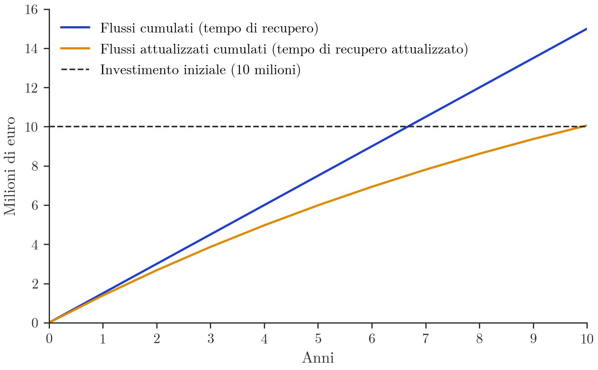

# Esercizi sui metodi di valutazione e opzioni reali

## Ripresa dei cinque metodi di valutazione

Riprendiamo da dove avevamo finito l'altra volta: cinque metodi per valutare un investimento. Il più utilizzato è il VAN, sono tutti in correlazione tra di loro, tutti sono espressione di una valutazione che tiene conto dell'investimento iniziale e dei flussi generati dal progetto. Evidentemente alcuni di essi tengono conto del concetto di attualizzazione e ci servono perché abbiamo spesso la necessità, come abbiamo detto, di confrontare progetti di investimento diversi di un'azienda. Gli investimenti sono spesso disomogenei: come facciamo a mettere in correlazione l'apertura di un punto vendita di proprietà con quella di un punto vendita in affitto? Se abbiamo il punto vendita di proprietà dovremo acquistare l'immobile, avere un esborso in un certo tempo; se invece lo prendiamo in affitto pagheremo il canone di locazione, non c'è l'esborso, e le scelte sono queste.

Prima di proseguire vediamo insieme un paio di esempi, esercizi, per vedere numericamente come si sviluppa l'applicazione di questi metodi su uno stesso progetto di investimento. Adesso vediamo un esercizio, anzi ne vediamo due, dove c'è un caso e applicheremo i vari metodi. Dopodiché, nella continuazione della lezione, vedremo le opzioni. L'argomento dopo le opzioni è il costo del capitale. Vediamo se ci arriviamo, se no lo continuiamo dopodomani.

Sulle parti che avete visto, vi sono chiari i concetti dell'altra volta, i metodi di valutazione, il concetto di ragionare sui flussi di cassa? Dopo lo vedremo. Tenete sempre a mente, e questo è uno sviluppo anche del corso, i vari flussi di cassa, perché sono importanti soprattutto quando guarderemo l'azienda nel suo complesso. ==È importante capire che ad ogni flusso di cassa corrispondono degli stakeholders==. Poi gli esercizi. Riferimento su Moodle, quelli che vediamo in aula; magari ve ne metto anche qualcun altro e dopo lo vediamo risolto nelle volte successive, così per esercitarci.

### Il caso: aprire un nuovo supermercato

Questo è un esempio dove c'è uno scenario con dei dati. Sono quelli che servono a voi come valutatori in azienda per valutare un investimento: quant'è l'ammontare dell'investimento iniziale, quanto si prevede che darà in termini di ritorno come flussi di cassa e quali sono le aspettative di tasso degli investitori. L'idea è di capire come valutare l'apertura di un nuovo supermercato. Avevamo visto l'esempio del Conad. Che ragionamento sta dietro all'apertura di un nuovo punto vendita? Sono investimenti che cubano milioni di euro, quindi ha senso chiedersi se conviene farli o non farli, se conviene farli in un determinato luogo piuttosto che in un altro. Hanno costi diversi perché anche a parità di metratura un punto vendita potrebbe essere in un'area residenziale, in un'area semi industriale fuori dalle abitazioni, quindi non hanno tutti lo stesso costo, magari a parità di metratura.

L'idea è capire, a fronte dello stesso investimento da 10 milioni, se conviene aprire un posto piuttosto che un altro, perché magari i flussi di cassa saranno diversi. Ipotizziamo che ci siano alcuni dati che usiamo e alcuni dati che ci servono meno. ==Quello che è importante è intercettare le informazioni che ci servono==, quindi ipotizziamo di partire con il VAN, dopo lì scorriamo tutti. Che VAN ha questo progetto? Un investimento iniziale di 10 milioni, con quel fatturato, con quel flusso di cassa annuo operativo. Anche questa è una semplificazione della realtà, non c'è un anno uguale all'altro, e ipotizzare che l'FCFO sia un milione e mezzo è una semplificazione, ma questo lo faremo sempre, a meno che voi non abbiate una previsione molto attendibile dei flussi di cassa all'euro, l'anno 1 un milione 422 mila, l'anno 2 un milione 526 mila 700.

### Dove si trova la proiezione dei flussi di cassa

In alcuni casi voi che siete i valutatori dovete valutare questo progetto o vi fate una previsione, quel punto vendita indicativamente genererà un flusso di cassa di un milione e mezzo all'anno, oppure avete una proiezione puntuale dei flussi di cassa. Da dove la trovate la proiezione dei flussi di cassa puntuali su un progetto aziendale? Da che documento? Se siete in un ufficio amministrazione e finanza, vi passa per le mani che documento dove ci potrebbe essere dentro uno sviluppo dei flussi di cassa quasi approssimati alla virgola? Se state sfogliando un documento che vi dà dei flussi di cassa previsionali, che documento state sfogliando sulla vostra scrivania? Uno studente risponde: un budget? Sì, nel senso che il budget solitamente ha un orizzonte di un anno, è un documento previsionale, però è molto molto dettagliato e si sviluppa solitamente nell'arco dei 12 mesi successivi, perché si naviga con un orizzonte molto stretto ed è dettagliato su tutte le funzioni aziendali. Qualcosa che si spinge oltre l'anno? Il business plan, o piano economico finanziario.

Se siete in un'azienda, se andate a lavorare per l'advisor, se siete in un private equity, se siete in una banca, vi sottopongono un'idea imprenditoriale. Banalmente avete un amico che fa la startup e vi sta chiedendo se volete mettere un gettone per giocare anche voi in quella partita: che cosa vi mostrerà per convincervi? Probabilmente vi fa vedere il business plan della sua iniziativa. Dentro ci sono i flussi di cassa previsionali, tendenzialmente. Se tu mi devi convincere a mettere una fiche su un investimento o mi devi convincere che il tuo investimento è più allettante di un altro, fammi vedere il business plan.

Stessa cosa quando la famiglia Bastianello del PAM, piuttosto che la famiglia Canella degli Alì, va in banca e dice: Ciao, banca Intesa, mi dai 10 milioni di euro che voglio aprire la Lidl nuovo di Abano.

> [!question] Da verificare: la trascrizione riporta "la Lidl nuovo di Abano"; dal seguito probabilmente "l'Alìper nuovo di Abano".

Cosa gli dice il direttore della banca prima di dirgli sì o no? Dammi un bilancio di Alìper per vedere se sei sul baratro o se sei un'azienda solvibile. Però siccome sta presentando un investimento, non vuole comprare l'S lunga, vuole aprire un altro, il centocinquantesimo Alìper, il direttore della banca gli chiede: Caro signor Canella, dammi un business plan del tuo investimento.

> [!question] Da verificare: la trascrizione riporta "l'S lunga"; probabilmente "Esselunga".

Voi cosa dovete produrre? Il signor Canella torna da voi, voi siete nell'ufficio finanziario dei supermercati Alìper e lui vi dirà: La banca mi ha chiesto il business plan del nuovo Alìper di Abano. E voi vi dovete mettere lì e sviluppare qualcosa che sia molto simile a questo esercizio che state per vedere. L'esercizio qual è? È di contrapporre all'investimento iniziale una previsione di flussi e far vedere al direttore della banca o a un imprenditore che l'investimento sta in piedi, produce una remunerazione che è soddisfacente e che magari lo è più di un'altra cosa. Perché il signor Canella potrebbe dire: nei prossimi tre anni compriamo i Famila dal gruppo Emisfero, oppure apriamo undici Alìper nuovi in tutto il Triveneto. Se abbiamo dieci milioni di euro dove ce li giochiamo? Compriamo dieci milioni e facciamo un deal e compriamo il marchio Famila, oppure apriamo undici nuovi Alìper. Come facciamo a confrontarlo? Voi sarete tranquillissimi perché saprete applicare queste regole, quindi calcolate il VAN dell'una e dell'altra cosa, ad esempio.

Applichiamo i cinque metodi. Se vi siete segnati i dati, ma sono pochi: l'investimento iniziale, il tasso, il WACC, le aspettative di rendimento degli investitori, la durata dell'investimento e l'FCFO, il valore dei flussi di cassa annui.

Queste sono le cose che servono di questa tabella.

### Le cinque misure sul caso del supermercato

Come calcolo il VAN? Contrappongo l'investimento iniziale al valore attuale dei flussi di cassa attesi. Quali sono i flussi di cassa? Un milione e mezzo a che tasso? Al WACC, all'aspettativa. Questo l'avete già visto, il VAN su altri corsi, l'avete già fatto in altri esami. Questo è un ripasso, lo riguardiamo perché ci serve per completare il ragionamento, anche perché le formule di attualizzazione sono una palestra per dopo: quando andremo a maneggiare i flussi di cassa del rendiconto finanziario di un'azienda useremo le stesse formule, e il VAN viene buono perché il concetto di attualizzare i flussi a un certo tasso è sempre quello.

Poi nel punto due vi ricordate che cos'è il TIR? Il TIR è un tasso per cui il VAN a quel tasso è zero. Il TIR che viene fuori, che sarà un n per cento, lo vado a confrontare con le aspettative di rendimento degli investitori, che in questo caso hanno un'aspettativa dell'8%. Mi chiedo: il TIR, il tasso di rendimento di questo progetto, è più alto o più basso delle aspettative che hanno gli investitori?

Poi ho l'indice di redditività, che è un indice, lo dice la parola, quindi è qualcosa diviso qualcos'altro. Vi ricordate dalle slide che vi ho messo che dividi quanto rende il progetto rispetto a quanto spendi per farlo, e viene fuori un indice. E il 4 e 5 si misura in tempo. Il tempo di recupero può essere semplice o attualizzato. Il tempo di recupero semplice non fa altro che sommare negli anni i flussi, contrapponendoli agli investimenti in uscita.

Qual è il problema per noi che siamo esperti di finanza, usando il metodo numero 4? Che concetto ci perdiamo se usiamo il 4 invece del 5? Cosa cambia dal 4 al 5? L'attualizzazione. E perché ci interessa? Perché l'abbiamo visto nella prima lezione, che avere 100 euro fra un anno non sono 100 euro oggi al tempo zero. Il punto 4 sostiene che 100 euro oggi, 100 euro fra un anno, 100 euro fra due anni sono sempre 100 euro. Il punto 5 dice: stai attento, perché per me, che sono un valutatore, applico le logiche della finanza e il tempo, come abbiamo visto nei grafici dei rendimenti e di tutto, ha un valore. ==Quel tempo per me ha un valore economico e finanziario==, quindi porto avanti e indietro i flussi e, di quanto li porto avanti e indietro, hanno valori diversi. Questa è la differenza tra il 4 e il 5. Vedremo poi nell'esercizio 2 che applicando i due metodi potrebbero portare a risultati diversi.

### Perché capire il ragionamento e non solo la formula

Questi bellissimi, li vediamo insieme risolti, dopo ve ne carico un paio dove potete farveli da soli o farveli fare da ChatGPT, tanto gli incollate questo e viene fuori. Però avete due limiti: uno, che ==durante il compito non avete ChatGPT, quindi vi conviene padroneggiare la formula==. La seconda è che vi conviene capire in profondità, perché questi ragionamenti nel mondo lavorativo li userete, ma non solo per produrre la formula del VAN: questa cosa basta impostarsela su un Excel e tanti saluti, o ve la faccia ChatGPT. Se parteciperete a una riunione con un private equity e fanno un ragionamento a voce, nel senso che ragioneranno sul fatto che a fronte di un investimento iniziale c'è una serie di flussi che andranno attualizzati, avrete necessità di seguirli con le orecchie e non avrete tempo di trafficare sull'AI.

> [!tip] Esame: durante il compito non c'è ChatGPT, quindi conviene padroneggiare la formula.

Al di là dell'esercizio matematico, perché questo non è un esame di matematica, un po' aiuta la memoria, un po' aiutano gli strumenti che avete, però cercate su queste cose di appropriarvi del ragionamento, che spesso è di buon senso applicato a delle logiche finanziarie, anche perché così potete apprezzare. Nel mondo del lavoro, quando andate in certe riunioni, in certi tavoli dove si parla di ritorno dell'investimento, di rendimenti alternativi, di confronto tra il tasso privo di rischio e un investimento rischioso e via così. Anche nella quotidianità questi ragionamenti vi servono più che altro per tenere il passo quando state lavorando su varie aree.

### Il VAN del supermercato

Le formule sono relativamente semplici: in questo caso il valore attuale è la proiezione per dieci periodi del milione e mezzo, attualizzato da contrapporre all'investimento iniziale che è di 10 milioni. Il milione e mezzo per dieci anni, un milione e mezzo, un milione e mezzo, dieci volte attualizzato in tutto al tempo zero porta 10.065.122. Io sto escludendo i 10 milioni, ho un VAN di 65.000 euro.

Se fossi il professore che guarda il libro, vi direi di accettarlo questo progetto. Se fossimo nella realtà, vi direi: occhio, perché tu stai facendo una previsione che stai per spendere 10 milioni e hai un ritorno di 10 milioni e 65 mila euro. Se tenete 10 mesi in più le impalcature, noleggiate, vi siete mangiati il VAN. Se ragioniamo a matematica, questo è un progetto con VAN positivo, però è veramente rischiato. Se questi sono gli unici elementi, è vero che di fronte a un altro progetto con un VAN di 10 mila euro questo è preferibile. È vero che questo è un VAN positivo ed è sicuramente preferibile a un progetto con VAN negativo, però abbiate anche la significatività, il corso di quello che state valutando e misurando. ==Questo è importante, che non lo vedete dalle formule.==

> [!question] Da verificare: la trascrizione riporta "il corso di quello che state valutando e misurando"; il senso di "corso" non è chiaro.

Immaginate, anche a buon senso, che voi state per aprire un punto vendita: immaginatevi un prato di erba dove nascerà una specie di centro commerciale che vi costerà 10 milioni di euro. Avete raccolto i preventivi, come voi sapete i preventivi si discostano di un n per cento dalla realtà sempre in maniera peggiorativa. Se qualcuno di voi ha avuto per le mani un preventivo di un lavoro di casa o della riparazione di un'auto o di una moto, andate lì, vi dice: Senti, devo cambiare la lampadina di cambio faroale, poi si è accorto che il filo ha spellacchiato, la batteria aveva già tre anni, e da una lampadina vi cambia mezzo scooter.

> [!question] Da verificare: la trascrizione riporta "lampadina di cambio faroale"; il termine non è chiaro.

Cosa succede qui? Che state per spendere 10 milioni perché vi entrino 10 milioni e 65 mila euro in 10 anni. ==Occhio, è un VAN positivo, però è molto rischiato==. Se vi dovessero chiedere un parere su questo investimento, è giusto anche, al di là del principio e della formula, che segnalate questo aspetto.

### Il TIR e l'indice di redditività del supermercato

L'IRR è sempre una formula di equivalenza: voi ponete idealmente zero al posto del valore attuale, prendete la formula del VAN, mettete il VAN uguale a zero, sostituite gli altri elementi e vi viene fuori un tasso interno di rendimento dell'8,14%. 10 anni ce li avete, l'FCFO è un milione e mezzo, l'I0 è 10 milioni, l'unico elemento che vi manca è il tasso. Il VAN è il primo a sinistra ed è zero, avete messo tutti gli elementi della formula del VAN, vi tirate fuori il tasso che viene 8,14%.

> [!question] Da verificare: la trascrizione riporta "il CFO è un milione e mezzo"; la slide 37 riporta "FCFO" e si adotta questa forma.

Anche qui è appena appena più soddisfacente rispetto alle attese degli investitori che si aspettano un 8%. Questo investimento rende un 8,14%, se tutto va bene, se l'I0 da 10 milioni è confermato. Perché l'I0 da 10 milioni non è un consuntivo, è una previsione. Questo punto vendita non c'è ancora, quindi anche l'I0, è vero che è un I0 che è al momento zero, ma è zero rispetto a quando parte il progetto: parte il progetto, in I0 sgancio 10 milioni e dopo inizio a produrre flussi.

L'indice di redditività è un quoziente. Nella formula voi dovete dividere il valore attuale dei flussi fratto l'investimento iniziale. Avevate visto nelle slide che questo, perché sia apprezzabile l'investimento, deve essere maggiore di uno, che banalmente basta guardare la formula, basta che il numeratore sia più grande del denominatore, che il valore attuale dei flussi sia più grande di quanto state per spendere.

### Il tempo di recupero, semplice e attualizzato

E avete visto il terzo metodo. Mancano il quarto e il quinto, il tempo di recupero. Tu dici: oggi spendo 10 milioni, poi un milione e mezzo all'anno, un milione e mezzo, un milione e mezzo, un milione e mezzo, per dieci volte mi rifaccio dell'investimento. L'imprenditore vi dice: Scusi, ma dopo quanti anni rientro di sti 10 milioni? Questa è la domanda a cui risponde il TR. Ma se io spendo 10 milioni, dopo quanti anni me lo rifaccio questo investimento? Dopo quanti anni lo recupero? La risposta è: dopo sei anni abbondanti, perché i flussi di cassa accumulati arrivano a 10 milioni tra il sesto e il settimo anno. Il primo anno ho un milione e mezzo, dopo due anni ne avete tre, dopo tre anni ne avete quattro e mezzo, e avanti così. Quando è che vi rifate dell'investimento iniziale? Alla fine del sesto anno avete un cumulato di 9 milioni, voi ne avete spesi 10. Alla fine del settimo anno ne avete 10 e mezzo. Possiamo dire che, se l'investimento partisse a t0, fosse il primo gennaio dell'anno zero, verso luglio del settimo anno, a spanne, avete recuperato il vostro investimento.

Ma secondo voi è corretto ragionare così? No? Perché? È una semplificazione, nella realtà non è così, perché viene da pensare che se tu mi dai un milione e mezzo fra un anno... Mi dici pure: lo vuoi tra sette anni. Ma tu fra sette anni non mi dai un milione e mezzo, me ne dai di più. Era quello che dicevamo prima, ma anche dello stipendio o di tutto il resto, il tempo per noi ha un valore, non è indifferente. Ha più senso il tempo di recupero attualizzato. Tu dici: alla fine dell'anno uno, riferito al momento zero, io nel momento zero tecnicamente ho un milione tre ottantotto, non ho un milione e cinque, perché c'è il tema che il tempo ha un valore, come avevamo visto nelle slide. Questo è lo stesso esercizio di prima, dove io vado ad attualizzare i flussi in entrata.

> [!question] Da verificare: la trascrizione riporta "un milione tre ottantotto"; probabilmente circa 1.388.000 euro.

Noi che siamo uomini e donne di finanza ci prenderemo un po' di parole dal signor Canella, perché prima grossolanamente gli avevamo detto che in sette anni rientrava dell'investimento, giusto? In sette anni dieci milioni e mezzo ti tornano indietro. Adesso vi siete messi a fare i conticini giusti e gli dite: no, guardi, scusi, effettivamente non sono sette. Sono quasi dieci e questo glielo spiegherete, perché da un ragionamento grossolano che può fare una persona che non maneggia i flussi nella finanza, da cui gli verrebbe anche facendo un calcolo a mente sette anni, perché fa un milione e mezzo per arrivare a dieci milioni, quanti anni ci metto se ho un milione e mezzo all'anno, in realtà non è così. Applicando il tempo di recupero attualizzato arrivo a nove anni e passa, quasi dieci anni, anzi dieci anni. Il valore attuale cumulato che arriva a 10.065.000 euro scollina subito dopo il decimo anno.

### Perché il libro li espone tutti

A volte non hai tutte le informazioni, per completezza vengono messi tutti i metodi. Potresti non avere il WACC, perché hai delle informazioni talmente grossolane che non riesci a calcolarti il WACC, quindi non sei in grado di attualizzare i flussi. È vero che un tasso bene o male lo trovi sempre per attualizzare, però è una prima stima. Di tutti questi vengono esposti sul libro per dovere di cronaca, perché fanno parte di un percorso di elementi di finanza, dei libri di valutazione. Nella prassi, effettivamente, quelli che vedete di più sono il VAN e il TIR e in parte il tempo di recupero attualizzato, i tre che vengono maggiormente usati. Il VAN e il TIR sono abbastanza simili, uno esprime euro e un altro esprime un tasso, il concetto è sempre quello. La formula del VAN e la formula del TIR usate gli stessi elementi e li rimescolate.

Se il tempo di recupero attualizzato è dieci anni, voi lo fareste o no questo progetto? Adesso avete fatto l'esercizio, vi ho dato i dati, viene fuori 9,9 anni, dieci anni. Lo fate o no l'investimento? La risposta è: dipende. Esatto. Diversamente dal VAN, che è una risposta secca, perché nessuno o quasi nessun umano vi direbbe sì, lo faccio se è un VAN negativo, il tempo di recupero è soggettivo, perché dice solo che questo progetto ha un tempo di recupero di n anni, ma a me può non stare bene aspettare dieci anni per recuperare dieci milioni di euro, mentre ==è inconfutabile il fatto che un progetto con VAN negativo sia da respingere==, perché sto distruggendo ricchezza. Metti, se hai dieci milioni, mettili, comprati un BTP, mettili nel conto deposito di qualsiasi banca, non metterti a fare un supermercato, perché stai distruggendo ricchezza, ti ritroverai con meno soldi di quelli che hai oggi. Se il progetto presenta un VAN negativo, vuol dire che attualizzando i flussi di qualsiasi tempo di quel progetto, tu ti ritroverai finanziariamente con meno soldi di quanti ne hai oggi, quindi solo un folle lo farebbe.

### I motivi strategici di un VAN negativo

Potrebbero esserci dei motivi strategici. Questo è l'unico motivo per cui voi potete fare un VAN negativo e potete affrontare un progetto con VAN negativo. Oggi camminavo per piazzale Roma, voi attraversate sotto per andare sul ponte di Calatrava, c'è Nike, Adidas, Mango, ci sono quei negozi sotto le gallerie, a stazione. Avete mai visto qualcuno dentro che compra? Ogni volta che passo c'è talmente poca gente dentro che non vedi neanche quasi i commessi. Verrebbe da chiedersi: ma qual è il VAN del negozio Adidas in stazione a Venezia? È da suicidarsi, non entra mai nessuno. Però d'altra parte c'è da chiedersi: può Adidas non avere un negozio in stazione a Venezia? Una qualsiasi persona del mondo esce nella città più bella del mondo e trova lo store di Adidas, non si può non averlo. Probabilmente, o spesso, molto spesso, è una questione strategica avere il negozio lì, perché se noi andiamo a calcolare il VAN del punto vendita della stazione di Venezia di qualsiasi negozio che c'è lì sotto, di abbigliamento, lasciate perdere magari KFC, ma prendete Nike, Mango e Adidas, ad esempio, quei tre lì o Bassetti, mi pare, quei quattro lì, sicuramente hanno un VAN negativo quei progetti di investimento, quindi solo un folle spenderebbe soldi per aprire un punto vendita lì, metterci della merce e dei commessi e pagare un affitto.

È evidente che si chiamano flagship store, un concetto forse più da marketing che da finanza, però il flagship store è lo store bandiera o rappresentativo della... metto la bandierina, come la metto a rischio, devo esserci lì. È come avere lo store in Galleria Vittorio Emanuele a Milano, o avere lo store in via Monte Napoleone. Ci sono dei negozi che sono perennemente vuoti.

> [!question] Da verificare: la trascrizione riporta "come la metto a rischio"; probabilmente "come a Risiko".

Se voi andate a fare i turisti, o ve lo auguro, i clienti, in via Monte Napoleone o nel quadrilatero della moda, trovate dei negozi che sono sempre vuoti. Però lo stesso negozio in altri punti della città, o a Roma o in altri punti, è pieno e c'è passaggio, o magari in un centro commerciale di alta gamma. Andate da Philippe Plein in via Monte Napoleone, non c'è mai nessuno. Che senso ha? Questo è l'unico motivo, probabilmente, che è strategico e non finanziario per affrontare un investimento con VAN negativo.

Altra cosa, lo vedremo più avanti nelle sinergie, nelle aziende, però ve lo anticipo, è simile. Tu potresti fare un'acquisizione di un'azienda dove l'aspetto strategico è quello apparentemente meno visibile: io sono di Adora, acquisisco l'azienda Tecnica Dolomite non tanto perché macina utili, ma perché dentro il responsabile sviluppo prodotto è un genio, il maggior genio del pianeta a sviluppare modelli. Siccome io non riesco a portar via quella risorsa, che è quell'ingegnere oppure quel pool di ingegneri che è il laboratorio di ricerca di Tecnica Dolomite sullo sviluppo di nuovi materiali innovativi, Tecnica Dolomite magari è un chiodo di azienda che va male, ha il bilancio in rosso, me la compro, ma perché dovrei comprarmela e portarmi dentro un EBITDA negativo, dei flussi di cassa negativi e sostenerla?

> [!question] Da verificare: la trascrizione riporta "io sono di Adora"; il nome dell'azienda non è chiaro.

Perché strategicamente potrei avere delle risorse chiave che non riesco ad avere in nessun altro modo. Se porto a casa le risorse di quell'azienda, riesco a mettere quelle persone che ho in quel laboratorio nel mio laboratorio di Adora e lancio la scarpa da running più bella del mondo, anche se quelli stanno sviluppando scarponi da sci. Questo è un altro motivo per cui si può infrangere la regola del VAN, però ==se non è per strategia, di marketing o di sviluppo prodotto, solitamente il VAN guida le decisioni==.

Questa è la differenza tra la riga blu, che è il tempo di recupero, e la riga gialla o arancio, che è il tempo di recupero attualizzato, e il tratteggio è l'investimento iniziale: con la riga arancione il break even si sposta molto più a destra.

### Secondo caso: una nuova linea di snack

Qui avete un'azienda alimentare che vuole lanciare una nuova linea di snack con una linea produttiva dedicata, come spesso capita. Una nuova linea di snack o un nuovo packaging. Quando l'azienda che fa l'acqua Dolomia ha deciso di fare una nuova bottiglia super wow da mettere sulle tavole dei ristoranti costosi e non quella solita di vetro col tappo lungo come tutte le altre, o magari di vetro un po' grezzo, ha dovuto, per riposizionarsi e poter vendere l'acqua sul packaging diverso, su una bottiglia più tondeggiante, più bombata di vetro e tutto, valutare l'investimento di una nuova linea produttiva. Perché i macchinari che mettevano i tappi, che imbottigliavano, etichettavano, erano diversi da quelli delle bottiglie lunghe che vedete di solito. Ha dovuto capire se le conveniva posizionarsi sui ristoranti di alta gamma, vendersi come acqua di nicchia nei ristoranti più costosi dove ti mettono l'acqua a 5 euro a bottiglia, però è la Dolomia con un bel design, oppure rimanere nei supermercati o nei clienti a domicilio. Qual è il trade-off?

In questo caso potrebbe essere una nuova gamma di snack, merendine da fare con una nuova linea produttiva. Devo comprare macchinari, attrezzature, avviare la produzione. L'investimento dura 5 anni, magari ha la durata del tempo che può avere la vita, anche di marketing, di uno snack. Ho un investimento iniziale di 4 milioni, la durata di questo progetto è cinque anni, il WACC è il 10% e tutto si esaurisce nell'arco di cinque anni. In questo caso il flusso di cassa non è che sono sempre un milione e mezzo, un milione e mezzo. Effettivamente questo è più aderente alla realtà, ti fa vedere che tu quando lanci un prodotto hai un flusso crescente di cassa: il primo anno fatturi 650.000 perché inizi a collocarlo ed entrano magari come flussi di cassa 650. Dopo, tra il secondo e il terzo anno va un po' a regime, dopo il quarto e il quinto sviluppi, e arrivi a un flusso alla fine del quinto anno che è quasi doppio rispetto a quando hai lanciato il prodotto. Complessivamente tu hai flussi compressivi per 4.650.000, verrebbe da pensare intanto a occhio che i flussi previsti sono più alti dell'investimento iniziale, a fronte di 4 milioni c'è un ritorno previsto di 4.650.000.

> [!question] Da verificare: la trascrizione riporta "flussi compressivi"; probabilmente "complessivi".

### Il VAN della linea di snack

Andiamo a vedere come valuteremo questo progetto. Il VAN come si fa qui? Ho flussi diversi, quindi devo andare su ognuno a prenderlo e portarlo indietro al tempo zero. Vuol dire che il flusso del primo anno, 650.000, lo porto indietro di un periodo, gli 800.000 li porto indietro di due periodi, riconduco tutto al momento zero dove escono i famosi 4 milioni. Contrappongo i 4 milioni iniziali al valore attualizzato dei miei flussi. E qui sgrano un po' gli occhi: apparentemente sembrava che a fronte di 4 milioni mi entrassero 4.650.000, mi accorgo che, siccome il tempo ha un valore, l'attualizzazione di tutti questi flussi dei 5 anni mi porta a un valore attuale di 3.418.000, perché 1.300.000 fra 5 anni, attualizzati a quel tasso rischioso, sono 800.000 euro oggi, quasi metà per l'effetto del valore attuale.

> [!question] Da verificare: la trascrizione riporta "6,50", "4 milioni 6,50" e "3 milioni 4,18"; si scrivono 650.000, 4.650.000 e 3.418.000, cifre che il docente dice per intero poco prima.

A fronte di 4 milioni di esborso iniziale io ho dei flussi di cassa attualizzati per 3.400.000, quindi il VAN è negativo per 581.000 euro. È meglio se io non lo faccio, se voi avete possibilità di avere 4 milioni non metteteli in questo progetto, anche se apparentemente vi porta flussi di cassa per 4.650.000, per il tempo e per il rischio, che è quello che abbiamo visto la volta, il tempo ha un valore e c'è un rischio. Ricordatevi che è un investimento rischioso, è spiattellato lì sull'esercizio, però questa è una linea di snack, non è il BTP dello Stato italiano, queste non sono cedole di un buono del Tesoro, sono flussi di cassa previsti di un investimento. Può essere che se questa è la proiezione di Ferrero, se alla fine dell'anno uno il Mulino Bianco mi copia lo snack, probabilmente non avrò neanche quei flussi di cassa lì negli anni dal due al cinque, oppure saranno più che dimezzati.

E cos'è che incorpora tutto questo rischio rispetto al mettere 4 milioni di zero su un BTP? Il WACC. Il WACC è del 10%. Perché sto portando indietro i flussi del 10%? Perché è così tanto? Perché probabilmente è un investimento molto rischioso. Se fossero le cedole di un BTP andrei a prendermi il tasso dei BTP, l'Euribor, dei tassi, e lo vediamo dopo nella lezione sul costo del capitale, a un tasso basso, sposto avanti e indietro i soldi senza rischio. Qui c'è un rischio, infatti ho il 10%.

> [!question] Da verificare: la trascrizione riporta "4 milioni di zero su un BTP"; il senso di "di zero" non è chiaro.

### Il TIR, l'indice di redditività e il tempo di recupero della linea di snack

Mettendo il VAN uguale a zero, nuovamente questo, lo sviluppo, le formule sono uguali, cambiano solo i numeri che vengono fuori. Con lo zero uguale all'inizio, 4 milioni, attualizzo tutti i cinque anni di flusso, il TIR è 4,70%. Questo progetto rende il 4,70%, ma le aspettative dei miei investitori sono del 10%. Investitori barra creditori. WACC, ponderato debito equity. Sto portando un progetto che rende il 4,70, questi mi dicono: No, questo progetto non mi interessa, rende meno di quelle che sono le mie aspettative.

> [!question] Da verificare: la trascrizione riporta "VA, CC"; la slide 39 riporta la sigla WACC con il suo significato e si adotta questa forma.

L'indice di redditività viene 0,8, evidentemente, quindi è minore di 1 e anche ovviamente nuovamente non è adottabile questo progetto. Il tempo di recupero, grossolanamente, mi dice che nell'arco dei cinque anni, se io non avessi né WACC né altro, a fronte di 4 milioni che escono, in cinque anni te ne entrano 4.650.000, ma ben visto che questa cosa non corrisponde di fatto alla realtà. Infatti, e da qui emerge, quando voi fate il tempo di recupero attualizzato, avevamo detto che il progetto, ce l'avevate nei dati dell'esercizio, durava cinque anni. In cinque anni io non lo recupero, sto investimento. Se io metto 4 milioni, alla fine del quinto anno mi sono entrati nel mio salvadanaio 3.418.000 attualizzati. Io alla fine del quinto anno, dove dovrei chiudere lo stabilimento e andare a Santo Domingo a godermi i soldi del VAN, non vado da nessuna parte, perché alla fine del quinto anno voi non avete recuperato l'investimento, siete ancora sotto, perché avete cumulato 3.418.000.

La risposta è: il tempo di recupero attualizzato risulta irraggiungibile nell'orizzonte temporale del progetto. Per cui dal grafico, ragionando con le formule più complete del tempo di recupero attualizzato, nell'arco del tempo dell'investimento, alla linea tratteggiata, che è quella di galleggiamento, che sono i 4 milioni, non ci arrivate. Questo investimento non è conveniente. Il VAN è negativo, inferiore al CAPEX, il TIR è inferiore al WACC del 10%.

L'indice di redditività è minore di 1. Il tempo di recupero mi dice cinque anni, ma il tempo di recupero attualizzato mi dice che supero l'orizzonte del progetto.

## Le opzioni reali

Queste sono le opzioni reali. ==Non sono le opzioni con le put del mondo della finanza, anche se il nome è lo stesso.== L'opzione intesa come facoltà di scegliere, come la possibilità di scegliere tra fare qualcosa e non farla. Tenete conto che le opzioni non sono dei titoli, cedole o coupon, dimenticatevi tutto quel mondo lì. La parola opzione intende che io posso avere le possibilità di decidere come comportarmi a fronte di un investimento.

### L'abbandono, l'espansione e l'attesa

Se sto sviluppando, se sono Amazon e sto sviluppando il telefono e gli altri mi stanno superando alla grande, il mio progetto sta andando a rotoli, decido di abbandonarlo. Quando io devo valutare, ad esempio, il VAN del telefono Fire del cellulare di Amazon e voi siete al momento zero, potreste considerare due scenari: uno che lanciate il telefono Fire e l'investimento va alla grande. Lo scenario B è che dopo un anno vi accorgete che le vendite non sono per niente soddisfacenti, ammesso che voi arriviate a venderlo nei negozi, e alla fine dell'anno uno, ad esempio, sbaraccate tutti i laboratori e le linee produttive, mettete un annuncio su Subito: vendesi impianto, causa inutilizzo, e prendete quello che prendete. Questa è l'opzione di abbandono, ad esempio. Il fatto che quando valuto un investimento io posso anche immaginare di valutarlo considerando la possibilità di avere l'opzione di abbandonare il progetto se le cose non vanno bene.

Viceversa, abbiamo visto, potrei anche avere la possibilità non solo che il telefono di Amazon vada bene, ma che va così bene che io, con gli incassi del telefono del primo anno, prendo quei milioni di euro e a distanza di 20 chilometri mi apro un altro plant e inizio a produrre altri telefoni a raddoppio volumi, che è l'opposto dell'abbandono. Qual è l'opposto dell'abbandono? È l'opzione di espansione, l'avevamo visto negli esempi. Se le cose vanno molto bene io mi espando.

C'è un'altra opzione intermedia, la terza, sono tre. L'altra è l'opzione di attesa, è dall'esempio del videogioco. Se mi accorgo che in uno scenario, se io lancio oggi il videogioco, ho determinati flussi di cassa, però in parte sono cannibalizzati dai videogiochi che ho già in circolazione. Se invece aspetto un anno, ho un effetto sorpresa o aspetto un anno perché l'anno prossimo ci sono i mondiali e il mio videogioco di calcio avrà una spinta pazzesca che non avrebbe quest'anno perché quest'anno non ci sono i mondiali, le persone si comprano appunto il gioco con le squadre di calcio, se lo lancio l'anno dei mondiali ho molta più cassa perché il videogioco vende di più. L'opzione di attesa rappresenta il fatto che io, quando valuto il progetto lancio del videogioco, posso aprire dentro al VAN di quel progetto due scenari paralleli: uno di lanciarlo come avete visto, come gli snack, e l'altro di attendere un anno e lanciarlo con dei flussi di cassa più elevati. E adesso li vediamo.

### Il limite del VAN semplice e il valore di un'opzione

Il limite del VAN è questo qui, intanto del VAN semplice uno, è il fatto che il management non abbia nessun potere e non possa decidere nulla. Quando mai nella realtà vi trovate una cosa come l'esercizio che vi ho appena mostrato, apro, lancio una linea di snack e i flussi di cassa sono quelli. Oppure altro, un punto vendita, i flussi di cassa sono quelli lì. Ma allora il management cosa ci sta a fare? Il management deciderà qualcosa rispetto a quell'investimento? Potrà simulare degli scenari. Usare le opzioni reali vuol dire che il management, quando applica il VAN, principalmente usa degli scenari che sono quei tre: espansione, abbandono e attesa. O fare investimenti addizionali in futuro, aspettare di investire, rinviare l'investimento, oppure abbandonare il progetto. Queste tre eventualità si chiamano opzioni reali.

*(slide 54)*

Quanto vale la facoltà di scelta? Se ragionate col buon senso, la formula è facile, per quello vi dicevo, ragionateci sempre. Quant'è il valore dell'opzione? È il valore attuale netto, il beneficio del progetto esercitando l'opzione, meno il valore di fare quel progetto senza l'opzione. Il valore dell'opzione, il poter dare un valore a questa scelta, è semplicemente la differenza in termini di VAN dei due scenari, il fatto di poter fare qualcosa e il fatto di non poter fare nulla.

*(slide 55)*

### L'opzione di espansione: i microchip

Espansione. Ipotizziamo di avere l'investimento nella linea produttiva, ad esempio la linea delle nuove bottiglie dell'acqua minerale, che ha due scenari: o uno scenario negativo, con bassi flussi di cassa e quindi con un VAN negativo, oppure uno scenario positivo dove i flussi di cassa elevati posso reinvestirli, ad esempio, e fare una seconda linea di bottiglie di acqua. Quanto vale in termini di VAN l'opzione di potermi espandere e attivare una seconda linea produttiva?

*(slide 56)*

Immaginate: avviate una linea produttiva per realizzare dei microchip e spendete 95.000 euro, che è il mio I0, 95.000 euro al 9% di WACC per quattro anni.

> [!question] Da verificare: la trascrizione riporta "95.000 euro"; la slide 57 riporta "€ 95.000k" e "€ 97.000k" (migliaia di euro). Si riporta ciò che dice il docente.

Poi, quei due che vedete sono i flussi di cassa. Sopra, quelli che iniziano con 105.000 sono i flussi di cassa se il progetto va bene. Quelli che iniziano con 70.000 sono i flussi di cassa se il progetto va male. E fin qui potreste attribuire una percentuale, ma fin qui è la vita, nel senso va bene, va male di per sé. Voi intanto sul blocco sopra potreste calcolarvi il VAN. Alla fine sono il VAN di due scenari dove l'uscita iniziale è 95.000, quindi fatevi il VAN dello scenario sopra e il VAN dello scenario sotto. Un VAN che ha quattro flussi in entrata da 105.000, 8.000, 8.000, 8.000, e l'altro VAN con 70.000, 6.000, 6.000, 6.000. E potreste ponderare questi due scenari. Adesso vediamo come si sviluppano. E questo è il fatto di non avere l'opzione. Fin qui non abbiamo scelto, abbiamo solo stimato la realtà: o va bene o va male, però il management non ha fatto ancora nulla, quindi non abbiamo parlato di opzioni.

Il secondo blocco è l'opzione: si consideri la possibilità, se le cose vanno bene. Se le cose vanno bene siamo in quale dei due scenari sopra? Quello su, quello da 105.000. Se le cose vanno bene, ho un T1 con 105.000 e poi 8.000, 8.000, 8.000. Se succede lo scenario sopra, allora uno potrebbe dire: sai che se il primo anno abbiamo fatto 105.000, quasi quasi con quei 105.000 che ho portato a casa in T1 ci potremmo aprire un'altra linea produttiva e mettere i 105.000 e ne spendiamo 97.000, quindi ci giochiamo gli incassi del primo anno perché le cose sono andate bene e vedo che stanno andando bene perché siamo nello scenario 105.000, 8.000, 8.000 e 8.000, e facciamo un investimento da 97.000 e ci apriamo un'altra linea produttiva di qualcos'altro che mi rende 55.000 euro per i successivi tre anni: apriamo un'altra linea, magari non di bottiglie ma di distillati, che mi costa 97.000, quindi vendo il kit bottiglia più grappa e quel kit lì che mi costa 97.000 imbastirlo mi dà tre flussi da 55.000. Però quello sotto lo faccio solo se le cose vanno bene.

*(slide 57)*

Come si traduce tutto questo? Questo sopra è lo scenario ottimistico e stiamo applicando il VAN. Avete lo scenario ottimistico con i quattro periodi, i flussi 105.000, 8.000, 8.000, 8.000, li attualizzate al WACC e avete il valore attuale dei flussi che è 114.000. Nello scenario ottimistico, se io lancio la linea di imbottigliamento e le cose vanno bene, il VAN è più 19.900. Io spendo 95.000 per portare a casa un valore attuale, se le cose vanno bene, di 114.900, quindi lo scenario ottimistico mi dà un VAN di 19.900 euro positivo. Probabilmente, al 50% avevamo detto, succederà questo, ma nello scenario avverso io rischio di ritrovarmi con un VAN di meno 16.000, ho speso sempre i 95.000, però cado in questo scenario di flussi di cassa in entrata e quindi ho meno 16.000 di VAN, con probabilità 50%.

> [!question] Da verificare: la trascrizione riporta "114.000" e poco dopo "114.900"; la seconda cifra concorda con il VAN di 19.900 su 95.000.

*(slide 58)*

In tutto questo mondo, quanto è il VAN di questo progetto, lasciando perdere le opzioni? Potrei dire che è con una probabilità del 50% 19.000 euro TIR e con una probabilità del 50% di meno 16.846. Il VAN, se non faccio niente, è di 1.531 euro.

> [!question] Da verificare: la trascrizione riporta "19.000 euro TIR"; probabilmente "19.900 euro di VAN".

Questo è solo si vince e si perde, ma io non decido niente, ho fatto solo due proiezioni, può andar bene o può andar male. Complessivamente è un po' diverso da prima dell'esercizio. Nell'esercizio avevo uno scenario con probabilità 100%, faccio il punto vendita, toglii snack e ho questi flussi.

> [!question] Da verificare: la trascrizione riporta "toglii snack"; il verbo non è chiaro.

Qui siamo un po' più vicini alla realtà, dove io dico: potrei anche pesare diversamente le percentuali, qui c'è un mezzo e un mezzo, perché abbiamo detto che le probabilità sono 50%. In realtà potrei ponderarlo con 70% e 30%, allora verrebbe diverso il VAN. Però questo è il VAN, si dice, senza l'opzione. Che scelte hai qui? Niente, mi affido al caso, va bene, va male, posso solo dire come andranno le cose in base alle probabilità.

Se voi aveste la possibilità di espandere, se le cose vanno bene, che cosa fareste? Vi si aprirebbe un sottoprogetto. Se succede lo scenario ottimistico, questo da 105.000, abbiamo detto, io posso espandere, ho l'opzione di espansione, ho l'opzione di mettere i 97.000 e questo diventa un nuovo progetto con dei nuovi flussi. Questa opzione di espansione però succede con una probabilità del 50%, per cui se questo ha il VAN dell'espansione, che è 38.000, avrà una probabilità del 50%, quindi si riduce a 19.000. Il valore atteso complessivo è la somma dei due VAN. 19.000 è il VAN di poter percorrere questo progetto di espansione e 1.531 è il fatto di poter fare il progetto sia che va bene o che va male, quindi 1.531 è il VAN della prima situazione. Lo scenario di espansione mi dà un VAN di 19.000, quindi il VAN complessivo di questo progetto è 20.000 euro. Il VAN dell'opzione di potermi espandere è più 19.000.

> [!question] Da verificare: il docente dice "20.000" e "19.000"; la slide 59 riporta "€ 20.899" e "€ 19.368". Si riporta ciò che dice il docente.

*(slide 59)*

Ho cerchiato in rosso questo perché i 97.000 meno, l'espansione, la nuova linea di bottiglie, tu la fai alla fine dell'anno uno, dopo che le cose sono andate bene e decidi di espanderti, dopo che ti sono entrati i 105.000, altrimenti non avresti i soldi per spendere quei 97.000. Ma se è vero che questa cosa succede alla fine del primo anno, dove io vedo che le cose sono andate bene, che ho portato a casa 105.000 e che posso permettermi il lusso di spenderne 97, questo succede all'anno uno. Ma noi in che anno ragioniamo? Nell'anno zero. Quindi i 97.000 li porto indietro di un anno. ==Errore canonico nel compito scritto.== Quando calcolate e sviluppate l'opzione di espansione, mi valorizzate questi flussi con i periodi sbagliati, oppure mi portate indietro il flusso, gli incassi dell'anno due, però questi li lasciate a meno 97.000. In realtà i meno 97.000 sono da portare indietro di un anno, quindi 97.000 sono un investimento che potremmo chiamare un I1, no? Un I0. Alla fine dell'anno uno tu spendi 97.000, che ad oggi che io fotografo queste possibilità sono 88.991 euro, non 97.000. Dopo lo vedremo, faremo magari degli altri esercizi.

> [!tip] Esame: errore canonico nel compito scritto: i 97.000 dell'espansione vanno portati indietro di un anno, non lasciati a meno 97.000.

> [!question] Da verificare: la trascrizione riporta "un I1, no? Un I0"; il senso non è chiaro.

### Espansione, secondo esempio: il punto vendita in Veneto

Un altro esempio di espansione è dire: un'azienda della GDO vuole aprire il primo punto vendita in Veneto, spende 5.000, mettete che siano milioni di euro, 5.000 migliaia, 5.000 k, quindi vuole spendere 5 milioni con un WACC del 10% e ha uno scenario di quattro anni. Spendo 5 milioni, apro il punto vendita. A questo punto, dopo che ho aperto il punto vendita in t0, le cose vanno bene o vanno male. Se vanno bene, ho i flussi dello scenario ottimistico; se vanno male, ho i flussi dello scenario pessimistico con una certa probabilità che noi, per semplicità, mettiamo al 50%, ma deciderete voi in base alle valutazioni del progetto quanto mettere. In questo esempio mettiamo il 50. Qui non ci sono opzioni fin qua. Spendo 5 milioni, se va bene ho i flussi sopra, se va male ho quelli sotto.

*(slide 60)*

Se le cose vanno bene, si consideri di ampliare il progetto alla fine dell'anno 1, quindi alla fine dell'anno 1 io vedo che i flussi sono stati, ad esempio, 1.500, e decido di ampliare, reinvestendo interamente i flussi incassati il primo anno del punto vendita. Ho due possibilità, le cose sono andate bene, quindi mi sono incanalato in questo scenario. Alla fine dell'anno 1 ho portato a casa 1.500, li uso per aprire un nuovo punto vendita, quindi 1.500 diventa il mio nuovo investimento, che mi genera questi flussi.

Lo specchietto sopra è se io non faccio niente e non ho nessuna opzione. Infatti dice il VAN del progetto senza l'opzione. Se le cose vanno bene, io spendo 5 milioni e mi tornano questi soldi qui, per cui ho un VAN di 727 mila euro, con una probabilità stimata del 50%. Se le cose vanno male, ho un VAN negativo di 1.830.000. Al 50% ho un VAN negativo di 915.000 euro. Quant'è il VAN senza l'opzione, il VAN del progetto? Meno 550.000. Se fossimo messi così, lo fareste, lo aprireste questo punto vendita di fronte a questo scenario di probabilità? No. Perché vi ho detto che il VAN negativo non intraprende progetti, quindi se io non avessi nessuna opzione, questo progetto sarebbe da respingere.

Ma potrei anche valutare che se le cose vanno bene e io mi ritrovo nello scenario ottimistico, potrei lanciare il secondo investimento che è molto redditizio. Prendo le entrate del primo anno, che sono 1.500, me le gioco tutte nel periodo uno e apro un nuovo punto vendita, magari in piazza San Marco, che mi rende 2.100, 2.000, 2.000, a fronte solo di 1.500 di investimento, perché qui ne avevo spesi 5 milioni. Apro un mini store piccolissimo ma in un posto strategico.

> [!question] Da verificare: il docente dice "2.100, 2.000, 2.000"; la slide 60 riporta "2.000 €, 2.100 €, 2.100 €".

Questo progetto al 50%, perché l'alternativa a espandersi è di non espandersi e quindi di non avere nessun flusso. Il progetto espansione è: faccio l'espansione, non faccio niente. Se non faccio niente non spendo niente, non succede niente. Ho al 50% 3.300 euro positivi di VAN e al 50% zero. L'opzione di aprire il corner in piazza San Marco ha un VAN di 1.651.000 euro. Solo per il fatto di avere questa opzione, se io la guardo congiuntamente con tutto il progetto, il fatto di avere la possibilità di aprire un corner in piazza San Marco rende complessivamente il progetto percorribile, perché se io sommo a questo punto i due VAN, il VAN del progetto senza avere nessuna possibilità che dovrei respingere e il VAN della possibilità di aprire un corner super redditizio in piazza San Marco, che ha un VAN di 1.600. Se io pondero i due VAN, perché abbiamo detto che i VAN io li posso trattare, sono euro, hanno la proprietà, forse è scritto nel libro, non so se è scritto nelle slide, i VAN hanno la proprietà additiva, io posso sommare questo VAN con questo VAN. Io posso sommare un VAN negativo con un VAN positivo, prendendo due progetti nell'idea di guardarli congiuntamente. E in effetti, complessivamente vado a un milione e novantanove, quindi se io avessi l'opzione questo progetto sarebbe da intraprendere. Se io invece non avessi nessun'altra scelta se non questi scenari, sarebbe da respingere.

> [!question] Da verificare: il docente dice "meno 550.000" e "un milione e novantanove"; la slide 61 riporta "-551" e "1.099" (migliaia di euro).

*(slide 61)*

### L'opzione di attesa: il videogioco

Questo è l'esempio di attendere, è l'esempio del videogioco, se va bene ho uno scenario ottimistico con dei flussi, se va male ho dei flussi più ridotti, flussi previsti in uno scenario pessimistico. Immaginate di avere la possibilità, una volta che ho sviluppato il videogioco, di aspettare un anno prima di lanciarlo. Se io aspetto un anno, perché ho maggiore riscontro di pubblico, lo lancio nell'anno dei mondiali, avrei i flussi che vedete sotto, 2.880 tutti gli anni. Se io aspetto ho dei flussi più alti rispetto anche allo scenario ottimistico di lanciare subito il videogioco. Com'è che lo posso quantificare questo effetto? Intanto mi calcolo il progetto senza avere nessuna chance, nessuna scelta e quindi mi calcolo il progetto senza le opzioni.

*(slide 62)*

Questo si fa sempre ed è sempre uguale. La parte alta dell'esercizio è di calcolare il progetto senza le opzioni, uno scenario pessimistico dove a fronte di 8.000 che spendo mi entrano questi flussi oppure mi entrano questi. 50% di probabilità avrei un VAN di 56 euro se io non potessi fare nulla. Se invece aspetto un anno, com'è che diventano gli scenari? Lo scenario ottimistico resta sempre questo, resta sempre quello. La differenza qual è? Che per evitarmi l'effetto pessimistico, di cannibalizzazione o di scenario un po' avverso, io potrei aspettare un anno e spendere sì 8.000 oggi perché devo sviluppare il videogioco. Gli 8.000, diversamente dall'espansione dove l'uscita ce l'avevo al momento uno, io il videogioco lo sviluppo e lo tengo pronto in canna da sparare al momento zero. ==Voi l'investimento qui vedete che è tutto in I0, gli 8.000 rossi sono sempre in I0.== Quello che io attendo nell'opzione di attesa è il lancio, il momento in cui iniziano ad arrivare i ricavi.

In questo caso, nell'attesa voi cosa fate? Spendete tutto 8.000 al momento zero. Qui lo lancio e vanno bene le cose, lo lancio e mi accorgo che non vanno bene, qui ho l'opzione, lo sviluppo e lo lancio, oppure ho l'opzione di attendere, il primo anno non faccio niente e sto fermo, ma non incasso neanche niente. Gli incassi arrivano all'anno due, però l'anno due è l'anno dei mondiali in questo caso, quindi i ricavi sono 2.880, 2.880, non 1.624, 2.424, 2.424, sono alti perché tu hai aspettato.

> [!question] Da verificare: la trascrizione riporta "non 1.624, 2.424, 2.424"; la slide 62 riporta "1.600 €, 2.400 €, 2.400 €, 2.400 €". Si riporta ciò che dice il docente.

Questo è il progetto con l'opzione. Questo succede al 50% e questo anche. Sopra ho 56, il VAN del progetto se io non posso fare niente. Se io potessi aspettare avrei 816. Con la regoletta che avete visto nella slide, quanto vale l'opzione di aspettare? È la differenza tra il VAN del progetto con l'opzione e il VAN del progetto senza l'opzione. Il poter aspettare un anno, in termini di VAN, per me vale 759.

*(slide 63)*

### L'opzione di abbandono: il gelato

Vediamo l'ultimo, l'abbandono. Io potrei avere un progetto di sviluppare un gelato con una linea dedicata, di spendere 200.000 euro, incassi per quattro anni, con il WACC al 10%.

> [!question] Da verificare: la trascrizione riporta "in cassi"; la slide 64 riporta "Periodo di incassi: 4 anni" e si adotta questa forma.

Se le cose vanno bene il gelato mi rende 70.000 all'anno, se le cose vanno male è una catastrofe, il primo anno mi rende 20.000 e poi 2.000, 2.000, 2.000. E io intanto dovrei calcolarmi il VAN di questo mondo qui, ed è sempre il primo elemento di paragone. Immaginate la possibilità di dire che se le cose vanno male non è che continuo a vedere gelati ostinatamente e prendermi 2.000 euro ogni anno.

> [!question] Da verificare: la trascrizione riporta "continuo a vedere gelati"; probabilmente "vendere".

Alla fine del primo anno mi accorgo di aver portato a casa 20.000 euro anziché 70, riconosco di essere nello scenario pessimistico e a quel punto uno può dire: col cavolo che adesso tengo aperta la linea di gelato per portare a casa 2.000 euro all'anno. Chiudo tutto, sbaracco e vendo tutto. Questa è l'opzione di abbandono. Vendo tutti i macchinari del gelato alla Romana e mi danno 170.000 euro e io ho smantellato la linea. Quanto vale la possibilità alla fine del primo anno, se le cose vanno male, scenario pessimistico, di poter chiudere il progetto e portare a casa 170.000 euro per aver smantellato l'impianto?

*(slide 64)*

Ragiono così. Nel riquadro in alto abbiamo il progetto senza che io abbia delle chance, spendo 200.000, se le cose vanno bene incasso così, se le cose vanno male incasso così. Faccio le mie ponderazioni sulla probabilità, il VAN del progetto è un disastro, è meno 77.000: se le cose vanno male, vedete che ho speso 200.000, vanno molto male. Se le cose vanno bene porto a casa 21.000 con il 50% di probabilità, ma se le cose vanno male, vanno molto male. Ma allora in questo scenario qui mi piacerebbe poter tirare i remi in barca e abbandonare tutto il progetto del gelato soft, vendendo le apparecchiature e vendendo tutto. Come lo traduciamo in numeri questa parte qui? Lo sviluppiamo così. Immaginiamo di essere in un mondo con l'opzione di abbandono dove tu hai speso 200.000 euro e ti entrano questi flussi se le cose vanno bene, come sopra. Oppure cosa fai? Hai speso 200.000 euro, alla fine dell'anno uno porti a casa 170.000 euro di aver smantellato l'impianto.

Allora qui è probabile, adesso devo verificare nel libro, ci sono due interpretazioni. Potresti anche tenere conto dei 20.000 che tu hai portato a casa nello scenario pessimistico. Se io considero che questi sono comunque stati acquisiti dall'azienda, alla fine dell'anno uno, nei conteggi qui, nello scenario pessimistico potrei trovarmi anche i 20.000 che ho portato a casa comunque nell'anno che è andato male. Magari dopo vi faccio le due varianti dell'esercizio. Queste sono una semplificazione, un'altra visione dell'esercizio: dire nello scenario pessimistico, se ho l'opzione di abbandono, non solo porto a casa i 170.000, ma porto a casa anche i 20.000 dell'anno che è andato male. Qui io potrei ipotizzare che ricavo, smantello l'impianto e ricavo 170.000. Potrei anche dire che alla fine dell'anno uno metto nella simulazione anche il fatto di aver portato a casa quei 20.000 euro. Il VAN, se io contassi anche il fatto che alla fine dell'anno uno le cose sono andate male, io vendo per 170.000, però ho anche portato a casa i primi 20.000 euro del fatto che il progetto è andato male. Potrei assumere che alla fine dell'anno uno mi ritrovo anche con questi incassi, quindi attualizzo di un periodo non 170 ma 190.000.

*(slide 65)*

### I limiti delle opzioni reali

Bene, vediamo le ultime due slide, e domani andiamo avanti con il costo del capitale. Hanno dei limiti, come avete visto sono delle forzature della realtà. È difficile dare delle percentuali di probabilità, quindi le probabilità di accadimento sono di difficile determinazione. È difficile trovare dei progetti comparabili in generale. La difficoltà di tutto questo percorso che abbiamo visto, queste lezioni su valutare i progetti di investimento: è vero che il VAN introduce un effetto di comparabilità, per cui se voi dovete scegliere tra aprire la l'iper di Abano con un VAN di un milione e acquisire il Villa con un VAN di un milione e mezzo, è vero che i due VAN sono confrontabili, ma nella realtà i progetti sono poco comparabili, perché uno è costruire da zero un punto vendita, l'altro è acquisire una catena con tutte le conseguenze e implicazioni del caso. Questi aspetti qui sono molto molto riduttivi.

> [!question] Da verificare: la trascrizione riporta "la l'iper di Abano" e "il Villa"; dal caso iniziale probabilmente "l'Alìper di Abano" e "il Famila".

*(slide 66)*

Vi possono aiutare per rendere più elastica la valutazione degli investimenti e capire se io aspetto a lanciare un progetto oppure se lo abbandono, se continuare, e cercano di avvicinare il metodo del VAN alla realtà, però tecnicamente sono comunque una forzatura della realtà, quindi sono di difficile applicazione perché portano con sé delle forti semplificazioni, però sono comunque validi per dare un'indicazione di massima. Bene, vi carico queste slide, domani ripartiamo dopo domani col costo del capitale.

> [!question] Da verificare: la trascrizione riporta "domani ripartiamo dopo domani"; il giorno della prossima lezione non è chiaro.

*(slide 67)*
