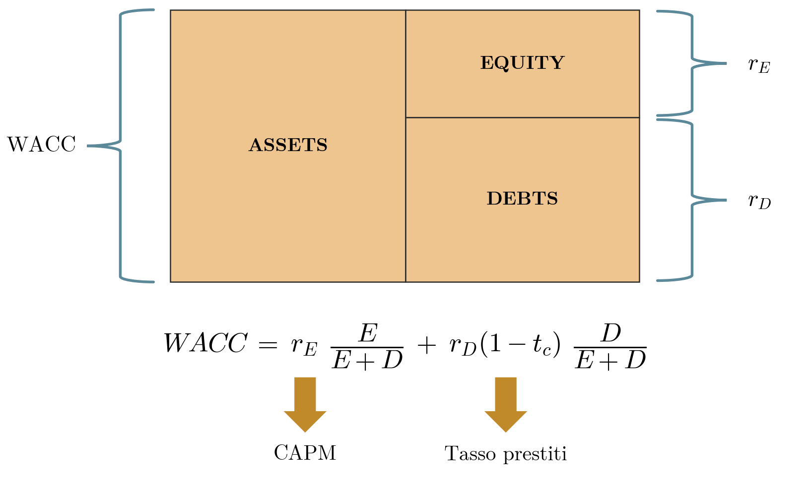
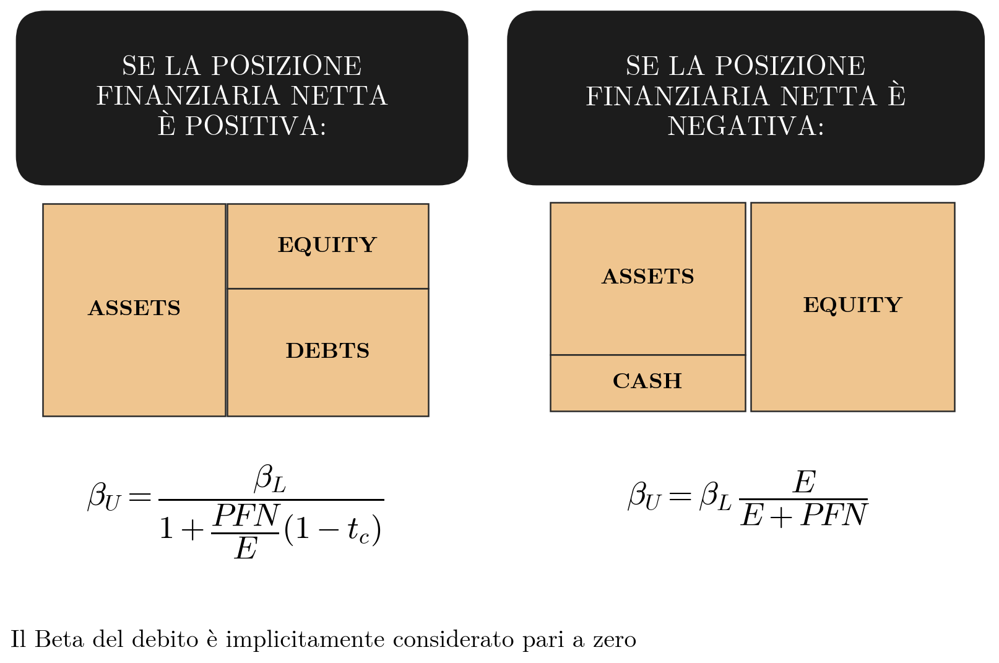

# Costo del capitale proprio, rischio paese e beta

## I tre macro blocchi dell'azienda: asset, equity e debito

Immaginiamo l'azienda costituita da tre macro blocchi. Immaginate una sorta di stato patrimoniale riclassificato o un prospetto a fonti e impieghi. A sinistra avete gli asset aziendali. Gli asset aziendali rappresentano un aspetto del valore, sono beni e risorse economiche, tutta la parte relativa ai fixed asset, quindi impianti, macchinari, immobili, ma anche i brevetti e il capitale circolante. Come vedete questo non è uno stato patrimoniale civilistico, è una riclassificazione. Infatti a sinistra avete una dicitura che è quella di capitale circolante che ovviamente, come sapete, contiene sia attività che passività, quindi non sono attivi e passivi questi. Questa è una riclassificazione che mette in luce il fatto che a fronte di determinati impieghi ci siano determinate fonti.

> [!question] Da verificare: la trascrizione riporta "l'azienda, AIMÈ, costituita"; la parola non è riconoscibile e la slide 3 non la scioglie, quindi è omessa.

E infatti tutto ciò che ho a sinistra è di pertinenza di tutti gli stakeholders, siano essi soci o terzi finanziatori, ed è ciò che mi permette di produrre e di creare i flussi di cassa. Cos'è che permette l'esistenza di questi asset, cioè la possibilità di far girare questo capitale? Lo permettono le fonti, e le fonti arrivano dagli stakeholders, che sono i soci o i finanziatori terzi, non sono i fornitori, perché ad esempio quelli sono già dentro al circolante, quindi li abbiamo già dentro agli asset.

A destra abbiamo due categorie di fonti, di finanziatori, che sono quelli che lo fanno in qualità di soci e quelli che lo fanno in qualità di creditori, per cui l'equity è quella porzione di azienda di pertinenza dei soci a valore. La particolarità di chi è un conferente di capitale è quella di venire dopo i creditori, quindi chi è socio, chi è equity riceve i flussi dopo che tutti i creditori sono stati soddisfatti, mentre i creditori sono solitamente le banche.

Un socio può essere creditore? Il socio può essere creditore, in alcuni bilanci c'è scritto "soci conto finanziamento", nelle voci del passivo. Può essere sia socio che creditore. Capita spesso che i soci, anziché fare un conferimento di capitale in beni o in denaro, fanno un prestito alla società. È chiaro che quel prestito viene trattato come un prestito, quindi sono creditori per quella porzione. Sono casi un po' eccezionali, però i finanziamenti soci li trovate sempre, specie quando l'azienda è provvisoriamente in tensione di liquidità: i soci fanno un prestito temporaneo in denaro per cercare di tamponare, dopo i soldi vengono restituiti al socio. Sennò sono le banche, gli istituti che rappresentano il capitale di debito. Hanno una priorità rispetto agli azionisti, quindi questo ci interessa perché lo vedremo anche nei flussi di cassa e nel rendiconto: ==un creditore viene prima di un azionista== e quindi anche nella remunerazione e nello schema stesso di rendiconto che ha prescritto il legislatore, l'area finanziaria viene idealmente prima dell'area degli azionisti e dei dividendi.

Se ho delle grandezze, ho anche delle aspettative di rendimento, quindi quelle tre.

> [!question] Da verificare: la trascrizione riporta "Dici: ture esterne e di quadri sono, come sapete, le aspettative di rendimento"; il passaggio non è leggibile e le slide 3 e 4 non lo sciolgono.

Per cui quelle degli azionisti hanno un'aspettativa di rendimento che è l'$r_E$, i creditori hanno il tasso debitore, $r_D$, e tutta l'azienda viene idealmente remunerata a un'aspettativa che incorpora le aspettative di entrambi in maniera ponderata, quindi il WACC. Questo lo conoscete già, per cui il WACC non fa altro che ponderare il costo del capitale sulla base di quanto è indebitata l'azienda rispetto alla porzione di equity, che è di pertinenza dei soci. Su questo c'è una piccola variante che vedete, quell'$1-T$ tra parentesi, che avevamo detto alla prima lezione essere lo scudo fiscale, cioè il fatto che l'azienda, quando remunera i creditori a un tasso $r_D$, ha la possibilità di dedursi gli oneri finanziari dal suo imponibile fiscale. Per la parte di interessi che paga può scalarseli dall'imposizione fiscale, dopo lo vedremo con un esempio.

## L'aliquota fiscale

Quando diciamo $T_C$, cioè l'aliquota fiscale, facciamo una semplificazione. Quali sono le aliquote fiscali in una società? A che fiscalità è soggetta un'azienda, una SRL, una SPA? Relativamente al reddito d'esercizio, sono tassati i margini con l'IRES e l'IRAP. Hanno basi imponibili diverse, però quando negli esercizi o nelle semplificazioni viene messo un 28 o un 30% di carico fiscale, il motivo deriva da questa slide, cioè il fatto che se noi dovessimo immaginare di fare un'approssimazione sull'utile ante imposte e calcolare più o meno quanto pesano le imposte, spesso vedete nei business plan, nel conto economico, che se io devo tirare su un business plan a più anni la proiezione del carico fiscale è tra il 27, 28, 30% stimato. È vero che dopo è tutto in capo al commercialista che fa tutto il calcolo dell'imponibile, però noi a volte dobbiamo semplificare la realtà. Se vi chiedono di fare un business plan e proiettare in avanti il carico fiscale, potete immaginare di mettere come carico fiscale circa un 28, 30%.

Specificamente, se ci riferiamo agli interessi passivi, gli interessi passivi sono deducibili dall'imponibile IRES. Siccome l'IRES è il 24%, io posso immaginare che dal mio monte imponibile su cui poi calcolo l'IRES posso togliere gli interessi passivi che pago sui finanziamenti e questo mi abbassa l'imponibile. E vedete che lo scudo fiscale è legato agli interessi passivi che sono legati all'IRES. Per quello poi negli esempi che vedremo, o nel libro o negli esercizi, quando andremo a calcolare lo scudo fiscale ci basiamo sul risparmio del 24%.

*(slide 5)*

## Il costo del debito

$r_D$ è il costo del debito. $r_D$ è quanto chiedono i finanziatori per prestare del denaro all'impresa. Chi è che presta denaro all'impresa? Abbiamo detto le banche, gli obbligazionisti oppure altri enti finanziari. Ci sono altre istituzioni finanziarie, ma ci sono anche enti statali o parastatali che finanziano la crescita, c'è Invitalia, c'è Simest, ci sono degli enti che ti danno dei finanziamenti a un costo del denaro agevolato, oppure finanziano gli investimenti, quindi sono varie istituzioni finanziarie. Ovviamente gli obbligazionisti, se l'azienda ha emesso delle obbligazioni, quindi avrà dei creditori, le banche e quindi anche i soci, lì non ci sono, può succedere che il socio faccia un finanziamento alla società. Il finanziamento del socio può essere fruttifero o infruttifero. Se è fruttifero, cade in questa slide come concetto.

Che cosa andiamo a ricompensare con $r_D$? Quello che abbiamo visto nei grafici, cioè il fatto che, a prescindere, prestare dei soldi implica un tempo e un rischio. Siccome noi li stiamo prestando a un'azienda, non li stiamo prestando al governo tedesco, l'azienda potrebbe avere diverse vicende, quindi l'$r_D$ incorpora di per sé un fattore rischio e un fattore tempo.

Dal punto di vista dell'azienda, quindi non di chi presta i soldi ma di chi li riceve, vedete che se l'azienda chiedesse un milione di euro al 5% annuo, all'azienda costerebbe il 3,8% quel finanziamento, perché la parte di interessi se la può scaricare dalle imposte. In che misura? Nella misura in cui tu riesci ad abbattere la base imponibile IRES, quindi se l'IRES è il 24%, se il 5% sono i tuoi interessi, così come sono, il 3,8% è il costo del debito senza il carico della fiscalità.

*(slide 6)*

Poi, se andate a tirarvi giù un bilancio o una situazione contabile di un'azienda, l'azienda ha una serie di finanziamenti: avrà un anticipo export, avrà un mutuo a 5 anni o un debito a 5 anni con la banca, avrà un mutuo a 30 anni, avrà il debito verso Simest perché ha acquisito un macchinario, quindi ognuno con i suoi tassi. Quant'è questo $r_D$ che viene esposto? Possiamo immaginare che sia idealmente, ==ovviamente ricordate che sempre sono delle semplificazioni==, ma potremmo assumere che sia la media dei tassi di debito.

> [!question] Da verificare: la trascrizione riporta "Perché qua c'è l'R1" dopo "Quant'è questo RD qua che viene esposto?"; la slide 7 non riporta nessun "R1", quindi è omesso.

Se un'impresa si finanzia con prestiti diversi, qual è il suo costo del debito? Una strada che potremmo attuare è dire: ho dei finanziamenti a un certo tasso, vedo anche quanto pesano i singoli finanziamenti rispetto a tutti i finanziamenti. Se un'azienda ha un mutuo da 20 milioni di euro al 5% e un finanziamento da 500 mila euro all'1%, ponderando 20 milioni di euro per 500.000, è molto più probabile che l'$r_D$ sia vicino al 5%, cioè a quel tasso, rispetto al fatto di fare una media tra i due $r_D$.

*(slide 7)*

Ha senso ponderare sì la media dei tassi, ma anche col peso, con l'importanza che ha ciascun debito rispetto al totale dei debiti finanziari dell'azienda. Intendiamo qui sempre debiti finanziari, non i fornitori: debiti che maturano tassi di interesse. Per cui se un'azienda ha tre mutui a tre tassi diversi, idealmente potrebbe svilupparsi in questo modo. Vedete che alla fine ho anche considerato lo scudo fiscale, quindi se il tasso medio è 4,70, migliorato dello scudo fiscale, il costo effettivo è 3,57.

> [!question] Da verificare: la trascrizione riporta "debiti finanziari, i fornitori, cioè debiti che maturano tassi di interesse", senza "non"; "non i fornitori" è dedotto da quanto detto prima sui fornitori già dentro al circolante, la slide 7 non lo scioglie.

## Il costo del capitale proprio

Poi abbiamo visto che, riferito alla grandezza dell'equity, c'è il costo del capitale relativo al capitale proprio, all'equity. È diverso dall'$r_D$ per forza, perché intanto è più rischioso, quindi solitamente è più alto. L'azionista si espone al rischio aziendale e quindi pretende un compenso che sia adeguato a questo rischio. E quindi $r_E$ rappresenta proprio questo: è quanto l'azienda deve remunerare un socio che mette 100 euro non come creditore ma come azionista, quindi quanto deve ricevere come rendimento per rischiare quei 100 euro e metterli nel capitale di rischio. Perché, come vedete, non ha garanzie l'equity, per cui un conferente di capitale rischia di perderlo se l'azienda chiude o fallisce, i 100 euro sono persi. Non solo, il secondo bullet dice quello che dicevamo prima, cioè il fatto che gli azionisti vengono dopo tutti, quindi se viene nominato un liquidatore, forse l'avrete visto in altri corsi, prima il personale, prima i dipendenti, dopo lo Stato, dopo le banche, dopo tutti i creditori, dopo, se avanza qualcosa, glielo diamo agli azionisti che hanno messo il capitale. Sono ultimi nella gerarchia di restituzione e quindi assorbono tutti i rischi rispetto agli altri soggetti e quindi solitamente $r_E$ è più alto di $r_D$.

*(slide 8)*

### Tasso privo di rischio e premio per il rischio

Ora vediamo come possiamo leggerlo questo $r_E$. C'è il costo dell'equity, il costo del capitale proprio dei soci e quindi dell'azienda, la remunerazione che dà l'azienda, che possiamo chiamare costo di capitale proprio, cioè il rendimento che chiede un investitore che vuole entrare come socio in quell'azienda. A grandi linee, possiamo immaginare che sia la somma di qualcosa di certo con un elemento di rischiosità. La somma di una condizione certa, di qualcosa di garantito, con qualcosa che invece dipende dal fatto che stiamo parlando di un'azienda che tutti i giorni, nella quotidianità, è esposta al mercato, alle decisioni aziendali, alla concorrenza, alle vicende all'interno dell'azienda, allo sviluppo dei prodotti, al mercato in cui opera e via così. Quello che si aspetta un investitore in termini di $r_E$, idealmente, è la somma di due elementi.

Il primo potremmo chiamarlo un tasso privo di rischio, cioè è qualcosa che dà valore al mio tempo, non tanto al fatto che sia un'azienda, ma al fatto che io ti sto vincolando delle somme per un determinato periodo di tempo. Questo è proprio come nelle primissime slide, quando dicevamo che 100 euro oggi sono 100 e passa euro fra un anno e 100 euro fra un anno oggi sono 98. Il fatto di spostare il denaro nel tempo già di per sé prevede una remunerazione che è data dal tasso fisso. Poi ci aggiungo un premio per il rischio. E il premio per il rischio ha due elementi. Uno è dato da quello che potremmo chiamare rischio sistematico, quindi dal beta, e poi lo vedremo.

> [!question] Da verificare: dopo "oggi sono 98" la trascrizione riporta "Sotto quello che ha euro in base al tasso, cioè"; il passaggio non è leggibile e la slide 9 non lo scioglie.

*(slide 9)*

### Il rischio paese

E l'altra parte è il fatto che non è indifferente per te il fatto che l'azienda sia in Italia, in Paraguay, in Germania o in America. La condizione di rischio è data, come avete capito, da due cose: uno un po' dal settore, dal fatto che sei con le ciminiere piuttosto che nelle telecomunicazioni, piuttosto che nell'aerospaziale, e l'altro componente è il fatto dove tu eserciti quel business. E lo vedremo dopo, non è indifferente decidere dove esercitare il business, perché se aprite un'azienda in Angola o in Congo, oppure nella zona industriale in Ucraina, probabilmente la Fairplast di Castelfranco Veneto a Vicenza, leader del PET, degli acquari, gabbiette, tutti gli accessori per gli animali, ha uno stabilimento in Ucraina e un mese fa, nello stabilimento di fianco, che è un altro capannone ma adiacente, hanno lanciato un missile e hanno raso al suolo il capannone, non c'è più la fabbrica. Per tre-quattro metri, la Fairplast di Vicenza aveva ancora al momento una controllata in Ucraina dove ha il business, però capite che non è indifferente dove fai business. È chiaro che se voi doveste mettere 100 euro su un'azienda nella zona industriale di Kiev, probabilmente, oppure in Angola dove passano le jeep, i ribelli col mitra, non è esattamente come metterli nella periferia di Bonn o di Berlino, o in America.

Questa parte qui deve avere un senso, deve avere un'importanza. E come lo misuriamo? Abbiamo vari modi, però il senso è questo: è di misurare questo che chiamiamo premio per il rischio di mercato. Questo che chiamiamo rischio paese, cioè il fatto che non è indifferente operare in un paese piuttosto che in un altro, ma anche a livello di progetto di investimento, ma anche a livello di avere il business di un'azienda, ho due modi per conteggiarlo. Questo lo trovate tutto sul libro, si chiama alternativa 1, alternativa 2, è tutto spiegato nel paragrafo. Si chiamano proprio così, alternativa 1 e 2, quindi dopo lo ritrovate. I due modi sono due strade che sono abbastanza simili, equivalenti. O metto questo rischio paese aggiungendolo al tasso privo di rischio, adesso vediamo com'è l'alternativa 1, oppure prendo questo rischio paese e lo metto nella componente del premio per il rischio di mercato. Entrambi i modi sono corretti e poi vedremo che il risultato non è molto diverso.

*(slide 10)*

Perché ci interessa il rischio paese? Per quello che abbiamo appena detto, cioè il rischio paese è la componente di rischiosità del paese a cui l'investimento si riferisce. Quando parliamo di investimento può essere un singolo progetto, di aprire una filiale lì oppure di acquisire un'azienda in quel paese. Se l'azienda valutata o il progetto valutato sono situati in Italia, si ragiona sulla rischiosità dell'Italia, quindi fa fede dov'è il business. Questo guida un po' la sede del business, cioè se la società ha la sede a Milano e a Milano c'è un ufficio con una segretaria, ma tutti i plant produttivi sono in Congo, se io valuto il progetto prendo il premio per il rischio dell'Italia. È vero che magari la sede legale è italiana, è a Milano, però il business, cioè dove si manifesta il rischio, probabilmente è in Africa, quindi il ragionamento lo faccio non prendendo la sede legale della società o dell'investimento: l'investimento probabilmente è dove lo devo fare, ma la sede legale potrebbe non essere dove c'è il core business dell'azienda. Siccome il rischio paese mi aiuta proprio a questo, devo usare un po' di accortezza nell'applicare e ==considerare il paese dove si svolgono effettivamente le operations==.

> [!question] Da verificare: la trascrizione riporta "prendo il premio per il rischio dell'Italia" con i plant in Congo; il resto del passaggio indica il paese dove si svolge il business.

*(slide 11)*

E questo rischio paese che abbiamo detto prima, a parte la guerra civile in Congo e le bombe in Ucraina, ci sono altri fattori che determinano il fatto che a livello mondo, e lo vedremo tra poco su un grafico, a ogni paese viene attribuito un livello di rischio che è dato da questi fattori, ad esempio da quanto solidi sono i conti pubblici, quindi che il governo, lo Stato, non vada in default, quanto è indebitato lo Stato, se sono affidabili le istituzioni, se sono stabili, quindi se ci sono dei fenomeni di corruzione all'interno delle istituzioni, se cambia governo ogni due mesi. Sono aspetti: la qualità delle infrastrutture, il rating stesso che viene attribuito a quel paese e via così. Ci sono una serie di indicatori che poi sono quelli che usano le società di rating quando dicono: confermato il rating dell'Italia. Cosa hanno valutato? Hanno valutato più o meno questi aspetti qui più tanti altri. E quindi dicono quanto rischioso è mettere i soldi in Italia, più rischioso è, più va chiesto un rendimento più alto.

*(slide 12)*

Questa è una cartina che ho aggiornato, nel senso che ogni anno viene pubblicata. Questa la pubblica Coface, non so se avete mai sentito Coface, è scritto Coface, è un'azienda che fa intermediazione creditizia, siccome è una multinazionale, loro, una grossa parte del business è assicurare i crediti.

È una specie di broker che assicura i crediti delle aziende. Ce n'è un'altra che ha un doppio nome, non mi verrà in mente. Sono aziende che assicurano i crediti aziendali, per cui tu, azienda, hai dei crediti, presenti il monte crediti a queste società e loro te lo assicurano, come assicurare la macchina. Tu paghi il premio e se tu non incassi quel credito per determinati motivi, questa azienda ti rimborsa lei del credito. E qual è il gioco? Che la Coface di turno ti assicura i crediti e più il tuo credito è rischioso, più è alto il premio, ovviamente. Per quello nei preventivi delle assicurazioni mi chiedono dove tenete la macchina, perché se la tenete in strada è più rischiosa e il premio è più alto, quindi il senso è un po' lo stesso.

Come vedete, adesso è scritto in piccolo, però la scala dei colori ha uno... Verde low, il primo verde è a uno e very low ed è il verde scuro, e a due è low. Prendete i verdi e guardate nel mondo dove sono i verdi e guardate dov'è la E, dov'è il viola più scuro. Questo vi dà un'idea della spiegazione abbastanza pratica della formula del rischio paese. Il rischio paese esiste perché effettivamente il mondo è distribuito così. E vedete che i paesi col verde scuro sono veramente pochi, quindi anche l'Italia peraltro che è un rosa chiaro, quindi è moderatamente alto, fairly high per Coface, il rischio di mercato. Qui è legato a rischio magari delle aziende e via così di questo settore.

> [!question] Da verificare: la trascrizione riporta "a uno e very low", "a due è low" e "dov'è la E"; la slide 13 è solo un'immagine senza testo, i codici restano aperti.

Non è l'unico, questo non è il riferimento mondiale, questo l'ha fatto Allianz, con altri colori, altri parametri, però è solo per farvi vedere come funziona il rischio paese. E nuovamente vedete dove sono i verdi che sono molto simili al grafico di Coface, quindi arrivano più o meno alle stesse conclusioni dove vedete che il rosso, in questo caso hanno meno colori perché hanno solo quattro colori: verde, giallo, arancio e viola. Infatti l'Italia in questo grafico è verde, ad esempio, però il senso è questo.

*(slide 13)*

### Il tasso privo di rischio

Ritornando alla nostra formula, che è questa, andiamo a vedere adesso le singole componenti, ora che abbiamo un po' capito come funziona il rischio paese. $r_f$ è il tasso privo di rischio. Cosa prendo come tasso privo di rischio? C'è qualcosa che veramente ha rischio idealmente zero? Se siamo in Italia, potremmo guardarci intorno e ragionare sul fatto che, scrutando all'orizzonte dall'Italia, la cosa più prossima a un tasso in cui non rischi nulla è comprare un Bund tedesco, un'obbligazione, un titolo di debito emesso dalla Germania. Facendo perno sull'Italia e guardandoci nei paesi immediatamente limitrofi, il primo riferimento più furbo e più utile a un tasso $r_f$, a un tasso risk free, è prendere il Bund tedesco a dieci anni. Adesso qui è scritto in piccolo, però sono dei bollettini. Questo è il bollettino della Deutsche Bank, la banca tedesca, l'equivalente tedesco della Banca d'Italia, che pubblica questo bollettino. Andate a prendere, ad esempio, il Bund emesso, obbligazioni dello Stato tedesco. Quante probabilità ci sono che la Germania fallisca e che non mi ridia il mio Bund fra dieci anni? Verosimilmente quasi nulla.

> [!question] Da verificare: la trascrizione riporta "a un tasso a rischio free"; la slide 14 riporta "RISK FREE" e si adotta questa forma.

> [!question] Da verificare: la trascrizione riporta "Deutsche Bank", che il docente descrive come "l'equivalente tedesco della Banca d'Italia"; la slide 15 è solo un'immagine senza testo.

Sicuramente, e questa è la notazione in rosso, ==il BTP, come avete visto anche dai grafici, dalle cartine geografiche, non è risk free==. Un titolo emesso dal governo italiano non è un titolo privo di rischio. Anche se nelle pubblicità delle poste, nelle pubblicità in televisione viene fuori il BTP, BTP valore, viene proposto agli italiani come qualcosa che ha un rendimento certo, però non lo ha di fatto. È comunque meno certo rispetto a un titolo tedesco.

*(slide 14)*

Possiamo immaginare che $r_f$ sia preso come riferimento il Bund tedesco, tanto che voi sentite parlare dello spread. Sapete cos'è lo spread? Lo spread tra cosa e cosa? Esatto, esattamente. È questo in questo grafico qui dove vedete, questo sono i bond, i tassi dei bond a dieci anni e infatti vedete che su Germania lo spread versus Bund, c'è il trattino, la Germania è il benchmark, è zero. E l'Italia ha invece uno spread dell'uno virgola qualcosa, che è questo qui sotto. Voi avete preso come riferimento la Germania, che vedete che ha un tasso, che era quello che vi avevo messo nella slide prima, quindi 3,37, 3,38 circa, è questo qui. Lo spread è zero. L'Italia ha uno spread versus il Bund di 1,05, che è la colonna con i numeri verdi. Questa è la dimostrazione che il Bund dell'Italia, il BTP per capirci, questa è la prova che il BTP italiano non è risk free, è rischioso e incorpora una seppur minima quantità di rischio che è data dal fatto di essere in Italia.

> [!question] Da verificare: la trascrizione riporta "quello che vi avevo messo nella slide prima, quindi 3,37, 3,38 circa"; la slide 14 riporta "BUND TEDESCO 10 ANNI (es. 2,20%)". Si riporta ciò che ha detto il docente.

*(slide 15)*

### Le due alternative per il rischio paese

Avevamo detto all'inizio, abbiamo due alternative: possiamo prendere il rischio paese, ad esempio in questo caso ipotizziamo di fare l'investimento in Italia, vogliamo applicare il rischio paese italiano. L'alternativa uno è caricare il rischio Italia e il rischio paese sul tasso privo di rischio, che è questo $r_f$. In base a quello che abbiamo detto qui, noi possiamo considerare di prendere il tasso privo di rischio e mettere la componente di rischio italiana. Ma in questo caso è proprio il tasso del BTP. Perché? Perché il tasso di un BTP italiano è il tasso free risk, idealmente quello tedesco, rimontato del fatto che il BTP, cioè che il tasso privo di rischio è in Italia. La prima alternativa dice, in poche parole, prendi il BTP perché tu nel BTP italiano, nelle obbligazioni emesse dal governo italiano, dentro hai già appioppato il rischio paese Italia. A quel punto che rischio ti manca? Ti manca solo il pezzetto di un portafoglio generico di mercato, un rischio generico di mercato che è quello base, a prescindere dal fatto che sei in Italia, ma solo per il fatto che sei nel mercato, immaginando un portafoglio infinito di tutte le aziende, il fatto che stiamo parlando di aziende. In questo caso ha senso prendere il premio per il rischio degli Stati Uniti, cioè un paese a rischio minimo.

*(slide 16)*

L'alternativa due per applicare il rischio Italia. Il tasso free risk, prendi pure il Bund tedesco, lascia $r_f$ così, non rimontarlo di niente, lascia $r_f$. Prendi il paese Italia e mettilo nella seconda parte dell'espressione, cioè aumenta il rischio paese, mettilo nel premium per il rischio di mercato. Perché? Perché io potrei immaginare che il rischio di mercato sia fatto da due piccole componenti che sono quelle lì sotto, cioè il fatto che sto considerando un portafoglio di aziende e quindi qualcosa di rischioso, ed è l'MRP, cioè sono sul mercato, sto ragionando sulle aziende, e poi ho un tassello che è il fatto che sono in Italia e che ho un rischio specifico per l'Italia e poi potrei chiamarlo country risk premium. Oppure, in altre parole, si prende il CDS, il credit default swap, il fatto che ho una rischiosità Italia, è come se io sommassi la rischiosità Italia alla rischiosità degli Stati Uniti. Cosa faccio nell'alternativa 2? Prendo la rischiosità di avere a che fare con delle aziende, prendo la rischiosità di tutto un portafoglio azionario, in cui il rischio è minimo, ma è comunque un portafoglio di mercato, e posso prendere gli Stati Uniti. E prendo l'MRP, il market risk premium, e ci sommo il country risk dell'Italia. Ho sommato il rischio italiano nella seconda fetta dell'espressione.

*(slide 17 e 18)*

Qui c'è la sintesi di tutte le slide, cioè quella in alto è la formula da cui siamo partiti, l'idea di voler calcolare il mio tasso $r_E$. A questo punto, nell'alternativa 1 avevamo detto: metto il rischio sopra al tasso $r_f$ e prendo il tasso del BTP Italia, e il resto lo lascio così com'è, il beta rimane beta e qui metto il premio, il market risk degli Stati Uniti, perché l'aspetto di rischio italiano l'ho sovraccaricato qui sopra l'$r_f$, sopra il tasso privo di rischio. L'alternativa 2 dice: lascia l'$r_f$ così com'è, prendi il Bund tedesco, immagina che quello sia il tuo tasso $r_f$, il tuo tasso privo di rischio, e il fatto che tu sei in Italia lo vai a mettere qui, la quantità di rischio per il fatto di essere in Italia la vai a sommare al premio del rischio di mercato. Sono due procedimenti diversi che prendono degli elementi diversi.

*(slide 19)*

Se fate un esempio numerico, andate a prendere i riferimenti numerici.

Vedete che si arriva a quantità abbastanza simili, perché se da quella tavola del Financial Times andate a prendervi il bond italiano, avete circa un 4,42 e questo è il tasso, il market premium degli Stati Uniti. Se invece di prendere questo prendete il tasso free risk del Bund, cioè 3,38, e poi andate a prendere il market risk degli Stati Uniti e ad esempio il CDS, il credit default swap dell'Italia, la rischiosità Italia, dalle tavole, che è circa l'1 e passa per cento, facendo la somma qui avete un 8,65 e qui sotto avete più o meno la stessa quantità, quindi vedete che arrivate più o meno alla stessa equivalenza e che è sensato. Perché le guardiamo tutti e due? Perché magari potrei avere a disposizione dei dati piuttosto che altri, quindi ==le teniamo valide entrambi, anche perché i risultati convergono==.

> [!question] Da verificare: la trascrizione riporta "4,42", "3,38" e "8,65"; la slide 20 riporta BTP 4,40%, Bund 2,20%, MRP 4,12%, premio Italia 1,08%. Si riportano i numeri detti dal docente.

*(slide 20)*

## Il coefficiente beta

Qual è l'unica parte che non abbiamo guardato? Il beta. Cos'è il beta? Perché mettiamo il beta nella formula? Il beta si riferisce idealmente al rendimento dei titoli, siccome questi concetti li abbiamo ereditati da Damodaran, che nel 1999 si è cimentato con tutte queste analisi e l'ha fatto sulle società quotate americane, allora si parla sempre di rendimento del titolo, anche se poi vedremo che in Italia, come sapete, su non so quanto, solo le SRL sono quasi un milione e le società quotate sono una manciata, quindi in Italia si presta meno a questo ragionamento, perché in Italia le società quotate, società che hanno dei titoli quotati, sono pochissime. E dopo lo vedremo questo aspetto, però queste sono le regole generali che ci aiutano a determinare i tassi. Quello che ci interessa quando dobbiamo ragionare è semplicemente applicare il beta e sapere che il beta esprime la correlazione tra tutti i rendimenti del mercato, con tutti i settori dentro, e il singolo titolo che stiamo valutando. Come singolo titolo potremmo anche fortemente immaginare il settore a cui appartiene quel titolo.

> [!question] Da verificare: la trascrizione riporta "Adamodaran"; la slide 17 riporta "Damodaran" e si adotta questa forma.

*(slide 21)*

### Da che cosa dipende il beta

E perché c'è il beta? Che cosa rappresenta il beta? Da cos'è che dipende il beta? Dipende da tre macro grandezze, cioè il fatto che alcuni settori e quindi di conseguenza alcune aziende di quei settori hanno dei ricavi ciclici. Se voi andate proprio nei singoli settori, ma anche molto stretti, non in generale, non so, food and beverage, ma l'esempio è ancora più forte se andate poi nel sotto segmento, è molto probabile che le aziende che fanno gelati siano sottoposte a un tipo di stagionalità, di ciclicità dei ricavi annuale che è molto simile tra di loro, che sarà diverso da quella che ha un'azienda di abbigliamento piuttosto che un'azienda automobilistica. Inoltre, alcune aziende sono più esposte alla ciclicità dei ricavi. Se un'azienda vende sciroppi per la tosse, probabilmente nel periodo autunnale vedete solo pubblicità di gente che tossisce e starnuta in televisione, quelle pubblicità a luglio non ne vedete neanche una. Come mai? Magari a luglio, giugno-luglio, trovate quelle, o gennaio-marzo, trovate quelle con la gente che ha mal di testa perché devono chiudere i bilanci o devono fare gli esami. Alla maturità o via così, e niente è casuale e ogni azienda, ogni settore ha le sue ciclicità.

Poi il beta dipende da quella che chiamiamo leva operativa o rischio operativo. Un'azienda siderurgica avrà un rapporto tra costi fissi e costi variabili molto diverso da un'azienda di telefonia o da un call center, ad esempio. Il call center che vive di personale, se domani chiude, il massimo di costi fissi saranno un centinaio di cuffie e di computer. Se chiude l'INVA, capite quanti costi fissi ci sono, cioè chiudere un alto forno non è come chiudere un call center. Cosa vuol dire? Che sono settori diversi e sono esposti in maniera diversa al rischio operativo, cioè la proporzione tra costi fissi e costi variabili. Il call center ha quasi tutti costi variabili, un'azienda siderurgica ha quasi tutti costi fissi.

> [!question] Da verificare: la trascrizione riporta "l'INVA" e più avanti "il beta dell'IVA"; le slide non riportano il nome, quindi resta come trascritto.

Il terzo è quello che dicevamo e che sposta un po' il peso nelle aziende italiane sul beta, che distorce un po' il ragionamento, cioè il fatto che se in America ti servono 500.000 dollari, vai a cercare un business angel che te li dà, che sogna con te e tu gli sganci un po' di azioni, oppure vai in borsa nel segmento delle emergenti, fai la startup e fai capitale di rischio. Se all'imprenditore in Italia servono 500.000 euro, telefona al direttore della banca per capire se gli presta 500.000 euro. E questo è un tema, perché poi qual è l'effetto nel bilancio, nello stato patrimoniale? Che le aziende italiane spesso sono, come dice lì, sottocapitalizzate in termini di capitale proprio. Perché? Perché se tu ogni volta che ti servono dei soldi te li vai a far dare dalla banca, il passivo diventa gonfio di debiti verso terzi e hai poco capitale proprio, poco capitale di rischio. ==Questa cosa dell'indebitamento è importante perché abbiamo capito anche che la conseguenza dell'indebitamento è lo scudo fiscale.== Lo vedremo dopo, il lungo e il largo nelle formule, però capite che un'azienda fatto 100, 100 euro, se ha un 60% di debito bancario e 40% di equity rispetto a una che ha tutto equity, quella che ha il debito ha lo scudo fiscale. Su quei 60 euro. Non stanno giocando la stessa partita, perché quella che ha l'indebitamento ha un vantaggio rispetto all'altra che non è indebitata, perché l'azienda indebitata può sfruttare il vantaggio, il risparmio fiscale.

Allora cosa facciamo? Ha senso guardarlo separatamente. Se è vero che il beta dipende da questi tre elementi, il terzo non mi convince molto, perché il fatto che io sia in un settore piuttosto che in un altro dovrebbe dipendere da quello, quindi mi determina quanti costi fissi o variabili ho, se ho i ricavi ciclici o no, ma non se sono tanto o poco indebitato. Però questo ha un impatto sul beta. Arriveremo poi alla conclusione di questo modulo sul costo del capitale, dove andremo a fare un ragionamento per cui avrebbe senso pulire l'effetto dell'indebitamento dal conteggio del beta, dal calcolo del beta. Anche perché, a maggior ragione in Italia, le aziende sono super indebitate.

*(slide 22)*

### I valori del beta

Il beta, sapete che può avere tre andamenti. Ai tre andamenti del beta, ai tre comportamenti, ai tre valori del beta corrispondono dei settori industriali, dei settori economici. Si dice che il beta è maggiore di uno e che ha un settore fortemente ciclico. Il beta uguale a uno, cioè il titolo, in questo caso l'azienda, si muove e varia come andamento proporzionalmente al mercato, quindi è ciclico, è al pari dell'economia. Oppure il beta è compreso tra zero e uno. Il beta minore di zero non c'è, come vedete. Il beta minore di zero sarebbe una cosa paradossale, cioè che un titolo va nella direzione opposta rispetto a dove va il mercato, il mercato sale, il titolo scende, oppure il titolo sale, il mercato scende. Sono casi talmente eccezionali che non vengono messi nelle casistiche, per cui il beta si considera tecnicamente quasi sempre maggiore di zero.

Per cui vedete qui alcuni esempi. Avete un beta maggiore di uno che amplifica le variazioni del mercato, cioè se il mercato sale dell'1%, un titolo che ha un beta di 1,5, il titolo sale dell'1,5%, cioè sale più di quanto sale il mercato, quindi tende ad amplificare. E questo è il caso dell'automotive o delle compagnie aeree, o delle aziende, ad esempio, di costruzioni e materiali edili. Il beta nell'intorno di uno, molto simile all'uno, segue proporzionalmente il mercato, sale e scende nella stessa misura in cui sale e scende il mercato e sono solitamente i settori dei trasporti e della logistica, le assicurazioni o tutto il settore della GDO. Mentre i titoli che si muovono in maniera più tiepida rispetto a come si muove il mercato sono quelle delle utilities o i farmaceutici oppure i beni essenziali. Perché, se vedete, quelli tra zero e uno non sono dei settori dove ci sono dei beni che voi acquisite per impulso o per euforia o per un picco di disponibilità di reddito, nel senso che non è che se siete ricchi accendete tutte le luci della casa contemporaneamente o piuttosto che fate scorta di medicine, perché potete comprarvi tutto l'outlet che volete. I beni di consumo essenziali, quindi c'è anche da aspettarselo che questi settori siano più indifferenti, tra virgolette, o più tiepidi rispetto a come si muove il mercato quando sale e scende, cioè che lo seguano in maniera meno amplificata.

*(slide 23)*

Mentre con un beta maggiore di uno spesso succede che in un momento di crescita economica magari le persone cambiano la macchina in un periodo di prosperità economica, oppure fanno più viaggi, oppure comprano casa. È comprensibile che in un momento dove il mercato cresce, dove l'economia cresce, ci siano alcuni settori, ad esempio di quelle tipologie, ma sono solo degli esempi, che potrebbero avere dei comportamenti amplificati rispetto a come sta andando il mercato.

## Il beta unlevered per valutare un progetto

Il fatto è che abbiamo detto che il beta incorpora la leva finanziaria, per definizione il beta porta con sé il debito, però io non so quanto è indebitata al momento della valutazione, ad esempio di un progetto. Io non so in che misura lo finanzierò, quei soldi miei o quei soldi dei creditori. Io devo valutare la remunerazione del progetto e il beta di quel progetto, cioè quanto è variante quel progetto in termini di beta, ma nel beta c'è la leva finanziaria. E questo è il motivo uno.

Il motivo due è quello che vi ho detto prima: i beta, andiamo a prenderceli sempre da quelle famose tavole che trovate su internet, che arrivano dall'America, da oltreoceano, dove la maggior parte delle aziende sono quotate e quindi sono piene di capitale proprio e hanno poco capitale di terzi. Ma allora io come faccio a prendere un beta di un'azienda che è in America, del settore americano, e usarlo per un'azienda italiana che è un'azienda magari dello stesso settore ma straindebitata? Probabilmente se io devo fare il beta della Diadora qui in Italia, la Diadora o la Liello magari hanno una quantità di capitale di terzi e di passivo enorme rispetto all'equity. Vado a prendere il beta del settore shoes, sportswear o quello che è in America, che è un beta di aziende che quasi non hanno debito perché sono in borsa e hanno tutto capitale proprio. Il punto due nuovamente ti dice che ci sono delle perplessità ad usare il beta così com'è, il beta levered, chiamiamolo.

Oppure potrebbe essere che potrei avere un disallineamento tra il fatto di dover valutare un progetto che è in un settore diverso dal settore dell'azienda, quindi lì sono in difficoltà rispetto alla tipologia di beta. Qual è la soluzione a tutto questo? È il beta unlevered, non $\beta_L$ ma $\beta_U$. Tutto questo discorso sul beta per dire che noi possiamo arrivare idealmente a un beta unlevered. Perché se io riesco a togliere l'effetto del debito dal mio beta, allora riesco veramente ad apprezzare il fatto di applicare un beta che rappresenta la ciclicità di quel settore, a prescindere dal fatto che l'investimento, il progetto, l'azienda siano tanto o poco indebitati.

> [!question] Da verificare: la trascrizione riporta "il beta all'everage di U"; la slide 24 riporta "beta unlevered" e si adotta questa forma.

La frase rossa dice: ==un progetto dovrebbe essere accettato oppure respinto a prescindere dall'indebitamento, a prescindere dalla politica finanziaria==, anche perché sappiamo, dice tra parentesi, che il debito rende meno costose le tue fonti, perché se le fonti di finanziamento sono debito, sono fonti meno costose rispetto al capitale proprio, per effetto dello scudo fiscale.

*(slide 24)*

Arriviamo alla formula 7.19 bis del libro, al 7.20 del libro, che troverete e che sono quelle due lì. Così almeno capiamo come siamo arrivati a quelle due formule.

Quella a sinistra ipotizza un'azienda indebitata e sapete per convenzione che un'azienda con debito ha una PFN positiva. Negativa quando ha cassa. Il beta unlevered si ottiene come? Prendendo il beta dalle tabelle, dalle tavole, il beta L, il beta levered, applico quel denominatore e arrivo a un beta in cui ho scorporato l'effetto dell'indebitamento, a sinistra della slide. Se invece ho la posizione finanziaria netta negativa, cioè ho cassa, la formula cambia, ma vedete che la cosa che principalmente cambia è il fatto che non ho $1-t_c$, cioè non ho lo scudo fiscale, perché se ho cassa e non ho debito non ho neanche lo scudo fiscale sugli interessi, perché interessi non ne pago se ho soldi in tasca invece che avere debiti bancari. Ad ogni modo, per coerenza, io vado a pulire il beta anche nel caso avessi cassa, perché ho detto sì che io voglio ragionare sul beta senza l'effetto del debito, ma anche senza l'effetto della cassa. Il progetto devo accettarlo o respingerlo a prescindere dal fatto che io abbia debito o cassa.

### Le somme sul costo del capitale

Bene, fine del modulo sul costo del capitale. Per tirare velocemente le somme, fate riferimento al fatto, ==le slide chiave sono sicuramente queste, dove voi dovete sapere che ci sono tre tipi di tasso==, l'$r_E$, l'$r_D$ e il WACC. In questo caso noi abbiamo fatto tutta questa parte della lezione sull'$r_E$. L'$r_E$ è dato da queste variabili e avete due strade per calcolarlo. Sono dati pubblici, quindi avete due modi per calcolarlo, andandoli a prendere come avete visto. Le quotazioni dei tassi dei bond, dei BTP, le tavole di Damodaran sul premio per il rischio, però l'importante è capire che valori prendere. Per il beta andate sempre a prendervi le tavole di Damodaran o via così, però ==ricordatevi che quei beta che trovate lì sono sporcati dal fatto che sono beta di aziende più o meno indebitate==.

Il beta di settore è dato dal beta delle singole aziende, quindi voi su internet potete trovare il beta di una quotata, ma anche il beta del settore. Trovate le tavole con il beta di settore e il beta singolo di quell'azienda. Non coincidono, perché il beta della singola azienda è influenzato da una serie di fattori più specifici rispetto al beta di settore. C'è il beta dell'IVA, per dire, e il beta del settore metallurgia e via così, non è che coincidono. Però entrambi sono sporcati dal beta, quindi quello è un beta L. Cosa dovete fare, cosa che faremo anche negli esercizi, è semplicemente togliere l'effetto del debito con queste due formule qui. Se siete di fronte a un'azienda indebitata usate le formule di sinistra, se è un'azienda dove la PFN dei bilanci è negativa, quindi c'è cassa, usate l'altra formula.

> [!question] Da verificare: la trascrizione riporta "entrambi sono sporcati dal beta"; le slide non la sciolgono (poco prima: "sporcati dal fatto che sono beta di aziende più o meno indebitate").

## I metodi per valutare un'azienda

Bene, proseguiamo con questo argomento che finiremo domani ed entriamo nel modulo delle valutazioni d'azienda. Prima abbiamo visto i progetti, abbiamo visto il tasso, adesso entriamo nei metodi per valutare un'azienda. Cosa sono i DCF, cosa sono i metodi dei DCF? È uno degli approcci maggiormente utilizzati. Quanti metodi vedremo per valutare un'azienda in questo corso? Uno, due, tre? Secondo voi? Due. Qualcuno dice tre? Due. Tecnicamente i DCF e i multipli delle EBITDA. Vedremo poi, quando verrà il team di KPMG, ci parlerà anche di un terzo metodo che non è nel libro, però nella prassi alcuni lo fanno, a volte si tiene come confronto, che è quello del patrimonio netto rettificato.

Fondamentalmente i multipli delle EBITDA e i DCF si basano sul fatto che se noi vogliamo comprare un'azienda dobbiamo vedere che prospettive ha di guadagno, di reddito, quindi o mi baso sui dati esterni, sui multipli, oppure mi baso sui flussi di cassa generati dall'azienda. In realtà in tutti e due i casi non sto guardando il patrimonio, non sto guardando dentro al capannone, non sto guardando quello che c'è dentro. Idealmente in nessuno dei due casi potrei accorgermi se un'azienda per tagliare la lamina di acciaio ha il signor Bepi con la taglierina così che va tutto il giorno avanti e indietro, oppure ha un robot laser che ha pagato un milione di euro di ultima generazione con AI integrata che come si avvicina il foglio taglia la sagoma e ne taglia cento al minuto, non come Gianni che ne taglia cento all'ora. Dov'è che vedo magari là il fatto che un'azienda ha degli impianti molto moderni? Perché tu nei DCF e nei multipli non ti rendi conto di questo aspetto, ad esempio, del valore di mercato di alcuni asset importanti.

E questo è ad esempio un tema per cui se io guardo il bilancio ancora meno, perché come sapete se quell'azienda ha comprato quel braccio robotizzato probabilmente lo sta ammortizzando secondo le tabelle fiscali con l'ammortamento al 25%, quindi in quattro anni quel braccio robotizzato da un milione di euro è arrivato a zero e dicevamo anche le altre volte: provate voi ad andare dall'imprenditore che ha speso un milione per quel robot, dopo quattro anni gli dici: no beh guarda, quel trabiccolo là ti do zero, perché tanto a bilancio c'è scritto zero, è tutto ammortizzato e quel robot lì in realtà può tagliare per altri dieci anni, quindi quello vi tira dietro una sedia. E questo è il disallineamento tra il valore netto contabile, usando i principi contabili, e quello che può essere un valore di mercato, un valore di recupero, un valore di realizzo, per cui c'è anche un aspetto della valutazione d'azienda che tiene conto di rettificare, cioè ricondurre il patrimonio dell'azienda a dei valori di mercato, soprattutto per le immobilizzazioni.

A Milano, dove c'è la Torre Unicredit in piazza Gae Aulenti, dove c'è il Bosco Verticale, in quella zona lì, di fianco ci sono le case ringhiera. Le case ringhiera sono delle casette milanesi di mattoni e dentro hanno il cortile interno con la ringhiera dove tutti si affacciano, fanno comarò, con l'edera: è la vecchia Milano di una volta. Allora Porta Garibaldi era un covo di drogati fino a prima che costruissero il Bosco Verticale, il Pirellone, Unicredit, tutte le altre, la Biblioteca degli Alberi, tutti i palazzi di via della Castiglia, il palazzo della Regione Lombardia. Quella zona lì era una zona malfamata, quelle case ringhiera non valevano niente. Adesso stare in affitto in un appartamento al Bosco Verticale ti costa 15.000 euro al mese circa. Quindi capisci che le case ringhiera di fianco potrebbero essersi apprezzate un pochino, visto che sono il civico dopo il Bosco Verticale.

Questo per dire cosa? Che se noi avessimo avuto la nostra azienda e avessimo la sede legale nelle case ringhiera di Milano e avessimo gli uffici là, probabilmente a bilancio quell'edificio magari oggi non vale quasi niente, perché se noi l'abbiamo ammortizzato al 3%, in 30 anni l'abbiamo comprato a 100 milioni, si è ridotto del 30% in 10 anni. È chiaro che se noi compriamo un'azienda che ci sta vendendo il fabbricato che ha le case ringhiera di fianco al Bosco Verticale oggi non ce lo vende al costo d'acquisto, è evidente. Che cosa si fa? Si fa il patrimonio netto rettificato, cioè un fabbricato a bilancio che è iscritto al costo storico non vale niente, cioè vale poco, però potrebbe essersi apprezzato nel tempo. E questo succede, immaginate, anche nelle location dei negozi, dove delle aree si sono rivalutate col tempo. La stessa cosa per le città turistiche, per le città dove c'è stata una riqualificazione residenziale o dove adesso passa la metropolitana e prima non passava. Il costo storico è un costo di acquisto e non rappresenta l'effettivo valore dei beni di quell'azienda.

> [!question] Da verificare: la trascrizione riporta "in 30 anni l'abbiamo comprato a 100 milioni, si è ridotto del 30% in 10 anni"; non si capisce se i 30 anni sono la durata dell'ammortamento o il tempo dall'acquisto.

E nei multipli e nei DCF non si parla di quanto può valere la sede della nostra azienda se è di fianco al Bosco Verticale con edificio che abbiamo comprato vent'anni fa a 300.000 euro e adesso vale 3 milioni. Me lo vendi a 300.000 al valore di libro del bilancio? No.

> [!question] Da verificare: la trascrizione riporta "E nelle bida e nei multipli di DCF"; "nei multipli e nei DCF" è dedotto dal passaggio precedente e le slide non lo confermano.

Il terzo metodo che non vedremo nel corso e che non c'è nel libro, però se andate a lavorare nella consulenza o se vi cimentate in un deal, può essere che sia quello di fare una ricognizione degli asset aziendali e tramite delle perizie giurate di periti stimare quanto valgono i beni dell'azienda a valore commerciale e anche gli immobili, ad esempio, soprattutto gli immobili.

### Il DCF: punti di forza e limiti

Tornando ai DCF, il valore dell'azienda dipende dalla sua capacità di generare dei flussi di cassa in futuro. Attualizzandoli a un certo tasso. Perché abbiamo visto tutti gli esercizi sul VAN? Perché il principio è identico. Come noi usiamo il VAN per un investimento, usiamo idealmente il concetto del VAN anche per un'azienda, immaginando che il progetto sia l'azienda stessa. In questo caso i DCF hanno dei punti di forza, cioè che io posso ragionare sulla capacità prospettica di generare risorse e poi che posso stimare sia i flussi di cassa attesi che anche il rischio ad essi associato.

Che problemi ha il DCF? Sennò useremmo solo quello, cioè se fosse il metodo perfetto useremmo solo i metodi del DCF per valutare le aziende. In realtà ha un po' di controindicazioni e che vedremo dopo in questo tra oggi e domani quando vedremo come si sviluppano i calcoli sul DCF. Però uno è che tu devi predire il futuro e stai facendo una forte assunzione. Tu col metodo DCF stai valutando quanto sono i flussi di cassa prospettici e li stai attualizzando ad oggi, ma chi ti dice che i flussi saranno quelli? Nessuno. Stiamo facendo una forte semplificazione. Il punto quattro dice: aiutati con un business plan. Come fai a stimare i flussi? Devo incaricare intanto un esperto che come minimo prende il binocolo e guarda avanti almeno di tre, quattro anni, almeno navigare a vista di tre, quattro anni. Siccome tu stai applicando i DCF e siccome stai assumendo di attualizzare ad oggi per comprare un'azienda, immaginando tutti i flussi di cassa che farà da qui alla fine dei tempi, almeno prenditi la briga di vedere quanta cassa farà nei prossimi quattro anni. Con quello non serve che tiri tanto le formule, probabilmente ci arrivi costruendo uno sviluppo di crescita del business attraverso un business plan.

E ve lo dico perché uno dei due modi di maneggiare il metodo dei DCF è spacchettare in due il valore futuro dell'azienda, fin dove riesco a navigare a vista con un business plan, attualizzo quei flussi e dopo uso una formula perpetua. Viceversa potrei partire da oggi e dire: per me l'azienda da oggi all'infinito fa questo cash flow, attualizzo tutto ad oggi, per me l'azienda vale così. È chiaro che se i flussi di cassa che io sto stimando non sono attendibili, sto costruendo un castello di carte, perché i flussi di cassa che io sono andato a calcolare sono specifici di quell'azienda, e questa è un'altra caratteristica dei DCF, cioè guardano l'azienda, non guardano il settore. La caratteristica del DCF è un'analisi, come dire, implicita dell'azienda. Se tu sbagli a fare la previsione dei flussi di cassa, stai usando delle formule di matematica finanziaria stile rendita perpetua, ti viene fuori una valutazione da un milione di euro che, se porti quella valutazione a una trattativa di un dealer, ti ridono dietro, perché se tu hai sbagliato a stimare i flussi, stai proiettando per milioni di euro un flusso di cassa che non è credibile, ovvero simile. ==Alla base dei DCF c'è un ragionamento molto delicato, cioè che i flussi di cassa siano sostenibili, siano credibili==, per quello dove possibile si usa un business plan, perché almeno ho fatto una simulazione informatica o chiedendo a tutte le aree aziendali di proiettare ricavi, costi e via così, di proiettare il business in maniera abbastanza certa. Dopodiché, per il resto, dal quinto anno in poi probabilmente mi dovrò affidare a dei conteggi che arrivano dai miei bilanci con tutte le incertezze del caso.

### Ottica asset e ottica equity

Io posso valutare l'azienda nella sua interezza e quindi avere un'ottica asset o ragionare solo sulla parte di pertinenza dei soci, un'ottica equity. Per cui in un'ottica asset parlerò di enterprise value. In un'ottica equity parlerò di MK CAP, cioè market capitalization, o il valore dell'equity, il valore del capitale proprio. In termini di valore stimato, se guardo la sfera patrimoniale avrò un capitale investito netto; in un'ottica asset, cioè tutti gli attivi. In un'ottica equity avrò il capitale proprio. Se invece ragiono in termini di conto economico, immaginando che io dal conto economico possa estrarre la redditività, avrò, in un'ottica asset, quella grandezza che chiamo NOPAT normalizzato, cioè Net Operating Profit After Taxes, dopo vedremo come calcolarlo, normalizzato e il reddito di bilancio in un'ottica equity, cioè l'ultima riga del conto economico, sempre normalizzata perché è quel lavoro di aggiustamento e normalizzazione che si fa con la due diligence. Se ragiono invece sul cash flow avrò gli aspetti finanziari, rifacendoci a quel grafico sul rendiconto finanziario che avete visto, i flussi di cassa che rappresentano tutta l'azienda sono gli FCFF, FCFO, mentre l'ultimo flusso disponibile che rimane è quello per gli azionisti, che è l'FCFE, che è quello in ottica equity. Il costo del capitale lo avete già visto, lo sapete bene, cioè in un'ottica asset io prendo tutto il costo di azionisti e creditori, in un'ottica equity prendo solo l'$r_E$, che è il costo dell'equity.

> [!question] Da verificare: la trascrizione riporta "un equity asset", "MKK" e "gli FCF, FCFO"; la slide 3 della presentazione sui metodi DCF riporta "ottica assets", "MK CAP" e "FCFF/FCFO" e si adottano queste forme.

*(slide 3)*

Domani riprendiamo da qui.
