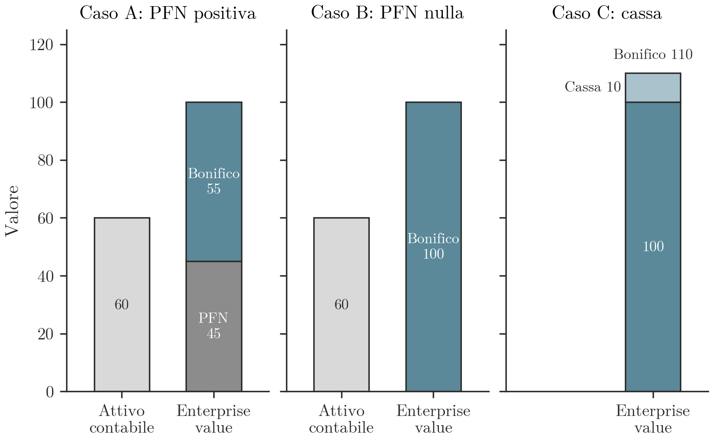
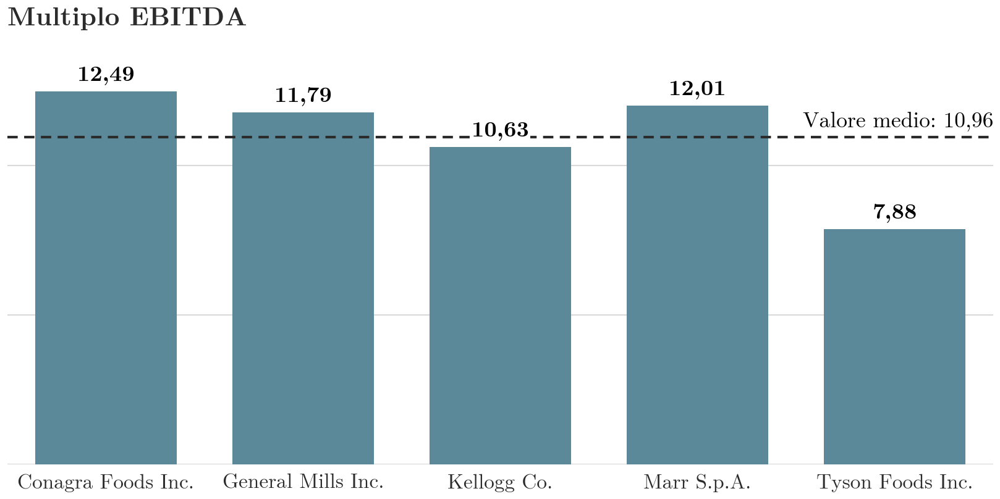

# Enterprise value, PFN e NOPAT nei metodi DCF

## Le grandezze per valutare l'impresa

Ieri siamo entrati nell'ambito del valutare l'impresa. Per valutare l'impresa dobbiamo capire quali sono le grandezze fondamentali e perché valutiamo l'impresa. Lo scopo di questo corso, come quando valutavamo gli investimenti, è l'idea che i dati contabili ci aiutano fino a un certo punto e non sono sufficienti per determinare l'effettivo valore dell'impresa, che spesso è determinato da aspetti prospettici, ad esempio che non sono riflessi nei bilanci, che guardano fondamentalmente il passato. Tutta la reportistica dell'azienda a consuntivo guarda indietro, quando c'è un'operazione di M&A si guarda in maniera prospettica. Per guardare in maniera prospettica dobbiamo scegliere delle grandezze e dei tassi.

> [!question] Da verificare: la trascrizione riporta "la reportistica dell'azienda consultivo"; si legge "a consuntivo", nessuna slide lo conferma.

Questo è il riepilogo, un piccolo prospetto per orientarci. In base agli aspetti che guardiamo o alle grandezze che normalizziamo, possiamo osservare l'azienda in un'ottica asset, nella sua interezza, nel suo valore complessivo, oppure nell'ottica degli azionisti, dei soci, quindi in un'ottica equity. Le grandezze che rappresentano questi due aspetti sono diverse: da una parte avete grandezze che rappresentano l'intero valore aziendale, mentre a destra sono grandezze che rappresentano il valore per i soli azionisti e quindi, ad esempio, non anche per i creditori.

*(slide 3)*

A grandi linee possiamo immaginare tre macro grandezze, rappresentative al loro interno di interessi dei relativi stakeholders. Quando osserviamo un'azienda in un'ottica di acquisirla, oppure osserviamo la nostra azienda in un'ottica di venderla, il valore complessivo è quello che convenzionalmente viene chiamato enterprise value. L'enterprise value è controbilanciato dalla somma di altri due interessi contrapposti: l'equity value, la parte di valore di competenza degli azionisti, e quella di competenza dei creditori.

*(slide 4)*

Questo non è uno stato patrimoniale contabile diviso in tre, perché lo stato patrimoniale, così come è nell'articolo 2423 del Codice Civile, ha valori di costo, abbiamo detto valori contabili, non valori di transazione. Però idealmente, in un'ottica fonti-impieghi, possiamo equiparare a questo concetto il fatto che un'azienda abbia un valore nel suo complesso, che possiamo chiamare impieghi, e per contro questi impieghi siano sostenuti da una serie di fonti. Le fonti chi le mette? O i soci o i creditori. In un'ottica di deal, quelli che solitamente siedono sul tavolo sono i compratori e i venditori, che ragionano sulla parte di equity. Poi ci saranno anche dei creditori, la banca, gli altri creditori, che hanno comunque delle pretese di remunerazione.

### Il prezzo e la PFN: l'esempio della casa

Questo è uno specchietto che ho ricostruito più che altro per chiarire l'idea. Spero che le chiarisca, però spero che non le confonda. È solo per darvi l'idea con un esempio molto semplice. Quello che a volte gioca un ruolo nel valore e nelle transazioni, dove spesso nel perimetro viene inclusa o esclusa ed è parte di negoziazione, è la parte di debito. Quindi la PFN: se sentite parlare delle transazioni, dicono: la PFN la teniamo fuori, la mettiamo dentro, te la tengo nel prezzo, te la escludo dal prezzo, e questa è la prassi delle negoziazioni.

Se guardate subito il disegno, che è quella casa, l'esempio si presta molto bene: l'azienda come una casa e la PFN come un mutuo. Il valore di quella casa rossa è sempre quello. E il valore concordato per quel deal, per quella transazione, è il valore della casa, l'enterprise value. Tutto quello che succede dopo, in termini di PFN, è una serie di meccanismi di aggiustamento, ma che non riguarda il valore di quell'azienda, in questo caso di quella casa. Il fatto che quella casa abbia dei "peni", delle ipoteche, dei debiti, oppure abbia una specie di tesoro dentro, non cambia il valore. Quindi, e diamo dei nomi, ==l'enterprise value non cambia rispetto a come si presenta la PFN==.

> [!question] Da verificare: la trascrizione riporta "dei peni, delle ipoteche, dei debiti"; probabilmente "pegni", nessuna slide lo conferma.

### I tre casi: PFN positiva, nulla, negativa

I casi sono tre. O l'azienda è indebitata, o l'azienda, raro, non ha né cassa né debiti, è come se avesse un euro in conto, solo per farvi vedere il caso, non succede quasi mai. Solitamente è il caso A, il caso C. O l'azienda ha una PFN positiva, ha dei debiti, ha dei creditori, oppure ha cassa. E quello è il caso C.

Voi vi trovate ad acquistare una casa "che ci ha aiuto"; se la casa, in questo caso l'azienda, l'avete valorizzata 100, sarete disposti a pagarla per un prezzo che tenga conto del fatto che vi state portando con voi una casa con un debito dentro. Ci andate ad abitare e dal giorno dopo dovete iniziare a pagare il mutuo, che ha, in questo caso, un capitale residuo di 45. Quando state per comprare la casa con un mutuo sopra, ovvero un'azienda con una PFN positiva stimata e calcolata dalla due diligence, è molto intuitivo il fatto che voi "vi allascoltate" dal prezzo. La tua azienda vale 100, ma se mi stai vendendo un'azienda che dentro ha 45 di debiti, quello che ti pago sarà 55, perché mi sto portando sul groppone anche 45 milioni di mutuo.

> [!question] Da verificare: la trascrizione riporta "una casa che ci ha aiuto" e "voi vi allascoltate dal prezzo"; forse una casa con un mutuo sopra e "ve lo scalate dal prezzo" (più avanti il docente dice "te lo scalo dal prezzo"), nessuna slide lo conferma.

Il fatto è che il "ledger price value" è sempre 100.

> [!question] Da verificare: la trascrizione riporta "ledger price value"; forse "enterprise value", ma nessuna slide lo conferma.

C'è, vedete a destra, magari il plusvalore rispetto agli asset contabili, cioè all'attivo di stato patrimoniale che è 60, che è dato dal bilancio civilistico. Un ragionamento è dire: prendo gli asset contabili, 60 è il totale attivo, prendendo il "1434" civile, per dire, cespiti, il famoso robot meccanico super innovativo ammortizzato al 100%, che vale zero, per cui paradossale, però si parte comunque dal bilancio. Quindi gli asset contabili, nel caso A, sono 60. Dopo viene fatto un ragionamento, una valutazione che è quella che facciamo noi, e portiamo il valore di quella casa a 100. Voi che avete fatto questo corso sapete che quella casa non vale 60, perché applicati i DCF, applicati i multipli, scoprite che vale 100. Se vuoi portarti a casa quella casa, vale 100. Il fatto che valga 100 non vuol dire che tu mi farai un bonifico da 100. Il meccanismo di aggiustamento si basa sempre sulla PFN. Nel caso A il bonifico sarà di 55.

> [!question] Da verificare: la trascrizione riporta "prendendo il 1434 civile": il numero dell'articolo non è certo e nessuna slide lo riporta. Riporta anche "nel caso Asson", reso con "nel caso A".

Nel caso B c'è nuovamente un patrimonio contabile di 60, la casa, l'azienda è valorizzata a 100. A quel punto non ci sono né debiti né liquidità, 100 è quello che abbiamo concordato. Per avere il 100% delle quote di quell'azienda ti pago un bonifico di 100, quindi il prezzo pagato corrisponde all'enterprise value quando la PFN non c'è.

Raro. Però ci sono aziende che vanno bene. Se voi oggi acquistate una catena di supermercati della GDO, gli Aliper, i PAM, l'Esselunga, hanno liquidità, hanno una PFN negativa. Se non altro perché hanno il ciclo inverso del circolante, hanno il circolante negativo. Poi lo vedremo nel circolante. Quando tu vai a comprare un vasetto di yogurt, tu non paghi, ma Esselunga lo paga a 60 giorni a Danone, quindi Esselunga incassa un euro oggi e ha crediti zero perché ha incassato da te, e a Danone fa il bonifico a 60 giorni. È evidente che se tu oggi compri Esselunga ti trovi un'azienda piena di cassa, se non altro per il loro business: anche perché va bene, ma anche perché è effetto del business. Potresti trovarti nel caso C, dove l'azienda Esselunga dentro ha dei conti correnti in verde e ha il sacco di soldi da 10 milioni dentro. Questo cambia il fatto che Esselunga vale 100? Però è chiaro che uno, per darti le chiavi di quell'azienda dove dentro c'è un forziere con 10 milioni di euro, ti dice: ti do le chiavi, tu mi dai 100 perché ti do l'azienda e poi mi paghi i soldi che ci sono dentro, oppure li scorporiamo.

Quindi è questo il tema che sentirete sempre nelle negoziazioni, perché c'è una separazione tra il valore dell'equity e il valore dell'enterprise value, ed è questo meccanismo di queste tre grandezze che si aggiustano. Il prezzo pagato, se tu compri una casa che vale 100 con un forziere da 10 milioni dentro, ti fa il bonifico da 110. Se i soldi te li lascia dentro glieli devi pagare, evidente, sono soldi. Se tu entri nel 100% di quell'azienda, ti danno le password dell'home banking e quei soldi diventano tuoi a tutti gli effetti, perché di quell'azienda diventi socio. A meno che la Srl dica: no, quelli li tiro fuori.

Solitamente, quando la PFN viene negoziata, parte esclusa dal deal, sei nel caso B. Loro il giorno prima di andare dal notaio, solitamente, si lasciano una piccola provvista. Però se ci fosse molta liquidità, se questo sacco di soldi arrivasse quasi alla seconda finestra, perché l'azienda non è solo che ha il ciclo inverso del circolante, ma è da vent'anni che fa soldi e quindi a bilancio è piena di soldi, e magari nella contropartita contabile è piena di riserve di capitale, quindi è piena di disponibilità liquide, è piena di riserve di patrimonio, i soci prima di vendere svuotano i due contenitori. Fanno una maxi distribuzione di dividendi, svuotano le casse, svuotano l'equity perché sfalciano la voce riserve, che è una voce tra virgolette fittizia, perché il patrimonio netto non esiste nella realtà. Sfalciano la voce riserve, abbassano tutti i soldi, tengono il minimo per tirare su la serranda il giorno dopo e ti danno quello. Il grosso della PFN viene portato fuori, quindi ci si avvicina molto al caso B.

> [!question] Da verificare: la trascrizione riporta "BFN"; la slide 11 riporta PFN e si adotta questa forma.

### Enterprise value ed equity value: le due domande

Verrebbe da pensare che l'enterprise value possa rispondere a quella domanda, cioè quanto vale il business di quell'azienda a prescindere da come tu lo stai finanziando. Quando si ragiona in una logica di enterprise value, si ragiona su quanto vale l'azienda nel suo complesso, a prescindere dal fatto che io vada a vedere se dentro c'è un mutuo o c'è un forziere con i soldi. La risposta A risponde al fatto di quanto vale quell'edificio rosso, quanto vale quell'azienda, quella casa rossa. L'equity value dice un'altra cosa, è più un discorso di cash, di regolamento. Se io voglio diventare azionista al 100% di quell'azienda, quanto devo pagare agli attuali soci per acquistare il 100% delle quote, per entrare in possesso dell'equity? ==Entrare in possesso dell'equity determina un prezzo da pagare per poter prendere il 100% delle quote, che non è il valore dell'azienda==.

Questo è quello che potete fissare come concetti, perché c'è il debito, e il debito sono altre persone, sono i creditori. Non siete soli: quando c'è la PFN non ci sono solo i soci, ci sono gli altri stakeholders che determinano l'ammontare di PFN, sia essa negativa o positiva, perché anche se è positiva è presso una banca, è il caso in cui c'è una disponibilità. Uno risponde alla domanda quanto vale quell'attività economica, e non mi chiedo come la sta finanziando. Quanto vale Riello? Vale 20 milioni, ma quando tu dici vale 20 milioni ti stai chiedendo: ma scusa, quanti debiti ha, quanto equity ha? No, vale 20 milioni, punto. È il suo valore, è l'enterprise value. Dopo, se voglio prendere il 100% delle quote, quanto devo pagare? Quant'è il valore che devo corrispondere per essere azionista e diventare parte dell'equity? Allora si ragiona sulla logica equity value.

### Come si prepara l'esame

Oggi vediamo una parte teorica, poi magari martedì facciamo qualche esempio, esercizio. Gli esempi e gli esercizi che facciamo sono finalizzati a quelli che saranno nella prova d'esame. Cerchiamo di fare degli esempi numerici. Quello che posso dirvi, visto che siete anche pochi, è che non c'è niente di segreto: quello che vi verrà chiesto nella prova d'esame non saranno delle sorprese rispetto al programma d'esame. A me interessa capire che voi abbiate acquisito i concetti che abbiamo visto insieme, quindi non vi andrò a chiedere quel paragrafo del libro che non avevo scritto, il 7.2. Vi chiedo la domanda multipla con la definizione del tasso.

Vi dico: ==non studiate solo dalle slide, anche per la teoria==. Il libro è di una semplicità notevole, secondo me: se uno segue le slide e segue il libro, il libro è abbastanza comprensibile. Però leggetevi la parte teorica, non studiate solo sulle slide e fate gli esercizi, perché nella parte teorica, sui concetti, sulle logiche dell'equity value, dell'enterprise value, i progetti, i vantaggi di applicare un metodo per un progetto di investimento o un altro, qui a lezione li abbiamo visti sommariamente, nel libro sono spiegati molto meglio, quindi leggeteveli, ma più che altro per "ripararli", finalizzati a essere pronti per l'esame, ma anche per capirci qualcosa. Per la parte degli esercizi, il libro mi pare che faccia un esempio alla fine di ogni capitolo, quindi non ne ha molti per fare esercizio. Ne metterò un po' e un po' li vediamo insieme. Ve ne metterò un po' di più di quelli che vediamo in aula, perché sennò passiamo le lezioni a fare esercizi: ne facciamo qualcuno per tipo e dopo vi esercitate.

> [!question] Da verificare: la trascrizione riporta "ma più che altro per ripararli"; forse "ripassarli".

> [!tip] Esame: nessuna sorpresa rispetto al programma; non studiate solo dalle slide, leggete la teoria sul libro e fate gli esercizi.

### Dal bilancio al NOPAT

Questo è un altro concetto che serve fissare. Se noi dobbiamo ragionare sulle grandezze dell'azienda, dobbiamo partire dai bilanci, purtroppo, specie se non lavoriamo in quell'azienda. Il vostro CFO, il vostro manager di private equity vi dice: metti il naso dentro a Gruppo Pittarello, non lo so, Pitta Rosso, Ariello, Abailant, e voi cosa fate? Vi scaricate il bilancio, dovete capirci qualcosa. Se vi chiedono quanto può valere quell'azienda, bisogna iniziare a macinare i bilanci, e da qui il fatto che dobbiamo prima di tutto riclassificare il bilancio. Avete già visto in altri corsi la riclassifica dei bilanci, partendo da un civilistico come l'EBIT, l'EBITDA. Ci serviranno. Ricordiamoci sempre che cos'è l'EBITDA, che è una grandezza chiave.

Nell'idea che associamo le grandezze economiche ai vari stakeholders, in un certo senso i costi remunerano una serie di soggetti. In particolare, prima dell'EBIT vengono poi remunerati in termini di oneri finanziari i creditori, perché l'azienda paga gli interessi sul debito e dopo paga lo Stato.

> [!question] Da verificare: il docente dice "prima dell'EBIT"; nella slide 10 gli oneri finanziari seguono l'EBIT.

Io vorrei arrivare in una condizione di livello di marginalità dove riesco a vedere in maniera molto pulita qual è il livello di redditività di un'azienda che ha già pagato tutti, compreso lo Stato, a esclusione dei soci e dei creditori, perché i soci e i creditori sono quelli di queste due grandezze qui. Se io dovessi tirar fuori una grandezza, diciamo flusso, ipotizzando che possa essere assimilata a della cassa, che fosse liquida quella grandezza, da un punto economico, devo arrivare a un risultato intermedio che non esiste nel conto economico civilistico e solitamente non esiste neanche nel conto economico riclassificato, che è quello che vedete sopra, dove solitamente vedete l'EBITDA, l'EBIT, l'EBT e l'ultima riga che è l'utile o la perdita d'esercizio.

> [!question] Da verificare: la trascrizione riporta "l'EBIT, l'EBIT, l'EBIT"; la slide 10 riporta EBITDA, EBIT, EBT e si adotta questa forma.

Per arrivare a dire cosa? Che a noi interessa il NOPAT. Che cos'è il NOPAT? È l'utile, più che l'utile il margine, dopo aver pagato tutti, compreso lo Stato con le imposte. Mi fermo prima e a quel punto io devo pagare cosa? Gli oneri finanziari e quello che resta va ai soci. Questa cosa non la vedo dal conto economico riclassificato che vedete sopra, me la devo costruire io con quella formula che vedete nel quadretto, che il NOPAT è l'EBIT, cioè arrivo fino a qui.

Parto dai ricavi, tolgo tutti, arrivo all'EBITDA, tolgo gli ammortamenti, arrivo all'EBIT. Che è earning before interest, taxes e basta. Io vorrei avere un risultato che sia dopo le tasse ma prima degli oneri finanziari, quindi non ce l'ho. Cosa faccio? Prendo l'EBIT, prendo quel margine lì, a questo livello qui, prendo il 55.000. Ci pago le tasse sopra, così pago lo Stato e me lo tolgo dai pensieri. Quello che resta è il NOPAT, ma quel NOPAT è proprio il flusso disponibile per chi? Per i creditori e i soci. Il NOPAT assomiglia molto, lo vedremo dopo, a quel flusso di cassa che è tipo l'FCFF e l'FCFO in un'ottica asset, per quello abbiamo messo il NOPAT qua. Qui ritorna il maxi specchietto. Qui siamo nella logica reddituale. E vedete che il NOPAT è cugino dell'FCFO.

*(slide 3)*

Se in un rendiconto finanziario io, in un'ottica asset, arrivo a un livello di flussi di cassa subito prima di remunerare, nell'area dei finanziamenti, i creditori e poi i soci, quei dividendi, concettualmente la stessa cosa vorrei riprodurla in un conto economico. Come faccio? Pago i costi operativi, gli ammortamenti e tutto, arrivo all'EBIT. A quel punto chi mi manca da pagare? Se sono arrivato ai 55.000, chi altri mi resta da pagare? I creditori con gli oneri finanziari, lo Stato con le imposte e i soci con i dividendi. Facciamo che di questi tre paghiamo lo Stato, così mi restano solo gli altri due. Il NOPAT dice: prendi l'EBIT e fai uno meno $t_c$. Calcolo le imposte sull'EBIT. ==Attenzione, non sono 9.000==. I 9.000 sono calcolati sull'EBIT, sui 45.000. Io calcolo le imposte sull'EBIT, cioè prima di pagare gli oneri finanziari. Così ho pagato tutti: sono qui all'EBIT, pago anche lo Stato e arrivo al NOPAT. Dopo voi siete i miei creditori e azionisti e vi dico: buongiorno, ho un NOPAT di 44.000. Come lo dividiamo? Voi, questa zona qui, siete i creditori, voi siete gli azionisti, a voi pago gli oneri finanziari e a voi pago i dividendi, fine. Quindi ==il NOPAT idealmente è come un flusso, un FCFO, è la versione conto economico dell'FCFO==. Misura il profitto netto generato dalle attività caratteristiche, perché pagare gli interessi ai creditori non è un'attività caratteristica, neanche pagare i dividendi, però magari le imposte sul reddito d'esercizio sì, perché è reddito scaturito dall'attività. Quant'è il flusso disponibile in un conto economico dopo che ho pagato tutti, compreso lo Stato, come se fosse un qualsiasi fornitore o dipendente che mi manda la fattura? Il NOPAT.

*(slide 8)*

> [!question] Da verificare: la trascrizione riporta "fai un meno TC"; si adotta $t_c$ come nella slide 20 della presentazione Parte2.

> [!question] Da verificare: la trascrizione riporta "I 9.000 sono calcolati sull'EBIT, sui 45.000"; la slide 8 non riporta questi numeri.

Provate a fare questo calcolino qua, provate a calcolare voi l'EBITDA, il NOPAT e poi il reddito netto. Abbiamo il fatturato, 568, costi operativi 372 di materie prime, personale 58, affitti 43, ammortamenti 12, oneri finanziari 22 e un carico fiscale del 27,9%. Provate a ricostruirvi un conto economico, tanto sono quattro numeri, un conto economico sintetico, e calcolare l'EBITDA e poi l'utile netto, e poi provate a calcolarvi il NOPAT, sapendo che è l'EBIT per $(1 - t_c)$. Così vedete se il passaggio vi è chiaro, dopo lo vediamo insieme. Questo è lo sviluppo per arrivare a un NOPAT.

*(slide 9)*

### Perché il NOPAT e non l'EBITDA

Vi starete chiedendo: ma perché ci sta spiegando il NOPAT se la valutazione è con i multipli dell'EBITDA? Non potevamo calcolare l'EBITDA? Questo modulo di lezione non è sui multipli dell'EBITDA, è sui DCF. Ci stiamo rompendo un po' la testa sul NOPAT perché stiamo tirando fuori un'approssimazione di un flusso di cassa, perché poi col NOPAT non faremo il multiplo di qualcosa, perché adesso stiamo capendo come funzionano i flussi di cassa attualizzati, ma non sempre un flusso di cassa potrebbe essere affidabile o attendibile in conto economico. È vero che è una grossa approssimazione, però la cosa più simile a un flusso di cassa dal punto di vista del conto economico è il NOPAT, per quello andiamo a calcolarcelo. È ovvio che quando useremo il metodo dei multipli dell'EBITDA ci potremo fermare tranquillamente all'EBITDA. Però non prendo l'EBITDA come un flusso di cassa, perché il metodo dei DCF muove nel tempo dei flussi di cassa, ma che senso ha che io muovo nel tempo l'EBITDA? Devo ancora toglierci gli ammortamenti, devo pagare le tasse, devo pagare... Non è rappresentativo. Quello che più posso chiamare idealmente flusso di cassa è il NOPAT.

### Le imposte sull'EBIT e le imposte d'esercizio

Vi siete accorti dal calcolo che le imposte d'esercizio non sono le imposte sull'EBIT. Non coincidono perché sono diverse le basi imponibili. Ve lo dico perché poi, nella fretta, quando a volte capitano degli esercizi sul compito su questo, chi va un po' di corsa a sviluppare questo esercizio per calcolare il NOPAT prende 17.019, prende queste imposte qui. Queste qui hanno questa base imponibile, non questa. La base imponibile è diversa. Se vi capiteranno gli esercizi, ricordatevi di fare questa cosa qui. Se l'avete fatta giusta subito, bene, tenete sempre questo ragionamento attivo: ==le imposte me le devo calcolare io, non sono quelle che trovo perché non è la stessa base imponibile==.

*(slide 10)*

> [!tip] Esame: nel NOPAT le imposte si calcolano sull'EBIT, non si prendono dal conto economico (17.019).

### Riclassificare lo stato patrimoniale: il CCN

Questa è la rappresentazione contabile a valori contabili, bilancio alla mano, AIDA, Camera di Commercio, di queste grandezze. Un esercizio che facciamo per tirarci fuori le grandezze che ci servono in prima battuta è riorganizzare lo stato patrimoniale dividendolo tra impieghi e fonti. A sinistra gli impieghi li potete assumere come il capitale immobilizzato netto, fixed asset, tangibile, intangibile e via così, e il capitale circolante. A destra abbiamo la parte contabile di equity e la somma algebrica di tutte le passività finanziarie.

*(slide 11)*

Come calcolate il CCN? Che voci ha il capitale circolante dentro? Rimanenze. Crediti e debiti di che tipo? I crediti tributari li metto? Operativi, quindi praticamente tutti. Anche i ratei e risconti, ad esempio, perché ce li ho nel patrimonio, quindi da qualche parte devo metterli. Ci sono due versioni del capitale circolante, c'è il CCC e il CCN. A volte trovate scritto capitale circolante commerciale, a volte capitale circolante netto. Cosa cambia? Il commerciale è quello più cooperativo, come ha detto lei: crediti clienti, fornitori e rimanenze, quello è il CCC. Poi però non ho finito tutte le poste dello stato patrimoniale, perché il TFR lo metto, i ratei e risconti, crediti e debiti tributari, i debiti previdenziali, devo mettere gli altri crediti, gli acconti, tutta sta roba qua dove la metto? È PFN? No, non è nessuna di queste, è PFN. Immobilizzazioni no, equity no, quindi vedete che per differenza la voce "attacco", dove metto tutte le altre voci su "quali credito e debito", è proprio il capitale circolante. A quel punto lo chiamano CCN, netto anche di tutte le altre voci.

> [!question] Da verificare: la trascrizione riporta "è PFN? No, non è nessuna di queste, è PFN"; la seconda dovrebbe essere il capitale circolante. Riporta anche "la voce attacco" e "su quali credito e debito", non leggibili con certezza.

### Il fornitore scaduto: CCN o PFN

Un punto su cui si discute in termini di valutazione, e lo troverete sempre, lo vediamo nell'ultima parte quando vedremo il deal, ma nelle lettere di intenti o nelle manifestazioni di interesse si dice che il prezzo pagato tiene conto della posizione finanziaria netta. La posizione finanziaria netta spesso nei contratti viene dettagliata, quindi un fornitore scaduto da sei mesi lo metterebbe nel CCN o nella PFN? Se io devo pagare un fornitore, io sono la MSC e devo pagare le lamiere della nave e ho 5-6 milioni di euro con il fornitore, con l'Ilva o con Arvedi, e "c'è gli OLI", ed è da sei mesi che non lo pago, è un debito verso fornitori, lo metto nel CCN? Sì, dici: se mi hai detto che fornitori vanno nel CCN, lo metto nel CCN, però è da sei mesi o otto mesi che è scaduto quel debito, perché io Arvedi lo pago a otto mesi.

> [!question] Da verificare: la trascrizione riporta "e c'è gli OLI ed è da sei mesi che non lo pago"; il passaggio non è leggibile.

Ci sono delle poste che non sono proprio così liquide e trasparenti. Lo stesso TFR. Cos'è il debito per trattamento di fine rapporto? In fondo, TFR a bilancio. È la quantità di accantonamento che l'azienda fa ogni anno in previsione che i dipendenti lascino l'azienda, ad esempio se si licenziano o se vanno in pensione, il momento in cui succede questa cosa. È un impegno dell'azienda, e sembrerebbe qualcosa di operativo perché riguarda il personale. Come metto nel CCN i debiti del personale, dovrei mettere nel CCN anche il debito per TFR. È anche vero che è un debito con scadenza super lunga, dura quanto dura l'azienda, e il fondo TFR quand'è che si chiude? Non si chiude mai, a meno che non lasci a casa tutti. Quindi è un debito che diventa quasi una forma di finanziamento, prende le caratteristiche di un debito finanziario, così come dei debiti verso fornitori scaduti da tantissimo tempo. Perché? Perché tu, se mediamente paghi i fornitori a 60 giorni, paghi e ti esce la cassa e ti va via il debito e si rigira. Se tu vuoi vendere, magari vuoi far vedere che hai tanta cassa, quindi una buona idea sarebbe smettere di pagare i fornitori. Allora chi compra dice: ma quanta cassa ha? Questa qui te la devo riconoscere nel prezzo, abbiamo detto, è come il sacco di denaro dentro la casa. Ma quel sacco di denaro deriva da cosa? Dal fatto che lui è bravo a fare business o dal fatto che ha smesso di pagare le persone? Quindi ==è fondamentale la quantificazione della PFN, perché su questo i venditori ci giocano==, e l'acquirente cerca di avere la completezza della PFN e capire che non ci sia qualche aspetto del CCN che si annida come elemento di PFN.

Se tu smetti di pagare un fornitore o ti metti d'accordo che lo paghi a dieci mesi, tu capisci che al 31/12 hai la cassa, ce l'hai, io che compro te la devo riconoscere perché hai il sacchetto di soldi dentro, e il debito verso fornitori non è valorizzato, non è messo nel prezzo perché è nel CCN. Abbiamo detto che sono questi gli elementi negoziali, la PFN, quindi se io riesco a infilare dentro i debiti verso fornitori una forma celata di finanziamento, mi porto a casa quei soldi, perché chi compra mi paga quel debito come fornitura, i soldi me li tengo e dopo lui si trova un debito da pagare. L'acquirente dice: no, non è normale ciclo di fornitura, tu con quel fornitore ti stai finanziando, quel fornitore è come fosse una banca, perché se quel fornitore è disposto ad aspettare otto mesi per avere i soldi, allora vado da un credit, mi faccio fare una linea di debito a un anno, cosa cambia? Niente. Quel fornitore è una banca, nella sostanza è una banca se tu non paghi un fornitore per dieci mesi. E magari qualcun altro lo paga, non perché non ha i soldi, ma perché non lo stai pagando per accordi. Il fornitore è una banca, ma allora se ti sta facendo da banca è PFN. Quello è un debito finanziario e te lo scalo dal prezzo. Quindi la furbata non funziona.

Per cui il CCN e la PFN sono due vasi comunicanti, perché il fatto che tu qui paghi o non paghi, ad esempio i fornitori, ha un riflesso sulla tua liquidità. Questi due fanno scorrere del denaro da qui a qui, e infatti poi lo vedremo con KPMG quando spiegherà questi concetti. Quando fanno la due diligence guardano l'andamento del CCN, lo mensilizzano, e tu guardi l'andamento di crediti, debiti, rimanenze e tutto quanto mensilizzato, su base due anni prima del deal, per vedere se a parità di ricavi i fornitori iniziano stranamente a dilatarsi o ad aumentare le scadenze. Vuol dire che il venditore, in vista di vendere, sta tirando un po' indietro i pagamenti per trattenere la cassa che poi gli viene riconosciuta come elemento sul prezzo. Queste grandezze, è vero che sono grandezze contabili, però sono la base per ragionare sui numeri, quindi è importante valorizzarle e sapere come funzionano. Anche le rimanenze sono degli elementi che apparentemente non hanno impatto sui soldi, perché tu dici, boh, io cosa vado a vedere? Dici, no, vado a vedere il flusso, prendo la PFN, prendo il debito, ma dopo da dove le prendi ste cose? Dal bilancio? Se hai le rimanenze particolarmente sgonfie o gonfie o valutate in maniera anomala, questo ha impatto sulla liquidità e sul circolante.

### La valutazione assoluta

Mettiamo i paletti, siamo nella valutazione assoluta. Che caratteristica ha quella che si chiama valutazione assoluta? È assoluta per differenziarsi da cosa? Da quella relativa. Quella di multipli si chiama relativa, quella dell'azienda nei DCF si chiama assoluta. Su cosa si basa? Intanto voi guardate solo quell'azienda. ==La cosa principale del metodo dei DCF per fissarlo è che si chiama assoluta perché vi focalizzate in maniera assoluta su quell'azienda==. L'altra si chiama relativa perché mette in relazione. Cosa sono i multipli? Dopo lo vedremo, sono multipli di altre aziende, quindi tu metti in relazione la tua azienda che stai per valutare con altre. Cambia proprio il sistema di osservazione. Per quello li usiamo insieme. Perché ha senso usarli insieme? Perché con uno apri la finestra e guardi fuori e guardi che multipli ci sono in giro. Con questa stai dentro e guardi quanta cassa sta facendo la tua azienda. O quanta ne farà?

Su che cosa ti basi? Sulla previsione delle future performance, dice il bullet 1. Vado a misurare quello che è il rischio operativo e il rischio finanziario, la performance intrinseca dell'azienda. Ed è il bullet 2, criterio analitico di stima: io vado dentro l'azienda e faccio un'analisi, non vado a prendere dei parametri esterni, indicatori, mi tiro fuori i bilanci, i business plan, fondamentali. Conduce a dei valori finanziari che sono chiamati fondamentali o intrinseci, e quindi sono basati, come vedevamo nei progetti di investimento, sul principio della convenienza a fare o no quell'investimento.

*(slide 12)*

Se io devo valutare Brembo, società quotata, leader nei sistemi frenanti, sede in provincia di Bergamo a chilometro rosso. L'avete mai vista da fuori? Se prendete la A4 e andate verso Bergamo, prendete l'aereo, arrivi al Serio, c'è un edificio lunghissimo che è tutto rosso, del rosso delle finestre, un rosso scuro, e si chiama il "bilancio rosso". È come il Vega di Mestre, è grandissimo: c'è la sede della Brembo, oltre a varie altre sedi. Comunque la sede legale è la sede di Brembo quotata. Quanto vale la Brembo? Che base prendo? Se mi sto focalizzando sui DCF, prendo quello che loro pubblicano e che è il rendiconto finanziario consolidato, quello che abbiamo visto per Delonghi, per Enel e via così.

> [!question] Da verificare: la trascrizione riporta "E si chiama il bilancio rosso"; forse il "chilometro rosso" detto poco prima, nessuna slide lo conferma.

### La valutazione relativa

Mentre, accenno introduttivo, ma sarà oggetto delle lezioni successive, i multipli hanno una logica comparativa, quindi non vado a vedere il rendiconto finanziario della Brembo S.p.A. se sto valutando i multipli, devo semplicemente prendere la Brembo e compararla con aziende simili, i famosi comparables, quindi il metodo dei multipli si basa sui comparables. Applico dei moltiplicatori che si chiamano multipli di mercato. Si chiamano multipli perché sono dei rapporti. Fanno riferimento alle quotazioni in borsa, fondamentalmente i multipli. Sto dicendo che prendo aziende simili, prendo i comparables, prendo dei multipli di mercato, quindi la valutazione che avrò sarà a valori di mercato, detti anche prezzi probabili.

*(slide 14)*

Quindi questa dei DCF porta a valori finanziari, detti fondamentali o intrinseci. La valutazione dei multipli porta a valori di mercato, cioè prezzi probabili. Quindi, domanda a risposta multipla: il metodo DCF porta a valori di mercato, vero o falso? Falso. ==Il metodo DCF porta a valori finanziari, detti anche fondamentali==. Invece ==il metodo dei multipli porta a dei valori di mercato== ed è anche intuitivo.

> [!tip] Esame: il metodo DCF porta a valori di mercato, vero o falso? Falso: porta a valori finanziari (fondamentali); i multipli a valori di mercato.

Voi focalizzate il fatto che, quando dovete valutare Brembo con i multipli, fate questo: andate a prendere i comparables di Brembo e li mettete in relazione tra di loro. Ci sono dei ragionamenti sulle valutazioni e via così. Il primo procedimento è trovare i comparables che siano veramente comparables, nel senso che siano veramente comparabili, perché sennò state prendendo un granchio grande come una casa. Il tema dei multipli: l'applicazione del metodo del multiplo è un'operazione matematica di un bambino forse di prima o seconda elementare. Prendere un EBITDA e metterci la X e fare per 3,2, se lo fate fare a un bambino di otto anni penso che lo sappia fare. Qual è la difficoltà? Sicuramente non è l'applicazione della formula. Il fatto è trovare che quel 3,5 sia rappresentativo, e anche che l'EBITDA che andate a moltiplicare sia rappresentativo. È per quello che ci si rompe la testa sull'EBITDA, facendo la due diligence e strizzando quell'EBITDA fino a che tu non lo normalizzi, primo elemento del moltiplicatore. Il secondo è il multiplo, devi trovare quello giusto, quello più appropriato.

### Il multiplo dell'EBITDA e i suoi limiti

Su questo faccio un inciso extra libro: va di moda il multiplo dell'EBITDA, però è molto approssimativo, non è mai usato da solo questo metodo, è quello più di moda, è quello più in voga. Se parlate con gli advisor, quanto vale l'EBITDA? Un milione? Beh, allora nel fashion siamo a un multiplo 8, quindi siamo sugli 8 milioni. Non è così: è comodo apparentemente, poi quando si va a scrivere con l'avvocato la lettera di compravendita dell'azienda non si fa l'EBITDA per il multiplo "di cui ton", che è 8, e quindi sono 8 milioni. Se l'EBITDA è un milione, non è esattamente così. Questa è la narrazione da bar o dal convegno M&A. Dopo, quando andate a mettere le mani nelle valutazioni, sono molto più prudenti e approfondite: ci si rompe la testa su quant'è l'EBITDA e quant'è il multiplo. E poi è sempre, sempre, sempre, sempre accompagnato da altri metodi, sempre. ==Non c'è una sola trattativa che venga siglata e firmata basandosi sul multiplo dell'EBITDA e basta==, perché è troppo approssimativo, è rappresentativo ma non abbastanza dettagliato.

> [!question] Da verificare: la trascrizione riporta "l'EBITDA per il multiplo di cui ton, che è 8"; il passaggio non è leggibile.

Mi dà un'idea del fatto che se l'azienda opera in quel settore, in maniera prospettica io posso immaginare che se Brembo è in un'arena competitiva con BorgWarner, Subaru, Ford, allora sui sistemi frenanti io posso spingermi ad azzardare il fatto di dire che se Brembo ha un EBITDA di 10 milioni, potrei immaginare che se le prospettive di sviluppo delle sue cugine sono 4,5 volte, allora potrei anche spingermi a dire che Brembo, se è allineata con i suoi comparables, anche lei potrebbe spingere e avere una prospettiva di 4,5.

Vado a prendere sempre i comparables, prendo alcuni multipli, poi ci faremo un paio di lezioni sui multipli, perché il multiplo dell'EBITDA è uno di una valanga di multipli, ce ne sono un sacco di tanti altri. Se tu hai delle aziende molto pesanti dal punto di vista di costi fissi, magari l'EBITDA non è esattamente il multiplo più appropriato, visto che l'EBITDA non tiene conto degli ammortamenti. Se voi siete Ilva che vivete di altiforni, prendete un multiplo che non ha dentro gli ammortamenti, un multiplo che non è rappresentativo di quanto è il capitale investito di quell'azienda, vi state perdendo un grosso pezzo per strada. Lo potete fare il multiplo dell'EBITDA magari se è un'azienda che non si basa tutto su un alto forno, oppure sullo sfruttamento di una miniera. Idem un'azienda, lo vedremo dopo quando vedremo i multipli: prendete Zara, un'azienda che macina fatturato basandosi sulle vendite, sui volumi di vendita, forse dovrei porre più il focus sulle vendite, non sulla redditività netta dell'EBITDA ma sulla capacità potenziale di sviluppare vendite. Dei multipli che siano ancorati alle sales e non agli ammortamenti, perché Zara magari i negozi ce li ha in affitto, quindi che ammortamenti ha? Niente, ha personale, magazzino, utenze e pubblicità, quindi chi se ne frega degli ammortamenti di Zara se la rete magari è in affitto. Capite che il multiplo dell'EBITDA è quello di cui si parla di più, ma non è l'unico e non è l'unico usato.

### Comparables diversi: il settore alimentare

Questo è un altro esempio, si compara sempre. Ci sono delle tavole dove spesso sono tutte aziende, magari sulle aziende quotate c'è molto più disponibilità di materiali e vengono sempre messi in relazione, per quello si chiama valutazione relativa. Qui avete cinque operatori del food, c'è la capitalizzazione di borsa, l'EBITDA e il multiplo.

Anche qui, che multiplo prendo? Prendo quello della Kellogg's o quello della General Mills? Anche qui c'è un lavoro sul multiplo, perché non è che ne trovi uno. Tu quando inizi a scavare e a cercare i multipli, dei comparables ne trovi una valanga, li trovi tutti diversi, cambiano. Magari queste sono aziende americane, la tua azienda di cereali è di Padova, quindi cosa fai? Sai la Sereal Docks, che è qua, un'azienda veneta, un colosso dei disparinati e dei cereali, però è in Italia. Le performance che fa in termini di EBITDA sono influenzate dal sistema Italia. Se io prendo cinque aziende americane, sono comparables, sì, ma perché fanno cereali? Sì, però come li fanno? Li fanno lì, dove magari c'è un posto del personale totalmente diverso e quindi l'EBITDA che performano è influenzato, c'è un mercato diverso finale. Magari la Sereal Docks esporta tutto, invece lì c'è un consumo interno. Ha senso proiettare le stesse prospettive di crescita di cinque aziende americane su un'azienda padovana? Prendere il multiplo di Kellogg e appioppiarlo alle vidate della serie Adox di Vicenza. Questi sono i ragionamenti che faremo poi sui multipli.

### Dalle due valutazioni alle formule dei DCF

Come vi dicevo, ==vanno approcciate entrambe, sia quella assoluta che quella relativa==. Fine della parentesi valutazione assoluta, valutazione relativa. Abbiamo visto le grandezze di bilancio, i DCF, ci serve il NOPAT, cos'è l'enterprise value, l'equity value, abbiamo visto una breve differenza tra assoluta e relativa.

*(slide 18)*

Adesso andiamo nelle formule che ci permettono di applicare la valutazione assoluta, che è quella dei DCF. In base all'ottica che abbiamo visto a inizio lezione, io arrivo a dei valori diversi. Applichiamo quello che abbiamo visto le lezioni precedenti e le altre volte. Ieri abbiamo fatto tutta la lezione sul costo del capitale, eccolo qua: perché ci serve il costo del capitale? Perché dentro alle formule dei DCF dobbiamo ficcarci un tasso, costo del capitale, quindi WACC o $r_E$.

> [!question] Da verificare: la trascrizione riporta "WACC o RE"; la slide 19 riporta $r_E$ e si adotta questa forma.

Se ragioniamo nel trovare il valore complessivo dell'azienda, potremmo immaginare di prendere quei famosi flussi di cassa che residuano immediatamente prima di remunerare creditori e soci. Se voi vi riprendete le slide sul rendiconto finanziario, ne vedremo anche altri esempi, nelle slide sul rendiconto finanziario l'FCFF e FCFO è quello dopo che avete remunerato tutti, anche gli investimenti, l'area tributaria e tutto, e dopo vi resta solo l'area finanziaria, rimborso finanziamenti, accensione finanziamenti, rimborso interessi e dividendi, quindi creditori e soci. Allora è buono l'FCFF, perché idealmente è quello il flusso che interessa a creditori e azionisti.

Se io chiedessi a un potenziale creditore o a un potenziale azionista di un'azienda: tu che flusso guarderesti per proiettarlo negli anni? Ti risponderebbe: guarderei il flusso che l'azienda sarebbe disposta a dare a me. Se glielo chiedessi congiuntamente a un azionista e a un creditore, all'unisono ti direbbero: il flusso per noi. Qual è il flusso per loro? L'FCFF, FCFO. Che tasso uso? Qual è il tasso, secondo voi, più appropriato per muovere un flusso di pertinenza sia di creditori che di azionisti, sia di debito che di equity?

Il WACC. È quello che si presta di più, per quello uso sta formula. Questa è una formula, lo vedremo tra poco, compatta. Non ho uno sviluppo di flussi, è una formula sintetica, compatta alla fine. È anche molto veloce da applicare, nel senso che è una sorta di rendita perpetua, perché ti va da uno all'infinito, per cui ipotizzi: quanto vale l'azienda X? Quanto è in grado di dare ai creditori e azionisti nel suo complesso? Questo FCFF, aggiornato a questo tasso che rappresenta le aspettative di entrambi, lo proietto nel tempo e trovo l'enterprise value, il valore dell'azienda a beneficio di tutti.

*(slide 19)*

Se invece stringo il focus sugli azionisti, gli azionisti dicono: a noi che cosa arriva nel rendiconto finanziario? Cioè l'FCFO. Dopo, purtroppo, vengono prima pagati i creditori, abbiamo detto, quindi l'area finanziaria. L'FCFE è l'ultima riga del rendiconto finanziario, è l'ultima fettina di flusso di cassa che residua per i poveri azionisti, che hanno come aspettativa il tasso $r_E$. Quanto vale l'equity, quant'è il valore dell'equity value in un'ottica per i soci azionisti? È applicare una formula di una rendita perpetua proiettando all'infinito il loro FCF. Il grande limite di questa cosa è che si scontra con la realtà. Ma chi l'ha detto che l'FCF sarà lo stesso per i prossimi mille anni? Tu prendi l'FCF del 2025 del bilancio depositato, prendi il tasso $r_E$ e dici: questo è l'equity, quell'azienda vale così perché io ho detto che... Ma chi l'ha detto? Adesso scopriamo un po' le carte anche sui DCF. ==Non è che i DCF, perché usano i flussi di cassa, siano un metodo attendibile==.

> [!question] Da verificare: la trascrizione riporta "Cioè l'FCFO" per gli azionisti; la slide 20 e il seguito portano all'FCFE.

### I flussi di cassa nei rendiconti finanziari

Quello che vi serve per fare i DCF, nel libro mi pare che parli di FCGC, flusso di cassa della gestione caratteristica. Non mi focalizzo molto sulle lettere. È vero che sono diversi, però non ho corretto la slide, volutamente, creandovi un po' di confusione: se vi scaricate dieci bilanci delle quotate con dieci rendiconti finanziari, trovate dieci nomi diversi di questi flussi: flusso di cassa delle attività operative, flusso di cassa della gestione caratteristica, free cash flow di cassa operativo, free cash flow operativo, una valanga di nomi. Perché? Perché il legislatore, quando ha fatto l'OIC, ha fatto il principio contabile sul rendiconto finanziario, ha dato delle indicazioni di massima dello schema, non ha messo i nomi. Non è uno stato patrimoniale civilistico dove hai le lettere maiuscole, hai i numeri romani, per cui A dell'attivo maiuscolo sono le immobilizzazioni, C è l'attivo circolante e via così. Nel rendiconto finanziario ognuno lo fa come gli piace.

Voi cercate di fissare questo concetto al di là di come lo chiamiamo: possiamo dire che ==il flusso che ci interessa è quello prima di remunerare il capitale di terzi e il capitale proprio==. Ci possono essere gli oneri straordinari, ma, quanto straordinari, facciamo conto di tralasciarli. Tra l'altro con i nuovi principi contabili c'è una voce che diventa residuale. Che cosa dovete guardare dei rendiconti finanziari? Andate a prendervi quello che residua e dategli un nome: FCF, FCFO, FCGC, dategli il nome che volete. L'importante è: che cosa manca da togliere? Dovete chiedervelo nel rendiconto. Manca da togliere l'area di capitale di terzi e l'area dei soci del capitale proprio dei dividendi. Qualsiasi rendiconto finanziario vi scarichiate da un bilancio di AIDA o di una quotata, la grandezza che ci interessa è in questa zona qui, quello che residua. ==L'FCFE è sempre il flusso che residua dopo tutti==, perché abbiamo capito che gli azionisti si prendono i soldi dopo che sono stati pagati tutti. L'FCFE è facile. L'FCFF, FCFO è quello prima di remunerare i creditori. Avete aumento o diminuzione dei debiti finanziari solo, gli interessi pagati: ho rimborsato i finanziamenti, quindi ho pagato interessi e si sono ridotti i debiti finanziari, oppure mi sono indebitato, quindi sono entrati soldi col più, perché questi sono flussi, quindi potrebbero essere anche entrati soldi o usciti soldi. C'è un più che a noi interessa nelle formule, che non lo trovate nei rendiconti finanziari perché non è un'espressione da valorizzare, però a noi interessa in un'ottica M&A, lo scudo fiscale: abbiamo detto che rappresenta un risparmio di denaro e quindi ha un elemento col più legato all'area dell'indebitamento. Qui trovate più scudo fiscale, quello non lo troverete sicuramente nei rendiconti finanziari.

*(slide 20)*

### Modello sintetico e modello analitico

Queste qui le abbiamo chiamate formule compatte. Se dovete usare il metodo dei DCF avete due strade. La prima è usare delle formule compatte tipo queste, però sono un po' approssimative, perché hai delle formule stile rendita perpetua ed è un modello sintetico, quello di sinistra. Cosa dice il modello sintetico? Sono le formule che vi ho mostrato prima, il valore degli asset o dell'equity si ottiene con formule compatte, e hanno tendenzialmente l'ipotesi che abbiano dei flussi costanti, oppure se gli metto un tasso di crescita non è che me lo posso giocare tanto, perché la formula è una, quindi se gli metto un tasso di crescita avanti sempre, e questo è il metodo sintetico.

Il metodo analitico è quello di cui forse sentite parlare, perché contiene due formule, il valore dell'azienda è dato da due mattoni, e i due mattoncini sono il valore frutto di un piano e il terminal value. Perché è più analitico? Perché immaginate di poter avere il cannocchiale e prevedere il futuro con le formule dei flussi di cassa. Avevamo detto ieri o l'altro ieri che il cannocchiale che vi permette di vedere nel futuro di tre, quattro anni un'azienda... non vi danno un cannocchiale ma vi danno un business plan. Cos'è che mi permette di vedere da qui a tre, cinque anni? Se sono il mago Merlino, un business plan a sette anni, che non ha molto valore, perché con l'incertezza geopolitica fare un business plan a sette anni è veramente azzardato.

*(slide 21)*

Però se mi dovessi dotare di cannocchiale e questi flussi di cassa, con un business plan sotto al naso potrei almeno fotografare il rendiconto finanziario previsionale, quello che vedete di Brembo. Se vi danno il business plan della Brembo, avete questo, è actual, ve ne danno uno con le colonne con gli anni. Oggi, se questo è il rendiconto del bilancio 25, avrete le colonne rendiconto finanziario 26, 27, 28 e 29 o 30. Avete cinque flussi di cassa, avete cinque FCFO da usare. Allora usiamoli, i prossimi cinque anni: fate come avete fatto con gli esercizi dei progetti di investimento, dove io vi davo i quattro, cinque anni di flusso. Se voi avete un business plan, avete i flussi dei prossimi quattro, cinque anni. Quelli sono ragionevolmente certi perché sono stimati all'euro dagli analisti o da loro.

Il metodo analitico dice: ottieni il valore totale come due flag. Il primo è il frutto di un piano. Dopo, quando arrivi al quinto, sesto anno, non ci vedi più perché è finito, non hai più niente. Allora ipotizzo da lì di fare una proiezione fino alla fine della vita dell'azienda, che posso chiamare terminal value. Il pezzo che mi lancia dalla fine del business plan al futuro si chiama terminal value. Ovviamente tutto quello che viene dopo, più il business plan, come avete fatto e vi siete cimentati anche con gli esercizi dei progetti di investimento, va tutto riportato al tempo zero. A cosa serviva aver visto le formule la settimana scorsa? Serve perché con quelle formule lì avete la familiarità di prendere i valori di un business plan e del terminal value e ricondurli tutti al momento zero.

### Rendiconto, conto economico e steady state

Questo è lo specchietto che idealmente vi fa vedere, siccome dobbiamo prendere dei flussi di cassa, ma non è detto che sempre abbiamo il rendiconto finanziario, l'abbiamo calcolato e tutto, vi fa solo vedere l'abbinamento sinistra-destra tra un rendiconto finanziario a sinistra e un conto economico a destra. Dove vi avrei detto che la seconda freccia rossa assimila l'FCF, NOPAT. Questo lo prendiamo da un punto economico, perché avete fatto stamattina l'esercizio ricavi, costi. E questo è il rendiconto finanziario. Però, in maniera logica, questi due sono fratelli: il flusso di cassa operativo è di fatto il NOPAT prima di remunerare i creditori e soci. I creditori si prendono le aree finanziarie e lo scudo fiscale e i soci si prendono l'utile di bilancio. Nel conto economico qua si prendono questi flussi qui, oneri finanziari e aumento o riduzione dei debiti, e poi si prendono i dividendi. Perché c'è scritto steady state sopra? Perché ipotizziamo che l'azienda, quando noi andiamo a sparare nel futuro questi flussi, replichi se stessa a vita, cosa abbastanza improbabile.

*(slide 22)*

> [!question] Da verificare: la trascrizione riporta "no PAT", "lo studio fiscale", "Mole di un anno"; le slide riportano NOPAT, "Scudo fiscale", MOL.

### La crescita costante g

Se io facessi crescere l'azienda dell'1% ogni anno, potrei immaginare che questo 1% diventa il mio tasso di crescita e che chiamo g piccolo. Ogni anno l'azienda fa $1+g$, $1+g$: MOL di un anno, più 1%, più 1%, più 1%, quindi immagino di disegnare un percorso di crescita dove l'azienda ogni anno cresce dell'1%. Questo è già più attinente alla realtà, anche se poi si ha un effetto importante, perché se voi continuate a far crescere l'azienda, quel G diventa importante. Non so se avete visto quel video di quando piegate il foglio di carta. C'è un video che ti dice: piega in quattro parti un foglio di carta, poi piegalo in otto, poi piegalo in sedici, in trenta... Dopo, non so, quaranta volte che l'avete ripiegato, diventa il diametro della Terra, perché ha una progressione tipo logaritmica del volume del foglio, cosa che non ci ragioniamo mai, però se continuate a ripiegarlo n volte su se stesso diventa una mole gigantesca. Per dirvi che l'effetto del G è questo, quindi ==attenzione a mettere il G==, perché ipotizzare che cresca l'1%, ma sull'1% che è cresciuta l'anno prima, quando sparate questa formula più o meno all'infinito, cambia tanto il valore: mettere 1%, mettere 1,8% cambia tanto, perché lo moltiplicate ogni anno.

Perché è fatta così? Sono delle semplificazioni, perché io dico: se cresce dell'1%, anche il mio MOL, il mio margine operativo lordo, crescerà dell'1% ogni anno, però se io devo crescere dell'1, la spiegazione di questa è quella di Go percentuale, se io devo crescere del MOL di $1+g$, probabilmente mi servirà più magazzino, avrò più crediti, avrò un po' più di soldi fermi, quindi il mio MOL è in parte mangiato da questo effetto. Il mio MOL che è $1+g$ è mangiato di quanto è cresciuto il mio circolante, assumendo il fatto che se io performo di $1+g$ probabilmente ho un $1+g$ di rimanenze, di crediti e quindi mi sto inchiodando un po' dal punto di vista della liquidità e mi sto mangiando un po' di MOL. La formula che dopo trovate anche nel libro vi spiega, io ve l'ho spiegato con parole forse un po' troppo semplici, però il concetto è questo: è il MOL che cresce meno la quantità di CCN che è mangiata da questo MOL cresciuto, che è proprio pari a G, l'assunzione è questa qui.

*(slide 23)*

> [!question] Da verificare: la trascrizione riporta "Go percentuale"; forse il "g x CCNO" della slide 23, abbinamento non certo.

Poi dice: tu non puoi crescere dell'1% ogni anno se non ti ingrandisci un po' e non investi un po' in nuovi impianti, quindi anche gli ammortamenti saliranno dell'1%, quindi anche i tuoi investimenti saliranno dell'1%, investimenti in capex, in asset. Fa questa amplificazione anche della parte patrimoniale con questi aggiustamenti qui. È ovvio che sono delle semplificazioni, perché a quel punto diventa tutto con la G. Però non è detto che io, perché cresco dell'1%, l'acqua San Benedetto amplia i suoi investimenti in linea produttiva dell'1%, per cui anche i miei ammortamenti aumentano dell'1%. Ma chi l'ha detto? Io magari per i prossimi due, tre anni non serve che faccia altri investimenti. Inizia a stare stretta la valutazione, anche qui, per quanto tu applichi i flussi di cassa dell'azienda, stai facendo delle forzature nel ragionamento.

### Dai flussi di cassa al conto economico

Questa è la stessa cosa di prima, solo che se non avete i flussi di cassa, questa è la stessa slide di prima che avete visto qui, dove usavo i flussi al numeratore, i flussi del rendiconto finanziario. Se invece vi voglio cimentare con quelli del conto economico, la slide 21 parla con la A26. Vedete che in ipotesi steady state le formule della 21 sono molto molto semplificate quelle della 26, il fatto di applicare una sorta di rendita perpetua dove anziché mettere i flussi di cassa metto questo, che è il flusso, che è il mio FCFO, FCFE. Però noi del conto economico lo possiamo assimilare al NOPAT. E qui metterò l'FCFE: se prendo il conto economico, qual è il fratello dell'FCFE in un conto economico? L'utile d'esercizio, l'ultima riga in fondo. Attualizzati con una formula tipo rendita perpetua. Se l'azienda sta ferma, replica se stessa tutti gli anni. Se invece l'azienda cresce, non faccio altro che metterci tutti gli aggiustamenti del G, con le semplificazioni che vi ho detto.

> [!question] Da verificare: la trascrizione riporta "la slide 21 parla con la A26"; nelle slide fornite i numeri non corrispondono.

Qui avrò l'utile d'esercizio, super semplificato, avrò il reddito di bilancio, l'utile d'esercizio che, se l'azienda cresce di G, immagino che anche l'utile a fine anno sia cresciuto dell'1%. Però avrò anche il capitale proprio che è impattato dalla crescita di G e via così. Anche qui avrò un reddito operativo che cresce dell'1%, però diminuito, magari, del mio capitale investito, dei miei asset che si sono un po' gonfiati, che mi hanno mangiato margine, quindi mi vanno a deprimere un po' il mio NOPAT, questo è il ragionamento. Se l'azienda cresce a un tasso fisso G oppure replica se stessa.

Vi lascio questo, visto che sono le 10.14. Prendete gli esempi delle pagine, dopo ve le carico fino a qui adesso, e provate a vedere l'azienda per cui avevate calcolato il NOPAT, provate ad applicare queste formule in un'ottica asset e equity e vedere quanto può valere l'azienda di cui avete calcolato il NOPAT. Ci vediamo mercoledì. No, martedì.

### Capitoli del libro e programma

Uno studente chiede quali sono i capitoli del libro per approfondire il costo del capitale e questo. Il docente risponde che non serve che li scriva: mi sembra sette, molto simili.

> [!question] Da verificare: la trascrizione riporta "Mi sembra sette, molto simili"; non è chiaro se indichi il capitolo 7.

Il 7 è quello che abbiamo visto ieri, che è tutto il CAPM e il premio per il rischio, alternativo 1, alternativo 2. Nell'8 trovate il DCF. Oggi l'8 fino all'8.4, guardate lì. Quello che non facciamo del capitolo 8 è solo la parte del sovraindebitamento, che non faremo in aula. Dopo vedremo i sanity checks, quella parte lì dell'8. ==Non serve che vi studiate la parte dell'8.5, tipo gli effetti negativi dell'indebitamento non li guardiamo==, e invece le altre cose sì. Poi lo vedete dalle slide: l'8 è in corso, non è ancora finito il modulo di DCF. Dopo partiremo con il 9, le sinergie, poi il 10. Dopo faremo 9 e 10 e poi faremo il modulo, l'ultimissima settimana. Parleremo della due diligence e del deal. ==Questo non c'è nel libro, vi basate sulle slide che vi passo io e su quelle che proietterà KPMG==. KPMG dovrebbe venire dopo.

> [!tip] Esame: non serve studiare l'8.5 (effetti negativi dell'indebitamento); due diligence e deal sono nelle slide del docente e di KPMG, non nel libro.
