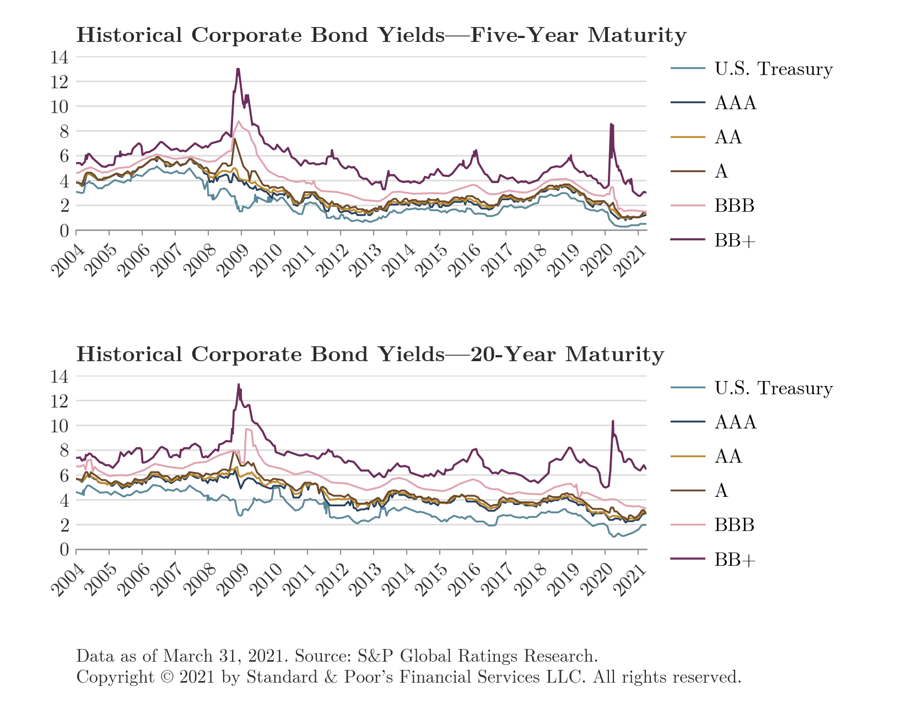
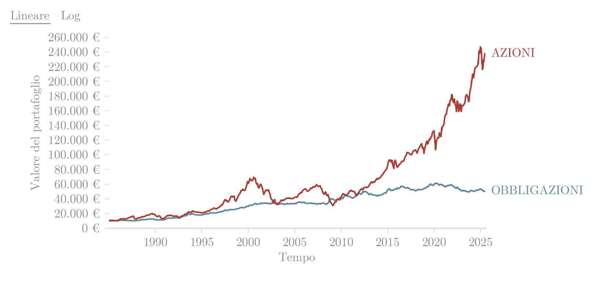
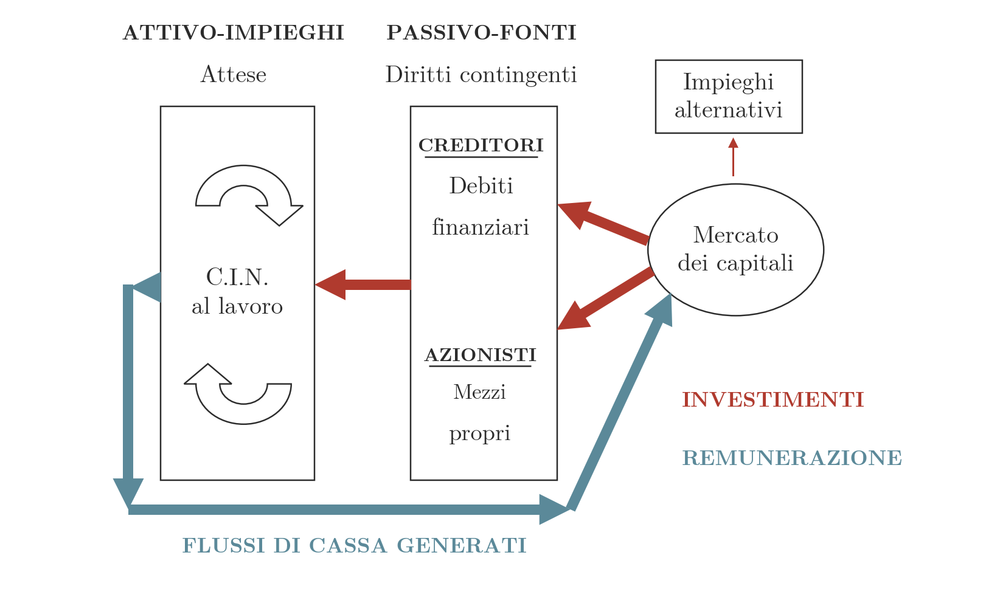

# Tempo, rischio e metodi di valutazione degli investimenti

## Il modulo sulla valutazione degli investimenti

- Il modulo riguarda come valutare un investimento, spesso incrementale e non sempre di start up da zero.
- Conad deve ampliare un punto vendita e la direzione finanziaria chiede in quanto tempo rientrate dell'investimento, di circa 10 milioni di euro, con ampliamento dell'organico e dei metri quadri.
- Si trovano dei KPI specifici: incremento di superficie e di dipendenti, quindi maggiori costi e maggiori ricavi.
- Nella GDO si guarda al fatturato per metro quadro, cercando il fatturato stimato e quello aggiuntivo rispetto al vecchio negozio.
- Poi si ragiona in termini di redditività e di recupero dell'investimento: l'imprenditore chiede quanti anni recupero l'investimento.

## Progetti abbandonati

- Dopo i casi di espansione, ci sono casi in cui l'investimento viene abbandonato per motivi strategici o economici o perché si ritiene sbagliata la scelta: la Maserati MC20 Folgore, totalmente elettrica, mai uscita.
- Il tema è se mi conviene andare avanti e qual è l'impatto in termini di valore di stoppare il progetto e dismettere attrezzature, costi di setup e laboratorio di progettazione.
- Amazon ha speso 170 milioni di dollari per lo smartphone Fire e non ne ha mai venduto uno.

> [!question] Da verificare: "qui il progetto di investimento non è in espansione in termini di abbandono" non è chiara.

## Progetti posticipati

- Un progetto può essere rimandato, e serve per le opzioni reali: c'è un periodo di attesa, i costi sono sostenuti ma i ricavi arrivano dopo.
- Non è indifferente avere il denaro nel periodo uno, zero, due, e questo cambia la valutazione.
- Lanice (automazioni per cancelli), verbale di assemblea del 2006: rinvia il lancio di nuovi prodotti della linea screen per completare la brevettazione di ulteriori componenti prima della commercializzazione.
- L'alternativa è lanciare oggi o attendere un anno per avere flussi di cassa prospettati più alti: è il concetto di postponed.

> [!question] Da verificare: "Lanice" e "linea screen" non confermati da nessuna slide.

- Digital Bros posticipa Assetto Corsa 2, che avrebbe cannibalizzato Assetto Corsa Competizione, all'estate successiva per permettere il lancio nella primavera della nuova stagione di Assetto Corsa Competizione.
- Lanciato oggi ci sono flussi certi; tra un anno l'effetto novità porta flussi maggiori, ma non è certo, e bisognerà ponderarlo con delle probabilità, nelle opzioni.

## Il valore della flessibilità e perché valutare un progetto

- Il modulo dopo è quello delle opzioni, il valore della flessibilità: un progetto può andare bene, andare male, essere abbandonato o posticipato.
- Si valuta un progetto per capire se conviene farlo, attendere, abbandonarlo o espanderlo, e servono due variabili, il tempo e il rischio.
- Nella ragioneria interessa relativamente in che esercizio si verificano i ricavi, senza valutare la rischiosità né il tempo.

*(slide 15)*

- ==Invece per noi, nel mondo della finanza, questi due concetti sono importanti.==
- Si abbina la fattibilità alla valutazione finanziaria, che analizza i flussi di cassa; il cash flow è il differenziale tra la liquidità prima e dopo.
- ==Questo concetto ci accompagnerà su tutte le lezioni, tutto quello che vedrete qui verrà distillato e si ricondurrà al fatto che tutto diventa flusso di cassa==, tanto, poco, prima, dopo.

*(slide 16)*

## Il tempo ha un valore

- Due elementi nella valutazione di convenienza: il tempo ha un valore e il rischio ha un prezzo.

> [!question] Da verificare: "il rischio ha un prezzo, ha un elemento"; si adotta la slide 17.

- Investendo a rischio praticamente nullo, ad esempio in BTP, 100 euro oggi tra un anno saranno aumentati del rendimento, quindi di 1 più $r$; ma 100 euro tra un anno sono meno di 100 euro oggi.
- La prima parte è capitalizzazione, porto i flussi in avanti di un anno; viceversa ho l'attualizzazione.

> [!question] Da verificare: "se R è il rischio di rendimento"; la slide 19 indica r come tasso privo di rischio.

*(slide 19)*

## Un investimento che rende meno del tasso privo di rischio

- Un investimento che rende meno di $r$, il tasso privo di rischio, distrugge ricchezza, perché l'alternativa è metterlo nei BTP.
- Con 100 euro e tasso del 3,5% il BTP dà 103 euro e 50 tra un anno; un progetto al 2% dà 102 euro.
- I 102 euro al tempo uno attualizzati a oggi: ricchezza distrutta per 1,45 euro, oggi al tempo zero avrei 98 euro.

> [!question] Da verificare: "98 euro"; la slide 20 riporta 102 / 1,035 = 98,55; "la montare di ricchezza" probabilmente "l'ammontare".

*(slide 20)*

## Il progetto da 1.400 euro

- Gli investimenti si confrontano con il tasso privo di rischio, qui il 3,5%.
- 1.400 euro oggi diventano 1.456 euro tra un anno, 56 euro in più, quindi il 4% annuo: più dei titoli di Stato al 3,5, quindi il progetto rischioso rende di più di un investimento non rischioso.

*(slide 21, slide 22)*

- Il tema è come si remunera il capitale raccolto sul mercato: si prende un tasso free risk perché non si è obbligati a fare l'investimento, si potrebbero comprare dei DTP.
- L'obiettivo delle imprese, che competono in un mercato rischioso, è finanziare investimenti che rendano più del mercato.

> [!question] Da verificare: "DTP" probabilmente BTP; "tasso di rischio" probabilmente tasso privo di rischio.

## Il prezzo del rischio: il dollaro investito nel 1926

- Il grafico sul mercato americano mostra un dollaro messo nel 1926 fino al 2025, cioè il 22; l'area piena è l'inflazione, la perdita di potere d'acquisto.

> [!question] Da verificare: la slide 27 riporta "1$ alla fine del 1925"; l'ultimo anno (2025 o 2022) resta aperto.

*(slide 27)*

- Le linee rosa sono i Treasury bills e i government bond: le linee 3, 4 e 5 hanno i rendimenti più bassi e sono la prova provata che hanno i rischi più bassi; chi non rischia ha un rendimento più basso nel tempo.
- Le due linee tratteggiate sopra sono le large cap stocks e più in alto le PMI americane; è una media.
- Verrebbe da pensare che con un dollaro da mettere sarebbe da metterlo nella una, senza pensarci due volte, visto che la media dei rendimenti dei titoli di Stato è più bassa: questo dà la percezione del prezzo del rischio.

## Ciò che il grafico non mostra

- Dal grafico non traspare che il sottostante, l'ente che emette questi bond, è sempre lo stesso.

> [!question] Da verificare: "della carta della Costituzione americana, probabilmente" non è chiara.

- Le aziende in alto probabilmente non sono quelle del 1926: molte hanno chiuso e sono fallite, e il dollaro messo su una singola azienda può essersi azzerato.
- I progetti e le aziende portano con sé un'elevata rischiosità: per le aziende vengono fuori tassi alti, 10, 11, 12 per cento, contro i BTP a tre, perché si sta attualizzando il rischio.

## Il rating e il rendimento delle obbligazioni

- Il rating di Standard & Poor's è un'altra faccia del rischio, correlato al rendimento dei corporate bond.
- La linea blu scuro è lo Stato americano, paese a rischio minimo con la AAA, e rende meno, è la linea sempre più bassa; seguono le aziende con AAA, A o AA (giallo, arancio e viola), appoggiate subito sopra.
- Per l'azienda di frutta secca in Congo durante una guerra civile, degradata BB+, la domanda è quanto rende e quanto rischi.

> [!question] Da verificare: "l'American paese a rischio minimo" e "il rating migliore della AAA" letti come sopra; "sul pizzillo" omesso.

- ==Quindi la correlazione rischio-rendimento accompagna tutte le decisioni finanziarie, non si scappa==, è una delle regole del gioco.
- Nelle valutazioni di aziende e tassi si ragiona sul tasso, sul mercato in cui opera l'azienda e sulla rischiosità, confrontando con i titoli del governo americano: la correlazione è strettissima.

## Obbligazioni contro azioni

- Obbligazioni contro azioni è la ciliegina sulla torta, l'evidenza.

> [!question] Da verificare: "Questo non è anche bello commento" omessa; la slide 29 riporta "Obbligazioni vs Azioni".

- L'obbligazione è un prestito, un impegno fortissimo alla restituzione, e il suo valore giuridico è forte perché obbliga l'azienda a restituire il capitale: con 100 euro in un'obbligazione si dorme più tranquilli che con 100 euro in un'azione.
- Se l'azienda fallisce le azioni si buttano nel cestino; con le obbligazioni si apre liquidazione o concordato, c'è un liquidatore e l'obbligazione diventa un credito, per cui c'è una probabilità che il capitale venga restituito.

> [!question] Da verificare: "il centrale in obbligazioni" probabilmente "il capitale in obbligazioni".

## A chi vanno i flussi di cassa

- Nello stato patrimoniale l'attivo è finanziato dal passivo: le banche (creditori terzi) e il patrimonio netto, che appartiene ai soci.
- Il cash flow va a remunerare gli stakeholder: i flussi della Diadora non ci interessano perché non siamo né creditori né azionisti; vanno a remunerare i creditori e i soci.
- Valutando un'azienda si calcola l'ammontare di flussi di cassa e quali vanno a una categoria e quali all'altra.

> [!question] Da verificare: "quella montante" probabilmente "quell'ammontare".

- Si valutano aziende perché qualcuno le vuole comprare o finanziare e si aspetta dei soldi indietro, perché non fa beneficenza.
- A sinistra uno stato patrimoniale riclassificato, a destra creditori e azionisti, che ricevono i flussi generati dal capitale investito netto.

## Lo schema del rendiconto finanziario

- Il rendiconto finanziario è lo schema più utile per capire come girano i flussi di cassa, non il conto economico né lo stato patrimoniale.
- C'è una parte di flusso di cassa dal core business, il cash flow gestionale, l'FCGC; le aree non cambiano nel metodo indiretto.

> [!question] Da verificare: "FCGC"; la slide 31 riporta "cash flow gestionale lordo" e "(FCFO)", la sigla resta aperta.

*(slide 31)*

- Il primo è l'area operativa: l'azienda fa girare il capitale investito netto e genera un MOL, un EBITDA.
- Calcolo rapido dal conto economico: A meno B, valore della produzione meno costo della produzione, più gli ammortamenti, da normalizzare e aggiustare.

> [!question] Da verificare: "fatela meno B" letto "fate A meno B"; "quelle EBITDA diventa quelle EBITDA" omesso.

- L'EBITDA non è cassa: un banco che costa 100 euro e si vende a 300 euro dà un EBITDA di 200 euro, ma se la scuola, pubblica amministrazione, non paga la fattura non c'è cassa.

> [!question] Da verificare: "le BDA" letto EBITDA, confermato dalla slide 9.

- L'EBITDA va rettificato dalla variazione del circolante: per passare a un flusso di cassa è necessario passare per la variazione del capitale circolante.
- ==È importante, questo nella finanza è un passaggio fondamentale, perché ci sono aziende che falliscono con l'EBITDA positivo.==
- Succede con la pubblica amministrazione, come l'ospedale che non paga mascherine e siringhe, o l'impresa edile che costruisce City Life e non viene pagata dall'agenzia commerciale: sulla carta ci sono ricavi incredibili ma si è fuori con tutti i soldi.

> [!question] Da verificare: "le BDA" letto EBITDA; "FCGC" resta aperta.

- Essere fuori coi soldi non si vede dal conto economico ma solo dal rendiconto finanziario.
- Se il cash flow gestionale, l'FCGC, è quasi zero o negativo, l'EBITDA è mangiato dal capitale circolante e diventa tutto crediti, non soldi; con i crediti non si pagano gli stipendi.
- Primo tema: l'azienda è impegnata a produrre cassa dall'area operativa.

## Investimenti, imposte, creditori e soci

- Area degli investimenti: macchinari, attrezzature e impianti produttivi non durano in eterno, quindi una parte del flusso di cassa viene sottratta per gli investimenti.
- Fornitori, dipendenti e personale si gestiscono con il delta CCNO, i debiti correnti operativi, con la variazione del capitale circolante.
- Lo Stato va pagato, quindi le imposte con segno meno; l'effetto delle imposte è mitigato dallo scudo fiscale sugli interessi sul debito, che si vedrà.
- Dopo l'FCFO restano i creditori e i soci; i creditori vengono remunerati rimborsando i debiti e pagando gli interessi.

> [!question] Da verificare: "dopo l'FCFO cosa resta"; la slide 31 riporta l'FCFO prima degli investimenti e l'FCFF dopo, resta aperto se intendesse FCFF.

- L'area finanziaria viene prima perché è un'area di impegni obbligatori, quasi come lo Stato: i creditori hanno un debito da restituire, mentre gli azionisti, se avanza qualcosa, se lo prendono, sennò no.
- I creditori si pagano con gli oneri finanziari e con il rimborso dei finanziamenti in uscita, e nell'area finanziaria entrano anche i nuovi finanziamenti, ad esempio un milione di euro.
- Resta il free cash flow relativo all'equity, l'ultimo che residua, da dare agli azionisti in dividendi o variazioni di capitale.

*(slide 31)*

## La posizione dei soci e i dividendi

- I dividendi sono in fondo alla gerarchia, quindi chi mette soldi per avere dividendi pretende almeno un rendimento alto: non ha un rimborso garantito per legge come un creditore o un dipendente.
- È l'assemblea che delibera la distribuzione dei dividendi, non obbligatoria; molte aziende non ne danno per anni perché capitalizzano gli utili e li mettono a riserva, come Enel se investe sul fotovoltaico.
- Ha effetti sul prezzo del titolo se è quotata; i flussi sono dedicati un po' agli investimenti e un po' a chi ha acquistato azioni.

## Aziende quotate e PMI italiane

- Le aziende non quotate sono il 95%: in Italia 950.000 SRL e qualche centinaio di quotate, rispetto a un milione; è 100 volte più probabile affrontare il rendiconto di un'azienda non quotata.
- Le PMI italiane sono molto indebitate, quindi l'area finanziaria è molto presente: vanno in banca a fare debito e non si quoterebbero mai in borsa; in America si quota di più perché in borsa ci sono più aziende e costa meno quotarsi e rimanere.
- Una fonderia di Vicenza che ha bisogno di mezzo milione di euro va dal direttore della banca con un business plan: capitale di terzi, soprattutto nei business maturi.
- Nelle start-up si cercano business angels, che mettono capitale di rischio, equity.

## Il rendiconto finanziario di Enel

- Il rendiconto è preso dal bilancio di Enel, credo in milioni di euro; nei bilanci i rendiconti sono dei minestroni incredibili, senza uno schema riga per riga, ma servono le categorie di flussi di cassa.
- Il libro scrive l'FCFO in tre righe, il rendiconto ne ha 50: bisogna riconciliare la realtà col libro, che è una semplificazione.
- La gerarchia è quella del metodo indiretto, che parte dal reddito generato.

> [!question] Da verificare: "ricongiagliare" e "lo scritto FCFO così" letti "riconciliare" e "l'FCFO scritto così".

- Si parte dal risultato netto d'esercizio, ultima riga del conto economico, si rimontano gli ammortamenti (da 8 milioni, 7 milioni 249 di ammortamenti) e si arriva al MOL; poi si pulisce dalla variazione del circolante e si arriva al flusso di cassa della gestione operativa.

> [!question] Da verificare: "consegno un positivo" e le cifre 8 milioni e 7 milioni 249 non sono confermate da nessuna slide.

- Il cash flow da attività di investimento comprende partecipazioni (Enel compra il 70% di una società di un parco fotovoltaico), attività materiali non correnti (il camino della centrale elettrica di Roma) e imprese o rami di impresa; le dismissioni entrano con segno più.

> [!question] Da verificare: "il cammino" letto "camino"; "l'impresa stessa cosa" e "leader in conto" omessi.

- Restano creditori e azionisti: rimborso di debiti finanziari, rate del mutuo, emissione e rimborso di obbligazioni, che generano nuovi creditori; per gli azionisti la riga è dividendi o acconti sui dividendi pagati.

> [!question] Da verificare: "conti sui dividendi" probabilmente "acconti".

- Enel genera un reddito a beneficio degli investimenti, poi dei creditori e poi degli azionisti.

## Il rendiconto finanziario della De' Longhi

- Si scarica il rendiconto finanziario della De' Longhi, siamo sempre lì.

> [!question] Da verificare: "Questo item, riscaricate rendiconto finanziario della De' Longhi" non è chiara.

- Parte dal risultato netto e le imposte, poi le variazioni di crediti commerciali, debiti commerciali e altre voci del circolante, delta CCNC: reddito operativo e delta capitale circolante portano al free cash flow from operations, prima della gestione degli investimenti.
- La gestione degli investimenti, il CAPEX, è uguale.

> [!question] Da verificare: la slide 31 riporta "Variazione CCNO", non "CCNC", sigla aperta; "A," e "mi è" omessi.

- Questo si usa per valutare le aziende col metodo dei flussi di cassa, i DCF, accanto ai multipli dell'EBITDA.
- ==Bisogna prendere confidenza con questo schema di bilancio perché è molto utile, bisogna sapere quali flussi prendere.==
- Qui sono messi insieme azionisti (stock option, dividendi) e creditori (interessi e rimborso dei finanziamenti), ma sono due soggetti diversi.

## La quadratura del rendiconto

- Le ultime righe sono le voci di quadratura: il rendiconto va sempre in quadratura, anche se quando ve lo fate squadra sempre per qualcosa.
- Dopo aver pagato tutti magari restano mille euro: l'ultimo importo del cash flow ==è la variazione delle disponibilità liquide da un anno all'altro, la variazione del conto in banca dell'azienda, e questa è la quadratura==.

> [!question] Da verificare: "Scrive dove sono" letto "sta scritto".

- Il rendiconto è un maxi incrocio di conto economico (vendite, ammortamenti, oneri finanziari, risultato d'esercizio) e stato patrimoniale (variazione del capitale circolante, investimenti come variazione delle immobilizzazioni pulite dagli ammortamenti).
- La prova del nove è che i soldi dentro l'azienda devono essere cambiati esattamente di quell'importo.

> [!question] Da verificare: "le vite" probabilmente "le vendite".

## I cinque metodi per valutare un investimento

- Videogiochi, la Tesla, Icona sono singoli progetti, non aziende, quindi servono dei metodi.
- Cinque metodi: valore attuale netto, tasso interno di rendimento, tempo di recupero, tempo di recupero attualizzato e indice di redditività; VAN e TIR sono già noti.
- Dimenticate il conto economico, siamo sui flussi di cassa.

*(slide 35)*

> [!question] Da verificare: "Tesla", "Icona" e "L'IRR attraversiamo" non sono confermati da nessuna slide.

## Perché servono i flussi di cassa e il momento zero

- Nel VAN al numeratore c'è l'FCFO, che si prende dal rendiconto finanziario: senza saperlo ricavare non si valuta un investimento, anche conoscendo la formula.
- Nessuno dà il flusso di cassa: dicono quanto rende, quanto costa, il risultato atteso; serve anche l'esborso al momento zero, I0 col segno meno.

> [!question] Da verificare: "vi basta sapere" letto "non vi basta" dal contesto.

- Si contrappone l'investimento iniziale al tempo zero e ==ricordatevi di questo, anche perché causa frequente di errore negli esercizi e nelle prove d'esame==.

> [!tip] Esame
> L'investimento iniziale al tempo zero è causa frequente di errore negli esercizi e nelle prove d'esame: viviamo nel momento zero, nell'I0, e non è indifferente un flusso fra un anno o un flusso oggi.

- Se l'investimento parte oggi e nel 2027 viene un milione di euro, è un FCFO al momento uno: oggi è 900 euro, 800 euro.
- ==la regola è di attualizzare i flussi, e i flussi li attualizzi già dal momento uno==; se il progetto parte tra un anno si portano indietro di un anno tutti i flussi, perché si è in T0.

> [!question] Da verificare: "900 euro, 800 euro" probabilmente 900 mila e 800 mila.

## Il VAN: criterio, punti di forza e di debolezza

- Il VAN dice che la somma attualizzata dei flussi di cassa in entrata al tasso di rischio del progetto deve essere maggiore di zero, quindi superiore all'investimento iniziale.
- Punti di forza: considera il fattore tempo, perché si attualizza, e la dimensione del progetto, euro contro euro, un milione contro mezzo milione.
- Punto di debolezza: non considera il razionamento del capitale.
- Esempio: un bar per il campus con un VAN del 16 per cento, mezzo milione di euro che in tre anni diventano 700 mila; con VAN maggiore di zero si farebbe, ma non si ha mezzo milione, quindi non lo facciamo.
- Il VAN dice che il progetto è percorribile, ma non tiene conto del fatto che si potrebbe non avere quella cifra.

> [!question] Da verificare: "un VAN del... 16 per cento" non è chiaro se fosse un tasso di rendimento; la slide 36 riporta "razionamento di capitale".

- I metodi si usano per confrontare più progetti: un'app con l'AI per 2.000 euro contro un bar con mezzo milione di setup, a parità di VAN.
- Se l'app mi rende il 3% di VAN e il bar è il 5%, verrebbe da scegliere il bar, peccato che non ho il capitale; si valutano sempre investimenti alternativi.
- Il VAN si usa se i flussi di cassa sono abbastanza stabili.

*(slide 36)*

## Primo esempio di VAN

- Investimento da 10.000, progetto su cinque anni, tasso medio ponderato del capitale del 9%, flussi di cassa di 3.000 ogni anno.
- Servono investimento iniziale, anni in cui il progetto genera cassa, tasso di rischiosità e flussi previsti.

*(slide 37)*

- Il valore attuale è il valore attualizzato dei flussi, cioè 11.668 euro; il valore attuale netto è la differenza con l'investimento iniziale.

*(slide 38)*

## Secondo esempio di VAN

- Progetto di quattro anni, sempre 3.000 euro costanti ogni anno, tasso dell'8%.
- Non si prende il tasso privo di rischio, il famoso tre e mezzo, perché aprire il bar è rischioso: il tasso è 8 e non più tre e mezzo.
- Per aprire il bar potrebbero esserci finanziatori che mettono capitale di rischio e una banca a titolo di credito, e bisogna remunerarli.

*(slide 39)*

> [!question] Da verificare: "potrei avere lì zero" aperto, la slide 39 riporta 12.000 euro; "che è idealmente il fatto che sia alto" non è chiara.

- Il WACC è il rendimento di azionisti e capitale preso a prestito; il VAN è negativo, quindi chi mette oggi 12.000 euro non viene soddisfatto sulle sue aspettative e il progetto non è conveniente.

*(slide 40)*

## Il valore attuale modificato

- Il VAM, valore attuale modificato, ha la stessa formula del VAN ma con l'R0 al posto del WACC.
- L'R0 è il tasso di un'azienda non indebitata, come se si finanziasse il progetto solo con le proprie risorse.

> [!question] Da verificare: "il VAN, che è il valore attuale modificato" letto VAM; "l'RO" letto R0; nessuna slide riporta la formula.

- Ha senso che la convenienza di aprire il bar sia impattata da come lo si finanzia, con azionisti o creditori? Non dovrebbe.
- È una variazione del libro e delle slide: un valore attuale con un tasso che non è il WACC, dove si ponderano anche le aspettative dei creditori, come se l'investimento fosse tutto con le proprie gambe.
- ==Io dovrei valutare la bontà di un investimento a prescindere da come lo finanzio.==
- Il punto di forza del WACC è il bullet 2, separa il valore dell'investimento da quello del finanziamento; il vantaggio del finanziamento è fiscale, lo scudo fiscale.

> [!question] Da verificare: "il punto di forza del WACC" detto dal docente; la slide 41 lo attribuisce al VAM.

*(slide 41)*

## Lo scudo fiscale

- Con capitale di rischio pago X di imposte in base al conto economico; con un mutuo pago gli interessi ma ho costi deducibili, quindi pago meno imposte; se i soldi sono tutti miei, non so, orbicio niente.
- ==Questo è il concetto di scudo fiscale che troveremo in tutte le formule da qui alla fine del corso==: dove c'è capitale di terzi c'è la possibilità di dedursi gli interessi.
- In termini di flusso è un aspetto significativo, al di là dell'aspettativa di tasso.

> [!question] Da verificare: "non so, orbicio niente" non è chiara; la falsa partenza "pago X di imposte" dopo "tutto con debito" è omessa.

## Il razionamento del capitale

- È il confronto tra l'app e il bar: il progetto B presenta un VAN decisamente maggiore, ma non abbiamo magari un milione e mezzo di euro da investire.

> [!question] Da verificare: "l'APR e il BAR" letto "l'app e il bar"; la slide 42 riporta "Progetto A" e "Progetto B", con 50.000 e 1.500.000 euro, e non conferma.

*(slide 42)*

## L'indice di redditività

- Il terzo metodo è il quoziente tra il valore attuale dell'investimento del progetto e l'esborso iniziale.
- I valori attuali dei flussi in entrata devono essere maggiori dell'investimento iniziale, per cui l'indice di redditività deve essere maggiore di uno.

*(slide 43)*

- Esempio: esborso iniziale di 200.000, flusso costante pari a 66.000 euro di valore attuale e WACC del 10%.

> [!question] Da verificare: la slide 44 riporta "per i successivi 4 periodi, pari a 66.000"; il docente parla di quattro flussi da 66.000.

*(slide 44)*

- Si attualizzano al tempo zero i quattro flussi in entrata da 66.000 al 10% per i quattro periodi: il flusso al tempo 1 indietro di un periodo e via così, il flusso al momento 4 a t zero.
- Diviso l'investimento iniziale, si vede se la formula è maggiore di 1.

*(slide 45)*

## Il tasso interno di rendimento

- Il TIR è il tasso interno di rendimento, una sorta di tasso di equivalenza: la bontà dell'investimento esce in forma di tasso, non di valore attuale.
- È il tasso che annulla il VAN: posto il VAN uguale zero nella formula si trova il TIR.
- Il TIR non è il WACC: il WACC sono le aspettative di capitale, il TIR annulla il valore attuale dell'investimento.
- ==il TIR deve essere maggiore del WACC==: quello che rende un progetto deve superare il costo, le aspettative, il costo opportunità del capitale.

*(slide 46)*

- Tiene conto del tempo e dei flussi di medio-lungo periodo ed è una misura sintetica; anche qui si ipotizzano flussi costanti.

*(slide 47)*

## Che cosa resta per la prossima volta

- La prossima volta terminiamo i metodi, il tempo di recupero e il tempo di recupero attualizzato; dopodiché abbiamo concluso.
- Magari vi carico le slide con il tempo di recupero e quello attualizzato, e la prossima volta ripartiamo dalle opzioni.
