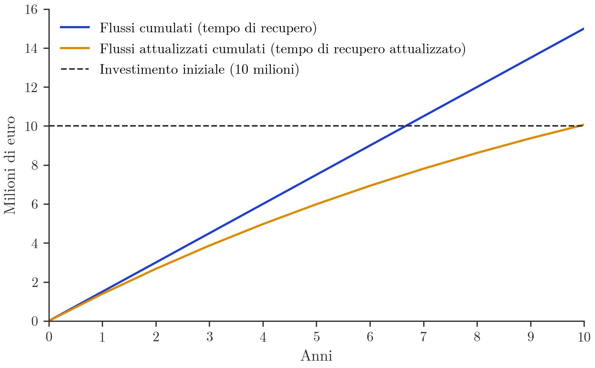

# Esercizi sui metodi di valutazione e opzioni reali

## Ripresa dei cinque metodi di valutazione

- Dei cinque metodi per valutare un investimento il più utilizzato è il VAN; sono tutti in correlazione tra loro e tengono conto dell'investimento iniziale e dei flussi generati dal progetto.
- Alcuni attualizzano e servono per confrontare investimenti disomogenei, come un punto vendita di proprietà (esborso per l'immobile) e uno in affitto (canone di locazione, nessun esborso).
- Si vedono due esercizi che applicano i metodi a uno stesso progetto; poi le opzioni, poi il costo del capitale (se non si arriva, dopodomani).
- ==È importante capire che ad ogni flusso di cassa corrispondono degli stakeholders==.

### Il caso: aprire un nuovo supermercato

- I dati del valutatore: investimento iniziale, flussi di cassa attesi, aspettative di tasso degli investitori. Si valuta l'apertura di un supermercato (esempio del Conad), investimento da milioni di euro, con costi diversi a seconda della zona anche a parità di metratura.
- A fronte dello stesso investimento da 10 milioni si vuole capire se conviene aprire un posto piuttosto che un altro, perché i flussi saranno diversi.
- ==Quello che è importante è intercettare le informazioni che ci servono==.
- Il VAN parte da 10 milioni di investimento iniziale e da un FCFO di un milione e mezzo l'anno: una semplificazione, perché non c'è un anno uguale all'altro, a meno di una previsione puntuale (anno 1 un milione 422 mila, anno 2 un milione 526 mila 700).

### Dove si trova la proiezione dei flussi di cassa

- Il valutatore si fa una previsione (un milione e mezzo all'anno) o ha una proiezione puntuale. Il budget è molto dettagliato ma ha un orizzonte di 12 mesi; il documento che va oltre l'anno è il business plan, o piano economico finanziario, con i flussi di cassa previsionali.
- Il business plan convince chi mette soldi in un'idea (startup, advisor, private equity, banca): la famiglia Bastianello del PAM o la famiglia Canella degli Alì va in banca Intesa a chiedere 10 milioni di euro per un nuovo Alìper ad Abano.

> [!question] Da verificare: la trascrizione riporta "la Lidl nuovo di Abano"; dal seguito probabilmente "l'Alìper nuovo di Abano".

- Il direttore chiede un bilancio per vedere se l'azienda è solvibile, ma per un investimento (non comprare l'S lunga, ma aprire il centocinquantesimo Alìper) chiede un business plan.

> [!question] Da verificare: la trascrizione riporta "l'S lunga"; probabilmente "Esselunga".

- L'ufficio finanziario deve contrapporre all'investimento iniziale una previsione di flussi e mostrare che l'investimento sta in piedi e remunera in modo soddisfacente, magari più di un'altra cosa: con dieci milioni di euro, comprare il marchio Famila dal gruppo Emisfero o aprire undici Alìper nuovi in tutto il Triveneto; si calcola il VAN dell'una e dell'altra.
- Dati dell'esercizio: investimento iniziale, tasso (WACC, aspettative di rendimento degli investitori), durata, FCFO.

### Le cinque misure sul caso del supermercato

- VAN: l'investimento iniziale contro il valore attuale dei flussi attesi (un milione e mezzo) attualizzati al WACC; le formule di attualizzazione serviranno anche sui flussi del rendiconto finanziario.
- TIR: il tasso per cui il VAN è zero, da confrontare con le aspettative degli investitori, qui l'8%.
- Indice di redditività: un quoziente, quanto rende il progetto rispetto a quanto si spende.
- Il 4 e il 5 si misurano in tempo, semplice o attualizzato; il semplice somma negli anni i flussi contrapponendoli agli investimenti in uscita.
- Differenza tra 4 e 5: l'attualizzazione. Il 4 considera 100 euro oggi, fra un anno e fra due anni sempre 100 euro; il 5 no: ==Quel tempo per me ha un valore economico e finanziario==. Nell'esercizio 2 i due metodi potrebbero dare risultati diversi.

### Perché capire il ragionamento e non solo la formula

- Due limiti: ==durante il compito non avete ChatGPT, quindi vi conviene padroneggiare la formula==, e in una riunione con un private equity si ragiona a voce su un investimento iniziale e flussi da attualizzare, senza tempo di trafficare sull'AI.
- Questo non è un esame di matematica: ci si deve appropriare del ragionamento, spesso buon senso applicato a logiche finanziarie.

> [!tip] Esame: durante il compito non c'è ChatGPT, quindi conviene padroneggiare la formula.

### Il VAN del supermercato

- Il valore attuale di dieci periodi del milione e mezzo è 10.065.122; tolti i 10 milioni, il VAN è di 65.000 euro.
- Per il professore che guarda il libro è da accettare; nella realtà si spendono 10 milioni per averne 10 milioni e 65 mila, e se si tengono 10 mesi in più le impalcature il VAN è mangiato. È preferibile a un progetto con VAN di 10 mila euro e a uno con VAN negativo, però serve la significatività di ciò che si misura. ==Questo è importante, che non lo vedete dalle formule.==

> [!question] Da verificare: la trascrizione riporta "il corso di quello che state valutando e misurando"; il senso di "corso" non è chiaro.

- I preventivi si discostano dalla realtà di un n per cento sempre in peggio (da una lampadina si cambia mezzo scooter).

> [!question] Da verificare: la trascrizione riporta "lampadina di cambio faroale"; il termine non è chiaro.

- ==Occhio, è un VAN positivo, però è molto rischiato==: se chiedono un parere, va segnalato.

### Il TIR e l'indice di redditività del supermercato

- Ponendo il VAN uguale a zero con 10 anni, FCFO di un milione e mezzo e I0 di 10 milioni, il TIR è 8,14%.

> [!question] Da verificare: la trascrizione riporta "il CFO è un milione e mezzo"; la slide 37 riporta "FCFO" e si adotta questa forma.

- È appena appena più soddisfacente dell'8% atteso, se tutto va bene e se l'I0 da 10 milioni è confermato: è una previsione, il punto vendita non c'è ancora.
- L'indice di redditività è il valore attuale dei flussi fratto l'investimento iniziale e deve essere maggiore di uno, cioè numeratore più grande del denominatore.

### Il tempo di recupero, semplice e attualizzato

- Semplice: dopo sei anni abbondanti; a fine sesto anno il cumulato è 9 milioni, a fine settimo 10 e mezzo, quindi verso luglio del settimo anno, a spanne.
- Non è corretto, perché il tempo ha un valore: ha più senso l'attualizzato. A fine anno uno, riferito al momento zero, si ha un milione tre ottantotto, non un milione e cinque.

> [!question] Da verificare: la trascrizione riporta "un milione tre ottantotto"; probabilmente circa 1.388.000 euro.

- Al signor Canella, che a mente dice sette anni, si spiega che con il tempo di recupero attualizzato sono nove anni e passa, quasi dieci, anzi dieci: il valore attuale cumulato arriva a 10.065.000 euro subito dopo il decimo anno.

### Perché il libro li espone tutti

- A volte non si hanno tutte le informazioni (per esempio il WACC), quindi per completezza il libro li espone tutti; nella prassi si vedono di più il VAN, il TIR e in parte il tempo di recupero attualizzato.
- VAN e TIR sono simili: uno esprime euro, l'altro un tasso, con gli stessi elementi rimescolati.
- Con un tempo di recupero attualizzato di 9,9 anni, dieci anni, il progetto si fa? Dipende: diversamente dal VAN, risposta secca, il tempo di recupero è soggettivo, può non stare bene aspettare dieci anni per recuperare dieci milioni.
- Per il VAN negativo ==è inconfutabile il fatto che un progetto con VAN negativo sia da respingere==, perché distrugge ricchezza: meglio un BTP o un conto deposito; solo un folle lo farebbe.

### I motivi strategici di un VAN negativo

- Solo motivi strategici giustificano un progetto con VAN negativo.
- Esempio: i negozi Nike, Adidas, Mango e Bassetti sotto le gallerie della stazione di piazzale Roma a Venezia, quasi vuoti, hanno sicuramente VAN negativo, ma Adidas non può non avere un negozio in stazione a Venezia.
- Si chiamano flagship store, concetto più da marketing che da finanza: lo store bandiera, come in Galleria Vittorio Emanuele a Milano o in via Monte Napoleone.

> [!question] Da verificare: la trascrizione riporta "come la metto a rischio"; probabilmente "come a Risiko".

- Philippe Plein in via Monte Napoleone è sempre vuoto, lo stesso negozio altrove è pieno: è l'unico motivo, strategico e non finanziario, per un VAN negativo.
- Anticipo sulle sinergie: Adora acquisisce Tecnica Dolomite, che va male (bilancio in rosso, EBITDA e flussi di cassa negativi), non per gli utili ma perché il responsabile sviluppo prodotto, o il pool di ingegneri del laboratorio sui nuovi materiali, è un genio.

> [!question] Da verificare: la trascrizione riporta "io sono di Adora"; il nome dell'azienda non è chiaro.

- Si acquisiscono risorse chiave che non si hanno altrimenti, per lanciare la scarpa da running più bella del mondo anche se quelli sviluppavano scarponi da sci. Però ==se non è per strategia, di marketing o di sviluppo prodotto, solitamente il VAN guida le decisioni==.
- Nel grafico la riga blu è il tempo di recupero, la gialla o arancio l'attualizzato, il tratteggio l'investimento iniziale: con la riga arancione il break even si sposta molto più a destra.

### Secondo caso: una nuova linea di snack

- Un'azienda alimentare vuole lanciare una nuova linea di snack con una linea produttiva dedicata. Esempio della Dolomia: la nuova bottiglia per ristoranti costosi (acqua a 5 euro a bottiglia) ha richiesto una nuova linea produttiva, con trade-off rispetto a supermercati o clienti a domicilio.
- Investimento iniziale 4 milioni, durata 5 anni (la vita, anche di marketing, di uno snack), WACC 10%.
- I flussi sono crescenti, più aderenti alla realtà: 650.000 il primo anno, a regime tra secondo e terzo, fino a un flusso a fine quinto anno quasi doppio rispetto al lancio. Complessivamente 4.650.000, più dei 4 milioni dell'investimento.

> [!question] Da verificare: la trascrizione riporta "flussi compressivi"; probabilmente "complessivi".

### Il VAN della linea di snack

- Ogni flusso si porta indietro al tempo zero (650.000 di un periodo, 800.000 di due periodi) e si contrappone ai 4 milioni iniziali.
- Il valore attuale dei flussi dei 5 anni è 3.418.000, non 4.650.000: 1.300.000 fra 5 anni, attualizzati a quel tasso rischioso, sono 800.000 euro oggi, quasi metà.

> [!question] Da verificare: la trascrizione riporta "6,50", "4 milioni 6,50" e "3 milioni 4,18"; si scrivono 650.000, 4.650.000 e 3.418.000, cifre che il docente dice per intero poco prima.

- A fronte di 4 milioni di esborso i flussi attualizzati sono 3.400.000: il VAN è negativo per 581.000 euro, meglio non farlo, per il tempo e per il rischio.
- Sono flussi previsti, non cedole del BTP dello Stato italiano: se a fine anno uno il Mulino Bianco copia lo snack di Ferrero, probabilmente quei flussi dal due al cinque non ci saranno, oppure saranno più che dimezzati.
- Il WACC incorpora il rischio rispetto ai 4 milioni su un BTP: è il 10% perché l'investimento è molto rischioso; per un BTP si userebbe un tasso basso, come nella lezione sul costo del capitale.

> [!question] Da verificare: la trascrizione riporta "4 milioni di zero su un BTP"; il senso di "di zero" non è chiaro.

### Il TIR, l'indice di redditività e il tempo di recupero della linea di snack

- Le formule sono uguali, cambiano i numeri: con il VAN uguale a zero e 4 milioni iniziali il TIR è 4,70%, contro il 10% atteso da investitori barra creditori (WACC, ponderato debito equity): il progetto non interessa.

> [!question] Da verificare: la trascrizione riporta "VA, CC"; la slide 39 riporta la sigla WACC con il suo significato e si adotta questa forma.

- L'indice di redditività è 0,8, minore di 1: il progetto non è adottabile.
- Il tempo di recupero grossolano dice che a fronte di 4 milioni in uscita in cinque anni ne entrano 4.650.000, ma non corrisponde alla realtà: con l'attualizzato, in cinque anni (la durata) il cumulato è 3.418.000 e l'investimento non è recuperato.
- Il tempo di recupero attualizzato risulta irraggiungibile nell'orizzonte temporale del progetto: la linea tratteggiata di galleggiamento, i 4 milioni, non viene raggiunta.
- Riepilogo: il VAN è negativo, inferiore al CAPEX, il TIR è inferiore al WACC del 10%, l'indice di redditività è minore di 1, il tempo di recupero è cinque anni ma l'attualizzato supera l'orizzonte del progetto.

## Le opzioni reali

- ==Non sono le opzioni con le put del mondo della finanza, anche se il nome è lo stesso.== L'opzione è la facoltà di scegliere tra fare qualcosa e non farla, non un titolo, una cedola o un coupon.

### L'abbandono, l'espansione e l'attesa

- Abbandono: Amazon sviluppa il telefono Fire; se dopo un anno le vendite non sono soddisfacenti, a fine anno uno si sbaracca tutto (annuncio su Subito) e si prende quello che si prende.
- Espansione, l'opposto: se il telefono va molto bene, con gli incassi del primo anno si apre un altro plant a 20 chilometri e si raddoppiano i volumi.
- Attesa, dall'esempio del videogioco: lanciandolo oggi i flussi sono in parte cannibalizzati dai giochi già in circolazione; aspettando un anno c'è l'effetto sorpresa, o i mondiali, e il videogioco di calcio vende di più. Nel VAN si aprono due scenari paralleli: lanciarlo subito o attendere un anno con flussi di cassa più elevati.

### Il limite del VAN semplice e il valore di un'opzione

- Il limite del VAN semplice è che il management non ha nessun potere e non può decidere nulla; con le opzioni reali usa tre scenari: investimenti addizionali in futuro (espansione), rinviare l'investimento (attesa), abbandonare il progetto.

*(slide 54)*

- Il valore dell'opzione è il VAN del progetto esercitando l'opzione meno il VAN del progetto senza l'opzione: la differenza tra poter fare qualcosa e non poter fare nulla.

*(slide 55)*

### L'opzione di espansione: i microchip

- Una linea produttiva (le nuove bottiglie d'acqua minerale) ha uno scenario negativo, con bassi flussi e VAN negativo, o uno positivo, con flussi elevati da reinvestire in una seconda linea. Quanto vale in VAN l'opzione di espandersi?

*(slide 56)*

- Esempio: una linea per microchip con I0 di 95.000 euro, WACC al 9%, quattro anni.

> [!question] Da verificare: la trascrizione riporta "95.000 euro"; la slide 57 riporta "€ 95.000k" e "€ 97.000k" (migliaia di euro). Si riporta ciò che dice il docente.

- Flussi se va bene: 105.000, 8.000, 8.000, 8.000; se va male: 70.000, 6.000, 6.000, 6.000. Si calcola il VAN dei due scenari con uscita 95.000 e si ponderano: è il caso senza opzione, il management non ha ancora fatto nulla.
- L'opzione: se va bene (scenario 105.000), con i 105.000 incassati in T1 si apre un'altra linea (distillati, il kit bottiglia più grappa) che costa 97.000 e rende 55.000 euro per tre anni; si fa solo se le cose vanno bene.

*(slide 57)*

- Scenario ottimistico: valore attuale dei flussi al WACC 114.000, VAN più 19.900 (95.000 spesi per 114.900), probabilità 50%. Scenario avverso: VAN meno 16.000, probabilità 50%.

> [!question] Da verificare: la trascrizione riporta "114.000" e poco dopo "114.900"; la seconda cifra concorda con il VAN di 19.900 su 95.000.

*(slide 58)*

- Senza opzioni: con probabilità del 50% 19.000 euro e del 50% meno 16.846; il VAN, se non faccio niente, è di 1.531 euro.

> [!question] Da verificare: la trascrizione riporta "19.000 euro TIR"; probabilmente "19.900 euro di VAN".

- Prima l'esercizio aveva uno scenario con probabilità 100%; qui si è più vicini alla realtà e si potrebbero pesare 70% e 30%, e il VAN cambierebbe.

> [!question] Da verificare: la trascrizione riporta "toglii snack"; il verbo non è chiaro.

- Con l'opzione di espansione, nello scenario ottimistico si mettono i 97.000 e nasce un nuovo progetto: il VAN dell'espansione è 38.000, con probabilità 50% diventa 19.000. Sommando 1.531 e 19.000 il VAN complessivo è 20.000 euro; il VAN dell'opzione di potermi espandere è più 19.000.

> [!question] Da verificare: il docente dice "20.000" e "19.000"; la slide 59 riporta "€ 20.899" e "€ 19.368". Si riporta ciò che dice il docente.

*(slide 59)*

- I 97.000 si spendono a fine anno uno, dopo gli incassi di 105.000, ma si ragiona nell'anno zero: vanno portati indietro di un anno e oggi sono 88.991 euro, non 97.000.
- ==Errore canonico nel compito scritto.== Si valorizzano i flussi con i periodi sbagliati, oppure si portano indietro gli incassi dell'anno due lasciando a meno 97.000.

> [!tip] Esame: errore canonico nel compito scritto: i 97.000 dell'espansione vanno portati indietro di un anno, non lasciati a meno 97.000.

> [!question] Da verificare: la trascrizione riporta "un I1, no? Un I0"; il senso non è chiaro.

### Espansione, secondo esempio: il punto vendita in Veneto

- Un'azienda della GDO apre il primo punto vendita in Veneto spendendo 5.000 (5.000 k, 5 milioni di euro), WACC del 10%, quattro anni; in t0 le cose vanno bene o male, con probabilità 50% per semplicità. Fin qui nessuna opzione.

*(slide 60)*

- Se va bene, a fine anno 1 si può ampliare: i flussi sono stati 1.500 e, reinvestiti interamente in un nuovo punto vendita, diventano il nuovo investimento.
- Senza opzione: se va bene VAN di 727 mila euro al 50%; se va male VAN negativo di 1.830.000, al 50% meno 915.000. Il VAN senza opzione è meno 550.000: da respingere.
- Con l'opzione, nello scenario ottimistico i 1.500 aprono un mini store in piazza San Marco che rende 2.100, 2.000, 2.000.

> [!question] Da verificare: il docente dice "2.100, 2.000, 2.000"; la slide 60 riporta "2.000 €, 2.100 €, 2.100 €".

- L'alternativa è non espandersi e non spendere niente: al 50% 3.300 euro positivi di VAN e al 50% zero. L'opzione del corner in piazza San Marco ha un VAN di 1.651.000 euro.
- I VAN hanno la proprietà additiva: si può sommare un VAN negativo con uno positivo. Sommando il VAN del progetto senza possibilità, da respingere, e il VAN del corner, che ha un VAN di 1.600, si arriva a un milione e novantanove: con l'opzione il progetto è da intraprendere, senza da respingere.

> [!question] Da verificare: il docente dice "meno 550.000" e "un milione e novantanove"; la slide 61 riporta "-551" e "1.099" (migliaia di euro).

*(slide 61)*

### L'opzione di attesa: il videogioco

- Sviluppato il videogioco, si può aspettare un anno e lanciarlo nell'anno dei mondiali, con flussi più alti anche dello scenario ottimistico del lancio immediato, 2.880 tutti gli anni. Prima si calcola il progetto senza le opzioni.

*(slide 62)*

- Senza opzioni: a fronte di 8.000 spesi, scenario pessimistico o ottimistico al 50%, VAN di 56 euro.
- Aspettando, lo scenario ottimistico resta uguale. ==Voi l'investimento qui vedete che è tutto in I0, gli 8.000 rossi sono sempre in I0.== Diversamente dall'espansione, dove l'uscita era al momento uno, il videogioco si sviluppa e si tiene pronto al momento zero; si attende il lancio, cioè i ricavi.
- Il primo anno non si fa e non si incassa niente; gli incassi arrivano all'anno due, l'anno dei mondiali, con ricavi 2.880, 2.880, non 1.624, 2.424, 2.424.

> [!question] Da verificare: la trascrizione riporta "non 1.624, 2.424, 2.424"; la slide 62 riporta "1.600 €, 2.400 €, 2.400 €, 2.400 €". Si riporta ciò che dice il docente.

- Con l'opzione il VAN è 816, senza è 56: il valore dell'opzione è la differenza, poter aspettare un anno vale 759.

*(slide 63)*

### L'opzione di abbandono: il gelato

- Gelato con linea dedicata: si spendono 200.000 euro, incassi per quattro anni, WACC al 10%.

> [!question] Da verificare: la trascrizione riporta "in cassi"; la slide 64 riporta "Periodo di incassi: 4 anni" e si adotta questa forma.

- Se va bene rende 70.000 all'anno; se va male il primo anno 20.000 e poi 2.000, 2.000, 2.000. Prima si calcola il VAN di questo mondo; se va male non si continua a vedere gelati ostinatamente per 2.000 euro all'anno.

> [!question] Da verificare: la trascrizione riporta "continuo a vedere gelati"; probabilmente "vendere".

- A fine anno uno, con 20.000 euro anziché 70, si riconosce lo scenario pessimistico, si chiude e si vende tutto: i macchinari del gelato alla Romana valgono 170.000 euro. È l'opzione di abbandono.

*(slide 64)*

- Senza chance, spendendo 200.000, il VAN è un disastro, meno 77.000: se va bene porto a casa 21.000 con il 50% di probabilità, ma se va male va molto male.
- Con l'opzione, spesi 200.000, se va bene si incassa come sopra, altrimenti a fine anno uno si portano a casa 170.000 euro smantellando l'impianto.
- Due interpretazioni, da verificare nel libro: nello scenario pessimistico si possono contare anche i 20.000 incassati nell'anno andato male, quindi a fine anno uno non 170 ma 190.000, attualizzati di un periodo. Magari dopo le due varianti.

*(slide 65)*

### I limiti delle opzioni reali

- Sono forzature della realtà: le probabilità di accadimento sono di difficile determinazione e in generale è difficile trovare progetti comparabili.
- Il VAN introduce comparabilità (aprire l'iper di Abano con un VAN di un milione, acquisire il Villa con un VAN di un milione e mezzo), ma i progetti sono poco comparabili: uno costruisce da zero un punto vendita, l'altro acquisisce una catena con tutte le implicazioni. Aspetti molto riduttivi.

> [!question] Da verificare: la trascrizione riporta "la l'iper di Abano" e "il Villa"; dal caso iniziale probabilmente "l'Alìper di Abano" e "il Famila".

*(slide 66)*

- Rendono più elastica la valutazione (aspettare a lanciare, abbandonare, continuare) e avvicinano il VAN alla realtà, ma restano una forzatura, di difficile applicazione per le forti semplificazioni; validi per un'indicazione di massima.
- Il docente carica le slide e riparte col costo del capitale.

> [!question] Da verificare: la trascrizione riporta "domani ripartiamo dopo domani"; il giorno della prossima lezione non è chiaro.

*(slide 67)*
