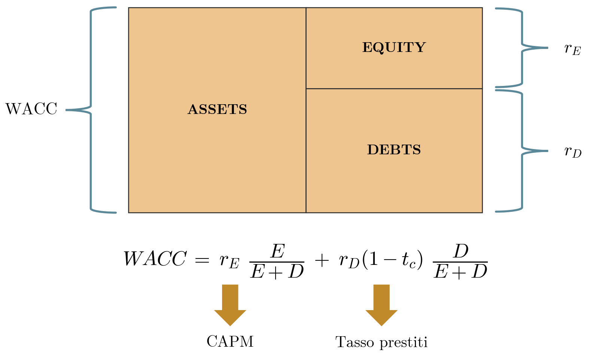
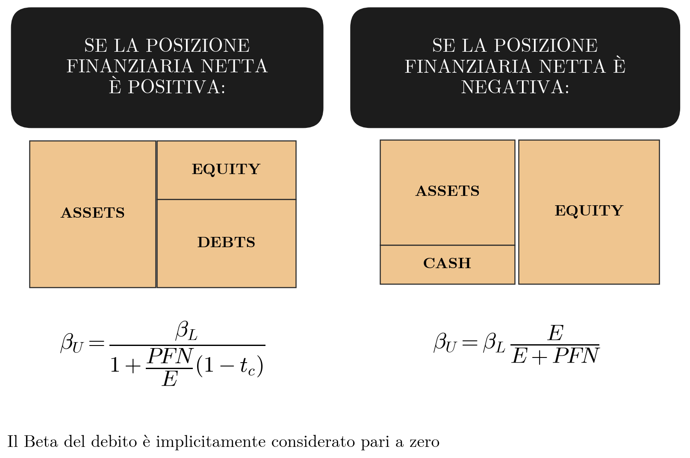

# Costo del capitale proprio, rischio paese e beta

## I tre macro blocchi dell'azienda: asset, equity e debito

- L'azienda si immagina come tre macro blocchi, una sorta di stato patrimoniale riclassificato o prospetto a fonti e impieghi.
- A sinistra ci sono gli asset: beni e risorse economiche, cioè fixed asset (impianti, macchinari, immobili), brevetti e capitale circolante. Non è uno stato patrimoniale civilistico: il capitale circolante contiene sia attività che passività.

> [!question] Da verificare: la trascrizione riporta "l'azienda, AIMÈ, costituita"; parola non riconoscibile, omessa.

- Gli asset sono di pertinenza di tutti gli stakeholders, soci o terzi finanziatori, e permettono di produrre i flussi di cassa. Le fonti arrivano dagli stakeholders e non dai fornitori, già dentro al circolante.
- A destra ci sono due categorie di fonti: i soci e i creditori (solitamente le banche). L'equity è la porzione di azienda di pertinenza dei soci e riceve i flussi dopo che tutti i creditori sono stati soddisfatti.
- Un socio può essere anche creditore ("soci conto finanziamento" nel passivo): il prestito è trattato come un prestito.
- ==un creditore viene prima di un azionista==: vale per la remunerazione e per lo schema di rendiconto prescritto dal legislatore, dove l'area finanziaria viene idealmente prima dell'area degli azionisti e dei dividendi.

> [!question] Da verificare: la trascrizione riporta "Dici: ture esterne e di quadri sono, come sapete, le aspettative di rendimento"; passaggio non leggibile.

- Le aspettative di rendimento sono $r_E$ per gli azionisti, $r_D$ (tasso debitore) per i creditori e il WACC per tutta l'azienda, che pondera il costo del capitale in base a quanto è indebitata l'azienda rispetto all'equity.
- Nel WACC l'$1-T$ tra parentesi è lo scudo fiscale: l'azienda che remunera i creditori a $r_D$ può dedursi gli oneri finanziari dall'imponibile fiscale.

## L'aliquota fiscale

- $T_C$ è una semplificazione: il reddito d'esercizio è tassato con IRES e IRAP, che hanno basi imponibili diverse.
- Nei business plan il carico fiscale proiettato sull'utile ante imposte è tra il 27, 28, 30%; se si chiede di proiettarlo si può mettere circa un 28, 30%.
- Gli interessi passivi sono deducibili dall'imponibile IRES e l'IRES è il 24%: negli esempi lo scudo fiscale si calcola sul risparmio del 24%.

*(slide 5)*

## Il costo del debito

- $r_D$ è quanto chiedono i finanziatori per prestare denaro all'impresa: banche, obbligazionisti, altri enti finanziari, enti come Invitalia e Simest a costo del denaro agevolato. Il finanziamento del socio, se fruttifero, rientra qui.
- $r_D$ ricompensa il tempo e il rischio: si presta a un'azienda e non al governo tedesco.
- Dal punto di vista di chi riceve i soldi: un milione di euro al 5% annuo costa all'azienda il 3,8%, perché gli interessi si scaricano dalle imposte abbattendo la base imponibile IRES (24%).

*(slide 6)*

- Un'azienda ha più finanziamenti (anticipo export, mutuo a 5 anni, mutuo a 30 anni, debito verso Simest), ognuno con il suo tasso. ==ovviamente ricordate che sempre sono delle semplificazioni==: si può assumere che $r_D$ sia la media dei tassi di debito.

> [!question] Da verificare: la trascrizione riporta "Perché qua c'è l'R1"; la slide 7 non lo riporta, omesso.

- La media va ponderata con il peso di ciascun finanziamento: con un mutuo da 20 milioni di euro al 5% e un finanziamento da 500 mila euro all'1%, $r_D$ è molto più probabilmente vicino al 5% che alla media dei due.

*(slide 7)*

- Si intendono debiti finanziari che maturano tassi di interesse, non i fornitori. Con tre mutui a tre tassi diversi il tasso medio è 4,70 e, con lo scudo fiscale, il costo effettivo è 3,57.

> [!question] Da verificare: la trascrizione riporta "debiti finanziari, i fornitori", senza "non"; "non i fornitori" è dedotto.

## Il costo del capitale proprio

- $r_E$ è diverso da $r_D$ e solitamente più alto: l'azionista si espone al rischio aziendale e pretende un compenso adeguato, cioè quanto deve ricevere un socio che mette 100 euro come azionista e non come creditore.
- L'equity non ha garanzie: se l'azienda chiude o fallisce i 100 euro sono persi.
- Gli azionisti vengono dopo tutti: con un liquidatore prima i dipendenti, lo Stato, le banche e tutti i creditori, poi, se avanza qualcosa, gli azionisti. Sono ultimi nella gerarchia di restituzione, assorbono tutti i rischi e quindi $r_E$ è più alto di $r_D$.

*(slide 8)*

### Tasso privo di rischio e premio per il rischio

- $r_E$ è il rendimento che chiede un investitore che vuole entrare come socio: la somma di due elementi, qualcosa di certo e un elemento di rischiosità (mercato, concorrenza, decisioni aziendali).
- Il primo è il tasso privo di rischio, che dà valore al tempo: come nelle prime slide, 100 euro oggi sono 100 e passa euro fra un anno e 100 euro fra un anno oggi sono 98.
- Poi si aggiunge un premio per il rischio, che ha due elementi. Uno è il rischio sistematico, cioè il beta, che si vedrà dopo.

> [!question] Da verificare: dopo "oggi sono 98" la trascrizione riporta "Sotto quello che ha euro in base al tasso, cioè"; non leggibile.

*(slide 9)*

### Il rischio paese

- Non è indifferente che l'azienda sia in Italia, in Paraguay, in Germania o in America: la rischiosità dipende dal settore e da dove si esercita il business.
- Esempio: la Fairplast di Castelfranco Veneto, Vicenza, leader del PET, ha uno stabilimento in Ucraina e nello stabilimento di fianco hanno lanciato un missile. Mettere 100 euro nella zona industriale di Kiev o in Angola non è come metterli nella periferia di Bonn o di Berlino, o in America.
- Il rischio paese si conteggia in due modi, che il libro chiama alternativa 1 e alternativa 2: o si aggiunge al tasso privo di rischio, o si mette nel premio per il rischio di mercato. Entrambi sono corretti e il risultato non è molto diverso.

*(slide 10)*

- Il rischio paese è la componente di rischiosità del paese a cui l'investimento si riferisce (un progetto, una filiale, l'acquisizione di un'azienda). Fa fede dov'è il business e non la sede legale: l'esempio è la sede a Milano con un ufficio e una segretaria e tutti i plant produttivi in Congo. ==considerare il paese dove si svolgono effettivamente le operations==.

> [!question] Da verificare: la trascrizione riporta "prendo il premio per il rischio dell'Italia" con i plant in Congo; il resto indica il paese dove si svolge il business.

*(slide 11)*

- Il livello di rischio di ogni paese dipende da solidità dei conti pubblici (default dello Stato), indebitamento dello Stato, affidabilità e stabilità delle istituzioni (corruzione, governo che cambia ogni due mesi), qualità delle infrastrutture e rating. Più rischioso è il paese, più alto va chiesto il rendimento.

*(slide 12)*

- La cartina è pubblicata ogni anno da Coface, che assicura i crediti delle aziende: più il credito è rischioso, più alto è il premio.
- Il primo verde è a uno e very low ed è il verde scuro, a due è low. I paesi con il verde scuro sono veramente pochi; l'Italia è rosa chiaro, moderatamente alto, fairly high per Coface.

> [!question] Da verificare: la trascrizione riporta "a uno e very low", "a due è low" e "dov'è la E"; i codici restano aperti.

- La cartina di Allianz ha altri parametri e quattro colori (verde, giallo, arancio e viola), con i verdi molto simili a Coface; qui l'Italia è verde.

*(slide 13)*

### Il tasso privo di rischio

- $r_f$ è il tasso privo di rischio. Dall'Italia la cosa più prossima a un tasso in cui non si rischia nulla è il Bund tedesco a dieci anni, titolo di debito emesso dalla Germania: il primo riferimento utile a un tasso risk free. Le probabilità che la Germania fallisca sono quasi nulle.

> [!question] Da verificare: la trascrizione riporta "a un tasso a rischio free"; si adotta "risk free" della slide 14.

> [!question] Da verificare: la trascrizione riporta "Deutsche Bank", descritta come "l'equivalente tedesco della Banca d'Italia".

- ==il BTP, come avete visto anche dai grafici, dalle cartine geografiche, non è risk free==. Anche se nelle pubblicità delle poste e in televisione il BTP valore è proposto come rendimento certo, è meno certo di un titolo tedesco.

*(slide 14)*

- Nel grafico dei tassi dei bond a dieci anni lo spread è versus Bund: la Germania è il benchmark e ha spread zero, con tasso 3,37, 3,38 circa. L'Italia ha uno spread versus il Bund di 1,05. È la prova che il BTP non è risk free e incorpora una seppur minima quantità di rischio data dall'essere in Italia.

> [!question] Da verificare: la trascrizione riporta "3,37, 3,38 circa"; la slide 14 riporta "BUND TEDESCO 10 ANNI (es. 2,20%)". Si riporta ciò che ha detto il docente.

*(slide 15)*

### Le due alternative per il rischio paese

- Alternativa 1: si carica il rischio paese su $r_f$, prendendo il tasso del BTP, che è il tasso free risk tedesco rimontato del fatto di essere in Italia e ha già dentro il rischio paese Italia. Manca solo il rischio generico di mercato, per cui si prende il premio per il rischio degli Stati Uniti, paese a rischio minimo.

*(slide 16)*

- Alternativa 2: si lascia $r_f$ al Bund tedesco, senza rimontarlo, e il rischio paese si mette nel premio per il rischio di mercato. Questo ha due componenti: l'MRP (market risk premium), cioè un portafoglio di aziende e quindi di mercato (Stati Uniti), e il country risk premium dell'Italia, per cui si prende il CDS (credit default swap). Si somma il country risk dell'Italia all'MRP.

*(slide 17 e 18)*

- Sintesi: nell'alternativa 1 il rischio va sopra $r_f$ con il tasso del BTP Italia, il beta rimane beta e si usa il market risk degli Stati Uniti. Nell'alternativa 2 $r_f$ è il Bund tedesco e il rischio dell'Italia si somma al premio del rischio di mercato.

*(slide 19)*

- Esempio numerico: il bond italiano dalla tavola del Financial Times è circa 4,42, più il market premium degli Stati Uniti. In alternativa il tasso free risk del Bund 3,38, più il market risk degli Stati Uniti, più il CDS dell'Italia, circa l'1 e passa per cento: si arriva a 8,65 e più o meno alla stessa quantità. ==le teniamo valide entrambi, anche perché i risultati convergono==; si guardano tutte e due perché si possono avere a disposizione dati piuttosto che altri.

> [!question] Da verificare: la trascrizione riporta "4,42", "3,38" e "8,65"; la slide 20 riporta BTP 4,40%, Bund 2,20%, MRP 4,12%, premio Italia 1,08%. Si riportano i numeri detti dal docente.

*(slide 20)*

## Il coefficiente beta

- Il beta si riferisce al rendimento dei titoli: i concetti sono ereditati da Damodaran, che nel 1999 ha fatto le analisi sulle società quotate americane. In Italia le SRL sono quasi un milione e le quotate una manciata, quindi il ragionamento si presta meno.
- Il beta esprime la correlazione tra tutti i rendimenti del mercato, con tutti i settori dentro, e il singolo titolo che si valuta. Come singolo titolo si può immaginare il settore a cui appartiene.

> [!question] Da verificare: la trascrizione riporta "Adamodaran"; si adotta "Damodaran" della slide 17.

*(slide 21)*

### Da che cosa dipende il beta

- Il beta dipende da tre macro grandezze. La prima sono i ricavi ciclici: alcuni settori e le loro aziende hanno una ciclicità dei ricavi molto simile tra loro (i gelati hanno una stagionalità annuale diversa da abbigliamento o automobilistico).
- La seconda è la leva operativa o rischio operativo, cioè la proporzione tra costi fissi e costi variabili: il call center ha quasi tutti costi variabili, un'azienda siderurgica quasi tutti costi fissi.

> [!question] Da verificare: la trascrizione riporta "l'INVA" e "il beta dell'IVA"; resta come trascritto.

- La terza è l'indebitamento, che sposta il peso nelle aziende italiane: in America per 500.000 dollari si va da un business angel o in borsa, in Italia per 500.000 euro si telefona al direttore della banca. Le aziende italiane sono sottocapitalizzate in capitale proprio e il passivo è gonfio di debiti verso terzi.
- ==Questa cosa dell'indebitamento è importante perché abbiamo capito anche che la conseguenza dell'indebitamento è lo scudo fiscale.== Fatto 100, un'azienda con il 60% di debito bancario e il 40% di equity ha lo scudo fiscale su quei 60 euro rispetto a una tutta equity: non giocano la stessa partita.
- Il terzo elemento non convince: il settore determina costi fissi o variabili e ciclicità, non l'indebitamento, ma questo ha un impatto sul beta. A fine modulo avrebbe senso pulire l'effetto dell'indebitamento dal calcolo del beta, a maggior ragione in Italia dove le aziende sono super indebitate.

*(slide 22)*

### I valori del beta

- Il beta ha tre valori, a cui corrispondono dei settori: maggiore di uno (settore fortemente ciclico), uguale a uno (il titolo varia proporzionalmente al mercato, al pari dell'economia), compreso tra zero e uno.
- Il beta minore di zero non c'è: sarebbe un titolo in direzione opposta al mercato, casi talmente eccezionali che il beta si considera quasi sempre maggiore di zero.
- Il beta maggiore di uno amplifica le variazioni del mercato: se il mercato sale dell'1%, un titolo con beta 1,5 sale dell'1,5%. Sono automotive, compagnie aeree, costruzioni e materiali edili.
- Il beta intorno a uno segue il mercato: trasporti e logistica, assicurazioni, GDO.
- Il beta tra zero e uno è dei titoli più tiepidi: utilities, farmaceutici, beni essenziali, che non si acquistano per impulso o per euforia, quindi seguono il mercato in maniera meno amplificata.

*(slide 23)*

- Con un beta maggiore di uno, in crescita economica le persone cambiano la macchina, fanno più viaggi o comprano casa: comportamenti amplificati rispetto al mercato.

## Il beta unlevered per valutare un progetto

- Motivo uno: il beta incorpora la leva finanziaria, ma nella valutazione di un progetto non si sa in che misura lo si finanzierà (soldi propri o dei creditori), mentre serve il beta del progetto.
- Motivo due: i beta si prendono dalle tavole che arrivano dall'America, dove la maggior parte delle aziende è quotata e ha poco capitale di terzi. Per la Diadora si prenderebbe il beta del settore shoes o sportswear americano, di aziende che quasi non hanno debito, mentre Diadora ha un passivo enorme rispetto all'equity. Ci sono perplessità a usare il beta levered così com'è.
- Può esserci anche un disallineamento tra un progetto in un settore diverso da quello dell'azienda.
- La soluzione è il beta unlevered $\beta_U$ (non $\beta_L$): togliendo l'effetto del debito si applica un beta che rappresenta la ciclicità del settore a prescindere dall'indebitamento.

> [!question] Da verificare: la trascrizione riporta "il beta all'everage di U"; si adotta "beta unlevered" della slide 24.

- La frase rossa: ==un progetto dovrebbe essere accettato oppure respinto a prescindere dall'indebitamento, a prescindere dalla politica finanziaria==, anche perché il debito rende meno costose le fonti per effetto dello scudo fiscale.

*(slide 24)*

- Le formule sono la 7.19 bis e la 7.20 del libro.

- A sinistra c'è l'azienda indebitata, che per convenzione ha una PFN positiva (negativa quando ha cassa): il $\beta_U$ si ottiene dal $\beta_L$ delle tavole applicando quel denominatore, scorporando l'effetto dell'indebitamento.
- Con la posizione finanziaria netta negativa, cioè con cassa, la formula cambia: non c'è $1-t_c$, cioè lo scudo fiscale, perché senza debiti non si pagano interessi. Si pulisce il beta anche dalla cassa per coerenza: il progetto va accettato o respinto a prescindere da debito o cassa.

### Le somme sul costo del capitale

- Fine del modulo: ==le slide chiave sono sicuramente queste, dove voi dovete sapere che ci sono tre tipi di tasso==, l'$r_E$, l'$r_D$ e il WACC. Questa parte della lezione era sull'$r_E$, con due strade per calcolarlo e dati pubblici: le quotazioni dei tassi dei bond (BTP) e le tavole di Damodaran sul premio per il rischio. L'importante è capire che valori prendere.
- Per il beta si usano le tavole di Damodaran, ==ricordatevi che quei beta che trovate lì sono sporcati dal fatto che sono beta di aziende più o meno indebitate==.
- Si trovano sia il beta di settore sia il beta della singola quotata; non coincidono, perché il beta della singola azienda è influenzato da fattori più specifici (il beta dell'IVA e il beta del settore metallurgia). Entrambi sono beta L.
- Negli esercizi si toglie l'effetto del debito con le due formule: quelle di sinistra per un'azienda indebitata, l'altra se la PFN è negativa (cassa).

> [!question] Da verificare: la trascrizione riporta "entrambi sono sporcati dal beta"; le slide non la sciolgono.

## I metodi per valutare un'azienda

- Si entra nel modulo delle valutazioni d'azienda, che si finisce domani. I DCF sono uno degli approcci maggiormente utilizzati.
- I metodi nel corso sono due: i DCF e i multipli delle EBITDA. Il team di KPMG parlerà di un terzo metodo che non è nel libro, il patrimonio netto rettificato, che alcuni usano o tengono come confronto.
- Multipli e DCF si basano sulle prospettive di guadagno, dai dati esterni (multipli) o dai flussi di cassa generati. In nessuno dei due si guarda il patrimonio: non si vede se l'azienda taglia la lamina con il signor Bepi e la taglierina o con un robot laser da un milione di euro con AI integrata. Non si coglie il valore di mercato di alcuni asset importanti.
- Il robot ammortizzato al 25% secondo le tabelle fiscali arriva a zero in quattro anni, ma può tagliare per altri dieci anni. È il disallineamento tra valore netto contabile e valore di mercato, di recupero, di realizzo; per questo la valutazione d'azienda rettifica il patrimonio a valori di mercato, soprattutto per le immobilizzazioni.
- Esempio di Milano: le case ringhiera accanto al Bosco Verticale un tempo non valevano niente, mentre un appartamento al Bosco Verticale costa in affitto circa 15.000 euro al mese. Una sede lì, ammortizzata al 3%, comprata a 100 milioni in 30 anni, si è ridotta del 30% in 10 anni: a bilancio vale poco ma non verrà venduta al costo d'acquisto.

> [!question] Da verificare: la trascrizione riporta "in 30 anni l'abbiamo comprato a 100 milioni, si è ridotto del 30% in 10 anni"; non è chiaro se i 30 anni siano la durata dell'ammortamento o il tempo dall'acquisto.

- Nel patrimonio netto rettificato un fabbricato iscritto al costo storico vale poco a bilancio ma potrebbe essersi apprezzato, come le location dei negozi o le zone riqualificate. Il costo storico non rappresenta l'effettivo valore dei beni.
- Nei multipli e nei DCF non si parla di quanto vale una sede comprata vent'anni fa a 300.000 euro che ora vale 3 milioni: non si vende a 300.000 al valore di libro.

> [!question] Da verificare: la trascrizione riporta "E nelle bida e nei multipli di DCF"; "nei multipli e nei DCF" è dedotto.

- Il terzo metodo, che non è nel corso né nel libro, serve in consulenza o in un deal: una ricognizione degli asset con perizie giurate di periti per stimare il valore commerciale dei beni, soprattutto gli immobili.

### Il DCF: punti di forza e limiti

- Il valore dell'azienda dipende dalla capacità di generare flussi di cassa in futuro, attualizzati a un certo tasso: stesso principio del VAN, con l'azienda stessa come progetto.
- Punti di forza: si ragiona sulla capacità prospettica di generare risorse e si possono stimare sia i flussi di cassa attesi sia il rischio associato.
- Limite: si deve predire il futuro, una forte assunzione, perché nessuno garantisce che i flussi saranno quelli. Punto quattro: aiutarsi con un business plan, con un esperto che guardi avanti almeno tre, quattro anni.
- Due modi di maneggiare il DCF: spacchettare il valore futuro, attualizzando i flussi fin dove si naviga a vista con il business plan e poi usando una formula perpetua; oppure assumere da oggi lo stesso cash flow all'infinito, attualizzando tutto ad oggi.
- I flussi sono specifici di quell'azienda: il DCF guarda l'azienda, non il settore. Se i flussi non sono attendibili è un castello di carte.
- ==Alla base dei DCF c'è un ragionamento molto delicato, cioè che i flussi di cassa siano sostenibili, siano credibili==: dove possibile si usa un business plan, dal quinto anno in poi ci si affida ai conteggi dai bilanci con tutte le incertezze del caso.

### Ottica asset e ottica equity

- Si può valutare l'azienda nella sua interezza, ottica asset, o la parte di pertinenza dei soci, ottica equity.
- Valore: in ottica asset l'enterprise value, in ottica equity la MK CAP (market capitalization), il valore del capitale proprio.
- Sfera patrimoniale: in ottica asset il capitale investito netto (tutti gli attivi), in ottica equity il capitale proprio.
- Conto economico: in ottica asset il NOPAT normalizzato (Net Operating Profit After Taxes), in ottica equity il reddito di bilancio, l'ultima riga del conto economico, normalizzata con il lavoro di aggiustamento della due diligence.
- Cash flow: in ottica asset gli FCFF, FCFO, in ottica equity l'FCFE, l'ultimo flusso disponibile per gli azionisti.
- Costo del capitale: in ottica asset il costo di azionisti e creditori, in ottica equity solo $r_E$, il costo dell'equity.

> [!question] Da verificare: la trascrizione riporta "un equity asset", "MKK" e "gli FCF, FCFO"; si adottano "ottica assets", "MK CAP" e "FCFF/FCFO" della slide 3.

*(slide 3)*

- Domani si riprende da qui.
