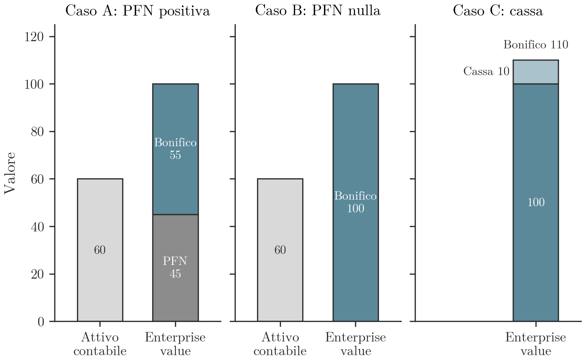
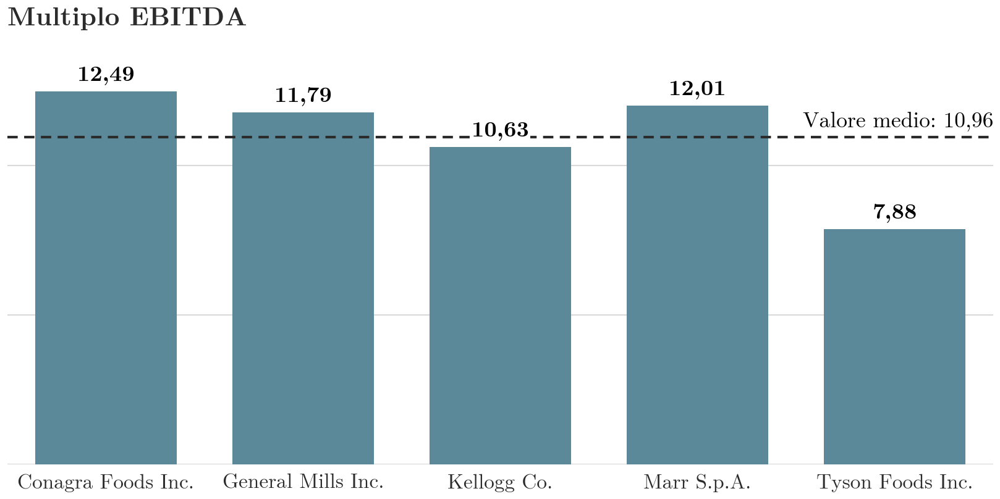

# Enterprise value, PFN e NOPAT nei metodi DCF

## Le grandezze per valutare l'impresa

- I dati contabili non bastano a determinare il valore effettivo dell'impresa, che spesso dipende da aspetti prospettici non riflessi nei bilanci, che guardano il passato.
- In un'operazione di M&A si guarda in maniera prospettica, scegliendo grandezze e tassi.

> [!question] Da verificare: "la reportistica dell'azienda consultivo"; si legge "a consuntivo", nessuna slide lo conferma.

- In ottica asset si osserva l'azienda nella sua interezza, nel suo valore complessivo; in ottica equity il valore per i soli azionisti, non anche per i creditori.

*(slide 3)*

- Il valore complessivo, che si guarda per acquisire o vendere un'azienda, è l'enterprise value.
- L'enterprise value è controbilanciato dalla somma di due interessi contrapposti: l'equity value, di competenza degli azionisti, e quello dei creditori.

*(slide 4)*

- Non è uno stato patrimoniale contabile diviso in tre: quello dell'articolo 2423 del Codice Civile ha valori contabili, non di transazione.
- In ottica fonti-impieghi l'azienda ha un valore complessivo, gli impieghi, sostenuto da fonti messe dai soci o dai creditori.
- In un deal ragionano sulla parte di equity compratori e venditori; i creditori hanno comunque pretese di remunerazione.

### Il prezzo e la PFN: l'esempio della casa

- L'azienda è come una casa e la PFN come un mutuo; nelle transazioni la PFN è spesso inclusa o esclusa dal perimetro e fa parte della negoziazione.
- Il valore concordato per il deal è il valore della casa, l'enterprise value; la PFN dà solo meccanismi di aggiustamento.
- ==l'enterprise value non cambia rispetto a come si presenta la PFN==.

> [!question] Da verificare: "dei peni, delle ipoteche"; probabilmente "pegni", nessuna slide lo conferma.

### I tre casi: PFN positiva, nulla, negativa

- I casi sono tre: l'azienda è indebitata; oppure, raro, non ha né cassa né debiti; oppure ha cassa. Solitamente è il caso A, il caso C.
- Caso A: la casa vale 100 e c'è un mutuo con capitale residuo di 45, una PFN positiva calcolata dalla due diligence; il prezzo si scala: "quello che ti pago sarà 55".

> [!question] Da verificare: "una casa che ci ha aiuto" e "voi vi allascoltate dal prezzo"; forse una casa con un mutuo sopra e "ve lo scalate dal prezzo".

- Il "ledger price value" è sempre 100.

> [!question] Da verificare: "ledger price value"; forse "enterprise value", nessuna slide lo conferma.

- Gli asset contabili, il totale attivo del bilancio civilistico, sono 60 nel caso A, ma con DCF e multipli la casa vale 100. Il bonifico non è da 100: l'aggiustamento si basa sulla PFN e nel caso A sarà di 55.

> [!question] Da verificare: "prendendo il 1434 civile": numero dell'articolo non certo; "nel caso Asson", reso con "nel caso A".

- Caso B: patrimonio contabile 60, azienda valorizzata 100, né debiti né liquidità: il bonifico è di 100, il prezzo corrisponde all'enterprise value quando la PFN non c'è.
- Aziende come la GDO (Aliper, PAM, Esselunga) hanno una PFN negativa per il ciclo inverso del circolante: Esselunga incassa subito e paga Danone a 60 giorni.
- Caso C: Esselunga ha un sacco di soldi da 10 milioni dentro e vale sempre 100; chi dà le chiavi dice: "tu mi dai 100 e poi mi paghi i soldi che ci sono dentro, oppure li scorporiamo".

- Una casa che vale 100 con un forziere da 10 milioni dentro porta un bonifico da 110; entrando nel 100% quei soldi diventano tuoi, a meno che la Srl dica che li tira fuori.
- Quando la PFN è parte esclusa dal deal sei nel caso B, con una piccola provvista lasciata il giorno prima del notaio.
- Con molta liquidità e riserve di capitale i soci prima di vendere svuotano casse e riserve con una maxi distribuzione di dividendi, tenendo il minimo; il grosso della PFN è portato fuori, ci si avvicina molto al caso B.

> [!question] Da verificare: "BFN"; la slide 11 riporta PFN e si adotta questa forma.

### Enterprise value ed equity value: le due domande

- L'enterprise value risponde a quanto vale il business a prescindere da come lo si finanzia, che dentro ci sia un mutuo o un forziere: Riello vale 20 milioni, punto.
- L'equity value è un discorso di cash, di regolamento: quanto pagare agli attuali soci per acquistare il 100% delle quote.
- ==Entrare in possesso dell'equity determina un prezzo da pagare per poter prendere il 100% delle quote, che non è il valore dell'azienda==.
- Il debito sono i creditori: con la PFN, negativa o positiva, ci sono altri stakeholders oltre ai soci.

### Come si prepara l'esame

- Oggi teoria, martedì esempi ed esercizi finalizzati a quelli della prova d'esame; la prova non riserva sorprese rispetto al programma.
- Interessa che si siano acquisiti i concetti: non verrà chiesto "quel paragrafo del libro che non avevo scritto, il 7.2" ma la domanda multipla con la definizione del tasso.
- ==non studiate solo dalle slide, anche per la teoria==: il libro è di una semplicità notevole e sui concetti spiega molto meglio delle slide.
- Il libro ha un esempio alla fine di ogni capitolo; il docente ne metterà di più di quelli visti in aula.

> [!question] Da verificare: "ma più che altro per ripararli"; forse "ripassarli".

> [!tip] Esame: nessuna sorpresa rispetto al programma; non studiate solo dalle slide, leggete la teoria sul libro e fate gli esercizi.

### Dal bilancio al NOPAT

- Per valutare un'azienda si parte dai bilanci, che vanno prima riclassificati, con EBIT ed EBITDA, grandezza chiave.
- Prima dell'EBIT vengono remunerati in termini di oneri finanziari i creditori, e dopo lo Stato.

> [!question] Da verificare: il docente dice "prima dell'EBIT"; nella slide 10 gli oneri finanziari seguono l'EBIT.

- Serve un livello di marginalità dopo aver pagato tutti, compreso lo Stato, esclusi soci e creditori: un risultato intermedio che non esiste nel conto economico civilistico né nel riclassificato (EBITDA, EBIT, EBT, utile o perdita d'esercizio).

> [!question] Da verificare: "l'EBIT, l'EBIT, l'EBIT"; la slide 10 riporta EBITDA, EBIT, EBT e si adotta questa forma.

- Il NOPAT è il margine dopo aver pagato tutti, compreso lo Stato con le imposte; restano gli oneri finanziari e ciò che va ai soci. Va costruito: si parte dai ricavi, si arriva all'EBITDA, si tolgono gli ammortamenti e si arriva all'EBIT (earning before interest, taxes), 55.000, e ci si pagano le tasse sopra.
- Il NOPAT è il flusso disponibile per creditori e soci e assomiglia molto al flusso di cassa FCFF e FCFO in ottica asset: siamo nella logica reddituale e il NOPAT è cugino dell'FCFO.

*(slide 3)*

- Si arriva all'EBIT, 55.000; restano da pagare creditori con gli oneri finanziari, Stato con le imposte e soci con i dividendi. Il NOPAT è l'EBIT per uno meno $t_c$, con le imposte calcolate sull'EBIT, prima degli oneri finanziari.
- ==Attenzione, non sono 9.000==: i 9.000 sono calcolati sull'EBIT, sui 45.000. Con un NOPAT di 44.000 si pagano gli oneri finanziari ai creditori e i dividendi agli azionisti.
- ==il NOPAT idealmente è come un flusso, un FCFO, è la versione conto economico dell'FCFO==. Misura il profitto netto delle attività caratteristiche; le imposte sul reddito d'esercizio ne fanno parte, interessi e dividendi no.

*(slide 8)*

> [!question] Da verificare: "fai un meno TC"; si adotta $t_c$ come nella slide 20 della presentazione Parte2.

> [!question] Da verificare: "I 9.000 sono calcolati sull'EBIT, sui 45.000"; la slide 8 non riporta questi numeri.

- Esercizio: fatturato 568, costi operativi 372 di materie prime, personale 58, affitti 43, ammortamenti 12, oneri finanziari 22, carico fiscale del 27,9%; calcolare EBITDA, utile netto e NOPAT, che è l'EBIT per $(1 - t_c)$.

*(slide 9)*

### Perché il NOPAT e non l'EBITDA

- Il modulo non è sui multipli dell'EBITDA ma sui DCF: il NOPAT è l'approssimazione di un flusso di cassa, la cosa più simile dal punto di vista del conto economico.
- Con i multipli dell'EBITDA ci si ferma all'EBITDA; ma i DCF muovono nel tempo flussi di cassa e muovere l'EBITDA non è rappresentativo, perché restano da togliere ammortamenti e tasse.

### Le imposte sull'EBIT e le imposte d'esercizio

- Le imposte d'esercizio non sono le imposte sull'EBIT, perché le basi imponibili sono diverse; negli esercizi chi va di corsa prende 17.019.
- ==le imposte me le devo calcolare io, non sono quelle che trovo perché non è la stessa base imponibile==.

*(slide 10)*

> [!tip] Esame: nel NOPAT le imposte si calcolano sull'EBIT, non si prendono dal conto economico (17.019).

### Riclassificare lo stato patrimoniale: il CCN

- Lo stato patrimoniale a valori contabili si riorganizza tra impieghi e fonti: a sinistra capitale immobilizzato netto e capitale circolante, a destra equity e somma algebrica delle passività finanziarie.

*(slide 11)*

- Il capitale circolante ha rimanenze, crediti e debiti operativi (praticamente tutti), anche ratei e risconti.
- Il CCC, capitale circolante commerciale, ha crediti clienti, fornitori e rimanenze; le altre poste (TFR, ratei e risconti, crediti e debiti tributari, debiti previdenziali, altri crediti, acconti) non sono PFN, immobilizzazioni o equity, quindi per differenza vanno nel capitale circolante, che così si chiama CCN.

> [!question] Da verificare: "è PFN? No, non è nessuna di queste, è PFN": la seconda dovrebbe essere il capitale circolante; "la voce attacco" e "su quali credito e debito" non leggibili.

### Il fornitore scaduto: CCN o PFN

- Le lettere di intenti dicono che il prezzo tiene conto della posizione finanziaria netta, spesso dettagliata nei contratti: un fornitore scaduto da sei mesi va nel CCN o nella PFN? Esempio: MSC con 5-6 milioni di euro verso Ilva o Arvedi per le lamiere, non pagati da sei, otto mesi.

> [!question] Da verificare: "e c'è gli OLI ed è da sei mesi che non lo pago"; il passaggio non è leggibile.

- Il TFR sembra operativo ma ha scadenza super lunga, il fondo non si chiude mai, e prende le caratteristiche di un debito finanziario, come i debiti verso fornitori scaduti da tantissimo tempo.
- Chi vende può smettere di pagare i fornitori per mostrare tanta cassa, che il compratore riconosce nel prezzo come il sacco di denaro dentro la casa; il debito verso fornitori, nel CCN, non è nel prezzo.
- ==è fondamentale la quantificazione della PFN, perché su questo i venditori ci giocano==, e l'acquirente cerca che nessun aspetto del CCN si annidi come elemento di PFN.
- Pagando un fornitore a dieci mesi, al 31/12 si ha la cassa che il compratore riconosce. Un fornitore che aspetta otto mesi è nella sostanza una banca: è PFN, debito finanziario, "te lo scalo dal prezzo", la furbata non funziona.
- CCN e PFN sono due vasi comunicanti: nella due diligence (lo si vedrà con KPMG) si mensilizza il CCN su due anni prima del deal; se a parità di ricavi i fornitori si dilatano, il venditore trattiene la cassa che gli verrà riconosciuta sul prezzo.
- Anche rimanenze sgonfie, gonfie o valutate in maniera anomala hanno impatto sulla liquidità e sul circolante.

### La valutazione assoluta

- Quella dei DCF si chiama assoluta, quella dei multipli relativa. ==La cosa principale del metodo dei DCF per fissarlo è che si chiama assoluta perché vi focalizzate in maniera assoluta su quell'azienda==.
- La relativa mette in relazione l'azienda con altre aziende tramite i multipli: si guarda fuori dalla finestra; con l'assoluta si sta dentro e si guarda quanta cassa fa o farà l'azienda. Per questo si usano insieme.
- Bullet 1: previsione delle future performance, rischio operativo e rischio finanziario, performance intrinseca. Bullet 2: criterio analitico di stima, con bilanci e business plan e non parametri esterni.
- Conduce a valori finanziari, detti fondamentali o intrinseci, basati sulla convenienza a fare o no quell'investimento.

*(slide 12)*

- Brembo, quotata, leader nei sistemi frenanti, sede a chilometro rosso: per i DCF si prende il rendiconto finanziario consolidato, come per Delonghi e Enel.

> [!question] Da verificare: "E si chiama il bilancio rosso"; forse il "chilometro rosso" detto prima, nessuna slide lo conferma.

### La valutazione relativa

- I multipli hanno una logica comparativa: si compara Brembo con aziende simili, i comparables, applicando multipli di mercato, rapporti riferiti alle quotazioni in borsa, e si ottengono valori di mercato, detti anche prezzi probabili.

*(slide 14)*

- Domanda a risposta multipla: il metodo DCF porta a valori di mercato, vero o falso? Falso. ==Il metodo DCF porta a valori finanziari, detti anche fondamentali==. Invece ==il metodo dei multipli porta a dei valori di mercato==.

> [!tip] Esame: il metodo DCF porta a valori di mercato, vero o falso? Falso: porta a valori finanziari (fondamentali); i multipli a valori di mercato.

- Il primo passo è trovare comparables veramente comparabili. Applicare il multiplo è un'operazione da bambino di prima o seconda elementare (un EBITDA per 3,2); la difficoltà è che quel 3,5 e l'EBITDA siano rappresentativi, per questo l'EBITDA si normalizza nella due diligence.

### Il multiplo dell'EBITDA e i suoi limiti

- Inciso extra libro: il multiplo dell'EBITDA è il più in voga ma molto approssimativo e mai usato da solo; "EBITDA di un milione, nel fashion multiplo 8, quindi 8 milioni" è la narrazione da bar o da convegno M&A.
- ==Non c'è una sola trattativa che venga siglata e firmata basandosi sul multiplo dell'EBITDA e basta==, perché è troppo approssimativo.

> [!question] Da verificare: "l'EBITDA per il multiplo di cui ton, che è 8"; il passaggio non è leggibile.

- Brembo con EBITDA di 10 milioni, in un'arena competitiva con BorgWarner, Subaru, Ford, se le cugine hanno prospettive di 4,5 volte potrebbe avere anch'essa 4,5.
- Con aziende pesanti di costi fissi, come Ilva con gli altiforni, l'EBITDA non tiene conto degli ammortamenti e perde un grosso pezzo; per Zara, che ha negozi in affitto e niente ammortamenti, conviene un multiplo ancorato alle sales.
- L'EBITDA è il multiplo di cui si parla di più, ma non è l'unico usato.

### Comparables diversi: il settore alimentare

- Si compara sempre, specie sulle quotate: per questo è valutazione relativa. La tavola ha cinque operatori del food con capitalizzazione di borsa, EBITDA e multiplo.

- Quale multiplo, Kellogg's o General Mills? Dei comparables se ne trovano una valanga, tutti diversi.
- Aziende americane contro un'azienda veneta come la Sereal Docks, con EBITDA influenzato dal sistema Italia: ha senso proiettare le stesse prospettive di crescita di cinque aziende americane su un'azienda padovana?

### Dalle due valutazioni alle formule dei DCF

- ==vanno approcciate entrambe, sia quella assoluta che quella relativa==.

*(slide 18)*

- Nelle formule dei DCF serve un tasso, il costo del capitale: WACC o $r_E$.

> [!question] Da verificare: "WACC o RE"; la slide 19 riporta $r_E$ e si adotta questa forma.

- Per il valore complessivo si prendono i flussi che residuano prima di remunerare creditori e soci: l'FCFF e FCFO, dopo investimenti e area tributaria, quando resta solo l'area finanziaria (finanziamenti, interessi e dividendi).
- Creditore e azionista direbbero insieme "il flusso per noi", l'FCFF, FCFO; il tasso appropriato per un flusso di debito e di equity è il WACC.
- È una formula compatta, una sorta di rendita perpetua da uno all'infinito: l'FCFF attualizzato al WACC dà l'enterprise value, il valore dell'azienda a beneficio di tutti.

*(slide 19)*

- Per gli azionisti: "a noi che cosa arriva nel rendiconto finanziario? Cioè l'FCFO".

> [!question] Da verificare: "Cioè l'FCFO" per gli azionisti; la slide 20 e il seguito portano all'FCFE.

- L'FCFE è l'ultima fettina di flusso di cassa che residua per gli azionisti, con aspettativa $r_E$; il valore dell'equity è una rendita perpetua del loro FCF.
- Il limite è la realtà: chi ha detto che l'FCF sarà lo stesso per mille anni, prendendo l'FCF del 2025 del bilancio depositato? ==Non è che i DCF, perché usano i flussi di cassa, siano un metodo attendibile==.

### I flussi di cassa nei rendiconti finanziari

- Il libro parla di FCGC, flusso di cassa della gestione caratteristica, ma nei rendiconti delle quotate si trovano dieci nomi diversi, perché l'OIC ha dato indicazioni di massima dello schema e non i nomi.
- ==il flusso che ci interessa è quello prima di remunerare il capitale di terzi e il capitale proprio==; quel che residua si può chiamare FCF, FCFO, FCGC, chiedendosi che cosa manca da togliere: l'area del capitale di terzi e quella dei soci, dei dividendi.
- ==L'FCFE è sempre il flusso che residua dopo tutti==; l'FCFF, FCFO è quello prima di remunerare i creditori (variazione dei debiti finanziari e interessi pagati).
- Nelle formule serve un più, lo scudo fiscale, un risparmio legato all'indebitamento che non si trova nei rendiconti finanziari.

*(slide 20)*

### Modello sintetico e modello analitico

- Il modello sintetico usa formule compatte tipo rendita perpetua, un po' approssimative, con flussi costanti o con un tasso di crescita su cui non si può giocare molto.
- Il metodo analitico ha due mattoni: il valore frutto di un piano e il terminal value. Un business plan a sette anni non ha molto valore, perché con l'incertezza geopolitica è azzardato.

*(slide 21)*

- Con il business plan, come per Brembo, dal rendiconto del bilancio 25 si hanno le colonne 26, 27, 28 e 29 o 30: cinque FCFO ragionevolmente certi, come negli esercizi dei progetti di investimento.
- Dopo il quinto, sesto anno si proietta fino alla fine della vita dell'azienda: è il terminal value. Business plan e terminal value vanno riportati al tempo zero.

### Rendiconto, conto economico e steady state

- Lo specchietto abbina il rendiconto finanziario a sinistra e il conto economico a destra: la seconda freccia rossa assimila FCF, NOPAT.
- Il flusso di cassa operativo è di fatto il NOPAT prima di remunerare creditori e soci: i creditori si prendono le aree finanziarie e lo scudo fiscale, i soci l'utile di bilancio.
- Steady state perché si ipotizza che l'azienda replichi se stessa a vita, cosa abbastanza improbabile.

*(slide 22)*

> [!question] Da verificare: "no PAT", "lo studio fiscale", "Mole di un anno"; le slide riportano NOPAT, "Scudo fiscale", MOL.

### La crescita costante g

- Se l'azienda cresce dell'1% ogni anno, quell'1% è il tasso g: ogni anno $1+g$, MOL di un anno più 1%, più 1%, più 1%.
- L'effetto di G è importante, come il foglio piegato quaranta volte che diventa il diametro della Terra: ==attenzione a mettere il G==, perché 1% o 1,8% cambia tanto il valore.
- Semplificazione: se il MOL cresce di $1+g$ servono più magazzino e crediti, e il MOL è in parte mangiato dal circolante; è il MOL che cresce meno la quantità di CCN mangiata, pari a G.

*(slide 23)*

> [!question] Da verificare: "Go percentuale"; forse il "g x CCNO" della slide 23, abbinamento non certo.

- Anche ammortamenti e investimenti in capex salgono dell'1%, ma non è detto: l'acqua San Benedetto per due, tre anni potrebbe non fare altri investimenti. Anche con i flussi di cassa si fanno forzature.

### Dai flussi di cassa al conto economico

- Con i flussi del conto economico, la slide 21 parla con la A26: in ipotesi steady state le formule sono molto semplificate, una rendita perpetua con al numeratore il NOPAT.

> [!question] Da verificare: "la slide 21 parla con la A26"; nelle slide fornite i numeri non corrispondono.

- Il fratello dell'FCFE in un conto economico è l'utile d'esercizio, l'ultima riga: se l'azienda sta ferma replica se stessa, se cresce si mettono gli aggiustamenti del G.
- Il reddito operativo cresce dell'1% ma è diminuito degli asset gonfiati, che deprimono il NOPAT.
- "Vi lascio questo, visto che sono le 10.14": applicare queste formule in ottica asset ed equity all'azienda di cui si è calcolato il NOPAT. Ci vediamo mercoledì. No, martedì.

### Capitoli del libro e programma

- Uno studente chiede i capitoli del libro sul costo del capitale: "mi sembra sette, molto simili".

> [!question] Da verificare: "Mi sembra sette, molto simili"; non è chiaro se indichi il capitolo 7.

- Il 7 è il CAPM e il premio per il rischio; nell'8 si trova il DCF, oggi fino all'8.4, senza la parte del sovraindebitamento. Dopo i sanity checks.
- ==Non serve che vi studiate la parte dell'8.5, tipo gli effetti negativi dell'indebitamento non li guardiamo==.
- Poi il 9, le sinergie, il 10 e nell'ultima settimana due diligence e deal: ==Questo non c'è nel libro, vi basate sulle slide che vi passo io e su quelle che proietterà KPMG==.

> [!tip] Esame: non serve studiare l'8.5 (effetti negativi dell'indebitamento); due diligence e deal sono nelle slide del docente e di KPMG, non nel libro.
