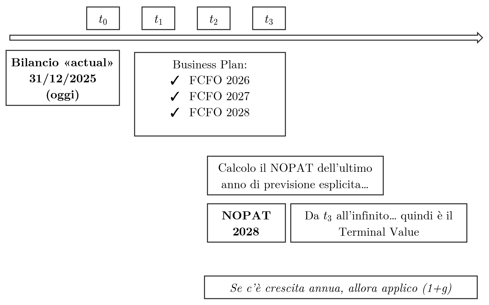
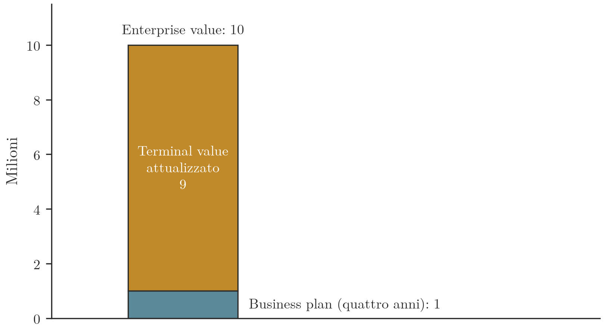

# Metodi DCF, terminal value e modelli multi-step

## Ripresa dell'esempio dell'azienda Alfa

- Dal conto economico si arriva al valore con il DCF, usando i flussi del conto economico anziché quelli del rendiconto finanziario.
- Il NOPAT non è isolato nel conto economico civilistico ma si calcola, perché è l'equivalente dell'FCFO, FCGC, il flusso di cassa della gestione caratteristica.

> [!question] Da verificare: la trascrizione riporta "ICF", si adotta DCF (slide 3); "FCGC" resta come detta.

- Esercizio: enterprise value ed equity value dell'azienda Alfa con WACC 5,8% e RE 7,5%.
- ==segnatevi queste due grandezze, quindi WACC e RE.==
- Senza business plan si usano le formule compatte, a flussi costanti.
- Slide numero 6: in ottica asset si ragiona sul NOPAT, in ottica equity sul reddito di bilancio normalizzato, cioè l'ultima riga del conto economico (in un rendiconto finanziario, FCFF e FCFO per l'asset, FCFE per l'equity).

> [!question] Da verificare: la trascrizione riporta "reddito operativo di bilancio" per l'equity value; non è chiaro se sia il reddito operativo o il netto.

- Il NOPAT rappresenta l'enterprise value: è il margine prima di pagare gli interessi ai creditori e i dividendi agli azionisti, ed è il numeratore della formula.
- Come rendita perpetua il NOPAT si attualizza al WACC, il tasso appropriato per azionisti e creditori; l'altra grandezza al RE.
- In ipotesi steady state, cioè azienda che non cresce, l'enterprise value è il NOPAT fratto il WACC e l'equity value è il reddito di bilancio, ultima riga del conto economico, attualizzato al RE.
- Risultato: enterprise value un milione e trentuno, equity value 586.000.
- Una PFN di 445.000, la porzione di valore in capo ai creditori, non faceva parte dell'esempio.

### Lo stesso esempio con crescita

- Con WACC 5,8%, RE 7,5, capitale investito netto operativo 760.000, capitale proprio 302.000 e crescita del 2% l'anno a tasso costante, siamo in ipotesi steady growth, il g piccolo.
- L'enterprise value ha la formula di sinistra, l'equity value quella di destra.
- Super semplificazione: il NOPAT cresce a 1 più g, cioè del 2% l'anno, e il capitale investito netto operativo, il CINO, cresce al tasso g del 2%.
- Che la struttura cresca come l'utile spesso è smentito, ma si applica come fattore correttivo prudenziale, perché altrimenti l'azienda esplode di valore.

> [!question] Da verificare: la trascrizione riporta "un CNO"; la slide 15 riporta "CINO", che si adotta.

- Senza crescita l'enterprise value è un milione e trentuno; con crescita a pari WACC e RE è un milione e duecentosei.
- Vale di più un'azienda che cresce di una che non cresce, e il g riflette questo.

## Metodo sintetico e metodo analitico

- Oggi si prosegue con il DCF, da giovedì i multipli.
- Il DCF si basa sui numeri e sui bilanci dell'azienda, diversamente dai multipli che prendono anche valori di mercato.
- Due metodi, sintetico e analitico: il sintetico ha flussi e tasso di crescita g costanti, è una forte semplificazione e permette formule compatte con il solo bilancio scaricato dalla Camera di Commercio, senza dati gestionali.

### Il metodo sintetico con i soli bilanci

- Per una target di acquisizione si scarica il bilancio da IDA o Orbis e si calcolano flussi di cassa o grandezze equiparabili, come il NOPAT; non si sa altro, quindi flussi costanti.
- Il g può essere il tasso di crescita del settore, dalle ricerche di mercato o dalle associazioni di categoria.
- ==Attenzione perché il tasso di crescita è costante, quindi avevamo detto l'altra volta di prenderlo con le pinze==, perché lo si applica in una rendita perpetua, cioè all'infinito.
- Le limitazioni si vedono verso la fine del modulo con i modelli multi-step, anche nel libro, che limano questa assunzione piuttosto forte.

### Il metodo analitico e il business plan

- Il metodo analitico è preferibile ma, oltre al bilancio, serve il business plan: senza non si fa.
- O si è l'azienda stessa, o qualcuno ha dato il business plan della target.
- È più rigoroso; il business plan, o piano industriale, è il piano economico-finanziario, e giovedì ne verrà mostrato uno di un deal chiuso.
- Il piano ha un orizzonte: tre anni, cinque anni, sette anni.

### Quanto è difficile prevedere

- Dal 2020-21 il Covid ha fatto saltare le previsioni; dal 2022 c'è la guerra in Ucraina, poi Trump con i dazi e ulteriori guerre: i fattori mondiali cambiano ormai settimanalmente e prevedere anche a tre anni è difficile.
- Lo stretto di Hormuz ha fatto quasi raddoppiare il costo del gasolio: un business plan di un anno fa avrebbe "cannato in pieno" il costo dei trasporti, e la differenza con il consuntivo è abissale.
- Il business plan non l'ha fatto un mago ma un analista con le informazioni di quel momento.

### Gli scenari nel business plan

- Il business plan contiene spesso almeno due o tre scenari.
- Ottimistico: riaprono Ormuz e il gasolio torna a un euro e sessanta anziché due euro e venti; pessimistico: l'economia si aggrava, aumentano i dazi e il costo delle materie prime.
- Si fanno solitamente scenari normal, best e worst.

## Il terminal value dopo il business plan

- Dal business plan si hanno i flussi di cassa dei prossimi tre, cinque, sei, sette anni, portati al tempo zero come col VAN della prima lezione: è il metodo analitico.
- Oltre il business plan c'è il terminal value, o valore terminale: una formula che approssima una serie di flussi illimitati, dall'ultimo orizzonte del business plan fino all'anno n infinito.
- L'impresa è equiparata a una rendita perpetua, una macchina di flussi di cassa; il terminal value è una sorta di rendita posticipata.

*(slide 4)*

### Aziende a durata limitata

- Il terminal value assume durata illimitata, ma l'azienda può finire, essere messa in liquidazione, e allora la rendita perpetua non ha senso.
- Caso normativo: autorizzazione o concessione, per esempio beni del demanio per 20 anni, 30 anni, non necessariamente rinnovati (balneari, autostrade).
- Caso ambientale: una miniera ha limiti allo sfruttamento del giacimento.
- Terzo caso: joint venture, rete di imprese, consorzio o associazione in partecipazione, che spesso hanno uno scopo e una durata.
- In tutti questi casi non si assume una rendita perpetua illimitata.

*(slide 5)*

### Esempi di aziende che chiudono

- Mercatone Uno è entrata in amministrazione straordinaria e termina il brand, quindi non può essere una rendita illimitata.
- La società Expo 2015 è chiusa e non c'è più.

> [!question] Da verificare: la trascrizione riporta "se voi siete stati a Roma", ma subito dopo il docente cita il polo fieristico di Rho.

- La joint venture tra GAC e Fiat Chrysler è finita in liquidazione.
- Ship Recycling Scarl è stata fatta per smaltire le 23.000 tonnellate di acciaio della Costa Concordia, in cordata con Saipem e Fonderie San Giorgio, e posta in liquidazione il 4 ottobre del 17 per avvenuto conseguimento dell'oggetto sociale; nel 24 ha chiuso i conti e il 25 è tutto a zero.

> [!question] Da verificare: la trascrizione riporta "un'accordata", "Scarle" e "adesso ci soffermiamo sui numeri, però" (forse "non ci soffermiamo").

- Una target acquisita e chiusa dopo tre anni non ha terminal value, perché l'azienda che chiude è contraria alla durata illimitata.

> [!question] Da verificare: la trascrizione riporta "la sbottate e la chiudete"; "sbottate" non si ricostruisce.

*(slide 6-10)*

### Valore terminale contabile o di liquidazione

- Nel modello analitico il valore con il DCF ha due componenti: il business plan e il terminal value.
- Pezzo uno: periodo di previsione analitica, generalmente tra tre e cinque anni; una volta sette, ma nessuno si azzarda più a stimare ricavi e materie prime nel 2033 circa.
- Pezzo due: il periodo oltre l'ultimo anno del business plan, in cui l'impresa presumibilmente continuerà a svolgere la sua attività e a generare flussi di cassa, espresso dal terminal value.

> [!question] Da verificare: la trascrizione riporta "attività generale flussi di cassa"; si legge "e a generare flussi di cassa".

- Se la durata è limitata, dopo il business plan si prende il valore terminale contabile, una sorta di valore contabile o di liquidazione, e non la rendita perpetua.
- Per l'azienda del ferro della Costa Concordia, al quinto anno si dismettono macchine e gru ragno: quanto valgono?

> [!question] Da verificare: la trascrizione riporta "sarà una rendita perpetua, se la durata è limitata" (forse manca un "non") e "la shipment trade" (forse la Ship Recycling).

*(slide 11)*

- Sarà un valore contabile di liquidazione, come per la società nata per costruire il passante di Mestre, che avrà venduto e comprato ruspe: il valore contabile sarà quello finale.

> [!question] Da verificare: la trascrizione riporta "si ha comprato delle ruspe"; si legge "avrà comprato".

- L'applicazione dipende dalla durata: illimitata, rendita perpetua; limitata, un valore residuo recuperato liquidando il patrimonio.

### La formula: business plan più terminal value

- In ottica asset l'enterprise value, il V grande, è la somma del valore attualizzato dei flussi del business plan e del terminal value.
- A sinistra del più c'è FCFF fratto 1 più WACC, come negli esercizi sui progetti con flussi agli anni 1, 2, 3, 4, attualizzati al WACC perché si guarda tutta l'azienda.
- Con FCFE, il flusso per gli azionisti, si attualizza al tasso RE.
- A destra del più c'è TV, il valore nel tempo futuro: va portato a zero con lo stesso tasso della parte sinistra.

> [!question] Da verificare: la trascrizione riporta "W grande" e "del PU"; si adottano "V grande" e "del più" (slide 12).

*(slide 12)*

### Il terminal value come rendita perpetua

- Nel business plan o nel bilancio non c'è la dicitura terminal value: TV si può sostituire con una rendita perpetua.
- Per l'enterprise value il terminal value è il NOPAT, il flusso a beneficio di tutti, attualizzato come rendita perpetua al WACC, poi portato al tempo zero con l'uno fratto.
- Il terminal value è l'I sparato nel tempo: i flussi del business plan più un flusso dal quinto anno fino al millesimo anno, portato indietro ad oggi.
- In un business plan quadriennale i flussi del periodo uno vanno indietro di un periodo, del due di due, del tre di tre, del quattro di quattro, e il terminal value di cinque periodi.

> [!question] Da verificare: la trascrizione riporta "è l'I sparato nel tempo"; forse il NOPAT, ma né audio né slide lo confermano.

*(slide 13)*

### Un esempio con il piano 2027-2031

- L'enterprise value è la somma di quanto vale oggi, 24 novembre 2026, l'azienda che opererà all'infinito.
- Il piano industriale di Adora a cinque anni, 2027, 2031, ha il rendiconto finanziario previsionale: si attualizzano a oggi i flussi del 27, 28, 29, 30, 31, poi si calcola il terminal value e lo si porta ad oggi.
- Come flusso da spararlo dal 2032 in poi si prende l'FC5, l'orizzonte più lontano che si vede, il 2031, per il terminal value dal 2031 al 2801.

> [!question] Da verificare: la trascrizione riporta "piano industriale di Adora" e "dal 2031 al 2801"; le slide non li riportano.

- Con un business plan a tre anni, 26, 27, 28, il NOPAT o il flusso di cassa dell'ultimo anno usato all'infinito è il terminal value; con il tasso di crescita ci sono le formule del g.

### Il terminal value con la crescita

- La formula è sempre la somma di una previsione esplicita, a sinistra del +, e del terminal value attualizzato, a destra.
- Il terminal value è NOPAT che cresce meno il capitale investito netto che cresce, fratto il WACC che cresce, per il fattore di attualizzazione.
- Si porta indietro una rendita perpetua dall'ultimo punto del 2031 ad oggi di cinque periodi, in t0.

> [!question] Da verificare: la trascrizione riporta "fratto il WACC che cresce" (la slide 15 ha WACC meno g, l'audio non lo conferma) e "in I0" (la slide 14 ha t0, adottato).

*(slide 15)*

### I controlli sul peso del terminal value

- I sanity checks del libro mettono in relazione il valore a sinistra del più, la previsione esplicita, con quello a destra, la proiezione all'infinito.
- Se l'enterprise value è 10 milioni e quattro anni di business plan danno un milione e il terminal value attualizzato 9 milioni, tanto valeva fare una rendita perpetua: il business plan pesa pochissimo, o il grosso dei flussi è dal 2031 in poi, nella zona arancione.

- Nei primi tre, quattro, cinque anni gli FCFF sono miseri perché il business è appena partito; il grosso arriva quando l'app raggiunge un milione di utenti.

> [!question] Da verificare: la trascrizione riporta "si è immesso più o meno a zero quei flussi di cassa"; il verbo non si ricostruisce e si è scritto "sono più o meno a zero".

- Allora tanto vale la formula compatta con un flusso a regime, senza scomporre i primi anni.
- Se il 90% del valore dipende dalle ipotesi sul periodo dopo il business plan, o ci sono errori di previsione (entrate sottostimate), o l'orizzonte è troppo breve, oppure si lascia perdere il metodo analitico, che non serve se i flussi del business plan non sono apprezzabili.

*(slide 16)*

- Tanto maggiore è il peso del terminal value, tanto più la valutazione dipende dalle ipotesi sul lungo periodo, cioè dalla crescita perpetua.
- ==Quando ho un terminal value che è l'85-90% di tutto il valore dell'impresa, dovrei farmi delle domande sul business plan==, su che tipo di previsioni ho fatto sui flussi dei primi 3-4-5 anni.

> [!question] Da verificare: la trascrizione riporta "switch exit come gli interpreto"; forse "sanity check, come li interpreto", ma né audio né slide lo confermano.

### I modelli multi-step

- Mitigano l'ipotesi forte: i business non crescono tutti uguali e la crescita si muove a velocità diverse in alcuni periodi.
- App nuova a diffusione progressiva: nei primi anni molti investimenti, molto rosso nel business plan e pochi flussi in entrata.
- Fenomeno di massa immediato (gadget, prodotto di moda): fiammata iniziale più alta del settore, poi l'effetto wow si raffredda e i flussi rallentano e magari si stabilizzano.
- Modello a due o a tre stadi.

*(slide 17)*

### Il modello a due stadi

- Due fasi: una fiammata iniziale e poi la stabilizzazione nel lungo periodo, come una nuova console che lo vogliono tutti e poi chi la sostituisce si stabilizza.
- Può essere un'azienda con un brevetto (farmaceutiche, design): fiammata iniziale perché lo sfrutta; poi il brevetto decade.
- Kartell: la lampada di Castiglioni degli anni '60 col brevetto si comprava solo da loro; scaduto, ora la vendono tutti.

*(slide 18)*

### Il modello a tre stadi

- Semplificazione della realtà: crescita molto veloce, una riduzione e poi una stabilizzazione.
- Ci si ferma qui, domani si riprende da questa slide.

*(slide 19)*
