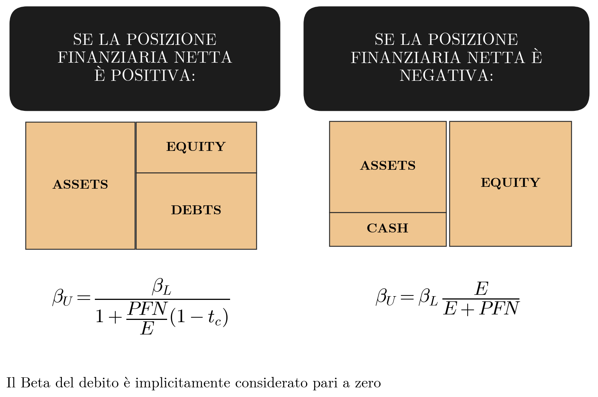

# Terminal value, VAM e domande di teoria

## Programma della lezione e crescita a più stadi

- Una notazione sul terminal value, qualche domanda teorica e poi i multipli, che continuano domani; mancano i multipli e le operazioni di integrazione con le sinergie.
- Una crescita $g$ non rappresenta bene la realtà aziendale, perché le aziende crescono a velocità diverse nelle varie fasi; l'approccio multi-step ipotizza velocità diverse, con due tipi di crescita $g$.
- Primo caso: crescita molto rapida e poi stabile, come un farmaco con brevetto e senza competitor; quando il mercato si apre ai competitor (il generico) la crescita rallenta.
- Secondo caso: crescita sostenuta con margini molto alti, poi una transizione in cui la crescita diminuisce perché i margini si riducono, e infine la stabilizzazione: tre velocità.

## Lo scudo fiscale e il valore attuale modificato

- Il debito ha il vantaggio dello scudo fiscale, perché gli oneri finanziari si deducono dalle imposte: per il VAM il flusso per tutti diventa il NOPAT più lo scudo fiscale, un flusso più alto, e non il solo NOPAT.

*(slide 20)*

- Il NOPAT, EBIT per uno meno $t_c$, si attualizza al tasso $r_0$ di un'azienda senza debiti; gli oneri finanziari, di pertinenza dei creditori, al tasso $r_D$.

> [!question] Da verificare: la trascrizione riporta "RO", "RD", "TC"; la slide 20 riporta $r_0$, $r_D$, $t_c$ e si adottano.

- $V$, l'enterprise value, è $V_U$, l'enterprise value di un'impresa unlevered, più $V_{TS}$, il valore attuale dello scudo fiscale.
- Se l'azienda non è indebitata resta solo il NOPAT attualizzato all'$r_0$; scorporando lo scudo fiscale non serve calcolare il WACC, che tiene conto delle aspettative di tutti gli stakeholders.
- Qui oneri finanziari per il 24%.
- Gli oneri finanziari diventano $D$ per $r_D$: con $D$ di 1.200 euro e $r_D$ del 10% sono 120 euro; si potrebbe ponderare con la PFN e tutti i tassi debitori, ma l'approssimazione è il valore nominale per il tasso.

## Il valore attuale modificato con crescita

- Niente di nuovo se non il fattore $g$: stessa formula, con EBIT per uno meno $t_c$ e $D$ per $r_D$ per $t_c$, rettificata per la crescita in ipotesi steady growth, anziché steady state; il NOPAT cresce a uno più $g$ ma è diminuito dal capitale investito netto, che cresce con la stessa velocità.

*(slide 22)*

- Le formule compatte si usano senza business plan, partendo dal conto economico, cioè dal NOPAT.
- Nel modello esteso la previsione esplicita ha due elementi (business plan e terminal value attualizzato); con debito sono quattro, perché ciascuno ha il suo scudo fiscale (TS), con la stessa dignità di un FCFO.
- Esagono 1: $V_U$ previsione esplicita, i flussi del piano industriale senza debiti attualizzati a $r_0$.

*(slide 23)*

- Esagono 2: il valore attuale del tax shield della previsione esplicita, con gli oneri finanziari dei business plan.
- Esagono 3: $TV_U$, il terminal value unlevered, con il NOPAT dell'ultimo anno di previsione esplicita portato indietro a $r_0$.
- Esagono 4: lo scudo fiscale del terminal value.
- Per il terminal value si sceglie il NOPAT nell'anno $n$, l'ultimo del piano; con queste due formule si chiudono i DCF.

## Il procedimento logico della valutazione con i DCF

- Uno: scegliere tra metodo analitico e sintetico; senza piano industriale gli analitici, con la stima puntuale dei flussi di ciascun esercizio, si scartano.
- Due: stabilire il numero di esercizi della previsione; il piano deve essere rappresentativo (un business che parte ha flussi particolari nei primi tre, cinque anni), ==avrà degli obiettivi di crescita e quindi la durata del piano è fondamentale==.
- Tre: le assumptions sono le regole del gioco di chi fa il piano e includono gli scenari (best case, worst case, normal case); esempio di piano 2027-2030, a quattro anni.
- Bisogna capire il mercato: una crescita del 5% nella moda che non cresce è un granchio, e i costi per utenze al 2% quando l'inflazione in Italia quest'anno ha superato il 4 vanno ripensati.
- Ricavi: stessi volumi e prezzi più alti ogni anno; per l'iPhone il delta prezzo è giustificato dalla tecnologia, nel fashion spesso no; Rolex alza i listini del 10% ogni anno a dicembre; la Dionysus di Gucci costava 1.500, 1.400 euro otto, nove anni fa e ora più di 2.000.

> [!question] Da verificare: la trascrizione riporta "I Devess, guardate le borse di Gucci"; "I Devess" non è interpretabile.

- Si decide cosa si proietta e quanto pesano costi, trasporto e utenze; per le ceramiche il gas è quadruplicato e la piastrella costa il quadruplo. ==I parametri del piano industriale sono fondamentali.==
- Quattro: il costo del capitale, con il CAPM, perché i flussi riflettono la rischiosità; si sceglie il metodo più appropriato.
- Cinque: il valore dell'azienda; dall'enterprise value in ogni deal conta l'equity value, quindi va considerata la posizione finanziaria netta.
- Sei: la bontà delle stime e lo scostamento dal valore contabile del patrimonio, per capire se il plusvalore tra enterprise value e capitale investito netto è enorme oppure riflette la crescita.

## Il peso del terminal value

- L'enterprise value somma i flussi dei primi anni e il terminal value; se il terminal value attualizzato è circa il 90% e il resto il 5-10%, ==probabilmente avete un po' valutato in maniera poco corretta le previsioni o comunque le stime==.
- Il terminal value è una rendita perpetua attualizzata a oggi, quindi sembrerebbe dover pesare molto più dei flussi dei primi quattro anni: un apparente paradosso, perché non è così.

> [!question] Da verificare: la trascrizione riporta "se invece viaggia chiaro va bene", probabilmente "vi è chiaro".

- Motivo uno: anche con un WACC molto alto i flussi molto lontani (20, 30, 40 anni) sono scontati molte volte e contribuiscono poco al valore odierno.
- Motivo due: la crescita $g$ del terminal value è spesso molto bassa, mentre i flussi iniziali crescono molto da un anno all'altro; la grande crescita di una startup è intercettata dal piano in maniera... al decimale.

> [!question] Da verificare: la trascrizione riporta "in maniera... Al decimale", frammento incompleto.

- Motivo tre: nei primi tre-cinque anni l'impresa crea più valore (cresce più del mercato, investe, ha rendimenti superiori alla media); poi si stabilizza con flussi regolari e crescita più bassa.
- Quindi la previsione esplicita contribuisce in modo significativo all'enterprise value; il libro, nel paragrafo dei checks, dice di insospettirsi se il terminal value è il 90%, mentre un terminal value attualizzato tipo il 75% potrebbe essere ragionevole.

*(slide 1)*

## Due esempi sul peso del terminal value

- Due esempi con la stessa impostazione e numeri diversi: terminal value al 75% e all'88% dell'enterprise value.

### Il primo esempio: terminal value al 75%

- Flussi del piano a cinque anni: 120, 144, 173 e così via, che crescono del 20% ogni anno (si può chiamare H, non è nelle slide); dopo il piano i flussi crescono del 2%.
- Attualizzando 120 di un periodo, 144 di due e così via, il valore attuale della previsione esplicita è 653 milioni, mettete che siano milioni di euro.

*(slide 2)*

- Qui troverete qualche variante, ==però l'importante è che le ipotesi che fate siano corrette==.
- Il terminal value prende l'FCFF del quinto anno, 249, e lo porta avanti della crescita perpetua $g$ del 2%: il flusso del sesto anno è 254, e con la rendita perpetua in ipotesi steady growth, col meno $g$, si trova il terminal value.

> [!question] Da verificare: la trascrizione riporta "il flusso di cassa... Del terminal value che usate, non l'avete già usato 249", frase incompleta.

- Portato indietro di cinque periodi, il present value del terminal value è 1.971; con 653 l'enterprise value è 2.624 e il terminal value ne pesa il 75%.

### Il secondo esempio: terminal value all'88%

- Stessa impostazione: previsione esplicita attualizzata 541, $g$ del 4%, terminal value con la rendita perpetua, tasso meno $g$ (167 con la formula); il terminal value di 5.500 attualizzato per cinque periodi viene 3.976.

*(slide 3)*

> [!question] Da verificare: la trascrizione riporta "5500"; la slide 3 riporta 5.567.

- Il totale è 4.517 e il valore attuale del terminal value è l'88%; con $g$ del 4,5% anziché 4% arriverebbe al 90%: si valuta un'azienda 4 milioni e mezzo con quasi 4 milioni da flussi che non si vedono, dal sesto anno all'infinito.

> [!question] Da verificare: "l'ISOMO arrivo a 4.517" non è interpretabile.

> [!question] Da verificare: 653 "milioni di euro" e 4.517 "4 milioni e mezzo", unità non univoca.

- Con un enterprise value di 4 milioni e mezzo e flussi dei primi anni che valgono solo 541.000 euro c'è qualcosa di sbilanciato, o un lavoraccio per niente: se attualizzare i flussi vale 500 su 4 milioni e mezzo, 5 milioni di enterprise value, non serve farlo, si usa la formula compatta con un NOPAT stimato.
- Le formule estese hanno senso se ha senso il peso di ciò che si mette quando c'è un piano industriale.

> [!question] Da verificare: la trascrizione riporta "come dicevano", si legge "come dicevamo".

> [!question] Da verificare: la trascrizione riporta "un opat"; la slide 8 (parte 1) riporta NOPAT.

## Domande di teoria

- Domande simili a quelle dell'esame, che vengono caricate dopo; nelle prossime settimane si alternano ripasso teorico, domande ed esercizi.

> [!tip] Esame: all'esame magari non saranno vero o falso, ma domande come queste, con tre risposte.

### Un progetto con utile che distrugge valore

- Un progetto che genera un utile può distruggere valore: vero, e bisogna motivare.
- Si può avere utile per tre anni e al terzo l'istanza di fallimento, per esempio con un cliente ospedale che non paga: c'è la dicotomia tra utile e fattibilità e appetibilità dell'investimento.
- Un progetto rischioso che rende l'1% non conviene se il Bund tedesco rende il 2,38%: l'utile si confronta sempre con rendimenti alternativi.

> [!question] Da verificare: la trascrizione riporta "BTP tedesco"; altrove dice "Bund tedesco".

- Un amministratore delegato che affronta progetti che rendono meno del tasso free risk distrugge valore.

> [!question] Da verificare: la trascrizione riporta "L'amministratore delegato di un'impresa è stato affrontando"; si legge "e state affrontando".

- Il WACC riassume le aspettative di azionisti e creditori e ==La condizione TIR maggiore di WACC è questa==: con TIR del 2% e WACC del 6% il progetto è utile e distrugge valore, quindi è vera.

### Il VAN più elevato e il razionamento del capitale

- Due: il VAN più elevato è sempre la scelta migliore anche con razionamento del capitale? Falsa, perché il razionamento del capitale è uno dei punti di forza o di criticità del VAN: un resort da 80 milioni di euro con VAN più alto del bar da 300 mila euro non si fa se non ci sono 80 milioni.
- La selezione richiede anche l'indice di redditività e soprattutto l'ammontare del capitale disponibile.

> [!question] Da verificare: la trascrizione riporta "fa tra Mesini" (probabilmente "tramezzini") e "la montare" (nel testo "l'ammontare").

### Il TIR e il tempo di recupero

- Tre: il TIR è il tasso di attualizzazione in cui il VAN è zero: vero, è la definizione; esprime il rendimento implicito e si confronta con il costo opportunità del capitale, il WACC.
- Quattro: il tempo di recupero semplice, TR, come quello attualizzato, considera il valore finanziario del tempo? Falso: solo quello attualizzato attualizza i flussi; il TR parte dallo zero negativo e somma in maniera secca i flussi di entrata.

> [!question] Da verificare: la trascrizione riporta "prendere i zero negativo"; probabilmente $I_0$, ma le slide di questa lezione non lo confermano.

### Le opzioni reali

- Cinque: un progetto con VAN negativo può diventare conveniente con le opzioni reali: vero; sono espansione, abbandono, rimandare l'investimento.
- Negli esercizi sulle opzioni il VAN negativo diventava positivo: senza poter abbandonare dopo un anno o posticipare lo si sarebbe mollato, perché in media il VAN era negativo.

### Costo del capitale proprio e costo del debito

- Sei: $r_E$ coincide generalmente con $r_D$ perché entrambi sono fonti di finanziamento? Falso; la parte vera è che entrambi sono fonti di finanziamento.
- Il creditore non rischia praticamente niente, l'azionista rischia: tendenzialmente $r_E$ è più alto di $r_D$, perché chi mette capitale di rischio chiede una remunerazione più alta.

> [!question] Da verificare: la trascrizione riporta "RE" e, più avanti, "RF"; le slide 3 e 14 del costo del capitale riportano rE e rf e si adottano $r_E$ e $r_F$.

### La deducibilità degli interessi passivi

- Sette: a parità di altre condizioni, la deducibilità degli interessi passivi riduce il costo effettivo del capitale di debito; la conclusione è vero.
- Nell'esercizio del CAPM, con $r_D$ e poi lo scudo fiscale, veniva 3,09, più basso perché lo scudo fiscale rende meno oneroso il tasso debitore.
- In Italia con $r_D$ del 3% su 100 euro gli oneri sono 3 euro, ma l'azienda paga 3 euro meno il 24% sui 3 euro, cioè 2 euro e rotti; il nuovo tasso è $r_D$ per uno meno l'aliquota fiscale: quindi 6%, sarà 3% per uno meno 24%, quindi 2, qualcosa per cento.
- Il tasso non è corretto con la penna: l'effetto fiscale sul flusso è che gli interessi bancari costano meno.

> [!question] Da verificare: la trascrizione riporta "Quindi 6%, sarà 3% per uno meno 24%"; il 6% non è ripreso dal seguito.

### Il beta misura il rischio specifico?

- Il beta misura il rischio specifico della singola impresa? Falso: si cerca il beta di settore, e la slide con i loghi mostra che rappresenta la variabilità del settore.

*(slide 23)*

- Il beta è legato al fatto che Diadora opera nel settore footwear; misura il rischio sistematico, la sensibilità del rendimento del titolo a quello di tutto il mercato.
- Il beta dei siti di finanza è un beta rettificato, di settore ponderato con le peculiarità dell'azienda, e non è quello del CAPM: ==andatevi a prendere le tavole del beta di settore, non state a prendere il beta dell'azienda==; per un'azienda farmaceutica il settore farmaceutico.
- È falso perché il beta è la sensibilità del singolo titolo rispetto a tutto il mercato.

### Il beta unlevered

- Nove: il beta unlevered stima il rischio sistematico dell'attività operativa depurandolo dall'indebitamento finanziario, cioè dalla PFN, non dai debiti verso fornitori; una slide ha i due casi con la PFN maggiore di zero e minore di zero.

- Il debito non dovrebbe mai influenzare il comportamento dell'azienda in termini di varianza e covarianza: ==Il beta non dovrebbe essere impattato dalla struttura finanziaria dell'azienda.==
- Le tavole di Damodaran sono americane, con aziende poco indebitate perché quotate e con tanto capitale proprio; le imprese italiane sono piene di debiti.

> [!question] Da verificare: la trascrizione riporta "Modarà"; le slide 17 e 18 riportano "Damodaran" e si adotta.

- Usare quel beta su un'azienda italiana finanziata tre quarti con capitale di terzi è poco coerente: meglio trasformare il beta levered di Damodaran in quello di un'azienda ideale senza debiti e calcolare separatamente l'effetto dell'indebitamento; è vera.

### Il BTP e il country risk premium

- Usare il BTP decennale come tasso base e aggiungere l'intero country risk premium italiano? No, si somma due volte il rischio dell'Italia: il BTP è già un tasso rischioso italiano e non serve sommare il country risk Italia o il credit default swap.
- La formula è $r_F$ più beta per il premio per il rischio di mercato (solitamente America o Germania) più il rischio paese, con l'alternativa 1 e 2 del libro e delle slide: ==non serve che dopo dentro al premio per il rischio mi rimetti il country risk Italia==; è falsa.

### Il valore asset side e l'equity value

- In logica asset side il valore dell'attività operativa è dato dai FCFO attualizzati al WACC: corretto, perché l'FCFO è il flusso per tutti, prima di oneri finanziari e dividendi, e il WACC esprime le aspettative di tutti.
- Dodici: enterprise value di 10 milioni e PFN di 3 milioni, equity value di 13 milioni? Falso: l'enterprise value è equity value più PFN, la PFN è positiva quindi è debito, e l'equity è 7, non 13.

### Il NOPAT

- Il NOPAT, Net Operating Profit After Taxes, è il risultato dopo ammortamenti, interessi e imposte? Falso: è simile all'FCFO, il flusso a beneficio di creditori e azionisti, e dedurre gli interessi vorrebbe dire aver già remunerato i creditori.
- Quella è la definizione dell'utile d'esercizio; il NOPAT è il risultato operativo al netto delle imposte operative, EBIT per uno meno $t_c$.

### Steady state, steady growth e uso congiunto dei metodi

- Lo steady state assume flussi costanti e lo steady growth flussi con tasso di crescita costante: vero, in uno l'azienda è costante, nell'altro cresce a un tasso $g$.
- DCF e multipli possono essere usati congiuntamente: vero; i metodi sono patrimonio netto rettificato (che il docente non racconta), multipli e DCF, e più metodi appropriati si usano meglio è, perché dovrebbero tendere a convergere o danno un'idea del valore.

### Il terminal value

- Sedici: nel DCF analitico il terminal value si somma direttamente al valore attuale dei flussi del business plan? No: si somma il valore attuale del terminal value, perché il terminal value, determinato alla fine della previsione esplicita, va attualizzato alla data di valutazione (con cinque periodi, tutto al momento zero).

> [!question] Da verificare: la trascrizione riporta "ho la previsione esplicita del terminal value"; si legge "e il terminal value".

- Diciassette: per un'impresa a durata limitata il terminal value può essere il valore di liquidazione del patrimonio: vero, per esempio Expo 2015, la joint venture, la shipyard company che toglie il ferro alla Costa Concordia (dice prima che fra tre anni è finito, poi che ci metterà cinque anni), dove non c'è una rendita perpetua ma il valore di liquidazione delle gru.

> [!question] Da verificare: la trascrizione riporta "l'impassante di Maxtr"; frammento non interpretabile.

- Un terminal value attualizzato del 90% mostra necessariamente che la valutazione con i DCF è errata? Due parole forti: non porta a un errore ma è un segnale, la previsione esplicita vale il 10% del valore; concettualmente, non in termini di formule, il valore non è sbagliato.
- ==Un'incidenza così elevata rappresenta un segnale di attenzione.==
- Magari è così veramente, ma allora i primi anni di previsione esplicita non hanno tutta quell'importanza.

### Il modello a tre stadi e il VAM

- Il modello a tre stadi ipotizza lo stesso tasso di crescita per tutta la vita? Falso: prevede crescita sostenuta, transizione e crescita stabilizzata.
- Il VAM, valore attuale modificato, determina separatamente il valore dell'attività operativa e il valore dei benefici fiscali dell'indebitamento: vero; oggi ci si ferma qui, domani i multipli.
