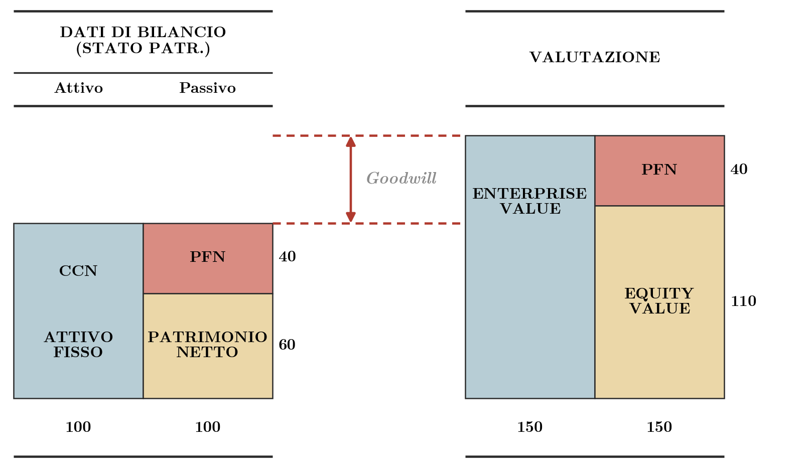
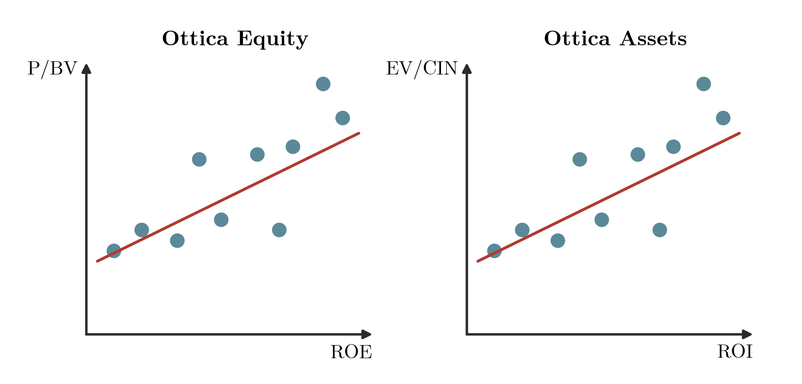
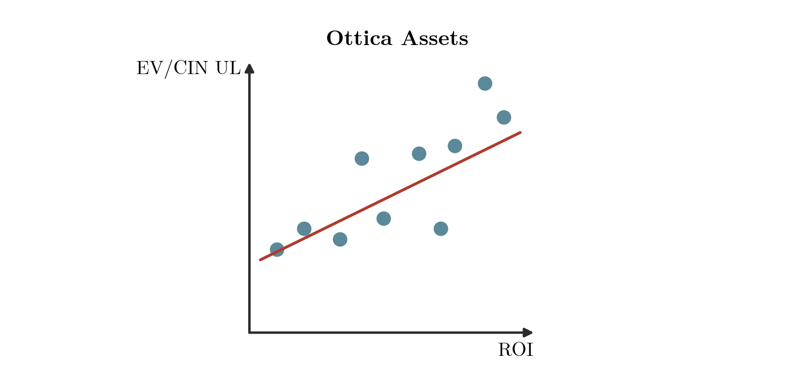

# Multipli di borsa, criticità e mappe del valore

## EBITDA adjusted e multiplo pagato in un'acquisizione

- EBITDA adjusted richiama il fatto che ci sia stato un aggiustamento.
- Secco acquisisce Garz e paga 11,2 volte l'EBITDA.
- Il multiplo è una moltiplicazione di due numeri di cui devo essere certo, perché determina il bonifico: ==devo essere sicuro che l'EBITDA sia corretto==, da qui l'ultimo modulo sull'analisi e gli aggiustamenti dell'EBITDA.

> [!question] Da verificare: "secco acquisisce Garz" resta come nella trascrizione e "IDA" si legge "AIDA"; le slide 5 e 6 danno EV 800 milioni ed EBITDA 71,14 milioni (circa 11,2 volte), ma la slide 5 anche "MULTIPLO = 10x EBITDA", forse un'altra operazione.

- Secco non prende l'EBITDA del bilancio tirato giù da AIDA: dopo due diligence e advisor, l'EBITDA adjusted è proposto dall'acquirente e negoziato col venditore, e fa base per il prezzo.
- Anche il multiplo è negoziato e concordato, perché serve consenso tra compratore e venditore.

## Prysmian e Atcor

- Prysmian, leader nei cavi, fa continuamente acquisizioni; l'ultima: Atcor per 3,8 miliardi di dollari, multiplo di 9,8.

> [!question] Da verificare: la trascrizione riporta "Actor", "Atkor", "Atcore" e "Prismian", "Prisma"; si adottano "Atcor" e "Prysmian"; "un'azienda che costruisce dei leader in cavi" è reso "leader nei cavi".

- Con enterprise value 3,8 e multiplo 9,8, l'EBITDA di Atcor valutato è 388 milioni, sicuramente adjusted: nel bilancio 2025 non si troverebbe.
- Da dove ha preso il 9,8 Prysmian? C'è il tema dell'EBITDA e il tema del multiplo, che si vedrà dopo.

> [!question] Da verificare: "Tipo rimpare 2025 di Atcor" non si capisce e resta fuori.

- Fatto salvo che l'EBITDA di Atcor sia 388 milioni, che ci arriva dai bilanci, con 13 di multiplo il prezzo cambia di qualche miliardo, non di qualche dollaro.

> [!question] Da verificare: "questo ci è arrivato qui i bilanci" si legge "che ci arriva dai bilanci", ipotesi.

## Trovare il settore giusto nelle tavole dei multipli

- Atcor opera nelle infrastrutture elettriche (sistemi di protezione, canalizzazione dei cavi, distribuzione elettrica), business simile a Prysmian.
- Il riferimento settoriale potrebbe essere Electrical Equipment & Components oppure anche Building Products.
- Nelle tavole non c'è un multiplo per ogni ATECO: le tavole sono una trentina, una quarantina; il ritaglio è della tavola di Damodaran.
- Bisogna ricondurre il business alla categoria appropriata, simile a quello che fa la target: è il primo esercizio di difficoltà. Per i cavi elettrici per infrastrutture, electrical equipment components insieme ai prodotti connessi al settore edilizio, anche industriale.

## I multipli di Damodaran sulle quotate americane

- Damodaran prende le quotate in America: per una non quotata italiana servono ragionamenti anche su questo.

> [!question] Da verificare: "Moderna" e "DaModa" nella trascrizione; si adotta "Damodaran" (slide 20 e 21).

- Solo aziende con EBITDA positivo; in questa categoria sono 41, poche per un multiplo assoluto a livello mondo.
- Building 11,01; tutte le aziende 11,81; Prysmian ha pagato 9,8. Electrical, il più appropriato: 24,59.

> [!question] Da verificare: "su quello del termine multiplo" si legge "determina il multiplo", ipotesi.

- Spessissimo i multipli di Damodaran sono molto alti rispetto a quelli delle transazioni.
- Studio della Corporate Finance Associates (Schneider Electric, Emerson): enterprise value su EBITDA 21,7, in linea con i 24,59.

> [!question] Da verificare: "sembrerebbe 21,7 parlarsi con i 24,59" si legge "in linea con", ipotesi.

- Prysmian ha riconosciuto 9,8, meno della metà dei multipli intorno ai 24: bisogna fare strategia sui multipli, diventare osservatori e critici, perché sono una moltiplicazione.

> [!question] Da verificare: "rispetto ai beni Smarca" è probabilmente "benchmark".

## Che cosa significa pagare 9,8 volte l'EBITDA

- Prysmian probabilmente ha fatto correzioni anche sul multiplo: gli aggiustamenti sull'EBITDA servono a vedere quanto renderà l'azienda in futuro.
- Il multiplo riflette il futuro: pagare n volte l'EBITDA è come pagare che l'azienda lo replichi per 9,8 anni, un plusvalore che determina l'enterprise value.

> [!question] Da verificare: "continuerà a fare quel multiplo" si intende "quell'EBITDA", ma è ciò che il docente ha detto.

- Questa capacità va rettificata: non si prende il multiplo secco dalle tavole; bisogna vedere se le aziende che danno 24 sono comparabili ad Atcor.
- Il comparable non è solo il settore: chi produce o è commerciale; molto indebitato o con capitale proprio; solo in America o in tutto il mondo, con diversi rischi.
- Bisogna capire se il multiplo incorpora sinergie; gli aggiustamenti di Prysmian non sono resi noti, ma potrebbero aver abbassato le aspettative di EBITDA fino a 9,8.

## Il commento all'operazione: antitrust e sinergie

- Enterprise value 3,8 miliardi, multiplo 9,8; Atcor è in un business adiacente ai cavi, quindi limitati rischi antitrust.
- Esempio Wind3: dopo la fusione restavano tre operatori (TIM, Vodafone, Wind3), mercato troppo concentrato, e il governo ha fatto entrare Iliad come quarto operatore.
- Iliad è entrata a 5,99 euro al mese per sempre, contro non meno di 10-15 euro di Vodafone, TIM e Wind: ha spaccato il mercato.
- Gli operatori non potevano calare il prezzo: dire "ci siamo sbagliati, facciamo 5,99" significa essere accusati di aver derubato i clienti per anni.

> [!question] Da verificare: "Ma ci siete sbagliati" si legge "ci siamo sbagliati", ipotesi.

- Vodafone non poteva svalutare il servizio (è anche business) e ha creato la low cost Ho, con offerte da 6-7 euro allineate a Iliad.

> [!question] Da verificare: "O" e "HO" nella trascrizione, si adotta "Ho"; la frase inintelligibile "Sono le compagnie così di batteria, ma neanche tanto, tanto che" è lasciata cadere.

- Ho viaggia sulla rete Vodafone, con la stessa copertura ma velocità di navigazione più bassa; le antenne costano milioni, quindi i low cost si appoggiano a quelle esistenti.
- Prysmian ha comprato Atcor anche perché stima sinergie pari al 40% delle EBITDA di Atcor, cioè 154 milioni di dollari.
- Le sinergie derivano dal cross selling: Prysmian vende i cavi e l'altra fa le guaine, oppure prodotti complementari come centraline e cavi dati.

> [!question] Da verificare: "le bida di Atcor" si legge "EBITDA"; "e l'altra fa le guaine" completa "Prysmian vende i cavi e ha... fare le guaine per i cavi", ipotesi.

## Bormioli Pharma e Gerresheimer

- Bormioli Pharma, italiana con 1.500 dipendenti, ha comprato la tedesca Gerresheimer per 800 milioni di euro, cioè l'enterprise value.

> [!question] Da verificare: le slide 5 e 6 riportano solo "Dati del deal: EV = 800 milioni, multiplo = 10x EBITDA" e "Dati di Bormioli Pharma", senza dire chi acquista chi.

- Anche qui "rettificato", non casuale: il multiplo è 10 volte l'EBITDA della società tedesca; Bormioli ha un EBITDA di 71 milioni; il ragionamento è legato ai valori di bilancio.

*(slide 6)*

## Brembo e Ohlins Racing

- Brembo (quotata, freni, Bergamo) ha comprato il 100% di Ohlins Racing, leader nelle sospensioni: equipaggiamento moto sport, fatturato 144 milioni di dollari, EBITDA rettificato tra il 21 e il 22%, cioè 30-32 milioni.
- Pagata 405 milioni di dollari, multiplo 13: prezzo elevato rispetto all'EBITDA di 30-32 milioni.
- L'articolo dice che Brembo viene valutata con un multiplo di 5,5, quindi compra un suo comparabile; ha pagato 13 volte l'EBITDA della società tedesca. Non c'è solo il caso in cui si paga meno del multiplo di mercato, ma anche il contrario.

*(slide 9)*

> [!question] Da verificare: "il Sirei Sibel" nella trascrizione; la slide 9 riporta "Ohlins Racing" con gli stessi numeri (144 milioni, 30-32 milioni, 405 milioni, 13x) e si adotta questa forma.

- 405 milioni è spropositato: lo confermerebbero le tavole di Damodaran, che per auto parts danno un multiplo tra il 5 e il 7; non si spiega come Brembo abbia pagato 13.

> [!question] Da verificare: "Ida Modera" si legge "Damodaran" (slide 20 e 21); "l'EBITDA ... viaggia tra il 5 e il 7" si legge come multiplo, ipotesi.

## Dove trovare i multipli

- Fonti: le tavole di Damodaran e altre con una fascia di multiplo per settore, forchetta molto ampia (da 5 a 15, da 6 a 12, da 4 a 13); bisogna collezionare fonti e informazioni.

*(slide 10)*

- Altra fonte, sempre mercato americano: si ragiona per industry e si cercano le più appropriate alla target.

*(slide 11)*

- Studi italiani, ad esempio nimbo.net: se la mia azienda fa software non prendo il multiplo di Microsoft o di AutoCAD, ma di aziende software o servizi IT; con aziende da due a cinque dipendenti i multipli sono più piccoli ma più aderenti al mercato italiano.

*(slide 12)*

> [!question] Da verificare: "Mimbo.net" nella trascrizione; la slide 12 riporta "nimbo.net".

- Quattro fonti, tutte diverse e con range: il lavoro del valutatore è metterle insieme con ragionevolezza, non fare il medione. ==la parola chiave è comparable==.

## I multipli come valutazione relativa

- Valutazione relativa perché mette in relazione più aziende; tiene poco conto dei flussi prospettici dell'azienda e dà enfasi ai prezzi di mercato, spessissimo di quotate (a partire da Damodaran).

## Il multiplo preso secco dall'imprenditore

- Esempio: target a Rovigo, 50 milioni di fatturato, cereali; l'imprenditore prende il multiplo della Kellogg's, quotata in America con miliardi di fatturato, e lo applica al proprio EBITDA.

> [!question] Da verificare: "Arobigo" si legge "Rovigo" e "applico l'EBITDA della Kellogg's" si legge "il multiplo della Kellogg's", ipotesi.

- Spesso l'acquirente offre 10 milioni e l'imprenditore ne aspetta 20: si è fatto l'EBITDA sul bilancio del commercialista (A meno B più ammortamenti), con dentro cose che la due diligence aggiusta.

> [!question] Da verificare: "le bidà" si legge "EBITDA"; "l'A meno D" si legge "A meno B", ma le slide non lo riportano.

- Ha preso il multiplo della più grande quotata americana del settore (Mitsubishi o General Motors): EBITDA 7 milioni per multiplo 3, 7 per 3 è 21 milioni.
- Con multipli ragionati l'EBITDA scende quasi a metà e il multiplo è 1,5, non 3, perché è una PMI meno liquida, non quotata, in Italia, senza prospettive di crescita, in settore maturo: su 5 milioni e qualcosa di EBITDA, enterprise value di 10 milioni.
- Il tema del multiplo è tutto nelle due grandezze che moltiplichiamo.

> [!question] Da verificare: 1,5 per 5 milioni e qualcosa di EBITDA non dà 10 milioni; "la simmetria" forse "l'asimmetria", ipotesi.

## Il multiplo K: grandezze economiche e patrimoniali

- I multipli non sono solo dell'EBITDA: il multiplo K è il quoziente tra il valore dell'azienda e una grandezza economica o patrimoniale.
- Il 3,5 è uguale enterprise value fratto EBITDA; con K rapporto prezzo-utili uguale a 5 e utile 100.000, l'equity value è 500.000.

*(slide 14)*

> [!question] Da verificare: "il 3,5" resta come nella trascrizione; la slide 14 usa "K", ma non basta a dire che il docente l'abbia detto.

- Bisogna anche scegliere il multiplo, e la scelta non è la scelta del multiplo delle unità dalle tavole.

> [!question] Da verificare: "delle unità" non si capisce e si lascia com'è.

- Possibili: enterprise value su sales, su EBITDA, su EBIT, sul capitale investito netto (ottica asset, grandezze di tutti gli stakeholders); in ottica equity il prezzo-utili e altre grandezze sull'equity value.

*(slide 15)*

## Multipli sull'utile e aziende non quotate in Italia

- Per l'Italia i multipli sull'utile sono a volte fuorvianti: una quotata ha interesse a mostrare tanti utili (in America sì, in Italia spesso no).
- La stragrande maggioranza delle aziende italiane non è quotata (quoziente tra le società su AIDA e sull'Istat) e chiude gli utili più bassi possibile per pagare meno imposte: i commercialisti tirano martellate al conto economico finché non riescono a portare giù l'utile, senza rendere conto al mercato dei capitali.

> [!question] Da verificare: "sull'istino" è probabilmente "Istat"; "finché non riescono appunto a giù l'utile" si integra "portare giù".

- Un multiplo sull'utile d'esercizio penalizza quell'azienda: in ottica equity gli indicatori sull'utile sono poco significativi.
- Si valuteranno prevalentemente aziende non quotate, per statistica.

> [!question] Da verificare: "se siamo un milione e qualche centinaio di aziende quotate in borsa" è probabilmente un milione contro qualche centinaio di quotate.

## Il rapporto prezzo-utili

- Il price earnings, per le quotate, è il rapporto tra prezzo di mercato e utili dell'azione: prezzo fratto utile per azione, oppure capitalizzazione di borsa contro utili conseguiti.
- Esempio: Eni a 23 euro con un milione di azioni ha capitalizzazione 23 milioni.
- Più alto è, più il mercato paga il livello di utili al denominatore: riflette aspettative di crescita e capacità di generare nuovi utili, una logica di prospettiva.

*(slide 16)*

## Da dove prendo i multipli: borsa e transazioni concluse

- Due basket: multipli di borsa o transazioni concluse.
- I multipli di borsa (Damodaran) sono estratti dai prezzi di quotate e riferiti a transazioni di minoranza, risultato di tante piccole transazioni (non si scambia ogni volta il 30, il 40, il 70 per cento del capitale), non veri deal: bisogna capire se sono comparabili.
- Le transazioni concluse sono deal simili al mio, un precedente (ad esempio Brembo che acquisisce un'azienda simile, un'azienda di sistemi frenanti che acquisisce una Magneti più piccola): riguardano pacchetti di maggioranza e una singola transazione, come Prysmian che compra Atcor.

*(slide 17)*

> [!question] Da verificare: "tipo da Morgan" si adotta "Damodaran" (slide 20 e 21); "una Magneti più piccola di quel settore" resta come riportato.

## Costruire il multiplo: numeratore e denominatore

- Il numeratore è il prezzo (dell'azione o la media): si può costruire il multiplo senza le tavole, per ogni società quotata, con al denominatore una grandezza economica o patrimoniale (utile, EBITDA, capitale investito netto).
- Il denominatore può essere l'utile al 31 dicembre (storico), l'utile previsionale dell'anno prossimo o l'utile rolling o trailing dei 12 mesi (a ottobre, da ottobre dell'anno prima).
- Si può costruire il multiplo se si trovano società simili alla target.

*(slide 18)*

## Il procedimento per un'azienda non quotata

- Per prima cosa scelgo il tipo di multiplo più rappresentativo (enterprise value su EBITDA, su sales, su capitale investito).
- Punto 2: scelgo il campione di riferimento (un settore, una singola azienda).
- Punto 3: moltiplico e trovo l'enterprise value.
- Punto 4: tolgo la PFN dall'enterprise value per arrivare all'equity value; con un multiplo equity trovo già l'equity value, con un multiplo asset devo togliere la PFN.

*(slide 19)*

## Dove trovare le informazioni e i problemi della comparabilità

- Informazioni: Bloomberg e altri siti finanziari, le tavole di Damodaran (multipli molto alti rispetto a quelli italiani, quindi sempre aggiustati al ribasso), aggiornate ogni tot mesi.

*(slide 20)*

- Primo problema: la comparabilità. Chi dice che le aziende abbiano la stessa crescita potenziale o la stessa leva finanziaria della target?
- I multipli su grandezze di conto economico dipendono dal bilancio: uno americano è fatto col bilancio US, IFRS, la target italiana con gli OIC; i profili fiscali sono diversi.

> [!question] Da verificare: "col bilancio US, IFRS" potrebbe non riportare un termine (per esempio "US GAAP"), ma è ciò che è stato trascritto.

- C'è anche un tema specifico dell'azienda: investimenti, perdite con crediti fiscali, componenti straordinarie, che spesso non possiamo sapere.
- Esempio: una target ha un credito fiscale di 20 milioni di euro da perdite pregresse, non in PFN: l'acquirente, consolidando, per cinque anni non paga imposte; per questo si scelgono molti multipli, il singolo può essere fuorviante.

*(slide 22)*

## Le tavole dei multipli delle transazioni concluse

- Le tavole delle transazioni concluse riportano anno, target, business, percentuale acquisita, prezzo e multipli, più dettagliate della tabella di settore.
- Esempio: 100% pagato 18 milioni di euro, enterprise value su EBITDA 12,16 ed enterprise value su sales 1,13; un retailer di abbigliamento da donna è più preciso di fashion; AstraZeneca che ha comprato Alexion; anche notizie con disclosure dei multipli, ad esempio nel fashion.

## La specificità della transazione

- Ultima slide della prima parte dei multipli. Le criticità: comparabilità del settore, del singolo multiplo e specificità della transazione, che non è mai simile alle altre.
- Esempio: impianti frigoriferi nella provincia di Rovigo, produttiva o commerciale, esporta tutto, indebitata o no.
- ==il multiplo di per sé non è mai sufficiente a determinare il valore di quella target==: va affiancato al metodo dei DCF, con i numeri veri di quell'azienda.

*(slide 28)*

## Capitale investito netto e PFN: riclassificare il bilancio

- Le grandezze sono enterprise value ed equity value; distinzione importante: ==il fatto che abbiamo delle grandezze che non sono quelle che riflettono poi i valori che vengono scambiati==.
- Per il capitale investito netto si riclassifica lo stato patrimoniale civilistico; la PFN non è una voce civilistica e va calcolata, perché è uno dei termini della valutazione.
- Si prendono le disponibilità liquide e i debiti finanziari (verso banche, altri finanziatori, finanziamento soci, debito per TFR); il finanziamento soci va in PFN perché è un debito di natura finanziaria.
- I debiti finanziari sono il segno che l'azienda venditrice si finanzia presso dei soggetti (due diligence): un fornitore con 200.000 euro non pagati per dieci mesi, mentre gli altri sono pagati a 60 giorni, è un debito finanziario implicito e l'acquirente lo decurta dal prezzo.

## Enterprise value e valori di bilancio

- L'enterprise value è quanto vale l'intera azienda nella capacità di produrre cassa, non il capitale investito netto contabile.
- ==se voi prendete uno stato patrimoniale, guarda il passato; se voi prendete l'enterprise value, guarda il futuro==: prende i flussi di cassa futuri e la proiezione di EBITDA o sales.
- Si passa dalla ragioneria alla finanza: il trattino rosso è questa differenza.

- Esempio: attivo 100, debiti 40, patrimonio netto 60; l'azienda, secondo le valutazioni del corso, vale probabilmente 150.
- Il debito finanziario, il 40 rosso, resta (leasing, mutuo); cambia il goodwill, il plusvalore, cioè la capacità di generare reddito in futuro.

## Book value, CIN e PFN: i nomi delle grandezze

- Book value di una quotata: patrimonio netto fratto numero di azioni, la quota di pertinenza degli azionisti per azione; il nome viene dal libro soci, dove si trascriveva ad esempio che Marco Zanetti ha comprato 300 azioni.
- CIN: il capitale investito, gli impieghi, formato da attivo fisso (asset) e working capital (CCN); nel CCN vanno le voci residuali (altri crediti e debiti, ratei e risconti, caparre, cauzioni, acconti da fornitori) che non sono né patrimonio netto né PFN.
- La PFN è il debito ed è posta negoziale: spesso negoziata, con definizione generica di debiti di natura finanziaria.
- Il TFR, quanto l'azienda deve a chi lascia l'azienda (pensione o licenziamento), pur non essendo un contratto di finanziamento va in PFN perché è una forma di finanziamento: l'azienda è formalmente indebitata verso i dipendenti.

*(slide 5)*

> [!question] Da verificare: "venduto a Nazione" si legge "un'azione" e "se non sono netti nel PFN" si legge "se non sono nella PFN", ma le slide non li riportano.

- ROE: utile sul patrimonio netto, redditività del capitale proprio; ROI: capitale investito; ROS: vendite; poi il prezzo sul book value.

*(slide 6)*

- Grandezze legate alle azioni: earnings per share, dividend per share e RE, il costo del capitale proprio.

*(slide 7)*

## Le criticità di comparabilità e il modello di Gordon

- Le criticità erano già state viste.

*(slide 8)*

- La formula del modello di Gordon mostra da quanti elementi è influenzato il multiplo di un comparable (le frecce arancioni); non va imparata.
- Regole contabili (leasing IAS 17, fair value delle immobilizzazioni, svalutazione crediti del 5%); R0, il rischio operativo di quell'azienda; TC, l'aliquota fiscale (IRES in Italia 24%, diversa per americane e tedesche); D su E, molto sbilanciato in Italia rispetto a un'americana; ROE, redditività e crescita.
- Sei motivi per cui un multiplo potrebbe non essere comparabile: "non c'è speranza", ma si cercano di risolvere queste criticità.

*(slide 9)*

> [!tip] Esame
> Il docente dice che la formula del modello di Gordon sulla slide non va imparata: serve solo a mostrare le frecce arancioni sotto.

> [!question] Da verificare: "IRS", "quota americana", "debiti utili" e "di Suez" si leggono "IRES", "quotata americana" e "D su E", ma le slide non li riportano.

> [!question] Da verificare: il docente dice "sei motivi"; la slide 9 riporta cinque determinanti del multiplo P/E (regole contabili, rischio operativo, profili fiscali, rischio finanziario, crescita/redditività).

## Come risolvere le difformità contabili e fiscali

- Regimi contabili diversi: prendere comparables dello stesso paese (OIC o IAS); per una target tedesca, comparables tedesche, con principi e aliquota simili.

*(slide 10)*

- La leva operativa è molto difficile da sanare: bisogna capire il modello di business.
- Esempio: due aziende tedesche che vendono profili di acciaio, stessa fiscalità, stessi regimi contabili: una commerciale (capannone in affitto, camion in leasing, nessun costo fisso), l'altra l'ILVA, con l'alto forno e costi fissi giganteschi. Mele con pere: la capacità di crescita è molto diversa.

> [!question] Da verificare: "l'IVA" si legge "ILVA" per l'alto forno; "quindi una commerciale" è lasciato cadere perché non coerente con il seguito.

## Differenze di crescita e le mappe del valore

- Le due aziende devono avere lo stesso profilo di crescita (settore maturo o ritmi alti): i multipli di aziende in settore maturo non riflettono il potenziale di crescita della target.
- Le mappe del valore: c'è una correlazione tra multipli e performance (ad esempio il ROE), spiegata da un metodo legato ai multipli.

*(slide 11)*

- Il grafico è spiegato nel libro; ==a me interessa che voi vi ricordiate la correlazione che c'è tra alcuni indicatori e il relativo multiplo==.
- Prima correlazione: ROE e prezzo sul book value.

*(slide 12)*

- Seconda: ROI, redditività del capitale investito, ed enterprise value sul capitale investito netto (l'attivo di stato patrimoniale).

*(slide 13)*

- Terza: redditività delle vendite, return of sales, ed enterprise value su sales.

*(slide 14)*

- Uso: dalla dispersione a pallini delle aziende del settore si traccia la retta tra multiplo e ROI; dal ROI della target si sale alla retta e si trova il multiplo.
- ==a me interessa che voi capiate il metodo, la correlazione, l'utilizzo==, se no facciamo un esame di matematica.

> [!tip] Esame
> Il docente dice che vedremo anche i passaggi, ma che gli interessa che si capiscano il metodo, la correlazione e l'utilizzo delle mappe del valore, se no si fa un esame di matematica.

- ROI e ROS si possono usare per costruire una mappa del valore con comparables quotati o presi dai bilanci; con il ROS della propria azienda, tracciata la retta, si arriva al multiplo.

## Le mappe del valore unlevered

- Per affinare si calcola l'enterprise value unlevered delle imprese: invece dell'enterprise value sul capitale investito netto, si prende il capitale investito netto unlevered.
- Così la correlazione si pulisce dall'effetto dell'indebitamento delle aziende del campione.

> [!question] Da verificare: il docente dice "prendere il capitale investito netto unlevered"; la slide 17 riporta il multiplo "EV/CIN UL", con l'enterprise value unlevered al numeratore.

## Come risolvere le criticità del singolo multiplo

- Riepilogo: soluzioni se si usa il singolo multiplo.
- Proventi straordinari: multipli in ottica asset, che non considerano il conto economico; con investimenti extra rettifiche contabili, idem per i crediti fiscali.
- Forti perdite: fermarsi a enterprise value su sales, non agli utili.
- Effetti dei corsi di borsa: non prendere i multipli in occasione di aumenti di capitale in borsa; con aumento del 30% e utile uguale il multiplo si annacqua.

*(slide 18)*

> [!question] Da verificare: "provettioni straordinari", "OTC asset" e "ripilogo" si leggono "proventi e oneri straordinari" (slide 18), "ottica assets" e "riepilogo" (slide 19).

- Questo è il riferimento, il procedimento da utilizzare.

*(slide 19)*

- Ci si ferma qui: la prossima volta esempi, esercizi.
