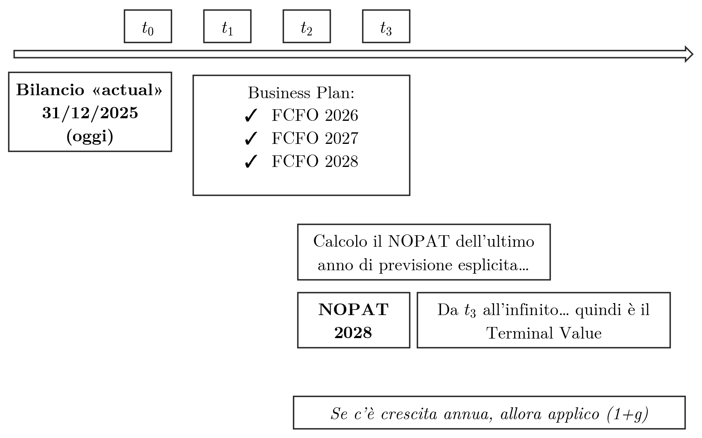
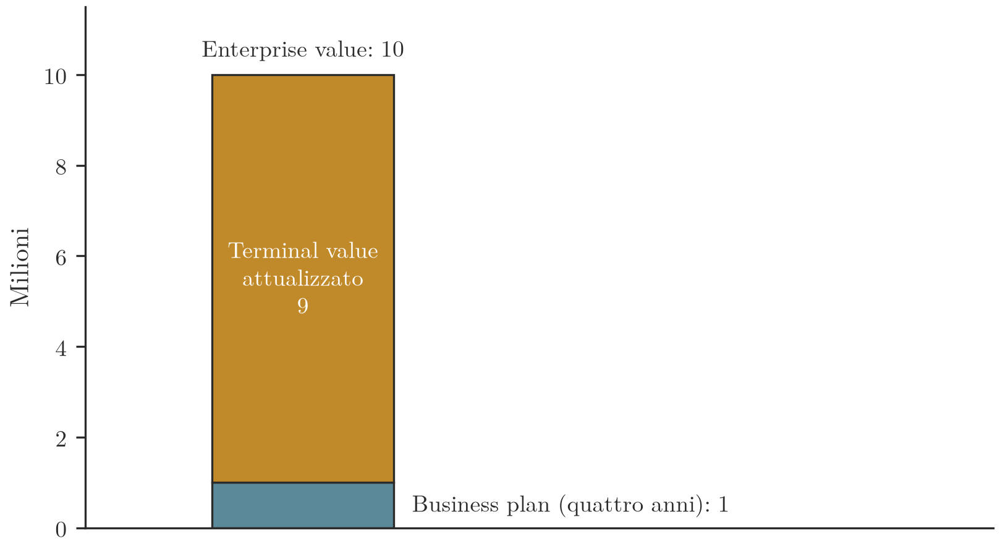

# Metodi DCF, terminal value e modelli multi-step

## Ripresa dell'esempio dell'azienda Alfa

Sempre rimanendo sugli esempi numerici, riprendiamo l'esempio numerico dell'ultima volta delle slide e vediamo come potremmo, partendo da un conto economico, arrivare a determinare il valore. Siamo in DCF, stiamo usando il metodo di valutazione dei flussi di cassa attualizzati, anziché i flussi che vengono dal rendiconto finanziario quelli che vengono dal conto economico. Avevamo detto che una grandezza che non abbiamo visibile, isolata nel conto economico, ma che ci torna utile calcolare è l'NOPAT, perché rappresenta l'equivalente dell'FCFO, FCGC, il flusso di cassa della gestione caratteristica; nel conto economico abbiamo il NOPAT.

> [!question] Da verificare: la trascrizione riporta "ICF"; la slide 3 riporta "I metodi DCF" e si adotta DCF. La sigla "FCGC" resta come detta, perché il docente la scioglie subito in "flusso di cassa della gestione caratteristica"; nelle slide non compare.

In questo esempio, sapendo che stiamo parlando dell'azienda Alfa che adesso andiamo a riprendere, calcolate l'enterprise value e l'equity value, date un valore usando la formula dei DCF, sapendo che il WACC è 5,8% e l'RE è 7,5%. Intanto ==segnatevi queste due grandezze, quindi WACC e RE.== Quanto vale l'impresa in ottica asset, in ottica equity? Potremmo usare, se abbiamo solo queste informazioni e nient'altro, quelle che abbiamo chiamato formule compatte. Non sto a sviluppare, non ce l'ho il business plan, non me l'hanno dato, ho il conto economico intanto. Posso prendere quello e assumere che i flussi siano costanti nel tempo. Che grandezze mi servono? I tassi ce li ho. Quali grandezze del conto economico devo andare a prendere se devo calcolare l'enterprise value in ottica asset e in ottica equity?

Slide numero 6, che era quella, il riepilogo generale, che in realtà non è un riepilogo perché è l'inizio. Guardate la terza freccia, mi dice: guarda che tu puoi assumere che se stai valutando in ottica asset e stai guardando l'aspetto reddituale, potresti ragionare in ottica asset sul NOPAT e in ottica equity sul reddito di bilancio normalizzato, cioè sull'ultima riga del conto economico, che tradotto in un rendiconto finanziario sarebbero l'FCFF e l'FCFO, se stessi guardando un rendiconto, e l'FCFE, cioè l'ultima riga, la remunerazione quella che poi diventa dividendo per gli azionisti in un'ottica equity, la penultima freccia. Se sei nella terz'ultima freccia, devi basarti su quelle grandezze del conto economico. Andiamo a vedere quali erano per l'impresa Alfa. Ce le avete qui. Se vi trovate di fronte a un conto economico così, come quello sopra, che grandezze andate a prendere per calcolare l'equity value e l'enterprise value? Il NOPAT e il reddito operativo vado a prendere. Il NOPAT me lo sono calcolato a parte perché nel conto economico civilistico non lo trovo.

> [!question] Da verificare: la trascrizione riporta "NOPAT e, sì, ma con A, è quello lì, operativo" e "reddito operativo di bilancio" per l'equity value; non è chiaro se sia il reddito operativo o il netto.

Il NOPAT è rappresentativo di cosa, dell'equity value o dell'enterprise value? Dell'enterprise value, corretto. Il NOPAT è la quantità di margine a conto economico prima di pagare gli interessi ai creditori e i dividendi agli azionisti. Siccome l'enterprise value è il valore per entrambi, il NOPAT rappresenta il numeratore della mia formula dell'enterprise value e per omogeneità dei tassi, se io prendo il NOPAT, al denominatore metterò il WACC o l'RE. Dovendo calcolare una sorta di rendita perpetua, immaginando di sparare il NOPAT nello spazio all'infinito, lo attualizzo al WACC, perché è il tasso più simile, più appropriato all'attualizzazione di un flusso che rappresenta un flusso per azionisti e creditori, mentre l'altro lo attualizzerò al RE.

Abbiamo visto che le formule che stiamo usando sono quelle in ipotesi steady state, cioè di azienda che non cresce, perché l'esempio non mi ha parlato di crescita, e quindi io posso dire che l'enterprise value è il NOPAT fratto il WACC e l'equity value è l'utile o perdita di bilancio, o reddito di bilancio, cioè l'ultima riga del conto economico, attualizzato al RE. Andiamo a prenderci l'esercizio e si presenta così. L'enterprise value è un milione e trentuno e l'equity value è 586.000, ritorna. Se riempio i quadretti, ho che l'enterprise value è tutta l'azienda e 586.000 è l'equity value. Potrei anche, puntini puntini, ipotizzare che questa azienda abbia una PFN di 445.000, cioè una porzione di valore in capo ai creditori. Non faceva parte dell'esempio. L'esempio dice calcola l'enterprise value e l'equity value. E questa è la formula: NOPAT fratto il WACC e il reddito operativo di bilancio fratto l'RE.

### Lo stesso esempio con crescita

Se l'azienda cresce, ipotizziamo l'esempio precedente, quindi con un WACC al 5,8%, un RE del 7,5, l'azienda presenta un capitale investito netto operativo di 760.000 e un capitale proprio di 302.000 e prevede di crescere il 2% l'anno a tasso costante. Siamo nell'ipotesi di quel famoso g piccolo, cioè l'ipotesi che l'azienda cresce all'infinito del 2%. Quanto vale? Siamo in ipotesi steady growth e l'enterprise value ha la formula di sinistra e l'equity value quella di destra, quindi ho tutte le grandezze dell'esercizio.

Avevamo detto che questa è una super semplificazione della realtà, quindi ipotizzo che il NOPAT ad esempio cresca a un tasso di 1 più g, cioè che il NOPAT stavolta va su del 2% ogni anno nella formula di sinistra, però ho anche l'azienda che si robustisce, quindi ho un patrimonio che si robustisce, quindi ho anche un capitale investito netto operativo, un CINO, che è moltiplicato al tasso g del 2%. È una super semplificazione della realtà che cerca di approssimare la realtà. L'idea, che spesso è smentita, è che un'azienda che ogni anno abbia un utile che cresce del 2% abbia anche una struttura che cresce del 2%. Chi l'ha detto? Non è detto, quindi è una semplificazione della realtà. Però la applico come fattore correttivo, anche perché sennò l'azienda cresce all'infinito del 2% ed esplode di valore, quindi un aspetto prudenziale, ad esempio, è abbattere il valore per questa quantità, ipotizzare che il valore del NOPAT cresciuto sia parzialmente mitigato da un aumento del mio capitale investito di pari crescita, cioè del 2%.

> [!question] Da verificare: la trascrizione riporta "un CNO"; la slide 15 riporta "CINO" e si adotta questa forma.

Siamo messi così, per cui applico le due formule dell'enterprise value e dell'equity value e quindi ho queste grandezze qui. Dopo ve le lascio le slide con i numeri. Vedete che un'impresa che non cresce viene valutata a un enterprise value di un milione e trentuno. Un'azienda che cresce a pari WACC e a pari RE è un milione e duecentosei. Vale di più un'azienda che cresce di una che non cresce. Tra queste due è evidente che il g riflette questo.

## Metodo sintetico e metodo analitico

Oggi proseguiamo con i metodi del DCF e da giovedì vediamo i multipli. Il metodo sintetico è la parte dove noi ipotizziamo di avere dei flussi costanti e un tasso di crescita costante. Ad esempio, il tasso di crescita lo chiamiamo g, quel g piccolo. Siamo dentro al metodo dei DCF, che si basa sui numeri dell'azienda, sui bilanci dell'azienda.

Diversamente dai multipli, che prendono valori anche di mercato. Dentro al modello dei DCF abbiamo due metodi: il metodo sintetico e il metodo analitico. Quello sintetico prevede che ci siano flussi costanti e tassi di crescita costanti. Questa è una forte semplificazione della realtà, permette di usare delle formule compatte e permette di calcolare il valore dell'azienda scaricandovi il bilancio dalla Camera di Commercio. Senza avere dati gestionali, perché la parte di sinistra è abbastanza rapida da calcolare, è una formula compatta, è un po' come quello che fareste quando applicate i multipli: anche coi multipli voi partite da un EBITDA, cioè da prendervi in mano un conto economico riclassificandolo e applicare dei multipli.

### Il metodo sintetico con i soli bilanci

Il modello dei DCF sintetico lo fai quando, ad esempio, devi valutare una target di un'acquisizione e non sei tu dentro la tua azienda, non ti stai facendo un'autovalutazione della tua azienda, dove hai tutti i numeri possibili e immaginabili, ma ti sei scaricato il bilancio da IDA o da Orbis e ti sei calcolato magari i DCF, quindi stai calcolando i flussi di cassa, o magari delle grandezze economiche che io posso equiparare, come abbiamo detto il NOPAT, ad esempio. E quelle ho. Tra l'altro non so nient'altro dell'azienda, quindi stiamo parlando di flussi costanti. Il tasso di crescita non lo so, però potrei anche immaginare che sia il tasso di crescita del mercato. Immaginate di essere degli advisor che devono valutare un'azienda target di cui non avete niente. Il metodo sintetico è quello in cui avete solo i bilanci. Il tasso g potrebbe essere il tasso di crescita di quel settore. Andate a prendervi delle ricerche di mercato e potreste ipotizzare, se proprio non sapete niente di quell'azienda, di prendere più o meno la crescita prevista di quel settore. Di solito ci sono le associazioni di categoria, se sono quelle del settore della moda, della gioielleria, del lusso, dell'acciaio, che fanno degli studi di settore annuali e fanno un po' delle previsioni di quanto cresce il mercato. Se voi siete dei valutatori potreste pensare che il tasso di crescita sia quello.

==Attenzione perché il tasso di crescita è costante, quindi avevamo detto l'altra volta di prenderlo con le pinze==, lunghissime, una maxi pinza, il tasso di crescita, perché dopo lo andate ad applicare in una formula con una rendita perpetua, cioè state sparando all'infinito il tasso di crescita. Poi questa cosa delle limitazioni lo vedremo verso la fine di questo modulo con quelli che chiamiamo modelli multi-step, che dopo trovate anche nel libro, che cercano di limare un po' questa assunzione che di per sé è piuttosto forte.

### Il metodo analitico e il business plan

Sarebbe preferibile usare il metodo analitico, però cosa vi serve per applicarlo? Che documento vi serve? Il bilancio, lo tirate giù dalla Camera di Commercio o da IDA. L'altra cosa che non avete e che vi devono dare è il business plan. Voi senza il business plan il metodo analitico non lo fate. E da qui la difficoltà: o voi siete l'azienda stessa e dovete valutare la vostra azienda e quindi avete il business plan alla mano, uno; o due, il business plan qualcuno ve l'ha dato, dell'azienda target, sennò non fate niente. È ovvio che è più analitico e più rigoroso, perché il business plan... Avete mai sfogliato un business plan o un piano industriale? Vi è mai capitato sotto mano? Il business plan o piano industriale, magari giovedì ve ne faccio vedere uno completo di un deal che si è chiuso, ha una serie di descrizioni del business, è proprio tradotto in italiano il piano economico-finanziario, il piano. Il piano ha un orizzonte solitamente. L'orizzonte è quanto chi ha scritto il business plan si è spinto con le previsioni, quindi può essersi spinto a tre anni, cinque anni, sette anni.

### Quanto è difficile prevedere

In questi periodi, soprattutto negli ultimi anni, mettete dal 2022, da quando più o meno c'è la guerra in Ucraina e anche dopo il Covid, immaginate che dal 2020-21 c'era il Covid, la pandemia che ha fatto saltare in aria tutte le previsioni e tutti i pronostici sulle crescite delle aziende. Dal 2022 la Russia ha iniziato a bombardare l'Ucraina e a febbraio sono cinque anni che c'è la guerra. Nel frattempo è arrivato Trump e ha sconvolto il mercato con i dazi, con ulteriori guerre. Le aziende italiane o le aziende di vari settori ormai lavorano su tutti i paesi del mondo, a meno che non siano delle aziende artigianali locali, ma anche quelle esportano. Per dire cosa? Che il conto economico di quell'azienda, i suoi flussi sono impattati da una miriade di fattori a livello mondo. E i fattori a livello mondo cambiano ormai settimanalmente.

È difficile fare un business plan, è difficile fare una previsione addirittura a tre anni, perché i mercati vanno su e giù, ma anche le economie stesse vanno su e giù, o anche gli analisti realizzano il fatto che alcuni business hanno delle economie diverse man mano che nascono e si sviluppano. Prendete tutto il settore dell'AI, queste aziende sono ampiamente in rosso, quasi tutte, è una scommessa; se tu dovessi fare il bilancio, il business plan di Anthropic, siamo in profondo rosso. Il business plan di tutto il settore dell'intelligenza artificiale, del calcolo. Ma anche negli altri settori, tutti quelli legati ad esempio all'informatica, ci sono alcuni settori che sono impattati dalle guerre. Guardate quanto lo stretto di Hormuz ha impattato sul costo dei combustibili, quindi un'azienda che è impattata sui trasporti, se voi aveste fatto un business plan prima che mettessero le mine nello stretto di Hormuz, avreste, detto in inglese, cannato in pieno il costo dei trasporti, ad esempio, e quanto era l'orizzonte, chi è che poteva prevederlo?

Mettete un anno fa, scrivevate un business plan proiettando dei costi di trasporto a condizioni assolutamente normali. Peccato che adesso il costo del gasolio, compreso il gasolio che usano le navi portacontainer o che usano gli aerei cargo, è praticamente raddoppiato. Se un'azienda esporta in tutto il mondo a spese sue oppure importa dalla Cina o importa via nave, adesso le navi devono fare tre, quattro volte la strada che facevano prima, quindi se voi vi foste letti un business plan di un anno fa di un'azienda qualsiasi e adesso il conto economico consuntivo di quell'azienda, trovereste una differenza abissale. Il metodo analitico è vero che si basa sul business plan, però il business plan non l'ha fatto un mago, l'ha fatto un analista, qualcuno di quell'azienda che ha usato le informazioni che aveva a disposizione in quel momento.

### Gli scenari nel business plan

Solitamente, qui vado un po' oltre, però il business plan contiene spesso quelle che si chiamano analisi di scenario, che forse le avete viste. Ultimamente, scrivendo un business plan, un piano industriale, si fanno solitamente almeno due o tre scenari diversi. Scenario le cose stanno così da qui a tre anni, scenario ottimistico, riaprono Ormuz, il gasolio torna a costare un euro e sessanta e non due euro e venti, scenario pessimistico, lo scenario economico si aggrava, i costi salgono, aumentano i dazi, aumenta il costo delle materie prime oppure c'è scarsità di materie prime perché alcuni paesi falliscono e via così.

Si fanno solitamente scenari normal, best e worst nel business plan.

## Il terminal value dopo il business plan

Detto questo, se noi abbiamo un business plan, che cosa abbiamo in mano? Abbiamo la previsione dei flussi di cassa dei prossimi tre, cinque, sei, sette anni. Siccome dobbiamo valutare quell'azienda, possiamo, come abbiamo fatto la prima lezione col VAN, intanto portare al tempo zero i flussi di cassa che sono visibili nel fascicolo di business plan, cioè usare il metodo analitico. E poi cosa facciamo? Una volta che ho superato il periodo di business plan, qual è l'altro elemento che mi fa valutare l'azienda? L'avevamo visto, si chiama terminal value. Il terminal value, o valore terminale, è una formula che approssima una serie di flussi illimitati, dall'ultimo orizzonte del business plan fino all'anno n infinito dell'azienda. Immagino che l'impresa sia equiparabile a una rendita perpetua, una macchina di flussi di cassa. Il terminal value è una sorta di rendita posticipata.

*(slide 4)*

### Aziende a durata limitata

Però bisogna ragionare sul fatto che potreste trovarvi, adesso vi farò vedere dei casi particolari di aziende che hanno una durata limitata, perché l'ipotesi del terminal value assume il fatto che l'azienda abbia una durata illimitata. Quali sono i casi in cui un'azienda può avere una durata limitata? A dispetto dei going concern della business continuity, di tutti quei sani principi che dicono che l'azienda prospererà all'infinito nel tempo, possono esserci delle limitazioni, qualcosa che limita la durata dell'azienda. A un certo punto l'azienda finisce, viene messa in liquidazione e quindi il terminal value non ha molto senso se io applico una rendita perpetua. Quando ho degli aspetti di natura normativa, cioè opero in alcuni business dove siamo in regime di autorizzazione o concessione. Le concessioni di alcuni beni del demanio hanno una durata 20 anni, 30 anni, non è detto che la rinnovino a me. Io ho quel bene in concessione, famosi balneari, ma anche le autostrade, ma anche, non lo so, la gestione di una diga, qualcosa che riguarda anche il pubblico servizio, l'erogazione, lo sfruttamento di una falda acquifera per erogare e vendere acqua, ad esempio.

Oppure la mia SPA è una miniera, non è che continuo a scavare fino al centro della Terra, quando finisce, finisce. Ci sono dei limiti ambientali, per cui se io devo fare il metodo DCF di una miniera, devo stare attento a usare il terminal value, perché potrebbero esserci dei limiti allo sfruttamento della risorsa o del giacimento, oppure il terzo caso per cui un'azienda finisce è perché stiamo parlando di una joint venture, ad esempio, o di una rete di imprese o di un consorzio o di un'associazione in partecipazione. Tutte queste realtà spesso hanno uno scopo e una durata. E in tutti questi casi io non assumo una rendita perpetua illimitata.

*(slide 5)*

### Esempi di aziende che chiudono

Ci sono aziende che iniziano per vari motivi a non andare benissimo, oppure avere delle vicende societarie, come ad esempio quello è il comunicato dei commissari straordinari del Mercatone Uno, di quell'azienda che è entrata in amministrazione straordinaria, termina il brand del Mercatone Uno, non potrà essere una rendita illimitata. La società che si è chiamata Expo 2015 è chiusa, è finita. Se voi siete stati a Roma, avete visto cosa c'è in fiera? Tutta quell'area lì non c'era. Prima del 2015 lì c'era una spianata di campi, oltre alla fiera, l'albero della vita, tutta quella parte lì, i raccordi, la fermata della metro, i parcheggi, tutto il polo fieristico di Rho, c'era ma è stato ampiamente ingrandito per l'Expo del 2015. È stata creata una società e quella società adesso non c'è più.

> [!question] Da verificare: la trascrizione riporta "se voi siete stati a Roma"; subito dopo il docente cita il polo fieristico di Rho.

Oppure abbiamo detto che può essere una joint venture, quella fatta tra GAC e Fiat Chrysler. A volte si fanno le joint venture per lanciare dei progetti. In questo caso non è andata bene e questa joint venture è finita a gambe all'aria in liquidazione.

La Ship Recycling Scarl, società consortile in accomandita a responsabilità limitata, se avete fatto diritto commerciale, allora avete ampia conoscenza delle Scarl, per smaltire la Costa Concordia è stata fatta una società. Quando hanno tirato su la Costa Concordia, l'hanno raddrizzata, c'erano 23.000 tonnellate di acciaio da smaltire, non proprio due tondini di ferro. È stata costituita una società, c'è stata fatta una cordata con Saipem, Fonderie San Giorgio. E hanno creato questa società che aveva appunto la durata, era il tempo di recuperare, vendere, smaltire tutto il ferro della Costa Concordia. E così è stato. Questo è un estratto dei bilanci. Vedete, la società è stata posta in liquidazione il 4 ottobre del 17 per avvenuto conseguimento dell'oggetto sociale: hanno smaltito le 23.000 tonnellate di ferro. Adesso ci soffermiamo sui numeri, però vedete che il 25 è la colonna vuota, questa società nel 24 ha chiuso i conti e si è stoppata, infatti il 25 è tutto a zero.

> [!question] Da verificare: la trascrizione riporta "un'accordata" (forse "una cordata"), "Scarle" (Scarl) e "adesso ci soffermiamo sui numeri, però" (forse "non ci soffermiamo").

Altre aziende chiudono perché magari sopraggiungono delle condizioni oppure vengono assorbite da un gruppo, e immaginate che la target che dovete valutare sia un'azienda che voi acquisite e dopo tre anni la chiudete. Voi potreste comprare un'azienda in funzionamento, la tenete tre anni, il tempo di rilevarla e fare un po' il trasferimento degli asset, del personale, prendere quello che serve e dopo tre anni la mettete in liquidazione e la chiudete. Quanto vale quell'azienda? Non posso applicare il terminal value perché se dopo tre anni la chiudo... L'azienda che chiude è contraria appunto alla durata illimitata, quindi non è applicabile il terminal value.

> [!question] Da verificare: la trascrizione riporta "dopo tre anni la sbottate e la chiudete"; "sbottate" non si ricostruisce.

*(slide 6-10)*

### Valore terminale contabile o di liquidazione

Adesso siamo nel modello analitico. Attraverso il metodo DCF il valore dell'impresa è determinato considerando la capacità di generare flussi di cassa futuri, che si articola in due componenti: pezzo uno il business plan, pezzo due il terminal value. Pezzo uno è il periodo che chiamiamo di previsione analitica, un orizzonte temporale generalmente compreso tra i tre e i cinque anni, una volta avevamo scritto sette, ma adesso nessuno, come vi dicevo, si azzarda più a fare un business plan a sette anni, perché sfido chiunque a stimare i ricavi, i costi delle materie prime che ci saranno appunto nel 2033 circa. E il periodo due è la previsione successiva, il periodo successivo alla previsione analitica, che si estende oltre l'ultimo anno del business plan e l'impresa continuerà presumibilmente, questo dobbiamo sapere noi e lo assumiamo, a svolgere la sua attività e a generare flussi di cassa. Questa seconda parte è espressa dal terminal value.

> [!question] Da verificare: la trascrizione riporta "a svolgere la sua attività generale flussi di cassa"; si legge "e a generare flussi di cassa".

Per dire cosa? Che in tutti gli esempi delle foto di prima, alla fine, dopo il business plan, l'altro tassello che ci mettono sarà una rendita perpetua, se la durata è limitata, cioè se so già che l'azienda dopo tre, cinque, sette anni chiuderà, ovvero quanto vale la shipment trade, quell'azienda che tira su il ferro della Costa Concordia? Come faccio a valutarla con il DCF? Ho un business plan a tre, cinque, sette anni e dopo non prenderò il terminal value come rendita perpetua, prenderò il valore terminale contabile, una sorta di valore contabile o di liquidazione, per cui quell'azienda che ha tirato su il ferro probabilmente al quinto anno non vado ad attualizzare, non proietterà flussi di cassa per altri anni illimitatamente, ma dismetto, che ne so, le macchine che tagliavano il ferro, le gru ragno che staccavano e strappavano il ferro dalla nave e lo mettevano sul piazzale, quanto valgono quelle cose?

> [!question] Da verificare: la trascrizione riporta "sarà una rendita perpetua, se la durata è limitata" (forse manca un "non") e "la shipment trade" (forse la Ship Recycling).

*(slide 11)*

Sarà un valore contabile di liquidazione. Il metodo analitico, quel DCF su quella società, oppure se devo valutare la società che ha costruito il passante di Mestre e che era una società nata per costruire la variante che va da Mestre a raccordo con l'altra, tutto il pezzo nuovo, quella lì non c'è più quella società, ha cambiato magari il suo oggetto sociale, adesso farà la manutenzione, ma avrà venduto, avrà comprato delle ruspe, delle cose, quindi il valore contabile sarà quello finale. L'applicazione del terminal value dipende dalla durata, questo è un po' il senso, per cui potrei avere una durata illimitata, rendita perpetua o limitata. Uso un valore residuo che recupero liquidando il patrimonio aziendale, vendendo le gru, le ruspe, le macchine, gli automezzi e via così.

> [!question] Da verificare: la trascrizione riporta "ma avrà venduto, si ha comprato delle ruspe"; si legge "avrà comprato".

### La formula: business plan più terminal value

Adesso vediamo un po' di formule. Ci ricordiamo che dobbiamo usare i flussi di cassa giusti, quindi in un'ottica asset dove io calcolo il V grande, l'enterprise value di tutta l'azienda, sarà la somma del business plan e del terminal value, del valore attualizzato dei flussi di cassa del business plan. Ma allora la formula in alto, la parte di sinistra FCFF fratto 1 più WACC, non è un po' come quello che facevate sugli esercizi delle opzioni? Il fatto di dire: ho un progetto che genera i seguenti flussi di cassa l'anno 1, 2, 3, 4, bene, è la prima parte di quella formula, stessa identica, dove FCFF hanno un nome e un cognome e vanno da 1 a 4. Ovviamente li attualizzo al WACC perché sto guardando tutta l'azienda. Se io invece guardassi sotto, se al numeratore avessi FCFE, che è il flusso per gli azionisti, lo attualizzo al tasso RE, relativo alle aspettative degli azionisti.

La parte a sinistra del più è la formula di attualizzazione del business plan, dei flussi che avete nel business plan. La parte a destra del più è l'altro pezzo, il terminal value. TV è il valore nel tempo futuro, un numeratore, TV grande, però noi siamo all'anno zero, come facevamo negli esercizi del progetto, quindi anche TV lo dovrò portare indietro fino a zero, perché io sono sempre nel momento zero come valutatore. Come mi porto ad oggi i flussi di cassa del business plan, così anche mi porto ad oggi il terminal value, molto semplice. Anche il terminal value va attualizzato ad oggi con lo stesso tasso della parte sinistra della formula.

> [!question] Da verificare: la trascrizione riporta "W grande" e "del PU"; la slide 12 ha V per gli assets e il segno +, e si adottano "V grande" e "del più".

*(slide 12)*

### Il terminal value come rendita perpetua

Cos'è il terminal value? Terminal value va bene, però dove prendo in un business plan o in un bilancio il terminal value? Non ho la dicitura terminal value, ce la siamo creata noi adesso. Se ci pensate, potremmo sostituire la parola TV, terminal value, con un insieme infinito di flussi di cassa nel tempo, una specie di rendita perpetua, perché il terminal value è proprio quello, è una rendita perpetua. Io potrei togliere la parola TV, che non vuol dire nulla, vuol dire solo terminal value, nella formula qui, questa qui dentro al quadrato azzurro. E invece di terminal value dargli un nome e un cognome e una formula.

Ma allora nel mondo dell'enterprise value, il terminal value cos'è se non prendere il NOPAT, il flusso di cassa a beneficio di tutti e attualizzarlo con una rendita perpetua al WACC. Dentro al quadrato io so che il terminal value è la formula della rendita perpetua, poi con l'asterisco uso questo uno fratto, ma uno fratto non è altro che portarlo al tempo zero. Il terminal value è l'I sparato nel tempo. Ho i flussi di cassa del business plan più un flusso di cassa che mi dice dal quinto anno del business plan fino al millesimo anno, lo porto indietro ad oggi. Avete che questo è il terminal value e lo porto indietro per quello che è la durata del piano. Se io inizio a fare questo ragionamento di sparare all'infinito il flusso nell'anno cinque, dovrò portare indietro il terminal value di cinque periodi. Così ho portato indietro il flusso di cassa del business plan del periodo uno di un periodo, del due di due periodi, del tre di tre periodi, del quattro di quattro periodi, ho fatto i quattro flussi di un business plan quadriennale, al quinto anno ho il terminal value, lo porto indietro anche quello.

> [!question] Da verificare: la trascrizione riporta "è l'I sparato nel tempo"; forse il NOPAT, ma né audio né slide lo confermano.

*(slide 13)*

### Un esempio con il piano 2027-2031

Quanto vale la tua azienda in termini di enterprise value? È la somma, come facevamo negli esercizi di una, due settimane fa, degli azzurri, cioè quanto vale oggi, che è il 24 novembre 2026, l'azienda che opererà all'infinito nel tempo. Mi faccio dare il business plan oggi, buongiorno, sono l'advisor, mi dà il business plan a cinque anni? Sì, eccolo qua. Questo è il piano industriale di Adora. 2027, 2031, lo spogliate. C'è una pagina che troverete con scritto rendiconto finanziario previsionale. Voi vedete il rendiconto finanziario del 26 quasi chiuso, poi rendiconto finanziario 27, 28, 29, 30, 31. Bene, prendo i flussi di cassa, li attualizzo oggi, ho usato il business plan e lo metto da parte. Poi devo calcolare il terminal value e portarlo ad oggi.

Vi anticipo che il flusso di cassa che posso mettere qui nel verde, qual è secondo voi? Qual è il flusso di cassa che posso prendere come buono per spararlo nel tempo dal 2032 in poi? Perché dovrò prendere un flusso di cassa, quale prendo? Qual è il flusso di cassa più buono che avete? Potrebbe essere il flusso di cassa FC5, guardo col binocolo all'orizzonte, riesco a vedere fino al 2031, fino a lì ci arrivo, me li porto tutti indietro fino a zero e ho trovato il primo pezzo. Vedo che lì al 2031 c'è un FC5, quello lì è l'orizzonte più lontano che vedo, allora quello può diventare il mio flusso per fare il terminal value dal 2031 al 2801.

> [!question] Da verificare: la trascrizione riporta "il piano industriale di Adora" e "dal 2031 al 2801"; le slide non riportano né il nome né quell'intervallo.

Per cui, altro esempio: parto, prendo i flussi di cassa, se fossimo stati nel 25, prendo 26, 27, 28, un business plan a tre anni. Calcolo il NOPAT, ad esempio dell'ultimo anno, oppure prendo il flusso di cassa dell'ultimo anno e lo uso da quel momento fino all'infinito ed è il terminal value. Se poi voglio anche metterci il g, il tasso di crescita, ho le formule del g.

### Il terminal value con la crescita

Cosa diventa la formula? Questa qui, dove vedete che abbiamo arricchito un po' la formula, ma è sempre la stessa cosa, guardate sempre il + come riferimento, la somma di una previsione esplicita e del terminal value attualizzato. A sinistra del + c'è la previsione esplicita, vedete sempre il business plan. Più questo è il terminal value, questo qui. NOPAT che cresce meno il capitale investito netto che cresce fratto il WACC che cresce per il fattore di attualizzazione. Se guardate la formula è molto semplice, è qualcosa che sta a destra e a sinistra del +. A sinistra ho questi, i verdi, che sono questi qui, quindi farò questo procedimento di portarli indietro tutti, e a destra ho questo terminal value. Cos'è il terminal value? È questo terminal value, ma attualizzato, perché sto portando indietro una rendita perpetua dall'ultimo punto lì del 2031, lo porto indietro ad oggi di cinque periodi, quindi mi prendo il terminal value e me lo riporto in t0.

> [!question] Da verificare: la trascrizione riporta "fratto il WACC che cresce" (la slide 15 ha WACC meno g, ma l'audio non lo conferma) e "in I0" (la slide 14 ha t0 e si adotta questa forma).

*(slide 15)*

### I controlli sul peso del terminal value

Come faccio a dire se questo procedimento ha senso? Devo guardare alcune grandezze. C'è un paragrafo del libro che si chiama i sanity checks o i checks, che mettono in relazione quello che ti viene fuori a sinistra del più, ad esempio, con quello che ti viene fuori a destra del più, cioè quanto è il valore che emerge dalla previsione esplicita, dal business plan, e quello che ti viene fuori con la stima della proiezione all'infinito.

Ve lo faccio vedere graficamente: se vi viene fuori che l'enterprise value è 10 milioni e sono spalmati così, capite che a spanne tanto valeva fare una rendita perpetua. Se i quattro anni di business plan vi danno un milione di flussi di cassa e il terminal value attualizzato vi dà 9 milioni, alla fine vuol dire che il business plan di per sé o non vale una cica, nel senso che pesa pochissimo, oppure l'altra cosa è che il grosso dei flussi, la maggior parte dei flussi, si manifesta nella zona arancione, cioè si manifesta dal 2031 in poi. Vuol dire che i primi anni non succede quasi nulla, perché magari è un progetto che deve partire.

Il business plan mi dirà: guarda che nei primi tre-quattro anni quei flussi di cassa sono più o meno a zero, quindi qui non c'è tanto da attualizzare. I primi tre, quattro, cinque anni questi FCFF qua sono miseri, perché siamo appena partiti col business. Il grosso arriva quando magari l'app raggiunge un milione di utenti, quindi i primi tre, quattro anni che devo un po' regalarlo, un po' fare le promo di qua e di là, questa parte qui del business plan non rende tanto. Ma allora a questo punto uno dice: allora non sto neanche a guardare il business plan. Se è così, tanto vale prendere già subito la formula della rendita, della formula compatta, dove prendo un flusso a regime e lo attualizzo. Non sto neanche a prendermi la briga di scomporre i primi anni di business plan se i flussi di quel business sono miseri e dopo mi calcolo un mega terminal value.

> [!question] Da verificare: la trascrizione riporta "i primi tre-quattro anni si è immesso più o meno a zero quei flussi di cassa"; il verbo non si ricostruisce e si è scritto "quei flussi di cassa sono più o meno a zero".

I sanity checks dicono questo. Se ti viene fuori che il 90% del valore dell'impresa dipende dall'ipotesi formulate sul periodo successivo al business plan, vuol dire che o ho fatto degli errori di previsione nel business plan, quindi ho sottostimato le entrate, o è un orizzonte troppo breve e quindi a questo punto avrei dovuto fare un business plan più lungo, oppure lascia perdere il metodo analitico. Lascialo perdere perché non ti serve a niente il metodo analitico se i flussi del business plan non sono apprezzabili, a questo punto non ha molto senso. Questi sono degli esempi di indicatori, dei quozienti che potete usare dopo che avete applicato il metodo analitico col terminal value per vedere questi indicatori se danno dei valori molto, molto, molto... non congruenti rispetto, hanno dei pesi molto elevati e quindi fanno vedere che non ha senso usare il metodo analitico.

*(slide 16)*

In poche parole chiudiamo l'argomento switch exit come li interpreto: tanto maggiore è il peso del terminal value rispetto al resto, tanto più la valutazione dipende dalle ipotesi formulate sul lungo periodo dell'impresa e quindi la parte che ipotizzo per la crescita perpetua, quella parte lì pesa molto. ==Quando ho un terminal value che è l'85-90% di tutto il valore dell'impresa, dovrei farmi delle domande sul business plan==, su che tipo di previsioni ho fatto sui flussi dei primi 3-4-5 anni.

> [!question] Da verificare: la trascrizione riporta "switch exit come gli interpreto"; forse "sanity check, come li interpreto", ma né audio né slide lo confermano.

### I modelli multi-step

Un motivo per cercare di mitigare questa cosa sono i modelli multi-step, che vedremo rapidamente, cioè il fatto che i business non crescono sempre tutti uguali, cioè parto e ho sempre lo stesso flusso, potrei avere varie velocità. Questi qui che si chiamano modelli multi-step ipotizzano che la crescita si muova a velocità diverse in alcuni periodi, che magari potrei avere tipo due effetti contrari: produco o lancio un'azienda con una app nuova che ha una diffusione magari progressiva, nei primi anni ho molti investimenti, quindi ho molto rosso nel business plan e pochi flussi in entrata. Oppure viceversa, potrei lanciare un'azienda dove ho un fenomeno di massa immediato, lancio un gadget, lancio un prodotto di moda, dove ho una fiammata iniziale che è addirittura più alta rispetto al settore, rispetto al business, dopo l'effetto moda, l'effetto wow si raffredda e quindi ho una fiammata iniziale nei primi anni e i flussi di cassa che rallentano dopo e magari si stabilizzano. Potrei avere un modello a due o a tre stadi per cercare di semplificare la realtà.

*(slide 17)*

### Il modello a due stadi

Se ho due stadi o due fasi è quando tu lanci magari un'azienda con un prodotto che fa una fiammata iniziale e poi si stabilizza nel lungo periodo, perché magari quel bene non ce l'ha nessuno. Magari le persone si vogliono dotare del bene prodotto di quell'azienda, non so, immaginate una nuova console, un nuovo dispositivo, lo vogliono tutti e dopo in realtà le persone che continuano a comprarlo e sostituirlo si stabilizzano. Potrebbe essere un'azienda che ha un brevetto particolare e quindi può lanciare quel bene. Ha una fiammata iniziale perché sfrutta quel brevetto. Immaginate anche i brevetti legati alle aziende farmaceutiche o al design. Ikea è come Zara: Ikea copia, come Zara copia. Anche Ikea fa molti prodotti che sono brevetti, sono prodotti di design dove non c'è più il brevetto sopra, le chaise longue, le lampade, le cose vintage. Magari sono di designer che hanno avuto il brevetto registrato per un periodo e dopo lo liberano o dopo decade dopo un tot di anni. Ikea copia cose di design.

Però l'azienda che ha magari il brevetto in mano nel momento in cui lo lancia, non so, la Kartell, prendete l'arredamento, la lampada di Castiglioni, quella col cubo di marmo, tutto lo stelo e la campana, quella grandissima che vedete nei negozi di arredamento, quella lì è piena di imitazioni, però l'originale era degli anni '60, era di Castiglioni, di un designer. Adesso la trovate dappertutto, la trovate anche da Ovio al centro commerciale a un prezzo molto basso, però quella aveva un brevetto. Quell'azienda, se tu volevi quella lampada, la potevi comprare solo da loro. Quando è scaduto il brevetto ne ha continuate a vendere, ma dopo la vendono tutti.

*(slide 18)*

### Il modello a tre stadi

Poi c'è un modello a tre stadi, ma sono semplificazioni della realtà queste. Può essere a tre stadi, una crescita molto veloce, una riduzione e poi una stabilizzazione. Ci fermiamo qui, domani riprendiamo da questa slide.

*(slide 19)*
