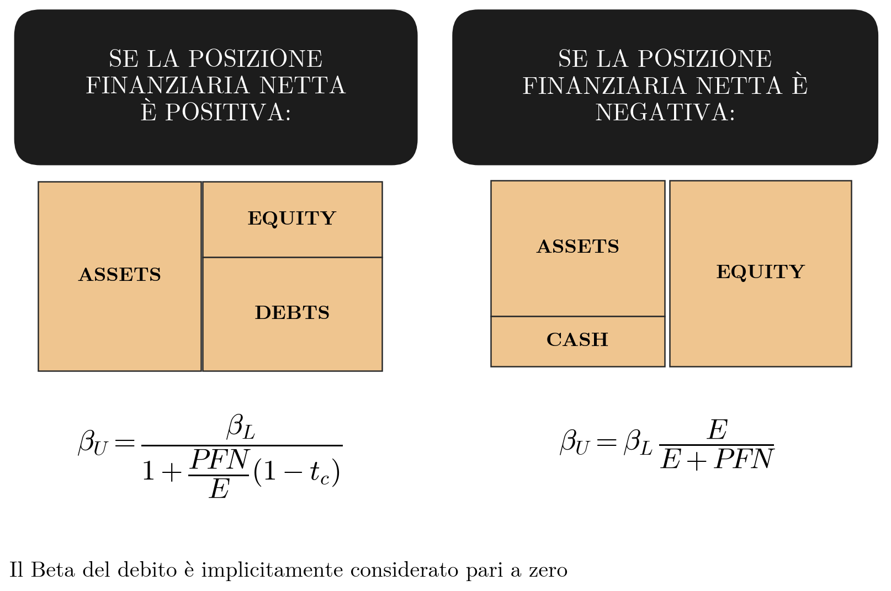

# Terminal value, VAM e domande di teoria

## Programma della lezione e crescita a più stadi

Una notazione sul terminal value. Vediamo qualche domanda teorica risolta e dopo iniziamo i multipli, che continueremo anche domani. I due argomenti che mancano sono i multipli e le operazioni di integrazione con le sinergie.

L'altra volta ci eravamo lasciati dicendo che una crescita $g$ non è molto rappresentativa della realtà aziendale, perché le aziende magari crescono a velocità diverse nelle varie fasi della vita dell'azienda o del lancio del progetto. Avevamo visto, e siamo comunque alla fine delle considerazioni sui DCF, che un approccio che possiamo usare anche nei metodi valutativi è quello che si chiama multi-step, cioè ipotizzare che la crescita, perché comunque presuppongo sempre che ci sia una crescita, si muova a velocità diverse. Quando abbiamo ipotizzato di usare il fattore $g$ di crescita all'interno dei DCF, possiamo pensare di usare due tipi di crescita $g$.

Possiamo immaginare un'azienda che cresce subito in maniera molto rapida e dopo si stabilizza in maniera normale, avevamo visto: inizialmente produce magari beni di arredamento, ma magari gode di un brevetto, per cui non ha competitor, ci sono delle barriere all'entrata date da un brevetto. Immaginate l'esempio proprio estremo, quello dei farmaci, quando il farmaco diventa il generico o via così. Immaginate all'inizio, nel lancio di un farmaco, dove non ci sono altre possibilità per le altre aziende di competere, e ovviamente dopo, quando il mercato si apre ai competitor, la crescita rallenta.

Oppure potrebbe succedere una crescita sostenuta inizialmente, quindi con ricavi rapidi, in crescita, margini molto alti, poi una crescita che in realtà diminuisce perché si perde un po' il vantaggio iniziale, perché i margini si riducono. C'è quindi una fase di transizione con una crescita che diminuisce e infine si stabilizza, e quindi immaginiamo tipo tre velocità.

## Lo scudo fiscale e il valore attuale modificato

Questa slide sta solo facendo vedere un concetto che avevamo già ricordato prima. Negli oneri finanziari, quindi nel debito, c'è questo vantaggio che è dato proprio dallo scudo fiscale: un'azienda che ha debito ha anche degli oneri finanziari e quindi ha la possibilità di dedurseli dalle imposte, può godere dello scudo fiscale. La prima espressione sopra dice che il NOPAT, che è solitamente il flusso a beneficio di tutti, potrebbe essere un NOPAT un po' più ricco, un po' più importante. Perché? Perché se io avessi il debito, il VAM dice: tu guarda che non hai solo il NOPAT, hai anche lo scudo fiscale, cioè hai anche un beneficio fiscale, e lo posso vedere come un maggior flusso di cassa. Il flusso per tutti diventerebbe non più il NOPAT, cioè prima di distribuire oneri finanziari e dividendi ai due stakeholders, ma il NOPAT più lo scudo fiscale, quindi un flusso più alto.

*(slide 20)*

Se questo è vero, e matematicamente è vero perché la deducibilità fiscale è un flusso in entrata o comunque un minor flusso in uscita, perché è un risparmio fiscale, allora potrei assumere, con le dovute attualizzazioni, che il NOPAT lo attualizzo a un tasso $r_0$. Perché $r_0$? Perché immagino che l'azienda lavori senza debito: il WACC dice che tu scorpori a destra e a sinistra del più l'effetto del debito e un'azienda senza debito, in modo che la somma delle due componenti mi restituisca l'effetto pulito di quello che succede. Io prendo un NOPAT che è EBIT per uno meno $t_c$ e lo attualizzo al tasso $r_0$, che è quello di un'azienda senza debiti. Gli oneri finanziari sono invece di pertinenza dei creditori e quindi li attualizzo al tasso $r_D$, che è il tasso che incorpora le aspettative dei creditori.

> [!question] Da verificare: la trascrizione riporta "RO", "RD", "TC"; la slide 20 riporta $r_0$, $r_D$, $t_c$ e si adottano.

Per cui arrivo a dire che $V$ grande, cioè l'enterprise value, lo potrai anche vedere usando una formula compatta, cioè $V_U$, l'enterprise value di un'impresa unlevered, più $V_{TS}$, cioè il valore attuale dello scudo fiscale, il valore attualizzato dei benefici dati dallo scudo fiscale. La somma di questi due valori attuali nel modello del WACC mi dà il valore dell'azienda, l'enterprise value. È anche comodo vederlo così perché, se un'azienda non è indebitata, quello che sta a destra del più è zero: il valore di un'impresa è dato dal valore di un'impresa senza debito, quindi il NOPAT attualizzato all'$r_0$ che guardavamo prima. Posso scorporare il valore dello scudo fiscale e sono più libero quando attualizzo i flussi, tipo i flussi del NOPAT, perché uso il tasso di un'azienda senza debito, $r_0$. Non devo più preoccuparmi di calcolare il WACC che tiene conto delle aspettative di tutti gli stakeholders. Riesco a separare quella che è una normale azienda senza debito, con la remunerazione attesa per gli azionisti, più l'impatto positivo della parte dello scudo fiscale, cioè del debito.

Qui oneri finanziari per il 24%. Come vengono semplificati nella formula gli oneri finanziari? Perché qui c'è la parola oneri finanziari che diventano $D$ grande per $r_D$. Se ho un finanziamento che ha una quota capitale di 1.200 euro, quindi se $D$ grande sono 1.200 euro e $r_D$ è il 10%, gli oneri finanziari sono $D$ per $r_D$, quindi 120 euro. Faccio una semplificazione logica per cui potrei dire che gli oneri finanziari sono sì quelli che vedo nel conto economico, ma se me li dovessi calcolare potrei anche calcolare l'ammontare del debito per $r_D$. Potrei fare anche di meglio: come avevamo visto quando parlavamo di $r_D$, potrei prendere la somma dei debiti e fare anche una ponderazione degli oneri finanziari, cioè vedere com'è la PFN dell'azienda e tutti i tassi debitori, tutti gli $r_D$. Lì posso comunque sviluppare quell'espressione. Però l'approssimazione è che gli interessi su un debito siano il capitale, il valore nominale, per il tasso.

## Il valore attuale modificato con crescita

Qui non c'è niente di nuovo se non il fattore di crescita $g$, quindi è la stessa formula che abbiamo visto un secondo fa: c'è EBIT per uno meno $t_c$ e $D$ per $r_D$ per $t_c$, con le dovute modifiche legate al fatto che l'azienda cresce a un tasso $g$. Avevamo detto tutti quei discorsi delle altre volte: è vero che il NOPAT cresce a uno più $g$, però è anche diminuito dalla quantità di capitale investito netto che cresce con la stessa velocità, e via così. Mantengo le due espressioni di prima e le rettifico usando la crescita $g$, in ipotesi steady growth, cioè di crescita anziché steady state.

*(slide 22)*

Siamo nelle formule compatte. Qui non ho business plan, ho solo un conto economico, ho il NOPAT. Queste formule le usiamo quando non ho lo sviluppo dei flussi di cassa e quindi parto dal conto economico. Se io avessi il modello esteso, per capirci quello con il business plan e il terminal value, cioè con la previsione esplicita, allora potrei sommare i due concetti: la formula della previsione esplicita ha due elementi, la parte del business plan e il terminal value attualizzato. Ma se un'impresa è indebitata, ci sono quattro elementi nella formula: il business plan più lo scudo fiscale sui flussi del business plan, il terminal value più lo scudo fiscale sui flussi del terminal value. Prendiamo per buono il fatto che il TS, cioè il tax shield, rappresenti un flusso fiscale con lo stesso flusso monetario, con la stessa dignità di un FCFO, la stessa considerazione. A questo punto da due diventano quattro gli elementi della formula.

Alla fine l'enterprise value, cioè il valore dell'azienda, è dato dal valore attualizzato dei flussi di cassa del business plan di un'azienda che non ha debiti. Io prendo il piano industriale e attualizzo i flussi a un tasso $r_0$, e siamo nell'esagono 1, cioè questo qui, $V_U$ previsione esplicita. Quindi la previsione esplicita cosa dice?

*(slide 23)*

Prendi i flussi di cassa di un'azienda senza debiti e li attualizzi al tasso di un'azienda senza debiti. Business plan alla mano, perfetto. Poi ti dice: aggiungi lo scudo fiscale di un'azienda, quindi aggiungi gli oneri finanziari, quindi aggiungi l'elemento 2, cioè il valore attuale del tax shield riferito alla previsione esplicita. Potrei prendere gli oneri finanziari che risultano dai business plan e così mi sono risolto i primi due elementi, cioè ho usato i flussi del piano industriale.

Poi ti dice: guarda che devi attualizzare il terminal value. Bene, allora facciamo, come abbiamo ragionato sul piano industriale, $TV_U$, il terminal value di un'azienda senza debiti. Il punto 3, l'esagono 3, è il terminal value unlevered. È la formula del terminal value dove io prendo il NOPAT, cioè prendo l'ultimo anno di previsione esplicita, ipotizzando che possa essere il NOPAT dell'ultimo anno, lo porto indietro al tasso $r_0$, e infine ho l'elemento 4, cioè a questo punto anche il terminal value avrà il suo effetto di scudo fiscale, che è l'esagono 4. Qui vedete che il tema è che devo scegliere un flusso per calcolarmi il terminal value: il NOPAT nell'anno $n$, cioè all'ultimo anno del piano industriale, per risolvere questa formula del WACC. Concludiamo con queste due e chiudiamo i DCF.

## Il procedimento logico della valutazione con i DCF

Qual è il procedimento logico per approcciare la valutazione dei flussi di cassa? Sono messi in sequenza. Uno: devo scegliere tra un metodo analitico e un metodo sintetico. La seconda frase dice che i metodi analitici prevedono la costruzione di un piano con la stima puntuale dei flussi finanziari di ciascun esercizio. Se sono nel momento uno e non ho un piano industriale, sto già scartando il metodo analitico, perché se non ho il piano industriale mi devo rifare solo ai metodi sintetici.

Due: nel caso io abbia la possibilità di disporre o di predisporre un business plan, un piano industriale, oppure me lo diano, il momento due dice: una volta che hai adottato il metodo analitico devi stabilire il numero di esercizi oggetto della previsione. Anche qui, abbiamo detto che non è semplice perché il business plan deve essere rappresentativo della realtà che state per analizzare. Non saranno semplicemente i primi cinque flussi di un'azienda qualsiasi, cioè non saranno tre, cinque, sette esercizi a caso di un'azienda qualsiasi; saranno magari tre, cinque esercizi di un'azienda che sta lanciando un business e quindi avrà dei flussi di cassa molto particolari i primi tre, cinque anni, ==avrà degli obiettivi di crescita e quindi la durata del piano è fondamentale==.

Il terzo, che è legato a questo, sono le cosiddette assumptions, che è la traduzione di ipotesi, fondamentalmente. Le troverete sempre. Quando vi diranno di formulare le assumptions su un business plan, dovrete stabilire voi quali sono le regole del gioco, e nelle assumptions ci sono anche le analisi di scenario. Quando vedete che in un business plan c'è il best case, il worst case, il normal case o scenario, best scenario, e via così, sono tutte le assumptions che voi fate. Una volta che hai scelto la durata, faccio un business plan 2027-2030, quindi a quattro anni. Adesso inizio a fare una serie di assumptions, quindi punto tre. È molto delicato perché qui dovete anche capire in che mercato siete. Se nelle assumptions mettete una crescita del 5%, e state analizzando, che ne so, il settore moda che non sta crescendo, state prendendo un granchio, ad esempio. Se nelle assumptions state mettendo la crescita dei costi per utenze del 2%, dovete pensarci, perché l'inflazione quest'anno in Italia ha superato il 4, poi si ristabilizza al 2 magari, però adesso non è 2.

Idem con i ricavi: quando dovete mettere le assumptions di un business plan, la parte dei ricavi è un tema, perché la vostra crescita dei ricavi, che qui nelle formule è semplificata ma non si vede: avete vari modi per far crescere i ricavi di un'azienda. Potreste anche tenere gli stessi volumi e aumentare i prezzi ogni anno. Magari l'iPhone costa sempre di più ogni anno: i modelli nuovi costano di più, magari hanno più tecnologia, ma il delta prezzo è giustificato dal delta tecnologia che c'è dentro. Nel fashion spesso non è così, nei Rolex non è così, i prezzi vanno su ogni anno. La Rolex tira una martellata ai listini a dicembre di ogni anno, l'anno dopo si riparte con i prezzi più alti, i modelli sono quelli alla fine. Cosa vuol dire? I ricavi di Rolex: qual è il business plan a cinque anni? Maggiori volumi? Forse ne venderanno anche meno, però mettono i prezzi ogni anno del 10% e quindi a parità di quantità aumentano i listini. I Devess, guardate le borse di Gucci. Una Dionysus di Gucci, quella col serpente sulla chiusura, quella di otto, nove anni fa costava 1.500, 1.400 euro, adesso viaggia a più di 2.000. Cos'è cambiato? È sempre quella, tra l'altro replicano le collezioni, quelle iconiche. Capite che è salito un po' di più dell'inflazione.

> [!question] Da verificare: la trascrizione riporta "I Devess, guardate le borse di Gucci"; "I Devess" non è interpretabile.

C'era quindi un tema nelle assumptions: voi cosa state proiettando? Volumi, fashion, un brevetto, un farmaco, una tecnologia, un cellulare, quindi di cos'è fatta l'azienda e quali sono gli scenari, quanto impattano i costi, quanto impattano i costi di trasporto, quanto impattano le utenze. Capite che per un'azienda che fa ceramiche oggi il gas è tipo quadruplicato, quindi fare la stessa piastrella oggi costa il quadruplo. Se oggi vi venisse chiesto di fare un piano industriale di un'azienda di ceramiche, la componente energia elettrica fa il prezzo di quella piastrella fondamentalmente, e dovete stimarla bene. ==I parametri del piano industriale sono fondamentali.==

Quattro: c'è il costo del capitale. Su questo abbiamo fatto tutto il ragionamento del CAPM, perché i flussi che avete stimato riflettono la rischiosità dell'impresa. Anche qui dovete scegliere il metodo più appropriato.

Cinque: a questo punto dovete determinare il valore dell'azienda. Avete tutte le formule del caso: avete i flussi, avete il tasso, avete scelto il metodo, avevate il piano industriale o l'avete costruito, avete fatto tutta la previsione e quindi riuscite a determinare il valore. Tenuto conto che, arrivato a un enterprise value, sapete che in ogni deal quello che conta è l'equity value, per cui va sempre considerato l'ammontare della posizione finanziaria netta.

Dopo, il punto sei è andare a vedere la bontà delle stime e di quanto si discosta il valore che avete trovato dal valore contabile del patrimonio di quell'azienda, per capire se questo plusvalore che vi dovesse venire tra l'enterprise value e, ad esempio, il capitale investito netto è veramente enorme oppure riflette la crescita e il plusvalore dell'azienda.

## Il peso del terminal value

Vi faccio vedere una cosa sul terminal value, perché la cosa che potrebbe far pensare è che alla fine la formula... Nell'enterprise value voi avete quella formula col più in mezzo: arrivate a formulare il valore di un'azienda determinato da due macro componenti, uno che sono i flussi di cassa dei primi anni, tre, quattro, cinque, sei, sette anni, più il terminal value. Dicevamo che se questo terminal value attualizzato è pari circa al 90% del valore totale che vi viene, ==probabilmente avete un po' valutato in maniera poco corretta le previsioni o comunque le stime==. Se questo è il 90% del totale e questo valore attualizzato qui il 5-10%, non va molto bene. Il rilievo che verrebbe da pensare è: ma come può? È evidente che apparentemente questa cosa magari non vi ha suscitato particolari dubbi, però potrebbe colpire il fatto che i flussi di cassa attualizzati dei primi quattro, cinque anni dell'azienda abbiano un peso significativo tanto quanto il valore dell'azienda attualizzato dal sesto anno fino alla fine della sua vita.

Il terminal value è il valore di una rendita perpetua attualizzato a oggi, quindi sembrerebbe quasi ragionevole che la seconda parte della formula fosse la parte preponderante di tutto questo. Verrebbe da pensare che se il terminal value è la somma dei flussi da qui all'eternità attualizzati, siano la stragrande maggioranza rispetto ai flussi del business plan dei primi quattro anni. In realtà ho fatto una piccola notazione su questo perché non è così. Dopo, se volete, ci date un'occhiata, se invece viaggia chiaro va bene, però ve lo mostro perché magari può venire il dubbio.

> [!question] Da verificare: la trascrizione riporta "se invece viaggia chiaro va bene"; probabilmente "se invece vi è chiaro va bene".

Il terminal value è una perpetuità e quindi sembrerebbe che dovesse valere tantissimo rispetto a cinque anni di piano, cioè la previsione esplicita: un apparente paradosso. In realtà ci sono delle spiegazioni per cui il flusso del terminal value è mitigato rispetto ai flussi della previsione esplicita, quelli che emergono dal piano industriale.

Per il motivo uno, ad esempio: quando prendo il terminal value e uso un fattore di sconto, anche con un WACC molto alto e per un periodo molto lungo, i flussi molto lontani vengono molto rimpiccioliti quando vengono attualizzati. I flussi generati molto avanti nel tempo contribuiscono in misura limitata al valore odierno perché vengono scontati molte volte. Anche se un flusso lo immaginiamo lontano tra 20, 30, 40 anni, quel valore attualizzato a oggi diventa un valore molto, molto piccolo, e questo contribuisce a ridimensionare il terminal value.

Poi abbiamo il fatto che spesso la crescita $g$, cioè la crescita che applico nel terminal value dopo che ho lanciato il business, è molto bassa. Abbiamo detto che il grosso dei flussi, spesso in un'azienda, una startup o un business con un'idea di business dirompente, ha una grande crescita che è intercettata dal mio piano industriale in maniera... al decimale, e in realtà la crescita $g$ è molto bassa. Mentre i flussi iniziali sono molto alti, crescono molto addirittura da un anno all'altro, i flussi successivi e lontani crescono molto poco, spesso molto meno dei flussi dei primi anni. Questo è un altro motivo per cui ho i primi flussi della previsione esplicita molto importanti e quelli del terminal value che non crescono in maniera così apprezzabile.

> [!question] Da verificare: la trascrizione riporta "in maniera... Al decimale"; frammento incompleto.

Un altro motivo può essere che la prima parte, quella dei flussi del business plan, dei primi tre-cinque anni, è il momento in cui l'impresa crea più valore. È lì che si genera il grosso dell'enterprise value, quando vado a calcolare i flussi della previsione esplicita, perché in quel periodo può essere che l'impresa cresca sopra il mercato, cioè cresca più del mercato, magari fa investimenti, ha dei rendimenti superiori alla media, quindi succedono molte cose in quei tre-cinque anni e potrebbero succedere dei flussi molto importanti. Poi l'azienda si stabilizza e quindi nella parte perpetua del terminal value l'impresa ha flussi regolari e una crescita magari più bassa, quindi niente di apprezzabile in confronto ai primi anni.

Si può assumere che il terminal value rappresenti sì molti anni, ma flussi molto lontani, quindi attualizzati tanto, e anche poco crescenti, quindi piccoli. L'effetto matematico è che quando calcolate l'enterprise value, che è la somma della previsione esplicita e del terminal value attualizzato, la parte esplicita contribuisce in modo significativo al valore complessivo. Per quello il libro vi dice nel paragrafo dei checks che dovreste insospettirvi se la parte del terminal value rappresenta il 90%, perché non dovrebbe rappresentare il 90% della vostra previsione, del vostro enterprise value. Un terminal value attualizzato che è tipo il 75% potrebbe essere un valore ragionevole.

*(slide 1)*

## Due esempi sul peso del terminal value

### Il primo esempio: terminal value al 75%

Vi ho fatto due esempi. Ipotizzate di avere un piano industriale che è l'uno, che si chiama flussi del piano, e quindi avete quella serie di flussi di cassa. Il periodo uno avete 120, 144, 173, quindi vi hanno dato un business plan a cinque anni. Col punto uno voi attualizzate la previsione esplicita. Questi sono i flussi del business plan, che crescono del 20%, abbiamo ipotizzato qui. Possiamo chiamarla, non c'è nelle slide, H, cioè di quanto crescono i flussi dentro al vostro business plan. Siccome lanciate un prodotto o un servizio, i flussi crescono del 20% ogni anno, mentre dopo i flussi crescono del 2%.

Il valore attuale del piano, cioè del business plan, da cosa è dato? Da questi flussi attualizzati per i periodi di previsione esplicita: 120 lo attualizzo di un periodo, 144 di due e via così. Ho il valore attuale della previsione esplicita che è 653 milioni, mettete che siano milioni di euro. Il mio business plan mi dà flussi di cassa attualizzati per 653. Adesso calcolo il valore attuale del terminal value.

*(slide 2)*

Qui troverete, poi lo vedremo magari negli esercizi, qualche variante, ==però l'importante è che le ipotesi che fate siano corrette==. Voi immaginate di avere i primi cinque esercizi, idealmente il flusso di cassa del terminal value che usate non l'avete già usato, 249, che è il flusso di cassa del quinto anno. In questo caso vedete che il terminal value prende l'FCFF del quinto anno, che è 249, e lo porta avanti della crescita $g$, che è la crescita perpetua, del 2%. Come flusso per il terminal value calcola il flusso del sesto anno, l'anno 6, perché il business plan va da 1 a 5, e quindi prende 254. È questo che usa per calcolare prima il terminal value con la formula della rendita perpetua: prendo il flusso di cassa del sesto anno e lo attualizzo alla formula della rendita perpetua in ipotesi steady growth, quindi col meno $g$, e trovo il terminal value.

> [!question] Da verificare: la trascrizione riporta "il flusso di cassa... Del terminal value che usate, non l'avete già usato 249"; frase incompleta.

Adesso devo attualizzare il terminal value. Siccome avevo un piano quinquennale, immagino di essere al momento 5, per cui porto indietro il terminal value. Vedete, di cinque periodi, quindi il valore attuale o present value del terminal value è 1.971. Ho portato indietro al momento zero anche il terminal value. A quel punto faccio la somma dei due: ho il valore attuale dell'ipotesi di piano, che era 653, e il valore attuale del terminal value, che è 1.971, e l'enterprise value è 2.624. Vado a vedere quanto pesa 1.971 su tutto l'enterprise value, su 2.624. I flussi che io ho immaginato come futuro, cioè quelli che non avevo nel business plan, pesano il 75%.

### Il secondo esempio: terminal value all'88%

L'esempio è uguale come impostazione, cambiano un po' i numeri. Avete sempre un business plan a cinque anni che voi attualizzate a oggi, avete 541, prendete il flusso del quinto anno, lo portate avanti alla crescita $g$ del 4%, calcolate con la formula della rendita perpetua il terminal value, che è questo, 167 con la formula, quindi il tasso meno $g$, e trovate il terminal value. Poi prendete il terminal value di 5.500 e lo attualizzate. Lo attualizzate per cinque periodi e lo portate al tempo zero, quindi viene 3.976.

*(slide 3)*

> [!question] Da verificare: la trascrizione riporta "5500"; la slide 3 riporta 5.567.

I due elementi da considerare sono questo, che è il valore attuale della previsione esplicita, 541, e questo, che è il valore attuale del terminal value; l'ISOMO arrivo a 4.517. Vedete che in questo caso il valore attuale del terminal value è l'88% rispetto al valore totale dell'azienda. Se provate a ritoccare la crescita nell'ipotesi futura, cioè mettere ad esempio anziché 4% di crescita un 4,5, arrivereste a un valore attuale del terminal value del 90%. Vuol dire che voi state valutando un'azienda 4 milioni e mezzo dicendo che su 4 milioni e mezzo quasi 4 milioni sono dati da dei flussi che non vedete, cioè da quelli che vanno dal sesto anno fino all'infinito.

> [!question] Da verificare: la trascrizione riporta "l'ISOMO arrivo a 4.517"; "l'ISOMO" non è interpretabile.

> [!question] Da verificare: il docente dice "653 milioni, mettete che siano milioni di euro" e poi "4 milioni e mezzo" per 4.517; l'unità non è univoca.

Come lo leggiamo questa considerazione? Se l'enterprise value è 4 milioni e mezzo e i miei flussi nei primi anni valgono solo 541.000 euro, cosa sto facendo? Che tipo di valutazione sto facendo? Io ho calcolato un business plan che nei primi cinque anni mi dà un valore attuale di flussi di 541.000 su un'azienda che vale in tutto, arriva a valere 4 milioni e mezzo. C'è qualcosa di sbilanciato, o comunque ho fatto un lavoraccio per niente. A questo punto, come dicevamo, prendi la formula compatta: non ti serve a niente attualizzare i flussi del business plan e fare tutta questa trafila. Se tutto questo che attualizzi vale 500 su 4 milioni e mezzo, 5 milioni di enterprise value, non serve neanche che ti metti a farlo: usa una formula compatta, stima un NOPAT e usa quello. Le formule estese hanno senso se ha senso il peso di quello che metti quando hai un piano industriale.

> [!question] Da verificare: la trascrizione riporta "come dicevano, prendi la formula compatta"; si legge "come dicevamo".

> [!question] Da verificare: la trascrizione riporta "un opat"; la slide 8 (parte 1) riporta NOPAT e si adotta questa forma.

## Domande di teoria

Proviamo a fare queste, così sono un po' simili a quelle dell'esame.

> [!tip] Esame: nell'esame magari non saranno vero o falso, però sono sempre domande come queste che troverete nel compito, dove magari avrete tre risposte anziché vero o falso.

Queste le vediamo insieme, dopo ve le carico. Nel corso delle prossime settimane alterneremo sempre un po' di ripasso teorico con domande che poi sono simili a quelle dell'esame, e anche gli esercizi, esempi ed esercizi. Queste vi servono per la parte teorica perché vi aiutano a capire se avete capito.

### Un progetto con utile che distrugge valore

Un progetto di investimento che genera un utile può comunque distruggere valore per l'impresa. Secondo voi questo è vero o falso? Vero. Vero, perché? Bisogna motivare la risposta, sennò uno può tirare la monetina e dargli bene, in questo caso. Sì, è vera. Esatto, è quello che avevamo detto proprio all'inizio: io potrei avere utile per tre anni di fila e il terzo anno mi fanno istanza di fallimento, siete d'accordo? Se il nostro cliente è un ospedale che non ci paga, noi vendiamo i letti dell'ospedale o le lenzuola all'ospedale per tre anni di fila, facciamo un utile clamoroso e non incassiamo neanche una fattura, ad esempio. Questo è un tema finanziario, ma in questo caso la risposta è anche il fatto che non solo c'è questo tema, cioè c'è la dicotomia tra utile e, appunto, fattibilità e appetibilità dell'investimento, ma c'è anche il fatto che di per sé un progetto che produce utile, se lei avesse un progetto rischioso che rende l'1% e i BTP dello Stato, seppur rischiosi, o il Bund tedesco adesso rende il 2,38%, se lei avesse un progetto che rende l'1%, ma chi glielo fa fare? Che è anche rischioso.

Usiamo i quiz anche per ripetere i concetti: dopo non vi rimetto questa identica domanda, però ne metto una magari con questo ragionamento dietro. Il fatto di produrre utili: cosa avevamo detto la prima o la seconda lezione? Che quando voi avete un euro disponibile, potete affrontare un progetto rischioso, potete comprarvi un Bund tedesco, potete anche non fare niente e tenervi l'euro. Il fatto che uno venga da voi e vi dica: guarda che io ho un progetto che fa utili. Dite: bravo, e quanto rende il tuo progetto? L'uno per cento. E voi dite: senti, guarda, è un progetto rischioso? Sì, perché è un progetto di investimento. Ok, guarda, facciamo così: io ho il BTP tedesco che mi rende 2,38, fatti pure il tuo progetto che ti rende l'uno. E lui ti dice: ma guarda che il mio progetto produce un utile. Sì, ho capito, ma io l'utile lo confronto sempre, e soprattutto in questo corso di finanza, con dei rendimenti alternativi. Il progetto all'uno per cento te lo fai te. Io senza rischiare niente, cioè rischio tasso risk free, mi compro un Bund tedesco, metto i 100 euro, a fine anno dormo tra due cuscini e a fine anno ho il 2,38 per cento: perché dovrei prendere il tuo progetto che mi rende l'uno?

> [!question] Da verificare: la trascrizione riporta "BTP tedesco"; altrove dice "Bund tedesco".

Il progetto di investimento che genera un utile potrebbe quindi distruggere valore per l'impresa, perché se voi siete l'amministratore delegato di un'impresa e state affrontando dei progetti che rendono meno di un tasso free risk, ad esempio, state distruggendo valore: comprate il Bund, non state a fare quel progetto, perché state allocando liquidità su qualcosa che vi rende meno di quanto vi rende un rendimento senza rischi.

> [!question] Da verificare: la trascrizione riporta "L'amministratore delegato di un'impresa è stato affrontando"; si legge "e state affrontando".

Vogliamo complicarlo ancora di più. Le aspettative di rendimento del mondo degli azionisti e dei creditori le possiamo riassumere col tasso che si chiama... qual è il tasso di rendimento che esprime le aspettative di tutti gli stakeholders? Il famoso WACC. Qual è la considerazione da fare quando nei progetti di investimento vi tirate fuori il TIR? Avevamo detto che il TIR deve essere rispetto al WACC maggiore. Già quello è un altro motivo per cui la uno è vera: tu devi portare sul piatto dei progetti di investimento che abbiano un TIR, un rendimento di quel progetto, più alto delle aspettative di azionisti e creditori, cioè del WACC. ==La condizione TIR maggiore di WACC è questa== e rappresenta anche questo aspetto qui. Se io avessi un progetto che genera un utile e ha un TIR del 2%, e le aspettative di azionisti e creditori sono un WACC del 6%, ho un progetto che è utile e distrugge valore. Quindi questa è vera.

### Il VAN più elevato e il razionamento del capitale

Due: il progetto caratterizzato dal VAN più elevato rappresenta sempre la scelta migliore anche in presenza di razionamento del capitale. Ho due progetti, vince quello che ha il VAN più alto anche se mi trovo in presenza di razionamento del capitale. Vero o falso? Cosa avevamo detto del razionamento del capitale? È uno dei punti di forza o di criticità del VAN, il tema del razionamento del capitale. Falsa. Se non ho i soldi, non faccio il progetto. È inutile che tu mi presenti un progetto di fare un resort di fianco a Porto Cervo che costa 80 milioni di euro, che ha un VAN più alto del bar che fa tra Mesini qua di fronte, che costa 300 mila euro. Se non abbiamo 80 milioni, quindi in presenza di razionamento del capitale, il VAN più alto non è vero che è la scelta migliore. La selezione dei progetti richiede di considerare anche altre cose, l'indice di redditività, ma soprattutto l'ammontare del capitale disponibile.

> [!question] Da verificare: la trascrizione riporta "fa tra Mesini" (probabilmente "tramezzini") e "la montare" (nel testo "l'ammontare").

### Il TIR e il tempo di recupero

Tre: il TIR è il tasso di rendimento che rappresenta il tasso di attualizzazione in corrispondenza del quale il VAN del progetto è pari a zero. Vero. È la definizione di TIR questa. Cos'è il TIR? È quel tasso che annulla il VAN, tanto che se vi ricordate la formula, voi fate zero uguale puntini puntini e vi tirate fuori la lettera $r$. Il TIR esprime il rendimento implicito e si confronta col costo opportunità del capitale, cioè quello che abbiamo detto prima, cioè col WACC. Io prendo il TIR e lo uso per confrontarlo col WACC.

Quattro: il metodo del tempo di recupero semplice, TR, come quello del tempo di recupero attualizzato, considera il valore finanziario del tempo. Falso. Perché? È il tempo di recupero attualizzato dove noi attualizziamo i flussi. Il tempo di recupero non fa altro che prendere i zero negativo e inizia a sommarci in maniera secca i flussi di entrata senza tenere conto del tempo.

> [!question] Da verificare: la trascrizione riporta "prendere i zero negativo"; probabilmente $I_0$, l'investimento iniziale, ma le slide di questa lezione non lo confermano.

### Le opzioni reali

Cinque: un progetto caratterizzato inizialmente da un VAN negativo può diventare finanziariamente conveniente considerando il valore delle opzioni reali. Vero? Vi ricordate cosa sono le opzioni reali? Espansione, abbandono, rimandare l'investimento. Vero? Le opzioni reali sono proprio quelle opzioni che, a dispetto di un VAN negativo... Lo avete fatto negli esercizi, quindi se non vi ricordate la frase pensate anche agli esercizi che avete visto in aula o quelli sulle opzioni. Negli esercizi sulle opzioni avevate dei casi in cui il VAN era negativo, però con l'opzione diventava positivo. Se io non avessi avuto scelta di poter abbandonare il progetto dopo un anno e vendere tutto, oppure se non avessi avuto la possibilità di posticiparlo, probabilmente l'avrei mollato quel progetto, perché mediamente, tenuto conto delle probabilità, il VAN era negativo.

Però le opzioni possono farlo diventare un VAN positivo.

### Costo del capitale proprio e costo del debito

Sei: il costo del capitale proprio, $r_E$, coincide generalmente col costo del debito, $r_D$, perché entrambi rappresentano fonti di finanziamento dell'impresa. Falso. Falso perché non coincidono, ovviamente. Qual è la parte vera dell'affermazione 6? Entrambi sono fonti di finanziamento. Entrambi: è quello il senso. Sono tutte e due fonti di finanziamento, ma perché non coincidono? Il creditore non rischia praticamente niente, l'azionista rischia. L'aspettativa di rendimento di un azionista è sempre più alta di quella di un creditore, quindi tendenzialmente $r_E$ è più alto di $r_D$, perché chi mette capitale di rischio, rischiando che non gli venga restituito, sta rischiando molto di più di un creditore e quindi chiede una remunerazione più alta.

> [!question] Da verificare: la trascrizione riporta "RE" e, più avanti, "RF"; le slide 3 e 14 del costo del capitale riportano rE e rf e si adottano $r_E$ e $r_F$.

### La deducibilità degli interessi passivi

Sette: a parità di altre condizioni, la deducibilità fiscale degli interessi passivi sui debiti, quindi gli oneri finanziari, riduce il costo effettivo del capitale di debito. Falso? Qualcuno dice vero, qualcuno conferma falso. Dice: a parità di tutto. Il fatto che gli interessi passivi, gli oneri finanziari, siano deducibili riduce il costo effettivo del capitale di debito. Nell'esercizio del CAPM, mi pare, avevamo visto proprio questa cosa: quando hai $r_D$ e poi calcoli lo scudo fiscale, veniva 3,09, mi ricordo. Veniva più basso perché dicevamo che lo scudo fiscale di fatto è un modo perché tu ti possa trovare una forma di ristoro dai tuoi debiti, e quindi alla fine lo scudo fiscale rende meno oneroso il tasso debitore.

Perché in Italia, un $r_D$ del 3%, quindi un onere finanziario del 3%, l'azienda non paga su 100 euro di capitale, se gli oneri finanziari sono 3 euro, l'azienda non paga 3 euro: paga 3 euro meno le imposte che si deduce sui 3 euro, cioè meno il 24% sui 3 euro, quindi pagherà di interessi 2 euro e rotti. Se voi dividete i 2 euro e rotti che paga per 100, non vi viene fuori un tasso più basso? 3 su 100 viene 3%, ma se fate 2, qualcosa su 100 vi viene che il tasso $r_D$ per effetto dello scudo fiscale è più basso. Il nuovo tasso $r_D$, in Italia possiamo affermare che sia $r_D$ per uno meno l'aliquota fiscale. Quindi 6%, sarà 3% per uno meno 24%, quindi 2, qualcosa per cento. È vero che la deducibilità fiscale degli interessi riduce il costo effettivo del capitale di debito. Non è che mi viene corretto il tasso con la penna: è che l'effetto fiscale sul flusso è che gli interessi bancari mi costano meno.

> [!question] Da verificare: la trascrizione riporta "Quindi 6%, sarà 3% per uno meno 24%"; il 6% non è ripreso dal seguito.

### Il beta misura il rischio specifico?

Nel modello del CAPM, Capital Asset Pricing Model, il coefficiente beta misura il rischio specifico della singola impresa. Vero o falso? Come lo chiamate il beta, puntini puntini, di? Quando andate a prendere le tavole del beta o andate su Google a cercare le tavole del beta, cercate il beta di... settore, il beta di settore. Avevamo visto che valori può assumere il beta. C'è una slide dove vi avevo messo i loghi delle aziende, tipo quelle farmaceutiche, quelle automobilistiche, e se vi ricordate il beta rappresenta proprio la variabilità del settore, e quindi può essere giusta questa. Il beta non rappresenta il rischio specifico della singola impresa, ma casomai del settore a cui appartiene quell'impresa.

*(slide 23)*

Il beta è legato al fatto che Diadora opera nel settore footwear, non che il beta sia di Diadora. Il beta misura il rischio sistematico, esprimendo la sensibilità del rendimento del titolo rispetto alle variazioni del rendimento di tutto il mercato. Come si comporta Diadora quando cambia tutto il mercato, quando cambia l'economia? Se tutto il portafoglio mondo di tutte le aziende del mondo, del pianeta, sale dell'1%, quanto sale Diadora? Più o meno dell'1%? E questo è il beta.

Poi non fatemi ingannare da quello che trovate su internet, perché se andate sui siti di finanza, andate nel profilo dell'azienda quotata e vi dà un beta. Voi potreste dirmi: sì, ma io sono andato su internet, ho visto che c'è il beta dell'impresa, quindi questa qui è vera. In realtà quello è un beta che non è il beta di cui parliamo noi: è un beta rettificato, è il beta di settore però ponderato con le peculiarità di quell'azienda, ma non è il beta che noi usiamo nelle formule del CAPM, perché altrimenti vi fate confusione. Ma questo non vale solo all'esame, anche fuori: quando dovete usare il beta e calcolare la formula, ==andatevi a prendere le tavole del beta di settore, non state a prendere il beta dell'azienda==, perché quello lì è un parametro calcolato dal sito di finanza, però altra cosa sono le tavole del beta di settore. Se io sto valutando un'azienda farmaceutica, devo prendere il settore farmaceutico perché devo ponderare il fatto che quell'azienda si comporterà in una certa maniera, in maniera più o meno elastica rispetto a tutto il mercato. Quindi è falso, perché il beta è proprio la sensibilità del singolo titolo rispetto a tutto il mercato.

### Il beta unlevered

Nove: il beta unlevered consente di stimare il rischio sistematico dell'attività operativa dell'impresa, depurandolo dagli effetti dell'indebitamento finanziario, perché ci sono anche i debiti verso fornitori, ma a noi non interessano in questo caso. Quando parliamo di indebitamento parliamo di PFN. Che cos'è il beta unlevered? Qui c'è, vi ricordate, una slide che vi ho fatto, che parla del beta e dopo dice di fare il beta unlevered, e ci sono i due casi con la PFN maggiore di zero e la PFN minore di zero.

Qui siamo nel tema che il debito non dovrebbe mai influenzare, lo diciamo durante tutto il corso, non dovrebbe mai: la quantità, quando un'azienda è indebitata, non dovrebbe influenzare nemmeno il comportamento dell'azienda in termini di varianza, covarianza e via così. ==Il beta non dovrebbe essere impattato dalla struttura finanziaria dell'azienda.== Questo l'abbiamo detto sempre. Se vi ricordate cosa dicevamo su questa cosa, abbiamo fatto un discorso: le tavole del beta le prendete spesso da Damodaran, che le ha scritte in America, e in America le aziende sono poco indebitate, vi ricordate questo discorso che facevamo? Sono poco indebitate perché sono quotate in borsa, c'hanno tanto capitale proprio dentro. Quel beta lì è di imprese poco indebitate. Le imprese italiane sono piene di debiti perché le aziende chiamano il direttore della banca e si fanno un finanziamento.

> [!question] Da verificare: la trascrizione riporta "Modarà"; le slide 17 e 18 riportano "Damodaran" e si adotta.

Quando andrete a fare i valutatori in un fondo, in una società di consulenza, dovete prendere il beta. Andate a prendere il beta dalle tavole di Damodaran di aziende che quasi non hanno PFN. Prendete quel beta di settore e lo mettete su un'azienda o su un progetto italiano con un'azienda che è finanziata tre quarti con capitale di banche e capitale di terzi. State facendo qualcosa di poco coerente. Non sarebbe meglio prendere il beta di Damodaran, che comunque è un beta levered, e trasformarlo in un beta di un'azienda ideale senza debiti e dopo calcolare separatamente l'effetto dell'indebitamento? Facendo così potrei arrivare a un beta unlevered, e il beta unlevered consentirebbe di stimare il rischio sistematico dell'attività operativa di quell'azienda depurandolo dall'indebitamento. Quindi è vera. Io faccio il beta unlevered perché così ho pulito, ho deleverato il beta.

### Il BTP e il country risk premium

Nella valutazione di un'impresa italiana è corretto utilizzare il rendimento del BTP decennale come tasso base e aggiungere al premio base di mercato l'intero country risk premium italiano. Vero o falso? Devo valutare un'impresa italiana, sto applicando la formula del CAPM, quella che prende il tasso free risk e il premio per il rischio di mercato. La frase dice: è corretto prendere per la parte $r_F$ il BTP decennale italiano come tasso base free risk e sommarci il premio base di mercato e il country risk italiano? La risposta è no, perché se rileggete questa frase state sommando due volte il rischio dell'Italia, perché abbiamo detto che il BTP è già un tasso rischioso italiano. Non serve che dopo nella formula mi sommi anche il country risk Italia o il credit default swap.

Vi ricordate la formula: $r_F$, tasso free risk, più beta che moltiplica il premio per il rischio di mercato, che solitamente si prende l'America o la Germania, più il rischio paese. Alternativa 1, alternativa 2 del libro e anche delle slide: andate a rivedervi quella e scoprirete che questa frase contiene un errore. Se tu mi metti il rischio Italia sopra il tasso free risk, quindi mi metti il BTP, ==non serve che dopo dentro al premio per il rischio mi rimetti il country risk Italia==, sennò me lo metti due volte. Quindi questa è falsa.

### Il valore asset side e l'equity value

Nel metodo dei DCF, in una logica asset side, il valore dell'attività operativa dell'impresa si determina attualizzando i flussi di cassa FCFO con il WACC. Se sono in una logica asset side, è corretto usare la formula FCFO attualizzati al WACC? La asset side considera tutta l'azienda nel suo complesso. L'FCFO considera i flussi quali? Quelli degli azionisti o quelli dei creditori o tutti e due? L'FCFO considera i flussi per tutti, perché sono quelli prima di trattenere gli oneri finanziari, i dividendi. E qual è il tasso che esprime l'attualizzazione dei flussi di tutti? Il WACC. Quindi questa frase è corretta, perché in una logica asset attualizzi i flussi a beneficio di tutti al tasso che incorpora le aspettative di tutti.

Dodici: se un'impresa ha un enterprise value di 10 milioni e una PFN di 3 milioni, allora ha un equity value di 13 milioni. Guardate su quel grafico con i quadranti dove avevate l'equity, la PFN, gli asset. Secondo voi è così? No. Io ho tutto l'enterprise value che è formato dall'equity value e dalla PFN. In questo caso vedete che la PFN è 3 milioni, quindi non è negativa, è un valore positivo, quindi vuol dire che è debito. Quindi è falso, perché tutta l'azienda ha un valore di 10 milioni, che è controbilanciato da un equity di 7 e da una PFN di 3: non è 13, è 7 l'equity value.

### Il NOPAT

Il NOPAT, Net Operating Profit After Taxes, rappresenta il risultato economico dell'impresa dopo aver dedotto ammortamenti, interessi e imposte. È un risultato economico dopo che noi abbiamo dedotto gli ammortamenti, gli interessi passivi, gli oneri finanziari e le imposte. È vero? Sì. Se non vi ricordate le formule, pensate a cos'è il NOPAT. L'avevamo detto che era simile all'FCFO. Il NOPAT non è il flusso a beneficio di tutti, giusto? Il NOPAT è il flusso a beneficio di tutti. Tutti chi? Creditori e azionisti. Provate a rileggerla: il NOPAT è quello che resta dopo aver tolto ammortamenti, interessi passivi e imposte. È vero o falso? È falso. Perché mi sta dicendo che lui ha tolto gli interessi passivi, ma vorrebbe dire che ho già remunerato i creditori. Questa definizione è la definizione dell'utile d'esercizio, non del NOPAT. Il NOPAT è il risultato operativo al netto delle imposte operative, quindi è EBIT per uno meno $t_c$, l'abbiamo visto poco fa, quindi quella è falsa.

### Steady state, steady growth e uso congiunto dei metodi

Il modello finanziario steady state assume flussi finanziari costanti nel tempo e lo steady growth assume flussi caratterizzati da un tasso di crescita costante. Una facile, questa qua, ci vuole. Vero? In uno l'azienda è sempre costante, nell'altro cresce a un tasso $g$: una steady state e una steady growth.

I metodi dei DCF e il metodo dei multipli possono essere utilizzati congiuntamente nella valutazione economica di un'impresa? Cosa abbiamo detto una volta che eravamo proprio in quest'aula? Quali sono i metodi valutativi? L'abbiamo detto più volte. Abbiamo detto: uno, c'è ma non ve lo racconterò, che è quello del patrimonio netto rettificato, perché non tiene conto di bla bla bla. Poi c'è il metodo dei multipli, poi c'è il metodo dei DCF. Cosa abbiamo detto di tutta questa varietà di metodi? Che non bisogna utilizzarli congiuntamente, che ne dovete scegliere uno, o che potete utilizzarli congiuntamente e servirvene per farvi una comprensione generale del valore dell'azienda? Dovete utilizzarli tutti? Più metodi usate, meglio è, basta che siano appropriati, perché se li usate congiuntamente avete dei metodi che dovrebbero tendere a convergere, o comunque riuscite a farvi un'idea. Quindi è vero che potete usarli congiuntamente.

### Il terminal value

Sedici: nel modello del DCF analitico il terminal value può essere sommato direttamente al valore attuale dei flussi finanziari del business plan. Siamo nel metodo DCF, è analitico, quindi ho la previsione esplicita e il terminal value. Faccio i valori attuali del business plan, che sono la prima parte, più il terminal value. È corretto? Dice che va attualizzato. Al valore attuale dei flussi finanziari del business plan si somma il valore attuale del terminal value, non il terminal value. Il terminal value, determinato al finale periodo della previsione esplicita, cioè la perpetuità, deve essere attualizzato alla data di valutazione. Vedete che nelle formule quello che abbiamo visto prima lo portiamo indietro. Nel caso di prima di cinque periodi, sono alla fine dell'anno cinque, è finito il business plan, terminal value, porto tutto al momento zero.

> [!question] Da verificare: la trascrizione riporta "ho la previsione esplicita del terminal value"; si legge "e il terminal value".

Diciassette: nella valutazione di un'impresa caratterizzata da una durata limitata, il terminal value può essere rappresentato dal valore di liquidazione del patrimonio. Vero o falso? Se l'azienda ha una durata limitata, cioè l'impassante di Maxtr, l'Expo 2015, la joint venture, posso pensare che il terminal value sia il valore di liquidazione che avrò alla fine di questa avventura aziendale, e quindi uso il patrimonio aziendale come terminal value? Avrebbe senso fare il terminal value con la formula della rendita perpetua della società che sta togliendo il ferro dalla Costa Concordia, che fra tre anni è finito? No. Quindi è vero. Se la durata è limitata, abbiamo visto l'esempio della shipyard company, quella che deve togliere il ferro alla Costa Concordia, ci metterà cinque anni. Cosa faccio, la rendita? Non è che toglie ferro all'infinito. Siccome mi hanno chiesto di valutare coi DCF la shipyard, come la valuto? Io posso dire: primi anni è così, poi il terminal value sarà il valore di liquidazione delle gru, dei ragni che prendono il ferro, avevamo detto, quindi un valore di liquidazione del patrimonio, non certo una rendita perpetua.

> [!question] Da verificare: la trascrizione riporta "l'impassante di Maxtr"; frammento non interpretabile.

Un terminal value attualizzato del 90% dell'enterprise value mostra necessariamente che la valutazione effettuata usando i DCF è errata. Ce ne sono due, di parole forti: una è necessariamente e l'altra è errata. Abbiamo detto che questi risultati non portano a un errore, però ci danno un segnale, cioè che la previsione esplicita vale il 10% del valore dell'azienda alla fine, quindi qualcosa non sta girando giusto. Ma concettualmente, non in termini di formule, quindi non è sbagliato quel valore. ==Un'incidenza così elevata rappresenta un segnale di attenzione.== Magari è così veramente, ma allora vuol dire che non c'è tutta quella importanza nei primi anni di previsione esplicita del piano.

### Il modello a tre stadi e il VAM

Il modello di valutazione a tre stadi ipotizza che l'impresa mantenga il medesimo tasso di crescita per tutta la sua vita. No, falso, si chiama tre stadi. Prevede quello che abbiamo visto poco fa: la crescita sostenuta, la transizione e una crescita stabilizzata.

Il metodo del VAM, valore attuale modificato, consente di determinare separatamente il valore dell'attività operativa dell'impresa e il valore dei benefici fiscali che derivano dall'indebitamento, cioè di separare il valore dell'attività, il valore dell'impresa, da quello dei suoi benefici fiscali. Vero. Vero perché è proprio quello il VAM. Oggi ci fermiamo qui. Queste ve le carico e domani partiamo sui multipli.
