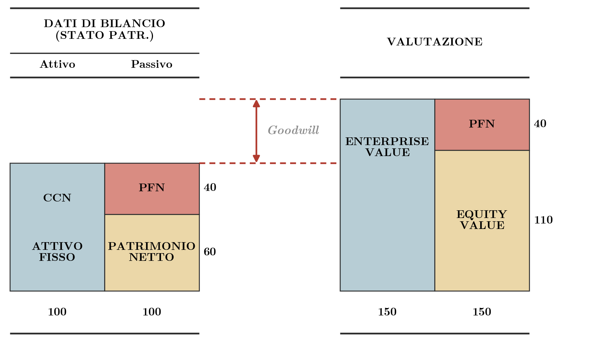
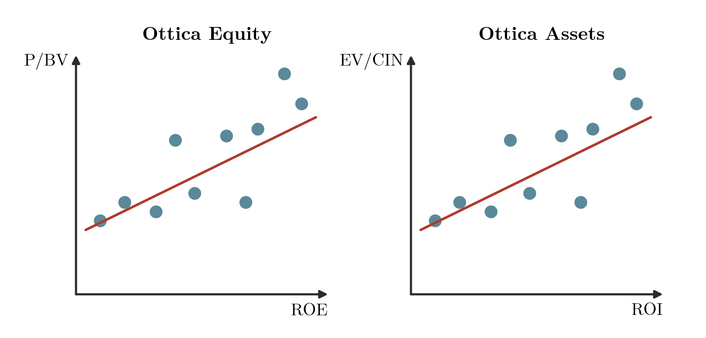
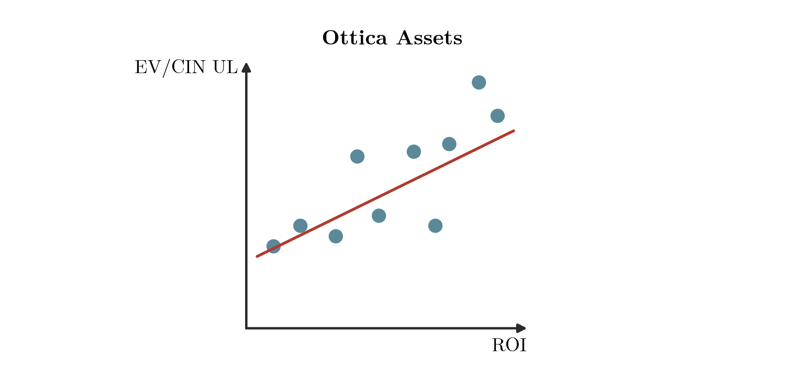

# Multipli di borsa, criticità e mappe del valore

## EBITDA adjusted e multiplo pagato in un'acquisizione

EBITDA adjusted richiama il fatto che ci sia stato un aggiustamento. Perché dovrebbero scrivere EBITDA adjusted e non EBITDA reported, ad esempio? Secco acquisisce Garz e paga n volte l'EBITDA. In questo caso paga 11,2 volte l'EBITDA. I due elementi che vediamo, che vedremo sempre nel multiplo, sono fondamentalmente due. Abbiamo detto che è di una banalità assurda, c'è una moltiplicazione, però moltiplico due numeri di cui devo essere certo, perché la moltiplicazione determina l'ammontare del bonifico che faccio quando compro un'azienda, quindi devo essere ragionevolmente certo di quei due numeri. Se la moltiplicazione è multiplo per EBITDA, ==devo essere sicuro che l'EBITDA sia corretto==, e da qui quello che vedremo in tutto l'ultimo modulo sull'analisi dell'EBITDA e gli aggiustamenti dell'EBITDA.

> [!question] Da verificare: la trascrizione riporta "secco acquisisce Garz" e "il bilancio tirato giù da IDA"; le slide non riportano questi nomi e "secco" e "Garz" si lasciano come nella trascrizione, mentre "IDA" si legge "AIDA", come la trascrizione riporta più avanti. Le slide 5 e 6 riportano EV 800 milioni ed EBITDA 71,14 milioni, che dà circa 11,2 volte, ma la slide 5 riporta anche "MULTIPLO = 10x EBITDA", e non è detto che si tratti della stessa operazione.

Secco non prende l'EBITDA del bilancio tirato giù da AIDA: fa la due diligence, manda gli advisor, gli advisor producono e dopo viene concordato in sede di negoziazione l'EBITDA adjusted, cioè quello che fa base per la determinazione del prezzo. L'EBITDA adjusted viene, come dire, proposto dall'acquirente con gli aggiustamenti che lui ritiene e dopo nasce una negoziazione col venditore, finché non si concorda l'ammontare corretto di EBITDA. Poi si applica il multiplo, e anche il multiplo viene comunque, tra virgolette, negoziato e concordato, perché deve esserci comunque consenso tra compratore e venditore.

## Prysmian e Atcor

Prysmian la conoscete? Praticamente gran parte dei cavi che stanno appoggiati sui fondali degli oceani e che portano le AI, le linee telefoniche in giro per il mondo sono di Prysmian. Questa è un'azienda leader nei cavi, quindi tutte le dorsali atlantiche, i cavi sottomarini, questa azienda è gigantesca e continuamente fa acquisizioni, ne trovate tante fatte da Prysmian. L'ultima che ha fatto è questa: ha comprato Atcor per 3,8 miliardi di dollari, pagando un multiplo di 9,8.

> [!question] Da verificare: la trascrizione riporta "Actor", "Atcor", "Atkor" e "Atcore" per l'azienda acquisita e "Prismian", "Prisma" e "Prysmian" per l'acquirente; le slide non riportano questi nomi e si adottano "Atcor" e "Prysmian". Riporta anche "un'azienda che costruisce dei leader in cavi", reso con "un'azienda leader nei cavi".

Ragionando arriviamo ovviamente all'EV/EBITDA di Atcor, e lo vedremo tra poco. Se l'enterprise value è il multiplo per l'EBITDA, se l'enterprise value è 3,8 e il multiplo è 9,8, assumiamo che sia stato valutato l'EBITDA di Atcor 388 milioni, che è sicuramente un EBITDA adjusted. Se scarichiamo il bilancio 2025 di Atcor non troveremo 388 milioni, perché è un EBITDA aggiustato. Da qui verrebbe da chiedersi da dove ha preso il 9,8 Prysmian: perché ha preso 9,8, da dove lo prendiamo? Se da un lato c'è il tema dell'EBITDA, dall'altro c'è il tema del multiplo, e poi lo vedremo, questa è solo un po' un'introduzione. Dopo scenderemo in profondità sulla scelta e su come maneggiare i multipli, però vedete che le cose si complicano: perché 9,8?

> [!question] Da verificare: la trascrizione riporta "se scarichiamo il bilancio... Tipo rimpare 2025 di Atcor"; "Tipo rimpare" non si capisce e resta fuori dal testo.

Fatto salvo che l'EBITDA di Atcor sia questo, 388 milioni, che ci arriva dai bilanci, dopo dovete determinare un multiplo. Capite che viene fuori 3,8 miliardi: se prendete 13 di multiplo cambia di qualche miliardo, cioè non di qualche dollaro.

> [!question] Da verificare: la trascrizione riporta "questo ci è arrivato qui i bilanci"; si legge "che ci arriva dai bilanci", ma è un'ipotesi.

## Trovare il settore giusto nelle tavole dei multipli

La considerazione è che Atcor opera nel settore delle infrastrutture elettriche, quindi ha un business simile a Prysmian: sta integrando qualcosa di molto simile a lei. Opera nel settore delle infrastrutture elettriche, sistemi di protezione, canalizzazione dei cavi e prodotti per la distribuzione elettrica. Cosa potremmo dire? Che il riferimento settoriale più appropriato potrebbe essere Electrical Equipment & Components oppure considerare anche Building Products.

Ecco, perché vedete che iniziate a, come dire, scontrarvi con la realtà. Intanto, nelle tavole dei multipli non c'è un multiplo per ogni ATECO, per ogni categoria merceologica. Non sono i codici ATECO della Camera di Commercio, dove c'è produzione di pellami, produzione di vini e dopo c'è l'ATECO produzione di vini spumanti, produzione di vini distillati: le tavole dei multipli sono più o meno una trentina, una quarantina. Questo è un ritaglio della tavola di Damodaran. Questo è il link, www stern.nyu e via così, il link internet alle tavole di Damodaran sui multipli. Adesso l'ho ritagliata, però non va tanto più giù perché sono in ordine alfabetico: qui è advertising, qui siamo già alla E. Quindi non ne avete tante, di categorie.

Per dire cosa? Che intanto bisogna ricondurre il business alla categoria appropriata. Voi non avrete il multiplo di un'azienda che fa cavi e dorsali sottomarine: dovete trovarlo. Questo è il primo esercizio di difficoltà. Dovendo scegliere quelli che si prestano di più, dopo magari ve li potete guardare tutti nella pagina, sennò non ci stava nella slide, potrebbe essere questo: se fai i cavi elettrici per infrastrutture, potrebbe essere da considerare congiuntamente sicuramente i componenti elettrici, quindi electrical equipment components, e i prodotti connessi al settore edilizio, ma edilizio inteso anche come edilizia industriale. Se da una centrale elettrica o da un fabbricato escono dei cavi, può essere che sia simile a quello che fa Atcor. Dobbiamo trovare il settore simile a quello che fa la target. La target fa questa cosa qua, abbiamo detto, infrastrutture elettriche, sistemi di protezione e canalizzazione dei cavi, allora trovate il multiplo. Altra cosa, altra considerazione: trovare il settore.

## I multipli di Damodaran sulle quotate americane

Poi arriviamo a quello che dice Damodaran. Tenete conto che Damodaran prende le quotate in America, fondamentalmente, e questo è un altro tema che vedremo poi nei multipli. Quando voi prendete la tavola di Damodaran, il software di Damodaran ragiona sulle quotate americane, per cui se voi avete una non quotata italiana, capite che dovete fare dei ragionamenti anche su questo.

> [!question] Da verificare: la trascrizione riporta "Moderna" e "DaModa"; le slide 20 e 21 riportano "Damodaran" e si adotta questa forma.

Poi avete questi calcoli qui: avete solo le aziende con l'EBITDA positivo e lui stima su queste. Il numero di aziende è 41, e lui fa praticamente un medione delle aziende e su quello determina il multiplo. In questa categoria ci sono 41 aziende, peraltro abbastanza poche per dare un multiplo assoluto a livello mondo. Comunque questo sarebbe 11,01, che se guardiamo poi in generale su tutte le aziende è 11,81. Vedete che Prysmian l'ha pagato 9,8, no? E questo sui building. Poi sull'electrical, che sembrerebbe quello più appropriato, vedete che c'è qui sotto, ve lo leggo, è 24,59. Capite che è tanto diverso, 24,59 di multiplo contro 9,8.

> [!question] Da verificare: la trascrizione riporta "lui prende... 41, questo è il numero di aziende e lui fa praticamente un medione delle aziende e su quello del termine multiplo"; si legge "su quello determina il multiplo", ma è un'ipotesi.

Un'altra cosa con cui vi scontrate nella realtà è che andate a vedere le tavole e spessissimo i multipli di Damodaran sono molto alti rispetto a quelli delle transazioni. Siccome non è l'unico riferimento mondiale, potete trovare altre tavole di multipli che magari considerano altre aziende. Potremmo prendere questo studio, ma assolutamente poi è un lavoro da costruire nel processo di valutazione: c'è questo studio della Corporate Finance Associates che prende nel settore elettrico e products, quindi potrebbero essere i cavi elettrici, una serie di operatori che sono questi qui, Schneider Electric e poi comunque aziende come Emerson, quindi sono colossi dei cavi elettrici, e in poche parole enterprise value su EBITDA siamo a 21,7. Quindi 21,7 sembrerebbe in linea con i 24,59 di Damodaran, e sembrerebbe che questo settore abbia un multiplo molto alto, molto interessante.

> [!question] Da verificare: la trascrizione riporta "sembrerebbe 21,7 parlarsi con i 24,59"; si legge "in linea con", ma è un'ipotesi.

E infatti questo è un caso un po' particolare che vi ho fatto vedere: Prysmian, a dispetto di multipli che viaggiano intorno ai 24, ha riconosciuto ad Atcor un 9,8, che è pochissimo, è meno della metà. Questo è il mondo dei multipli, e questo è il corso di finanza strategica: bisogna fare strategia sui multipli perché sono una moltiplicazione, quindi la vostra capacità è di diventare, come dire, osservatori e critici avendo tutti gli elementi. Su questo esempio, che poi vedremo, questa è un po' un'introduzione al tema: il multiplo pagato da Prysmian sembrerebbe molto più basso rispetto ai benchmark.

> [!question] Da verificare: la trascrizione riporta "rispetto ai beni Smarca"; probabilmente "benchmark".

## Che cosa significa pagare 9,8 volte l'EBITDA

Qual è il significato, quindi: Prysmian perché paga 9,8? Perché probabilmente ha fatto una serie di correzioni anche sul multiplo, non le ha fatte solo sulle EBITDA, perché le correzioni di aggiustamenti sulle EBITDA le fai per vedere quanto rende l'azienda e quanto potrà rendere in futuro. Il multiplo riflette proprio il futuro: io ti compro un'azienda oggi che fa n euro di EBITDA e te la pago n volte quell'EBITDA. È come se io ti pagassi il fatto che quell'azienda è in grado di replicare quell'EBITDA per 9,8 anni, giusto? Voi prendete un multiplo di 9,8, quando comprate un'azienda, e dice il venditore: guarda, lo fai quest'anno, io è come se riflettessi il fatto che per 9,8 anni la tua azienda continuerà a fare quel multiplo e io te lo pago. È una sorta appunto di plusvalore che ti riconosco, che è quello che poi determina l'enterprise value.

> [!question] Da verificare: la trascrizione riporta "continuerà a fare quel multiplo"; dal contesto si intende "quell'EBITDA", ma è ciò che il docente ha detto.

Ovviamente questa cosa, questa capacità di fare reddito per n anni, deve essere rettificata da quegli aspetti che vi ho messo nell'elenco puntato. Intanto bisogna vedere se le aziende che danno 24 di multiplo sono effettivamente comparabili ad Atcor, alla target. Prima cosa, non prendete il multiplo secco dalle tavole, perché bisogna capire esattamente cosa fa Atcor e anche che tipo di azienda è. E poi lo vedremo, l'analisi dei multipli: ma sono veramente dei comparables? Il comparable non è solo il settore, perché le aziende non sono fatte con lo stampino. Non è che tutti quelli che fanno cavi elettrici sono uguali: uno può produrli, uno può essere una commerciale, magari non ha l'impianto produttivo, compra e vende cavi; un altro può essere molto indebitato, e questo lo vedremo; un altro può lavorare con il capitale proprio; un altro lavora solo in America; un altro lavora in tutto il mondo ed è esposta a una serie di rischi. Non basta sapere che fa cavi elettrici.

Poi bisogna capire se il multiplo incorpora anche delle possibili sinergie. Ci sono una serie di aggiustamenti che potrebbe aver fatto Prysmian, non lo sappiamo perché non vengono resi noti, però sono quelli che potrebbero aver abbassato le aspettative di redditività, di EBITDA, portandole a 9,8.

## Il commento all'operazione: antitrust e sinergie

Questo è comunque il commento all'operazione: si parla di un enterprise value di 3,8 miliardi, il multiplo 9,8. Vedete che dice che Atcor è attiva in un business adiacente a quello dei cavi, quindi implica limitati rischi antitrust, e questo è un altro tema.

Wind e 3 si sono fuse, ve lo ricordate? Prima c'era la 3, H3G, dopo c'era Hutchison Whampoa, dopo c'era la Wind e dopo c'era Wind3. C'erano Vodafone, TIM, Wind e 3. Cosa è successo quando si è fusa Wind3, in termini di player sul mercato? Quand'è che è arrivata Iliad in Italia? Iliad è sbucata come un fungo sotto gli alberi. Da dove è venuta fuori Iliad? Iliad non è di quelle tre. La conoscete Iliad, avete visto i corner, è un operatore telefonico. Da dove è sbucato fuori? C'è sempre stato o no? È francese. E che cavolo c'entra con gli altri tre? E perché è arrivato in Italia? Per un tema di antitrust, perché nel momento in cui si è fusa Wind3 non c'erano più quattro operatori, ce n'erano tre a quel punto, cioè TIM, Vodafone e Wind3. Il mercato stava diventando troppo concentrato, per cui, come dire, il governo ha consentito che un quarto operatore forte entrasse con un'offerta per diventare quarto operatore, ed è arrivato Iliad. Capite che le aggregazioni spesso aprono un tema di antitrust; in questo caso no, perché è un business collaterale. Adiacente. Le acquisizioni poi fanno scaturire una serie di ragionamenti sulle sinergie.

Poi, se vi ricordate, qual era la caratteristica di Iliad quando è entrata e qual è la caratteristica che ha Iliad adesso? Perché uno che si deve scegliere un operatore sceglie Iliad oggi? Uno studente risponde: costi bassi. Costi bassi, e quindi entra un operatore dalla Francia e spacca il mercato, perché quando è entrato Iliad entrava con un abbonamento mensile tipo 5,99 euro, quando qualsiasi ricaricabile della Vodafone o della TIM viaggiava a non meno di 10-15 euro al mese, la TIM, Vodafone e Wind. Tu non potevi avere una ricaricabile a meno di 10-15 euro. Arriva Iliad e fa 5,99 per sempre, tutta la vita, e quindi spacca il mercato. E cosa fanno le compagnie? Viene fuori una sommossa: se immaginate che voi siete clienti Vodafone e TIM, avete sempre pagato 10-15 euro e la Vodafone e TIM dice: ci siamo sbagliati, facciamo che domani facciamo anche noi 5,99. Dice: scusa, ma allora mi hai derubato per anni. Erano in una condizione dove non potevano calare il prezzo e avevano un operatore che stava portando via quote di mercato importanti.

> [!question] Da verificare: la trascrizione riporta "Ma ci siete sbagliati"; si legge "ci siamo sbagliati", ma è un'ipotesi.

Cosa hanno fatto? Cosa si è inventata Vodafone, che aveva la SIM a 10-15 euro, per competere con Iliad? Uno studente risponde: diversi piani. Ma i piani meno di così non può: era già il piano base, metti che costa 10 euro e Iliad lo faceva a metà. Si è inventata Ho. Cos'era Ho? È Vodafone, la low cost di Vodafone. Vodafone non poteva svalutare il suo prodotto, il suo servizio, sennò avrebbe svalutato tutta la linea, perché Vodafone è anche business, è anche per le aziende, quindi non potevano calare il prezzo di fronte a un 5,99 di Iliad. Hanno creato la low cost. È arrivata Ho, è arrivata Very, Very è collegata a Wind, Very Mobile, quella verde, quella a tartaruga, che è collegata a WindTre. Vodafone su Ho ha delle offerte che sono allineate a quelle di Iliad: anche con Ho puoi portare a casa un'offerta da 6 euro, 7 euro al mese, che è impensabile se vai in un negozio TIM, Vodafone o Wind. Vedete che Ho è allineata a Iliad coi prezzi, e Ho su che antenne viaggia? Che rete usa Ho? Vodafone. Le antenne sono sempre quelle, non è che Ho ha piantato delle antenne: le antenne costano milioni, piantare le antenne, quindi gli operatori low cost vanno in appoggio ovviamente alle infrastrutture esistenti.

> [!question] Da verificare: la trascrizione riporta "O" e "HO" per la low cost di Vodafone e, prima di "Vodafone su O ha delle offerte", la frase "Sono le compagnie così di batteria, ma neanche tanto, tanto che", lasciata cadere perché inintelligibile; le slide non riportano questi nomi e si adotta "Ho" come ipotesi.

Voi avete queste cose ovviamente: non vengono trasmesse in maniera così palese al consumatore. Per fare così loro fanno: Ho viaggia sulla rete Vodafone, quindi ha praticamente la stessa copertura; dovendo dare un servizio un po' più scarno, allora Ho ha una velocità di navigazione più bassa. Non di copertura, ma di navigazione. Copertura no, perché le antenne sono le stesse. Hanno fatto in modo che la velocità su Ho sia rallentata, cioè ha una corsia meno preferenziale rispetto a Vodafone, ma il segnale viaggia sulle stesse antenne. Capite cosa ha innescato la fusione Wind Tre a cascata sul mercato della telefonia: l'arrivo delle low cost, l'arrivo di Iliad, un diverso posizionamento di quelli che già c'erano. Tutto questo lo vedremo poi dopo nelle sinergie, perché qui parla anche di sinergie.

Prysmian ha acquisito Atcor non solo perché si porta a casa, tra virgolette, le EBITDA di Atcor, ma anche perché sono stimate sinergie pari al 40% delle EBITDA di Atcor. Se fate il 40% delle EBITDA di Atcor, l'aveva scritto sopra, vedete che Prysmian stima sinergie per 154 milioni di dollari. Queste fanno parte anche dei motivi per cui Prysmian ha comprato Atcor. Le sinergie derivano, dice, dal cross selling. Vuol dire che a quel punto possono fare sinergia sulla vendita: magari Prysmian vende i cavi e l'altra fa le guaine per i cavi, quindi fanno cross selling sul prodotto, oppure hanno due prodotti complementari, magari uno vende le centraline e l'altro vende i cavi dati.

> [!question] Da verificare: la trascrizione riporta "le bida di Atcor"; si legge "EBITDA", il termine usato in tutte le slide. Riporta anche "Prysmian vende i cavi e ha... fare le guaine per i cavi"; "e l'altra fa le guaine" completa la frase, ma è un'ipotesi.

## Bormioli Pharma e Gerresheimer

Bormioli Pharma ha comprato un'azienda tedesca, Gerresheimer, per 800 milioni di euro. Bormioli Pharma è italiana, ha 1.500 dipendenti, ha pagato 800 milioni, quindi un enterprise value di 800 milioni, un multiplo delle EBITDA.

> [!question] Da verificare: il docente dice che Bormioli Pharma "ha comprato" Gerresheimer e "ha pagato 800 milioni"; le slide 5 e 6 riportano soltanto "Dati del deal: EV = 800 milioni, multiplo = 10x EBITDA" e "Dati di Bormioli Pharma", senza dire chi acquista chi.

Vedete nuovamente la parola rettificato, che non è casuale, come anche prima c'era l'adjusted EBITDA o EBITDA rettificato, pari a 10 volte l'EBITDA della società tedesca. Questi sono appunto i dati di Bormioli, che ha un EBITDA di 71 milioni. Il ragionamento è sempre legato ai valori di bilancio.

*(slide 6)*

## Brembo e Ohlins Racing

Vediamo Brembo. Brembo ha comprato il 100% di questa società, Ohlins Racing, che è una società leader nelle sospensioni, lo vedremo poi nelle sinergie. Brembo è quotata, fa i freni, sede a Bergamo, al chilometro rosso, e ha comprato un'azienda che fa sospensioni. Equipaggiamento moto sport: si prevede di chiudere con un fatturato di 144 milioni di dollari, un EBITDA rettificato tra il 21 e il 22%, cioè 30-32 milioni di dollari. Vedete che il multiplo pagato, questa azienda è stata pagata tantissimo, è stata pagata 405 milioni di dollari. E dicono un prezzo elevato perché l'EBITDA della target è circa 30-32 milioni ed è stata pagata 405 milioni. Brembo ha pagato, ha sborsato 405 milioni pagando un multiplo di 13. E l'articolo dice: Brembo viene valutata con un multiplo di 5,5, quindi Brembo compra tecnicamente un suo comparabile, e se voi doveste acquisire Brembo vi vedreste un multiplo di 5,5. E Brembo questa volta, al contrario di Prysmian, ha pagato 13 volte l'EBITDA della società tedesca. Vedete che non c'è solo il caso in cui viene pagato meno del multiplo di mercato, ma anche il contrario.

*(slide 9)*

> [!question] Da verificare: la trascrizione riporta "il Sirei Sibel"; la slide 9 riporta "Ohlins Racing" con gli stessi numeri (fatturato 144 milioni, EBITDA 30-32 milioni, EV 405 milioni, multiplo 13x) e si adotta questa forma.

Se questi erano i dati della target e voi avreste dovuto valutare l'acquisizione, vedete che la target, andate a prendere i bilanci, fatturava 144 milioni. Dice l'articolo un adjusted EBITDA di 21-22% del fatturato, si intende sempre dei ricavi, quindi desumiamo che l'EBITDA della società target fosse sui 30 milioni. Capite che il valore di 405 milioni è spropositato, anche perché sarebbe confermato dalle tavole di Damodaran, ad esempio. Se andate a prendere il settore, e c'è un settore che si avvicina molto a quello delle auto parts, cioè i ricambi per auto, vedete che il multiplo di Damodaran viaggia tra il 5 e il 7, e quindi Brembo ha pagato 13. In questo caso, nuovamente, non si spiega come abbia pagato 13 una target del suo settore che ha dei multipli che viaggiano tra 5 e 7.

> [!question] Da verificare: la trascrizione riporta "Ida Modera" e "l'EBITDA di Ida Modera viaggia tra il 5 e il 7 per"; le slide 20 e 21 riportano "Damodaran" e si adotta questa forma, mentre "l'EBITDA ... viaggia tra il 5 e il 7" si legge come multiplo, ma è un'ipotesi.

## Dove trovare i multipli

Dove troviamo i multipli o esempi di multipli? Ci sono varie fonti. Una sicuramente è quella che avete visto prima, che sono le tavole di Damodaran, ma ce ne sono altre, tipo questa, dove avete però ogni settore una fascia di multiplo. In alcuni casi non trovate esattamente il valore, ma una fascia, tra l'altro una forchetta molto ampia. Vedete che va da 5 a 15, da 6 a 12, da 4 a 13. Dovete collezionare una serie di fonti e di informazioni.

*(slide 10)*

Questa è un'altra fonte dove si trovano i multipli, sempre relativi al mercato americano. Lo scopo della ricognizione è cercare varie fonti, e vedete che in questo caso si ragiona sempre per industry e dovete cercare un po' le industry più appropriate alla target che dovete valutare.

*(slide 11)*

Ci sono studi italiani, ad esempio nimbo.net, quindi prendete ad esempio per l'Italia aziende piccole. Ho un'azienda piccola: se la mia azienda fa, appunto, software, non vado a prendere il multiplo di Microsoft, cercherò di prendere un multiplo di aziende che sono software o servizi IT, però non prendo il multiplo dell'azienda che produce AutoCAD o che vende il software più usato al mondo. Posso ragionare su cercare delle tavole con degli studi su aziende italiane e di dimensione magari piccola, aziende italiane da due a cinque dipendenti in questi settori, e probabilmente i multipli saranno più piccoli, però anche forse più aderenti al mercato italiano, se la target è italiana.

*(slide 12)*

> [!question] Da verificare: la trascrizione riporta "Mimbo.net"; la slide 12 riporta "nimbo.net" e si adotta questa forma.

Abbiamo già trovato tipo quattro fonti di tavole di multipli, tutti diversi, tutti che danno dei range, e quindi anche il lavoro del valutatore è mettere insieme con ragionevolezza tutte queste cose. Qual è l'idea? Qual è lo spirito? Non è che devo fare il medione di tutti i multipli che trovo. L'obiettivo, ==la parola chiave è comparable==: io prendo le aziende comparable, devono essere effettivamente comparable, comparabili.

## I multipli come valutazione relativa

Vediamo in generale i multipli. È una valutazione relativa perché mette in relazione più aziende. Non tiene conto di fatto in gran parte dei flussi prospettici dell'azienda che noi consideriamo, ma dà molta enfasi al mercato, ai prezzi di mercato, alle quotazioni, perché i multipli sono spessissimo riferiti, a partire da quelli di Damodaran, a valori e performance di società quotate. I multipli che chiamiamo di mercato, la gran parte delle volte stiamo parlando del mercato azionario, quindi il mercato delle quotate.

## Il multiplo preso secco dall'imprenditore

Capite adesso qual è il ragionamento? Io sto valutando una target in Italia, a Rovigo, che fattura 50 milioni ed è nel settore dei cereali: vado a prendere il multiplo della Kellogg's, che è quotata in America e fattura miliardi di euro, e applico il multiplo della Kellogg's all'EBITDA dell'azienda di Rovigo. Questo è il ragionamento dei multipli preso secco dall'imprenditore che vuole vendere, e questo succede spesso, nel senso che il venditore prende nella sua testa, si fa l'EBITDA, se lo calcola.

> [!question] Da verificare: la trascrizione riporta "una target in Italia che è Arobigo" e "applico l'EBITDA della Kellogg's all'EBITDA dell'azienda di Rovigo"; si legge "a Rovigo" per il "Rovigo" detto poco dopo e "il multiplo della Kellogg's" per il senso, ma sono ipotesi.

Nella realtà succede questo: voi vi troverete di fronte a delle situazioni quasi sempre dove l'acquirente offre 10 milioni per comprare l'azienda e l'imprenditore si aspetta che gliene date 20. E quindi iniziano parolacce a tutto spiano, e se ne vada, non vuole più vederlo: io la mia azienda non la vendo perché vale 20 milioni, voi mi state umiliando perché me ne offrite 10. In realtà chi offre 10 siete voi, che lavorerete probabilmente come advisor e avrete ben capito che l'azienda di quel signore non vale 20 milioni. Ma che conti si è fatto lui? Magari si è fatto le EBITDA sul bilancio, così come esce, come glielo fa il commercialista, quindi si è preso l'A meno B e si è risommato gli ammortamenti e si è tirato fuori le EBITDA dell'ultimo bilancio, che magari dentro ha un sacco di cose che non c'entrano e che vengono poi aggiustate dalla due diligence.

> [!question] Da verificare: la trascrizione riporta "iniziano parolacce, tutto spiano" (si legge "a tutto spiano"), "le bidà" (si legge "EBITDA", il termine delle slide) e "l'A meno D" (si legge "A meno B", ma le slide non lo riportano).

Poi ha preso il multiplo della più grande quotata americana sul suo settore: magari ha preso, se fa granaglia, non so, la Mitsubishi o la General Motors come multiplo. Lui si è fatto un EBITDA di 7 milioni nella sua testa, General Motors ha un multiplo di 3, 7 per 3 è 21 e lui pensa che la sua azienda vale 21 milioni. Arrivate voi che prendete dei multipli ragionati, gli avete aggiustato l'EBITDA che è sceso quasi a metà, il multiplo non è 3 ma è 1,5 perché riflette il fatto che la sua è una PMI e che quindi è meno liquida, che non è quotata, che è in Italia, che non ha prospettive di crescita, che è un settore maturo, e gli mettete un multiplo di 1,5. Sì, di uno e mezzo, e su 5 milioni e qualcosa di EBITDA vanno fuori un enterprise value di 10 milioni. Gliel'ho andato a proporre a quel signore. Capite che la simmetria, cioè ci sono anche posizioni che partono molto lontane, ma il tema del multiplo è tutto in quelle due grandezze che moltiplichiamo.

> [!question] Da verificare: la trascrizione riporta "multiplo di 1,5" e "su 5 milioni e qualcosa di EBITDA vanno fuori un enterprise value di 10 milioni"; il prodotto di questi numeri non dà 10 milioni. La trascrizione riporta anche "che capite che la simmetria"; forse "l'asimmetria", ma è un'ipotesi.

## Il multiplo K: grandezze economiche e patrimoniali

Il multiplo funziona come l'abbiamo visto. Adesso vedrete che abbiamo visto solo la notizia dove ci sono i multipli dell'EBITDA. Non è vero, i multipli sono di una quantità di altre grandezze. Questo è il ragionamento generale: il multiplo, cioè K, rappresenta il quoziente tra il valore dell'azienda e una grandezza economica o una grandezza patrimoniale. Il 3,5 è uguale enterprise value fratto EBITDA, se fosse il caso che abbiamo visto prima, no? Nel caso del rapporto prezzo-utili, se K è il rapporto prezzo-utili e K è uguale a 5, se l'utile è 100.000, l'equity value è 500.000. Vedete che possono essere grandezze o economiche o patrimoniali.

*(slide 14)*

> [!question] Da verificare: la trascrizione riporta "il 3,5 è uguale enterprise value fratto EBITDA"; la slide 14 usa "K" per il multiplo, ma non basta a stabilire che il docente abbia detto "K": si lascia il 3,5 della trascrizione.

Vedete che iniziano a comparire altri multipli che non si vedono mai in giro, però sono multipli appropriati perché... La teoria è che tu devi anche scegliere il multiplo, ma la scelta del multiplo non è la scelta del multiplo delle unità dalle tavole, è la scelta del multiplo.

> [!question] Da verificare: la trascrizione riporta "la scelta del multiplo delle unità dalle tavole"; "delle unità" non si capisce e si lascia com'è.

Può essere un multiplo enterprise value su sales. Il secondo è quello che abbiamo visto fino adesso, enterprise value su EBITDA, ma potrebbe essere anche su EBIT, anche sul capitale investito netto, in un'ottica asset, cioè in un'ottica che riflette le grandezze di tutti gli stakeholders. In un'ottica equity potrei ragionare sul rapporto prezzo-utili e su altre grandezze che focalizzano l'equity value.

*(slide 15)*

## Multipli sull'utile e aziende non quotate in Italia

Un ragionamento che a volte è fuorviante è di prendere, per l'Italia ad esempio, multipli che riguardano la redditività, no? Che prendono gli utili, tipo multipli che hanno come indicatore, come elemento per calcolarlo, l'utile. In Italia soprattutto, se una società è quotata ha tutto l'interesse a far vedere che ha tanti utili, perché il prezzo viaggia: fa vedere agli azionisti che è in grado di produrre tanti utili, quindi in prospettiva tanti dividendi. Capite anche la differenza che si crea tra un mercato americano dove le aziende sono incentivate, se sono quotate, anche a produrre tanti utili, rispetto a quello che spesso riconosciamo noi in Italia. I bilanci fatti in Italia sono fatti soprattutto da quelle non quotate, che sono la maggior parte delle aziende italiane, perché se fate un quoziente tra le società che trovate su AIDA e le società sull'Istat, vedete che la stragrande maggioranza non è quotata. E la stragrande maggioranza dei bilanci è fatta con una logica, soprattutto in Italia, di cercare, anche perché l'azienda non è quotata e non deve dimostrare utili a nessuno, di chiudere quegli utili più bassi possibile, perché meno utile fai, meno imposte paghi. Ma allora se io vado a prendere un multiplo che riflette l'utile, quindi l'utile d'esercizio, penalizza quell'azienda. I ragionamenti in ottica equity con indicatori che fanno riferimento all'utile sono poco significativi, perché in Italia le aziende, i commercialisti tirano martellate al conto economico finché non riescono a portare giù l'utile più possibile per pagare meno imposte possibile, perché tanto non devono rendere conto al mercato dei capitali, non sono quotate.

> [!question] Da verificare: la trascrizione riporta "le società sull'istino"; probabilmente "Istat", ma le slide non lo riportano. Riporta anche "finché non riescono appunto a giù l'utile"; si integra "portare giù".

Siccome noi valuteremo prevalentemente aziende non quotate, perché è inevitabile, perché se siamo un milione e qualche centinaio di aziende quotate in borsa, le probabilità che voi dobbiate valutare una non quotata è dato dalla statistica.

> [!question] Da verificare: la trascrizione riporta "se siamo un milione e qualche centinaio di aziende quotate in borsa"; il senso è probabilmente un milione di aziende contro qualche centinaio di quotate, ma è ciò che il docente ha detto.

## Il rapporto prezzo-utili

Il rapporto prezzo-utili è uno degli indicatori, uno dei multipli, se ne parla molto, è molto utilizzato, quindi lo vediamo un attimo. È ovviamente il rapporto price earnings ed è il rapporto, riferito alle aziende quotate, tra il prezzo di mercato e gli utili dell'azione, quindi quanto è quotata un'azione e gli utili che produce quell'azione. Il rapporto, ad esempio, moltiplicato per il numero di azioni, parliamo della capitalizzazione di borsa. Se le Eni sono quotate 23 euro e ci sono un milione di azioni di Eni oggi in circolazione, di capitale sociale, la capitalizzazione di Eni è 23 milioni, 23 per un milione di azioni in circolazione. Quella è la capitalizzazione di borsa, che viene confrontata con gli utili conseguiti da Eni. Se lo ragionate su una singola azione, avete il prezzo dell'azione fratto l'utile per azione, se no avete la capitalizzazione di borsa contro gli utili conseguiti.

E perché guardiamo questo indicatore? Perché è interessante? Perché più alto è, vedete che la parte sottolineata dice che più alto è, vuol dire che il mercato è disposto a pagare molto per avere il livello degli utili che stanno al denominatore. Riflette proprio l'aspettativa di crescita, la capacità di generare nuovi utili. Un rapporto prezzo-utili alto riflette il fatto che gli investitori, gli azionisti, hanno delle aspettative molto alte su quel titolo rispetto agli utili che attualmente produce l'azienda, quindi è una logica di vedere la prospettiva, la capacità di generare utili.

*(slide 16)*

## Da dove prendo i multipli: borsa e transazioni concluse

Da dove prendo i multipli? Dove vado a prendermi i multipli? Li vado a prendere da due basket: uno, i multipli di borsa, oppure anche dalle transazioni concluse. I multipli presi dalla borsa hanno delle caratteristiche. Se voi prendete un multiplo di una quotata, che caratteristiche ha quel multiplo? Quando andate a scegliere un multiplo da una tavola di multipli che ragiona sulle società quotate, tipo Damodaran, vedete che intanto sono estratti dai prezzi di borsa, sono società quotate. Sono multipli riferiti a transazioni di minoranza, quindi anche gli indicatori sono riferiti a scambi minoritari di quote azionarie, quindi non sono dei veri e propri deal. Il multiplo di borsa riflette il valore che danno gli investitori a micro transazioni, non viene scambiato ogni volta il 30, il 40, il 70 per cento del capitale, e quindi sono il risultato di tante piccole transazioni. Ha queste caratteristiche, per cui bisogna capire se è veramente comparabile con quello che serve a noi.

L'altra cosa, potrei dire transazioni concluse: posso trovare dei deal simili a quello che sto costruendo io? C'è un precedente giurisprudenziale? È già successo che un'azienda che è leader in quel settore lì ha comprato un'azienda. Se devo valutare quell'azienda tedesca, è già successo che Brembo abbia acquisito un'azienda simile, è già successo che un'azienda di sistemi frenanti abbia acquisito una Magneti più piccola di quel settore. Quanto era il multiplo di quella transazione? Le transazioni che succedono possono essere prese come multipli comparabili insieme ad altre valutazioni, perché intanto magari sono riferite a pacchetti di maggioranza, proprio come il deal che devo costruire io, ad esempio. Riguardano pacchetti di maggioranza e sono riferite ovviamente a una singola transazione: vado a prendere il multiplo pagato nei singoli deal, vado a prendermi ad esempio le notizie che abbiamo visto prima, cioè Prysmian che compra questo. Se io trovo dei deal molto simili al mio posso applicarlo.

*(slide 17)*

> [!question] Da verificare: la trascrizione riporta "tipo da Morgan"; le slide 20 e 21 riportano "Damodaran" e si adotta questa forma. Riporta anche "una Magneti più piccola di quel settore", lasciato come riportato.

## Costruire il multiplo: numeratore e denominatore

Qual è il numeratore e il denominatore del multiplo, nei multipli di borsa? Il numeratore è il prezzo, quindi io il prezzo posso anche costruirmelo, il multiplo. Riferito a una società o a un set di società, io potrei andare a costruirmelo il multiplo senza usare le tavole, perché potrei per ogni società quotata andare a costruirmelo: prendere al numeratore il prezzo, il prezzo dell'azione o la media del prezzo, e al denominatore mettere una grandezza economica o patrimoniale, cioè prendo l'utile, prendo l'EBITDA, prendo il capitale investito netto. E anche qui quale prendo? Posso prendere l'utile al 31 dicembre, cioè alla fine dell'anno, quindi una grandezza storica. Posso prendere l'utile previsionale dell'anno prossimo, quindi una previsione, oppure potrei prendere l'utile rolling o trailing dei 12 mesi: se sono a ottobre prendo l'utile da ottobre dell'anno prima a ottobre di quest'anno. Vedete che avete anche la possibilità, usando i valori delle società quotate, perché potete prendere dai bilanci, di costruirvi il multiplo. Se trovate delle società simili alla vostra target, potete anche pensare di costruirlo, il multiplo.

*(slide 18)*

## Il procedimento per un'azienda non quotata

Come faccio, in particolare se ho un'azienda non quotata? Qual è il procedimento? Scelgo il tipo di multiplo come prima cosa. Devo scegliere il tipo di multiplo: enterprise value su EBITDA, su sales, su capitale investito, quello più rappresentativo. Poi devo scegliere il campione di riferimento: prendo un settore, prendo da singola azienda, prendo il multiplo, cioè che campione prendo, che è il punto 2. Punto 3, faccio una semplice moltiplicazione e trovo l'enterprise value. Il punto 4, e questo è sempre così nelle transazioni: fino al tre arrivo all'enterprise value, poi nel quattro devo togliere la PFN. Se vi ricordate, se sono nel caso dove c'è ad esempio una PFN positiva, io devo toglierla dall'enterprise value e arrivare all'equity value. Se è un multiplo equity trovo già l'equity value, se invece è un multiplo asset arrivo all'enterprise value, ma allora devo togliere la PFN.

*(slide 19)*

## Dove trovare le informazioni e i problemi della comparabilità

Dove trovo le informazioni? Bloomberg e altri siti finanziari, le tavole di Damodaran, sapendo, e ve lo dico già, che sono multipli molto alti rispetto a quelli italiani, quindi sono sempre aggiustati al ribasso per le caratteristiche. Queste appunto sono le tavole che trovate sempre a questo link e sono aggiornate ogni tot mesi.

*(slide 20)*

Che problemi hanno i multipli? Intanto di comparabilità, ed è quello che abbiamo visto fino adesso: un multiplo vuol dire vado a prendere le performance di aziende simili e proietto la stessa capacità. Ma chi ti dice che le aziende di cui tu stai prendendo i multipli hanno la stessa crescita della tua target in termini potenziali? Chi ti dice che hanno ad esempio la stessa leva finanziaria della tua società? Oppure, siccome il multiplo riflette una grandezza di conto economico, ad esempio quelli sulle sales o sulla redditività, si rifanno a come è costruito il bilancio. Il multiplo di un'azienda americana è fatto col bilancio US, IFRS, invece la target italiana fa il bilancio con gli OIC, ad esempio. Ci sono dei profili fiscali diversi, capite che tutte queste cose rendono abbastanza difficoltoso applicare il multiplo alla nostra target italiana quando le caratteristiche delle altre sono così diverse. C'è un tema di comparabilità.

> [!question] Da verificare: la trascrizione riporta "col bilancio US, IFRS"; potrebbe mancare un termine (per esempio "US GAAP"), ma è ciò che è stato trascritto.

E poi c'è un tema, anche se io prendessi il multiplo ad esempio di una transazione conclusa: c'è un tema di settore, poi c'è un tema specifico dell'azienda, cioè delle vicende dell'azienda. I problemi di comparabilità sono quelli legati anche semplicemente allo stato in cui operano le aziende, con diversa fiscalità o diversi principi contabili. Ma poi ci sono cose molto specifiche delle vicende della singola azienda: il fatto che l'azienda che sto valutando abbia fatto degli investimenti, che abbia delle perdite, quindi abbia dei crediti fiscali, che abbia avuto delle componenti straordinarie. Queste cose spesso, quando prendiamo un altro multiplo, non possiamo saperle.

Ad esempio, un'azienda paga un'altra target tanto in termini di multiplo perché la target è un'azienda che ha dentro un credito fiscale, magari che non è in PFN, però c'è all'interno dell'azienda ed è un vantaggio. Se quell'azienda target si porta in pancia un credito fiscale di 20 milioni di euro, perché questa azienda ha perdite pregresse, io che compro la target potrei comprarla anche perché mi sto portando dentro un credito fiscale di 20 milioni di euro. Vuol dire che io per cinque anni non pago imposte, io acquirente, perché dopo consolido le due aziende, porto dentro la perdita fiscale, ho un credito e questo vuol dire che va a spareggiare i miei utili e le mie imposte. Come facciamo a sapere se, prendendo il multiplo della transazione conclusa, il multiplo riflette eventi di questo tipo? È per quello che se ne scelgono molti, perché il singolo multiplo può essere fuorviante.

*(slide 22)*

## Le tavole dei multipli delle transazioni concluse

Queste sono delle tavole che trovate con i multipli delle transazioni concluse. Come trovate le tavole con i multipli di settore, vedete che ad esempio questa ti fa vedere l'anno, chi era la target che è stata acquisita, il business della target. Queste sono interessanti perché ti fanno intercettare se c'è qualcosa di simile: dice quanto è stato acquisito, quindi 100%, è stato pagato 18 milioni di euro e ci sono anche i multipli calcolati, è un 12,16 enterprise value su EBITDA e 1,13 enterprise value su sales. Vedete che questi possono essere dei riferimenti, perché queste potrebbero essere più dettagliate della singola tabella. Tipo questo è un retailer di abbigliamento da donna: questo potrebbe essere utile perché magari se devo valutare nel campo dell'abbigliamento potrebbe essere troppo generico il fashion, invece potrei trovare il multiplo dell'abbigliamento da donna, che è il settore di riferimento. Idem anche questa, sempre su base americana: vedete che trovate il nome dell'acquirente, il nome della target e poi tutti i riferimenti, la percentuale acquisita, e queste tavole vi servono per i multipli delle transazioni concluse. AstraZeneca che ha comprato Alexion e via così, quanto l'ha pagata e quanto sono i multipli. Vedete che potete riferirvi, ad esempio, sempre nelle transazioni concluse, a una serie di multipli legati al vostro settore. Non solo le tavole, ma anche notizie dove vengono poi magari data disclosure dei multipli che vengono utilizzati nel settore che vi interessa, ad esempio nel fashion.

## La specificità della transazione

Questa è l'ultima slide della prima parte dei multipli e poi vediamo l'altra. Le criticità sono legate al fatto della comparabilità del settore, del singolo multiplo che avete visto e in più della specificità della transazione: la transazione che andate a costruire non è mai simile alle altre, avrà una serie di caratteristiche, per quello che il multiplo non basta mai per valutare il vostro deal. Voi dovrete acquisire un'azienda che fa impianti frigoriferi nella provincia di Rovigo, che però magari è tutta produttiva e non è commerciale, oppure è tutta commerciale, oppure esporta tutto all'estero, è molto indebitata o non è per niente indebitata. Capite che ==il multiplo di per sé non è mai sufficiente a determinare il valore di quella target==, quindi sarebbe opportuno, ad esempio, affiancarlo ai multipli, al metodo dei DCF, dove tu hai i numeri veri di quell'azienda.

*(slide 28)*

## Capitale investito netto e PFN: riclassificare il bilancio

Torniamo un attimo su questi aspetti. Avete due, fondamentalmente, grandezze: l'enterprise value e l'equity value. Bisogna distinguere tra quello che è il bilancio contabile, che è quello che noi usiamo, che è l'ottica di bilancio, chiamiamola, che ha delle grandezze contabili. Questa è un po' una distinzione importante, ==il fatto che abbiamo delle grandezze che non sono quelle che riflettono poi i valori che vengono scambiati==.

Cos'è il capitale investito netto? Cosa si intende per capitale investito netto? Immaginate uno stato patrimoniale, immaginate di riclassificarlo: partite dallo stato patrimoniale civilistico, dove avete delle grandezze che non vi servono. La prima cosa che fate è prendere un bilancio civilistico e riclassificarlo: nel bilancio civilistico avete la PFN? C'è la riga PFN in un bilancio civilistico? Avete una voce civilistica che si chiama posizione finanziaria netta in uno stato patrimoniale? No. E cos'è questa PFN? Va calcolata. Siccome la PFN è uno dei termini della valutazione, va calcolata. E come la calcolate? Partendo da uno stato patrimoniale, che cosa mettete come elementi per calcolarvi la PFN di quell'azienda? Tipo gli elementi attivi che voi ci prendereste dallo stato patrimoniale, le disponibilità liquide, no? E poi dovete prendere i debiti finanziari. Quali sono i debiti finanziari in uno stato patrimoniale civilistico? Debiti verso le banche, sono quelli. E i debiti verso altri finanziatori, che è un'altra delle voci civilistiche, e il finanziamento soci, e il debito per TFR. Questi vanno in PFN o no? Il primo tema è riclassificare un bilancio. Anche se stiamo ragionando in ottica di bilancio, dobbiamo riclassificare le grandezze. Vanno i debiti finanziari in PFN, ma quali sono i debiti finanziari? Un debito per finanziamento soci va in PFN? Sì, perché è un debito di natura finanziaria.

Poi vedremo nella due diligence che i debiti finanziari sono quelli che rappresentano il fatto che l'azienda venditrice si sta finanziando presso dei soggetti. Se ha un debito verso fornitore, l'azienda target, e lo paga a dieci mesi, quando tutti gli altri fornitori li paga a due mesi, quel fornitore sta finanziando l'azienda. Gli sta prestando i soldi. Se un fornitore avanza 200.000 euro e tu azienda non lo paghi per dieci mesi, quando paghi tutti gli altri fornitori a 60 giorni, quei 200.000 euro lì non pensate che siano una forma di finanziamento? Non è un normale debito di fornitura. Io che compro te lo decurto dal prezzo che ti pago, perché è una forma implicita di debito finanziario.

E questo determina appunto la logica di bilancio, quindi i valori contabili di bilancio.

## Enterprise value e valori di bilancio

Poi c'è quello che esce dai vostri ragionamenti, cioè l'enterprise value, cioè quanto vale l'azienda, il valore dell'intera azienda, nella sua capacità di produrre cassa, che non è il capitale investito netto contabile. La grossa differenza è il fatto che ==se voi prendete uno stato patrimoniale, guarda il passato; se voi prendete l'enterprise value, guarda il futuro==, evidentemente, perché l'enterprise value prende i flussi di cassa futuri, il multiplo che rappresenta la futura proiezione delle EBITDA, ad esempio, o delle sales, e quindi guarda avanti in logica di valutazione; l'altro guarda fondamentalmente il passato. E quindi si crea questa differenza. Quello che vedete da questo corso è il fatto che passo dalla ragioneria alla finanza: quel trattino rosso è questa differenza qui, altrimenti a me basterebbe prendere uno stato patrimoniale.

E dagli 100 euro, però che cosa vi state portando a casa con 100 euro o con 60 euro se vi pago il patrimonio netto? Io potrei anche prendermi uno stato patrimoniale, vedere quant'è il patrimonio netto. Alla fine il patrimonio netto non è il capitale dei soci? Quindi se io voglio entrare mi basterebbe dare 60 euro, che vedete a sinistra, agli azionisti e portarmi a casa tutta quell'azienda. Perché gli azionisti non me la danno con 60 euro quell'azienda? In effetti il bilancio direbbe così, dice: 60, chiaro, l'attivo è 100, però ci sono debiti per 40, io ti do 60, ad esempio. Quell'azienda perché non vale 100? Quell'azienda, secondo le valutazioni che facciamo noi in questo corso, probabilmente viene fuori che vale 150. Vedete che cos'è che cambia alla fine? Fondamentalmente il debito, il debito finanziario è sempre il rosso, è sempre il 40 che si sposta. Quello lì rimane perché sono debiti, è il capitale residuo, può essere un leasing, un mutuo, quindi tecnicamente potresti trovare un valore, come dire, un valore attuale della PFN, cioè attualizzare, fare un ragionamento a valore di mercato, però il valore dei debiti finanziari è quello. Diciamo la parte di goodwill, che è il plusvalore, che è proprio la capacità di generare reddito in futuro.

## Book value, CIN e PFN: i nomi delle grandezze

Giusto per mettere i nomi, perché poi guarderemo i multipli che sono fatti con queste grandezze: cos'è il book value? Per un'azienda quotata, il book value, quello che chiamano book value, è il patrimonio netto fratto il numero di azioni. Si chiama proprio valore di libro perché è preso come si intendeva una volta: c'era il libro degli azionisti, adesso non c'è più, è tutto informatizzato. Una volta c'era, c'è ancora, ma adesso non è neanche più cartaceo, il libro soci. Si chiamava proprio libro, dove erano scritti gli azionisti, quindi quando veniva comprata o venduta un'azione cambiavano gli azionisti, veniva trascritto in un librone dove c'era scritto che Marco Zanetti ha comprato 300 azioni e le ha vendute ed è il nuovo azionista, quindi un book. Il book value è il valore del patrimonio netto, inteso come la quota di pertinenza degli azionisti, che se io divido per il numero di azioni in circolazione trovo il valore del patrimonio netto di un'azione.

Il CIN è il capitale investito, che è tutto ciò che c'è a sinistra, potremmo chiamarlo gli impieghi, idealmente nella zona degli impieghi, che è formato dall'attivo fisso, quindi dagli asset, e dal working capital, quindi dal CCN. Abbiamo detto che c'è la differenza tra CCC e CCN e nel CCN mettete dentro tutti gli altri crediti, gli altri debiti fino ai ratei e risconti, che da qualche parte bisogna pur metterli, poveretti, li metteremo nel CCN, perché se non sono nella PFN bisogna mettere dentro tutte le voci residuali fino alle caparre, agli altri debiti, alle cauzioni, agli acconti da fornitori, quindi tutte quelle voci residuali che di fatto non sono né patrimonio netto né PFN.

La PFN è il debito, e avete capito che la PFN, magari lo capirete di più quando faremo la due diligence o lo spiegherà KPMG, la PFN è posta negoziale, cioè la PFN viene spesso negoziata, perché c'è una definizione generica di PFN, appunto debiti di natura finanziaria, ma nuovamente potremmo pensare che il debito per trattamento di fine rapporto che l'azienda accantona nel corso della vita non sia un debito di fornitura, anche se non ha contratto ufficialmente un prestito, non ha un contratto di mutuo, il debito, il fondo TFR, il debito per TFR ad esempio, che è la quantità di denaro che l'azienda deve corrispondere a chi lascia l'azienda nel caso in cui la lasciasse, o se va in pensione o se si licenzia. Non c'è un contratto di mutuo, però quei soldi è un impegno che ha. Ad esempio, il TFR, pur non essendo un contratto di finanziamento, va in PFN perché è una forma di finanziamento. L'azienda è formalmente indebitata verso i dipendenti e via così.

*(slide 5)*

> [!question] Da verificare: la trascrizione riporta "venduto a Nazione" e "se non sono netti nel PFN"; si leggono "un'azione" e "se non sono nella PFN", ma le slide non li riportano.

E ROE, sapete che è la redditività del capitale proprio, cioè l'utile sul patrimonio netto. Il ROI, la redditività del capitale investito, il ROS sulle vendite, il prezzo sul book value.

*(slide 6)*

Queste grandezze sono legate alle azioni, quindi alle aziende quotate, quindi l'utile per azione, earnings per share, il dividend per share e l'RE, appunto, è il costo del capitale proprio.

*(slide 7)*

## Le criticità di comparabilità e il modello di Gordon

Le criticità le avevamo viste.

*(slide 8)*

Questa è una formula che ti fa vedere, ad esempio, l'applicazione di un multiplo, no, che è la formula, il modello di Gordon. Non dovete impararvela questa formula, ma è solo per farvi vedere tutte le frecce arancioni sotto. Da quanti elementi è influenzata quella formula del multiplo in un'azienda che voi prendete come comparable? Il rapporto prezzo utile per azione è dato dalle regole contabili, cioè dal fatto che tu arrivi alla determinazione di quell'utile, ad esempio, con una contabilizzazione dei leasing IAS 17 in un certo modo, con il fair value delle tue immobilizzazioni, con una svalutazione crediti del 5%. Intanto una parte è data dalle regole contabili, che potrebbero non essere le tue. L'R0 a cui si fa riferimento è dato dal rischio operativo di quella specifica azienda. TC è l'aliquota fiscale: in IRES è in Italia il 24%, ma se io prendo una quotata americana ha le sue aliquote fiscali, se prendo una tedesca idem. Anche l'aspetto TC è dato dai profili fiscali. Poi c'è l'applicazione del rapporto debiti utili. Anche qui abbiamo visto il rapporto tra debito e equity, scusate, D su E, ma D su E di fatto è diverso per ogni azienda e abbiamo visto che in Italia sono molto più indebitate, quindi questo rapporto è molto sbilanciato rispetto a un'americana. E ROE riflette la redditività, che potrebbe essere diversa anche in prospettive di crescita. Abbiamo trovato sei motivi per cui un multiplo apparentemente da prendere potrebbe essere diverso e non comparabile con quello che facciamo. Quindi, non c'è speranza. In realtà cerchiamo di risolvercele queste criticità, sennò non prendiamo neanche un multiplo, ci arrendiamo prima.

*(slide 9)*

> [!tip] Esame
> Il docente dice che la formula del modello di Gordon sulla slide non va imparata: serve solo a mostrare le frecce arancioni sotto.

> [!question] Da verificare: la trascrizione riporta "l'aliquota fiscale in IRS", "una quota americana", "il rapporto debiti utili" e "di Suez"; si leggono "IRES", "quotata americana" e "D su E", ma le slide non li riportano.

> [!question] Da verificare: il docente dice "abbiamo trovato sei motivi"; la slide 9 riporta cinque determinanti del multiplo P/E (regole contabili, rischio operativo, profili fiscali, rischio finanziario, crescita/redditività).

## Come risolvere le difformità contabili e fiscali

Questa slide dice: guarda che ci sono dei modi con cui tu puoi cercare di risolvere queste questioni. Il fatto che ci siano delle difformità dei regimi contabili, cioè le regole con cui tu fai il bilancio: almeno prendi imprese comparabili dello stesso paese, così sai che i bilanci sono stati scritti usando gli stessi criteri, usando gli OIC oppure usando gli IAS, cioè se sono in Germania. Quindi prendo comparables con bilanci fatti con i principi tedeschi, dove l'utile si sarà formato applicando gli stessi principi, idem per la parte fiscale. È molto più comparable, tra virgolette, se la target è tedesca, prendere delle comparables tedesche, perché così quando ho il tema dell'aliquota sarà la stessa aliquota. Sarà un comparable che avrà dei multipli che viaggiano con applicazione di aliquote fiscali simili a quelle della mia target.

*(slide 10)*

In realtà la leva operativa è molto difficile da sanare: bisognerebbe capire, magari dal sito internet o da cosa fa l'azienda, qual è il suo modello di business, perché voi capite che uno potrebbe vendere, avere come output, profili di acciaio. Travi di acciaio tipo questa, però potrebbe essere una commerciale o potrebbe essere l'ILVA. Due aziende comparable che vendono profili di acciaio. La commerciale ha un capannone in affitto e degli impiegati e dei camion e si carica di travi e vende travi di ferro e non ha costi fissi. Ha un capannone in affitto, dipendenti e camion in leasing. Altra cosa è l'ILVA, che c'ha l'alto forno e quindi ha una leva operativa enorme, c'ha una quantità di costi fissi gigantesca. Voi prendete due aziende dello stesso settore, tutto uguale, due aziende tedesche, stessa fiscalità, stesso bilancio, stessi regimi contabili, una è una commerciale, una è una produttiva. Proprio mele con pere, perché la produttiva ha un modello di business con dei costi fissi giganteschi rispetto alla commerciale. Se applicate il multiplo sarà molto più complessa o diversa la capacità di crescita di un'azienda con un alto forno di una che ha un magazzino in affitto.

> [!question] Da verificare: la trascrizione riporta "potrebbe essere l'IVA, quindi una commerciale" e poco dopo "l'IVA che c'ha l'alto forno"; si legge "ILVA" per l'alto forno, e le parole "quindi una commerciale" sono lasciate cadere perché non coerenti con il seguito.

## Differenze di crescita e le mappe del valore

E in più bisogna anche ragionare sul fatto che le due aziende abbiano lo stesso profilo di crescita: sono tutte e due in un settore maturo, oppure una ha dei ritmi di crescita molto alti e la mia non ce li ha, o viceversa la mia la sto per comprare perché ha un grande potenziale di crescita e questa cosa non è riflessa dai multipli, perché io prendo dei multipli di aziende tedesche del settore dell'acciaio che magari sono aziende in un settore maturo. Io non riesco, nel valutare la mia target, a riflettere ad esempio la capacità di crescita. Dovrei cercare di collegare le performance anche delle aziende che vado a valutare, non solo il multiplo.

Allora vengono in aiuto le mappe del valore, perché hanno riconosciuto che c'è una correlazione: tu puoi prendere aziende che hanno dei valori congruenti in termini di performance economico-finanziarie. C'è una correlazione tra i multipli che tu puoi usare e le performance, ad esempio il ROE, la redditività del capitale proprio. Questa correlazione è spiegata dalle mappe, da un metodo sempre legato ai multipli che si chiama mappa del valore.

*(slide 11)*

Come si arriva ad esempio alle mappe del valore, che poi sono questi grafici qui, magari li riprendiamo poi martedì. Fa una comparazione, questo è come, spiegato anche nel libro, come si arriva al grafico. Adesso non guarderemo tutti i passaggi di questo, io ve li ho messi, però ==a me interessa che voi vi ricordiate la correlazione che c'è tra alcuni indicatori e il relativo multiplo==, che adesso vedremo.

Hanno fatto dei ragionamenti sulla correlazione che c'è tra il ROE, la redditività del capitale proprio, e il prezzo sul book value. Il prezzo sul book value è implicitamente correlato al ROE delle aziende di quel settore.

*(slide 12)*

Idem hanno dimostrato le mappe del valore una correlazione che c'è tra il multiplo enterprise value sul capitale investito netto e il ROI. Vedete che il ROI è la redditività del capitale investito, cioè quanto sta rendendo il mio capitale, e c'è una correlazione stretta con il multiplo che riflette l'enterprise value e il capitale investito netto, che abbiamo detto che è l'attivo di stato patrimoniale, per capirci.

*(slide 13)*

Idem per le vendite. La terza correlazione che hanno dimostrato è il fatto che c'è una relazione tra la redditività delle vendite, cioè return of sales, e il multiplo che è enterprise value su sales. Nuovamente il multiplo e quell'indicatore sono correlati.

*(slide 14)*

Per farvela breve, come si dovrebbero usare questi grafici? Io attraverso questa correlazione, attraverso il grafico, attraverso quella dispersione a pallini che rappresenta le varie aziende di quel settore, riesco a tracciare la retta che rappresenta la correlazione tra il multiplo e il ROI. A quel punto, una volta che ho tracciato la retta, cosa faccio? Vado a prendere il ROI della mia target, lo metto qua, salgo, arrivo alla retta, torno qua e trovo il multiplo. Questo è un po' l'utilizzo, ma ve l'ho fatto molto molto semplificato, è quello che interessa a noi. Poi vedremo anche i passaggi, però ==a me interessa che voi capiate il metodo, la correlazione, l'utilizzo==, se no facciamo un esame di matematica.

> [!tip] Esame
> Il docente dice che vedremo anche i passaggi, ma che gli interessa che si capiscano il metodo, la correlazione e l'utilizzo delle mappe del valore, se no si fa un esame di matematica.

Nuovamente, quello che vi interessa sapere è che voi potete sfruttare i ROI e i ROS, che sono degli indicatori che troverete sempre, per costruirvi una mappa del valore, dove comunque le altre grandezze le avete degli altri comparables, per cui indicatori che possono essere di comparables quotati o presi dai bilanci, tipo questi. Capite che una volta che voi poi avete il ROS della vostra azienda, riuscite, una volta tracciata la retta, ad arrivare al multiplo, che il multiplo riflette di fatto questa correlazione.

## Le mappe del valore unlevered

L'altra cosa è dire: aggiungo un ulteriore elemento per affinare l'analisi. Posso calcolare quello che facevamo sempre prima, negli esercizi, come criterio, cioè calcolare l'enterprise value unlevered delle imprese, quindi anziché usare nel ROI l'enterprise value sul capitale investito netto, potrei pensare di prendere il capitale investito netto unlevered, cioè vado non solo a determinare la correlazione, ma anche a pulirla dall'effetto dell'indebitamento delle singole aziende che ho preso a campione, così io riesco a togliermi il problema del fatto che le aziende che rappresentano quei pallini possano essere più o meno indebitate rispetto alla mia. L'idea è prendere la mappa del valore, la correlazione che esiste ad esempio tra ROI e quel multiplo, calcolando anche il fatto che possa arrivare a un valore unlevered.

> [!question] Da verificare: il docente dice "prendere il capitale investito netto unlevered"; la slide 17 riporta il multiplo "EV/CIN UL", con l'enterprise value unlevered al numeratore.

## Come risolvere le criticità del singolo multiplo

Vediamo le ultime due slide, un minuto e così abbiamo concluso tutto il modulo dei multipli. E questo è un riepilogo. Come risolvere le criticità se stai usando il singolo multiplo? E queste sono delle soluzioni. Se ti trovi di fronte a proventi straordinari, usa dei multipli in un'ottica asset, cioè che non considerano il conto economico, cioè non considerano semplicemente la parte degli utili. Ad esempio, se ho degli investimenti extra, devo fare delle rettifiche di tipo contabile, idem per i crediti fiscali e via così. Se ho delle forti perdite dell'azienda, potrei usare un multiplo che non tiene conto delle perdite, quindi degli utili, ma fermarmi a un multiplo dove la parte rappresentativa è data dalle sales, quindi l'enterprise value rapportandolo alle sales, non rapportandolo agli utili, perché magari le aziende comparabili hanno avuto delle grosse perdite e rendono poco comparabile la mia operazione. Poi idem potrei avere degli effetti dati dai corsi della borsa, cioè dall'andamento dei titoli, quindi non dovrei prendere il valore dei titoli, i multipli, in occasione di aumenti di capitale in borsa, perché questo ha degli effetti: se il capitale aumenta e l'utile resta sempre quello, mi si annacqua l'indicatore. Se io prendo il multiplo della quotata nell'anno in cui ha fatto un aumento di capitale del 30%, l'utile è sempre quello, mi si annacqua il multiplo se confronto il capitale con l'utile.

*(slide 18)*

> [!question] Da verificare: la trascrizione riporta "provettioni straordinari", "OTC asset" e "ripilogo"; la slide 18 riporta "proventi e oneri straordinari" e "ottica assets" e la slide 19 "riepilogo", e si adottano queste forme.

E questo è il riferimento, il procedimento da utilizzare.

*(slide 19)*

Ci fermiamo qui, la prossima volta facciamo un po' di esempi, esercizi.
