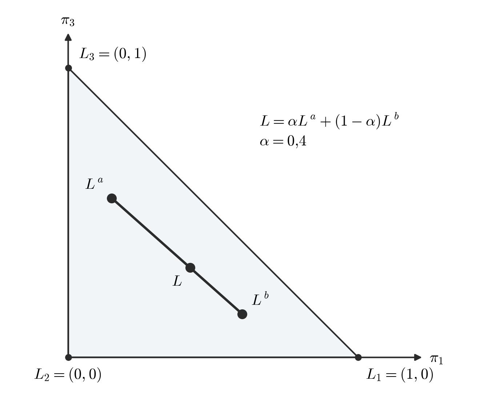
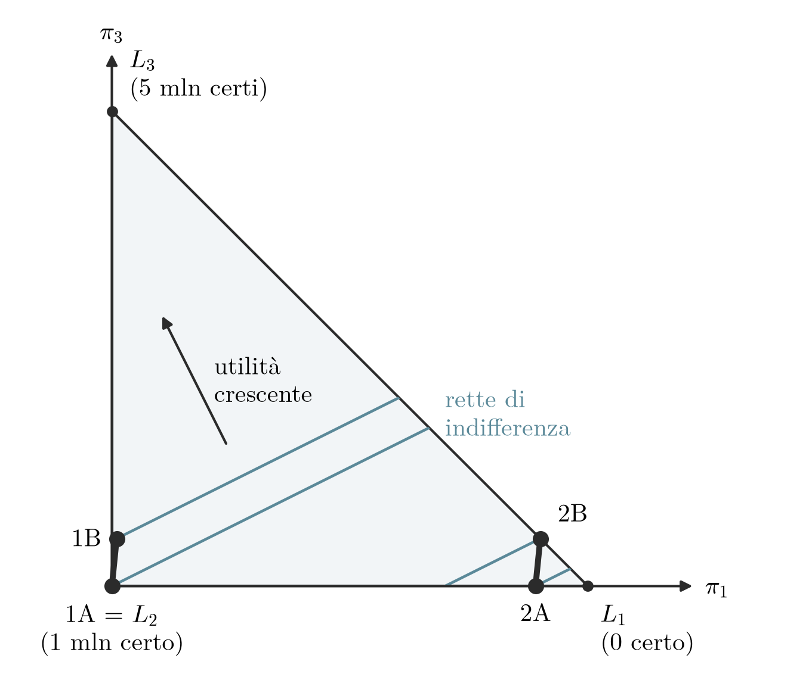

## Oggetto del capitolo

La teoria dell'utilità attesa (TUA) è il modello di scelta fra lotterie su cui si regge il resto del corso. Il capitolo definisce le lotterie e il modo di combinarle, enuncia gli assiomi che le preferenze di un agente devono soddisfare perché esista una rappresentazione come utilità attesa e dimostra il teorema di rappresentazione di von Neumann e Morgenstern. L'ultima parte presenta due paradossi sperimentali, di Allais e di Ellsberg, in cui le scelte osservate non sono compatibili con il modello.

Il capitolo segue il [[ERA 01 Ripasso|ripasso di matematica]], da cui riprende valore atteso e probabilità, e precede il [[ERA 03 Avversione al Rischio|capitolo sull'avversione al rischio]], che usa la funzione di utilità $u$ qui introdotta per misurare il grado di avversione.

## Notazione e ipotesi

Le lotterie hanno un numero finito di premi (esiti), importi di denaro $x_s$ con $s\in S$, raccolti nell'insieme $\mathcal X=\{x_s\}_{s\in S}$, detto anche insieme degli stati (*state space*). Le probabilità sono oggettive e note, salvo nell'ultima sezione. Gli indici in alto distinguono lotterie diverse, $L^1,L^2,L^3$; un indice in basso, come in $L_s$, indica una lotteria degenere. Per le preferenze si usano $\succeq$ (almeno altrettanto buona), $\succ$ (strettamente preferita) e $\sim$ (indifferenza). Nei capitoli sulle assicurazioni, a cominciare da quello sulle [[ERA 07 Assicurazioni e Asimmetrie Informative|asimmetrie informative]], la lettera $L$ indica una perdita e non una lotteria. La lettera $\mathcal L$ indica qui l'insieme delle lotterie; nel ripasso di matematica e nel capitolo sull'azzardo morale indica la Lagrangiana.

## Lotterie semplici e composte

Un esempio elementare di lotteria: domani si può essere fortunati o sfortunati con uguale probabilità, e la lotteria paga 200 euro in caso di fortuna e 100 altrimenti. I due premi hanno probabilità $1/2$ ciascuno e il valore atteso è

$$\tfrac12\cdot200+\tfrac12\cdot100=150.$$

> [!abstract] Definizione
> Una **lotteria** $L$ è una variabile casuale che assume i valori dell'insieme finito $\mathcal X=\{x_s\}_{s\in S}$ con probabilità $\pi_s\ge0$, $\sum_{s\in S}\pi_s=1$. Il suo valore atteso è
>
> $$E[L]=\sum_{s\in S}\pi_s\,x_s.$$

Una lotteria si identifica con il vettore delle sue probabilità $(\pi_s)_{s\in S}$, e l'insieme di tutte le lotterie è $\mathcal L=\{(\pi_s)\in\mathbb R^S_+:\ \sum_s\pi_s=1\}$. Tutte le lotterie in gioco sono definite sullo stesso insieme di premi, l'unione dei premi che compaiono nelle singole lotterie, e a un premio che una lotteria non offre si assegna probabilità zero. La **lotteria degenere** $L_s$ assegna probabilità 1 al premio $x_s$.

Il premio di una lotteria può essere a sua volta una lotteria. Si partecipa, per esempio, a quella appena descritta con probabilità $2/3$, mentre con probabilità $1/3$ si ricevono 60 euro certi.

> [!abstract] Definizione
> Date due lotterie $L^a$ e $L^b$ e $\alpha\in[0,1]$, la **lotteria composta** $\alpha L^a+(1-\alpha)L^b$ dà con probabilità $\alpha$ l'esito di $L^a$ e con probabilità $1-\alpha$ quello di $L^b$. Le sue probabilità sui premi sono
>
> $$\pi_s=\alpha\,\pi^a_s+(1-\alpha)\,\pi^b_s,\qquad s\in S.$$

Conta soltanto la probabilità finale con cui si ottiene ciascun premio, non il modo in cui la lotteria si articola in stadi: una lotteria composta si identifica con la lotteria semplice che ha le stesse probabilità finali, e questa operazione si chiama riduzione. Nell'esempio i premi 200 e 100 hanno ciascuno probabilità $\frac23\cdot\frac12=\frac13$ e il premio 60 ha probabilità $\frac13$, per cui il valore atteso è

$$\tfrac13\cdot200+\tfrac13\cdot100+\tfrac13\cdot60=120.$$

Lo stesso valore si ottiene per un'altra via, dal valore atteso delle due lotterie componenti. La prima è la lotteria di partenza, con valore atteso 150; la seconda è il premio certo di 60 euro. Con $\alpha=\frac23$,

$$\tfrac23\Big[\tfrac12\cdot200+\tfrac12\cdot100\Big]+\tfrac13\cdot60=\tfrac23\cdot150+\tfrac13\cdot60=100+20=120.$$

L'uguaglianza dei due calcoli è un caso della linearità del valore atteso rispetto alle combinazioni di lotterie.

> [!tip] Teorema
> Per ogni coppia di lotterie $L^a,L^b$ e ogni $\alpha\in[0,1]$,
>
> $$E[\alpha L^a+(1-\alpha)L^b]=\alpha\,E[L^a]+(1-\alpha)\,E[L^b].$$

> [!note] Dimostrazione
> Le probabilità della lotteria composta sono $\alpha\pi^a_s+(1-\alpha)\pi^b_s$, quindi
>
> $$E[\alpha L^a+(1-\alpha)L^b]=\sum_s\big(\alpha\pi^a_s+(1-\alpha)\pi^b_s\big)x_s=\alpha\sum_s\pi^a_sx_s+(1-\alpha)\sum_s\pi^b_sx_s,$$
>
> che è il membro di destra.

## Il triangolo di Machina

Con tre premi $x_1<x_2<x_3$ una lotteria è $L=(\pi_1,\pi_2,\pi_3)$ con $\pi_2=1-\pi_1-\pi_3$: è determinata dalla coppia $(\pi_1,\pi_3)$. L'insieme di tutte le lotterie sui tre premi è il triangolo di Machina

$$T=\{(\pi_1,\pi_3)\in\mathbb R^2:\ \pi_1\ge0,\ \pi_3\ge0,\ \pi_1+\pi_3\le1\},$$

con $\pi_1$ sull'asse orizzontale e $\pi_3$ sull'asse verticale. I tre vertici sono le lotterie degeneri: $(1,0)$ dà $x_1$ con certezza, $(0,1)$ dà $x_3$ con certezza e $(0,0)$ dà $x_2$ con certezza. Su ciascun lato una probabilità è nulla: sulla base $\pi_3=0$ i premi possibili sono $x_1$ e $x_2$, sul lato sinistro $\pi_1=0$ sono $x_2$ e $x_3$, sull'ipotenusa $\pi_1+\pi_3=1$ sono $x_1$ e $x_3$.

La lotteria composta $L=\alpha L^a+(1-\alpha)L^b$ ha coordinate $\pi_i=\alpha\pi^a_i+(1-\alpha)\pi^b_i$, per $i=1,3$: è il punto del segmento che unisce $L^a$ e $L^b$, più vicino a $L^a$ quanto più $\alpha$ è vicino a 1. Il triangolo si disegna spesso equilatero, con le tre probabilità $(\pi_1,\pi_2,\pi_3)$ come coordinate baricentriche. È la stessa figura a meno di una trasformazione affine, che conserva le rette e il parallelismo, e le conclusioni del capitolo non dipendono dalla scelta.

**Figura 1** — Il triangolo di Machina per tre premi $x_1<x_2<x_3$: i vertici sono le lotterie degeneri $L_1$, $L_2$, $L_3$ e la lotteria composta $L=\alpha L^a+(1-\alpha)L^b$ sta sul segmento che unisce $L^a$ e $L^b$. Il disegno è una ricostruzione, con $L^a$, $L^b$ e $\alpha$ scelti a titolo di esempio.

## Preferenze e utilità attesa

Il valore atteso del denaro non spiega da solo le preferenze degli agenti fra lotterie; la sezione sul paradosso di Allais ne dà un esempio numerico. Von Neumann e Morgenstern (1944; la derivazione assiomatica dell'utilità numerica è nell'appendice dell'edizione del 1947) hanno sviluppato una teoria per rappresentare queste preferenze.

L'agente ha una relazione di preferenza $\succeq$ fra lotterie. Come nella teoria del consumatore, una relazione completa (due lotterie qualsiasi sono confrontabili), transitiva e continua, nel senso che sono chiusi gli insiemi delle lotterie almeno buone quanto una data e quelli delle lotterie non migliori di essa, ammette una rappresentazione con una funzione di utilità continua $V$, cioè $L^1\succeq L^2\iff V(L^1)\ge V(L^2)$. Completezza e transitività da sole non bastano: le preferenze lessicografiche sono complete e transitive e non hanno una funzione di utilità. Per le lotterie la continuità entra come assioma nella sezione seguente, in una forma diversa che riguarda le combinazioni di due lotterie.

L'obiettivo è trovare condizioni sotto cui $\succeq$ abbia una rappresentazione con **utilità attesa**,

$$U(L)=\sum_{s\in S}\pi_s\,u_s,\qquad u_s=u(x_s).$$

Qui $u$ è la funzione di utilità di Bernoulli, che assegna a ogni importo $x$ un'utilità $u(x)$ ed è crescente, perché l'agente preferisce più denaro a meno. In questa forma, scritta anche $U(L)=E[u(L)]$, l'utilità di una lotteria è la media delle utilità dei suoi premi pesate con le loro probabilità. La concavità di $u$ e l'avversione al rischio non si assumono qui: sono l'oggetto del capitolo successivo.

Avere la forma $\sum_s\pi_su_s$ equivale a richiedere che $U$ sia lineare nelle combinazioni di lotterie:

$$U\big(\alpha L^1+(1-\alpha)L^2\big)=\alpha\,U(L^1)+(1-\alpha)\,U(L^2).$$

Il membro di sinistra è l'utilità di una lotteria composta, quello di destra la media ponderata delle utilità delle lotterie componenti. L'equivalenza si dimostra più avanti.

## Gli assiomi

Oltre a essere completa e transitiva, la relazione $\succeq$ soddisfa due assiomi.

> [!abstract] Definizione
> La relazione $\succeq$ soddisfa la **continuità** (C) se, date tre lotterie con $L^1\succeq L^2\succeq L^3$, esiste $\alpha\in[0,1]$ tale che
>
> $$L^2\sim\alpha L^1+(1-\alpha)L^3.$$
>
> Soddisfa l'**indipendenza** (IIA) se, per ogni terna $L^1,L^2,L^3$ e ogni $\alpha\in(0,1]$,
>
> $$L^1\succeq L^2\iff\alpha L^1+(1-\alpha)L^3\succeq\alpha L^2+(1-\alpha)L^3.$$

Nel corso l'assioma si chiama indipendenza delle alternative irrilevanti (IIA, *independence of irrelevant alternatives*). Nei testi lo stesso nome indica un'altra condizione, sulla scelta fra insiemi di alternative, e l'assioma di cui si parla qui si chiama semplicemente indipendenza. Il caso $\alpha=0$ è escluso perché renderebbe falsa l'equivalenza: le due combinazioni coinciderebbero con $L^3$ qualunque siano $L^1$ e $L^2$.

Le due implicazioni dell'equivalenza hanno due conseguenze. Se $L^1\sim L^2$, ciascuna delle due è preferita o indifferente all'altra e le due combinazioni sono indifferenti: l'indifferenza si conserva nelle combinazioni con una terza lotteria. Se $L^1\succ L^2$, l'implicazione da sinistra a destra dà che la prima combinazione è almeno buona quanto la seconda. Se anche la seconda fosse almeno buona quanto la prima, l'implicazione da destra a sinistra, con i ruoli di $L^1$ e $L^2$ scambiati, darebbe $L^2\succeq L^1$, contro l'ipotesi. Si conserva quindi anche la preferenza stretta. Le due proprietà servono nella dimostrazione del teorema.

L'assioma di continuità esprime l'idea che piccole variazioni delle probabilità non cambiano la natura dell'ordinamento. Da sola la forma (C) riguarda solo i segmenti che uniscono due lotterie e non basta a garantire una rappresentazione continua. Insieme all'indipendenza equivale alle altre formulazioni in uso, per esempio quella che richiede chiusi gli insiemi delle lotterie almeno buone quanto una data e quelli delle lotterie non migliori di essa. La rappresentazione che il teorema costruisce è lineare, quindi continua.

L'indipendenza dice che le preferenze di un agente fra due lotterie non cambiano se ciascuna viene combinata, con lo stesso peso, con una terza lotteria. Nella teoria del consumatore non ha un analogo, perché i panieri di beni non si combinano come le lotterie.

## Il teorema dell'utilità attesa

> [!tip] Teorema
> Sia $\succeq$ una relazione di preferenza fra lotterie, completa e transitiva, che soddisfa la continuità (C) e l'indipendenza. Allora esiste una collezione di numeri $\{u_s\}_{s\in S}$ tale che, per ogni coppia di lotterie $L^1=\{\pi^1_s\}_{s\in S}$ e $L^2=\{\pi^2_s\}_{s\in S}$,
>
> $$L^1\succeq L^2\iff U(L^1)\ge U(L^2),\qquad U(L^i)=\sum_{s\in S}\pi^i_s\,u_s,\quad i=1,2.$$

L'insieme dei premi è finito e le probabilità sono note. La dimostrazione procede in tre passi. Si mostra, con l'indipendenza, che esistono una migliore e una peggiore lotteria in assoluto. Con la continuità si scrive ogni lotteria come indifferente a una combinazione della migliore e della peggiore, e il peso della migliore in quella combinazione ne misura l'utilità. Con l'indipendenza si mostra che questo peso è lineare nelle combinazioni e ordina le lotterie come le preferenze.

## Dimostrazione del teorema

### Preferenze lineari e utilità attesa

Il primo risultato lega la forma $\sum_s\pi_su_s$ alla linearità. Una funzione $U$ sulle lotterie è lineare se $U(\beta L^1+(1-\beta)L^2)=\beta U(L^1)+(1-\beta)U(L^2)$ per ogni $L^1,L^2$ e ogni $\beta\in[0,1]$. Le preferenze si dicono lineari se hanno una rappresentazione $U$ lineare.

> [!tip] Teorema
> (Linearità e utilità attesa.) Una funzione $U$ sulle lotterie è lineare se e solo se esistono numeri $u_s$, $s\in S$, tali che $U(L)=\sum_s\pi_su_s$ per ogni lotteria $L=(\pi_s)_{s\in S}$. In tal caso $u_s=U(L_s)$.

> [!note] Dimostrazione
> *Se.* Le probabilità della combinazione $\beta L^1+(1-\beta)L^2$ sono $\beta\pi^1_s+(1-\beta)\pi^2_s$, quindi
>
> $$U\big(\beta L^1+(1-\beta)L^2\big)=\sum_s\big(\beta\pi^1_s+(1-\beta)\pi^2_s\big)u_s=\beta U(L^1)+(1-\beta)U(L^2).$$
>
> *Solo se.* Si pone $u_s=U(L_s)$. Una lotteria $L$ è la combinazione $\sum_s\pi_sL_s$ delle lotterie degeneri, con pesi $\pi_s$ (una combinazione di più lotterie si definisce come quella di due: le probabilità finali sono le somme pesate; per riduzione quelle sui premi sono le $\pi_s$). Si procede per induzione sul numero $n$ di premi con probabilità positiva. Per $n=1$ la lotteria è degenere, $L=L_s$, e $U(L_s)=u_s$ per definizione. Sia $n>1$ e si numerino i premi con probabilità positiva in modo che l'ultimo sia $x_n$, con $\pi_n<1$. Si ha
>
> $$L=(1-\pi_n)\,L'+\pi_n\,L_n,\qquad L'=\sum_{s<n}\frac{\pi_s}{1-\pi_n}\,L_s,$$
>
> dove $L'$ ha $n-1$ premi con probabilità positiva e pesi normalizzati. La linearità e l'ipotesi induttiva danno
>
> $$U(L)=(1-\pi_n)\,U(L')+\pi_n\,U(L_n)=(1-\pi_n)\sum_{s<n}\frac{\pi_s}{1-\pi_n}\,u_s+\pi_nu_n=\sum_s\pi_su_s.$$

### Migliore e peggiore lotteria

Se $\succeq$ ha una rappresentazione continua $V$, una migliore e una peggiore lotteria esistono per il teorema di Weierstrass: l'insieme $\mathcal L$ delle lotterie è un sottoinsieme chiuso e limitato di $\mathbb R^S$, quindi compatto, e $V$ ha su $\mathcal L$ un massimo e un minimo. Una $V$ continua, però, è una conseguenza del teorema che si sta dimostrando: la forma (C) da sola non la garantisce, e usarla qui renderebbe circolare la dimostrazione. Con un numero finito di premi l'esistenza si dimostra senza $V$, e una migliore e una peggiore lotteria si possono scegliere degeneri.

> [!tip] Teorema
> (Migliore e peggiore lotteria.) Siano $\overline L$ e $\underline L$ una migliore e una peggiore fra le lotterie degeneri $L_s$, che esistono perché sono in numero finito e $\succeq$ è completa e transitiva. Allora $\overline L\succeq L\succeq\underline L$ per ogni lotteria $L$.

> [!note] Dimostrazione
> Per induzione sul numero $n$ di premi con probabilità positiva. Per $n=1$ la lotteria è degenere e la tesi vale per costruzione. Sia $n>1$. Come nella dimostrazione del teorema di linearità, $L=(1-\pi_n)L'+\pi_nL_n$ con $0<\pi_n<1$ e $L'$ con $n-1$ premi con probabilità positiva, per cui $\overline L\succeq L'$ per ipotesi induttiva e $\overline L\succeq L_n$ per definizione. L'indipendenza, prima con peso $1-\pi_n$ e terza lotteria $\overline L$, poi con peso $\pi_n$ e terza lotteria $L'$, dà
>
> $$\overline L=(1-\pi_n)\overline L+\pi_n\overline L\ \succeq\ (1-\pi_n)L'+\pi_n\overline L\ \succeq\ (1-\pi_n)L'+\pi_nL_n=L,$$
>
> e per transitività $\overline L\succeq L$. Lo stesso argomento con i versi rovesciati dà $L\succeq\underline L$.

Se $\overline L\sim\underline L$, ogni lotteria è indifferente a entrambe: l'agente è indifferente fra tutte le lotterie e il teorema vale con tutte le utilità $u_s$ uguali. Nel seguito si assume $\overline L\succ\underline L$.

### Decomposizione di una lotteria

Per ogni $L$ vale $\overline L\succeq L\succeq\underline L$, e la continuità (C) dà $\alpha\in[0,1]$ tale che

$$L\sim\alpha\,\overline L+(1-\alpha)\,\underline L.$$

L'intervallo è chiuso: per $L=\overline L$ si ha $\alpha=1$ e per $L=\underline L$ si ha $\alpha=0$. Il coefficiente $\alpha$ è unico, come mostra il lemma seguente, e si indica con $\alpha(L)$. Per due lotterie si scrive $\alpha^i=\alpha(L^i)$.

> [!tip] Teorema
> (Lemma di monotonia.) Se $1\ge a>b\ge0$, allora
>
> $$a\,\overline L+(1-a)\,\underline L\ \succ\ b\,\overline L+(1-b)\,\underline L.$$

> [!note] Dimostrazione
> Si pone $M=a\overline L+(1-a)\underline L$. Da $\overline L\succ\underline L$ e dall'indipendenza, nella forma che conserva la preferenza stretta, con peso $a>0$ e terza lotteria $\underline L$, segue $M\succ a\underline L+(1-a)\underline L=\underline L$. Con $t=b/a\in[0,1)$ si ha $tM+(1-t)\underline L=ta\,\overline L+(1-ta)\,\underline L=b\,\overline L+(1-b)\,\underline L$. Da $M\succ\underline L$, con peso $1-t>0$ e terza lotteria $M$, si ottiene
>
> $$M=tM+(1-t)M\ \succ\ tM+(1-t)\underline L=b\,\overline L+(1-b)\,\underline L.$$

Se una lotteria $L$ fosse indifferente a due combinazioni con coefficienti diversi $a>b$, queste sarebbero indifferenti fra loro per transitività, in contrasto con il lemma: $\alpha(L)$ è una funzione di $L$, con $\alpha(\overline L)=1$ e $\alpha(\underline L)=0$.

### Il coefficiente di decomposizione è lineare

Si considerino $L^1$, $L^2$ e $\beta\in(0,1)$ (i casi $\beta=0$ e $\beta=1$ sono immediati). Si applica due volte l'indipendenza, nella forma che conserva l'indifferenza. La prima volta si sostituisce $L^1$ con la lotteria indifferente $\alpha^1\overline L+(1-\alpha^1)\underline L$, con peso $\beta$ e terza lotteria $L^2$; la seconda volta si sostituisce allo stesso modo $L^2$ con $\alpha^2\overline L+(1-\alpha^2)\underline L$, con peso $1-\beta$ e terza lotteria $\alpha^1\overline L+(1-\alpha^1)\underline L$, e si conclude per transitività. Si ottiene

$$\beta L^1+(1-\beta)L^2\sim\beta\big[\alpha^1\overline L+(1-\alpha^1)\underline L\big]+(1-\beta)\big[\alpha^2\overline L+(1-\alpha^2)\underline L\big]=\alpha'\,\overline L+(1-\alpha')\,\underline L,$$

con $\alpha'=\beta\alpha^1+(1-\beta)\alpha^2$, che è la somma dei pesi con cui compare $\overline L$. Per l'unicità del coefficiente,

$$\alpha\big(\beta L^1+(1-\beta)L^2\big)=\beta\,\alpha(L^1)+(1-\beta)\,\alpha(L^2),$$

cioè $\alpha$ è lineare.

### Il coefficiente rappresenta le preferenze

> [!tip] Teorema
> Per ogni coppia di lotterie, $L^1\succeq L^2\iff\alpha^1\ge\alpha^2$.

> [!note] Dimostrazione
> *Solo se.* Sia $L^1\succeq L^2$. Poiché $L^1\succeq L^2\succeq\underline L$, la continuità dà $\delta\in[0,1]$ tale che $L^2\sim\delta L^1+(1-\delta)\underline L$. Sostituendo a $L^1$ la combinazione equivalente (indipendenza; il caso $\delta=0$ è immediato) e riordinando i pesi,
>
> $$L^2\sim\delta L^1+(1-\delta)\underline L\sim\delta\big(\alpha^1\overline L+(1-\alpha^1)\underline L\big)+(1-\delta)\underline L=\delta\alpha^1\,\overline L+\big(1-\delta\alpha^1\big)\underline L.$$
>
> Per l'unicità del coefficiente $\alpha^2=\delta\alpha^1\le\alpha^1$.
>
> *Se.* Sia $\alpha^1\ge\alpha^2$. Se $\alpha^2=1$ allora $\alpha^1=1$, $L^1\sim\overline L\sim L^2$ e la tesi è immediata. Sia $\alpha^2<1$ e si ponga
>
> $$\theta=\frac{\alpha^1-\alpha^2}{1-\alpha^2}\in[0,1],$$
>
> che vale 0 se $\alpha^1=\alpha^2$ e 1 se $\alpha^1=1$. Vale l'identità $\theta+(1-\theta)\alpha^2=\alpha^1$, per cui
>
> $$L^1\sim\alpha^1\overline L+(1-\alpha^1)\underline L=\theta\,\overline L+(1-\theta)\big[\alpha^2\overline L+(1-\alpha^2)\underline L\big]\sim\theta\,\overline L+(1-\theta)L^2.$$
>
> L'ultima indifferenza viene dall'indipendenza applicata a $\alpha^2\overline L+(1-\alpha^2)\underline L\sim L^2$, con peso $1-\theta$ e terza lotteria $\overline L$. Poiché $\overline L\succeq L^2$ per il teorema sulla migliore e la peggiore lotteria, l'indipendenza con peso $\theta$ e terza lotteria $L^2$ dà
>
> $$\theta\,\overline L+(1-\theta)L^2\succeq\theta L^2+(1-\theta)L^2=L^2.$$
>
> I due usi dell'indipendenza richiedono $0<\theta<1$, e per questi valori $L^1\succeq L^2$ segue per transitività. Nei casi estremi la tesi è immediata. Con $\theta=0$, cioè $\alpha^1=\alpha^2$, $L^1$ e $L^2$ sono indifferenti alla stessa combinazione di $\overline L$ e $\underline L$, quindi $L^1\sim L^2$. Con $\theta=1$, cioè $\alpha^1=1$, si ha $L^1\sim\overline L\succeq L^2$.

### La forma dell'utilità attesa

La funzione $U(L)=\alpha(L)$ ordina le lotterie come le preferenze, per il teorema appena dimostrato, ed è lineare. Per il teorema di linearità vale $U(L)=\sum_s\pi_su_s$ con $u_s=\alpha(L_s)=U(L_s)$, dove $L_s$ è la lotteria degenere sul premio $x_s$. Si è ottenuto

$$L^1\succeq L^2\iff\alpha(L^1)\ge\alpha(L^2)\iff U(L^1)\ge U(L^2),$$

che è la tesi.

## Le rette di indifferenza nel triangolo

Si considerino tre premi $x_1<x_2<x_3$ con utilità $u_s=u(x_s)$, per cui $u_1<u_2<u_3$ perché $u$ è crescente. L'utilità attesa del punto $(\pi_1,\pi_3)$ del triangolo è

$$U(\pi_1,\pi_3)=\pi_1u_1+(1-\pi_1-\pi_3)\,u_2+\pi_3u_3=u_2+\pi_1(u_1-u_2)+\pi_3(u_3-u_2).$$

È una funzione affine delle coordinate. Le curve di indifferenza, lungo le quali $U$ è costante, sono rette parallele: su una di esse $(u_1-u_2)\,d\pi_1+(u_3-u_2)\,d\pi_3=0$, da cui

$$\frac{d\pi_3}{d\pi_1}=\frac{u_2-u_1}{u_3-u_2}>0.$$

L'utilità cresce verso nord-ovest, quando $\pi_3$ aumenta e $\pi_1$ diminuisce. Se ne ricava una proprietà delle preferenze, che discende dall'indipendenza. Siano $L^aL^b$ e $M^aM^b$ due segmenti paralleli e con lo stesso orientamento, cioè $L^b-L^a=c\,(M^b-M^a)$ con $c>0$. La differenza $U(L^b)-U(L^a)=(u_1-u_2)(\pi^b_1-\pi^a_1)+(u_3-u_2)(\pi^b_3-\pi^a_3)$ dipende linearmente dal vettore $L^b-L^a$, per cui $U(L^b)-U(L^a)=c\,[U(M^b)-U(M^a)]$ e le due differenze hanno lo stesso segno:

$$L^a\succeq L^b\iff M^a\succeq M^b.$$

La linearità ha altre due conseguenze nel triangolo. Con $L_1,L_2,L_3$ i tre vertici, vale $U(L)=\pi_1U(L_1)+\pi_2U(L_2)+\pi_3U(L_3)$: $U(L)$ è una media ponderata delle utilità dei vertici. Senza l'ipotesi che $u$ sia crescente, se l'agente è indifferente fra i tre vertici, è indifferente fra tutte le lotterie del triangolo: la sua curva di indifferenza è l'intero triangolo. In generale $U(L)$ sta fra la più bassa e la più alta delle utilità dei vertici, per cui la migliore e la peggiore lotteria si trovano fra i vertici: con $u$ crescente, $\overline L=L_3$ e $\underline L=L_1$.

## Il paradosso di Allais

Nel primo esperimento si sceglie fra due opzioni. L'opzione 1A dà un milione di euro con certezza. L'opzione 1B dà un milione con probabilità 89%, nulla con probabilità 1% e cinque milioni con probabilità 10%. Nel secondo esperimento le opzioni sono 2A, che dà nulla con probabilità 89% e un milione con probabilità 11%, e 2B, che dà nulla con probabilità 90% e cinque milioni con probabilità 10%. Le probabilità sono riassunte nella tabella.

| Opzione | Nulla | 1 milione | 5 milioni |
|---|---|---|---|
| 1A | 0% | 100% | 0% |
| 1B | 1% | 89% | 10% |
| 2A | 89% | 11% | 0% |
| 2B | 90% | 0% | 10% |

Molte persone scelgono 1A nel primo esperimento e 2B nel secondo. Un agente che valutasse le opzioni con il valore atteso, in milioni, avrebbe 1 per 1A e 1,39 per 1B, 0,11 per 2A e 0,5 per 2B, e sceglierebbe 1B e 2B: il valore atteso non descrive la scelta tipica. Si mostra ora che le scelte tipiche violano l'indipendenza e che nessuna funzione $u$ può rappresentarle.

### Violazione dell'indipendenza

Le quattro opzioni si riscrivono come lotterie composte. Si indica con $[x]$ la lotteria che dà $x$ milioni con certezza (è la lotteria degenere $L_s$ con $x_s=x$), e si pongono $A'=[1]$ e $B'$ la lotteria che dà nulla con probabilità $\frac1{11}$ e cinque milioni con probabilità $\frac{10}{11}$. Con peso $\alpha=0{,}11$,

$$1A=0{,}11\,A'+0{,}89\,[1],\qquad 1B=0{,}11\,B'+0{,}89\,[1],$$

$$2A=0{,}11\,A'+0{,}89\,[0],\qquad 2B=0{,}11\,B'+0{,}89\,[0].$$

Si verifica per esempio che $0{,}11\,B'$ dà nulla con probabilità $0{,}01$ e cinque milioni con probabilità $0{,}10$: aggiungendo $0{,}89\,[1]$ si ottiene 1B, aggiungendo $0{,}89\,[0]$ si ottiene 2B, che dà nulla con probabilità $0{,}89+0{,}01=0{,}90$. Le due coppie differiscono solo per la componente comune, $[1]$ nel primo esperimento e $[0]$ nel secondo, con lo stesso peso $0{,}89$. L'indipendenza, con $L^1=A'$, $L^2=B'$ e terza lotteria $[1]$ oppure $[0]$, dà

$$1A\succeq1B\iff A'\succeq B'\iff2A\succeq2B.$$

Un agente che preferisce 1A a 1B deve preferire 2A a 2B, e la scelta tipica, 1A e 2B, la viola.

### Utilità attesa

Con la forma $U(L)=\sum_s\pi_su(x_s)$ le utilità delle quattro opzioni sono

$$U(1A)=u(1),\qquad U(1B)=0{,}89\,u(1)+0{,}01\,u(0)+0{,}10\,u(5),$$

$$U(2A)=0{,}89\,u(0)+0{,}11\,u(1),\qquad U(2B)=0{,}90\,u(0)+0{,}10\,u(5).$$

La scelta 1A rispetto a 1B vale se e solo se

$$u(1)>0{,}89\,u(1)+0{,}01\,u(0)+0{,}10\,u(5)\iff0{,}11\,u(1)>0{,}01\,u(0)+0{,}10\,u(5),$$

mentre la scelta 2B rispetto a 2A vale se e solo se $0{,}11\,u(1)<0{,}01\,u(0)+0{,}10\,u(5)$. Le due disuguaglianze sono incompatibili: la differenza $U(1A)-U(1B)=0{,}11\,u(1)-0{,}01\,u(0)-0{,}10\,u(5)$ coincide con $U(2A)-U(2B)$, per cui i due segni sono sempre uguali. Nessuna funzione $u$ rappresenta insieme le due scelte, e l'assioma violato è l'indipendenza.

### Lettura nel triangolo

Si usino i premi $x_1=0$, $x_2=1$ e $x_3=5$ milioni, con coordinate $(\pi_1,\pi_3)$ uguali alla probabilità di nulla e alla probabilità di cinque milioni. I quattro punti sono $1A=(0;\,0)$, $1B=(0{,}01;\,0{,}10)$, $2A=(0{,}89;\,0)$ e $2B=(0{,}90;\,0{,}10)$. I segmenti $1A\,1B$ e $2A\,2B$ hanno lo stesso vettore $(0{,}01;\,0{,}10)$: sono paralleli, con lo stesso orientamento e pendenza 10. Sotto utilità attesa $U(1B)-U(1A)=U(2B)-U(2A)=0{,}01\,\big(u(0)-u(1)\big)+0{,}10\,\big(u(5)-u(1)\big)$.

**Figura 2** — I punti $1A$, $1B$, $2A$, $2B$ dell'esperimento di Allais nel triangolo di Machina, con premi $0$, $1$ e $5$ milioni, e le rette di indifferenza tracciate per $u(0)=0$, $u(1)=1$, $u(5)=3$ (pendenza $\tfrac12$); l'utilità cresce verso nord-ovest. I segmenti paralleli $1A\,1B$ e $2A\,2B$ hanno pendenza 10. Il disegno è una ricostruzione dell'esempio.

Con rette di indifferenza parallele i due segmenti attraversano le rette nello stesso verso. Se $1B$ sta su una retta di utilità maggiore di quella di $1A$, anche $2B$ sta su una retta di utilità maggiore di quella di $2A$, e viceversa. Le scelte tipiche chiedono invece che l'utilità cresca sia passando da $1B$ a $1A$ sia passando da $2A$ a $2B$. I due spostamenti sono opposti, $(-0{,}01;\,-0{,}10)$ e $(0{,}01;\,0{,}10)$, e poiché $U$ è affine le due variazioni di utilità sono una l'opposta dell'altra, $U(1A)-U(1B)=-\big(U(2B)-U(2A)\big)$: non possono essere entrambe positive, qualunque sia la pendenza delle rette.

### Possibili spiegazioni

Ottenere nulla può essere percepito come una perdita nell'esperimento 1 e come la situazione di partenza (*status quo*) nell'esperimento 2. Nel primo esperimento un milione è l'esito certo di 1A e il più probabile di 1B, mentre nulla ha probabilità 0 in 1A e 1% in 1B; nel secondo nulla è l'esito più probabile di entrambe le opzioni. Conta il modo in cui il problema è presentato (*framing*, inquadratura). Le implicazioni toccano le politiche pubbliche, per esempio le politiche per l'innovazione e la contrattazione salariale.

## Il paradosso di Ellsberg

Un'urna contiene 30 palline rosse e 60 palline che sono nere o gialle in una proporzione ignota; ogni pallina ha la stessa probabilità di essere estratta. Con R, N e G si indicano gli eventi «pallina rossa», «nera» e «gialla», per cui $\mathbb P(\mathrm R)=\frac13$ mentre $\mathbb P(\mathrm N)$ e $\mathbb P(\mathrm G)$ sono ignote, con somma $\frac23$. Si fanno due scelte, ciascuna fra due opzioni che pagano 100 euro se si verifica un certo evento e nulla altrimenti.

| Scelta | Opzione | Paga 100 euro se la pallina è |
|---|---|---|
| 1 | A | rossa |
| 1 | B | nera |
| 2 | C | rossa o gialla |
| 2 | D | nera o gialla |

Le scelte tipiche sono $A\succ B$ e $D\succ C$. Sono incompatibili con l'utilità attesa, intesa con probabilità soggettive: poiché la proporzione di palline nere e gialle non è data, l'agente dovrebbe formarsi probabilità $\mathbb P(\mathrm R)$, $\mathbb P(\mathrm N)$, $\mathbb P(\mathrm G)$ e valutare le opzioni con esse. Il teorema dimostrato sopra presuppone probabilità oggettive e note, e l'inconsistenza riguarda qualunque assegnazione di probabilità soggettive.

Un'opzione che paga 100 euro con probabilità $q$ e nulla altrimenti ha utilità attesa $u(0)+q\,[u(100)-u(0)]$, per cui $A\succ B$ equivale a

$$\big(\mathbb P(\mathrm R)-\mathbb P(\mathrm N)\big)\big(u(100)-u(0)\big)>0,$$

e poiché $u(100)>u(0)$ a $\mathbb P(\mathrm R)>\mathbb P(\mathrm N)$, cioè $\mathbb P(\mathrm N)<\frac13$. Per $D\succ C$ le probabilità di pagare sono $\mathbb P(\mathrm N)+\mathbb P(\mathrm G)$ e $\mathbb P(\mathrm R)+\mathbb P(\mathrm G)$, la cui differenza è $\mathbb P(\mathrm N)-\mathbb P(\mathrm R)$, e la condizione diventa

$$\big(\mathbb P(\mathrm N)-\mathbb P(\mathrm R)\big)\big(u(100)-u(0)\big)>0,$$

da cui $\mathbb P(\mathrm N)>\mathbb P(\mathrm R)=\frac13$. Le due condizioni su $\mathbb P(\mathrm N)$ sono contraddittorie.

### Avversione all'ambiguità

La proporzione di palline gialle e nere non è specificata, e gli agenti sono avversi all'ambiguità: preferiscono le opzioni con probabilità note. Una formalizzazione è l'utilità max-min (Gilboa e Schmeidler, 1989). L'agente considera l'insieme dei modelli di probabilità compatibili con l'informazione, $\mathcal M=\{\mathbb P:\ \mathbb P(\mathrm R)=\tfrac13\}$, cioè $\mathbb P(\mathrm N)\in[0,\tfrac23]$ con $\mathbb P(\mathrm G)=\tfrac23-\mathbb P(\mathrm N)$, e valuta ogni opzione con il modello che ne minimizza l'utilità attesa:

$$U_{\min}(\text{opzione})=\min_{\mathbb P\in\mathcal M}\ E_{\mathbb P}[u(\text{pagamento})],$$

dove $E_{\mathbb P}$ è il valore atteso calcolato con la probabilità $\mathbb P$.

Il minimo è preso sull'utilità attesa al variare della probabilità in $\mathcal M$: se fosse preso sui premi, A e B varrebbero entrambe $u(0)$ e non si spiegherebbe $A\succ B$. Per il calcolo si pone $u(100)=1$ e $u(0)=0$. L'opzione A vale $\frac13$ per ogni modello di $\mathcal M$. L'opzione B vale $\mathbb P(\mathrm N)$, minimo 0 per $\mathbb P(\mathrm N)=0$: l'agente si comporta come se non ci fossero palline nere. L'opzione C vale $\frac13+\mathbb P(\mathrm G)$, minimo $\frac13$ per $\mathbb P(\mathrm G)=0$: l'agente si comporta come se non ci fossero palline gialle. L'opzione D vale $\mathbb P(\mathrm N)+\mathbb P(\mathrm G)=\frac23$ per ogni modello. I valori max-min sono

$$U_{\min}(A)=\tfrac13,\quad U_{\min}(B)=0,\quad U_{\min}(C)=\tfrac13,\quad U_{\min}(D)=\tfrac23,$$

e l'agente max-min sceglie $A\succ B$ e $D\succ C$, come si osserva.

Nei capitoli seguenti le scelte si descrivono con l'utilità attesa. Quando i premi sono livelli di ricchezza $W$ si scrive $E[u(W)]$, e il capitolo sull'avversione al rischio usa la forma $E[u(w+X)]$, per una ricchezza certa $w$ a cui si somma una lotteria $X$.
