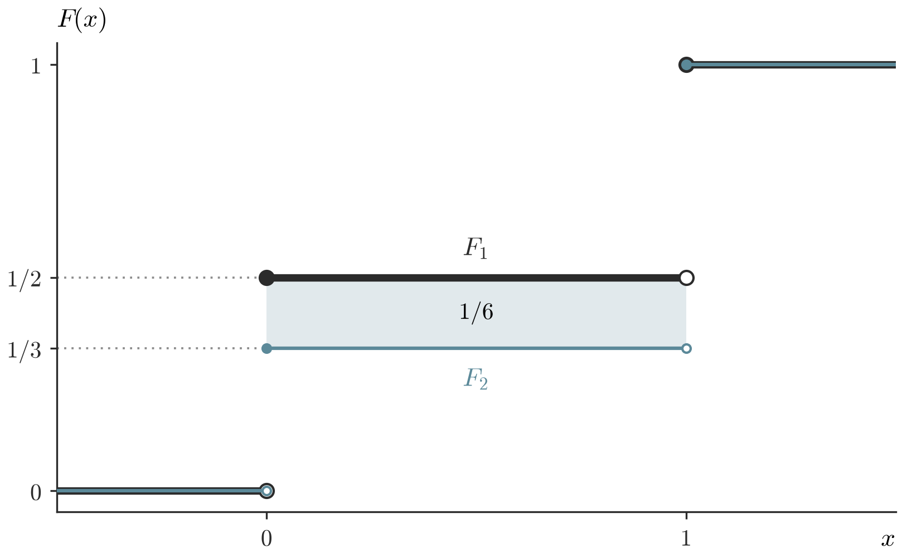
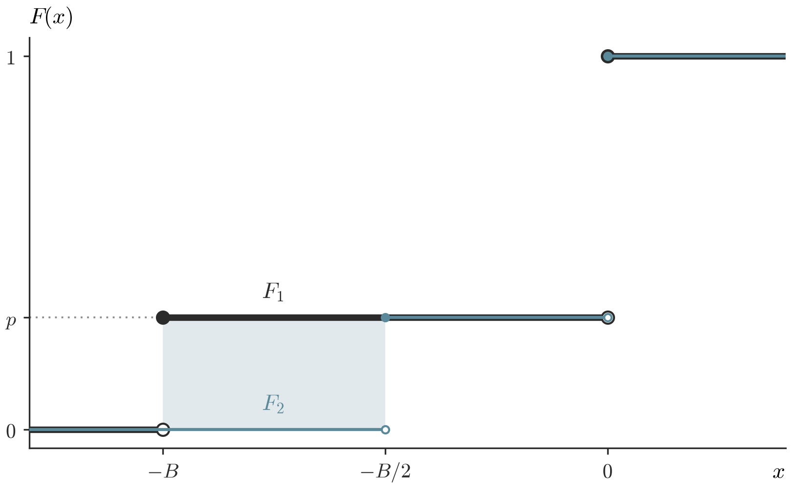
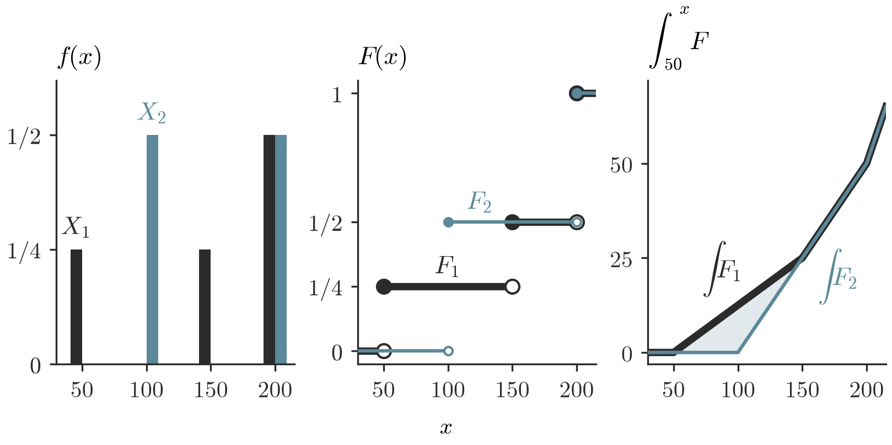

## Oggetto del capitolo

Il capitolo confronta lotterie con lo strumento dell'utilità attesa. Si colloca dopo l'[[ERA 03 Avversione al Rischio|avversione al rischio]] e prima del [[ERA 05 Portafoglio Ottimale|portafoglio ottimale]], che ne usa i risultati. Nel capitolo precedente la lotteria era fissa e variavano le preferenze dell'agente rispetto al rischio. Qui le preferenze si fissano e variano le lotterie.

L'obiettivo è un risultato di questa forma: se la funzione di utilità di Bernoulli di un agente appartiene a una certa classe, allora l'agente preferisce la lotteria 1 alla lotteria 2. Più grande è la classe, più difficile è concludere, perché la preferenza deve valere per ogni agente della classe e in generale due agenti della stessa classe ordinano alcune coppie di lotterie in modo opposto. Per quelle coppie nessuna lotteria domina l'altra e il confronto resta aperto.

Il capitolo considera due classi: le funzioni di utilità crescenti, a cui corrisponde la dominanza stocastica del primo ordine (FOSD, *first-order stochastic dominance*), e le funzioni crescenti e concave, a cui corrisponde la dominanza stocastica del secondo ordine (SOSD, *second-order stochastic dominance*). La seconda classe è contenuta nella prima: la FOSD chiede l'accordo di più agenti, ordina quindi meno coppie di lotterie, e implica la SOSD. Entrambe le dominanze si applicano alla condivisione del rischio in una comunità di agenti.

## Notazione e ipotesi

Una lotteria è una variabile casuale $X$ con funzione di ripartizione (c.d.f.) $F(x)=\mathbb P(X\le x)$. In questo capitolo i valori $x$ sono livelli finali di ricchezza o di reddito, non incrementi, e il valore atteso $E[X]$ può essere qualsiasi: la condizione $E[X]=0$ del capitolo precedente vale solo dove viene richiamata. Le lotterie confrontate hanno il supporto, cioè l'insieme dei premi (esiti) possibili, contenuto in un intervallo $[a,b]$, e la funzione di utilità di Bernoulli $u$ è definita su $[a,b]$. «Crescente» ha il senso debole di non decrescente, così che la classe comprenda anche le funzioni non strettamente crescenti.

Si indica con $E_F[u(X)]$ l'utilità attesa sotto la c.d.f. $F$: è $\sum_x u(x)f(x)$ per una lotteria discreta con funzione di probabilità (p.m.f.) $f$ e $\int u(x)f(x)\,dx$ per una lotteria con densità $f$, e si scrive anche $E_F[u(X)]=\int u\,dF$, scrittura che comprende i due casi. Se $X_i$ ha c.d.f. $F_i$, allora $E_{F_i}[u(X)]=E[u(X_i)]$. Il materiale del corso scrive la stessa grandezza $E[u\mid F]$: la barra indica la distribuzione con cui si calcola l'attesa, non un condizionamento, e qui si usa il pedice, per non confonderla con il valore atteso condizionato $E[\cdot\mid\cdot]$, che si introduce nella sezione seguente.

Una lotteria discreta si scrive come elenco di coppie (valore, probabilità): $X=(0,\tfrac12;\,1,\tfrac12)$ vale 0 e 1, ciascuno con probabilità $\tfrac12$. Con due c.d.f. $F_1$ e $F_2$, «$F_2$ domina $F_1$» si legge «$F_2$ è preferita»: le sezioni sulla dominanza del primo e del secondo ordine definiscono la dominanza con una condizione sulle c.d.f. e dimostrano che equivale a $E_{F_1}[u(X)]\le E_{F_2}[u(X)]$ per tutte le $u$ della classe considerata. Le espressioni «$F_2$ FOSD $F_1$» e «$F_2$ SOSD $F_1$» si leggono allo stesso modo. In questo capitolo $p$ è una probabilità e $B$ l'importo di uno shock, omonimi del premio della polizza e dell'indennizzo dei capitoli sulle [[ERA 07 Assicurazioni e Asimmetrie Informative|asimmetrie informative]] e sull'[[ERA 08 Assicurazioni e Azzardo Morale|azzardo morale]].

## Il valore atteso condizionato

La dimostrazione del risultato principale sulla SOSD usa il valore atteso condizionato. Siano $X$ e $Y$ due variabili casuali discrete con funzione di probabilità congiunta $f(x,y)=\mathbb P(X=x,Y=y)$ e funzione di probabilità marginale $f_X(x)=\sum_yf(x,y)$ di $X$.

> [!abstract] Definizione
> Sia $x$ un valore di $X$ con $f_X(x)>0$. La probabilità di $Y=y$ condizionata a $X=x$ è $f(x,y)/f_X(x)$. Il **valore atteso condizionato** di $g(x,Y)$, per una funzione $g$, dato $x$ è
>
> $$E[g(x,Y)\mid x]=\sum_yg(x,y)\,\frac{f(x,y)}{f_X(x)}.$$

Con $g(x,y)=y$ si ottiene la media di $Y$ calcolata sulla distribuzione che resta quando si sa che $X=x$. Come in $E_F$, il pedice di $E_X$ indica la distribuzione rispetto alla quale si calcola la media, qui quella di $X$. Il teorema seguente è la legge delle aspettative iterate, detta anche proprietà della torre.

> [!tip] Teorema
> Per ogni funzione $g$,
>
> $$E[g(X,Y)]=E_X\big[E[g(x,Y)\mid x]\big].$$

> [!note] Dimostrazione
> Per definizione di valore atteso, $E[g(X,Y)]=\sum_{x,y}g(x,y)f(x,y)$. I termini con $f_X(x)=0$ sono nulli, perché allora $f(x,y)=0$ per ogni $y$, e per gli altri si può moltiplicare e dividere per $f_X(x)$:
>
> $$E[g(X,Y)]=\sum_xf_X(x)\sum_yg(x,y)\,\frac{f(x,y)}{f_X(x)}=\sum_xf_X(x)\,E[g(x,Y)\mid x]=E_X\big[E[g(x,Y)\mid x]\big].$$

Un caso particolare serve in tutto il capitolo: aggiungere a $X$ un termine a media condizionata nulla non ne cambia la media.

> [!tip] Teorema
> Se $E[Y\mid x]=0$ per ogni $x$ nel supporto di $X$, allora $E[X+Y]=E[X]$.

> [!note] Dimostrazione
> Si applica la proprietà della torre con $g(x,y)=x+y$. Dato $x$, il valore $x$ è una costante: per linearità $E[x+Y\mid x]=x+E[Y\mid x]$, e per ipotesi $E[Y\mid x]=0$:
>
> $$E[X+Y]=E_X\big[E[x+Y\mid x]\big]=E_X\big[x+E[Y\mid x]\big]=E_X[x]=E[X].$$

La media condizionata nulla è una condizione più debole dell'indipendenza con $E[Y]=0$. Se $X$ e $Y$ sono indipendenti, $f(x,y)=f_X(x)f_Y(y)$ e la probabilità condizionata di $Y=y$ è $f_Y(y)$ per ogni $x$. Ne segue $E[Y\mid x]=E[Y]$, che con $E[Y]=0$ dà $E[Y\mid x]=0$. Il viceversa è falso, perché la distribuzione di $Y$ può cambiare con $x$ pur avendo sempre media nulla, come nell'esempio della sezione sul *mean-preserving spread*. Le stesse definizioni valgono per variabili con densità congiunta $f(x,y)$, con le densità al posto delle funzioni di probabilità e gli integrali al posto delle somme, e la proprietà della torre si dimostra allo stesso modo. Se $Y$ è indipendente da $X$, la distribuzione di $Y$ condizionata a $X=x$ è la sua distribuzione marginale per ogni $x$. È la versione che serve con le normali, per le quali $\mathbb P(X=x)=0$ per ogni $x$.

## Dominanza stocastica del primo ordine

Si cerca la condizione sulle c.d.f. $F_1$ e $F_2$ per cui $E_{F_1}[u(X)]\le E_{F_2}[u(X)]$ per ogni funzione $u$ crescente. La risposta è la dominanza stocastica del primo ordine.

> [!abstract] Definizione
> $F_2$ **domina al primo ordine** $F_1$ (FOSD) se $F_2(x)\le F_1(x)$ per ogni $x\in[a,b]$.

Poiché $\mathbb P(X_i>x)=1-F_i(x)$, la condizione dice che $X_2$ supera ogni soglia $x$ con probabilità almeno pari a quella di $X_1$: $F_2$ mette più massa sui valori alti.

> [!tip] Teorema
> Sono equivalenti: (a) $F_2(x)\le F_1(x)$ per ogni $x\in[a,b]$; (b) $E_{F_1}[u(X)]\le E_{F_2}[u(X)]$ per ogni funzione $u$ crescente su $[a,b]$.

Le dimostrazioni di questo capitolo poggiano su un'identità. Sia $X$ una lotteria con valori in $[a,b]$ e $u$ derivabile. Per ogni $x\in[a,b]$ si ha $u(x)=u(b)-\int_a^bu'(t)\,\mathbf 1_{\{x\le t\}}\,dt$, dove $\mathbf 1_{\{x\le t\}}$ vale 1 se $x\le t$ e 0 altrimenti: l'integrale è $\int_x^bu'(t)\,dt$. Si sostituisce $X$ a $x$ e si prende il valore atteso, osservando che $E[\mathbf 1_{\{X\le t\}}]=\mathbb P(X\le t)=F(t)$:

$$E_F[u(X)]=u(b)-\int_a^bu'(t)\,F(t)\,dt.$$

La formula ha la forma dell'integrazione per parti del [[ERA 01 Ripasso|ripasso]], che però chiede funzioni continuamente derivabili, mentre le c.d.f. delle lotterie discrete sono a gradini. La derivazione con la funzione indicatrice non usa la derivata di $F$: l'identità vale per ogni c.d.f., e per ogni $u$ continua e derivabile salvo un numero finito di punti, con $u'$ integrabile, come le funzioni lineari a tratti. Con $u(x)=x$ l'identità dà $E[X]=b-\int_a^bF(t)\,dt$. Per due lotterie la differenza delle utilità attese è

$$E_{F_2}[u(X)]-E_{F_1}[u(X)]=\int_a^bu'(t)\,\big[F_1(t)-F_2(t)\big]\,dt.$$

> [!note] Dimostrazione
> *(a) implica (b).* Sia $u$ crescente e derivabile, con $u'\ge0$. Per (a), $F_1(t)-F_2(t)\ge0$ per ogni $t$: l'integranda della differenza è non negativa, e lo è anche l'integrale.
>
> *(b) implica (a).* Si fissa $x^*\in[a,b]$ e si sceglie $u(x)=\mathbf 1_{\{x>x^*\}}$, che è crescente: vale 0 fino a $x^*$ e 1 dopo. Allora $E_F[u(X)]=\mathbb P(X>x^*)=1-F(x^*)$, e (b) diventa $1-F_1(x^*)\le1-F_2(x^*)$, cioè $F_2(x^*)\le F_1(x^*)$. Il punto $x^*$ è arbitrario.

La dimostrazione che (a) implica (b) tratta le $u$ derivabili. Lo stesso argomento vale per le $u$ continue e derivabili salvo un numero finito di punti, come le lineari a tratti, perché per queste vale l'identità. Per una $u$ crescente qualsiasi il teorema vale lo stesso, ma qui non si dimostra. Se $F_2(x_0)<F_1(x_0)$ in un punto e $u$ è strettamente crescente, la disuguaglianza (b) è stretta: le c.d.f. sono continue da destra, per cui $F_1-F_2$ resta positiva su un intervallo a destra di $x_0$, dove l'integrale di $u'$ è positivo.

Con $u(x)=x$ si vede che la FOSD implica $E[X_2]\ge E[X_1]$. Il viceversa è falso: una media più alta non basta. Se $X_1=1$ con certezza e $X_2=(0,\tfrac12;\,4,\tfrac12)$, si ha $E[X_2]=2>1=E[X_1]$, ma $F_2(0)=\tfrac12>0=F_1(0)$, per cui $F_2$ non domina $F_1$ al primo ordine, e la funzione crescente $u(x)=\min(x,1)$ dà $E[u(X_2)]=\tfrac12<1=E[u(X_1)]$. A medie uguali la FOSD è esclusa, salvo che le due distribuzioni coincidano. Se $F_2$ domina $F_1$ al primo ordine e $E[X_1]=E[X_2]$, l'identità con $u(x)=x$ dà $\int_a^b[F_1(t)-F_2(t)]\,dt=E[X_2]-E[X_1]=0$. La differenza $F_1-F_2$ è non negativa e continua da destra: se fosse positiva in un punto, lo sarebbe su un intervallo a destra di quel punto e l'integrale sarebbe positivo. È quindi nulla ovunque, e lo stesso vale scambiando i ruoli: due lotterie con la stessa media e distribuzioni diverse non sono ordinate dalla FOSD in nessun verso. Per queste coppie si può ancora cercare la dominanza del secondo ordine.

> [!example] Esempio
> Siano $X_1=(0,\tfrac12;\,1,\tfrac12)$ e $X_2=(0,\tfrac13;\,1,\tfrac23)$. Le c.d.f. sono
>
> $$F_1(x)=\begin{cases}0&x<0\\\tfrac12&0\le x<1\\1&x\ge1\end{cases}\qquad F_2(x)=\begin{cases}0&x<0\\\tfrac13&0\le x<1\\1&x\ge1\end{cases}$$
>
> Fuori da $[0,1)$ coincidono, e su $[0,1)$ si ha $F_2=\tfrac13<\tfrac12=F_1$: $F_2$ domina $F_1$ al primo ordine. Le medie sono $E[X_1]=\tfrac12$ e $E[X_2]=\tfrac23$. Per ogni $u$ crescente
>
> $$E[u(X_2)]-E[u(X_1)]=\tfrac23u(1)+\tfrac13u(0)-\tfrac12u(1)-\tfrac12u(0)=\tfrac16\,\big[u(1)-u(0)\big]\ge0,$$
>
> che è il valore dell'integrale $\int_0^1u'(t)\cdot\tfrac16\,dt$ dell'identità.

Le c.d.f. sono funzioni a gradini continue da destra: nella figura i punti pieni indicano il valore che la funzione assume nel salto, i punti vuoti il limite da sinistra, e $[0,1)$ è l'unico intervallo in cui le due curve differiscono.

**Figura 1** — Le c.d.f. $F_1$ (salto di $\tfrac12$ in 0) e $F_2$ (salto di $\tfrac13$ in 0) a gradini: $F_2\le F_1$ su tutto l'asse, con differenza $\tfrac16$ su $[0,1)$, cioè $F_2$ domina $F_1$ al primo ordine.

### Applicazione: condivisione del rischio con un solo agente colpito

Una comunità ha $N$ agenti. L'agente 1 subisce uno shock di reddito $-B$, con $B>0$, con probabilità $p\in(0,1)$. I membri accettano di dividere le perdite in parti uguali. Si chiede di descrivere la distribuzione del reddito di un membro con $N=1$ e con $N=2$ e di dimostrare che il passaggio da $N=1$ a $N=2$ riduce il rischio nel senso della FOSD.

Sia $X_N$ la variazione di reddito di un membro quando la comunità ha $N$ agenti, cioè la sua quota della perdita, che è negativa o nulla. La perdita complessiva è $B$ con probabilità $p$ qualunque sia $N$, e divisa in parti uguali costa $B/N$ a ciascun membro. Si ha

$$X_1=(-B,\,p;\ 0,\,1-p),\qquad X_2=(-\tfrac B2,\,p;\ 0,\,1-p).$$

Il confronto è quello dell'agente 1, il solo colpito, prima e dopo la condivisione: con $N=1$ sopporta l'intera perdita, con $N=2$ ne sopporta la metà, e la sua perdita attesa passa da $pB$ a $pB/2$. L'agente che entra nella comunità passa invece da nessun rischio a una perdita $B/2$ con probabilità $p$. Le c.d.f. sono

$$F_1(x)=\begin{cases}0&x<-B\\p&-B\le x<0\\1&x\ge0\end{cases}\qquad F_2(x)=\begin{cases}0&x<-B/2\\p&-B/2\le x<0\\1&x\ge0\end{cases}$$

> [!note] Dimostrazione
> Si verifica che $F_2(x)\le F_1(x)$ per ogni $x$. Per $x<-B$ le due funzioni valgono entrambe 0, e per $x\ge-B/2$ coincidono ($p$ su $[-B/2,0)$, 1 da 0 in poi). Per $-B\le x<-B/2$ si ha $F_2(x)=0<p=F_1(x)$. Perciò $F_2$ domina $F_1$ al primo ordine. Direttamente, per ogni $u$ crescente $E[u(X_2)]-E[u(X_1)]=p\,[u(-B/2)-u(-B)]\ge0$.

La differenza fra le due c.d.f. sta tutta in $[-B,-B/2)$, dove $F_2$ è ancora nulla e $F_1$ ha già raggiunto $p$. La figura riporta il caso $B=1$ e $p=0{,}3$.

**Figura 2** — Le c.d.f. della condivisione del rischio con $B=1$ e $p=0{,}3$: $F_1$ salta a $p$ in $-B$, $F_2$ in $-B/2$, e la regione tra le due curve su $[-B,-B/2)$ è dove $F_2<F_1$.

### Due lotterie uniformi

> [!example] Esempio
> Siano $X_1\sim U[0,1]$ e $X_2\sim U[-1,1]$, uniformi con $a=-1$ e $b=1$. Quale affermazione è vera: (1) $F_1$ domina $F_2$ al primo ordine, (2) $F_2$ domina $F_1$ al primo ordine, (3) le due lotterie non sono ordinate dalla FOSD?
>
> Le c.d.f. sono $F_1(x)=0,\ x,\ 1$ per $x<0$, $0\le x\le1$, $x>1$, e $F_2(x)=0,\ \tfrac{x+1}2,\ 1$ per $x<-1$, $-1\le x\le1$, $x>1$. La differenza $F_2-F_1$ è nulla per $x<-1$ e per $x>1$, vale $\tfrac{x+1}2$ su $[-1,0]$ e $\tfrac{1-x}2$ su $[0,1]$: è non negativa ovunque e positiva su $(-1,1)$. Quindi $F_1(x)\le F_2(x)$ per ogni $x$. La risposta è la (1): $F_1$ domina $F_2$. Le medie sono $\tfrac12$ e $0$, coerenti con il verso della dominanza.

## Dominanza stocastica del secondo ordine

Si cerca ora la condizione per cui $E_{F_1}[u(X)]\le E_{F_2}[u(X)]$ per ogni funzione $u$ crescente e concava. La classe è più piccola e la condizione è meno restrittiva di quella della FOSD.

> [!abstract] Definizione
> $F_2$ **domina al secondo ordine** $F_1$ (SOSD) se
>
> $$\int_a^xF_1(\theta)\,d\theta\ \ge\ \int_a^xF_2(\theta)\,d\theta\qquad\text{per ogni }x\in[a,b].$$

Se il supporto non è limitato inferiormente, come per la normale, si pone $a=-\infty$: gli integrali esistono se $X$ ha valore atteso finito.

> [!tip] Teorema
> Sono equivalenti: (a) $F_2$ domina $F_1$ al secondo ordine; (b) $E_{F_1}[u(X)]\le E_{F_2}[u(X)]$ per ogni funzione $u$ crescente e concava su $[a,b]$.

> [!note] Dimostrazione
> *(a) implica (b).* Sia $u$ due volte derivabile con continuità, con $u'\ge0$ e $u''\le0$. Si pone $D(x)=\int_a^x[F_1(\theta)-F_2(\theta)]\,d\theta$: per (a) $D\ge0$, e $D(a)=0$. Per l'identità $E[X]=b-\int_a^bF$, $D(b)=E[X_2]-E[X_1]$. La funzione $D$ è continua e, su ogni intervallo in cui $F_1$ e $F_2$ sono continue, derivabile con $D'=F_1-F_2$; le c.d.f. del capitolo hanno un numero finito di salti. Si applica l'integrazione per parti del ripasso su ciascuno di questi intervalli; sommando, i termini di bordo interni si cancellano perché $D$ e $u'$ sono continue, e con l'identità della differenza si ottiene
>
> $$E_{F_2}[u(X)]-E_{F_1}[u(X)]=\int_a^bu'(t)\,D'(t)\,dt=u'(b)\,D(b)-\int_a^bu''(t)\,D(t)\,dt.$$
>
> Il primo termine è non negativo perché $u'(b)\ge0$ e $D(b)\ge0$. Il secondo lo è perché $u''\le0$ e $D\ge0$: la differenza è non negativa.
>
> *(b) implica (a).* Per $\theta\in[a,b]$ sia $u_\theta(x)=\min(x,\theta)$, che è crescente e concava. La sua derivata vale 1 per $x<\theta$ e 0 dopo, per cui l'identità dà $E_F[u_\theta(X)]=\theta-\int_a^\theta F(t)\,dt$. La condizione (b) per $u_\theta$ diventa $\theta-\int_a^\theta F_1\le\theta-\int_a^\theta F_2$, cioè $\int_a^\theta F_1\ge\int_a^\theta F_2$. Poiché $\theta$ è arbitrario, vale (a).

Come per la FOSD, la dimostrazione che (a) implica (b) tratta le $u$ due volte derivabili con continuità e le c.d.f. con un numero finito di salti, come quelle del capitolo. Per le $u_\theta$ la conclusione segue direttamente dall'identità $E_F[u_\theta(X)]=\theta-\int_a^\theta F$; per una $u$ crescente e concava qualsiasi il teorema vale lo stesso, ma qui non si dimostra.

Prendendo $u(x)=x$, che è crescente e concava, si ottiene che la SOSD implica $E[X_2]\ge E[X_1]$. La condizione integrale a $x=b$ riproduce questo fatto, perché $\int_a^bF=b-E[X]$, e vale con l'uguaglianza se e solo se le medie sono uguali. La SOSD non richiede medie uguali: se $X_2=X_1+10$, la lotteria $X_2$ domina $X_1$ al primo ordine e quindi al secondo (la classe delle $u$ crescenti e concave è contenuta in quella delle crescenti). Una varianza più bassa, da sola, non basta per la SOSD: nella coppia della sezione sulla dominanza del primo ordine $X_1=1$ ha varianza nulla e $X_2=(0,\tfrac12;\,4,\tfrac12)$ ha varianza 4, ma $F_1$ non domina $F_2$ al secondo ordine, perché $E[X_1]<E[X_2]$; né $F_2$ domina $F_1$, perché con $a=0$ e $0<x<1$ si ha $\int_0^xF_2=\tfrac x2>0=\int_0^xF_1$.

> [!example] Esempio
> La p.m.f. di $X_1$ ha le code più spesse di quella di $X_2$. Siano
>
> $$X_1=(50,\tfrac14;\ 150,\tfrac14;\ 200,\tfrac12),\qquad X_2=(100,\tfrac12;\ 200,\tfrac12),$$
>
> con $a=50$ e $b=200$. Le c.d.f. sono
>
> $$F_1(x)=\begin{cases}0&x<50\\\tfrac14&50\le x<150\\\tfrac12&150\le x<200\\1&x\ge200\end{cases}\qquad F_2(x)=\begin{cases}0&x<100\\\tfrac12&100\le x<200\\1&x\ge200\end{cases}$$
>
> Le medie coincidono: $E[X_1]=12{,}5+37{,}5+100=150=E[X_2]$. Le c.d.f. si incrociano, con $F_1>F_2$ su $[50,100)$ e $F_1<F_2$ su $[100,150)$: la FOSD non vale in nessun verso. Si calcolano allora gli integrali $\int_{50}^xF_i$, che sono nulli per $x<50$ perché $F_1=F_2=0$ sotto 50, dividendo l'intervallo $[50,150)$, dove $F_1$ è costante, nel punto 100 in cui cambia $F_2$:
>
> | $x$ | $\int_{50}^xF_1$ | $\int_{50}^xF_2$ | $\int F_1-\int F_2$ |
> |---|---|---|---|
> | $<50$ | 0 | 0 | 0 |
> | $[50,100)$ | $(x-50)/4$ | 0 | $(x-50)/4\ge0$ |
> | $[100,150)$ | $(x-50)/4$ | $(x-100)/2$ | $(150-x)/4\ge0$ |
> | $[150,200)$ | $x/2-50$ | $x/2-50$ | 0 |
> | $\ge200$ | $x-150$ | $x-150$ | 0 |
>
> L'ultima colonna è non negativa per ogni $x$ e si annulla da 150 in poi. Oltre 200 l'uguaglianza segue dalle medie uguali, perché $\int_{50}^xF=x-E[X]$. Perciò $F_2$ domina $F_1$ al secondo ordine.

La figura riporta l'esempio in tre pannelli: le p.m.f., le c.d.f. che si incrociano e gli integrali delle c.d.f., il cui confronto è la condizione della definizione.

**Figura 3** — Per $X_1$ e $X_2$: a sinistra le p.m.f., al centro le c.d.f. a gradini, che si incrociano, a destra gli integrali $\int_{50}^xF_1$ e $\int_{50}^xF_2$, con il primo sopra il secondo su $(50,150)$ e uguali da 150 in poi.

### Il *mean-preserving spread*

La SOSD si dimostra spesso costruendo la lotteria meno desiderabile a partire da quella desiderabile con l'aggiunta di rumore.

> [!abstract] Definizione
> $F_1$ è un **mean-preserving spread** (dispersione che conserva la media) di $F_2$ se
>
> $$X_1\overset d=X_2+\tilde\varepsilon,\qquad E[\tilde\varepsilon\mid x_2]=0\ \ \text{per ogni }x_2\text{ nel supporto di }X_2.$$

Il segno $\overset d=$ dice che $X_1$ e $X_2+\tilde\varepsilon$ hanno la stessa c.d.f. $F_1$. Il termine $\tilde\varepsilon$ è detto rumore bianco, e qui indica un rumore a media condizionata nulla. In generale non è indipendente da $X_2$: la sua distribuzione può dipendere da $x_2$. Il *mean-preserving spread*, detto anche aumento del rischio, è una lotteria composta: si estrae $x_2$ da $F_2$ e poi un esito dalla lotteria $x_2+\tilde\varepsilon$ condizionata a $x_2$, come nelle [[ERA 02 Teoria dell'Utilità Attesa|lotterie composte]]. Per il teorema della sezione sul valore atteso condizionato, $E[X_1]=E[X_2]$: la dispersione cresce e la media resta.

> [!example] Esempio
> Siano $X_1=(50,\tfrac14;\,150,\tfrac14;\,200,\tfrac12)$ e $X_2=(100,\tfrac12;\,200,\tfrac12)$, le lotterie dell'esempio precedente. Si ha $X_1\overset d=X_2+\tilde\varepsilon$ con il rumore dato, per ogni valore di $x_2$, dalla distribuzione condizionata
>
> | $x_2$ | valori di $\tilde\varepsilon$ | probabilità condizionate |
> |---|---|---|
> | 200 | 0 | 1 |
> | 100 | $-50$, $+50$ | $\tfrac12$, $\tfrac12$ |
>
> La media condizionata è nulla in entrambi i casi: per $x_2=200$ vale 0, e per $x_2=100$ vale $\tfrac12(-50)+\tfrac12(50)=0$. La p.m.f. di $X_2+\tilde\varepsilon$ è quella di $X_1$: il valore 50 ha probabilità $\tfrac12\cdot\tfrac12=\tfrac14$, il valore 150 ha probabilità $\tfrac12\cdot\tfrac12=\tfrac14$, il valore 200 ha probabilità $\tfrac12\cdot1=\tfrac12$. Il rumore non è indipendente da $X_2$: è nullo se $x_2=200$ e vale $\pm50$ se $x_2=100$.

> [!tip] Teorema
> Se $F_1$ è un *mean-preserving spread* di $F_2$, allora $F_2$ domina $F_1$ al secondo ordine: $E[u(X_1)]\le E[u(X_2)]$ per ogni funzione $u$ concava, in particolare per ogni $u$ crescente e concava.

> [!note] Dimostrazione
> Si ipotizza $X_1\overset d=X_2+\tilde\varepsilon$ con $E[\tilde\varepsilon\mid x_2]=0$ per ogni $x_2$, e $u$ concava. Poiché $X_1$ e $X_2+\tilde\varepsilon$ hanno la stessa distribuzione, hanno la stessa utilità attesa. La proprietà della torre con $g(x,y)=u(x+y)$ dà
>
> $$E[u(X_1)]=E[u(X_2+\tilde\varepsilon)]=E_{X_2}\big[E[u(x_2+\tilde\varepsilon)\mid x_2]\big].$$
>
> Dato $x_2$, $x_2+\tilde\varepsilon$ è una variabile casuale con la distribuzione condizionata e media condizionata $x_2+E[\tilde\varepsilon\mid x_2]=x_2$. La disuguaglianza di Jensen del [[ERA 03 Avversione al Rischio|capitolo sull'avversione al rischio]], valida per ogni variabile casuale a valore atteso finito, applicata a questa distribuzione dà
>
> $$E[u(x_2+\tilde\varepsilon)\mid x_2]\ \le\ u\big(x_2+E[\tilde\varepsilon\mid x_2]\big)=u(x_2).$$
>
> Si prende il valore atteso rispetto a $x_2$, che conserva la disuguaglianza:
>
> $$E[u(X_1)]\ \le\ E_{X_2}\big[u(x_2)\big]=E[u(X_2)].$$
>
> La disuguaglianza vale per ogni $u$ concava e in particolare per ogni $u$ crescente e concava: per il teorema della dominanza del secondo ordine, $F_2$ domina $F_1$ al secondo ordine.

Per ogni $x_2$ la disuguaglianza di Jensen è la definizione di avversione al rischio con ricchezza certa $x_2$ e lotteria $\tilde\varepsilon\mid x_2$ a valore atteso nullo: la SOSD è l'ordine su cui concordano tutti gli agenti avversi al rischio con $u$ crescente. La dimostrazione usa solo la concavità, non la monotonia di $u$, perché le due medie coincidono.

Il teorema è un «se»: a medie uguali vale anche il viceversa, risultato di Rothschild e Stiglitz che qui non si dimostra. Con medie diverse la SOSD può valere senza *mean-preserving spread*, come per $X_2=X_1+10$.

> [!example] Esempio
> Siano $X_1\sim\mathcal N(0,1)$ e $X_2\sim\mathcal N(0,2)$, con la convenzione $\mathcal N(\mu,\sigma^2)$ in cui il secondo parametro è la varianza. Quale affermazione è corretta: (i) $F_1$ domina $F_2$ al secondo ordine, (ii) $F_2$ domina $F_1$ al secondo ordine, (iii) le due lotterie non sono ordinate dalla SOSD?
>
> Sia $\tilde\varepsilon\sim\mathcal N(0,1)$ indipendente da $X_1$. La somma di normali indipendenti è normale, con media e varianza che si sommano: $X_1+\tilde\varepsilon\sim\mathcal N(0,1+1)=\mathcal N(0,2)$, la distribuzione di $X_2$. Per l'indipendenza $E[\tilde\varepsilon\mid x_1]=E[\tilde\varepsilon]=0$ per ogni $x_1$. Quindi $F_2$ è un *mean-preserving spread* di $F_1$ e, per il teorema, $F_1$ domina $F_2$ al secondo ordine. La risposta è la (i).
>
> La FOSD non vale. Con $\Phi$ la c.d.f. della normale standard, $F_1(x)=\Phi(x)$ e $F_2(x)=\Phi(x/\sqrt2)$. Per $x<0$ si ha $x/\sqrt2>x$ e $F_2(x)>F_1(x)$, mentre per $x>0$ si ha $x/\sqrt2<x$ e $F_2(x)<F_1(x)$: le c.d.f. si incrociano in 0, come deve accadere con medie uguali e distribuzioni diverse.

### Applicazione: condivisione del rischio con shock indipendenti

Una comunità è formata da $N$ agenti. Ciascuno subisce uno shock di reddito $-B$ con probabilità $p$, indipendente da quello degli altri (idiosincratico), e i membri dividono le perdite in parti uguali. Si chiede di descrivere la distribuzione della variazione di reddito di un membro con $N=2$ e con $N=3$ e di dimostrare che il passaggio da $N=2$ a $N=3$ riduce il rischio di ciascun agente nel senso della SOSD. Come nel caso precedente, $X_1$ è la lotteria con meno agenti ($N=2$) e $X_2$ quella con più agenti ($N=3$): qui il pedice non è $N$.

La differenza con il caso dell'agente solo colpito sta nel numero dei colpiti. Con $N$ agenti la variazione di reddito di un membro, cioè la perdita media cambiata di segno, è $-B\,K/N$, dove $K$ è il numero di agenti colpiti: è la somma di $N$ variabili indipendenti che valgono 1 con probabilità $p$ e 0 altrimenti, cioè ha distribuzione binomiale $\mathrm{Bin}(N,p)$, con $E[K]=Np$ e, per l'indipendenza, varianza $Np(1-p)$. La variazione ha quindi valore atteso $-\tfrac BN\,Np=-pB$ per ogni $N$ e varianza $\tfrac{B^2}{N^2}\,Np(1-p)=B^2p(1-p)/N$, che decresce con $N$. Qui la perdita attesa per membro non cambia e diminuisce solo la dispersione. Con medie uguali e distribuzioni diverse la FOSD è esclusa e resta da verificare la SOSD. Le distribuzioni sono

$$X_1=\big(-B,\,p^2;\ -\tfrac B2,\,2p(1-p);\ 0,\,(1-p)^2\big),$$

$$X_2=\big(-B,\,p^3;\ -\tfrac{2B}3,\,3p^2(1-p);\ -\tfrac B3,\,3p(1-p)^2;\ 0,\,(1-p)^3\big).$$

Si dimostra che $F_1$ è un *mean-preserving spread* di $F_2$. Si prende $X_1\overset d=X_2+\tilde\varepsilon$, dove il rumore dipende da $x_2$ come nella tabella.

| $x_2$ | valori di $\tilde\varepsilon$ | probabilità condizionate |
|---|---|---|
| $-B$ | 0 | 1 |
| $-\tfrac23B$ | $-\tfrac B3$, $+\tfrac B6$ | $\tfrac13$, $\tfrac23$ |
| $-\tfrac13B$ | $-\tfrac B6$, $+\tfrac B3$ | $\tfrac23$, $\tfrac13$ |
| $0$ | 0 | 1 |

> [!note] Dimostrazione
> *Media condizionata.* Per $x_2=-B$ e $x_2=0$ il rumore è nullo e la media è 0. Per $x_2=-\tfrac23B$ vale $\tfrac13(-\tfrac B3)+\tfrac23\cdot\tfrac B6=-\tfrac B9+\tfrac B9=0$, e per $x_2=-\tfrac13B$ vale $\tfrac23(-\tfrac B6)+\tfrac13\cdot\tfrac B3=-\tfrac B9+\tfrac B9=0$.
>
> *Distribuzione di $X_2+\tilde\varepsilon$.* Il valore $-B$ si ottiene da $x_2=-B$, o da $x_2=-\tfrac23B$ con rumore $-\tfrac B3$; il valore $-\tfrac B2$ da $x_2=-\tfrac23B$ con rumore $+\tfrac B6$ o da $x_2=-\tfrac13B$ con rumore $-\tfrac B6$; il valore 0 da $x_2=-\tfrac13B$ con rumore $+\tfrac B3$ o da $x_2=0$. Le probabilità sono
>
> $$\mathbb P(-B)=p^3+3p^2(1-p)\cdot\tfrac13=p^3+p^2(1-p)=p^2,$$
>
> $$\mathbb P\big(-\tfrac B2\big)=3p^2(1-p)\cdot\tfrac23+3p(1-p)^2\cdot\tfrac23=2p(1-p)\,\big[p+(1-p)\big]=2p(1-p),$$
>
> $$\mathbb P(0)=3p(1-p)^2\cdot\tfrac13+(1-p)^3=(1-p)^2\,\big[p+(1-p)\big]=(1-p)^2.$$
>
> Sono le probabilità di $X_1$. Ne segue che $F_1$ è un *mean-preserving spread* di $F_2$, e per il teorema precedente $F_2$ domina $F_1$ al secondo ordine.

Nella costruzione ogni valore di $X_2$ viene spostato solo verso i valori vicini: da $-\tfrac23B$ verso $-B$ o $-\tfrac B2$, da $-\tfrac13B$ verso $-\tfrac B2$ o 0.

## Quale ordine per quale classe di utilità

> [!example] Esempio
> (1) Sia $u$ crescente e concava e sia $F_2$ FOSD $F_1$: si possono ordinare $E_{F_1}[u(X)]$ ed $E_{F_2}[u(X)]$? (2) Sia $u$ crescente e sia $F_3$ SOSD $F_4$: si possono ordinare $E_{F_3}[u(X)]$ ed $E_{F_4}[u(X)]$?
>
> *(1) Sì:* $E_{F_2}[u(X)]\ge E_{F_1}[u(X)]$. La FOSD basta per ogni $u$ crescente, e le funzioni crescenti e concave sono un sottoinsieme delle crescenti. La concavità aggiunta nella domanda è superflua. Lo conferma il confronto fra le condizioni: se $F_2(\theta)\le F_1(\theta)$ per ogni $\theta$, integrando su $[a,x]$ si ottiene $\int_a^xF_2\le\int_a^xF_1$, che è la condizione della SOSD. La FOSD implica dunque la SOSD.
>
> *(2) No, non in generale:* la SOSD ordina solo per le $u$ crescenti e concave, e una $u$ crescente e convessa può invertire l'ordine. Sia $X_3=1$ con certezza e $X_4=(0,\tfrac12;\,2,\tfrac12)$. Si ha $X_4=X_3+\tilde\varepsilon$ con $\tilde\varepsilon=\pm1$, ciascun segno con probabilità $\tfrac12$ e media nulla, quindi $F_4$ è un *mean-preserving spread* di $F_3$ e $F_3$ domina $F_4$ al secondo ordine. Con $u(x)=x^2$, crescente per $x\ge0$ e convessa, $E[u(X_3)]=1<2=E[u(X_4)]$. Con $u(x)=\sqrt x$, crescente e concava, $E[u(X_3)]=1>\tfrac12\sqrt2\approx0{,}707=E[u(X_4)]$. Lo stesso accade con le lotterie dell'esempio a medie uguali: $X_2$ domina $X_1$ al secondo ordine, ma con $u(x)=x^2$ si ha $E[u(X_1)]=26\,250>25\,000=E[u(X_2)]$.

Il [[ERA 05 Portafoglio Ottimale|capitolo sul portafoglio ottimale]] applica la regola che questi risultati fissano: se $F_2$ domina $F_1$ al primo ordine, ogni agente con $u$ crescente preferisce $F_2$; se la dominanza è del secondo ordine, la preferenza vale per ogni $u$ crescente e concava; poiché la seconda classe è contenuta nella prima, la dominanza del primo ordine implica quella del secondo.
