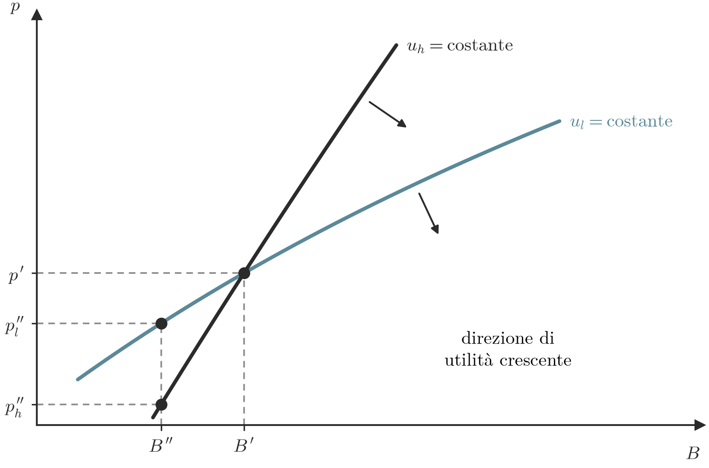
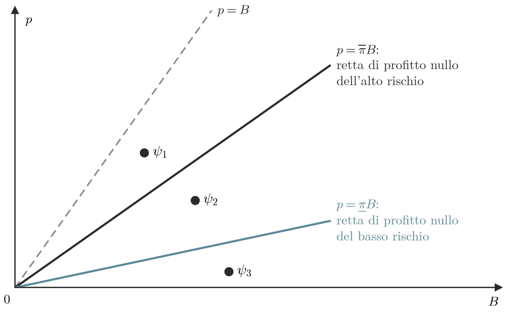
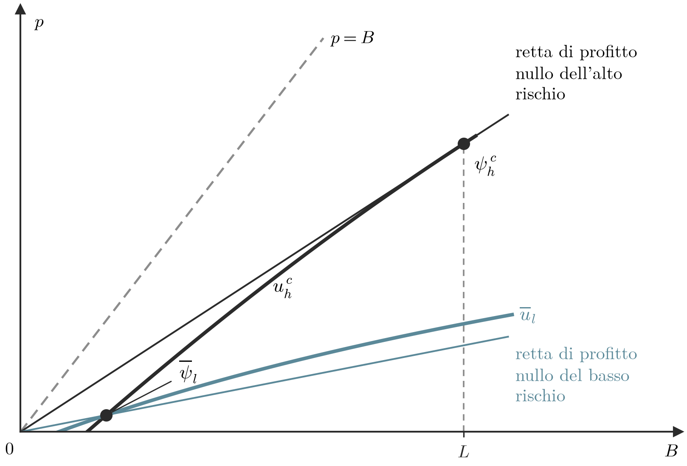
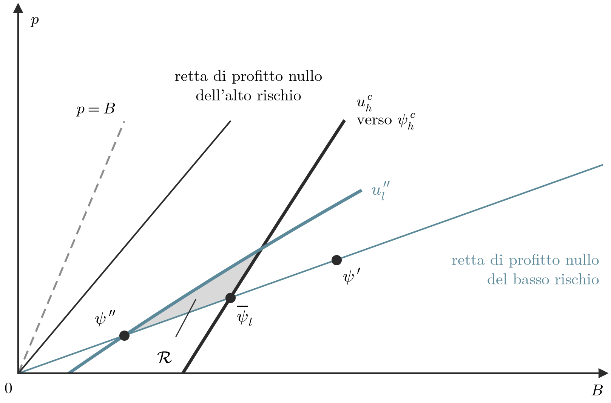

## Oggetto del capitolo

Il capitolo applica la scelta in condizioni di incertezza al mercato assicurativo e studia che cosa accade quando i due lati del mercato non hanno la stessa informazione. Si colloca dopo il [[ERA 06 Prezzo dei Titoli|prezzo dei titoli]] e prima dell'[[ERA 08 Assicurazioni e Azzardo Morale|azzardo morale]]. Dal [[ERA 02 Teoria dell'Utilità Attesa|capitolo sull'utilità attesa]] riprende il criterio di scelta dei consumatori; dal [[ERA 03 Avversione al Rischio|capitolo sull'avversione al rischio]] la disuguaglianza di Jensen e l'equivalente certo, che qui si usano senza rispiegarli.

Il percorso ha tre passi. Il primo è un mercato assicurativo concorrenziale in cui le compagnie osservano la probabilità di incidente di ogni consumatore: l'esito è efficiente. Il secondo toglie questa osservabilità: il prezzo di equilibrio può salire sopra la perdita attesa media, i consumatori meno rischiosi possono uscire dal mercato e in casi estremi il mercato scompare (selezione avversa). Il terzo lascia alle compagnie la possibilità di offrire contratti diversi fra cui i consumatori scelgono (*screening*): la scelta rivela il tipo del consumatore e il mercato torna a funzionare, anche se non in modo pienamente efficiente.

Una convenzione di notazione vale per tutto il capitolo. La lettera $\pi$ indica sempre una probabilità di incidente e $p$ un prezzo, o un premio, mai una probabilità. La ricchezza iniziale certa è $w$, la perdita in caso di incidente è $L$, e la funzione $u$ è quella di Bernoulli dei capitoli precedenti. La lettera $h$ compare con due significati, come pedice del tipo ad alto rischio e come nome della funzione $h(p)$ della sezione sul prezzo di equilibrio; il contesto li distingue. Nella parte sul modello di screening i tipi di consumatore si distinguono con i pedici $l$ (basso rischio) e $h$ (alto rischio).

## Informazione imperfetta e asimmetrie informative

La teoria neoclassica della domanda e dell'offerta, unita alla scelta in condizioni di incertezza, non diventa in modo automatico una teoria di domanda e offerta con informazione imperfetta. L'unione regge solo se l'incertezza è esogena su entrambi i lati del mercato, cioè se nessun agente può influenzarla con le proprie scelte. Molti aspetti dell'incertezza non lo sono. La qualità di un prodotto, per esempio, è una scelta del produttore: se i consumatori non la osservano, al produttore conviene fabbricare solo beni di bassa qualità, i consumatori lo sanno e si comportano di conseguenza.

Il caso rilevante è quello delle **asimmetrie informative**, in cui agenti diversi possiedono informazioni diverse. L'allocazione di mercato che ne risulta è in generale inefficiente. È una forma di fallimento del mercato, e il primo teorema fondamentale dell'economia del benessere (ogni equilibrio concorrenziale è Pareto efficiente) non vale più in generale. Il fallimento completo del mercato è il caso limite.

Le asimmetrie sono di due tipi. Nel primo, l'**informazione nascosta** (*hidden information*), la compagnia è meno informata del consumatore sul profilo di rischio del consumatore: per l'assicurazione sanitaria, sullo stato di salute del potenziale consumatore. La conseguenza tipica è la **selezione avversa** (*adverse selection*): i consumatori migliori lasciano il mercato, restano i peggiori, il prezzo sale e nei casi estremi il mercato scompare. Nel secondo, l'**azione nascosta** (*hidden action*), la compagnia non osserva un'azione dell'agente che influenza il suo stato, come un'alimentazione corretta o meno. La conseguenza tipica è l'**azzardo morale** (*moral hazard*): il consumatore tende ad assumere comportamenti più rischiosi di quanto sarebbe socialmente ottimale. Questo capitolo tratta la selezione avversa; l'azzardo morale è l'oggetto del [[ERA 08 Assicurazioni e Azzardo Morale|capitolo successivo]].

## Il modello di mercato

Si considerano $m$ consumatori, indicizzati da $i=1,\dots,m$. Ciascuno ha ricchezza iniziale $w$ e può subire un incidente (in termini assicurativi, un sinistro) che gli causa una perdita $L$, con $0<L<w$. La probabilità di incidente del consumatore $i$ è $\pi_i\in[0,1]$, esogena, e gli incidenti di consumatori diversi sono eventi indipendenti: l'incidente è, per esempio, l'urto contro un albero, non contro un'altra auto. Ricchezza iniziale, perdita e funzione di utilità $u$ sono uguali per tutti, e i consumatori differiscono solo per $\pi_i$. La funzione $u$ è continua, strettamente crescente e strettamente concava; i consumatori massimizzano l'utilità attesa e sono quindi strettamente avversi al rischio.

Le compagnie di assicurazione sono più d'una e identiche fra loro, neutrali al rischio, e massimizzano il profitto atteso. Offrono solo copertura piena, detta anche assicurazione completa: la polizza paga $L$ se il consumatore ha l'incidente e zero altrimenti. È un bene indivisibile (*lumpy good*): si acquista una polizza intera o nessuna, non una frazione. Fornire assicurazione non ha costo. Se il prezzo della polizza del consumatore $i$ è $p_i$, la compagnia incassa $p_i$ in ogni caso e paga $L$ con probabilità $\pi_i$, per cui il profitto atteso di una polizza venduta a $i$ è
$$p_i-\pi_iL.$$
La concorrenza è perfetta: in equilibrio il profitto atteso è nullo. Un consumatore che acquista la polizza ha la ricchezza certa $w-p_i$, perché l'indennizzo $L$ compensa la perdita.

## Il benchmark: informazione perfetta

Si supponga che le compagnie osservino la probabilità $\pi_i$ di ogni consumatore. Con informazione perfetta la polizza che paga $L$ al consumatore $i$ se ha un incidente è un bene distinto da quella che paga $L$ al consumatore $j$ se ha un incidente, perché i due eventi sono stati del mondo diversi. Ciascuna polizza ha il proprio prezzo $p_i$.

Dal lato dell'offerta, se $p_i<\pi_iL$ la compagnia perde in media su ogni polizza e l'offerta è zero. Se $p_i>\pi_iL$ guadagna in media e l'offerta è infinita. A $p_i=\pi_iL$ è indifferente e offre qualunque quantità. Il prezzo che azzera il profitto è la perdita attesa del consumatore. Un contratto con questa proprietà si dice **equo** (*actuarially fair*).

Il teorema seguente mostra, per il lato della domanda, che a prezzo equo ogni consumatore vuole assicurarsi.

> [!tip] Teorema
> Se $0<\pi_i<1$, il consumatore $i$ preferisce strettamente la polizza al prezzo equo $p_i^*=\pi_iL$ alla situazione senza assicurazione. Se $\pi_i\in\{0,1\}$ è indifferente.

> [!note] Dimostrazione
> Senza assicurazione la ricchezza è $w-L$ con probabilità $\pi_i$ e $w$ con probabilità $1-\pi_i$, per cui l'utilità attesa è $\pi_iu(w-L)+(1-\pi_i)u(w)$. La funzione $u$ è strettamente concava e la perdita aleatoria, cioè la lotteria che vale $-L$ con probabilità $\pi_i$ e $0$ altrimenti, non è degenere, perché $0<\pi_i<1$. La disuguaglianza di Jensen è allora stretta:
>
> $$\text{utilità attesa senza assicurazione}=\pi_iu(w-L)+(1-\pi_i)u(w)\ <\ u\big(\pi_i(w-L)+(1-\pi_i)w\big).$$
>
> Il valore atteso della ricchezza è $\pi_i(w-L)+(1-\pi_i)w=w-\pi_iL=w-p_i^*$, quindi il membro di destra è $u(w-p_i^*)$, l'utilità della ricchezza certa del consumatore assicurato. Il consumatore preferisce assicurarsi. Per $\pi_i=0$ la polizza è gratuita e non serve; per $\pi_i=1$ costa $L$ e paga $L$ con certezza, per cui è come non averla comprata: in entrambi i casi l'utilità non cambia e la disuguaglianza vale come uguaglianza.

La preferenza stretta fissa la quantità domandata. A $p_i^*$ il consumatore compra almeno una polizza, per la preferenza stretta appena dimostrata. Non ne compra di più: con $k$ polizze al prezzo equo la ricchezza vale $w-L+kL(1-\pi_i)$ in caso di incidente e $w-k\pi_iL$ altrimenti, con valore atteso $w-\pi_iL$ per ogni $k$, e per la disuguaglianza di Jensen stretta è migliore l'unica scelta senza rischio, $k=1$. L'indivisibilità esclude solo le frazioni di polizza. A prezzo maggiore l'offerta, infinita perché il profitto sarebbe positivo, eccede la domanda. A prezzo minore l'offerta è nulla, perché la compagnia perderebbe, e la domanda è di almeno una polizza. L'unico prezzo che pareggia domanda e offerta è $p_i^*=\pi_iL$.

> [!tip] Teorema
> Con informazione perfetta il prezzo di equilibrio della polizza del consumatore $i$ è $p_i^*=\pi_iL$. Ogni consumatore con $0<\pi_i<1$ acquista esattamente una polizza e il profitto atteso di ogni contratto è nullo.

> [!example] Esempio
> Sia $u=\ln$, $w=10$, $L=6$ e $\pi=0{,}3$. Il prezzo equo è $p^*=0{,}3\cdot6=1{,}8$. Senza assicurazione l'utilità attesa è
>
> $$0{,}3\ln4+0{,}7\ln10\approx2{,}0277,$$
>
> con assicurazione è $\ln(10-1{,}8)=\ln8{,}2\approx2{,}1041$, maggiore. L'equivalente certo della situazione senza assicurazione è $e^{2{,}0277}\approx7{,}60$: il consumatore pagherebbe fino a $10-7{,}60=2{,}40$ per assicurarsi, cioè $0{,}60$ più della perdita attesa. Questa differenza è il premio per il rischio della situazione senza assicurazione, pari alla ricchezza attesa $w-\pi L=8{,}2$ meno l'equivalente certo $7{,}60$, e spiega perché a prezzo equo la preferenza per l'assicurazione è stretta.

L'allocazione di equilibrio è Pareto efficiente, cioè nessuna allocazione fattibile fa stare meglio un agente senza far stare peggio un altro, come prevede il primo teorema fondamentale dell'economia del benessere. L'intuizione è questa: l'unico modo di far stare meglio un consumatore è ridurre il prezzo $p_i$ che paga, ma scendere sotto $\pi_iL$ causa una perdita alla compagnia.

## Informazione asimmetrica e prezzo di equilibrio

### Un solo prezzo

Le compagnie ora non osservano $\pi_i$, che conosce solo il consumatore. Si assume che $\pi_i$ abbia come supporto l'intervallo non degenere $[\underline\pi,\overline\pi]$ e funzione di ripartizione $F(\pi)$ continua; la popolazione si tratta come numerosa, descritta da una distribuzione continua. Dal punto di vista di una compagnia i consumatori sono identici, e in equilibrio il prezzo è lo stesso per tutti: $p_i=p$ per ogni $i$. Se infatti il consumatore $i$ pagasse più del consumatore $j$ e comprassero entrambi, la polizza venduta a $i$ darebbe un profitto atteso strettamente maggiore di quella venduta a $j$, che in equilibrio non è negativo. Il profitto sulla polizza di $i$ sarebbe strettamente positivo, ogni compagnia vorrebbe venderne una quantità illimitata e questo non può essere un equilibrio.

### La congettura sul prezzo e la regola di acquisto

Come prima, l'offerta è infinita con profitto positivo e nulla con profitto negativo. La congettura naturale è che il prezzo sia la perdita attesa della popolazione,
$$p^{**}=E[\pi]\,L,\qquad E[\pi]=\int_{\underline\pi}^{\overline\pi}\pi\,dF(\pi).$$
Questo prezzo azzera il profitto solo se comprano tutti i consumatori. Se comprano soltanto alcuni, la perdita attesa per polizza è quella degli acquirenti, e va calcolata su chi acquista davvero.

> [!tip] Teorema
> Sia $p\in[0,L]$ il prezzo comune. Il consumatore di tipo $\pi$ acquista la polizza se e solo se $\pi\ge h(p)$, dove
>
> $$h(p)=\frac{u(w)-u(w-p)}{u(w)-u(w-L)}.$$
>
> Il profitto atteso per polizza venduta è $p-E[\pi\mid\pi\ge h(p)]\,L$, con
>
> $$E[\pi\mid\pi\ge h(p)]=\frac{\int_{h(p)}^{\overline\pi}\pi\,dF(\pi)}{1-F(h(p))}.$$

> [!note] Dimostrazione
> Il consumatore di tipo $\pi$ acquista se l'utilità della ricchezza certa $w-p$ non è inferiore a quella senza assicurazione (a parità di utilità si assume che acquisti):
>
> $$u(w-p)\ \ge\ \pi u(w-L)+(1-\pi)u(w)=u(w)-\pi\big[u(w)-u(w-L)\big].$$
>
> Si porta $u(w)$ a sinistra e si ottiene $\pi\,[u(w)-u(w-L)]\ge u(w)-u(w-p)$. Poiché $u$ è strettamente crescente, $u(w)-u(w-L)>0$ e si può dividere senza cambiare il verso: $\pi\ge h(p)$. Gli acquirenti sono dunque i consumatori con $\pi\ge h(p)$. La compagnia incassa $p$ da ciascuno e paga $L$ con la probabilità di incidente dell'acquirente, che fra gli acquirenti vale in media $E[\pi\mid\pi\ge h(p)]$: da qui il profitto atteso per polizza e, per la definizione di media condizionata, la sua espressione.

La funzione $h$ ha proprietà che servono più avanti. Vale $h(0)=0$ e $h(L)=1$. Se $u$ è due volte derivabile, $h'(p)=u'(w-p)/[u(w)-u(w-L)]>0$ e $h''(p)=-u''(w-p)/[u(w)-u(w-L)]\ge0$: $h$ è crescente e, essendo $u$ strettamente concava, strettamente convessa. Vale anche $h(p)<p/L$ per $0<p<L$. Poiché $w-p=(1-p/L)\,w+(p/L)\,(w-L)$, la concavità stretta di $u$ dà $u(w-p)>(1-p/L)\,u(w)+(p/L)\,u(w-L)$, cioè $u(w)-u(w-p)<(p/L)\,[u(w)-u(w-L)]$. A un prezzo $p$ comprano anche consumatori con $\pi<p/L$, che pagano più della propria polizza equa: l'avversione al rischio li spinge ad assicurarsi lo stesso.

> [!abstract] Definizione
> Un prezzo $p^*$ è un **prezzo di equilibrio** con informazione asimmetrica se è un punto fisso dell'equazione di profitto nullo sul gruppo degli acquirenti effettivi:
>
> $$p^*=E[\pi\mid\pi\ge h(p^*)]\,L.$$

A $p^*$ le compagnie sono indifferenti sulla quantità offerta, quindi domanda e offerta coincidono. La congettura $p^{**}$ non regge in generale, come mostra il teorema seguente.

> [!tip] Teorema
> Per ogni prezzo di equilibrio vale $p^*\ge p^{**}$, con disuguaglianza stretta se e solo se $h(p^*)>\underline\pi$, cioè se una parte dei consumatori non compra. Il prezzo $p^{**}$ azzera il profitto soltanto se comprano tutti.

> [!note] Dimostrazione
> Se $h(p^*)\le\underline\pi$ compra l'intera popolazione, la media condizionata coincide con $E[\pi]$ e $p^*=p^{**}$. Se $h(p^*)>\underline\pi$, la quota $F(h(p^*))$ dei consumatori con $\pi<h(p^*)$ è positiva, perché il supporto parte da $\underline\pi$. Con $t=h(p^*)$ si scrive $E[\pi]=F(t)\,E[\pi\mid\pi<t]+(1-F(t))\,E[\pi\mid\pi\ge t]$, dove $E[\pi\mid\pi<t]<t\le E[\pi\mid\pi\ge t]$. La media $E[\pi]$ sta quindi strettamente sotto $E[\pi\mid\pi\ge t]$, e moltiplicando per $L$ si ha $p^{**}<p^*$.

> [!example] Esempio
> Sia $u=\ln$, $w=1$, $L=0{,}5$, per cui $h(p)=\ln(1-p)/\ln(0{,}5)$.
>
> (i) Con $\pi$ uniforme su $[0{,}14;\,0{,}16]$ si ha $E[\pi]=0{,}15$ e $p^{**}=0{,}075$. Poiché $h(0{,}075)\approx0{,}1125<0{,}14=\underline\pi$, comprano tutti, la perdita attesa per polizza è proprio $0{,}075$ e $p^{**}$ è un prezzo di equilibrio.
>
> (ii) Con $\pi$ uniforme su $[0,1]$ si ha $p^{**}=0{,}25$ e $h(0{,}25)\approx0{,}4150$. Comprano i consumatori con $\pi\ge0{,}4150$, la loro probabilità media di incidente è $0{,}7075$ e la perdita attesa per polizza è $0{,}7075\cdot0{,}5\approx0{,}3538$. A $p^{**}$ il profitto per polizza è $0{,}25-0{,}3538\approx-0{,}1038$.

La selezione non è sempre attiva: con probabilità di incidente poco disperse, come nel caso (i), comprano tutti e il prezzo resta quello della perdita attesa media.

### Esistenza dell'equilibrio

> [!tip] Teorema
> Se $\overline\pi<1$, esiste almeno un prezzo $p^*\in[0,\overline\pi L]$ che soddisfa $p^*=E[\pi\mid\pi\ge h(p^*)]\,L$.

> [!note] Dimostrazione
> Sia $g(p)=E[\pi\mid\pi\ge h(p)]\,L$ per $p\in[0,\overline\pi L]$. Poiché $\overline\pi L<L$, vale $h(p)<p/L\le\overline\pi$ per $p>0$, e $h(0)=0<\overline\pi$: la soglia $h(p)$ sta sempre sotto $\overline\pi$ e la media condizionata è ben definita. La funzione $g$ è continua, perché $h$ e $F$ lo sono. In $p=0$ vale $g(0)=E[\pi]\,L\ge0$. In $p=\overline\pi L$ vale $g(\overline\pi L)\le\overline\pi L$, perché una media condizionata non supera $\overline\pi$. La funzione $\varphi(p)=g(p)-p$ è quindi non negativa in $0$ e non positiva in $\overline\pi L$, e per il teorema dei valori intermedi si annulla in un punto $p^*$. Anche senza continuità di $F$, la funzione $g$ è non decrescente e manda $[0,\overline\pi L]$ in sé, per cui ha comunque un punto fisso.

> [!example] Esempio
> Sia $u=\ln$, $w=1$, $L=0{,}5$ e $\pi$ uniforme su $[0{,}05;\,0{,}5]$. Si ha $E[\pi]=0{,}275$ e $p^{**}=0{,}1375$, ma $h(0{,}1375)\approx0{,}2134>\underline\pi$: a quel prezzo una parte dei consumatori non comprerebbe, e il profitto per polizza sarebbe negativo. Il punto fisso è $p^*\approx0{,}2100$. A quel prezzo $h(p^*)\approx0{,}3401$, comprano i consumatori con $\pi\ge0{,}3401$ (circa il 36% della popolazione), la loro probabilità media di incidente è $0{,}4201$ e $0{,}4201\cdot0{,}5\approx0{,}2100=p^*$. Il prezzo di equilibrio supera $p^{**}$ del 53% circa.

L'unicità non è garantita in generale: l'esempio seguente ha in certi casi due equilibri.

### Un esempio con distribuzione uniforme

> [!example] Esempio
> Sia $\pi$ uniforme su $[0,1]$. Per ogni soglia $t$ si ha $E[\pi\mid\pi\ge t]=(1+t)/2$, per cui l'equazione di equilibrio diventa
>
> $$p^*=\frac{1+h(p^*)}{2}\,L.$$
>
> Poiché $h(L)=1$, il prezzo $p^*=L$ la risolve: $(1+1)L/2=L$. È sempre un equilibrio (con $\overline\pi=1$ la media condizionata a $\pi\ge1$ si intende come limite di $(1+t)/2$ per $t\to1$). In questo equilibrio compra solo chi ha $\pi=1$, che paga $L$ per ricevere $L$ ed è come se non comprasse: il mercato fallisce del tutto. La funzione $g(p)=(1+h(p))L/2$ è strettamente crescente e strettamente convessa, perché lo è $h$, per cui $g(p)-p$ ha al più due zeri e $p^*=L$ ne è uno. Con $u=\ln$ e $w=1$, per $L=0{,}5$ l'unico equilibrio è $p^*=0{,}5$. Per $L=0{,}8$ ci sono due equilibri, $p^*\approx0{,}696$ e $p^*=0{,}8$; nel primo compra chi ha $\pi\ge0{,}739$ circa.

Che $p^*=L$ sia l'unico equilibrio dipende da $u$ e da $L$: quando l'avversione al rischio rispetto alla perdita è moderata il fallimento completo è l'unico esito, quando è più forte esiste anche un equilibrio con una parte dei consumatori assicurata.

### La selezione avversa

Quando la selezione è attiva non tutti i consumatori comprano: acquistano soltanto quelli con $\pi\ge h(p^*)$, cioè i più rischiosi, mentre i consumatori migliori, quelli a minor rischio, restano fuori. Al crescere del prezzo $h(p)$ cresce, quindi il gruppo che continua ad acquistare è in media più rischioso e la perdita attesa per polizza sale con il prezzo. Il prezzo è lo stesso per tutti, ma la composizione di chi compra cambia con il prezzo.

L'allocazione che ne risulta è molto inefficiente. Nel caso estremo $p^*=L$ non si conclude nessuna transazione e nessun miglioramento paretiano viene realizzato, benché ogni consumatore con $0<\pi_i<1$ starebbe strettamente meglio con la polizza equa $\pi_iL<L$ che l'informazione perfetta consentirebbe. Eppure i mercati assicurativi esistono: compagnie e consumatori possono provare a trasmettere informazione all'altro lato del mercato con il proprio comportamento.

## Screening e signalling

La trasmissione può avvenire in due modi. Nello **screening** l'agente meno informato, la compagnia, propone al consumatore alternative differenziate allo scopo di separare i diversi tipi di consumatori. Nel **signalling** l'agente più informato, il consumatore, propone alla compagnia alternative differenziate per segnalare il proprio profilo di rischio. Il capitolo sviluppa lo screening.

### Il modello di screening

Esistono due tipi di consumatori: il tipo a basso rischio ha probabilità di incidente $\underline\pi$, il tipo ad alto rischio $\overline\pi$, con $0<\underline\pi<\overline\pi<1$. I due simboli, che nella sezione precedente erano gli estremi del supporto, indicano ora i due soli valori possibili. La quota $\alpha$ di consumatori a basso rischio (e quindi $1-\alpha$ di quelli ad alto rischio) è nota alle compagnie, che non sanno però a quale tipo appartenga il singolo consumatore. Ricchezza $w$, perdita $L$ e utilità $u$ sono quelle del modello precedente.

Le compagnie sono due, indicate da $j=1,2$, e hanno le stesse caratteristiche di prima: neutrali al rischio, senza costi. Un contratto è una coppia $(B,p)$, dove $B$ è l'indennizzo che la polizza paga in caso di incidente e $p$ è il premio, cioè il prezzo pagato in ogni caso. Sono ammessi contratti con copertura parziale, $B\ne L$. Il contratto che la compagnia $j$ propone al tipo $i\in\{l,h\}$ è $(B^j_i,p^j_i)$: l'apice indica la compagnia, il pedice il tipo. Ogni compagnia offre zero, uno o due contratti; poiché i tipi sono due, due contratti bastano. Il contratto nullo $(0,0)$, cioè non assicurarsi, è sempre disponibile.

Il gioco ha due tempi. Prima le compagnie propongono simultaneamente i loro contratti; poi i consumatori scelgono quello che massimizza la propria utilità attesa fra i contratti offerti e $(0,0)$.

## Preferenze e single-crossing

Il consumatore di tipo $\pi$ che sceglie il contratto $(B,p)$ ha ricchezza $w-p-L+B$ se subisce l'incidente (paga il premio, perde $L$, riceve $B$) e $w-p$ altrimenti. La sua utilità attesa è
$$EU(B,p;\pi)=\pi\,u(w-p-L+B)+(1-\pi)\,u(w-p).$$
Nei grafici l'asse orizzontale è l'indennizzo $B$ e quello verticale il premio $p$; un contratto è un punto $(B,p)$. L'utilità cresce con $B$ e decresce con $p$, perché $u$ è crescente, quindi aumenta spostandosi verso il basso e verso destra. La curva di indifferenza al livello $\bar u$ è l'insieme dei punti con $EU(B,p;\pi)=\bar u$.

> [!tip] Teorema
> (Single-crossing property.) La curva di indifferenza del tipo ad alto rischio ha, in ogni punto $(B,p)$, pendenza maggiore di quella del tipo a basso rischio. Due curve di indifferenza di tipi diversi si incrociano al più una volta.

> [!note] Dimostrazione
> Si pongono $a=u'(w-p-L+B)>0$ e $b=u'(w-p)>0$. Le derivate parziali dell'utilità attesa sono $EU_B=\pi a$ ed $EU_p=-\pi a-(1-\pi)b$. Lungo una curva di indifferenza il differenziale totale è nullo, $EU_B\,dB+EU_p\,dp=0$, e la pendenza è
>
> $$s(B,p;\pi)=\frac{dp}{dB}=-\frac{EU_B}{EU_p}=\frac{\pi a}{\pi a+(1-\pi)b}.$$
>
> Si confrontano ora i due tipi nello stesso contratto, quindi con $(B,p)$, e dunque $a$ e $b$, fissati; la derivata che interessa è $\partial s/\partial\pi$, cioè $\partial^2p/\partial B\,\partial\pi$ a $(B,p)$ fissato. Poiché il denominatore ha derivata $a-b$ rispetto a $\pi$,
>
> $$\frac{\partial s}{\partial\pi}=\frac{a\,[\pi a+(1-\pi)b]-\pi a\,(a-b)}{[\pi a+(1-\pi)b]^2}=\frac{ab}{[\pi a+(1-\pi)b]^2}>0.$$
>
> La pendenza cresce con $\pi$: nello stesso punto, la curva del tipo ad alto rischio è più ripida di quella del tipo a basso rischio.
>
> Per la seconda parte, $EU$ è strettamente decrescente in $p$, quindi ogni curva di indifferenza è il grafico di una funzione $p(B)$. Siano $p_l(B)$ e $p_h(B)$ le due curve e $d=p_h-p_l$. In ogni punto di incrocio $d=0$ e $d'=s_h-s_l>0$, per quanto appena mostrato. Se le curve si incrociassero due volte, $d$ sarebbe positiva dopo il primo incrocio e dovrebbe tornare a zero scendendo, cioè con $d'\le0$ nel secondo: impossibile.

La pendenza è il saggio marginale di sostituzione fra indennizzo e premio: il premio che il consumatore è disposto a pagare per un'unità in più di indennizzo. Il tipo ad alto rischio, che ha più probabilità di incassarlo, ne offre di più. Partendo da un contratto $(B',p')$ e riducendo l'indennizzo a $B''<B'$, per lasciare indifferente il tipo a basso rischio il premio deve scendere a $p_l''$. Per lasciare indifferente il tipo ad alto rischio deve scendere di più, a $p_h''<p_l''$. Il tipo a basso rischio accetta una riduzione dell'indennizzo anche per una riduzione del premio più piccola, perché ha meno probabilità di subire l'incidente: valuta meno la copertura. Un contratto con indennizzo $B''$ e premio $p$, con $p_h''<p\le p_l''$, è preferito o equivalente a $(B',p')$ per il tipo a basso rischio, mentre il tipo ad alto rischio preferisce $(B',p')$ (Figura 1).

> [!example] Esempio
> Sia $u=\ln$, $w=10$, $L=6$, $\underline\pi=0{,}15$, $\overline\pi=0{,}5$ e il contratto $(B',p')=(2;\,0{,}6)$. Le pendenze in quel punto sono $s_l\approx0{,}235$ e $s_h\approx0{,}635$. A $B''=1{,}2$ i premi che lasciano indifferenti i due tipi sono $p_l''\approx0{,}402$ e $p_h''\approx0{,}082$, quindi $p_h''<p_l''<p'$.

**Figura 1** — Le curve di indifferenza del tipo a basso rischio ($u_l=\text{costante}$) e del tipo ad alto rischio ($u_h=\text{costante}$) passanti per il contratto $(B',p')$ si incrociano una sola volta, e per $B''<B'$ il premio che lascia indifferente il tipo ad alto rischio, $p_h''$, è inferiore a quello del tipo a basso rischio, $p_l''$; il disegno è tracciato per $u=\ln$, $w=10$, $L=6$, $\underline\pi=0{,}15$, $\overline\pi=0{,}5$.

## Profitti e rette di profitto nullo

Si supponga che una compagnia sappia separare i due tipi. Un contratto $(B,p)$ venduto a un consumatore di probabilità $\pi$ gli dà un profitto atteso $p-\pi B$: incassa $p$ e paga $B$ con probabilità $\pi$. Per i due tipi i profitti sono
$$p-\overline\pi B\quad\text{(alto rischio)},\qquad p-\underline\pi B\quad\text{(basso rischio)}.$$
I contratti con profitto nullo per ciascun tipo stanno sulle rette
$$p=\overline\pi B,\qquad p=\underline\pi B,$$
che passano per l'origine con pendenze $\overline\pi>\underline\pi$. Per $B=L$ si ritrova il benchmark, $p=\pi L$.

La Figura 2 mostra le due rette e la bisettrice $p=B$: sopra la bisettrice il premio supera l'indennizzo e il contratto è peggiore del non assicurarsi in entrambi gli stati. Un contratto sopra una retta dà profitto positivo alla compagnia se lo compra il tipo corrispondente, uno sotto dà una perdita. Tre contratti $\psi_1,\psi_2,\psi_3$ ne illustrano le posizioni. Il contratto $\psi_1$, sopra la retta dell'alto rischio, dà profitto positivo qualunque sia il tipo che lo compra. Il contratto $\psi_2$, fra le due rette, dà profitto positivo se lo compra il tipo a basso rischio e negativo se lo compra il tipo ad alto rischio. Il contratto $\psi_3$, sotto la retta del basso rischio, dà perdita con entrambi i tipi.

> [!example] Esempio
> Con $\underline\pi=0{,}15$ e $\overline\pi=0{,}5$ si considerino $\psi_1=(2{,}3;\,1{,}7)$, $\psi_2=(3{,}2;\,1{,}1)$ e $\psi_3=(3{,}8;\,0{,}2)$, scritti come $(B,p)$. I profitti attesi $p-\overline\pi B$ e $p-\underline\pi B$ sono $0{,}55$ e $1{,}355$ per $\psi_1$, $-0{,}5$ e $0{,}62$ per $\psi_2$, $-1{,}7$ e $-0{,}37$ per $\psi_3$.

**Figura 2** — Le rette di profitto nullo $p=\overline\pi B$ (alto rischio) e $p=\underline\pi B$ (basso rischio) dividono il piano $(B,p)$ in tre zone: $\psi_1$ dà profitto positivo con entrambi i tipi, $\psi_2$ positivo con il tipo a basso rischio e negativo con quello ad alto rischio, $\psi_3$ negativo con entrambi.

## L'equilibrio separante

Un equilibrio è una coppia di offerte, una per compagnia, tale che nessuna compagnia può aumentare il proprio profitto atteso cambiando la propria offerta, data quella dell'altra, sapendo che i consumatori scelgono, fra i contratti disponibili e $(0,0)$, quello che massimizza la loro utilità attesa. È separante quando ciascun tipo sceglie un contratto diverso da quello dell'altro, per cui la scelta rivela il tipo. Il risultato seguente caratterizza i contratti scelti.

> [!tip] Teorema
> Se esiste un equilibrio separante, i contratti scelti dai consumatori sono univocamente determinati. Il contratto scelto dal tipo ad alto rischio è
>
> $$\psi_h^c=(L,\ \overline\pi L),$$
>
> copertura piena a prezzo equo. Il contratto scelto dal tipo a basso rischio è $\overline\psi_l=(\overline B_l,\overline p_l)$, con $\overline B_l<L$, soluzione del sistema
>
> $$\overline p_l=\underline\pi\,\overline B_l,\qquad \overline\pi\,u(w-\overline p_l-L+\overline B_l)+(1-\overline\pi)\,u(w-\overline p_l)=u(w-\overline\pi L).$$
>
> Il tipo ad alto rischio sceglie $\psi_h^c$ e il tipo a basso rischio sceglie $\overline\psi_l$.

Il membro di destra della seconda equazione è l'utilità $u_h^c=u(w-\overline\pi L)$ che il tipo ad alto rischio ricava da $\psi_h^c$: con $B=L$ i due stati hanno la stessa ricchezza $w-\overline\pi L$. Con lo stesso simbolo si indica la sua curva di indifferenza a quel livello. Il contratto $\overline\psi_l$ sta dunque sulla retta di profitto nullo del basso rischio e sulla curva $u_h^c$, per cui il tipo ad alto rischio lo valuta quanto $\psi_h^c$. La Figura 3 mostra i due contratti. La curva $u_h^c$ è tangente in $\psi_h^c$ alla retta di profitto nullo dell'alto rischio (si veda la seconda condizione più avanti); $\overline u_l$ è la curva di indifferenza del tipo a basso rischio che passa per $\overline\psi_l$.

**Figura 3** — L'equilibrio separante è formato da $\psi_h^c=(L,\overline\pi L)$, sulla retta di profitto nullo dell'alto rischio dove la curva $u_h^c$ la tocca, e da $\overline\psi_l$, nel punto in cui la retta di profitto nullo del basso rischio incontra $u_h^c$; $\overline u_l$ è la curva di indifferenza del tipo a basso rischio per $\overline\psi_l$. Il disegno è tracciato per $u=\ln$, $w=10$, $L=6$, $\underline\pi=0{,}15$, $\overline\pi=0{,}5$. Con questi valori $u_h^c$ è quasi rettilinea vicino a $\psi_h^c$ e si distingue dalla retta di profitto nullo solo a una certa distanza; la curva è interrotta poco oltre $\psi_h^c$, perché la retta resti visibile.

Quattro condizioni fanno di questi due contratti l'unico candidato. Ciascuna si ricava dal comportamento di una compagnia che cerca una deviazione profittevole.

### Ogni contratto sta sulla propria retta di profitto nullo

Un contratto sopra la retta del tipo a cui è destinato dà profitto positivo. L'altra compagnia può allora ridurre di poco il premio, a parità di indennizzo (*undercut*): attira i consumatori e ha ancora profitto positivo (per il contratto del basso rischio la nuova offerta va scelta in modo da non attirare il tipo ad alto rischio, come nella regione $\mathcal R$ descritta più avanti). Un contratto sotto la retta fa perdere la compagnia che lo offre, che guadagnerebbe a non offrirlo del tutto. Ciascun contratto sta quindi sulla retta del proprio tipo.

### Il contratto per l'alto rischio prevede la copertura piena

Il contratto $\psi_h^c$ sta sulla retta $p=\overline\pi B$. Per stabilire quale punto della retta resiste alle deviazioni serve la pendenza delle curve di indifferenza. Come mostra la dimostrazione della single-crossing property, la pendenza è $\pi a/(\pi a+(1-\pi)b)$, con $a=u'(w-p-L+B)$ e $b=u'(w-p)$. Se $B=L$ i due argomenti di $u'$ coincidono, $a=b$, e la pendenza vale $\pi$, la stessa della retta di profitto nullo del tipo, che è $p=\pi B$. Se $B<L$ si ha $w-p-L+B<w-p$, quindi $a>b$ perché $u'$ è decrescente, e la pendenza supera $\pi$. Se $B>L$ vale $a<b$ e la pendenza è inferiore a $\pi$.

Se $B\ne L$, la curva di indifferenza del tipo ad alto rischio non è tangente alla retta $p=\overline\pi B$: la attraversa, e da una parte del punto sta strettamente sopra di essa. Lì ci sono contratti equivalenti per quel tipo con profitto positivo, e abbassando di poco il premio diventano strettamente preferiti, con profitto ancora positivo. L'altra compagnia può offrirli e attirare il tipo ad alto rischio. L'unico punto della retta senza questa deviazione è $B=L$, dove la curva è tangente.

### Il contratto per il basso rischio non è imitabile

Il contratto per il basso rischio deve stare sulla curva $u_h^c$ o dal lato in cui il tipo ad alto rischio sta peggio che in $\psi_h^c$, cioè sopra e a sinistra della curva. Se stesse dall'altra parte, il tipo ad alto rischio lo preferirebbe a $\psi_h^c$ e lo acquisterebbe, fingendosi a basso rischio: il contratto non sarebbe compatibile con gli incentivi (*incentive compatible*). Sulla retta del basso rischio la curva $u_h^c$ passa per $\overline\psi_l$, con $\overline B_l<L$: i contratti della retta con indennizzo fra $\overline B_l$ e $L$, compresa la copertura piena equa $(L,\underline\pi L)$ (perché $\underline\pi L<\overline\pi L$), sono preferiti dal tipo ad alto rischio a $\psi_h^c$. Il tipo a basso rischio ha quindi una copertura inferiore a quella piena.

### Il contratto per il basso rischio sta sulla curva $u_h^c$

Fra i punti della retta di profitto nullo del basso rischio che rispettano gli incentivi resta da stabilire quale. Sia $\psi''$ un punto della retta a sinistra di $\overline\psi_l$, quindi con meno copertura, e sia $u_l''$ la curva di indifferenza del tipo a basso rischio che passa per $\psi''$. Esiste allora una regione $\mathcal R$ (Figura 4) di contratti che stanno sopra la retta del basso rischio, sono preferiti dal tipo a basso rischio a $\psi''$ e non sono preferiti dal tipo ad alto rischio a $\psi_h^c$:
$$\mathcal R=\{(B,p):\ p>\underline\pi B,\ EU(B,p;\underline\pi)>EU(\psi'';\underline\pi),\ EU(B,p;\overline\pi)<u_h^c\}.$$
Un'altra compagnia può offrire un solo contratto in $\mathcal R$: attira i soli consumatori a basso rischio, i migliori, e ottiene un profitto positivo. Questo comportamento si chiama **cream skimming** (letteralmente, scremare la panna). Se invece il contratto per il basso rischio fosse un punto $\psi'$ della retta a destra di $\overline\psi_l$, il tipo ad alto rischio lo preferirebbe a $\psi_h^c$, in violazione della condizione precedente. In $\overline\psi_l$ la regione $\mathcal R$ si annulla, e $\overline\psi_l$ è l'unico punto che resiste.

**Figura 4** — Se il contratto per il basso rischio fosse $\psi''$, a sinistra di $\overline\psi_l$ sulla sua retta di profitto nullo, la regione ombreggiata $\mathcal R$ (sopra quella retta, sotto la curva $u_l''$ e a sinistra di $u_h^c$) conterrebbe contratti preferiti a $\psi''$ dal tipo a basso rischio e non preferiti a $\psi_h^c$ dal tipo ad alto rischio, con profitto positivo per chi li offre; se fosse $\psi'$, a destra di $\overline\psi_l$, il tipo ad alto rischio lo preferirebbe a $\psi_h^c$. Il disegno ingrandisce la zona intorno a $\overline\psi_l$, con gli stessi valori numerici della Figura 3 e la scala verticale più dilatata di quella orizzontale; la curva $u_h^c$ prosegue fino a $\psi_h^c$, fuori dal riquadro.

> [!example] Esempio
> Con $u=\ln$, $w=10$, $L=6$, $\underline\pi=0{,}15$, $\overline\pi=0{,}5$ il contratto per l'alto rischio è $\psi_h^c=(6;\,3)$ e la sua utilità è $u_h^c=\ln7\approx1{,}9459$. Il contratto per il basso rischio è $\overline\psi_l\approx(1{,}161;\,0{,}1741)$: il tipo a basso rischio riceve un indennizzo di $1{,}161$ a fronte di una perdita di $6$. Per il tipo ad alto rischio i due contratti si equivalgono.
>
> Il tipo ad alto rischio ottiene $1{,}9459$, contro $1{,}8444$ senza assicurazione, e la stessa utilità della polizza equa a copertura piena: sta come con informazione perfetta. Il tipo a basso rischio ottiene $2{,}1833$, contro $2{,}1651$ senza assicurazione e $2{,}2083$ con la copertura piena equa $(6;\,0{,}9)$.

## Esistenza e proprietà dell'equilibrio separante

Le quattro condizioni caratterizzano i contratti solo nel caso in cui un equilibrio separante esista, e l'esistenza non è garantita. Può mancare quando la quota di consumatori a basso rischio è alta: una compagnia può allora offrire un contratto unico, appena sopra la retta di profitto nullo del gruppo, $p=[\alpha\underline\pi+(1-\alpha)\overline\pi]\,B$, che attira entrambi i tipi e dà profitto positivo. Con i parametri della Figura 3 questa deviazione è possibile quando $\alpha$ supera circa $0{,}86$.

Quando l'equilibrio esiste, nella forma simmetrica qui descritta le due compagnie offrono la stessa coppia di contratti e riescono a separare perfettamente i due tipi. L'allocazione è migliore di un completo fallimento del mercato: ogni tipo sta meglio, come nell'esempio numerico, e le compagnie hanno profitto nullo come prima, per cui è un miglioramento paretiano. Il tipo ad alto rischio ottiene l'allocazione del *first best*, cioè quella che si avrebbe con informazione perfetta. Il tipo a basso rischio ottiene un *second best*: trae solo una parte dei benefici che la transazione offrirebbe, perché ha una copertura inferiore a quella piena. La copertura è ridotta proprio per rendere $\overline\psi_l$ poco attraente per il tipo ad alto rischio. Qui *second best* indica che $\overline\psi_l$ è il contratto migliore per il tipo a basso rischio fra quelli con profitto nullo su di lui ($p=\underline\pi B$) che il tipo ad alto rischio non preferisce a $\psi_h^c$: la copertura piena equa non è raggiungibile senza attirare il tipo ad alto rischio.
